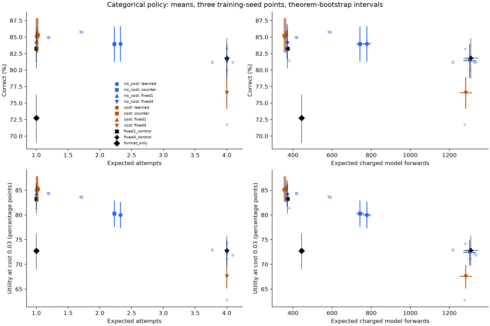

# Experiment 2: learned stopping with an attempt cost

The joint policy improves generation relative to its format-only initialization, but learned allocation does not improve utility over accepting its own first proof. It has a small positive advantage over the development-fitted work mixture and count-only imitation.

The objective is selected-proof correctness minus 0.03 for each additional attempt. Three independent RL seeds start from the same outcome-blind format-adapted r16 model and fresh heads; generation, stopping, and selection learn together. No Experiment 1 selector is inherited. See the [working method and artifact index](../../../../code/experiments/current/learned_compute_allocation_20261006/allocation/cost/README.md) and [shared methods and limitations](../README.md).

The registered fresh evaluation uses 400 structurally separate theorems, two generation draws, and the mean of three fixed training seeds. Correctness integrates the native categorical selector. Intervals bootstrap whole theorems within family; they do not estimate uncertainty over new training seeds.

| Readout on the cost-trained model | Correct (%) | Expected attempts | Utility at cost 0.03 (%) | Charged forward tokens |
|---|---:|---:|---:|---:|
| Learned allocation | 85.319 | 1.021 | 85.255 | 2,616.8 |
| Own first proof | 85.333 | 1.000 | 85.333 | 2,136.4 |
| Count-only imitation | 85.309 | 1.023 | 85.241 | 2,250.0 |
| DEV work-matched fixed mixture | 85.199 | 1.078 | 84.965 | 2,620.7 |
| Fixed four, same generator and chooser | 76.582 | 4.000 | 67.582 | 22,479.0 |

Learned minus own-first utility is **−0.0779 percentage points**, with paired 95% interval **[−0.0832, −0.0729]**. Own first is better and cheaper. The count-only utility improvement is +0.0142 points [0.0090, 0.0189], with 366.8 additional forward tokens. Against the DEV work mixture, correctness improves +0.1199 points [0.1071, 0.1325]; the TEST work residual is −3.89 tokens [−19.78, 12.94]. Thus that positive comparison is approximately matched on the declared work proxy, but does not overturn the stronger first-proof baseline. Simultaneously matching attempts and forward tokens was infeasible on DEV for all three cost seeds, so no joint mixture comparison is reported.

The three native seed accuracies are 85.744%, 84.976%, and 85.238%, at 1.015, 1.017, and 1.032 expected attempts. Greedy index selection matches own-first correctness within numerical precision; fully greedy stopping uses one attempt. This endpoint agreement does not establish a content-blind or strictly first-position mechanism.

First-proof correctness rises from the format-only model's 72.75% to 85.333% (+12.583 points [9.958, 15.292]). The separately trained fixed-one control reaches 83.25%, and the fixed-four control selects correctly 81.829% at four attempts. These controls have one seed and selected checkpoint ages 100 and 200, versus 200 for the primary models. Training episodes and theorem schedules are matched; actual attempts and compute are not. The finite eight-attempt oracle reaches 90.167%, while the native fixed-eight selector reaches 60.050%: additional valid proofs exist, but the categorical chooser does not use them well.

Expected charged policy work differs from the actual expense of collecting eight-attempt paths. Forward tokens and attention cells are proxies, not exact FLOPs; some collection jobs shared GPUs with foreign workloads. The [registered aggregate](../../../../artifacts/learned_compute_allocation_20261006/allocation/final_main_summary_fp32_v2.json), [full CSV](../figures/main_live_results.csv), and [plot provenance](../figures/main_live_results.provenance.json) retain all registered readouts, seeds, controls, and paired contrasts. The [independent result audit](../../../../code/experiments/current/learned_compute_allocation_20261006/reviews/joint_live_main_review.md) accepts the aggregate; historical evaluation and its [independent audit](../../../../code/experiments/current/learned_compute_allocation_20261006/reviews/joint_live_historical_review.md) are complete.

This is a minimal joint REINFORCE pilot with one on-policy update per batch, not PPO. Only costs 0 and 0.03 were trained. The shared summary records the format/history support and likelihood-replay limitations. No count-16, matched-pool context intervention, or generalized entropy result is asserted. An additional joint arm initialized from an Experiment 1 selector was not run; those scorers are separate staged diagnostics.

On the separately registered historical benchmark of 72 theorems, the cost-aware native policy
returns 41.403% correct proofs with 1.039 expected attempts, versus 41.435%
for its own first proof. The paired difference is −0.03248 percentage points
[−0.04381, −0.02165]. Format-only first-proof correctness is 41.667%; no historical
transfer improvement is established. Original source roles of 58/14 theorems and at least one
known pretraining exposure are preserved. This reused benchmark uses the bounded
MAIN protocol and unchanged MAIN-DEV choices, with no benchmark tuning. See the
[historical aggregate](../../../../artifacts/learned_compute_allocation_20261006/allocation/final_historical_summary_fp32_v2.json)
and [separate historical figure](../figures/historical_live_results.png).

The historical policy exceeds its unchanged DEV-selected work mixture by 0.1104 correctness points [0.0795, 0.1424], but uses 144.66 more model input tokens [109.94, 179.73]. The DEV work match does not transfer exactly to this benchmark. Its count-only correctness difference is −0.0028 points [−0.0066, 0.0014], with 0.0163 more attempts and 326.36 more input tokens.
