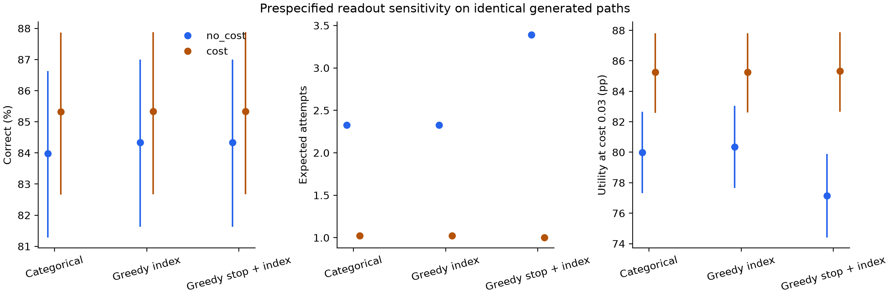

# Experiment 3: learned stopping without an attempt cost

The joint model learns better first-proof generation, but its stochastic stopping and selection do not improve correctness over accepting its own first proof. A separate causal diagnostic finds policy-relative continuation harm through loss of selection mass on old valid candidates; useful acceptance discrimination is not established.

The objective is final selected-proof correctness only, with no attempt or length cost. Three independent RL seeds start from the same outcome-blind format-adapted r16 model and fresh heads; generation, stopping, and selection learn together. No Experiment 1 selector or cost-trained weights are inherited. See the [working method and artifact index](../../../../code/experiments/current/learned_compute_allocation_20261006/allocation/no_cost/README.md) and [shared methods and limitations](../README.md).

The registered fresh evaluation uses 400 structurally separate theorems, two generation draws, and the mean of three fixed training seeds. Correctness integrates the native categorical selector. Intervals bootstrap whole theorems within family and condition on these fitted models.

| Readout on the no-cost model | Correct (%) | Expected attempts | Charged forward tokens |
|---|---:|---:|---:|
| Learned allocation | 83.974 | 2.325 | 14,666.4 |
| Own first proof | 84.333 | 1.000 | 2,263.8 |
| Count-only imitation | 83.955 | 2.228 | 11,860.4 |
| DEV attempt-matched fixed mixture | 84.092 | 2.228 | 11,938.2 |
| DEV work-matched fixed mixture | 84.036 | 2.438 | 13,829.4 |
| Fixed four, same generator and chooser | 81.420 | 4.000 | 23,215.9 |

Learned minus own-first correctness is **−0.3595 percentage points**, with paired 95% interval **[−0.4048, −0.3171]**. It beats count-only imitation by just +0.0187 points [0.0101, 0.0262], using 0.0964 additional attempts and 2,806 additional forward tokens on TEST. It loses correctness to the work mixture by −0.0620 points [−0.0848, −0.0350], despite using 837 additional tokens [665, 1,009]. These mixtures match DEV budgets, not necessarily TEST budgets. A joint attempt/work mixture is feasible for seeds 101 and 102 but not 103, so there is no three-seed joint-mixture endpoint.

Seed accuracies are 85.799%, 84.958%, and 81.164%, at 1.695, 1.186, and 4.094 expected attempts. Native policy termination is hard-forced with probability 5.735%; those cases are separate from voluntary stopping. Greedy index selection matches own-first correctness within numerical precision while retaining the native stopping law. Making stopping greedy too increases mean attempts to 3.393, with no correctness gain. Endpoint agreement does not prove a position-only mechanism.

First-proof correctness improves from the format-only model's 72.75% to 84.333% (+11.583 points [9.208, 14.125]). The separately trained fixed-one control scores 83.25%; its selected checkpoint uses 800 RL episodes versus 1,600 for these primary models. The fixed-four control scores 81.829% at four attempts. Both controls have one training seed. The finite eight-attempt oracle reaches 90.042%, while the native fixed-eight selector reaches 71.046%: cached valid proofs remain available, but selection is the bottleneck.

A separately registered causal diagnostic on 64 test theorems and two fixed no-cost checkpoints forces one additional attempt and then accepts with the native categorical selector. Expected correctness falls by 0.867 points [−1.143, −0.604]. Correctness mass on old candidates falls by 3.943 points, while new valid candidates add 3.076 points; oracle availability increases. This supports policy-relative selector dilution, not destruction of cached proofs or established useful acceptance discrimination. See the [registered causal aggregate](../../../../artifacts/learned_compute_allocation_20261006/context/causal_main_test_aggregate_v1/metrics.json).

Expected charged policy work differs from the actual expense of collecting eight-attempt paths. The [registered MAIN aggregate](../../../../artifacts/learned_compute_allocation_20261006/allocation/final_main_summary_fp32_v2.json), [full CSV](../figures/main_live_results.csv), and [plot provenance](../figures/main_live_results.provenance.json) retain all registered endpoints. The [independent result audit](../../../../code/experiments/current/learned_compute_allocation_20261006/reviews/joint_live_main_review.md) accepts the aggregate; historical evaluation and its [independent audit](../../../../code/experiments/current/learned_compute_allocation_20261006/reviews/joint_live_historical_review.md) are complete.

This is a minimal joint REINFORCE pilot with one on-policy update per batch, not PPO. Only costs 0 and 0.03 were trained; episode counts and theorem schedules match, while attempts, compute, and selected ages differ. The shared summary records format/history and likelihood-replay limitations. No count-16, matched-pool context intervention, or generalized entropy result is asserted. An additional joint arm initialized from an Experiment 1 selector was not run; those scorers are separate staged diagnostics.

On the separately registered historical benchmark of 72 theorems, the correctness-only native policy
returns 40.951% correct proofs with 2.372 expected attempts, versus 41.435%
for its own first proof. The paired difference is −0.48417 percentage points
[−0.67779, −0.31684]. Format-only first-proof correctness is 41.667%; no historical
transfer improvement is established. Original source roles of 58/14 theorems and at least one
known pretraining exposure are preserved. This reused benchmark uses the bounded
MAIN protocol and unchanged MAIN-DEV choices, with no benchmark tuning. See the
[historical aggregate](../../../../artifacts/learned_compute_allocation_20261006/allocation/final_historical_summary_fp32_v2.json)
and [separate historical figure](../figures/historical_live_results.png).

On the historical benchmark, the unchanged DEV-selected work mixture is more accurate: native minus mixture correctness is −0.1350 points [−0.1906, −0.0840], with 447.87 more model input tokens [165.09, 683.87]. The DEV work match does not transfer exactly. Native minus count-only correctness is −0.0952 points [−0.1593, −0.0491], with 0.1435 more attempts and 1,342.16 more input tokens.
