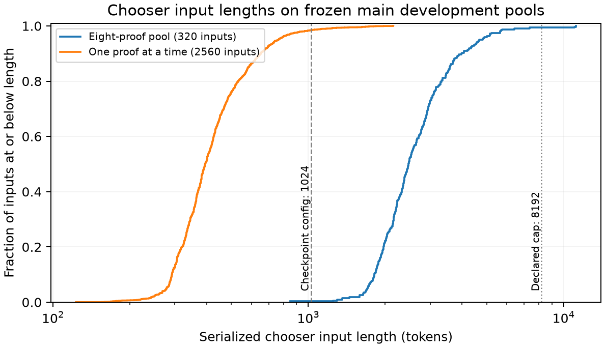
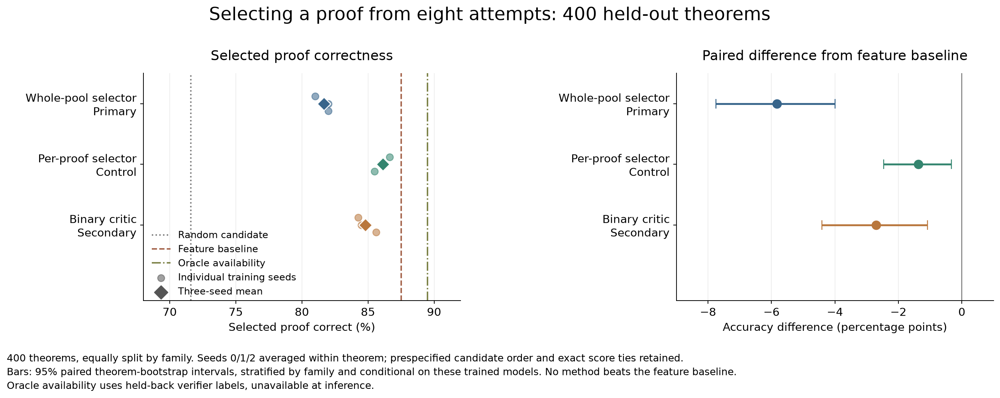
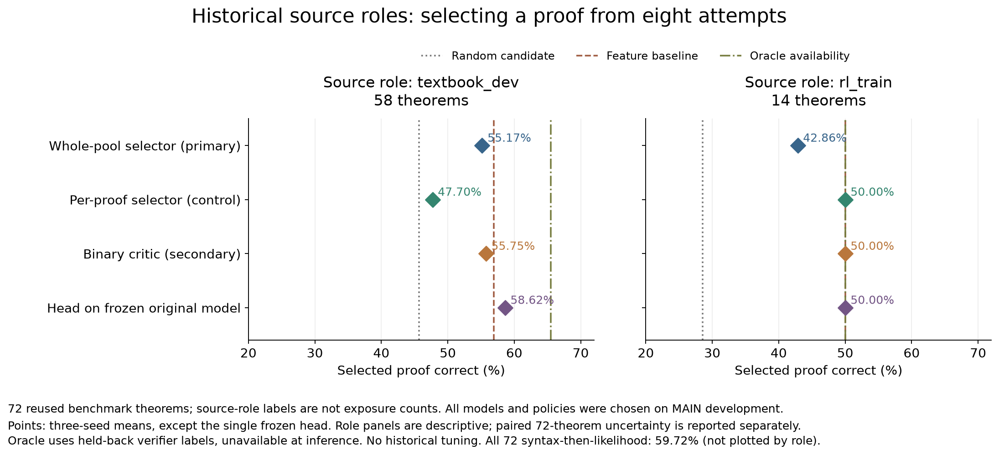
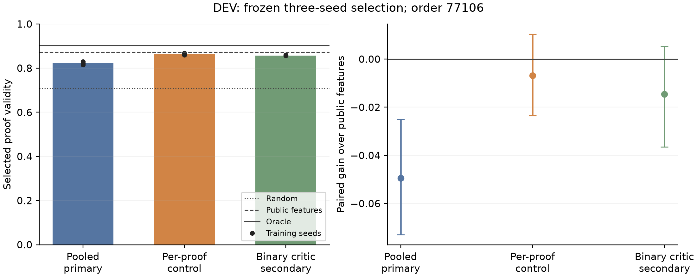

# Can a proof model recognize which of eight attempts succeeded?

The primary whole-pool selector learns relative to its original untrained readout, but fails the proposal's strongest-baseline criterion on the fresh 400-theorem test set. Its three-seed mean accuracy is 81.67%, versus 69.75% for its untrained readout and 87.50% for the frozen public-feature baseline. The factorized control reaches 86.13% and the secondary binary critic 84.79%; both also trail the feature baseline. All prespecified methods, seeds and candidate orders are retained. The separately evaluated reused historical benchmark does not establish fresh generalization.

Three development observations determined the protocol. First, eight attempts usually exceed the checkpoint's configured 1,024-token context: 94 of 100 initial development pools did, with a maximum 6,610 tokens. The chooser therefore uses an explicit 8,192-token ALiBi extrapolation, with every overflow retained through a seeded uniform fallback. This is a new interface and longer context; it does not demonstrate that the base checkpoint already understands such lists.

The figure shows serialized inputs before overflow fallback. The pooled method exceeds the original 1024-token configuration on 319/320 main development pools; the factorized method does so on 40/2560 individual proofs. Two pooled inputs exceed 8192 and receive no model score.

Second, larger generated formulas produced useful success/failure mixtures at the original sampling temperature 0.8. Fifty broad forward-generated development theorems yielded 301 valid proofs among 400 attempts and oracle coverage 45/50. Fifty compound-formula disjunction-elimination theorems yielded 281/400 valid attempts and oracle coverage 47/50. Among completed attempts, the strict Lean checker rejected 27/328 and 54/335 respectively, leaving meaningful errors beyond visible completion. These panels calibrated the distribution, using only generation success rates, before the main corpus was frozen.

Third, a harder nested case-elimination stress panel mostly failed before completing proofs: the four-leaf stratum produced one valid proof in 344 attempts across 43 theorems. This is a narrow development stress observation. It simultaneously increases premises, branching and reference-certificate length, so it does not isolate a causal effect of nesting or establish a minimum proof-length frontier.

## Frozen main experiment

The main corpus contains 1,600 training, 320 development and 400 test theorems, evenly divided between broad forward generation and compound-formula two-leaf case elimination. Every theorem has a distinct atom-erased connective skeleton across the full corpus, and the shared skeleton hash assigns train/development/test membership. Canonical matches to all 155,000 cap 12 pretraining records, 4,495 expert-iteration targets, and known public benchmark theorem metadata were excluded, including premise permutations and atom bijections. The source's protected short/long prompt sets were not inspected. Earlier pilot cases are excluded from the main corpus. A further audit finds zero training or development skeleton matches against 135016 known pretraining/expert-iteration skeletons, beyond the canonical theorem exclusions. This does not imply unseen logical substructures.

Candidate pools have eight fresh-context attempts from the frozen base model, sampling temperature 0.8, maximum 256 tokens per action and 48 actions. The primary chooser sees theorem text and a deterministic transcript of every public environment text transition, including implicit case closures and branch binders. This rendering uses no verifier verdict. An action-trace ablation preserves only explicit effective actions; it can omit essential implicit binders and is not always a standalone proof certificate. Exact raw sampled actions are stored separately. Strict Lean verdicts, failure reasons, terminal metadata and constructed reference proofs remain in private records. The chooser maximizes probability mass on any valid candidate; all-invalid pools receive no update but remain in evaluation. Candidate order is shuffled. A factorized control scores each proof separately with the same trainable ALiBi model and existing vocabulary readouts. Training seeds 0/1/2 independently start from the same original generator checkpoint.

The earliest 31-theorem format smoke merely validated the interface and training loop. On 100 development pools sampled at temperature 1.1, untrained argmax selection scored 86%, while two tiny epochs scored 87% and 89%. Soft expected correctness did not improve consistently. These numbers support no learned-recognition claim and do not select the primary corpus.

The distribution remains limited. A descriptive classical truth-table audit finds unsatisfiable premises in 400/800 forward training theorems and 79/160 forward development theorems, while many goals are classical tautologies. Formula and reference length therefore do not establish a minimum reasoning burden. The two-leaf family has fewer such cases, and results must be reported separately by family. This audit did not change the frozen data and did not inspect final test outcomes.

## Fresh MAIN test results

The decisions parent was frozen at 05:17 UTC and both public pools were sealed before inference or private-label inspection. MAIN registry SHA256 is `bd289d62de0e5c3395fa10330177385184cc66d67d09fc82cead10a65894a1d2`. All 37 registered inference jobs completed: 27 trained evaluations (nine independently initialized trained models across three fixed candidate orders), nine original-model controls, and one frozen-head evaluation. Primary results average the three training seeds within each theorem at the prespecified order seed 77106. Paired 95% bootstrap intervals resample theorems within family, conditional on these three models.

| Method | Test accuracy | Difference from feature baseline, 95% interval |
|---|---:|---:|
| Pooled primary | 81.67% | −5.83 pp [−7.75, −4.00] |
| Factorized marginal control | 86.13% | −1.38 pp [−2.46, −0.33] |
| Factorized BCE secondary | 84.79% | −2.71 pp [−4.42, −1.08] |
| Public-feature baseline | 87.50% | — |
| Random candidate | 71.59% | — |
| Oracle availability | 89.50% | — |

Pooled seed accuracies are 81%, 82% and 82%; factorized seeds are 86.625%, 86.25% and 85.5%; BCE seeds are 84.25%, 84.5% and 85.625%. The pooled gain over random is 10.07 percentage points [7.93, 12.28]. Relative to their own untrained readouts, pooled accuracy rises from 69.75% and factorized accuracy from 76.375%. These observed improvements support learning on the declared task, but do not satisfy the proposal's stronger requirement to beat the best declared baseline. The factorized comparison changes both cross-candidate architecture and context burden, so its advantage does not isolate long-context failure.

The pooled primary recovers 56.25% of the random-to-oracle gap and selects correctly on 91.25% of pools containing any valid proof. The factorized control recovers 81.15% and BCE 73.71%. Supplementary pooled-order averages span 81.17–82.29%, with mean 81.71%; factorized and BCE exact-tie accuracies are identical across all three orders. No order was selected using test results. One pooled test input exceeds 8192 and receives the frozen uniform fallback; no factorized or frozen-head candidate overflows.

On the 67 pools where all eight proofs are syntactically complete but validity is mixed, pooled accuracy is 82.59%, factorized 92.04%, BCE 90.05%, and features 95.52% (random 76.68%). This descriptive stratum removes simple completion missingness but does not isolate semantic understanding: the feature baseline retains likelihood, entropy and visible structural features. It constrains any claim that the neural model uniquely recognizes correctness beyond these cues. Family, valid-count, completion, length and selected-position strata are retained without selecting a favorable subset.

The separately frozen 385-parameter head reaches 84.00%, versus 84.25% for its prespecified matched fully fine-tuned BCE seed 0. The paired difference is −0.25 percentage points [−2.00, 1.50]; versus the labelled three-seed BCE mean it is −0.79 [−2.38, 0.75]. The frozen head preserves original generator weights exactly by construction, while the earlier DEV retention probe found severe generation degradation after full BCE fine-tuning. This is a secondary preservation control, not a new primary winner. On the 67 all-complete mixed-validity pools, the head reaches 83.58%, versus 89.55% for its matched full critic and 95.52% for features; overall proximity does not establish equivalent recognition. The 385-parameter count concerns the trained readout; scoring still requires the original backbone forward. Its paired difference from features is −3.50 percentage points [−5.50, −1.75].

The frozen-head staged secondary applies its unchanged development threshold 0.65 at attempt cost 0.03. It scores 81.99% with 1.829 mean attempts and reward 0.794974. Its fixed 1/2/4/8 accuracies are 71.59%, 79.28%, 82.89% and 84.00%. The mixture weights remain frozen at the development target 1.7566 attempts; they are not refitted to match observed test stopping, and therefore are not an exact test-budget match. This secondary charges text-scoring inputs and omits likelihood replay; input-token costs are lower bounds, not kernel-time equality.

Measurement integrity passed for every test attempt: direct Lean checking of all 3200 public rendered transcripts matches every private validity label; all 2559 completed literal strings match the collected assembled Lean text. There are no disagreements and no exclusions. The separate historical audit is reported below.

## Two illustrative remaining errors

The feature scorer misses eight MAIN pools that contain a valid proof. A [descriptive archive](../../../artifacts/learned_compute_allocation_20261006/analysis/feature_misses_main_descriptive_v1.json) retains every such pool, its reconstructed frozen feature scores, and the selected proof alongside a valid candidate. This inspection happened after evaluation and does not change any method or estimate error-type prevalence. Two cases show why syntactic completion and high confidence remain imperfect signals; their simplified descriptions received [independent review](../../../code/experiments/current/learned_compute_allocation_20261006/reviews/feature_miss_illustrations_review.md).

In theorem `b3d8c290be045f21d09a`, all eight proofs complete syntactically but only one is valid. Abstractly, the premises are `A ∨ B`, `A → G` and `B → G`. The selected candidate 6 applies the `A → G` premise in both branches of `Or.elim`, including the branch whose assumption has type `B`. Candidate 1 uses the correct implication in each branch. The frozen feature logits are 2.8235 for the invalid choice and 2.7272 for the valid proof. This is a concrete type mismatch, despite a plausible proof outline.

In theorem `30025165b81905655c49`, seven of eight complete candidates are valid. The premises contain `A` and `¬A`, so a valid proof can derive `False` and eliminate it. The selected candidate 0 instead supplies a hypothesis of the wrong type to a negation in its final contradiction argument, even after constructing a useful intermediate statement. Its feature logit is 2.8118, above every valid candidate. This example also illustrates the limited reasoning burden of some forward-family tasks: the reported selection problem includes contradictions in the premises, rather than uniformly difficult theorem discovery.

## Historical reused benchmark: 72 theorems

All frozen methods were applied unchanged after all nine MAIN live evaluations completed. This source contains 58 `textbook_dev` and 14 `rl_train` records; these are source roles, not exposure counts. One canonical theorem overlaps the known cap-12 pretraining corpus. All 72 were excluded from the fresh MAIN corpus. This is historical retention/transfer evidence, not fresh structural generalization. Our eight attempts, 256-token action cap and 48-action cap differ from the upstream historical 256-attempt, 512-token/96-action evaluation, so these numbers do not reproduce its published results.

| Method | Historical accuracy | Difference from features, paired 95% interval |
|---|---:|---:|
| Pooled primary | 52.78% | −2.78 pp [−9.26, 3.70] |
| Factorized marginal control | 48.15% | −7.41 pp [−12.96, −2.31] |
| Factorized BCE secondary | 54.63% | −0.93 pp [−5.56, 3.70] |
| Head on frozen original model | 56.94% | +1.39 pp [−2.78, 6.94] |
| Public features | 55.56% | — |
| Syntax then likelihood | 59.72% | — |
| Random candidate | 42.36% | — |
| Oracle availability | 62.50% | — |

The strongest observed historical baseline is syntax-then-likelihood at 59.72%, above both features and the frozen head. Feature contrasts retain the prespecified comparator and do not imply it is strongest on this reused benchmark.

Primary rows average the same three independently trained seeds within theorem at the frozen candidate order. The paired theorem bootstrap preserves the observed 58/72 and 14/72 role weights, conditional on the fitted models. Pooled seed accuracies are 48.61%, 54.17% and 55.56%; factorized seeds are 47.22%, 44.44% and 52.78%; BCE seeds are 55.56%, 54.17% and 54.17%. All 27 trained evaluations and 37 inference jobs are retained. Supplementary pooled orders range from 50.00% to 52.78%; factorized/BCE results are invariant across the three orders. No historical outcome selected a model or order.

The original historical pooled readout scores 41.67%, while the original factorized readout scores 54.17%. Thus pooled learning transfers relative to its own readout, but the trained factorized control falls below its original readout on this benchmark. The frozen head differs from its matched full BCE seed 0 by +1.39 pp [0.00, 4.17], and from the labelled BCE three-seed mean by +2.31 [0.00, 6.02]; these are secondary comparisons, not a selected winner. Only three pools have all eight candidates complete with mixed validity, too few to support a broad semantic-recognition claim.

Role-specific pooled/factorized/BCE/head accuracies are 55.17%/47.70%/55.75%/58.62% on the 58 `textbook_dev` records and 42.86%/50.00%/50.00%/50.00% on the 14 `rl_train` records. These small descriptive subgroups do not establish a difference between roles.

At attempt cost 0.03, the unchanged MAIN-development stopping policies score 55.15% with 4.801 attempts for features and 55.23% with 4.426 attempts for the three-seed BCE aggregate. Their charged input-work lower bounds are 20145.51 and 11623.20 tokens. Against the mixtures frozen at MAIN-development work targets, accuracy differences are +4.86 and +6.14 percentage points, but work also increases by 11024.27 and 6326.86 tokens, with positive intervals. Native utility-difference intervals include zero. This is not an equal-compute transfer advantage: historical stopping shifts both accuracy and workload, and mixture weights were never retuned to historical outcomes.

All 576 public transcripts agree with their private strict-Lean labels; all 290 completed strings match the collected certificate exactly. There are 244 valid attempts, no disagreements, no exclusions and no 8192-token overflow. The original aggregation opened authorized historical labels and then failed a MAIN-specific family assertion. Its failed launch is preserved. A separately approved, reviewed historical-only schema successor validates the exact 58/14 roles and retains the original estimators and bootstrap settings; no original registry, model, metric definition or output was overwritten.

Historical raw predictions are in `selectors/final_historical/`, numerical reports in `analysis/final_historical/`, and the repair provenance in `analysis_successors/historical_selection_roles_v2/`. Independent numerical reviews are [selection](../../../code/experiments/current/learned_compute_allocation_20261006/reviews/historical_selection_review.md) and [frozen head](../../../code/experiments/current/learned_compute_allocation_20261006/reviews/historical_frozen_head_review.md). The staged aggregate is `analysis/historical_test_staged_aggregate_v1/`.

## Development results, before final evaluation

Each primary method trains for five epochs at learning rate 3e-5, with independent seeds 0/1/2 and earliest maximum development accuracy selecting its checkpoint. Exact score ties receive uniform expected correctness. The primary pooled selector scores 0.815625, 0.821875 and 0.8296875; the factorized control scores 0.859375, 0.8671875 and 0.86875. The separately implemented ten-feature baseline scores 0.871875, and oracle coverage is 0.903125. All methods and seeds will be reported; these results do not justify choosing a favorable architecture or subset after final evaluation.

The dots show individual training seeds; the right panel shows paired 95% theorem bootstrap intervals stratified by family. Checkpoint selection used these same development pools, so the intervals are diagnostic and do not establish final generalization. The complete machine-readable metrics and figure source live in `selectors/aggregation_dev_smoke/`.

The factorized model performs better on the case-elimination family (0.91875–0.9375) than broad forward generation (0.796875–0.8125). The feature baseline scores 0.91875 and 0.825 respectively. Across 320 development theorems, factorized models uniquely solve 3–5.5 theorem mass missed by the feature baseline, while the feature baseline uniquely solves 6–7 missed by those models. These fractional counts integrate exact model ties. Thus this audit finds some complementary predictions, without an overall development advantage or an isolated semantic-recognition result.

A separately declared secondary critic trains the same original ALiBi checkpoint with binary validity loss on all generated candidates, selecting the earliest checkpoint with minimum development binary log loss. Its three development accuracies are 0.859375, 0.85625 and 0.85625, with log losses 0.315710, 0.295558 and 0.289351. It exposes per-proof sigmoid scores for a development-calibrated stopping comparison; the joint sequential controllers do not inherit its weights. Its stopping threshold must be fitted on development and frozen before final outcomes.

On one separate saved-live-path development pilot, using the frozen seed-0 binary critic on the same first two attempts raises greedy-index readout accuracy from the native greedy 0.6875 to 0.78125. The native categorical readout scores 0.653678 and is a different comparison. This is an external, separately trained critic under generator domain shift, not a new native controller result; the primary categorical endpoint remains unchanged. At four or eight attempts the external greedy accuracy falls to 0.71875 or 0.6875, so this pilot does not support a general replacement claim.

A matched clean-generation diagnostic finds that the selected fully fine-tuned binary critic succeeds on only 29/128 development attempts, compared with 93/128 for the original proof model. The theorem-paired difference is −0.50 (family-stratified 95% interval −0.6094 to −0.3828). Same prompts, nominal sampling seed and settings are used, but trajectory-dependent batching means these are not identical random sample paths. This cautions against treating a separately fine-tuned classifier as an unchanged proof generator. The prespecified secondary control now fits only a separate 385-parameter validity head on frozen original LayerNorm representations. Its development accuracy is 0.84375, versus 0.859375 for full BCE seed 0 and 0.7765625 for the original vocabulary readout. Its family-stratified paired difference against full BCE is −0.015625 (95% interval −0.04375 to 0.0125). Original trunk and language-model-head tensor digests match exactly before and after extraction; the generator is therefore preserved by construction. The untuned L-BFGS solve terminates under its prescribed stopping criteria before iteration and evaluation limits, with gradient 2.02e−6 above the requested 1e−7 tolerance. Its exact internal stopping branch was not logged. This is a single secondary development fit, not evidence of a best possible frozen critic.

The public-feature baseline uses likelihood and entropy from full-forward replay under actual generation state prefixes. Those diagnostics require additional model inference; its small classifier is not the full inference cost. Text-only neural selectors can omit that confidence replay and pay their own scoring forwards. Any staged cost comparison must charge the required diagnostic replay and generator prefill, alongside classifier or neural readout work. Candidate tokens and summed input lengths remain proxies unless an actual batch meter measured the compared policy.

The recorded selection-owned job scopes sum to 2.123 GPU-assigned hours through MAIN and historical inference, including candidate collection, training and measured evaluations. All 37 MAIN inference child processes account for 629.40 seconds (10.49 minutes); the 37 historical children add 214.23 seconds (3.57 minutes). Queue preflight and snapshot overhead are outside those child timers. This is a lower bound on occupancy, not GPU kernel time: collection includes CPU environment/Lean overhead, loading and several early failed or unmetered runs are excluded, and historical elapsed timers used wall clocks. The raw ledger preserves these limitations. The chained final ledger is `selectors/resource_ledger/historical_test_successor.json`; the separate cached-confidence engineering diagnostic and root-owned final pool collection are excluded. These totals are measured job scopes, not isolated GPU latency, and shared-device admission records retain the timing caveat.

## Evidence and artifact map

- [Working notes and code](../../../code/experiments/current/learned_compute_allocation_20261006/selection/README.md).
- Raw artifacts: `artifacts/learned_compute_allocation_20261006/` from the repository root.
- `data/main_v1/manifest.json`: frozen configuration, code snapshots, hashes, source exposure and split audit.
- `pools/{dev_pilot_v2,dev_temperature1p1_pilot,forward_deep_dev_pilot,ore2_dev_pilot,ore_dev_pilot}/`: calibration candidate pools, separate private labels, sampling configurations and exact diagnostics.
- `selectors/format_smoke_s0_local/`: local-only initial interface smoke.
- Primary development collection: `pools/main_dev_{forward,ore2}/`; combined schema4 views live in `pools/main_{train,dev}/public_transitions.jsonl`.

- `selectors/frozen_primary_dev_choices.json` and `frozen_bce_dev_choices.json`: exact selected epochs, checkpoint hashes and raw development predictions.
- `selectors/frozen_head_features_v1/`, `frozen_head_v1/` and `frozen_head_dev_analysis/`: frozen-trunk caches, terminal head, preservation digests and paired development metrics.
- `selectors/primary_dev_error_audit/` and `selectors/resource_ledger/`: complete descriptive development error strata and runtime inventory.
- `selectors/final_main/` and `selectors/main_test_queue_v1/`: all 37 raw prediction/config outputs and per-process source/hash/timing records.
- `analysis/final_main/selection/`: authoritative MAIN metrics, per-theorem records and standalone PNG/SVG; source is `code/experiments/current/learned_compute_allocation_20261006/selection/aggregate_selection.py`.
- `analysis/final_main/frozen_head_paired/` and `frozen_head_thresholds/`: separately registered secondary comparison and unchanged development-frozen threshold policies.
- `pools/main_test/transition_lean_audit.json`: all-attempt rendering/label integrity audit.
- `freeze_inputs/selection_v2/` and `final_evaluation/main_protocol.json`: locked method inventories and final sealed registry.

The fresh MAIN result does not meet the strongest-baseline criterion. The task is limited to the frozen two-family distribution; historical results concern a separately reused benchmark.
