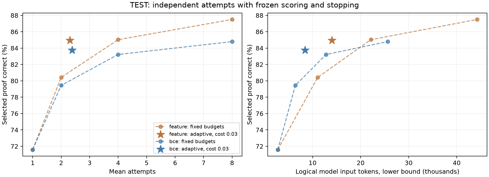
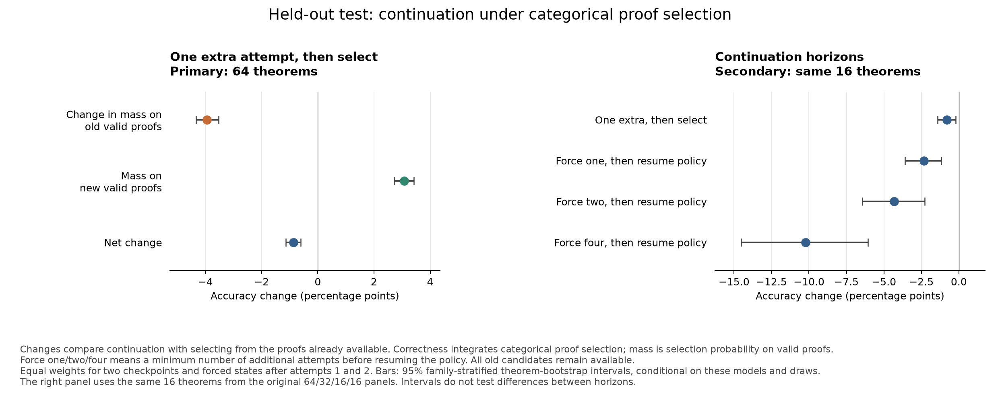

# Learned confidence helps choose proofs; joint retry training does not yet improve on the first attempt

## Executive summary

Good pass@k means a verifier can find a successful attempt among k samples. Deploying that capability requires the model to choose a proof and decide whether another attempt is worth its cost. We tested both steps using Dan's round-16 expert-iteration checkpoint, a 9.56-million-parameter natural-deduction model, starting from the [learned-compute-allocation proposal](../../proposals/learned-compute-allocation/README.md). The main held-out test contains 400 fresh theorem skeletons from two synthetic proof families. No policy receives verifier verdicts at inference.

1. **Learned confidence makes independent attempts useful.** From eight original-model proofs, a logistic score over ten public statistics selects a valid proof on **87.5%** of theorems, versus **71.59%** for random selection; **89.5%** of pools contain a valid proof. The three neural selector designs score 81.67–86.13%, below this strong baseline. A confidence threshold reaches **84.95% at 2.31 expected attempts**. It beats its own scorer's development-fitted fixed-budget mixture by **2.98 percentage points [1.76, 4.25]**; the mixture matches development work, not exact test work. This is adaptive allocation on saved independent pools, with scoring charged, rather than measured online latency.

2. **Joint training improves first-proof generation, but its retry policy does not improve the returned answer.** Across three training seeds per condition, cost-aware training returns correct proofs **85.319%** of the time at **1.021 attempts**, versus **85.333%** from returning those same models' first proof. Correctness-only training reaches **83.974% at 2.325 attempts**, versus **84.333%** for its first proof. Small gains over count-only controls survive, but the simpler first-proof rule is more accurate and uses less work. Short training and a fragile history interface limit how broadly this failure applies.

3. **More available valid proofs can coexist with worse model selection.** In a prespecified 64-theorem intervention, forcing one extra attempt raises oracle availability from **87.11% to 89.11%**, while lowering correctness under the model's probabilistic selection rule by **0.87 points [0.60, 1.14]**. New valid proofs do not compensate for probability moved away from valid earlier proofs. This is a failure of the measured policy, not evidence that additional reasoning inevitably harms a model.

The successful stopping rule is a separate threshold over learned confidence. The jointly trained proof model has yet to demonstrate a useful decision about when it is done. The reused 72-theorem historical benchmark is less favorable: syntax-plus-likelihood selection has the highest observed accuracy, and transferred stopping thresholds substantially exceed their development-matched work budgets. These results establish neither broad transfer nor learning to adapt across tasks.

**Recommendation:** preserve generation and proof ranking, then train stopping separately against equally tuned constant-confidence and count-only controls. A cheap prerequisite is to rerank saved joint-policy development candidates with the frozen critic. The [concrete follow-up design](../../code/experiments/current/learned_compute_allocation_20261006/selection/followup_stopping_design.md) is proposed and unrun.

## What was tested

The proposal asks whether a model can turn sampling headroom into selected accuracy and learn when to stop. We separated recognition, allocation and contextual regeneration so that improvement in one would not be mistaken for success in all three. The [hypothesis table](../../code/experiments/current/learned_compute_allocation_20261006/hypotheses.md) records the original predictions and their final status.

The main corpus contains 1,600 training, 320 development and 400 test theorems, balanced between forward-generated formulas and two-branch disjunction elimination. A formula skeleton records logical connective structure after removing atom names. All 2,320 saved skeletons are distinct, with zero split overlap; known generator-training exposures and pilot examples are excluded. Proof-construction families recur across splits. The generator's complete historical exposure is unavailable, and the forward family can contain contradictory premises. This is a structural holdout within a narrow distribution.

| Experiment | Learned component | Held-out evaluation |
|---|---|---|
| Choose among independent attempts | Three seeds each of a pooled chooser, per-proof marginal ranker and binary validity critic; feature and frozen-head controls | Same 400 pools of eight original-model proofs |
| Stop independent sampling | Development-selected threshold on learned confidence | Exact order/subset averaging on those saved pools |
| Jointly generate, select and stop | Three RL seeds with an attempt penalty and three without; separate fixed-one/fixed-four controls | 400 theorems, two sampled paths per model, up to eight attempts |
| Force continuation | No additional learning | Two frozen correctness-only checkpoints; 64-theorem primary panel |
| Historical retention/transfer | No refitting | Reused 72-theorem benchmark, reported separately |

Independent proofs use temperature 0.8, at most 256 tokens per action and 48 actions. The original model's nominal context is 1,024 tokens. The pooled chooser extends this to 8,192 tokens; one test pool overflows and receives the prespecified uniform fallback. Joint policies additionally cap each attempt at 1,024 tokens and allow a 16,384-token context. Earlier proofs remain selectable, and a valid intermediate proof never automatically stops the policy. Models observe public theorem and proof/environment text, including grammar/scope information, but no Lean verdict, verifier error or reference proof.

Final models, policies, seeds, budget mixtures and original analysis plans were frozen before final inference. Two later implementation amendments are disclosed below; they change validation guards, not estimates or statistical procedures. Intervals below are paired 95% theorem-bootstrap intervals, stratified by the declared families and conditional on fitted models and saved generation paths. Primary seed results are available in the detailed reports; these intervals do not measure uncertainty over arbitrary future training runs.

## 1. Confidence supports selection and stopping on independent proof pools

The first question is whether recognition can recover the available sampling headroom. All methods below choose from identical candidate pools, so their differences come from selection rather than generation. Oracle availability is the fraction of pools containing any valid proof; it uses the verifier only for evaluation.

The pooled chooser reads all eight proofs together; the per-proof ranker scores each separately. Both train to increase the total probability of selecting any valid candidate. The binary critic instead predicts each proof's validity. These three neural designs fine-tune the original model for five epochs, with checkpoints selected on development data. The feature score learns from public statistics rather than proof text.

| Selection from eight proofs | Selected accuracy | Difference from learned features, percentage points |
|---|---:|---:|
| Uniform random candidate | 71.59% | — |
| Syntax completion, then likelihood | 83.50% | — |
| Learned public-feature score | **87.50%** | Reference |
| Pooled neural chooser, three seeds | 81.67% | −5.83 [−7.75, −4.00] |
| Per-proof marginal ranker, three seeds | 86.13% | −1.38 [−2.46, −0.33] |
| Binary validity critic, three seeds | 84.79% | −2.71 [−4.42, −1.08] |
| 385-parameter head on frozen original model | 84.00% | −3.50 [−5.50, −1.75] |
| Oracle availability | 89.50% | Upper bound |

*Selection on the same 400 held-out theorem pools, each containing eight independent proofs. The three plotted neural methods each average three trained models; faint points show seeds. The separate frozen-head result appears in the table only. Differences use paired, family-stratified 95% theorem-bootstrap intervals conditional on the fitted models and pools. A learned score over public syntax, likelihood, entropy and length statistics beats the primary neural selectors. Oracle availability uses verifier information unavailable to deployment.*

The feature score recovers **88.8% of the gap** between random selection and oracle availability. Its success is not exclusively detection of incomplete syntax: on the descriptive subset of 67 mixed-validity pools where all eight proofs finish syntactically, it scores 95.52%. Two illustrated remaining errors confuse implication branches or misuse contradiction; these are post-hoc examples, not a prevalence estimate. The [selection report](selection/summary.md) includes the examples, individual seeds and all controls.

To test allocation, stop when the current proof's learned confidence passes a development-selected threshold, otherwise continue up to eight; at the limit, return the highest-scoring retained proof. The primary reward is correctness minus 0.03 per additional attempt. The policy observes no future candidate. Exact averaging over orders and subsets measures its behavior on saved pools.

| Adaptive scorer | Accuracy | Expected attempts | Logical model-input tokens | Accuracy gain over own development-work-matched fixed mixture |
|---|---:|---:|---:|---:|
| Public features | 84.95% | 2.31 | 14,013 | +2.98 points [1.76, 4.25] |
| Binary critic, three seeds | 83.74% | 2.39 | 8,408 | +3.09 points [1.95, 4.32] |

*The same 400 test theorems, with exact candidate-order averaging. Circles are fixed budgets 1, 2, 4 and 8; dashed segments connect discrete policies. Stars use development-selected confidence thresholds for correctness minus 0.03 times additional attempts. “BCE” is the binary validity critic, averaged within theorem over three training seeds. Feature work includes likelihood/entropy replay; critic work includes proof-scoring forwards. Fixed-one selection needs no scorer. Logical unpadded model-input counts are lower bounds, not elapsed time. These are within-scorer comparisons; they do not establish the best frontier across different systems.*

The fixed-mixture weights are fit on development and unchanged on test. Test work differences are −783 tokens [−2,259, +763] for features and −45 [−859, +837] for the critic. Thus the comparison is neither exact test-work matching nor evidence of statistically established work reduction. Online early exit was not benchmarked, and the feature scorer pays for a separate model replay to obtain likelihood and entropy.

Preserving generation matters. A full binary-critic fine-tune produces only 29/128 valid first proofs on a separate development retention probe, versus 93/128 from the original generator: a −50-point difference [−60.94, −38.28]. The frozen 385-parameter head retains every original generator parameter and reaches 84.0% selection accuracy. Its difference from the matched full critic is −0.25 points [−2.0, +1.5], which is not a noninferiority result. On the 67 all-complete mixed-validity pools, it trails that critic, 83.58% versus 89.55%. The small trainable head still requires full backbone inference.

## 2. Joint retry training fails the same-model first-proof test

The key comparison for learned stopping is against returning the same checkpoint's first attempt. It holds generator training fixed. Comparing only against the original model would allow better first-proof generation to masquerade as useful allocation.

Joint training starts from a shared, outcome-blind format adapter with fresh selection/stopping heads. Each primary run makes 200 policy-gradient updates of eight episodes. Cost-aware reward subtracts 0.03 per additional attempt; correctness-only reward omits that penalty. Native evaluation integrates the learned categorical stop and index probabilities along saved generation paths.

| Deployment rule | Selected correctness | Expected attempts | Model-input tokens processed |
|---|---:|---:|---:|
| Cost-aware learned policy | 85.319% | 1.021 | 2,617 |
| Same cost-aware models, return first proof | **85.333%** | **1.000** | **2,136** |
| Correctness-only learned policy | 83.974% | 2.325 | 14,666 |
| Same correctness-only models, return first proof | **84.333%** | **1.000** | **2,264** |
| Separately trained fixed-one control | 83.250% | 1.000 | 2,265 |
| Separately trained fixed-four control | 81.829% | 4.000 | 23,697 |
| Format-adapted starting model, return first proof | 72.750% | 1.000 | 2,890 |

*Differences from returning the same model's first proof on 400 fresh theorems, with two saved generation paths per theorem and three trained models per arm. Large dots are three-model means; faint dots are individual seeds. Bars are paired, family-stratified 95% theorem-bootstrap intervals conditional on these models and paths. Cost-aware training subtracts 0.03 per additional attempt; correctness-only training omits that penalty. Native evaluation integrates learned stop and proof-selection probabilities. Input tokens measure expected policy work, including controller queries, and exclude the larger expense of collecting every forced eight-attempt path.*

Cost-aware retry loses **0.0139 percentage points [0.0107, 0.0170]** against its own first proof; correctness-only retry loses **0.3595 points [0.3171, 0.4048]**. The cost-aware difference is tiny but consistently unfavorable, and controller queries add work. Its utility loss at cost 0.03 is 0.0779 points [0.0729, 0.0832]. Correctness-only retry spends substantially more work without improving accuracy.

Correctness-only evaluation places 5.73% of termination probability at a protocol-imposed terminal prefix; cost-aware evaluation places below 0.001% there. This mass reaches the attempt or context limit rather than demonstrating an earlier learned stop. It does not estimate what the policy would do without that limit.

There are favorable contrasts worth retaining. Native policies beat their development-fitted count-only controls by 0.0104 and 0.0187 percentage points, respectively. Cost-aware retry also beats its development-work-matched fixed mixture by **0.120 points [0.107, 0.132]**, with test work residual −3.9 tokens [−19.8, +12.9]. These improvements do not overturn the higher accuracy and lower work of returning the same model's first proof. Correctness-only retry trails its own development-work mixture while using more test work.

Training improves first-proof accuracy over the format-only starting point by **12.58 points [9.96, 15.29]** with cost and **11.58 [9.21, 14.13]** without. That is a generator improvement. The fixed-one control reaches 83.25%, while the fixed-four control returns correct proofs in 81.83% of cases, versus 82.0% for its own first proof. Controls use one seed, and development selects fixed-one at update 100 while the other RL checkpoints use 200. Maximum episode budgets match; selected training ages, generated attempts and training work do not.

Greedy deployment changes the interpretation: fully greedy policies select the first proof on every visited path. It would be false to say every possible prefix ranks the first proof highest; 22 of 38,400 primary-model prefixes have a different argmax, all at later counts unreachable under fully greedy stopping. The native policy's probability spread and its near-first greedy behavior are both part of this failed allocation result.

History conditioning is a major limitation. Before adaptation, adding one earlier attempt reduces valid development continuations from 180/192 to 5/192. Even an empty three-token attempt marker yields only 10/192, while three end-of-sequence tokens retain 177/192; the collapse cannot be attributed solely to prior proof content or length. Format adaptation helps, but a later small panel still falls from 25/32 valid first attempts to 7/32 eighth attempts. Training has only 1,600 episodes per primary seed, and later student-generated histories exceed the adapter's training support. The result bounds this implementation; it does not rule out better trained contextual retry policies. Full methods and controls are in the [allocation report](allocation/README.md).

## 3. Increasing oracle availability can reduce native selected correctness

A forced-continuation intervention tests whether the stopping problem can involve negative policy value even when earlier proofs remain available. On 64 held-out theorems, we compare accepting at forced states after one or two attempts with generating one extra attempt and then selecting. The primary average weights two frozen correctness-only checkpoints and both starting counts equally, using eight sampled futures per state.

Correctness falls from **85.08% to 84.22%**, a change of **−0.87 percentage points [−1.14, −0.60]**. Selection probability assigned to valid old proofs falls by 3.94 points; valid new proofs contribute only 3.08 points. Oracle availability nevertheless rises from 87.11% to 89.11%. Both checkpoints and both starting counts have negative effects.

*Primary panel: one extra attempt followed by selection, averaged over two frozen checkpoints, forced counts one and two, and eight futures per state on 64 test theorems. Secondary panel: continuation protocols on the same 16-theorem subset. “Resume policy” permits learned generation and stopping after the minimum number of forced new attempts. Bars are paired, family-stratified 95% theorem-bootstrap intervals conditional on these checkpoints and draws. They do not test differences between horizons. Candidate probability mass measures the policy's chance of selecting a valid old or new proof, not the fraction of generated proofs that are valid.*

On the paired 16-theorem control, removing prior history from the generator while retaining all candidates for selection improves new-proof validity by 23.44 points and the one-extra continuation effect by 0.78 points [0.40, 1.26]. This implicates the history interface, but changes the generated candidates and does not isolate recognition interference on identical proofs.

The acceptance head also fails to establish useful discrimination of continuation value. After conditioning on count and whether a valid incumbent exists, acceptance probability correlates with one-extra gain at +0.10 [−0.09, +0.31] and +0.25 [+0.03, +0.46] in the two checkpoints; useful discrimination would have the opposite sign.

These are effects of the native categorical policy on experimentally forced states. The later states can be rarely visited naturally. Probability dilution across a larger candidate set could explain loss without damage to any internal representation. We did not establish intrinsic reasoning harm, greedy-selection harm or a calibrated prediction of when more work will help. The [causal audit](../../code/experiments/current/learned_compute_allocation_20261006/reviews/causal_test_aggregate_review.md) independently reproduces the registered estimates.

## Historical transfer is weaker

All models and thresholds were reused unchanged on the 72-theorem historical benchmark. Its source roles are 58 `textbook_dev` and 14 `rl_train`; these labels are not counts of demonstrated training exposure. Known exposure exists and complete history is unavailable, so this is a retention/transfer check, not fresh generalization or a reproduction of Dan's larger-budget pass@k evaluation.

From eight independent original-model proofs, random selection scores 42.36% and oracle availability is 62.5%. **Syntax then likelihood has the highest point estimate at 59.72%**. Learned features score 55.56%; pooled, per-proof marginal and binary neural selectors average 52.78%, 48.15% and 54.63%. The frozen head scores 56.94%. Role-specific descriptive plots and uncertainty are in the [selection report](selection/summary.md).

Unchanged feature and binary-critic thresholds use 4.80 and 4.43 attempts and reach 55.15% and 55.23% accuracy. They exceed their frozen development-work mixtures by roughly 11,024 and 6,327 input tokens. Their accuracy gains therefore cannot establish equal-compute transfer. Joint cost-aware and correctness-only policies score 41.40% and 40.95%, below their respective first-proof accuracy of 41.44%; the format-only first-proof point estimate is 41.67%. The main-distribution generation improvement does not establish historical improvement.

## Checks, limits and completed scope

Astra independently reconstructed the main selection readouts, 51,200 staged-policy rows, 104,800 live-policy rows and 3,840 causal branches, including the registered paired intervals and source/model bindings. Direct Lean replay matched all 3,200 main independent-candidate labels and a prospectively chosen 36-example live sample in reviewer reruns; the selection researcher checked all 576 historical labels. Historical selection, staged and live calculations and provenance received separate reviewer audits. These checks support the recorded calculations, while leaving distributional and optimization limits intact.

The original registries and sources remain preserved. Two reviewed analysis successors addressed implementation failures: one admits FP32 probability sums up to 1e−6 above the domain boundary without clipping or changing estimates; the other replaces an incompatible main-family assertion with the historical 58/14 role schema, leaving estimators unchanged. The historical original failed after authorized label loading and before producing aggregate metrics. Separate operational addenda permit recorded sharing with foreign-user GPU jobs. No model, fit or endpoint was changed in these amendments.

The sprint implements one policy-gradient update per episode batch, without repeated PPO epochs. Only costs 0 and 0.03 were trained. It does not test a broad cost curve, longer training, larger models, 16-attempt scaling, compact memory or a fixed-candidate history-interference control. Neural selection objectives differ in architecture, context burden and supervision density. Joint training starts independently of the learned selectors. Accordingly, the sprint does not deliver a single successful model that learns all of generation, selection and stopping, or demonstrate adaptation across new tasks. The [scope note](../../code/experiments/current/learned_compute_allocation_20261006/scope_and_limitations.md) records the remaining proposal gaps.

Public-feature stopping uses logical unpadded input counts; live evaluation accounts for actual sampled forwards. These scales should not be combined into a cross-system compute frontier. Neither is an end-to-end latency benchmark. A small, label-free development diagnostic preserves 16/16 feature choices and 128/128 threshold decisions when replacing replay statistics with sampling-time statistics, but establishes neither general equivalence nor speedup; registered costs are unchanged. See the [confidence-extraction note](../../code/experiments/current/learned_compute_allocation_20261006/selection/cached_confidence_note.md).

The focused regression suite passes **77 tests**; scoped Ruff lint passes. The format check retains **two cosmetic exceptions** because those exact source bytes are bound to a sealed launcher or figure provenance. The earlier whole-workspace check had 5,965 Ruff findings, nearly all in preexisting work; the one new warning was fixed. See [validation details](../../code/experiments/current/learned_compute_allocation_20261006/reviews/final_style_exceptions.md). A clean-machine rerun has not been tested.

## Next experiment: learn stopping while preserving generation and recognition

First, apply the existing frozen-backbone 385-parameter critic to saved joint-policy **development** candidates, comparing native selection, critic selection and oracle availability at fixed counts. This cheap diagnostic tests recoverable selection loss on identical pools. Related earlier development pilots used a fully fine-tuned critic and gave mixed results across counts; this exact frozen-head diagnostic remains unrun. A negative result would also reflect critic distribution shift; a positive result would not repair later generation or establish stopping.

Then keep the original generator and frozen critic fixed and collect independent stopping-training, development and test pools. Train seven confidence thresholds, one per count before the eight-attempt cap. Compare against a constant confidence threshold and every count-only budget, with the same training outcomes, objective and tuning opportunity. Keep the stronger feature-based policy as a separate deployment reference with its own replay cost. Freeze development-budget mixtures and report test mismatches. The proposed success criterion requires a test reward gain of at least 0.005 in the point estimate and paired intervals above zero against constant and count-only controls; it does not claim a true gain of at least 0.005.

The constant-threshold control matters: with known iid candidate payoffs, reliable incumbent values, full recall and constant draw cost, the optimal stopping threshold is independent of the remaining positive finite horizon. Count can help in the real system through calibration, latent difficulty or changing future distributions. An allocation gain alone would not distinguish these mechanisms or prove prediction of future improvement.

A broader meta-learning study should define tasks and a learned adaptation mechanism, using separate examples for adaptation and evaluation within each task. Compare evaluation performance after matched adaptation experience against global and scratch-adapted policies. Holding out proof families and generation regimes would be a stronger transfer test than the present skeleton split. This design is **proposed, not run**; its [reviewed specification](../../code/experiments/current/learned_compute_allocation_20261006/selection/followup_stopping_design.md) makes the next decision concrete.

## Resources and artifacts

The sprint ran 01:39–11:39 UTC on 6 October 2026, with two GPT-6.1 Sol researchers and one GPT-6 Astra reviewer. All model work and numerical audits completed before the reserved 10:39–11:39 writing hour. All owned GPUs were released by 09:28 UTC. Additional paid GPU spend is **$0**; agent billing is unavailable.

The registered final evaluation contains **102 model child processes and 12.31 hours of summed process wall time**. An independent [resource audit](../../code/experiments/current/learned_compute_allocation_20261006/allocation/resource_accounting_review.md) verifies their launch-ledger hashes and checks overlap with development inventories.

| Inventory | Recorded hours | Timing scope and missing coverage |
|---|---:|---|
| Root development | 3.44 | Mixed update/replay/process intervals; 13 untimed entries |
| Selection development | 1.89 | Collection, training and scoring sections; five additional untimed jobs |
| Allocation development | 4.09 | Update or collection/policy sections; three untimed debug jobs |
| Cached-confidence diagnostics | 0.035 | Main-function intervals; import/startup time excluded |
| Registered final evaluation | 12.31 | All 102 whole child processes, including setup, checking and serialization |

These inventories are disjoint, but their timing scopes differ. CPU-only later analyses and queue waits are excluded, and earlier missing timers prevent an exact whole-sprint total. Nested timers and allocation's overlapping final live ledger are not added again. Shared GPU occupancy further prevents interpreting these figures as GPU kernel-active hours or isolated deployment latency.

| Artifact | Location |
|---|---|
| Working directory and reproduction entry points | [Sprint README](../../code/experiments/current/learned_compute_allocation_20261006/README.md) |
| Scope, decisions and durable state | [Kickoff](../../code/experiments/current/learned_compute_allocation_20261006/start.md), [research log](../../code/experiments/current/learned_compute_allocation_20261006/research_log.md), [manifest](../../code/experiments/current/learned_compute_allocation_20261006/manifest.json) |
| Detailed selection and joint-policy evidence | [Selection report](selection/summary.md), [allocation report](allocation/README.md) |
| Final main estimates | [Selection](../../artifacts/learned_compute_allocation_20261006/analysis/final_main/selection/metrics.json), [staged stopping](figures/staged_main/metrics.json), [joint policy](../../artifacts/learned_compute_allocation_20261006/allocation/final_main_summary_fp32_v2.json), [continuation](figures/causal_main/metrics.json) |
| Historical estimates | [Selection](../../artifacts/learned_compute_allocation_20261006/analysis/final_historical/selection/metrics.json), [stopping](../../artifacts/learned_compute_allocation_20261006/analysis/historical_test_staged_aggregate_v1/metrics.json), [joint policy](../../artifacts/learned_compute_allocation_20261006/allocation/final_historical_summary_fp32_v2.json) |
| Independent reviews | [Review directory](../../code/experiments/current/learned_compute_allocation_20261006/reviews/) |
| Resources and runtime | [Final ledger](../../artifacts/learned_compute_allocation_20261006/final_resource_ledger_v1.json), [runtime snapshot](../../artifacts/learned_compute_allocation_20261006/runtime_environment_v1.json) |
| Prior methods and unrun continuation | [Prior work](../../code/experiments/current/learned_compute_allocation_20261006/prior_work.md), [next experiment](../../code/experiments/current/learned_compute_allocation_20261006/selection/followup_stopping_design.md) |

Repository branch: `dmitry/main`, starting commit `315f36266bb4dd7feeff87228cb2662f8a36badc`. Dan's source commit is `4dcd0e4f336b3bf0ee24230dc5335ba3dba8969c`; original checkpoint SHA256 is `ba5d03de5dba890be643da82f9edca826d254c862cdcd33c221954b70918da24`. Exact model, source and policy hashes are in the frozen registries linked from the manifest. Large raw artifacts and checkpoints remain local and uncommitted. No changes were pushed or published; unrelated `proof-state` work was preserved.
