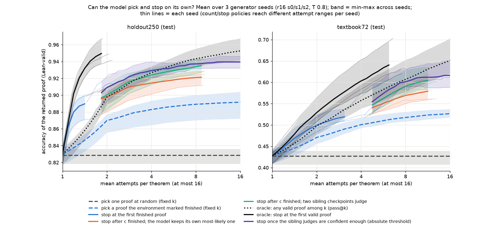

# The proof model can pick its own best attempt, especially when a sibling judges, but it cannot yet tell when it is done

## Executive summary

Dan's best natural-deduction prover (`state_env_october_r16`, a 9.6M-parameter model that writes proofs one step at a
time) proves 41% of the textbook72 problems on a single attempt and 69% if it may try 64 times and Lean picks the
winner. That gap is the test-time-scaling headroom, and today only the verifier can cash it in. We froze the
generator, sampled up to 64 attempts per theorem on 6,525 theorems, kept every attempt including the failures, and
asked how much of the gap the model can close by itself. Two held-out test sets: holdout250 (mostly easy, 84% of
attempts valid) and textbook72 (hard, 41%).

1. **The model already knows which of its proofs is right, with no training.** Among attempts the environment
   accepts as finished, keep the one the model itself assigns the highest per-token likelihood. At 8 attempts this
   recovers about three quarters of the gap between a random attempt and the best of the 8: holdout250 0.836 → 0.918
   (oracle 0.940), textbook72 0.405 → 0.540 (oracle 0.594).
   - 
2. **A sibling checkpoint is a better judge than the generator itself.** Scoring the same proofs with the likelihood
   of the other two training seeds of the same recipe raises the 8-attempt selection to 0.928 / 0.573, within 0.01–0.02
   of the oracle. A 3×3 generator-by-judge experiment shows that every generator is the worst judge of its own
   proofs (self penalty −0.03 to −0.07 in how well it separates valid from invalid proofs of the same theorem). Any
   sampler rates its own draws a little high; this one rates its own *invalid* proofs two to three times higher
   still, and that excess is the blind spot. Round 8 of the same seed shares it; a stage-1 model is simply a weak judge.
   - 
3. **Training a verifier on Lean labels did not beat the free likelihood signal.** A scalar head fine-tuned from the
   same checkpoint (3 seeds) learns which *theorems* are hard (it separates valid from invalid attempts across all
   theorems with AUROC 0.92–0.97) but ranks proofs of the *same* theorem worse than likelihood (within-theorem AUROC
   0.60–0.65 vs 0.69–0.79). Retraining it as a within-theorem ranker with 3.3× more hard negatives raised that to
   0.64–0.68, still below likelihood; undertraining and data scarcity are excluded for this recipe.
   - 
4. **Picking is nearly solved at a fixed budget; stopping is the open problem.** A rule that stops after the
   c-th finished attempt and keeps the sibling-judged favourite reaches 0.924 at 3.9 attempts on holdout250, matching
   oracle pass@4 (0.927). But an oracle that stops at the first *valid* proof reaches 0.952 at 2.0 attempts, and no
   model-side rule approaches it. The best, stopping once the sibling judges' absolute confidence passes a
   threshold tuned on development data, closes about a fifth of that gap; difficulty-aware allocation does not beat
   the count rule, and thresholds on the generator's own likelihood do not transfer between theorem sets.
   - 

Every comparison was fixed and sha-frozen on development data before its single test read, with paired
theorem-level bootstraps and three generator seeds for the headline numbers; a Codex audit recomputed the phase-1
headline numbers from the raw files. The same two test sets were used across five phases, so later questions were
chosen knowing earlier test results. All numbers are for one sampling run per generator, so intervals cover theorem
resampling, not sampling-seed resampling.

## What problem this addresses, and why

Test-time scaling only pays off if something decides which attempt to keep and when to stop sampling. In the
current pipeline that something is Lean, which is fine for measuring pass@k and useless for deployment on theorems
whose proofs we cannot check, or for an RL loop that wants the model's own judgement as a reward. The
[learned-compute-allocation proposal](../../proposals/learned-compute-allocation/README.md) (2026-10-05), motivated by
ReVISE's learned accept-or-refine decision [@pmlr-v267-lee25ab] and Satori's reflect-and-explore actions
[@pmlr-v267-shen25o], laid out three experiments: select among eight attempts, stop with an attempt cost, stop without a cost. This sprint ran the
first with a per-candidate scorer and a frozen-generator form of the second (threshold and count rules on a score),
and added what the results demanded: sibling judges, a data ladder for the learned head, and a mechanism analysis.
It did not train `ACCEPT`/`CONTINUE` actions by reinforcement learning, and it did not put eight proofs in one context
(the checkpoint's context is 1,024 tokens; eight proofs need about 2,000).

## Setup

**Generator.** `la_T1_best12_s{0,1,2}_r16.pt` from `hf://buckets/dan-pandori/nd-rl/rl-continue/ckpts/rc/ladder/`:
Robbie's 9.56M ALiBi/NoPE recipe in Dan's proof-state interface (the model sees the Lean tactic state and writes one
action; the environment applies it syntactically and Lean 4 judges the finished proof), after 16 rounds of expert
iteration. Sampling as in Dan's read-outs: T 0.8, at most 512 tokens per action and 96 actions per attempt.

**Attempts and labels.** Every attempt is recorded raw: the sampled token ids of every action through its `<eos>`,
whether the environment reached a finished proof (`done`), the assembled proof text when it did, a hash of the exact
prompt the model saw at every step, and token counts. The pool file is written before Lean runs; Lean's verdict and
its failure reason live in a separate labels file that no scorer reads. Replaying every stored attempt through the
environment reproduces every state hash and every proof text byte for byte (0 mismatches in 129,456 + 113,760 +
41,216 attempts across the three generation rounds).

**Theorem sets.** Selector training and development: Dan's `rl_targets` (4,495 theorems, the expert-iteration
targets, 94% of attempts valid), `dev1108` (1,108) and the long-proof pool `rr600` (600), split at the theorem level
with atom-renaming and premise-permutation equivalence grouped. Test, frozen before any test attempt was scored:
`holdout250` (250 theorems, 84% of attempts valid, pass@64 0.96) and `textbook72` (72 textbook problems, 41% valid,
pass@64 0.69; eval-only by group rule). The Codex reviewer independently found no overlap between the training
sources and the test sets under exact, renaming, or premise-permutation keys; schema-family overlap (the same
textbook schema with different sub-formulas) is not excluded, and Dan's model card notes one textbook72 problem that overlaps the K12 pretraining data (a
worker's note that 14 were RL targets is being checked against the audit's no-overlap result).

**Scorers.** A scorer maps an attempt to a number; selection keeps the argmax. `completion` is the environment's
finished flag (legal at inference because the environment is part of the deployed system; it includes scope and goal
checks but not type checks, so finished proofs can still be wrong). `loglik_mean_masked` is the mean per-token
log-probability of the sampled action tokens under a frozen judge model, teacher-forced on the exact states the
generator saw, with the positions the environment overrides (the name after `have`, box binders, the first `Or.elim`
binder) masked out. `completion_loglik` is completion first, likelihood as the tie-break. The learned heads are
described under finding 3.

**Evaluation.** For pool size m, 200 shared random m-subsets per theorem; accuracy of the selected proof, oracle
pass@m on the same subsets, and the random expectation; paired theorem-level bootstrap (B = 1,000–2,000) for every
difference. Unsolvable theorems stay in the denominator. Stopping policies consume attempts in a random order (50
orderings), stop by their rule or at 16 attempts, and return their best-scoring attempt; thresholds are chosen on
the development split for a target mean attempt count and then read once on test at the realised cost.

## Findings

### 1. Own-likelihood selection recovers about three quarters of the gap

Among finished attempts, the generator's own likelihood of the proof carries recognition signal: within theorems
that have both valid and invalid finished attempts, it ranks valid above invalid with AUROC 0.788 (holdout250, 116
such theorems) and 0.687 (textbook72, 34). The increment beyond the finished flag alone is +0.022 [0.012, 0.031] and
+0.020 [0.005, 0.040] in selected-proof accuracy at k=8.

| k=8, generator s0 | holdout250 | textbook72 |
|---|---|---|
| random attempt | 0.836 | 0.405 |
| a finished attempt | 0.896 | 0.519 |
| finished, highest own likelihood | 0.918 [0.886, 0.946] | 0.540 [0.441, 0.643] |
| finished, highest sibling likelihood | 0.928 | 0.573 |
| oracle: any valid among the 8 | 0.940 | 0.594 |

Across the three generator seeds the ordering random < finished < own likelihood < sibling likelihood < oracle
holds on both sets; seed-to-seed standard deviations are ≤ 0.01 on holdout250 and ≤ 0.03 on textbook72.

### 2. A generator is the worst judge of its own proofs

We generated 64 attempts per test theorem with each of the three seeds and scored every pool with every seed. The
diagonal of the generator-by-judge matrix (a model judging its own proofs) is the lowest cell in 5 of 6 rows. A
two-way fit (generator effect + judge effect + a self indicator) gives a self penalty on within-theorem AUROC of
−0.029 [−0.048, −0.010] on holdout250 and −0.068 [−0.115, −0.019] on textbook72, with judge-identity effects within
±0.01, so this is not "seed 0 happens to be a weak judge". Averaging the two sibling judges is best or tied-best,
and so is averaging all three, which means "not self" and "ensemble of judges" both contribute and are not separated
here.

Mechanism, from the same scores: a generator assigns its own proofs +0.03 to +0.04 nats per token more than its
siblings do when the proof is valid, and +0.07 to +0.11 when it is invalid. Centred within theorem, the valid-minus-
invalid separation is 0.012–0.018 nats under the self judge and 0.040–0.063 under the siblings. The excess sits on
atomic `have` lines, that is, exactly where a wrong inference step that the environment accepts and Lean rejects is
written. There is no dependence on proof length.

Two checks on where the blind spot comes from. Round 8 of the same seed judges round 16's proofs exactly as badly as
round 16 itself (within ±0.01), so the last eight rounds of expert iteration did not create it. The stage-1
(pretraining-only) model of the same seed is a much weaker judge (−0.10 AUROC), so expert iteration up to round 8 did
make the model a better judge of this kind of proof, just not of its own.

### 3. A learned verifier head did not beat likelihood, and more data did not fix it

Phase 1 (pre-registered): the r16 checkpoint plus a scalar head, trained with class-weighted binary cross-entropy on
all training attempts (97,776 attempts, 88% valid, 3,195 finished-but-invalid), early-stopped on development AUROC,
three seeds. It has the highest *pooled* AUROC of every scorer (0.92 / 0.95 on the test sets) and the lowest
*within-theorem* AUROC among finished attempts (0.646 / 0.596). Selected-proof accuracy at k=8 is below own-likelihood
by 0.012 [0.001, 0.022] and 0.025 [0.010, 0.043]. A supervised logistic regression on visible features (finished,
steps, tokens, likelihood, entropy) lands between the two. The head learned how hard each theorem is, which a
selector cannot use.

Phase 2 (pre-registered, after generating 113,760 more attempts on hard training theorems): a within-theorem
pairwise ranker on finished attempts only, with an unclipped history input and 10,676 finished-invalid examples.
Within-theorem AUROC rises along the data ladder (holdout250: 0.629 → 0.635 → 0.664 → 0.677 at 0.8k → 1.6k → 3.2k →
10.7k hard negatives) and stays below likelihood (0.788). Development AUROC is flat from training step 100 to 1,300,
so this recipe is not undertrained. Feeding likelihood to the head as an input does not help either. One recipe
(learning rate, head, model size) was tried; the result is a negative for this recipe, not a theorem.

### 4. Stopping: the count rule is as good as anything, and far from the oracle

"Stop at the first finished attempt" is a strong policy: holdout250 0.892 at 1.6 attempts, textbook72 0.527 at 4.0
(three-seed means). "Stop after the c-th finished attempt and keep the sibling-judged favourite" continues the same
curve: 0.924 at 3.9 and 0.934 at 8.1 attempts on holdout250, 0.587 at 7.6 on textbook72. At those budgets it matches
oracle pass@k (0.927 at 4, 0.943 at 8; 0.607 at 8), so at a fixed budget the picking problem is close to solved.

What is not solved is knowing you are done. The oracle that stops at the first valid proof reaches 0.952 at 2.0
attempts on holdout250 and 0.652 at 7.2 on textbook72. Three model-side attempts at that fell short:

- An absolute threshold on own likelihood, tuned on development data, adds +0.012 [0.004, 0.021] at 4 attempts on
  holdout250 over fixed-k with the same selector, but the same threshold spends 12 attempts on textbook72 when aiming
  at 4, because textbook proofs have lower likelihood even when the theorem is easy. Two secondary thresholds
  (minimum step likelihood, summed likelihood) do beat fixed-k on textbook72 (+0.023 [0.011, 0.038], +0.016 [0.005,
  0.031]) without beating the first-finished rule.
- Rank-based rules (z-score of the incumbent against the theorem's own attempts) trace the same curve as the count
  rule.
- Difficulty-aware allocation (continue while a development-fitted estimate of the chance that the next attempt is
  valid, times the chance the incumbent is wrong, exceeds a cost) uses the pooled verifier's difficulty estimate from
  the first attempt. It ties the count rule on holdout250 and beats it on textbook72 only by spending five more
  attempts. All policies pour attempts into near-hopeless theorems, and a give-up rule loses on development data, so
  those attempts still pay off on average.

The best rule found (phase 5, pre-registered) stops once the sibling-judged likelihood of the current favourite
passes an absolute threshold, or once a development-fitted estimate of its validity passes a probability. Cost-matched
against the count rule with the same selector it adds +0.006 to +0.010 on holdout250 at 2.3–3.9 attempts (intervals
exclude 0) and +0.011 to +0.016 on textbook72 at 8–10 attempts (two of three intervals include 0), closing 15–23% of
the distance from the count rule to the first-valid oracle. Its budget transfers to textbook72 better than the
self-likelihood threshold (2.1–2.5× the target instead of 3×) and worse than the count rule (1.5×). Below the
first-finished point no rule that returns a finished proof can go.

## Map of what was done

- Working folder: `code/experiments/current/proof_selection_20261006/`: kickoff `start.md`, data `schema.md`, worker
  briefs, timestamped `research_log.md` and `logs/worker_{A,B}.md` with every pre-registration and freeze, Codex
  audits in `reviews/` (with the reviewer's recomputation scripts), code in `code/`, tables and freeze hashes in
  `results/`, figures in `figures/`.
- Heavy artifacts on this machine in `~/runs/proof-selection/`: pools with every attempt (`pools_v2/`, sha256
  manifest), per-attempt scores (`scores/`), verifier checkpoints (`verifier/`, `verifier2/`), stopping curves
  (`stopping/`), the three r16 checkpoints plus the r8 and stage-1 ancestors (`ckpts/`). Proposed durable home: the
  `ndrl` Hugging Face org.
- Branch `dmitry/selection-sprint` (worktree `/data/users/dmitry/ndrl-selection-sprint`). Dan's environment code:
  `dan-pandori/nd-takehome` branch `dan` @ `4dcd0e4f`, cloned to `~/runs/proof-selection/nd-takehome`.
- Team: two Opus 5.5 workers (A: collector, pools, learned heads; B: likelihood scorer, stopping, judge matrices)
  and a Codex reviewer at the design stage and at the midpoint, plus a final red-team pass on this document.
- A parallel Codex-run sprint on the same proposal started three minutes before this one in the main working tree;
  the two were kept isolated (separate worktree, branch, GPUs, and run directory). Its files were not read after the
  first minute of this sprint.

## Limitations

- One sampling run per generator and set; intervals cover theorem resampling only. textbook72 has 72 theorems, of
  which only 34–42 have both valid and invalid finished attempts, so its within-theorem intervals are about ±0.1.
- "Finished" is not label-free in spirit: the environment's syntactic checks (scope, goal match, binder shape) reject
  some wrong proofs before Lean. Every scorer, including the random baseline's competitors, has that information; the
  likelihood and verifier results are increments on top of it.
- Likelihood is computed at temperature 1 with environment-assigned name positions masked; it is a diagnostic
  quantity, not the probability the T 0.8 sampler assigned.
- The test sets were visible before the freeze through an aggregate headroom table computed from Dan's earlier
  pools, and the textbook72 pool was generated one minute before the written freeze; the history-input decision for
  the phase-1 head used textbook72's label-free clipping rate. No test label influenced any choice, and all primary
  comparisons were fixed before test scoring. Phase 2–5 questions were chosen after phase-1 test results were known.
- The learned-head negative is for one architecture and recipe (scalar head on the 9.6M model, pairwise or BCE loss);
  a larger or differently trained judge may behave differently.
- The self-judging penalty is confounded with judge ensembling in the "siblings" column; the single-judge
  comparisons (11 of 12 positive) support the penalty on their own, and the two-way fit has only three residual
  degrees of freedom.
- Everything is a frozen-generator result. Nothing here trains the generator to emit a stop decision, so the
  proposal's experiments 2 and 3 as written remain open.

## What to do next

1. **Use sibling judges now.** For any read-out that reports model-selected rather than oracle pass@k, select by
   the mean likelihood of the other seeds; it is free and within 0.01–0.02 of the oracle at 8 attempts.
2. **The stopping problem is a calibration problem.** The missing piece is an absolute estimate of "this proof is
   valid" that transfers across theorem distributions; pooled sibling likelihood (AUROC 0.77–0.80 on finished
   attempts) is a start, and a judge trained on *sibling* samples rather than its own is the natural next head.
3. **Test the blind spot as an RL signal.** Expert iteration trained each seed on its own accepted samples; a reward
   from a sibling judge would be less correlated with the generator's errors. The proposal's experiments 2–3 can
   now start from pools and scorers that already exist.
