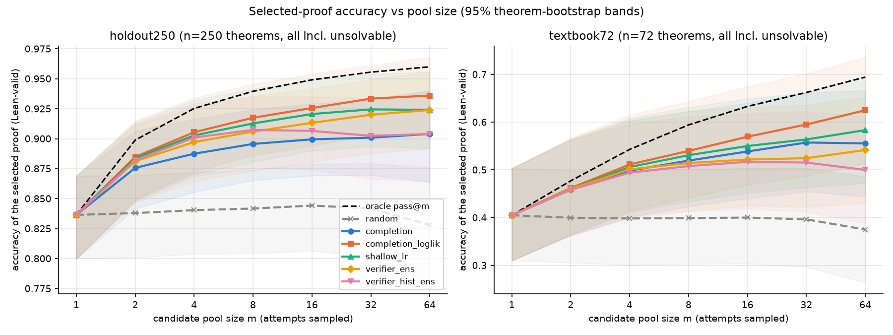
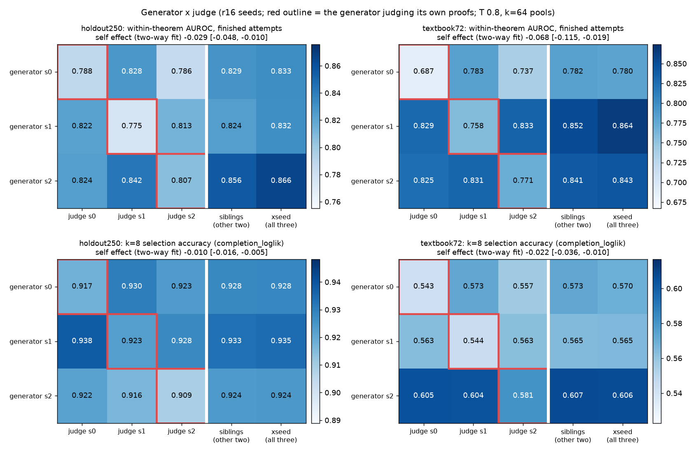
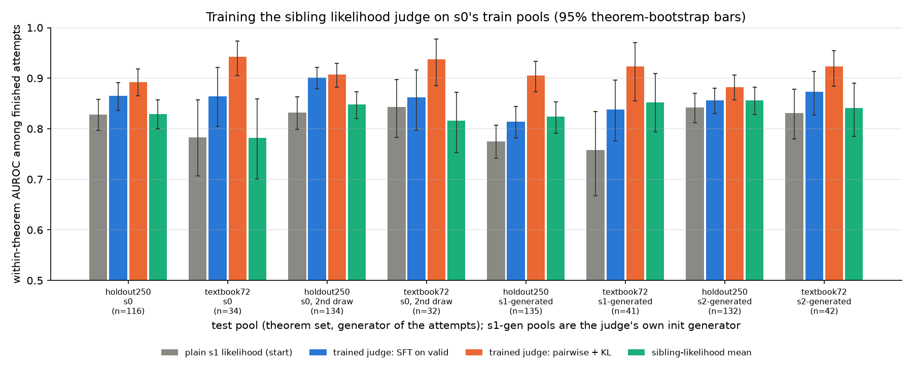
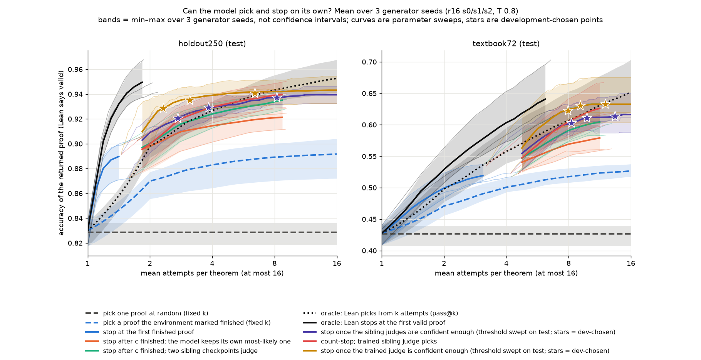
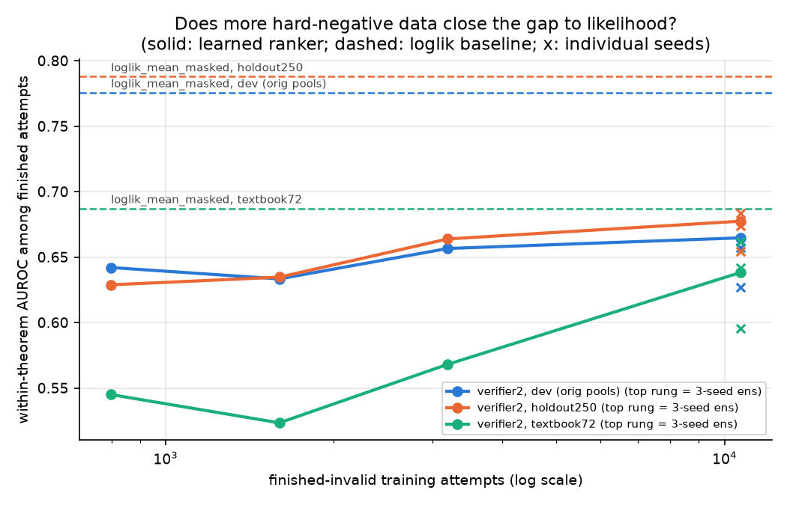
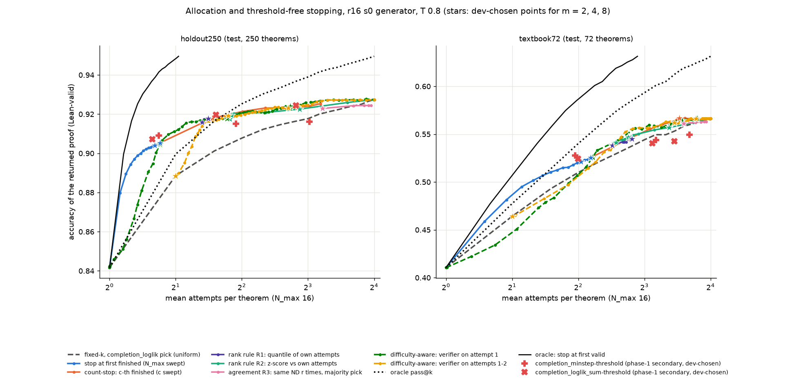

# The proof model can pick its own best attempt; a sibling trained to rank proofs picks almost as well as Lean and closes half of the stopping gap

## Executive summary

Dan's best natural-deduction prover (`state_env_october_r16`, a 9.6M-parameter model that writes proofs one Lean
tactic step at a time) proves 41% of the 72 textbook problems on one attempt and 69% if it may try 64 times and
Lean picks the winner. That gap is the test-time-scaling headroom, and today only the verifier can collect it. We
froze the generator, sampled 16 to 96 attempts per theorem on 6,525 theorems, kept every attempt including the
failures, and measured how much of the gap the model closes by itself: picking the right attempt (selection) and
stopping once it has one (stopping). Two held-out test sets: holdout250 (250 theorems, 84% of attempts Lean-valid)
and textbook72 (72, 41%). "Finished" means the environment accepted the attempt as a complete proof; Lean may still
reject it. "Likelihood" means the mean per-token log-probability a judge model assigns to the proof.

1. **Keeping the finished proof the generator finds most likely recovers about three quarters of the gap, with no
   training.** At 8 attempts: holdout250 0.836 (random attempt) → 0.918 (oracle 0.940); textbook72 0.405 → 0.540
   (oracle 0.594).
   - 
2. **The other two training seeds of the same recipe are better judges than the generator itself.** Their likelihood
   raises the 8-attempt selection to 0.928 / 0.567. In a 3×3 generator-by-judge experiment a model judging its own
   proofs is the lowest cell in 5 of 6 rows (fitted self penalty −0.029 [−0.048, −0.010] and −0.068 [−0.115,
   −0.019] in within-theorem ranking quality): it rates its own invalid proofs +0.07 to +0.11 nats per token above
   what its siblings give them, against +0.03 to +0.04 for its valid proofs.
   - 
3. **A sibling trained to rank proofs by its own likelihood recovers about 93% of the gap; scalar verifier heads
   never beat plain likelihood.** Fine-tuning sibling s1 so that its per-token likelihood rises on Lean-valid and
   falls on invalid proofs of the same theorem lifts within-theorem ranking from 0.83 / 0.78 to 0.89 / 0.94 and
   8-attempt selection to 0.933 / 0.582 (oracle 0.940 / 0.594), and the gain carries over to proofs written by the
   other generators. Three recipes that put a scalar head on the network instead all rank below untrained likelihood.
   - 
4. **Stopping is where the headroom remains, and the trained judge closes about half of it.** An oracle that stops
   at the first valid proof reaches 0.953 on holdout250 at about 2 attempts. "Stop after the c-th finished attempt"
   with sibling selection reaches 0.915 at 2.8 attempts; stopping once the trained judge's score passes a threshold
   tuned on development data reaches 0.935 at 3.1 (and 0.630 at 9.1 attempts on textbook72, oracle 0.653), closing
   50–60% of the distance from the count rule to the oracle. Its attempt budget still overshoots on textbook72
   (a 4-attempt target spends 9).
   - 

Each primary comparison was fixed on development data and its test read logged before scoring; intervals are
paired theorem-level bootstraps, and the stopping curves average three generator seeds. The two test sets were used
across seven phases, so later questions were posed knowing earlier test results, and comparisons marked
"descriptive" below were computed after a test read. A second sampling draw reproduces every accuracy-type number
within 0.03. A Codex audit recomputed the phase-1 numbers from the raw files; a second Codex review red-teamed an
earlier draft of this document.

## What problem this addresses, and why

Test-time scaling only pays off if something decides which attempt to keep and when to stop sampling. In the
current pipeline that something is Lean. That is fine for measuring pass@k and no help for an RL loop that wants
the model's own judgement as a reward, or for problems whose proofs cannot be checked. The
[learned-compute-allocation proposal](../../proposals/learned-compute-allocation/README.md) (2026-10-05), motivated
by ReVISE's learned accept-or-refine decision [@pmlr-v267-lee25ab] and Satori's reflect-and-explore actions
[@pmlr-v267-shen25o], laid out three experiments: select among eight attempts, stop with an attempt cost, stop without
a cost. This sprint ran the first with a per-candidate scorer and a frozen-generator form of the second (threshold
and count rules on a score), then followed the results: sibling judges, a data ladder for the learned head, a
mechanism analysis, a trained likelihood judge, and absolute-confidence stopping. It did not train
`ACCEPT`/`CONTINUE` actions by reinforcement learning, and it did not put eight proofs in one context (the
checkpoint's context is 1,024 tokens; eight proofs need about 2,000).

## Setup

**Generator.** `la_T1_best12_s{0,1,2}_r16.pt` from `hf://buckets/dan-pandori/nd-rl/rl-continue/ckpts/rc/ladder/`:
Robbie's 9.56M ALiBi/NoPE recipe in Dan's proof-state interface (the model sees the Lean tactic state and writes one
action; the environment applies it syntactically; Lean 4 judges the finished proof), after 16 rounds of expert
iteration. Sampling as in Dan's read-outs: T 0.8, at most 512 tokens per action and 96 actions per attempt. Seed s0
generated every training pool and the first test pools; s1 and s2 generated test pools for the judge experiment.

**Attempts and labels.** Every attempt is recorded raw: the sampled token ids of every action through its `<eos>`,
whether the environment reached a finished proof, the assembled proof text when it did, a hash of the exact prompt
the model saw at every step, and token counts. The pool file is written before Lean runs; Lean's verdict and failure
reason live in a separate labels file that no scorer reads (a label-permutation test leaves every score byte-
identical). Replaying every stored attempt through the environment reproduces every state hash and proof text (0
mismatches in 129,456 + 113,760 + 41,216 + 20,608 attempts over four generation rounds). Lean judging used Dan's
`judge_many` path (ND-to-Lean translation plus Lean 4 core), which his documentation describes as equivalent to the
sampler's literal-text gate; that equivalence was not rechecked here.

**Theorem sets.** Selector training and development: Dan's `rl_targets` (4,495 theorems, the expert-iteration
targets; 94% of the 16 attempts per theorem valid), `dev1108` (1,108) and the long-proof pool `rr600` (600), split
at the theorem level with atom-renaming and premise-permutation equivalence grouped. Test: `holdout250` (250
theorems, pass@64 0.96) and `textbook72` (72 textbook problems, pass@64 0.69; eval-only by group rule). The Codex
reviewer found no overlap between the training sources and the test sets under exact, renaming, or premise-
permutation keys; same-schema overlap with different sub-formulas is not excluded. Dan's model card for the
generator notes one textbook72 problem that overlaps its K12 training data.

**Scorers.** A scorer maps an attempt to a number; selection keeps the argmax. `completion` is the environment's
finished flag, which includes scope, goal and binder checks but no type check, so finished proofs can be wrong; it is
available to every policy because the environment is part of the deployed system. `loglik_mean_masked` is the mean
per-token log-probability of the sampled action tokens under a frozen judge model, teacher-forced on the exact
states the generator saw, with the positions the environment overrides (the name after `have`, box binders, the
first `Or.elim` binder) masked out; computed at temperature 1, and checked at 0.8. `completion_loglik` is completion
first, likelihood as the tie-break. "Within-theorem AUROC" is the probability that a valid finished proof outranks an
invalid finished proof *of the same theorem*, averaged over theorems that have both (116–135 on holdout250, 32–42 on
textbook72); "pooled AUROC" is the same probability over pairs drawn from any theorems.

**Evaluation.** For pool size m, 200 shared random m-subsets per theorem (sampled without replacement); accuracy of
the selected proof, oracle pass@m on the same subsets, and the random expectation; paired theorem bootstrap (1,000–
2,000 resamples) for every difference; unsolvable theorems stay in the denominator. All selection numbers in this
document use Worker A's registered subsets. Stopping policies consume attempts in a random order (50 orderings), stop
by their rule or at 16 attempts, and return their best-scoring attempt; policy parameters were chosen on the
development split for a target mean attempt count and read once on test at the realised cost.

## Findings

### 1. Own-likelihood selection recovers about three quarters of the gap

Among finished attempts, the generator's own likelihood of the proof carries recognition signal: within-theorem
AUROC 0.788 (holdout250) and 0.687 (textbook72). Its increment beyond the finished flag alone in selected-proof
accuracy at k=8 is +0.022 [0.012, 0.031] and +0.020 [0.005, 0.040] (recomputed by the audit).

| k=8, generator s0 | holdout250 | textbook72 |
|---|---|---|
| random attempt (expectation) | 0.836 | 0.405 |
| a finished attempt | 0.896 | 0.519 |
| finished, highest own likelihood | 0.918 [0.886, 0.946] | 0.540 [0.441, 0.643] |
| finished, highest sibling likelihood | 0.928 | 0.567 |
| finished, highest trained-judge score | 0.933 | 0.582 |
| oracle: any valid among the 8 | 0.940 | 0.594 |

Across the three generator seeds the ordering random < finished < own likelihood < sibling likelihood < oracle
holds on both sets at k=8; the seed-to-seed standard deviation is at most 0.014 on holdout250 and 0.033 on
textbook72.

### 2. A generator is a worse judge of its own proofs than its siblings are

We generated 64 attempts per test theorem with each of the three seeds and scored every pool with every seed
(figure under finding 2 above). Self-judging is the lowest cell in 5 of 6 rows; the exception is holdout250 with s0's
proofs, where judge s2 scores 0.786 against the self score 0.788. A two-way fit (generator effect + judge effect +
self indicator) gives the self penalty quoted above, with judge-identity effects within about ±0.01, so a weak seed-0
judge does not explain it. The gain in k=8 selection from switching to sibling judges replicates for all three
generators (six paired intervals exclude 0) and in a second sampling draw of seed s0's test pools (holdout250
+0.013 [0.002, 0.025]; textbook72 +0.012 [−0.001, 0.027], smaller than the first draw's +0.030). Averaging all three
judges is close to averaging the two siblings (within 0.01, except 0.856 vs 0.866 for s2's proofs on holdout250 and
0.852 vs 0.864 for s1's on textbook72), so "not the generator" and "an ensemble of judges" both contribute and are
not separated. Rescoring at the sampling temperature leaves the penalty unchanged.

Mechanism, descriptively: relative to its siblings, a generator assigns its own proofs +0.033 to +0.040 nats per
token more when the proof is valid and +0.071 to +0.107 when it is invalid. Centred within theorem, the valid-minus-
invalid separation is 0.012–0.018 nats under the self judge and 0.040–0.063 under the siblings. Pooling steps by
type, the excess is largest on atomic `have` lines (+0.15 to +0.21 on invalid proofs) and near zero on `exact` and
premise lines; these step-type figures carry whole-proof labels and no intervals. There is no consistent
concentration in long proofs.

Two checks on where the blind spot comes from, for seed s0 only. Round 8 of the same seed judges round 16's proofs
about as well as round 16 does (+0.005 [−0.022, 0.030] and −0.008 [−0.095, 0.073]), and clearly worse than the
siblings (−0.036 [−0.072, −0.002] and −0.103 [−0.177, −0.036]); the pre-registered prediction that the ancestor would
sit between self and siblings failed. The stage-1 (pretraining-only) model of the same seed is a weaker judge
(−0.097 [−0.140, −0.053] on holdout250; −0.082 [−0.181, +0.008] on textbook72).

### 3. Scalar heads lose to likelihood; a likelihood judge trained on pairs wins

Phase 1 (pre-registered): the r16 checkpoint plus a scalar head, trained with class-weighted binary cross-entropy on
all training attempts (97,776 attempts, 88% valid, 3,195 finished-but-invalid), early-stopped on development AUROC,
three seeds. Its pooled AUROC on the test sets is 0.92 / 0.95 and its within-theorem AUROC among finished attempts
0.646 / 0.596; selected-proof accuracy at k=8 is below own-likelihood by 0.012 [0.001, 0.022] and 0.025 [0.010,
0.043]. A supervised logistic regression on visible features (finished, steps, tokens, likelihood, entropy) lands
between the two. One reading is that the head learned how hard each theorem is, which a selector cannot use; the
audit notes that scarce hard negatives, input clipping (the phase-1 input format truncates 57–93% of attempts at
1,024 tokens) and optimization are alternatives the phase-1 data cannot separate.

Phase 2 (pre-registered, after generating 113,760 more attempts on hard training theorems): a within-theorem
pairwise ranker on finished attempts only, with a history input that clips 0.3–2% of attempts, and 10,676 finished-
invalid examples. Within-theorem AUROC on holdout250 goes 0.629 → 0.635 → 0.664 → 0.677 along the ladder (0.8k → 1.6k
→ 3.2k → 10.7k hard negatives; one seed per lower rung, a 3-seed ensemble at the top, seed spread ±0.02–0.04) and
stays below likelihood (0.788, paired −0.111 [−0.177, −0.040]); on textbook72 it reaches 0.638 against 0.687
(−0.049 [−0.196, +0.089], unresolved). Development AUROC is flat from training step 100 to 1,300. Giving the head the
likelihood as an input raises it to 0.718 / 0.698, still not above likelihood alone (−0.070 [−0.133, −0.010] on
holdout250; +0.011, unresolved, on textbook72). The new data is concentrated on harder theorems, so the ladder
confounds "more data" with "harder theorems".

Phase 3 (pre-registered): the same ranker with its body initialized from a sibling seed, two runs each from s1 and
s2. Against the s0-initialized head: +0.021 [−0.009, +0.051] and −0.029 [−0.094, +0.045]; against sibling
likelihood: −0.131 [−0.184, −0.074] and −0.174 [−0.300, −0.041]. Heads of either initialization sit at 0.53–0.75
across the generator-by-head matrix, without the consistent diagonal penalty the likelihood judges show. The
hypothesis that the head inherits the generator's blind spot through initialization is not supported.

Phase 4 (pre-registered, the last training experiment): keep the per-token likelihood as the score and train the
*model* instead of a head. Starting from sibling s1, on s0's training pools only, two variants with two seeds each:
continued training on Lean-valid finished proofs with Dan's action-token loss, and a pairwise variant that raises
the masked mean log-probability of the valid proof and lowers that of the invalid proof of the same theorem
(a DPO-style logistic against a frozen s1 reference, with a token-level KL anchor). Early stopping on development
within-theorem AUROC. Scored with the unchanged likelihood scorer.

| within-theorem AUROC, finished attempts | holdout250 | textbook72 |
|---|---|---|
| plain s1 likelihood (starting point) | 0.828 | 0.783 |
| sibling mean (s1, s2) | 0.829 | 0.782 |
| s1 trained on valid proofs | 0.865 | 0.864 |
| s1 trained pairwise | **0.893** (+0.065 [0.036, 0.094] vs s1) | **0.942** (+0.159 [0.088, 0.236]) |

The pairwise judge also beats the sibling mean (+0.064 [0.033, 0.095]; +0.159 [0.084, 0.237]), holds on the second
sampling draw (+0.075 [0.048, 0.103]; +0.094 [0.037, 0.158]) and on proofs written by s1 and s2 (+0.03 to +0.08
over the sibling mean, all intervals above 0), so it did not just learn s0's habits. The valid-only variant helps
less and does not transfer beyond the sibling mean. At k=8 with completion first, the pairwise judge selects
0.933 / 0.582 against the plain-s1 0.931 / 0.568 (+0.002 unresolved; +0.014 [0.001, 0.031]) and the oracle
0.940 / 0.594. Its pooled AUROC on finished attempts is 0.88–0.96 across the eight test pools, against 0.74–0.89 for
sibling likelihood, which is what makes it usable for stopping. Its likelihoods drifted during training (invalid
proofs −0.09 → −0.31 nats per token on development; token KL to s1 about 0.08), so it is a ranker, not a calibrated
probability and not a sampler. One hyper-parameter setting per variant; the valid-only seed 0 peaked at its last
step.

### 4. Stopping retains the headroom; the trained judge closes about half of it

"Stop at the first finished attempt" is a strong policy: holdout250 0.892 at 1.6 attempts, textbook72 0.527 at 4.0
(three-seed means). "Stop after the c-th finished attempt and keep the siblings' favourite" continues the same
curve: 0.924 at 3.9 and 0.934 at 8.1 attempts on holdout250, 0.587 at 7.6 on textbook72, against oracle pass@k point
estimates of 0.927 at 4, 0.943 at 8, and 0.607 at 8 (variable allocation versus fixed k; no equivalence test).

The oracle that stops at the first valid proof reaches 0.953 at 2.0 attempts on holdout250 and 0.653 at 7.2 on
textbook72. Model-side rules tested against that, in the order they were tried:

- An absolute threshold on own likelihood, tuned on development data, adds +0.012 [0.004, 0.021] at 4 attempts on
  holdout250 over fixed-k with the same selector, but the same threshold spends 12 attempts on textbook72 when aiming
  at 4, because textbook proofs have lower likelihood even when the theorem is easy. Two secondary thresholds
  (minimum step likelihood, summed likelihood) beat fixed-k on textbook72 (+0.023 [0.011, 0.038], +0.016 [0.005,
  0.031]) and are not distinguishable from the first-finished rule.
- Rank-based rules (z-score of the incumbent against the theorem's own attempts) trace the same curve as the count
  rule.
- Difficulty-aware allocation (continue while a development-fitted estimate of the chance that the next attempt is
  valid, times the chance the incumbent is wrong, exceeds a cost; difficulty estimated from the phase-1 head's score
  of the first attempt) ties the count rule on holdout250 and beats it on textbook72 only by spending five more
  attempts. All policies spend most on near-hopeless theorems, and a give-up rule loses on development data.
- A threshold on the sibling-judged likelihood (phase 5, pre-registered), in a descriptive comparison computed
  after the test read that interpolates the count rule with the same selector to each policy's realised cost, adds
  +0.006 to +0.010 on holdout250 at 2.3–3.9 attempts (intervals exclude 0), +0.003 [−0.000, +0.005] at 8.2, and
  +0.011 to +0.016 on textbook72 at 8–10 attempts (two of three intervals include 0): 18–21% of the distance from
  the count rule to the first-valid oracle at the low-budget points on holdout250, 23% on textbook72 at 8 attempts.
- A threshold on the trained pairwise judge's score (phase 7, pre-registered; τ chosen on the s0 development split,
  the same split the judge was early-stopped on), averaged over the three generators' pools:

| dev-chosen target | count-stop, sibling pick | count-stop, trained-judge pick | sibling threshold | trained-judge threshold | oracle: first valid |
|---|---|---|---|---|---|
| holdout250, m≈4 | 0.915 @ 2.8 | 0.920 @ 2.8 | 0.929 @ 3.9 | **0.935 @ 3.1** | 0.953 |
| holdout250, m≈8 | 0.933 @ 7.1 | 0.938 @ 7.1 | 0.937 @ 8.2 | **0.941 @ 6.5** | 0.953 |
| textbook72, m≈4 | 0.567 @ 6.1 | 0.579 @ 6.1 | 0.611 @ 9.8 | **0.630 @ 9.1** | 0.653 |
| textbook72, m≈8 | 0.604 @ 10.8 | 0.624 @ 10.8 | 0.613 @ 13.4 | **0.633 @ 12.1** | 0.653 |

  At equal attempts (count rule interpolated to the threshold rule's realised cost), the trained-judge threshold adds
  +0.024 [0.017, 0.032] over count-stop with sibling selection on holdout250 at 2.3 attempts (50% of the distance to
  the first-valid oracle; 53% at 3.1) and +0.035 [0.018, 0.056] on textbook72 at 9.1 attempts (60%). Against the
  sibling threshold at each rule's own development-chosen point: +0.008 [0.001, 0.015] on holdout250 with fewer
  attempts, +0.020 [0.003, 0.038] on textbook72. Below the first-finished point (about 1.6 attempts on holdout250,
  4.0 on textbook72) no rule that returns a finished proof can go, and the attempt budget chosen on development data
  still overshoots on textbook72 (a 4-attempt target spends 9.1).

## Map of what was done

- Working folder: `code/experiments/current/proof_selection_20261006/`: kickoff `start.md`, data `schema.md`, worker
  briefs, timestamped `research_log.md` and `logs/worker_{A,B}.md` with every pre-registration and freeze, three
  Codex reviews in `reviews/` (design, midpoint recomputation with scripts, write-up red team), code in `code/`,
  tables and freeze hashes in `results/` (`results/HEADLINE_SOURCES.md` maps every number here to its source file),
  figures in `figures/`.
- Heavy artifacts on this machine in `~/runs/proof-selection/`: pools with every attempt (`pools_v2/`, sha256
  manifest), per-attempt scores (`scores/`), head checkpoints (`verifier/`, `verifier2/`), trained judges
  (`judge/`), stopping curves (`stopping/`), the three r16 checkpoints plus the r8 and stage-1 ancestors (`ckpts/`).
  Proposed durable home: the `ndrl` Hugging Face org.
- Branch `dmitry/selection-sprint` (worktree `/data/users/dmitry/ndrl-selection-sprint`), not pushed. Dan's
  environment code: `dan-pandori/nd-takehome` branch `dan` @ `4dcd0e4f`, cloned to `~/runs/proof-selection/nd-takehome`.
- Team: two Opus 5.5 workers (A: collector, pools, learned heads, trained judge; B: likelihood scorer, stopping,
  judge matrices) and a Codex reviewer at the design stage, at the midpoint, and on an earlier draft of this
  document. Experiments finished at 07:35 UTC; the sprint's deadline was 11:42.
- A Codex-run sprint on the same proposal started three minutes before this one in the main working tree. The two
  were kept apart by a separate worktree, branch, run directory and GPU set; its working files were read only during
  the first minutes of this sprint, to establish the collision. Two of Worker A's training runs were killed by an
  out-of-memory condition from a process this sprint does not own and were rerun unchanged.

## Limitations

- **Test exposure, by worker.** An aggregate headroom table from Dan's earlier pools exposed both test sets' difficulty
  before the design was fixed. Worker A generated the textbook72 pool at 02:07 UTC and its aggregate label summary
  printed at 02:07:36, one minute before the written freeze of the primary comparisons; A's history-input decision
  used textbook72's label-free clipping rate. Worker B first read test stopping results between its 02:30 freeze and
  02:38, before A's 03:28 freeze of the selection scores. Later phases were designed knowing earlier test results,
  and the phase-5 cost-matched comparison and the phase-1 fixed-k mixture weights use realised test costs. No test
  label was used to choose a threshold, checkpoint, or comparison.
- Intervals are pointwise, cover theorem resampling only, and many comparisons were made. A second sampling draw of
  seed s0's test pools (`results/worker_B_phase6.md`) moves accuracy-type numbers by 0.001–0.004 on holdout250 and
  0.001–0.028 on textbook72, well inside the theorem-bootstrap half-widths of about 0.03 and 0.10, but moves
  within-theorem AUROC levels by up to 0.08 (textbook72 self-judge 0.687 → 0.764), so absolute AUROC levels quoted
  here are draw-dependent; the sibling-minus-self and trained-minus-plain differences are not.
- "Finished" carries the environment's syntactic checks, which reject some wrong proofs before Lean. Every scorer
  has that information; the likelihood and judge results are increments on top of it.
- Likelihood is a diagnostic quantity (temperature 1, environment-assigned names masked); rescoring at T 0.8 leaves
  the self penalty and selection ordering unchanged (textbook72 sibling-minus-self AUROC +0.105 [0.027, 0.186] vs
  +0.095 at T 1).
- The scalar-head negatives are for one architecture and recipe family (scalar head on the 9.6M model, BCE or
  pairwise loss, s0-generated training data, development data from s0 only); the ladder confounds data quantity with
  theorem difficulty. The trained judge is one hyper-parameter setting per variant, trained on s0's proofs only, and
  its stopping threshold was chosen on the development split it was early-stopped on, so its development numbers
  favour it; the test numbers were read once. Each candidate costs two judge forward passes (two seeds).
- The "siblings" column mixes judge identities, and the two-way fit has three residual degrees of freedom; the
  single-judge comparisons (11 of 12 positive) support the penalty on their own.
- The difficulty-aware allocation model was fitted for the self-likelihood selector and reused with the sibling
  selector; before the phase-2 freeze, Worker B inspected a label-free count of repeated proof texts on holdout250.
- Everything is a frozen-generator result. Nothing here trains the generator to emit a stop decision, so the
  proposal's experiments 2 and 3 as written remain open.

## What to do next

1. **Report model-selected pass rates with a trained sibling judge, or at least the plain sibling likelihood.**
   The plain sibling mean needs no training and was within 0.01–0.04 of oracle pass@8; the pairwise-trained judge
   was within 0.01, with two forward passes per candidate. Both should be re-measured on fresh theorems.
2. **Make the judge's score a budget as well as a ranking.** The trained judge's threshold closes half of the
   stopping gap but its attempt budget still overshoots on textbook72. Candidates to compare on fresh test
   theorems at matched total inference cost: calibrating the judge's score to a probability per theorem
   distribution, training the judge on all three generators' proofs, and the proposal's RL-trained stop action.
3. **Test whether a sibling judge is a better RL reward than self-judgement.** Expert iteration trained each seed on
   its own accepted samples; whether a trained sibling reward is less correlated with the generator's errors, and
   whether that helps, is untested. The pools, scorers and judges here are a starting point.
