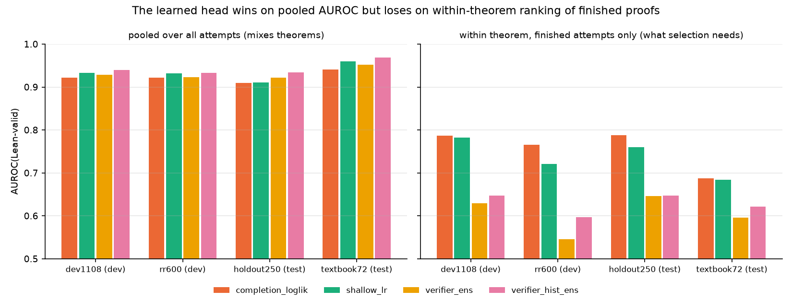
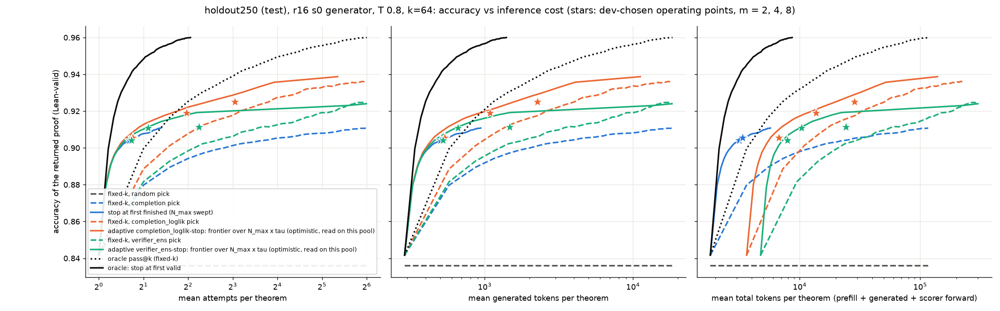

# Can the proof model pick its own winning attempt and know when to stop?

## Executive summary

Dan's r16 proof-state model (`state_env_october_r16`) solves 0.41 of textbook72 per attempt and 0.69 at pass@64, but
every extra solve is found by Lean. We froze the generator, sampled up to 64 attempts per theorem on 6,525 theorems,
kept every attempt (not only the valid ones), and asked whether the *model* can close that gap: pick the right
attempt (selection) and stop sampling when it has one (stopping).

1. **The model already knows which of its proofs is right, for free.** Keep the finished attempt the model itself
   assigns the highest per-token likelihood; this recovers about three quarters of the gap between a random attempt
   and oracle pass@8 on both held-out sets (holdout250: 0.836 → 0.918 vs oracle 0.940; textbook72: 0.405 → 0.540 vs
   oracle 0.594). No training was involved.
   - 
2. **A verifier head trained on Lean labels learned which theorems are hard, not which proof is wrong.** Fine-tuning
   the same checkpoint with a scalar head (3 seeds) gives the best *pooled* AUROC (0.92–0.97) but ranks finished
   proofs of the *same* theorem worse than likelihood (within-theorem AUROC 0.60–0.65 vs 0.69–0.79), and so selects
   worse (paired −0.012 and −0.025 at k=8, CIs exclude 0). Selection needs within-theorem ranking only.
   - 
3. **"Stop at the first finished proof" is hard to beat.** It reaches 0.904 on holdout250 in 1.6 attempts. Adaptive
   stopping on the likelihood adds +0.012 [0.004, 0.021] at about 4 attempts there, but its threshold does not transfer
   to textbook72, where proofs have lower likelihood even when the theorem is easy.
   - 
4. (phase 2, pending: data-scaled within-theorem ranker; sibling-checkpoint judges; difficulty-aware allocation.)

## What problem this addresses

Test-time scaling only pays off if something decides which attempt to keep and when to stop sampling. In the current
pipeline that something is Lean. This sprint measures how far model-side signals get, with the generator frozen so
that any gain is recognition, not better generation. It executes experiment 1 of
[the learned-compute-allocation proposal](../../proposals/learned-compute-allocation/README.md) with a per-candidate
scorer, and a frozen-generator version of its experiment 2 (threshold stopping). It does not train `ACCEPT`/`CONTINUE`
actions by RL and does not put eight proofs in one context (the checkpoint's context is 1,024 tokens).

## Map of what was done

- Working folder: `code/experiments/current/proof_selection_20261006/` (kickoff `start.md`, data `schema.md`, worker
  briefs, timestamped `research_log.md` and `logs/worker_{A,B}.md`, two Codex audits in `reviews/`, code in `code/`,
  tables in `results/`, figures in `figures/`).
- Heavy artifacts on this machine in `~/runs/proof-selection/`: pools with every attempt (`pools_v2/`, with separate
  `.labels.jsonl` Lean verdicts and a sha256 manifest), per-attempt scores (`scores/`), verifier checkpoints
  (`verifier/`), stopping curves (`stopping/`). Proposed durable home: the `ndrl` Hugging Face org.
- Branch `dmitry/selection-sprint` (worktree `/data/users/dmitry/ndrl-selection-sprint`). Dan's environment code:
  `dan-pandori/nd-takehome` branch `dan` @ `4dcd0e4f`, cloned to `~/runs/proof-selection/nd-takehome`.

## Findings

### 1. Own-likelihood selection recovers ~75% of the gap

(detail pending)

### 2. The trained head learns difficulty, not correctness

(detail pending)

### 3. Stopping

(detail pending)

## Method details

(pending)

## Limitations and what to do next

(pending)
