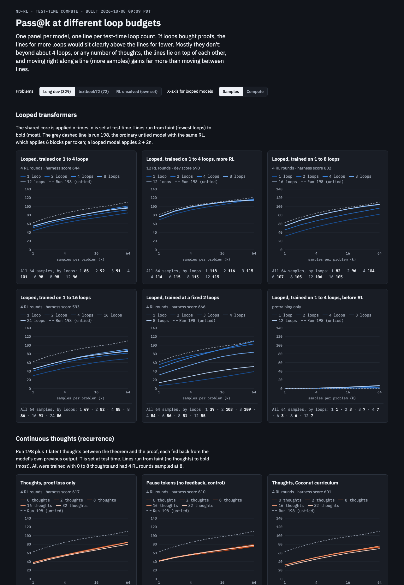

# Test-time loops: looped transformers do not scale with loops; the RL recipe is what improved

Status: stopped 2026-10-07 21:02 PT when the RunPod balance ran out. Robbie's read on 2026-10-08:
"broadly doesn't seem to work, we barely see scaling."

Question (Robbie's task from the 10/2 group meeting): can a looped transformer buy more proofs on
hard problems by running more loops at test time?

Short answer: no. Extra loops are worth 2 to 4% on dev for three times the compute per sample, the
benefit saturates by about 4 loops, and at equal training the ordinary untied model is ahead. The
useful by-product is a better expert-iteration recipe, which takes the untied model from 680 to
792 dev theorems.

Interactive versions (private to Robbie): [pass@k by budget](https://claude.ai/artifact/RKJ9m3ppQqiziV6zveLJEZ),
[spike report](https://claude.ai/artifact/BPrfvMZP45s6dYLCzp8vfn).

## Configuration

Two stages, both on run 198's `pretrain.py` (sha `6bdbe0047ac4`), seed policy and data unchanged,
RunPod A40s, dev = the dev half of the ladder transfer pool (1,108 theorems of true length 7+).

1. **Spike, 2026-10-06.** Working folder
   [`code/experiments/current/looped_spike_20261006`](../../code/experiments/current/looped_spike_20261006/README.md).
   Looped trunk: one untied entry block, two shared core blocks applied n times with the entry
   output re-injected each pass, one untied exit block (6.40M parameters against 9.56M). Arms
   trained at a fixed 2 loops and on random 1-4, 1-8 and 1-16 loops; old frozen harness (4 rounds of
   expert iteration, sampled at 2 loops); one seed each. Each checkpoint was then sampled at 1 to 24
   loops on textbook72, long dev (329 theorems of length 10+) and its own never-solved RL targets.
2. **Autoresearch loop, 2026-10-07, 09:20 to 21:02 PT.** Working folder
   [`code/experiments/current/autoresearch_loops`](../../code/experiments/current/autoresearch_loops/README.md),
   branch `autoresearch-loops`. Forked harness: the agent owns RL (1,800 s of GPU clock, a sampling
   oracle that returns only Lean-verified attempts at the fixed targets), and the metric is dev
   solved with 64 samples at 8 loops, with the same eval at 2 loops recorded beside it. Twelve
   experiments (500 to 512) by Fable 5.1 and Opus 5.5 plus one operator control (590), three seeds
   each. Every result: [`RESULTS.md`](../../code/experiments/current/autoresearch_loops/RESULTS.md).

Checkpoints: `robbiethompson2018/nd-rl-checkpoints`, `runs/looped-spike-20261006_*` and
`runs/5xx-*`. A sibling loop for continuous thoughts shares the harness (branch
`autoresearch-thoughts`, another agent's work; its numbers are not reproduced here).

## Observations

Observed, spike (one seed per model, old RL), long dev solved with 64 samples by test-time loops:

| trained on | 1 | 2 | 4 | 8 | 12 to 24 | harness score at 2 loops |
|---|---|---|---|---|---|---|
| 1-4 loops | 85 | 92 | 101 | 98 | 96 | 644 |
| 1-8 loops | 82 | 96 | 104 | 105 | 105 to 106 | 602 |
| 1-16 loops | 69 | 82 | 88 | 86 | 86 to 91 | 593 |
| fixed 2 loops | 39 | 103 | 84 | 51 | 55 | 666 |
| 1-4 loops, 12 RL rounds | 118 | 116 | 114 | 115 | 115 | 690 |
| run 198, untied | | 110 (4 rounds), 121 (12 rounds) | | | | 680, 716 |

Observed, autoresearch loop (three-seed means, dev solved of 1,108):

| | at 8 loops | at 2 loops |
|---|---|---|
| 500 looped baseline, RL samples at 1/2/4/8 loops | 675 | 657 |
| 502 retry only the targets 1 loop failed, at a random 2/4/8 loops | 690 | 672 |
| 507 RL fine-tune in token-budget batches | 732 | 714 |
| 509 Muon for the RL fine-tune | 748 | 727 |
| 510 more, shorter RL rounds | 764 | 752 |
| 512 two alternating shared core pairs, 9.56M parameters | 766 | 739 |
| 590 control: run 198's untied six blocks with 507's RL | 792 | 792 |

- Loops saturate early. Gains stop at about 4 loops whatever range the model trained on, and
  running far past the trained range neither helps nor breaks. One experiment (505) measured the
  core state changing by 28%, 10% and 5% over the first three passes and about 2% per pass after.
- More RL removes most of the loop benefit: after 12 old rounds, one loop did as well as four.
- Nothing widened the gap between 8 and 2 loops without lowering 2 loops. Tried: RL only at 8
  loops (501), training each proof at or above its discovery depth (503), truncated backprop
  through loops (504, which erased the gap), a countdown embedding (505), an untied first pass
  (506), training on 1-4 loops (508), a wider trunk at the untied model's parameter count (511).
- Every kept experiment was an RL-efficiency change. The recipe: rounds repeat until the budget is
  spent; each round samples every target 8 times and retries only the failures 24 more times;
  the fine-tune uses token-budget batches (about 2.5 times faster than padded batches), Muon on
  the hidden matrices, and half as many records per round. Twelve to fourteen rounds fit where
  four ran before.
- That recipe helps the untied model more. With 507's version of it, run 198's architecture
  scores 792 (790/785/800), against 680 under the old harness. At equal RL and equal parameters the
  looped trunk is 26 to 46 dev theorems behind, and three times as expensive to sample at 8 loops.
- One clean positive for depth: among targets that failed 8 tries at 1 loop, 11.4% were solved on
  retry at 2 loops, 13.8% at 4 and 15.9% at 8 (502, retry depth randomized, about 4,100 targets
  per arm).

Interpretation, not established: at this model size and on this task, weight sharing costs more
than re-applying the core buys, and the RL schedule matters more than either. Withdrawn during the
work: a claim that looped models generalise better before RL, which rested on RL round-1 counts
that vary from about 260 to 760 between near-identical runs.

## Limitations and next step

- One seed per model in the spike; three in the loop, where a single seed has a standard deviation
  of roughly 10 to 25, so adjacent keeps (509, 510, 512) are not separated from noise.
- All selection was on dev. The holdout half of the transfer pool has not been scored for any
  model from the new harness, including the 792.
- The control has 507's RL, not 509's or 510's changes.
- Run 198 was tuned over about 200 autoresearch runs on this dev pool; the looped trunk was not.
- The loop ran 11.7 of its planned 24 hours.

Next: score holdout for 590 and 512 (about $0.15 of GPU each), then run the untied model with the
full final RL recipe. If the work continues it should be on the untied model and RL, not loops.
To resume the loop: [`LOOP.md`](../../code/experiments/current/autoresearch_loops/LOOP.md).
