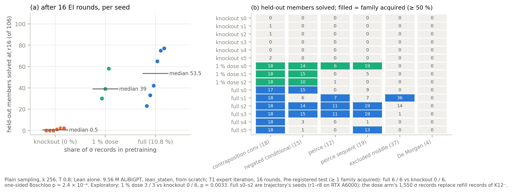
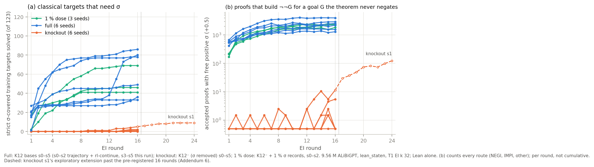
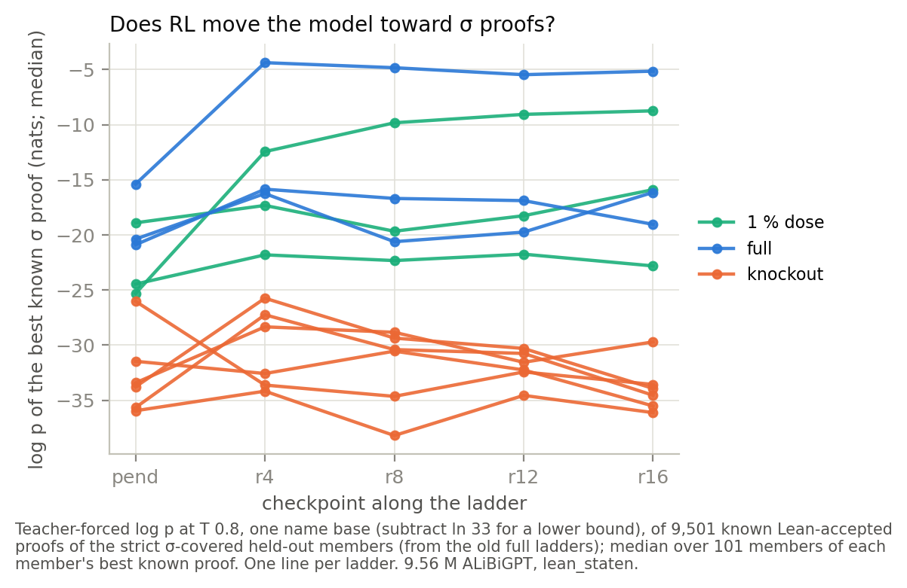
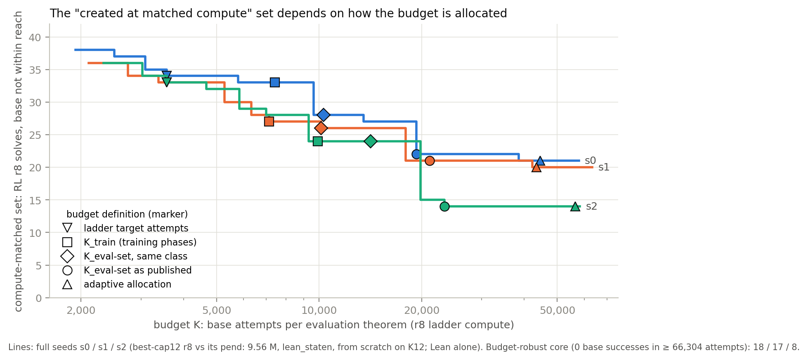
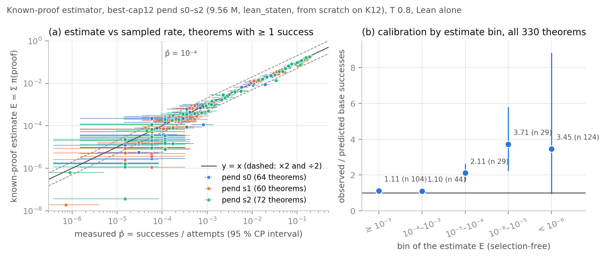
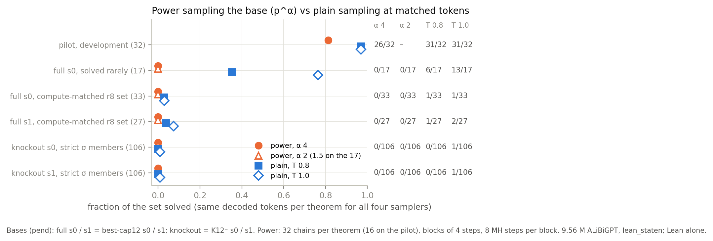

# create-or-elicit: pretrained without the classical reductio σ, 0 / 6 knockout seeds acquire a classical family in 16 EI rounds against 6 / 6 full-exposure seeds ("needs exposure", p = 0.00024); 1 % σ in pretraining restores acquisition on 3 / 3; σ is rare in the knockout bases, not absent

Status: completed and reviewed 2026-10-13. **No hard-constraint violation, nothing quarantined.** Before reading the
write-up, the reviewer rebuilt the knockout set, the families, every arm's acquisition table, the certificates and the
Lean checks with independent code (`review_coe/`). Lean accepted every proof it re-checked: all 448 stored knockout
proofs of strict members, the 16,961 refill records and samples from every arm. The controls behaved.
The pre-registered primary result and its verdict, **"needs exposure"**, **stand**. The review asked for ten
rewordings, all applied below.

**Not supported as written:**
- that the classical families "need" σ in pretraining, beyond 16 rounds of this EI;
- "sharpening the base is not RL" as a claim about sharpening in general (it holds for one MH sampler);
- "(18 / 17 / 8 survive all)".

Three Boschloo p-values in `numbers.md` / `claims_ledger.md` came from a transposed table: 0.0020 → **0.0032**,
0.30 → 0.39, 0.035 → 0.034. No verdict changes.

Question (proposal 27, Dan 2026-10-11): does RL against a verifier create a capability its base never had, or does it
raise the probability of one the base already had? Earlier runs measured this without intervening. This run **removes
one composition from pretraining** and asks whether expert iteration (EI) brings it back.

**σ** is double negation (`DN`, Lean `Classical.byContradiction`) applied to a line built by negation introduction
(`NEGI`): classical proof by contradiction. The classical families the project tracks are excluded middle, both Peirce
families, and the classical members of the negated-conditional, De Morgan and converse-contraposition families. On
their strict members (defined below), any proof needs a DN step on a double negation the proof builds itself: σ,
another σ⁺ route, or the lemma route.

Proposal: [`2026-10-11-create-or-elicit-paper.md`](../../docs/proposals/2026-10-11-create-or-elicit-paper.md);
brief: [`BRIEF_create-or-elicit.md`](../../docs/proposals/paper/BRIEF_create-or-elicit.md). The writing run
`create-or-elicit-paper` ([brief](../../docs/proposals/paper/BRIEF_create-or-elicit-paper.md)) is queued next and starts
from this summary and the review. Where these differ from the executor's `claims_ledger.md`, the review's corrections
take precedence; they are listed under "Rewordings applied" (items 8–9 cover the ledger).

## Configuration

- **Repository.** Fork `dan-pandori/nd-takehome`, branch `dan_create-or-elicit`, from the fork's `origin/dan` at
  `4dcd0e4f`. Ran on the second VPS (agent2), every role at `--effort max`.
  - The pre-registration `preregistration/create-or-elicit.md` was committed at
    [`d0ac00e2`](https://github.com/dan-pandori/nd-takehome/commit/d0ac00e2) (05:52:13Z), with a pre-launch amendment at
    [`13e41bbd`](https://github.com/dan-pandori/nd-takehome/commit/13e41bbd) (05:56:17Z). Both precede the first pod
    (`coe-k0`, 05:57:04Z).
  - Addenda 1–6 each precede the work they govern, with one exception. **Addendum 2** (07:05Z) came after knockout s0's
    round 1 and replaced the σ-covered definition with a stricter one (below). It is disclosed, and the reviewer's
    recount shows the original 178 / 291 sets give the same primary result (6 / 6 vs 0 / 6), so it did not decide the
    headline.
  - DONE at [`c50b16f3`](https://github.com/dan-pandori/nd-takehome/commit/c50b16f3). Deliverables:
    - `run_create_or_elicit.md`, `numbers.md` § create-or-elicit and `log.md`;
    - `claims_ledger.md` v3 (rows L73–L101 are this run's) and `next_steps.md`;
    - `figures/coe_*.{png,pdf}`, the scripts in `coe/` and `pod/coe/`, and the data notes `data/coe/README.md`.
  - Review: [`review_create-or-elicit.md`](https://github.com/dan-pandori/nd-takehome/blob/8e195390/review_create-or-elicit.md).
    [`dd8ee82e`](https://github.com/dan-pandori/nd-takehome/commit/dd8ee82e) holds §Recount, written blind with the
    reviewer kit `review_coe/`; [`8e195390`](https://github.com/dan-pandori/nd-takehome/commit/8e195390) holds §Compare
    and §Verdict.
- **Timeline.** Executor Mon 2026-10-12 05:14 – Tue 2026-10-13 17:39 UTC; pods 10-12 05:57 – 10-13 16:40; reviewer
  10-13 17:40–18:36.
- **Models for every number** (Lean alone).
  - All are `best_model.ALiBiGPT` 6 × 384, **9,560,832 params**, format `lean_staten` (proof-state environment,
    environment-assigned names), trained from scratch with `state_env_october`'s recipe (best-cap12).
  - Stage 1 runs for 1,200 s on one A40. Then T1 EI (`state_ladder_ei.py`) runs for 16 rounds: k 32, T 0.8, 600
    fine-tune steps per round, 4,495 `rl_targets`, and 20,000 replay records **from the arm's own pretraining set**.
  - pend = end of pretraining; rN = after N rounds.

  | arm | pretraining set | seeds | where trained |
  |---|---|---|---|
  | full, old | K12 | s0–s2 | `trajectory` (pend md5 `2bf801fd` / `eaff7f4d` / `abca9c63`; r1–r8 on RTX A6000, batch 2,048, s2 1,024 from r2) + `rl-continue` (r9–r16 on A40) |
  | full, new | K12 | s3–s5 | this run, A40, batch 1,024 |
  | knockout | K12⁻ | s0–s5 (s1 continued to r24, exploratory) | this run, A40, batch 1,024 |
  | 1 % dose (`dose1`) | K12^1% | s0–s2 | this run, A40, batch 1,024 |

  Arms with the same seed number share the initial-weight and per-round sampling seeds, not the data.
- **Data.**
  - **K12** (`train_k12.jsonl`, 155,000 records; decompressed md5 `800b5486`): σ occurs in 16,703 records. σ⁺ (DN
    citing any derived line) occurs in **16,961 (10.94 %)**. The lemma route occurs in 0.
  - **K12⁻** (`data/coe/train_k12ko.jsonl.gz`, decompressed md5 `466fc214`):
    - removes the 16,961 σ⁺ records, in written or pruned form;
    - refills per length from K12's own unused source pools: L 4–6 from `train_depth3_f0_a1.jsonl`, L 7–12 from
      `pool_long_kh.jsonl`;
    - every refill record passes every K12 filter, is σ⁺-free and lemma-route-free, and is disjoint by renaming class
      (order-sensitive and premise-order-invariant keys) from K12 and every evaluation pool;
    - 138,039 kept + 16,961 refill = 155,000, with per-length counts identical to K12's.

    DN and NEGI each stay; only their composition goes.
  - **K12^1%** (`data/coe/train_k12dose1.jsonl.gz`, decompressed md5 `19cd2263`): K12⁻ with 1,550 refill records replaced by 1,550
    removed σ records, at K12's σ length mix; the σ⁺ share is exactly 1.00 %. A 0.1 % set (155 records,
    `train_k12dose01.jsonl.gz`) is built and in the bucket, unused.
  - **Families.** Six classical generator families. Each has 40 trained-on members (`rl_targets`) and 40 held-out
    members (transfer pool, sampled every round but never trained on).
    - A member is **strict σ-covered** (Addendum 2) if it is classical-only (not provable by G4ip) and its sequent
      contains no ¬¬ subformula. Any DN step must then cite a double negation the proof built itself: σ, another σ⁺
      route, or the lemma route.
    - Strict sets: **123 trained, 106 held-out**. The held-out members are contraposition_conv 18, demorgan_nand_to_or
      4, excluded_middle 37, negated_conditional 15, peirce 12, peirce_sequent 19, plus the generated
      `la_transfer_916`.
  - Read set `read1054`: textbook72 (scoring only) + holdout250 + 732 tracked transfer theorems.
- **Reads.**
  - Plain: k 256, T 0.8, 96 steps, 512 tokens per action, batch 512, sample seed 0 (x0) or 1 (x1).
  - Guided: `guided_eval.py --arm logical`, ≤ 10 rejections per attempt.
  - Peak memory was 8.3 GB at batch 512 and 25.5 GB at batch 2,048 (timing reads).
  - The old seeds' ladders, and some of their old reads, ran at batch 2,048 / 1,024. A batch change is a sampling
    re-draw, and it is disclosed.
- **Thresholds and decision rule** (pre-registered).
  - Solved: ≥ 1 Lean-accepted proof in 256 plain attempts (x0). A **family is acquired** ("at the bar") when ≥ 50 % of
    its strict held-out members are solved.
  - Budget: `K_train(R)` = the ladder's sample + fine-tune GPU-s for rounds 1–R, divided by 322 × c_base. Here c_base
    is the seed's own base's per-attempt cost on the 322, at batch 1,024 on an A40.
  - Within reach at K: p̂ ≥ 1 / K. **Certified out of reach:** one-sided 95 % Clopper–Pearson UB95 < 0.05 / K. With 0
    successes that takes n ≥ 59.9 K.
  - Verdicts:
    - **Created:** ≥ 2 / 6 knockout seeds acquire a family at r16, and the knockout base is certified out of reach on it.
    - **Needs exposure:** ≤ 1 knockout seed acquires the family, and the full arm acquires it on more seeds
      (one-sided Boschloo p ≤ 0.05).
    - **Neither:** no seed acquires the family. Any other outcome is **undetermined**.
  - **Primary test:** per seed, "≥ 1 strict family at the bar at r16", full vs knockout, one-sided Boschloo.
  - Power, stated before running: the test rejects at (full, knockout) acquisitions of at least (3, 0), (5, 1) or
    (6, 2). A 0 / 6 knockout outcome bounds the per-seed creation rate below 0.39.
- **Checker: Lean alone** (`lean_gate`: Lean 4 on the literal sampled text; the pre-filter only rejects).
  - `nd_verify` is unmodified (tree `9437bb72`) and not used as a judge.
  - `artifacts/TEST_RUN_DONE` is unchanged, and there was no test-file run.
- **Pods and cost.** 16 pods, **309.34 pod-hours, $182.50** of the $190 / 330 h budget (`podbudget`, `~/podhours.log`).
  - Fifteen were NVIDIA A40 (SECURE, $0.59/h). One was an RTX A6000 (`coe-t6`, 0.27 h, $0.16), which stuck while
    initialising and was deleted. No A6000 was timed directly. Instead, the A6000 / A40 ratio (0.90 / 0.96 on s0 / s1)
    compares a round-1 replica on an A40 with `trajectory`'s A6000 round 1.
  - The brief's budget was $140 / 300 h. The executor asked at 06:00 UTC whether to fund the dose curve, and Dan raised
    the budget to $190 / 330 h at 15:23 UTC. The executor did not poll its inbox and saw the answer at 20:31; the dose
    arm started at 20:33.
  - Budget cuts:
    - at 04:13 on 10-13: no r16 redraw, guided read or standard A for the dose arm;
    - at 08:23: Phase 3a ended up on 5 knockout seeds, not 6.

    Knockout s1's extension was cut to r20 at 08:23 and restored to r24 at 10:38.
  - Pod time per arm:
    - full s3–s5: 22.1–24.3 h ($13.0–14.3) each;
    - knockout s0 and s2–s5: 22.7–27.5 h ($13.4–16.2) each; s1 34.7 h ($20.5, with the extension);
    - dose s0–s2: 16.7–18.2 h ($9.8–10.7) each;
    - shared pods (Phase 0.2, old-seed reads, Phase 2 / 2b): 26.0 h ($15.3).
- **Compute per arm** (registry rows, `artifacts/coe/compute.md`, recounted by the reviewer; A40 throughout). Per new
  16-round ladder, mean over seeds:

  | quantity | knockout | full | dose1 |
  |---|---|---|---|
  | sample GPU-s | 32,441 | 34,005 | 34,492 |
  | eval GPU-s | 7,886 | 8,046 | 7,970 |
  | fine-tune GPU-s (child `state_train.py`) | 13,747 | 13,753 | 13,898 |
  | total GPU-s | 54,105 | 55,841 | 56,390 |
  | generated tokens | 6.69 × 10⁸ | 6.73 × 10⁸ | 6.76 × 10⁸ |
  | Lean checks | 2.15 × 10⁶ | 2.21 × 10⁶ | 2.18 × 10⁶ |

  - Every ladder made 2,301,440 target attempts and 9,600 fine-tune steps. Stage 1 took ≈ 1,280 GPU-s, ≈ 24,000 steps
    and ≈ 4.4 × 10⁸ tokens per seed.
  - **Every knockout / full and dose1 / full ratio is within 0.95–1.03, nowhere near the 1.25× flag.** The arms are
    matched on protocol (attempts, steps and tokens per round).
  - Process GPU-hours over the run (executor's `compute.md`, not recounted): 419.9 in total. RL ladders took 191.2,
    plain reads 106.8, guided reads 74.9, standard A 15.3 and certificates 12.8.
- **Bucket.** `hf://buckets/dan-pandori/nd-rl/create-or-elicit/`:
  - `ckpts/coe/`: `stage1_{full,ko,dose1}_s{S}.pt` (12), `ladder/la_{full,ko,dose1}_s{S}_r{R}.pt` (200) and `p3a/`
    (Phase 3a);
  - `artifacts/coe/`: read rows, large-k chunks, scores, the ladders' found / mix / alloc files, and the
    `LEAN_GATE_DUMP` texts;
  - `artifacts/create-or-elicit/`: registry rows (3,817 compute rows);
  - `data/coe/`: K12⁻, K12^1%, K12^0.1% and the job inputs.

  At publication the executor re-downloaded all 744 files (1.27 GB) and matched them by sha256.
  `artifacts/MANIFEST.jsonl` lists the local copies. `artifacts/coe/ladder/la_full_s5/` (alloc / round / args) is in
  the bucket but not in git. The librarian checked that the top-level paths exist (200 ladder checkpoints listed).

*Figure F1 (executor's): (a) strict held-out members solved at r16 per seed and arm; (b) per family, with filled cells
at the bar. Plain k 256, x0. Both p-values shown (2.4 × 10⁻⁴, 0.0033) are ones the reviewer confirmed.*

## Observations

All numbers are on the models above under Lean alone, and reproduce in the reviewer's recount unless noted. Seeds are
listed in s0 … s5 order.

**1. The knockout set is what the pre-registration says.**
- K12 \ K12⁻ is exactly the 16,961 σ⁺ records: removed − σ⁺ = 0, and no kept record contains σ⁺. The DN-cited rule
  counts and the per-length counts match the pre-registration, and the refill matches the removal per length.
- The refill holds every filter: σ⁺ 0, lemma route 0, box depth ≥ 3 0, and DN only on hypothesis (669) or premise
  (204) lines.
  - Under both keys it shares 0 renaming classes with K12 or with any of the 100 `.jsonl` files under `data/` and
    `targets/`.
  - Lean accepts **16,961 / 16,961** refill records.
- The pods trained on these exact files: the md5s of K12 / K12⁻ / K12^1% equal those every `seed_*.log` prints (12 / 12
  seeds).
- **Replay in the knockout ladders never carried σ / σ⁺ and never leaked a removed record.** This covers every round's
  fine-tune mix on 6 / 6 seeds, s1 through r24. Every σ / σ⁺ record in a knockout mix is the ladder's own RL proof.
- What else shifts, K12 → K12⁻:
  - DN records 13.73 % → 3.29 %; NEGI 15.21 % → 5.19 %;
  - mean term size 35.91 → 36.25; premise-count shares within 0.6 points;
  - rule shares IMPI +5.07, ORE +2.79, R +2.08, BOTE +1.26, NEGE −3.13 points;
  - classical-only theorems (G4ip, 20,000-record sample) 4.17 % → 1.35 %, a 67.6 % relative drop. The pre-registered
    ≥ 70 % is a miss: the remainder is DN on ¬¬ premises and hypotheses.

**2. The pre-registered primary result: "needs exposure."** Strict held-out members solved (of 106), plain x0 unless
stated:

| model | pend | r8 | r16 | r16 x1 | r16 guided | families at the bar, r16 x0 |
|---|---|---|---|---|---|---|
| full s0 | 18 | 38 | 42 | 43 | 44 | contraposition_conv, negated_conditional |
| full s1 | 6 | 25 | 75 | 73 | 75 | contraposition_conv, excluded_middle (36 / 37), peirce |
| full s2 | 22 | 66 | 77 | 77 | 80 | contraposition_conv, negated_conditional, peirce, peirce_sequent |
| full s3 | 23 | 59 | 65 | 64 | 64 | contraposition_conv, negated_conditional, peirce, peirce_sequent |
| full s4 | 15 | 21 | 23 | 22 | 24 | contraposition_conv |
| full s5 | 18 | 19 | 33 | 34 | 33 | contraposition_conv, peirce_sequent |
| knockout s0 | 0 | 0 | 0 | 0 | 0 | – |
| knockout s1 | 0 | 1 | 2 | 2 | 3 | – (r20 and r24 x0: 5) |
| knockout s2 | 0 | 0 | 1 | 1 | 0 | – |
| knockout s3 | 0 | 0 | 0 | 0 | 0 | – |
| knockout s4 | 0 | 0 | 0 | 0 | 0 | – |
| knockout s5 | 0 | 0 | 2 | 1 | 2 | – |
| dose1 s0 | 6 | 53 | 58 | – | – | contraposition_conv, negated_conditional, peirce (6 / 12), peirce_sequent |
| dose1 s1 | 18 | 33 | 39 | – | – | contraposition_conv, negated_conditional |
| dose1 s2 | 8 | 28 | 30 | – | – | contraposition_conv, negated_conditional |

- **Primary test: 6 / 6 full vs 0 / 6 knockout seeds have ≥ 1 family at the bar at r16; one-sided Boschloo
  p = 0.00024.** That is on x0; x1 and the guided read give the same, and so do the original 178-member sets. The
  verdict is **"needs exposure"**, for the indicator and for contraposition_conv on its own.
- Per family (Holm over 6):
  - contraposition_conv 6 vs 0 (p 0.0002, Holm 0.0015);
  - negated_conditional, peirce and peirce_sequent 3 vs 0 each (p 0.034, Holm 0.17);
  - excluded_middle 1 vs 0 (p 0.39);
  - demorgan_nand_to_or 0 vs 0 (no model solves any of its 4 strict members).

  Only contraposition_conv earns "needs exposure" on its own. negated_conditional, peirce, peirce_sequent and
  excluded_middle are undetermined at 6 seeds; demorgan_nand_to_or is "neither".
- Members solved at r16: full 42 / 75 / 77 / 65 / 23 / 33 (median 53.5) vs knockout 0 / 2 / 1 / 0 / 0 / 2 (median
  0.5). Exact one-sided Mann–Whitney U = 36, p = 0.0011.
- IQMs (reviewer; percentile bootstrap over seeds, 10,000 resamples):
  - r16: full 53.75 [30.5, 73.5], knockout 0.75 [0, 1.75], difference **53.0 [31.0, 72.8]**;
  - pend: full 18.25 [11.25, 21.5], knockout 0.
- **The stricter RL-only reading** (exploratory, not pre-registered). The executor proposed it (`log.md` 10-13 09:27);
  the reviewer recounted it, corrected the p-value and calls it the cleaner RL statement.
  - In the full arm, contraposition_conv is already a pretraining capability: it is at the bar at pend on 5 / 6 seeds,
    and on 6 / 6 in the guided read. So the primary indicator is decided before RL starts.
  - Families acquired *during RL* (at the bar at r16, not at pend, same draw): full **5 / 6** (s4 none) vs knockout
    **0 / 6**, Boschloo **p = 0.0032**. The executor's 0.0020 came from a transposed table.
- Training side, from each round's `alloc` files (every target got 32 attempts per round). First round with a training
  share ≥ 0.5 on the strict trained members:

  | ladder | contraposition_conv | negated_conditional | peirce | peirce_sequent | excluded_middle | demorgan |
  |---|---|---|---|---|---|---|
  | full s0 / s1 / s2 | 1 / 2 / 1 | 4 / 13 / 3 | – / – / 3 | – / – / 5 | – / 14 / – | never |
  | full s3 / s4 / s5 | 2 / 1 / 1 | 2 / – / – | 8 / – / – | 3 / – / 16 | never | never |
  | knockout s0–s5 | never | never | never | never | never | never |
  | dose1 s0 / s1 / s2 | 2 / 1 / 3 | 3 / 7 / 7 | 12 / – / – | 7 / – / – | never | never |

  - Strict trained targets solved in the round-1 → round-16 samples (of 123):
    - full: 21 → 49, 1 → 80, 27 → 86, 17 → 78, 15 → 33, 20 → 36;
    - knockout: 0 in round 1 on every seed; 0 / 5 / 0 / 0 / 0 / 1 in round 16 (cumulative over r1–r16, executor:
      0 / 5 / 1 / 0 / 0 / 2);
    - dose1: 2 → 69, 17 → 46, 2 → 41.
  - Knockout s1's contraposition_conv share was 0 until r8, 0.04 at r9, 0.19 at r16, 0.30 at r19–r20 and 0.33 at
    r21–r24.

**3. One percent σ in pretraining restores acquisition** (exploratory; 3 seeds; at r16 only the plain x0 read).
- Strict held-out members solved: pend 6 / 18 / 8, r8 53 / 33 / 28, **r16 58 / 39 / 30**. The median is 39; with
  n = 3 the IQM is the mean, 42.3 [30, 58].
- Families acquired during RL on 3 / 3 (the table above lists them). Dose s1 is at the bar for contraposition_conv
  already at pend (17 / 18).
- Against the knockout arm: 3 / 3 vs 0 / 6, one-sided Boschloo p = 0.0033 (exploratory).
- Round 1, each base's own k 32 sample:
  - σ proofs 223 / 183 / 241 (knockout 6–13, new full seeds 635–885);
  - free positive reductio from round 1 on 3 / 3;
  - strict trained targets solved 2 / 17 / 2.
- **Not measured on the dose arm** (budget cut): the r16 redraw (x1) and r16 guided reads, and large-k standard A.
  Its pend x0, x1 and guided reads exist.
  - Its "created" counts on the 322 (76 / 65 / 47) are therefore 512-attempt upper bounds, not compute-matched.
  - 8.84 % of dose s2's strict-member attempts at r16 were cut off (Observation 12).

**4. σ is rare in the knockout arm, not absent.**
- σ (DN on a NEGI line) and σ⁺ appear in **round 1 of every knockout ladder**: 6–13 distinct new σ proofs per ladder
  (12 / 13 / 6 / 6 / 7 / 11). They occur on theorems whose sequent supplies the ¬¬G, or whose G is a negation.
- **Free positive reductio** ("free+") is a DN step on a derived line whose conclusion G is not a negation and whose ¬¬G
  is not a subformula of the sequent. This is the genuinely classical step; on strict members every σ is free+. The
  first two columns count distinct accepted proofs from every bucket `found` file, r1–r16; the σ⁺ share at r16 is in
  brackets.

  | ladder | distinct accepted proofs | σ⁺ share (r16) | free+ proofs (first round) | strict trained targets with a free+ proof |
  |---|---|---|---|---|
  | knockout s0 | 568,100 | 0.48 % (0.51 %) | 0 (never) | 0 |
  | knockout s1 | 596,861 | 0.57 % (0.61 %) | 34 (r9); 123 in r24 alone | 9 by r24 |
  | knockout s2 | 719,994 | 0.58 % (0.67 %) | 4 (r12) | 1 |
  | knockout s3 | 632,736 | 0.38 % (0.57 %) | 1 (r15) | 0 |
  | knockout s4 | 664,562 | 0.33 % (0.43 %) | 2 (r15) | 0 |
  | knockout s5 | 687,864 | 0.64 % (0.75 %) | 16 (r2) | 2 |
  | full s0–s5 | 605k–711k | 3.9–9.6 % (3.8–9.8 %) | 17,507–50,222 (r1) | 33–86 |
  | dose1 s0–s2 | 639k–752k | 4.1–5.0 % (4.6–5.6 %) | 20,597–26,662 (r1) | 41–69 |

- The lemma route appears sporadically in knockout ladders: 0–1 distinct proofs per round on s0 and s2–s5. On
  knockout s1 it is 0–2 per round in r4–r17 and 2–10 per round in r18–r24.
- Held-out members are sampled at k 32 per round on the 832 tracked theorems, and never trained on.
  - Knockout s1 first solves `la_transfer_916` (generated) at r4, `1460` at r13, `1019` at r16, and `1246` and `2256`
    at r19.
  - Knockout s3 first solves `916` at r8. The other knockout seeds solve no strict member.
- **Certificates of the knockout bases** (105 strict family members pooled, at each seed's K_train(16)):

  | knockout | c_base | K_train(16) | pooled attempts | successes | UB95 vs 0.05 / K | certified |
  |---|---|---|---|---|---|---|
  | s0 | 5.89 ms | 23,322 | 1,491,420 | 0 | 2.01e-6 < 2.14e-6 | **yes** |
  | s1 | 8.31 ms | 17,189 | 1,120,378 | 6 (on 4 contraposition_conv members) | 1.06e-5 > 2.91e-6 | no |
  | s2 | 7.30 ms | 20,907 | 1,338,328 | 1 | 3.55e-6 > 2.39e-6 | no |
  | s3 | 6.21 ms | 20,782 | 1,340,640 | 0 | 2.24e-6 < 2.41e-6 | **yes** |
  | s4 | 6.98 ms | 21,554 | 1,360,222 | 3 | 5.70e-6 > 2.32e-6 | no |
  | s5 | 6.68 ms | 22,297 | 1,419,656 | 2 | 4.44e-6 > 2.24e-6 | no |

  - **2 of 6 bases are certified, and no family is certified for any seed**: every per-family K_max is below K_train.
    The verdicts are the same with a K built from the ladder's own rows alone.
  - Why the two K versions differ (reviewer): the ladder's own fine-tune rows hold only 25–45 s per ladder. The
    fine-tune runs in a child `state_train.py`, whose rows carry ≈ 13,000–14,600 s per ladder.
  - **Every knockout-base success on a strict member is a genuine σ** (14 proofs). Per member, p̂ is ≈ 10⁻⁶–3 × 10⁻⁴.
  - **Knockout s1's base has 4 / 18 contraposition_conv members within reach at K_train**: `la_transfer_528`, `1246`,
    `1460` and `2256`, with p̂ 1.0–3.3 × 10⁻⁴ ≥ 1 / 17,189.
  - Sampling stopped at a member's first success per 1,024-attempt chunk, so p̂ on members with successes is biased up
    a little. The 0-success certificates are unaffected.
- **Log p of known σ proofs.** These are teacher-forced scores at T 0.8 with one name base; subtract ln 33 = 3.50 for
  a lower bound. Each value is the median over the 101 strict held-out members with a known proof, using each member's
  best proof among the old full ladders' proofs.
  - Knockout bases: −33.4 / −26.0 / −35.7 / −33.8 / −36.0 / −31.5 (full s0 pend: −19.2).
  - Along the ladders, pend → r16:
    - knockout s0 −33.4 → −29.7, s1 −26.0 → −33.6, s2 −35.7 → −34.5, s3 −33.8 → −33.9, s4 −36.0 → −36.1,
      s5 −31.5 → −35.5;
    - full s3 −15.4 → −5.1, s4 −20.9 → −19.0, s5 −20.4 → −16.1;
    - dose1 −25.3 → −8.7, −18.9 → −15.9, −24.5 → −22.8.
  - The scored proofs are the full arm's, so a knockout model that finds its own spelling (s1) need not raise them.
  - The worst step of the best proof, opening the ¬G box, scores −18.0 to −21.6 on the knockout bases against −10.5 on
    the full base.

*Figure F2 (executor's): (a) strict trained targets solved, cumulative over rounds; (b) accepted proofs per round
(not cumulative) that build ¬¬G for a goal G the theorem never negates, by every route (NEGI, IMPI, other); log scale,
+0.5 so that zero shows. Dashed: knockout s1's exploratory extension past the pre-registered 16 rounds.*

*Figure F3 (executor's): median log p of the best known σ proof of the strict held-out members, per ladder, pend to
r16. The proofs scored are the old full ladders'.*

**5. Knockout s1, rounds 17–24** (exploratory, Addendum 6).
- The free reductio spreads. Free+ proofs per round were 1, 0, 0, 2, 5, 10, 5, 11 in r9–r16 and 29, 37, 49, 74, 81,
  74, 98, 123 in r17–r24. The contraposition_conv training share reaches 0.33 (9 / 27) from r21.
- But the plain k 256 read solves the **same 5 / 106 strict held-out members at r20 and r24**:
  - contraposition_conv `1019`, `1246`, `1460` and `2256` (4 / 18), plus `la_transfer_916`;
  - they are solved more often: successes per 256 from r16 → r20 → r24 are 0 → 32 → 214, 0 → 23 → 126,
    108 → 205 → 189, 0 → 47 → 177 and 10 → 14 → 33 (executor's counts);
  - no family reaches the bar.
- Three of its four contraposition_conv members (`1246`, `1460`, `2256`) are among the four its base already had
  within reach at K_train.
- The reviewer endorses the executor's reading in `log.md` 07:09: elicitation of a rare base behaviour, not a creation.
- Its r20 proofs of these members: σ 32, σ⁺-only 24, lemma route 7.

**6. Phase 3a, one seeded EI round** (exploratory, Addendum 6).
- From each knockout r16 checkpoint, one extra round was run with and without knockout s1's base's own free-σ proof of
  `la_transfer_916` (4 copies). A plain k 256 read of the other 105 strict members followed.
- Seeded − control: +0 / +0 / +2 / +0 / +0 on knockout s0 / s1 / s2 / s3 / s5; s4 was not run. s2's two are 1 / 256
  each, on two contraposition_conv members (one-sided exact p 0.25).
- No family reaches the bar in either arm. The executor reads this as "seeding with a single proof is not the
  bottleneck" (`next_steps.md`); the review reports the counts and the missed expectation only.

**7. General ability of the knockout bases.**
- Held-out greedy (`p2/heldout`, 5,000 theorems, of which 679 have a σ reference proof), mean over seeds: full 0.9517,
  knockout 0.8829, a gap of **−6.88 pp** (−7.7 pp in medians).
  - On the 4,321 non-σ theorems the gap is +0.12 pp (means; medians are full 0.957, knockout 0.950).
  - On the 679 σ theorems: full 0.96, knockout 0.45.
  - Dose1: 0.917 / 0.945 / 0.929.
- **pass@256 at pend is lower also on intuitionistic theorems** (reviewer):
  - holdout250: full median 0.798 vs knockout 0.748 (0.94×); on its 225 non-classical members the knockout is
    −4.3 theorems;
  - textbook72 (scoring only), full s3–s5 vs knockout: −6.7 of 72, and −4.0 of its 53 G4ip-provable theorems.
- At r16:
  - holdout250's non-classical members are saturated and equal (0.996 vs 0.996); all of holdout250 is 0.960 vs 0.938;
  - textbook72 is still −7.5 (−2.5 on its non-classical theorems).
- The textbook72 gap rests on 3 full seeds (s3–s5), because the old full seeds were not read on textbook72 in this run.
  Adding `trajectory`'s own pend reads of s0–s2 (batch 2,048, a re-draw) gives −6.5 theorems (−9 pp) over 6 vs 6.

**8. Compute-matched reach on the 322 (standard A) does not need σ.**
- Each new base got 512 attempts. Every theorem it failed then got ≥ K_train(16) attempts. Within reach means
  p̂ ≥ 1 / K.

  | model | RL r16 solves | base within reach at K_train | created (RL ∖ reach) | Δ_cov |
  |---|---|---|---|---|
  | full s3 | 298 | 261 | 37 | +37 |
  | full s4 | 291 | 255 | 36 | +36 |
  | full s5 | 291 | 259 | 35 | +32 |
  | knockout s0–s5 | 277–286 | 241–259 | 30 / 32 / 36 / 37 / 27 / 22 | +29 / +31 / +35 / +37 / +26 / +21 |

- None of these sets is netted against RL-free controls: the new seeds have no replay-only ladder.

**9. Phase 0: the estimator at small p, and the budget in measured base attempts** (old full s0–s2, best-cap12).
- **The known-proof estimator**, compared with measured p̂ on capability-defs' J1 / J2 / J9 files (196 (seed, theorem)
  pairs). The ratio is the median of estimate / p̂, with its 10–90 % range:

  | p̂ bin | estimate / p̂ | 10–90 % | n |
  |---|---|---|---|
  | ≥ 10⁻³ | 0.937 | 0.76–1.09 | 106 |
  | 10⁻⁴–10⁻³ | 0.883 | 0.16–1.75 | 52 |
  | 10⁻⁵–10⁻⁴ | **0.454** (≈ 2× low) | 0.08–1.54 | 36 |
  | < 10⁻⁵ | 0.36 | – | 2 |

  - The reviewer did not recount the executor's selection-free calibration by estimate bin (observed / predicted
    1.11 / 1.10 / 2.11 / 3.71 / 3.45, from E ≥ 10⁻³ down to E < 10⁻⁶), its coverage numbers or its unseen-mass
    (Good–Turing) analysis.
  - Executor's reading: E is trustworthy in aggregate at E ≥ 10⁻⁴, and below that it is a lower bound that is too low.
    So "within reach if E ≥ 2 / K" never falsely certifies reach. It loses power for p < 10⁻⁴, which at K ≈ 2 × 10⁴ is
    right at the threshold.
- **Budgets.** The A40 per-attempt cost of the old pend models on the 322, at batch 2,048, is 7.22 / 8.04 / 6.36 ms.
  capability-defs used 3.6 ms, from one hard-theorem chunk. Restated at r8, the compute-matched sets (theorems r8
  solves that pend cannot reach at K) are:

  | budget (attempts per theorem) | s0 | s1 | s2 |
  |---|---|---|---|
  | K_att, ladder target attempts / 322 (3,574) | 34 | 33 | 33 |
  | K_train, training-phase GPU-s at same-class cost (7,418 / 7,128 / 9,924) | 33 | 27 | 24 |
  | K_eval-set, uniform, same class (10,316 / 10,143 / 14,153) | 28 | 26 | 24 |
  | K_eval-set as published (19,281 / 21,107 / 23,310) | 22 | 21 | 14 |
  | K_adapt: 512 each, the rest on the failures (44,570 / 43,427 / 56,509) | 21 | 20 | 14 |

  - The sets are nested, so **21 / 20 / 14 are compute-matched at all five allocations, and 18 / 17 / 8 of them have no
    base success in ≥ 66,304 attempts** (reworded).
  - J9's certificates by budget (executor's; not recounted): 9 / 9 at K_train and K_att, 8 / 9 uniform, 7 / 9
    published, 0 / 9 adaptive.

*Figure F4 (executor's): compute-matched r8 set against the budget K, per old full seed, with the five budget
definitions marked. The caption's "budget-robust core 18 / 17 / 8" is the subset with no base success in ≥ 66,304
attempts.*

*Figure F5 (executor's): (a) known-proof estimate against measured p̂; (b) observed / predicted base successes by
estimate bin. Panel (b)'s ratios were not recounted.*

**10. Phase 2 / 2b: a sharpening null for one MH power sampler.**
- The sampler targets p^α at the sequence level: Metropolis–Hastings with suffix resampling (`coe/power_sample.py`),
  32 chains per theorem, blocks of 4 steps and 8 MH steps per block. Each theorem's plain-sampling comparator gets
  exactly the same decoded tokens.
- Full s0 / s1 pend (old) on their K_train compute-matched r8 sets (33 / 27 theorems):
  - power at α 4 and α 2: **0 / 33 and 0 / 27**;
  - plain T 0.8: 1 / 33 and 1 / 27; plain T 1.0: 1 / 33 and 2 / 27.
- Knockout s0 / s1 pend on the strict 106: power 0 / 106 at both α; plain T 0.8 0 / 106; plain T 1.0 1 / 106 each
  (`la_transfer_916`).
- Phase 2b, on full s0:
  - with 32 MH steps per block: 0 / 33, and the pilot's per-chain success is 0.760, against 0.752 at 8 steps;
  - **positive control, 17 theorems the base solves rarely: power α 4 0 / 17, α 1.5 0 / 17; plain T 0.8 6 / 17,
    plain T 1.0 13 / 17**;
  - α 1.5 on the 33: 0.
- **The match is on decoded tokens, not compute.**
  - At the same decoded tokens the power runs took 1.6–2.7× the plain runs' wall-clock (472 vs 282 s, 971 vs 607 s,
    192 vs 71 s). Power sampling got more compute, so the null is not weakened.
  - But this sampler finds *fewer* rare base proofs than plain sampling at the same tokens. The null is therefore a
    property of this MH sampler at α 1.5–4; whether it holds for p^α is untested. Addendum 4's own rule calls such a
    result "sampler-specific".
- No chain ends in a proof on any target set. The plain comparators' rows keep no proof text, so their 1–2 solves
  could not be re-checked in Lean.

*Figure F6 (executor's): fraction of each target set solved by power sampling (α 4, α 2 / 1.5) and plain sampling (T
0.8, T 1.0) at the same decoded tokens per theorem. The comparison is not compute-matched: power took 1.6–2.7× the
wall-clock.*

**11. Pre-registered expectations** (the reviewer's tally).
- **Hit:**
  - shape: DN 3.29 %, NEGI −10.0 points, term size +0.34, premise shares ≤ 0.6 points;
  - E1: greedy −6.88 pp, non-σ +0.12 pp, holdout250 0.94×;
  - E2: on 6 / 6 seeds, 0 / 123 strict trained targets in round 1 and 0 strict held-out members at pend; median best log
    p −26 to −36 (≤ −15);
  - E3:
    - contraposition_conv on 3 / 3 new full seeds;
    - peirce / peirce_sequent / excluded_middle on 1 / 2 / 0;
    - demorgan on 0 / 3;
    - 54 / 55 generated members;
    - ≥ 1 family on 6 / 6 full seeds;
  - E4: knockout ≥ 1 family on 0 / 6; σ⁺ share 0.43–0.75 % at r16 on 6 / 6;
  - E5: primary p 0.00024; strict r16 medians full 53.5 (≥ 40) and knockout 0.5 (≤ 3);
  - E6: holdout250 non-classical 0.996 vs 0.996;
  - E7: Δ_cov > 0 on 3 / 3;
  - Addendum 3: 0 / 0 on the K_train sets (≤ 3), ≤ +2 over plain, per-chain ≤ 0.02;
  - Addendum 4: 0 / 33 at 32 MH steps; the pilot within ±5 points; positive control, power ≤ plain. "α 1.5 between
    α 4 and plain" came out at the α 4 end (0), and "higher per-output success where both solve" could not be
    evaluated, since power solved none;
  - Addendum 5: σ proofs at r1, free+ from r1, ≥ 1 family on 3 / 3;
  - Addendum 6, extension: share 0.33, 4 / 18, no other family.
- **Miss:**
  - classical-only shift: −67.6 % (≥ 70 %);
  - E1 textbook72: −6.5 theorems (within ±4);
  - E2 pooled certificate: 2 / 6 bases (≥ 5 / 6);
  - E3 negated_conditional: 1 / 3 new full seeds (≥ 2 / 3);
  - E4 "first σ⁺ after round 4": σ⁺ in round 1 on 6 / 6. Free σ first appears at s0 never, s1 r9, s2 r12, s3 r15,
    s4 r15, s5 r2;
  - E7 range +8 to +35: +37 / +36 on 2 / 3 seeds;
  - Addendum 3, "0 / 106 on the knockout bases for every sampler": plain T 1.0 solves 1 / 106 on both;
  - Addendum 5: round-1 strict targets 2 / 17 / 2 (3–15, so a miss on 3 / 3);
  - Addendum 6, Phase 3a: seeded − control ≥ +1 on ≥ 3 / 6 seeds; observed +2 on 1 / 5.
- **Near-misses and partial:**
  - Phase 0.2: s1's A40 cost 8.04 ms (6–8); s2's uniform ratio 0.61 (≤ 0.6);
  - Addendum 5: strict r16 members between the arm medians on 2 / 3 seeds (s0 above).
- The write-up's own miss list omits the E3 negated_conditional miss, Addendum 3's plain T 1.0, the Phase 0.2
  near-misses and the classical-only shift.

**12. Checks.**
- **Lean re-check** with the reviewer's renderer and Lean 4.34.1 (the pods' version). A theorem passes iff its line has
  no error and `#print axioms` ⊆ {propext, Classical.choice, Quot.sound}.
  - Knockout:
    - **every stored proof of a strict member**, from all plain reads (including r20 / r24 and Phase 3a) and all
      large-k successes: 448 / 448, all using `Classical.choice`;
    - guided literal texts: 142 / 142;
    - a seeded sample of r16 x0 proofs of any theorem: 150 / 150.
  - Full: r16 x0 strict-member proofs 200 / 200; guided literal texts 120 / 120.
  - Dose1: 150 / 150 and 120 / 120. K12⁻ refill: 16,961 / 16,961.
  - Controls:
    - 60 / 60 untouched proofs pass;
    - these all fail: 0 / 150 of the reads' own Lean rejections, 0 / 60 proofs under another theorem, 0 / 40 literal
      texts under another theorem, 0 / 40 strict knockout proofs with `Classical.byContradiction` removed, and
      `sorry`;
    - 3 / 60 `Or.inl` ↔ `Or.inr` flips pass, all benign.
  - The executor's own re-check: 1,062 / 1,062 accepted, and 1,062 / 1,062 rejected with the goal negated.
- **The gate's pre-filter.** Knockout s1's `LEAN_GATE_DUMP` holds 2,354,794 distinct texts.
  - Lean saw the 2,132,659 that the pre-filter passed and accepted every one. All ≈ 222k rejections were the
    pre-filter's.
  - Re-checked as literal text: 150 filter-rejected texts per reason × 13 reasons (including 150 `by-contradiction`)
    gave **0 / 1,950 Lean-accepted**. The 95 % upper bound on the false-reject rate is ≈ 0.15 %.
- Plain reads store the environment's ND string, not the literal sampled text. Those proofs were re-rendered, giving
  the same term up to the name base.
  - Medians, term size / ND lines: knockout strict 55 / 20, full strict 54 / 18, dose1 strict 59.5 / 21.
  - Guided literal texts, term size: knockout 40, full 47.5, dose1 24.5 nodes.
- **Splits** (renaming class; order-sensitive / premise-order-invariant keys).
  - `rl_targets` against every evaluation pool this run reads: 0 / 0.
  - K12 / K12⁻ / K12^1% against those pools, on the invariant key only: the known textbook72 twin (1 / 0), `p2/heldout`
    22 / 21 / 21 and `heldout1000` 5 / 4 / 4. **0 with the strict 106 and the original 178.**
  - Inherited from K12, not introduced here: K12⁻ shares classes with the take-home test prompts (`test_short_prompts`
    49 / 40, `test_long_prompts` 7 / 6). There was no test-file run in this run.
- **Training never saw evaluation files.** By code reading, the mix is built from `found` (`rl_targets` proofs) plus
  replay sampled from `--train`. `state_train.py` reads `p2/heldout` for a logged validation loss only.
- **Cut-offs** (an action > 512 tokens or > 96 steps): **64 of 74 plain reads have more than 0.1 % of some stratum cut
  off.**
  - Strict stratum at r16 x0:
    - knockout 0.04 / 4.97 / 3.99 / 1.07 / 4.16 / 1.52 %;
    - full 0.34 / 0.33 / 0.11 / 0.35 / 2.89 / 0.26 %;
    - dose1 1.20 / 0.68 / **8.84 %**;
    - Phase 3a, knockout s1: 6.5–7.6 %.
  - Guided reads: 4 of 27 are above 0.1 %.
  - The guided strict counts agree with plain (knockout r16 guided 0 / 3 / 0 / 0 / 0 / 2), so no acquisition verdict
    depends on the cut-offs. The dose arm has no r16 guided read to compare. Still, the policy line is crossed almost
    everywhere, and a cut-off can only hide a success.
  - The doubled-cap re-read planned in the log (21:17) was not run.
- **Auditability.**
  - Plain reads keep no literal text, and no read stores per-attempt sample text, so cut-offs can be counted but not
    inspected.
  - Phase 2's plain comparators keep no proof text.
  - `artifacts/coe/ladder/la_full_s5/` is in the bucket only.

## Rewordings applied (from the review)

1. Headline 1, "The classical families need σ in pretraining", becomes: "not acquired by this EI from a σ-free base
   within 16 rounds (0 / 6 seeds; one seed acquiring slowly by r24); 1 % σ in pretraining restores it on 3 / 3".
   **"Need" is not supported as written**: the knockout bases write σ at low rates, and knockout s1's ladder is slowly
   acquiring contraposition_conv.
2. "Elsewhere knockout bases match full ones (held-out greedy without σ: 0.950 vs 0.957)" is true for held-out greedy
   only. pass@256 at pend is lower also on intuitionistic theorems: textbook72 −4.0 / 53, holdout250 −4.3 / 225.
   holdout250 recovers by r16; textbook72 does not (−2.5 on its non-classical theorems).
3. "4 / 6 knockout bases reach family members at ≈ 10⁻⁶ per attempt" becomes "4 / 6 knockout bases write σ proofs of
   family members (1–6 in 1.1–1.4 M pooled attempts)". "Reach" is this project's term for p̂ ≥ 1 / K. In that sense,
   knockout s1's base has 4 / 18 contraposition_conv members within reach at K_train.
4. "Sharpening the base is not RL … at matched compute" becomes: "this MH power sampler (α 1.5–4), at matched decoded
   tokens, solves none of RL's compute-matched new solves, and also fewer rare base solves than plain sampling (0 vs
   6–13 of 17)". **Not supported as written** as a claim about sharpening in general. The "the null is a property of
   p^α" in `log.md` 13:21 overstates it.
5. "(18 / 17 / 8 survive all)" becomes "21 / 20 / 14 are compute-matched at all five allocations; 18 / 17 / 8 of them
   have no base success in ≥ 66,304 attempts". **Not supported as written.**
6. "106 held-out theorems whose classical step needs σ" becomes "… needs a DN on a double negation the proof builds (σ,
   another σ⁺ route, or the lemma route)". Knockout s1's r20 proofs of them were σ 32, σ⁺-only 24 and lemma route 7.
7. The expectations and deviations summary gains:
   - the E3 negated_conditional miss (1 / 3);
   - Addendum 3's plain T 1.0 miss;
   - Phase 0.2's two near-misses;
   - the cut-off deviation;
   - the dose arm's missing standard A;
   - the refill Lean check having run on the VPS rather than on the first pod.
8. **Boschloo p-values.**
   - The bug: `coe/coe_compare.py` l. 85 and `coe/coe_dose_summary.py` l. 53 pass `[[a1, n1 − a1], [a2, n2 − a2]]` to
     `scipy.stats.boschloo_exact`, which treats each *column* as a group, so they tested the transposed design.
   - Corrected, with the arms as columns (this equals the reviewer's own implementation):
     - 6 / 6 vs 0 / 6: 0.00024, unchanged;
     - 3 / 3 vs 0 / 6: 0.0033, unchanged;
     - 5 / 6 vs 0 / 6: **0.0032** (reported 0.0020);
     - 3 / 6 vs 0 / 6: 0.034 (reported 0.035);
     - 1 / 6 vs 0 / 6: **0.39** (reported 0.30).
   - The pre-registered power table stands: its rejection region is the same in both orientations for every cell
     checked. No verdict changes.
   - The scripts are still unfixed on the fork. The fix is `[[a1, a2], [n1 − a1, n2 − a2]]`.
9. **`claims_ledger.md`**, the writing run's input.
   - This run's rows:
     - L91: p → 0.0032; L89: 0.035 → 0.034;
     - L81's "No negative control is recorded" is stale. `artifacts/coe/refill_lean_negctl.json` has one (200 / 200
       accepted unchanged, 0 / 200 with the goal negated), and the reviewer's own check closes the point;
     - L84's σ⁺-only counts (20 / 21 / 35 / 16 / 18 / 58) differ from the reviewer's (18 / 21 / 28 / 15 / 18 / 53) by up
       to 7. The two definitions differ, and the counts are unused in any headline;
     - L85–L86: the caveats are right, but the headline wording built on them changes as in item 4.
   - Inherited rows, 18 sampled (every forced headline row, plus 12 drawn at random): every bold value is at the cited
     place, with the same meaning, model and checker. Small discrepancies, none in a bold value:
     - L32's "MDD 2.7" was not reviewed as stated (the guided-tts review gives ≈ 4–5 pp per seed and ≈ 3 pp for the
       IQM);
     - L20: the review gives 768 fewer attempts per J9 pair, and the "K ≤" limits are rounded up;
     - L23's superseded value is 0.305 / 0.355;
     - L41's wording for s1's Peirce;
     - L63's textbook72 pend 34 / 33 / 36 appears on the model card only;
     - L47 quotes the executor's numbers.
10. Report cut-offs per stratum (Observation 12), not as all-theorem fractions. `numbers.md`'s dose figures
    (0.33 / 0.16 / 1.42 %) are all-theorem; the strict stratum is 1.20 / 0.68 / 8.84 %.

Also missing from the executor's reports: an IQM with an interval, which the policy asks for. The reviewer's IQMs are
in Observation 2.

## Interpretation (not a finding)

This is the librarian's synthesis of the reviewed observations above, in the review's wording where it has one. It is
not itself a reviewed claim.
- Within 16 rounds of this EI, no σ-free base acquired a classical family (0 / 6), every full-exposure seed has one
  (6 / 6), and 1 % σ in pretraining (1,550 of 155,000 records) restored acquisition on 3 / 3 seeds. Whether more
  rounds or more exploration would get there from 0 % is open; "need" is not shown (review).
- The knockout bases are not σ-free in behaviour.
  - Four of the six compose σ on family members at 10⁻⁶–3 × 10⁻⁴ per attempt, and five of the six ladders wrote the
    free reductio themselves, rarely.
  - The one ladder that made progress, knockout s1, did so mostly on members its base already had within reach: 3 of
    the 4 contraposition_conv members it solves at r24 (`1019` is the exception). Its held-out set then stayed at
    5 / 106 from r20 to r24. The reviewer agrees with the executor that this is elicitation of a rare base behaviour,
    not creation.
  - The "created" rule had little power if creation happens on fewer than one seed in five: 0 / 6 bounds the per-seed
    rate below 0.39.
- In the full arm, the headline family (contraposition_conv) is already a pretraining capability. The RL-only
  comparison (5 / 6 vs 0 / 6, p = 0.0032) is the cleaner statement about RL.
- RL's compute-matched gain on the 322 is similar in both arms (Δ_cov +21 to +37). RL's set-level advantage over its
  base therefore does not depend on σ.

## Limitations and next step

- **Scope.** One architecture (9.56 M, proof state) on propositional logic, with 6 / 6 / 3 seeds and 16 rounds (one
  knockout seed to 24). One RL algorithm: T1 EI at k 32, T 0.8. A negative knockout result says "this EI did not", not
  "RL cannot".
- **Statistical power.**
  - The per-family tests other than contraposition_conv are undetermined at 6 seeds (3 vs 0, Holm 0.17; excluded
    middle 1 vs 0); De Morgan is "neither" (0 vs 0).
  - Excluded middle (1 / 6 full seeds) cannot be tested at these counts. The executor estimates ≈ 12–15 seeds per arm
    for 80 % power.
- **Certification.** Certificates hold for 2 / 6 knockout bases and for no family; 4 / 6 bases write σ on strict
  members.
- **Cut-offs** exceed the policy in most plain reads: up to 5 % of strict-member attempts on knockout r16, and 8.8 % on
  dose s2 r16. The knockout and full arms' guided counts agree with plain; the dose arm has no r16 guided read, and
  the doubled-cap re-read was not run.
- **Dose arm.** 3 seeds; at r16 only the plain x0 read (no r16 redraw or guided read) and no standard A.
- **The sharpening null** is for one MH sampler, and that sampler fails a positive control.
- **General ability.** The textbook72 gap rests on 3 full seeds read in this run's settings.
- **Reach.** The new seeds' standard-A sets are not netted against RL-free controls.
- **Next (reviewer), in order:**
  1. **Is creation rare or absent?** More knockout seeds, or the s0 / s2–s5 ladders continued to r24, would estimate
     the per-seed rate. Because 4 / 6 knockout bases already write σ, any future acquisition must be judged per member
     against the base's own large-k rate.
  2. **The cut-off question, cheaply:** a doubled-cap re-read (`max_action` 1,024, `max_steps` 192) of the strict
     members on the knockout r16 and dose s2 r16 checkpoints.
  3. **The sharpening null:** find a positive control the sampler passes, or score the importance-weighted p^α mass of
     the known proofs with the scorer. The control could be a better-mixing SMC, or more MH steps on the 17 rare
     theorems until power ≥ plain. Otherwise, keep the claim sampler-specific.
  4. **Dose arm:** its r16 redraw and guided reads and standard A, then the 0.1 % arm.
  5. Read old full s0–s2 on textbook72 at batch 512, to compare 6 vs 6 seeds.
- **Next (executor, `next_steps.md`).** Costs are at $0.59 per A40-hour; one seed with this run's post-ladder work costs
  ≈ $13–16. Ranked:
  1. the 0.1 % dose arm, ≈ $33 for 3 seeds (the set is built);
  2. exploration from the knockout bases, ≈ $30–60: T 1.0 rollouts, larger k on failed targets, or ε after return.
     Continuing from r16 costs ≈ $5 per seed per 8 rounds;
  3. longer knockout ladders, to r32, at ≈ $5 per seed per 8 rounds;
  4. σ exposure during RL instead of pretraining (the 1,550 dose records in the knockout ladders' replay), ≈ $30;
  5. GRPO vs EI from the knockout bases, ≈ $40;
  6. more seeds for the per-family tests (≈ 12–15 per arm);
  7. a harder target pool, ≈ $20;
  8. an interface pilot, ≈ $25.

  Dropped: Phase 3a at scale.
- The writing run `create-or-elicit-paper` ($10 / 20 pod-hours) is queued next. It works from this summary and the
  review.
