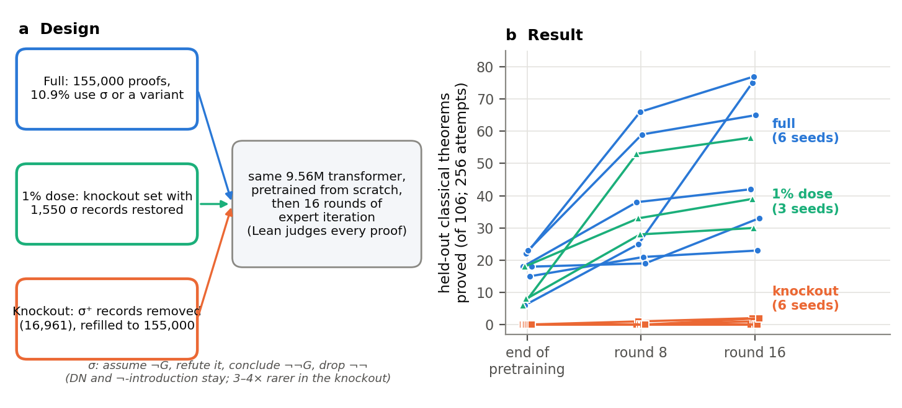
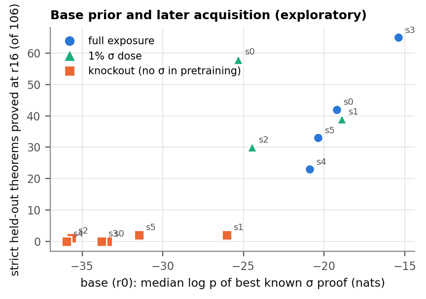

# create-or-elicit-paper: the paper and blog drafts for "Did RL create it?" state the reviewed knockout result at the strength its review allows, and no headline number is wrong; the pre-registered check C4 drops the knockout-s1 "elicitation" reading; 17 paper and 8 blog rewordings

Status: completed and reviewed 2026-10-14. **No hard-constraint violation, nothing quarantined.** This was a writing run.
It drafted a paper (LaTeX, 34 pages) and a blog post (2,499 words) from `create-or-elicit`'s reviewed results. Its own
measurements are small: five pre-registered pod checks (C1–C5) and CPU analyses (A2–A5b).

The reviewer reproduced everything the run measured or computed, using independent code and an independent Lean
harness, and rebuilt the PDF. Four read-only sub-auditors then checked **731 claims** against their reviewed sources.
**No headline number is wrong anywhere: every table cell in the paper and every number in the blog reproduces.** The
paper and blog state `create-or-elicit`'s result at the strength its review allows.

Before the draft goes to Dan's readers, the review asks for rewordings: **17 in the paper (P1–P17) and 8 in the blog
(B1–B8)**. None changes a headline number. They are applied, each marked *[review]*, in the reading copy
[`docs/papers/create-or-elicit/review_marked/`](../../docs/papers/create-or-elicit/review_marked/README.md) (see "Reading copy" below).

**Not supported as written:**
- that every rejection was the pre-filter's (P9). Only the Lean gate's rejections were: 72–88 % of knockout r16 attempts
  end earlier, in the environment's grammar and action checks;
- that GRPO, "by sampling alone", would first succeed on seeds 1, 2 and 5 (P11). By the paper's own A5 base rates it
  is s1 (P = 0.29 by r16), then s4 (0.13);
- the PUCT half of "neither method proves most of the compute-matched creations" (P16). No reviewed source scores
  search on those sets;
- that knockout s5's ladder proves `2256` in every plain r16 draw (P6). It does in 3 of 4.

**What this changes in [create-or-elicit's summary](../2026-10-12-create-or-elicit-sigma-knockout-not-acquired-in-16-ei-rounds-needs-exposure-1pct-dose-restores/README.md):**
- **C4's pre-registered drop rule fired.** That summary read knockout s1's progress as "elicitation, not creation":
  mostly members its base already had within reach. This run sampled knockout s1's base 18,432 times per member with no
  early stopping. Of `1246`, `1460` and `2256`, only `1460` is within reach (c = 4); the other two have c = 0. So the
  paper drops the reading.
  - The ladder's tracked samples solve five theorems. The base reaches 2 of them (`916`, `1460`); `1019`, `1246` and
    `2256` had 0 base successes.
  - Two members within the base's reach (`1096`, `1606`, c = 2 each) are never solved in the ladder's tracked samples.
- **The pre-filter's false-reject check grows** from 0 / 1,950 to **0 / 210,151 distinct rejected texts** in knockout
  s1's ladder, under the reviewer's own Lean harness, whose controls fail when they should. The one-sided 95 % bound is
  1.43 × 10⁻⁵ per distinct text.
- **The cut-off question** (create-or-elicit's next step 2):
  - doubling the caps changes each strict count by at most 1 and changes no family verdict;
  - it cuts the cut-off share only 1.0–2.2×, not the expected ≥ 5×. The remaining cut-offs are single runaway actions
    longer than 1,024 tokens;
  - 9 of 10 reads still exceed the policy's 0.1 % at doubled caps;
  - the two reads are independent draws, not a paired design.
- **The dose arm's missing r16 reads exist now** (C2): redraw 56 / 39 / 30 and guided 58 / 42 / 29, with the same
  families at the bar on 3 / 3 seeds.
- **textbook72 on 6 vs 6 seeds** (C3, at batch 512): the full − knockout gap at pend is +5.83, against +6.50 from the
  values on file.

Question (proposal 27, Dan 2026-10-11): write `create-or-elicit` and the earlier reviewed runs up as a paper draft and a
plain-language blog post. Both state exactly what the reviews support about whether RL against a verifier creates a
capability its base lacked or raises the probability of one it had. Proposal:
[`2026-10-11-create-or-elicit-paper.md`](../../docs/proposals/2026-10-11-create-or-elicit-paper.md); brief:
[`BRIEF_create-or-elicit-paper.md`](../../docs/proposals/paper/BRIEF_create-or-elicit-paper.md). Both documents are
drafts for Dan: nothing was posted, submitted or sent, and the author list and acknowledgements are left for Dan.

## Configuration

- **Repository.** Fork `dan-pandori/nd-takehome`, branch `dan_create-or-elicit-paper`. It was made by `newrun` from
  the fork's `origin/dan` (`4dcd0e4f`), then fast-forwarded to the reviewed `dan_create-or-elicit` (`8e195390`) so the
  figure scripts read its artefacts in-tree. Ran on agent2, every role at `--effort max`, with a hard stop at 96 h.
  - Pre-registration `preregistration/create-or-elicit-paper.md` at
    [`c602e43c`](https://github.com/dan-pandori/nd-takehome/commit/c602e43c) (19:27:18Z), before the first pod
    (`coep-1`, 19:28:57Z). Each addendum precedes the work it governs:

    | addendum | commit, time (UTC) | governs |
    |---|---|---|
    | 1 | `432ff8fb`, 19:40 | A3 extensions (within-family AUC, dose seeds) |
    | 2 | `45dfbdea`, 20:01 | A4 |
    | 3 | `114ddda8`, 20:40 | A5 (post hoc) |
    | 4 | `e36ad9a6`, 20:44:45 | C4 and C5 (C4 launched 20:45:44) |
    | 5 | `27516dd9`, 21:28 | A3b, A5b and the descriptives; precedes the round-2 revision (21:36) |

    A2, A3's extensions, A3b, A5 and A5b are labelled exploratory or post hoc in the pre-registration itself.
  - DONE at [`ed8cf1ea`](https://github.com/dan-pandori/nd-takehome/commit/ed8cf1ea). Deliverables:
    - `paper/`: `main.tex`, `sections/`, `refs.bib` (94 entries), `main.pdf` (34 pages, main text 23), `figures/`
      (F0–F7 and four blog figures, regenerated by `paper/scripts/figures.py` from reviewed data files) and `scripts/`;
    - `paper/blog.md`, `OUTLINE.md`, `LEDGER.md` (every number → its reviewed source), `REVISIONS.md`,
      `next_steps.md`, `critiques/` and `notes/related_work_digest.md`;
    - `run_create_or_elicit_paper.md`, `numbers.md` § create-or-elicit-paper and `log.md`.
  - Review: [`review_create-or-elicit-paper.md`](https://github.com/dan-pandori/nd-takehome/blob/1ad2a691/review_create-or-elicit-paper.md),
    with the reviewer's kit in `review_coep/` and the four sub-audits in `review_coep/phase2/{front,results,back,blog}.md`:
    - [`824af4a7`](https://github.com/dan-pandori/nd-takehome/commit/824af4a7): §Recount, written before reading any
      write-up;
    - [`1ad2a691`](https://github.com/dan-pandori/nd-takehome/commit/1ad2a691): §Comparison and §Verdict.
- **Timeline.** Executor Tue 2026-10-13 19:20 – 23:03 UTC; pods 19:28:57 – 22:57; reviewer Wed 10-14 01:22–02:29 (the
  C5 pass finished 02:25).
- **Process.**
  - Outline first, then a draft.
  - Two critique rounds, each by three "reviewer 2" critic sub-agents (novelty, soundness, clarity) and followed by a
    revision. Scores were 4 / 4 / 5 out of 10 in round 1 and 5 / 6 / 6 in round 2.
  - Round 1's revision restructured the paper. It now leads with the RL-specific contrasts, uses certificates on the
    pre-registered 106, adds the waiting-time null (A5) and checks C4 / C5, and scopes the title to EI. Round 2 added
    the guided r0 knockout results, per-family base rates and the A3b / A5b sensitivity analyses.
  - Then an independent claim audit (382 rows: 70 discrepancies, 67 FIX and 3 UNSUPPORTED) and a re-audit of the
    changed passages (90 rows: 22, 21 FIX and 1 UNSUPPORTED). The executor reports applying all of them.
- **Models for every number** (Lean alone).
  - The 9.56 M-parameter from-scratch proof-state prover of `create-or-elicit`: `best_model.ALiBiGPT` 6 × 384,
    9,560,832 params, `lean_staten`. Stage 1 is on K12 (*full*), K12⁻ (the σ knockout, *ko*) or K12⁻ with 1 % σ
    restored (*dose1*), followed by 16 T1 EI rounds with the Lean judge.
  - Checkpoints: `create-or-elicit/ckpts/coe/ladder/la_<arm>_s<S>_r16.pt`.
  - C3 reads the old full seeds s0–s2 at pend (`trajectory/ckpts/tj/stage1_best12_s<S>_b1200.pt`).
  - C4 samples the knockout bases at pend (`stage1_ko_s1.pt`, `stage1_ko_s3.pt`).
  - Both pods logged identical md5s for all 13 checkpoints.
  - Inherited numbers in the paper carry their own models. The ones the review found unlabelled are P3, P8, P16 and
    B7 below.
- **Settings** (recorded in every `*.args.json`).
  - Reads: k 256, T 0.8, batch 512, `state_eval.py` (fast path), Lean judge.
    - Caps: standard (`max_action` 512, `max_steps` 96); doubled (1,024 / 192).
    - Guided: `guided_eval.py --arm logical --max_rej 10`.
  - C4: batch 1,024, chunks of 1,024 with seed 9,500 + chunk, `--stop_successes 0`.
  - Peak memory: 6.8–11.4 GB per process on an A40, recorded for every read.
  - Inputs:
    - `data/coe_paper/strict106.jsonl`: the 106 strict held-out members, with `read1054`'s prompts;
    - `tb72.jsonl`: `read1054`'s 72 textbook72 rows, scoring only, read by C3 alone;
    - the C4 inputs.
- **Pods and cost.** `podbudget create-or-elicit-paper --set 20 10` was registered before the first pod.
  - Two NVIDIA A40 pods (SECURE, $0.59/h): `coep-1` 3.48 h ($2.05), `coep-2` 3.00 h ($1.77). Total **6.48 pod-hours,
    $3.82** of $10 / 20 h. The stop rule ($8) was not reached.
  - Process GPU time was 37,817 GPU-s: 10.5 process-hours, with two processes sharing each A40.
- **Bucket** (no new checkpoints):
  - `hf://buckets/dan-pandori/nd-rl/create-or-elicit-paper/artifacts/coe_paper/`: `eval/` (124 files), `c4/`, `c5/`,
    `logs/`;
  - `hf://buckets/dan-pandori/nd-rl/create-or-elicit-paper/data/coe_paper/`: `strict106.jsonl`, `tb72.jsonl`,
    `c4_ko_s1.jsonl`, `c4_ko_s3.jsonl`.

  The three `c2_dose1_s*_g0.repeat.json.gz` files left untracked in the worktree are in the bucket too.

## Observations

### The paper and the blog

- **Paper:** *Did Expert Iteration Create It? A Pretraining Knockout and Compute-Matched Budgets in a From-Scratch
  Theorem Prover*.
  - Sections: abstract (≈ 250 words), introduction with contributions, the organism and the experiment, results (the σ
    knockout), how much RL created in the full-exposure models (budgets, certificates, test-time compute), related
    work, discussion, limitations, reproducibility.
  - Appendices: glossary, the knockout set, per-family timing, budgets and the estimator, Lean proofs, power sampling,
    pre-registered expectations against outcomes, corrections, this run's checks, provenance.
  - Lean is shown for the proofs.
- **Blog:** `blog.md`, 2,499 words (`wc -w`; 2,418 without the code block), 4 figures, a simplified Lean σ proof with
  a goal-negated control. It makes no claim of "need" and scopes the sharpening null to the sampler.
- **What both documents state, in the reviewer's summary of what stands:**
  - no knockout seed acquired a classical family in 16 EI rounds (0 / 6 vs 6 / 6, p = 0.00024), a contrast largely
    decided before RL;
  - RL-phase gains of 8–69 vs 0–2 held-out strict theorems, and acquisition during RL 5 / 6 vs 0 / 6 (p = 0.0032),
    labelled post hoc;
  - the 1 % dose restores acquisition (3 / 3, exploratory);
  - σ is rare in the knockout bases, not absent;
  - no claim of "need", and no general sharpening claim.
- **The review's audit.** Four sub-auditors covered the front matter, the results and checks appendix, the back half
  and `refs.bib`, and the blog.

  | audit | rows | reproduces | differs | wording / stronger | not derivable |
  |---|---|---|---|---|---|
  | front (title, abstract, intro, setup, measurement) | 131 | 102 | 3 | 22 | 4 |
  | results + checks appendix | 212 | 188 | 9 | 13 | 2 |
  | back (related work … appendices, bib) | 294 | 245 | 8 | 33 | 8 (4 unreviewed source, 4 not checkable from the notes) |
  | blog | 94 | 85 | 2 (wording) | 3 stronger than the paper, 4 not in the paper | 0 |

  The reviewer re-derived every finding listed as consequential (P1–P17, B1–B8 below).
- **Figures (A1).** Every figure the reviewer opened plots reviewed values:
  - Fig. 0, 1 and 6 read `review_coe/out_acq.json` and the A2 points;
  - Fig. 2 reads the per-round files (it matches the reviewed recount on the knockout);
  - Fig. 3 reads the score summaries;
  - Fig. 4 reads the reviewed `budget08` sets;
  - Fig. 7 matches `capdefs_j3` / `mcts_a_summary`.

  Only captions have defects: Fig. 7's models are unnamed, and the blog's Fig. 2 caption says "each model" when 12 of
  the 15 ladders are drawn.

  

  *Fig. 0 of the paper. Held-out strict classical theorems proved (of 106, 256 attempts each) at the end of
  pretraining and after 8 and 16 EI rounds, one line per seed: full (6 seeds), 1 % dose (3) and knockout (6).*

- **Writing expectations (pre-registered W1–W4).**

  | expectation | verdict |
  |---|---|
  | W1: the headline is the reviewed verdict, with no "need" and no general sharpening claim | **hit**. "Needs exposure" appears only as the pre-registered rule's label and is hedged in the discussion; the power-sampling null is "for this sampler … not for sharpening" |
  | W2: the critiques raise the five objections and the paper answers each | **hit**. All five are raised in rounds 1–2 and answered in the text, four of them in the limitations; the power-sampling control is answered in the results, not the limitations |
  | W3: the claim audit finds ≤ 15 discrepancies, none needing a headline change | **miss, reported**. 70 discrepancies, plus 22 in the re-audit; one abstract sentence was weakened |
  | W4: tectonic builds; abstract ≤ 250 words; blog 1,500–2,500 words with 3–5 figures | **hit**. The reviewer rebuilt `main.pdf` from the committed sources: exit 0, 34 pages, no undefined references |

### C1: standard vs doubled caps on the strict 106 (r16, plain, sample seed 0)

`x0` is `create-or-elicit`'s reviewed r16 x0 read, taken on `read1054`. "Cut" means attempts ending in a truncated
action or the step cap, out of 27,136.

| r16 checkpoint | x0 | std | dbl | std only / dbl only | cut std | cut dbl | std / dbl | families at the bar (std = dbl) |
|---|---|---|---|---|---|---|---|---|
| ko s0 | 0 | 0 | 0 | 0 / 0 | 0.037 % | 0.000 % | ∞ | – |
| ko s1 | 2 | 3 | 3 | 0 / 0 | 5.09 % | 2.73 % | 1.9 | – |
| ko s2 | 1 | 1 | 2 | 0 / 1 | 3.76 % | 3.20 % | 1.2 | – |
| ko s3 | 0 | 0 | 1 | 0 / 1 | 1.22 % | 0.86 % | 1.4 | – |
| ko s4 | 0 | 0 | 0 | 0 / 0 | 4.29 % | 1.96 % | 2.2 | – |
| ko s5 | 2 | 2 | 2 | 0 / 0 | 1.69 % | 1.61 % | 1.0 | – |
| dose1 s0 | 58 | 57 | 56 | 2 / 1 | 1.23 % | 1.08 % | 1.1 | cc, nc, peirce, peirce_seq |
| dose1 s1 | 39 | 40 | 41 | 0 / 1 | 0.71 % | 0.54 % | 1.3 | cc, nc |
| dose1 s2 | 30 | 28 | 29 | 0 / 1 | 9.30 % | 8.58 % | 1.1 | cc, nc |
| full s4 | 23 | 22 | 22 | 0 / 0 | 2.80 % | 1.89 % | 1.5 | cc |

- **"Doubled caps cut the strict cut-off share by ≥ 5× on every checkpoint": miss on 9 of 10.** The ratios are 1.0–2.2;
  only knockout s0 (0.04 % → 0) qualifies.
  - The doubled step cap removes the step-cap cut-offs: 257 → 9 attempts in total.
  - The action cut-offs stay (7,914 → 6,083). They are single actions longer than 1,024 tokens: runaway generations,
    not proofs that need more room.
  - 9 of 10 reads exceed the policy's 0.1 % per stratum at standard caps (up to 9.3 %, dose1 s2), and 9 of 10 still do
    at doubled caps.
- **Knockout seeds rise by ≤ 2 and none reaches the bar: holds** (+0, +0, +1, +1, 0, 0). The headline's falsifier (a
  knockout seed at the bar under doubled caps) did not fire.
  - The knockout's solved members are contraposition_conv members, plus `la_transfer_916` (the generated member) on s1.
  - s3's member under doubled caps is `916`.
- **Dose s2 rises by ≤ 8 and keeps its two families: holds** (28 → 29). **Full s4 rises by ≤ 3: holds** (22 → 22).
- **Not a paired design.** The pre-registration assumed the two caps' draws "differ only where the cap binds". Take
  the members with no cut-off attempt in the standard read that were solved in either read. Only 14 / 45, 9 / 34,
  12 / 24 and 12 / 20 of them (dose1 s0, s1, s2 and full s4) have identical `n_ok`. So ±1 differences are sampling, not cap effects.
- The standard-cap read is itself a re-draw of x0: the same checkpoint and seed on a different input file. 5 of the 10
  counts differ.

### C2: the dose arm at r16 on an equal footing

| dose1 | x0 (coe) | plain x1 | Δ | x1 at the bar | guided g0 | Δ | guided at the bar | x1 cut | guided step-cap ends |
|---|---|---|---|---|---|---|---|---|---|
| s0 | 58 | 56 | −2 | cc, nc, peirce, ps | 58 | 0 | cc, nc, peirce, ps | 1.29 % | 15 / 27,136 |
| s1 | 39 | 39 | 0 | cc, nc | 42 | +3 | cc, nc | 0.60 % | 1 / 27,136 |
| s2 | 30 | 30 | 0 | cc, nc | 29 | −1 | cc, nc | 8.96 % | 7 / 27,136 |

Both expectations hold: x1 is within ±6 of x0 and guided within ±8, each with ≥ 1 family at the bar on 3 / 3 seeds.

### C3: textbook72 at pend, old full s0–s2, batch 512

| old full | C3 (x0, batch 512) | on file (trajectory, batch 2,048) | Δ | cut-off |
|---|---|---|---|---|
| s0 | 34 / 72 | 32 | +2 | 0 / 18,432 |
| s1 | 30 / 72 | 32 | −2 | 4 / 18,432 (0.02 %) |
| s2 | 34 / 72 | 38 | −4 | 22 / 18,432 (0.12 %) |

- **"Each seed within ±4" holds,** with s2 exactly at the edge.
- The 6-vs-6 gap uses the knockout pend values (26, 34, 29, 26, 23, 28; mean 27.67) and the new full seeds
  (33, 34, 36). With the on-file values for old full s0–s2 the full mean is 34.17 and the gap (full − knockout) is
  **+6.50**; with C3's values it is 33.50 and **+5.83**.
- The pre-registered range "[−9, −4]" has the wrong sign for "full − knockout", which is positive by construction. As
  written it misses; read as a magnitude (4–9) it holds. The appendix scores it by the intended magnitude and says so.

### C4: knockout bases at n = 18,432 per theorem, no early stopping

"Within reach" at K = 17,189 (knockout s1's K_train(16)) means c ≥ 2 of 18,432. Every chunk is present: 18 per
theorem, seeds 9,500 + chunk.

| member (knockout s1 base) | family | c / 18,432 | distinct proofs | within reach |
|---|---|---|---|---|
| `la_transfer_1460` | contraposition_conv | 4 | 1 | yes |
| `la_transfer_1096` | contraposition_conv | 2 | 1 | yes |
| `la_transfer_1606` | contraposition_conv | 2 | 1 | yes |
| `la_transfer_55`, `la_transfer_1963` | contraposition_conv | 1 each | 1 | no |
| the other 13 cc members, incl. `1019`, `1246`, `2256` | contraposition_conv | 0 | – | no |
| `la_transfer_916` (generated) | – | 13 | 8 | yes |
| `la_transfer_916` on the **knockout s3** base | – | 1 | 1 | no |

- The pooled rate over the 18 contraposition_conv members is 10 / 331,776 = **3.0 × 10⁻⁵**. Over all 19 members it is
  23 / 350,208. The earlier early-stopped sample gave 3.2 × 10⁻⁵.
- Pre-registered expectations:
  - `1460` within reach: **holds**;
  - ≥ 2 of {`1246`, `1460`, `2256`} within reach: **miss**;
  - `1019` has c ≤ 1: **holds** (0);
  - `916` within reach on both bases: **miss** (s3: 1).
- **The drop rule fires:** "mostly members its base could already reach" is dropped. The ladder's tracked k-32
  samples solve `916` (r4), `1460` (r13), `1019` (r16), and `1246` and `2256` (r19). The base reaches 2 of these 5.

### C5: the pre-filter's false-reject rate over a whole ladder

- **The dump.** Knockout s1's ladder gate dump (rounds 1–16) has 2,354,794 rows: 2,132,659 Lean-accepted and 222,135
  pre-filter rejects over 13 reasons.
  - No row passed the filter and was then rejected by Lean, so the filter alone decided every Lean-gate rejection in
    this ladder.
  - The 222,135 rejected rows are **210,151 distinct (prompt, text) pairs**, 21,055 of them on a by-contradiction step.
- **The executor's pass:** Lean accepted 0 / 222,135 rows, with a harness control of 400 / 400 accepted and 0 / 400
  when paired with another theorem.
- **The reviewer's pass:** an own harness (Lean 4.34.1, own header, literal text, `#print axioms` per theorem), sharing
  no code with the executor's. It accepted **0 of the 210,151 distinct texts**, 0 in each of the 13 reasons.
  - Its controls:
    - accepted texts 1,000 / 1,000;
    - the same proofs through an own ND → Lean renderer 1,000 / 1,000;
    - a text on another theorem 0 / 1,000;
    - truncated texts 0 / 300;
    - `sorry` 0 / 50;
    - every single `Or.inl`↔`Or.inr` / `.1`↔`.2` flip of 300 texts: 16 / 531 accepted, all 16 benign.
  - One-sided 95 % bounds per distinct text: **1.43 × 10⁻⁵** overall and 1.42 × 10⁻⁴ for by-contradiction, in this
    ladder only. The pre-registration's 1.3 × 10⁻⁵ / 1.3 × 10⁻⁴ were computed on rows.

### A2–A5b: the base's prior against acquisition (exploratory or post hoc)

- **A2** (Spearman ρ over 13 ladders: pend median log p of the best known σ proof vs strict members solved at r16): **0.877**,
  so the expectation (ρ ≥ 0.6) holds. The ρ is mostly the arm split: without the six knockout seeds it is **0.39**
  (p 0.38). Within the dose arm the relation is not monotone, as expected.

  

- **A3 / A3b** (AUC of a member's pend best-known log p for "solved at r16"):

  | seed | n (pos / neg) | A3 AUC | within-family AUC (pairs) | A3b: not solved at pend (gained) | A3b AUC |
  |---|---|---|---|---|---|
  | full s0 | 101 (42 / 59) | 0.954 | 0.626 (107) | 83 (24) | 0.919 |
  | full s3 | 101 (65 / 36) | 0.953 | 0.978 (46) | 78 (42) | 0.927 |
  | full s4 | 101 (23 / 78) | 0.940 | 0.926 (54) | 86 (8) | 0.833 |
  | full s5 | 101 (33 / 68) | 0.922 | 0.467 (92) | 83 (16) | 0.851 |
  | dose1 s0 | 101 (58 / 43) | 0.858 | 0.280 (50) | 95 (52) | 0.841 |
  | dose1 s1 | 101 (39 / 62) | 0.861 | 0.600 (70) | 83 (21) | 0.742 |
  | dose1 s2 | 101 (30 / 71) | 0.846 | 0.328 (61) | 93 (22) | 0.789 |

  - A3 (AUC ≥ 0.7 on ≥ 3 / 4 full seeds) holds 4 / 4, and the dose AUC ≥ 0.7 holds 3 / 3.
  - The within-family expectation ("lower than overall, and > 0.5") holds on 3 / 4 for each part: s3's is higher than
    its overall AUC, and s5's is below 0.5.
  - The dose within-family AUCs are below 0.5 on 2 / 3.
  - A3b holds 4 / 4.
  - The within-family AUCs rest on 46–107 pairs.
- **A4** (Spearman of pend log p with the first-solve round): full **−0.82 / −0.87 / −0.69 / −0.73**, 4 / 4 ≤ −0.5.
  Within-family means are −0.48 to −0.33 (< 0 on 4 / 4). Dose: −0.72 / −0.64 / −0.61, within-family −0.10 / −0.22 / +0.14.
- **A5** (post hoc waiting-time null). The null puts each knockout ladder's per-round rate on the 123 strict training
  targets at its base's pooled held-out rate.
  - It expects **0.547** seeds with a strict success by r16; **3** were observed (s1 at r9, s2 and s5 at r14).
    Poisson-binomial **P(≥ 3) = 0.0060**.
  - Knockout s1's expected first success under the null is round 47.
  - **A5b** (pre-registered range 0.006–0.03) holds for every variant: 106 pool 0.0105; family-weighted 0.0115;
    Jeffreys posterior-predictive 0.0139 (105) and **0.0199** (106, 0.74 expected seeds).

### Descriptives (Addendum 5; the reviewer's own Boschloo)

- **Families acquired during RL** (at the bar at r16 and not at pend, plain x0): full **5 / 6**, knockout 0 / 6,
  **p = 0.0032**; dose 3 / 3.
- **Hardware-matched** (full s3–s5 ran on A40 like the knockout):
  - acquired during RL: 2 / 3 vs 0 / 6, p = 0.034;
  - ≥ 1 family at the bar at r16: 3 / 3 vs 0 / 6, p = 0.0033.
- **RL-phase gains, strict, pend → r16:** full 24 / 69 / 55 / 42 / 8 / 15 vs knockout 0 / 2 / 1 / 0 / 0 / 2 (exact
  Mann–Whitney p = 0.0011); on the hardware-matched seeds p = 0.012.
  - Guided reads: full gains 24, 62, 44, 29, 5, 16; knockout −1, +2, 0, −1, −3, +2 (p 0.0011).
  - Guided knockout bases reach 1–3 strict members on 4 of 6 seeds at pend, where plain x0 reaches none.
- **Per-family pooled base rates** (knockout bases): c > 0 only in contraposition_conv (s1 6, s2 1, s4 3, s5 1) and
  peirce_sequent (s5 1). Every other family has 0 in 43k–526k attempts per seed.
- **Δ_cov** means are 35.0 (full s3–s5) vs 29.8 (knockout s0–s5). The tie-aware exact permutation p is **0.095**, not the draft's
  0.13; it is not significant either way, so "not clearly worse at RL" stands.

### Integrity checks (reviewer)

- **Lean re-check: 959 / 959 counted proofs accepted.**
  - Every read contributed one proof of every solved member, plus random extras: 50 knockout (all that exist), 376
    dose, 150 full s4, 150 textbook72, 219 guided literal texts and the 14 distinct C4 proofs.
  - Median term size: knockout r16 12, dose1 r16 17, full s4 r16 12, C4 7.
- **Splits clean.** No training file shares a renaming class with strict106 or the C4 inputs, under order-sensitive and
  premise-order-invariant keys. Every pretraining set (K12, K12⁻, the dose set) shares one premise-order-invariant
  class with textbook72: the known premise-swapped twin `textbook_3ed45280…`, which the paper does not disclose (P17).
- **Hard constraints hold.**
  - `nd_verify` is unmodified and not used as a judge.
  - `TEST_RUN_DONE` is untouched, and this run did no training.
  - textbook72 was read by C3 only.
  - The budget was registered before the first pod.
- **Compute:**

  | check | GPU-s (A40, per process) | attempts | generated tokens | Lean texts |
  |---|---|---|---|---|
  | C1 (20 reads) | 23,582 | 542,720 | 190.4 M | 51,773 |
  | C2 (3 plain + 3 guided) | 9,068 | 162,816 | 76.7 M | 44,775 |
  | C3 (3 reads) | 740 | 55,296 | 6.6 M | 3,828 |
  | C4 (2 bases) | 4,427 | 368,640 | n/a | n/a |
  | C5 (CPU only) | 0 (2,254 s + 26 s CPU) | – | – | 222,935 |

  The run wrote no results-registry rows, so these numbers come from summaries and logs. No arm comparison in this run
  depends on matched compute.

## Rewordings the review requires (none changes a headline number)

Paper. The review's § and line numbers follow the source files: §5 is `05_results.tex` and §8 is `08_limitations.tex`.
In the PDF those are §3 and §7; the reading copy's README maps them.

| # | where | claim | the reviewer's finding | required |
|---|---|---|---|---|
| P1 | §5.8; App. I | C1 is "a paired re-evaluation" | not paired: the two caps are independent draws; the appendix's next sentence says so | reword ("same-seed re-evaluation"; ±1 changes are sampling) |
| P2 | intro; contributions | knockout s0 is "the only base whose rate is certified out of reach under plain sampling"; certificates listed as pre-registered | true only on the pre-registered 106 pool, at T 0.8 and N_eval 322. Plain sampling at T 1.0 solved `la_transfer_916` on knockout bases s0 and s1. The pre-registered expectation (≥ 5 / 6 certified) **missed**: 1 / 6 on the 106, 2 / 6 on the 105 | scope it; say the expectation missed |
| P3 | abstract; intro | "51–60 … look RL-created at equal sample counts; 14–21 remain when the base gets RL's compute as attempts" | the reviewed sets are 34/33/33, 33/27/24, 28/26/24, 22/21/14 and 21/20/14 across the five allocations; 21/20/14 survives all five. They are on r8 of the earlier full seeds s0–s2, on the 322 | "14–34 remain depending on how RL's compute is counted; 14–21 survive all five"; label the models |
| P4 | intro; discussion | "Our knockout bases fail at k = 256 under plain sampling" | one of 12 plain k-256 base reads succeeds: knockout s1 x1 proved `la_transfer_916` | "prove none in the pre-registered evaluation; one proves one in a second draw" |
| P5 | abstract | a family is acquired with "half its held-out members proved in 256 attempts" | the bar is half of a family's **strict** held-out members (e.g. 9 of converse contraposition's 18) | reword |
| P6 | §5.5; discussion | knockout s1's `1019` "which two of three r16 draws had already proved once"; knockout s5 "proves 1246 and 2256 … in all three plain r16 draws" | there are four plain r16 draws plus a guided one. s1: `1019` is in 2 of 4 plain draws (C1 std and dbl) and twice in guided, but not in x0 or x1. s5: `2256` is in 3 of 4 (x1 proved only `1246`). "`916` and `1460` in every r16 draw; never `1096` or `1606`" holds over all five | correct the counts |
| P7 | §5.3 | "The proofs [scored] are the full ladders' own" | they are the **old** full ladders' (s0–s2) known proofs, not the scored ladder's own for full s3–s5, dose or knockout | reword |
| P8 | §5.7 vs §5's scope sentence | the seeded-round contrast "6 and 17 targets" from the earlier organism | these are the 3.2 M whole-proof organism's (Run 3) numbers under the older checker; §5's scope sentence says every number is on the 9.56 M models under Lean | label |
| P9 | §5.8 | "Every rejection in the experiment was the pre-filter's" | true of the Lean gate only. 72–88 % of knockout r16 attempts (77–89 % with cut-offs) end earlier, in the grammar and action checks; 10–23 % reach the gate. Neither C5 nor the 150-per-reason check covers those | "every Lean-gate rejection" |
| P10 | §5.1 | per-family verdicts: NEEDS EXPOSURE for converse contraposition only; three families UNDETERMINED (p 0.034, Holm 0.17) | the decision rule's text says "Boschloo p ≤ 0.05" per family; its secondary-test line adds the Holm correction over 6. At uncorrected p 0.034, three more families would meet "needs exposure" | state that the verdicts rest on the pre-registered Holm correction (the conservative reading, as the create-or-elicit review applied it) |
| P11 | discussion | "By sampling alone, GRPO would most likely first succeed where EI did (seeds 1, 2 and 5)" | by the paper's A5 base rates, P(success by r16) = 0.29 (s1), **0.13 (s4)**, 0.085 (s5), 0.046 (s2) | correct (s1, then s4) |
| P12 | §5.6 | "textbook72 keeps −2.5" at r16 | −2.5 is on textbook72's 53 intuitionistic problems; on all 72 the r16 gap is −7.5 | name the subset |
| P13 | abstract | "five of six proved … 1–7 times in 1.1–1.5 million attempts" | the five bases with a success had 1.12–1.43 M; 1.50 M is s0, which had none. 5 / 6 counts the generated `916` (4 / 6 on family members) | minor |
| P14 | abstract; intro | "we remove … the classical reductio σ" | the removal is σ⁺ (σ and its variants; 16,961 records), as Fig. 1 and §3 say | minor wording |
| P15 | intro | "Cued practice transferred too little to acquire a family" | asserts a transfer mechanism; the results say why the rate rose "is not identified" | minor wording |
| P16 | §4 test-time-compute paragraph and Fig. 7; §3 | guided / PUCT gains "for the base and r8"; "314,541 tested (state, step) pairs" | the models are the earlier full seeds s0–s2 (best-cap12, r0 / r8 / r16) and guided-tts' r8 models. Neither is named. The PUCT half of "neither method proves most of the compute-matched creations" has no reviewed source | label; drop or source the PUCT half |
| P17 | §8 Limitations | — | missing or understated: the knockout's general-ability numbers (greedy −6.88 pp, all on σ-reference theorems; −4.0 / 53 textbook72 and −4.3 / 225 holdout250 intuitionistic at r0); the textbook72 premise-swapped twin; that doubling the caps left most cut-offs in place (1.0–2.2×) and that C1's draws are independent; one `c_base` timing read per seed under s0's 8 %-margin certificate; that the free positive reductio is a post hoc measure | add |

Smaller items (spot-checked by the reviewer):
- the limitations omit old full s1's 303 of 322;
- the reproducibility section under-counts the post hoc analyses;
- three `refs.bib` entries (`havrilla2024teaching`, `singh2023restem`, `zelikman2022star`) print with no identifier;
- Yang & Chen is quoted only up to the half of a contrast that suits the paper. The reviewer took this from the
  literature notes and did not re-read the source.

Precision:
- C5's "222,135 texts" are rows (210,151 distinct texts), and the bound should be stated per distinct text. The
  review suggests "below 1.4 × 10⁻⁵", but its own per-text bound is 1.43 × 10⁻⁵, so the reading copy uses
  "1.4 × 10⁻⁵ per distinct text" (1.35 × 10⁻⁵ per row);
- the Δ_cov p is 0.095, not 0.13;
- A5b's upper P is 0.020, not 0.019;
- C1's "1.05–2.3×" in `numbers.md` is 2.2×;
- the run summary's "2,495 words" is 2,499.

Blog (verified by the reviewer against the text):
- **B1.** The short version leads with the post hoc RL-phase result (5 / 6 vs 0 / 6) unlabelled at first mention,
  while its epistemic note says "the main test was pre-registered". Label it, or lead with the pre-registered
  6 / 6 vs 0 / 6 and its "mostly decided before RL".
- **B2.** Negative results the paper carries are missing:
  - the MCTS gate failure;
  - that the pre-registered rule could not return "created", and that only converse contraposition earned "needs
    exposure";
  - the guided base proving only 3 / 4 / 1 of the 22 / 21 / 14 compute-matched creations;
  - the hardware-matched family contrast (2 / 3 vs 0 / 6, p = 0.034), next to the favourable gains test;
  - the older-checker caveat on the earlier-organism results it cites;
  - every robustness and RL-free-control result.

  The brief asks for "the same evidence as the paper, including the negative and null results".
- **B3.** The pre-registered drop rule is paraphrased wrongly: the registered condition is ≤ 1 of `1246` / `1460` /
  `2256` with c ≥ 2.
- **B4.** The likelihood paragraph omits two caveats: the scored proofs are the old full ladders', and dose s0 and
  knockout s1 sit within 0.7 nats yet prove 58 and 2.
- **B5.** Some framing words are stronger than the paper: "undid the deletion", RL "is how today's reasoning models get
  much of their skill", "easy problems".
- **B6.** The Fig. 2 caption says "each model", but 12 of the 15 ladders are drawn.
- **B7.** The models behind the later sections (the r8 of three earlier full runs) are not identifiable.
- **B8.** Seven terms are used before they are defined, among them "early-stopped".

Records:
- `paper/LEDGER.md` P8 still carries the dropped reading ("solved mostly members its base could already reach") as
  reviewed, and several of its rows list the blog as using numbers it no longer contains.
- `next_steps.md` item 1b assumes 6–8 ms per attempt. C4 measured **12.35 ms** per attempt on a knockout base at batch
  1,024 on 19 strict members (5.5 ms on `916` alone). At that rate 2.4 × 10⁷ attempts is ≈ 82 A40-hours (≈ $48), not
  40–55 h ($25–30).

## Reading copy in nd-rl

The brief asks the librarian to copy the paper, the blog and the figures to nd-rl `docs/papers/create-or-elicit/`. Its
[README](../../docs/papers/create-or-elicit/review_marked/README.md) lists every change. Since 2026-10-14 the copy is in
`review_marked/`, and `docs/papers/create-or-elicit/` holds run `paper-clean`'s clean versions.
- **Two commits.** The first is a byte-identical copy of the executor's files at `ed8cf1ea`: `main.tex`, `sections/`,
  `refs.bib`, `build.sh`, `main.pdf`, `blog.md`, `figures/` and `lean/`. The second applies the review. So the diff
  between them is exactly what the librarian changed.
- **Paper.** P1–P17, the smaller items and the precision items are applied with **60 *[review]* marks**. They print as
  red italic "[review]" in `main.pdf`, which was rebuilt with tectonic: exit 0, 35 pages, no undefined references. The
  abstract keeps its length (≈ 250 words).
  - The PUCT half of the test-time-compute claim is dropped.
  - Three changes go slightly beyond the review's wording:
    - the C5 bound reads "1.4 × 10⁻⁵ per distinct text", not the review's "below 1.4 × 10⁻⁵", because the exact value
      is 1.43 × 10⁻⁵;
    - App. I's accepted count is labelled rows;
    - `singh2023restem` gets its arXiv identifier, verified in `docs/literature/`.
- **Blog.** B1–B8, plus the echoes of P2, P5, P13 and P14, are applied with 31 marks. Restoring the negative results
  (B2) and the definitions (B8) takes the blog to **3,080 words**, against the brief's cap of 2,500.
- **Done by four editing sub-agents and then checked.** Each sub-agent worked on its own files and applied only the
  findings the review lists. The librarian then read every diff against the review and checked the added Yang & Chen
  clause against the source text. Points the sub-agents noticed that the review does not list were not applied; they
  are listed in the README for Dan. None touches a headline number.
- **textbook72.** Every theorem printed in the paper and the blog was compared with textbook72's renaming classes:
  the σ examples, the Lean listings, the family schemas and "P or not P".
  - One collides: the negated-conditional family's schema, printed in §2's family list, shares a class with one
    textbook72 problem (`textbook_b98931f2…`). It is the named family's defining law, so it is flagged for Dan, not
    changed.
  - The new limitation names the premise-swapped twin by ID only.
- **Not copied** (named in the README): `OUTLINE.md`, `LEDGER.md`, `REVISIONS.md`, `next_steps.md`, `critiques/`, the
  related-work digest, `scripts/` and `data/`. These stay on the fork branch.

## Interpretation (not a finding)

- **What the paper can claim.** Within 16 rounds, this EI amplified a composition that pretraining had exposed but did
  not acquire the classical families without it. The pre-registered contrast (0 / 6 vs 6 / 6) is largely decided at
  pend, where one family is already at the bar on 5 / 6 full seeds. So the RL-specific evidence is post hoc: the
  RL-phase gains (8–69 vs 0–2, p = 0.0011) and acquisition during RL (5 / 6 vs 0 / 6, p = 0.0032). The paper now leads
  with these, labelled as such.
- **Knockout s1 is open again.** C4 removes the "elicitation of what the base could reach" account: three of the five
  theorems its ladder proves had 0 base successes in 18,432 attempts. Separately, A5 (post hoc) finds that three
  knockout ladders first proved a strict training theorem sooner than their bases' held-out rates predict
  (P = 0.006–0.020 across variants).

  Together these are consistent with the knockout ladders' σ rate rising during RL on some theorems. The paper keeps
  that reading as "why it rose is not identified". It rests on plug-in held-out base rates assumed to transfer to the
  123 strict training theorems, which the reviewer's next measurement (below) would test directly.
- **The base's prior predicts what RL acquires within the exposed arms.** A3 / A4 give AUC 0.92–0.95 and first-solve ρ
  −0.69 to −0.87 on full seeds. The across-ladder A2 ρ is mostly the arm split, and within families the dose seeds
  disagree (0.28 / 0.60 / 0.33). So it is not a general law of which members come first.
- **The knockout arm's guided reads** reach 1–3 strict members at pend on 4 / 6 seeds where plain x0 reaches none.
  This fits "rare, not absent", as do C4's within-reach members.

## Limitations and next step

- **Scope.** A writing run. Its new measurements are small checks of inherited claims (one knockout ladder's gate dump
  for C5, one base for C4's members). The paper's limitations, as amended by P17, cover:
  - one 9.56 M architecture on propositional logic;
  - one RL algorithm (T1 EI) for 16 rounds, with 6 / 6 / 3 seeds;
  - near-saturated targets;
  - the knockout's side effects on DN and ¬-introduction frequency and on general ability;
  - cut-offs above the policy in most reads.

  The sharpening null holds for one MH sampler that fails its positive control. The paper treats it in the results
  (§3.7), not in the limitations.
- **Next measurement (reviewer).** Settle A5's open mechanistic claim directly.
  - Sample the 123 strict training theorems at the knockout ladders' r0, r8 and r16 checkpoints: no early stopping,
    C4's settings (T 0.8, batch 1,024, standard caps), a pre-registered drop rule, and ≈ 5 × 10⁵ attempts per
    checkpoint (≈ 4,000 per theorem).
  - The first strict successes at r9–r14 imply mid-ladder rates of about 2–3 × 10⁻⁵, against pooled base rates
    ≤ 6 × 10⁻⁶. So 5 × 10⁵ attempts would expect 10–15 successes if the rate rose and ≤ 3 if it did not.
  - At C4's measured 12.35 ms per attempt that is ≈ 9 × 10⁶ attempts ≈ 31 A40-hours ≈ **$18**. A replay-only control
    from two knockout bases would add its fine-tunes.
  - It separates "EI waits for a rare sample" from "EI raises the rate on cued σ".
- **The generality question** (does the null hold for signed updates?) still needs GRPO from the six knockout bases.
  Per-seed predictions should be written first and ranked by the base rates: s1, s4, s5, s2 (P11).
- **Executor's `next_steps.md`** (ranked; costs at $0.59 per A40-hour and 6–8 ms per attempt, where C4 measured
  12.35 ms):
  - **1.** GRPO from the knockout bases at matched samples, ≈ $40–60.
  - **1b.** The knockout ladders' σ rate along the run, with a replay-only control: ≈ $25–30 as costed, ≈ $48 at
    C4's measured rate (review). The reviewer's smaller version is the measurement above.
  - **2.** Exposure during RL instead of in pretraining (replay swap), ≈ $30–45.
  - **3.** The 0.1 % and 0.01 % dose arms, ≈ $33 per dose.
  - **4.** Per-theorem base rates at n ≥ K and per-family certificates: ≈ $3–10 as costed, or ≈ $8–10 per base for the
    full extension.
  - **5.** A knockout at matched atom frequencies, ≈ $90–100. **5b.** Two to four seeded rounds, ≈ $10–15.
  - **6.** Longer and more exploratory knockout ladders, ≈ $5 per seed per 8 rounds.
  - **7.** A second composition knockout, ≈ $100.
  - **8.** Scale (30–40 M parameters), ≈ $60–120 per pair of arms.
  - **9.** Power sampling with a sampler that passes its positive control, ≈ $3–5.
  - **10.** An interface pilot, ≈ $25, and a classical-rich target pool, ≈ $20.

  CPU-only items: the proof-route anatomy of knockout s1; a Good–Turing unseen-mass estimate; a fit of Tsilivis et
  al.'s STaR recursion; an evidence-hierarchy table of published creation claims. Literature still to read in full:
  Ji et al. 2601.21590, Talwar et al. 2610.13653, Ran-Milo et al. 2601.15158, Li & Liu 2605.08368, and
  pretraining-data filtering (e.g. "Deep Ignorance", not yet verified).
- **For Dan** (the drafts are his to circulate): the author list and acknowledgements, and whether to queue a revision
  run that folds the *[review]* marks into clean prose and rebuilds the blog within its 2,500-word limit.
