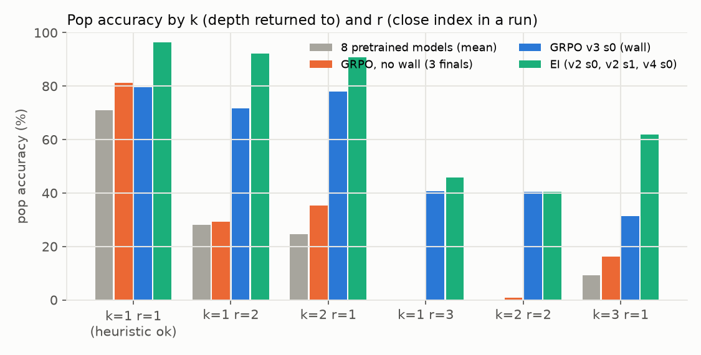
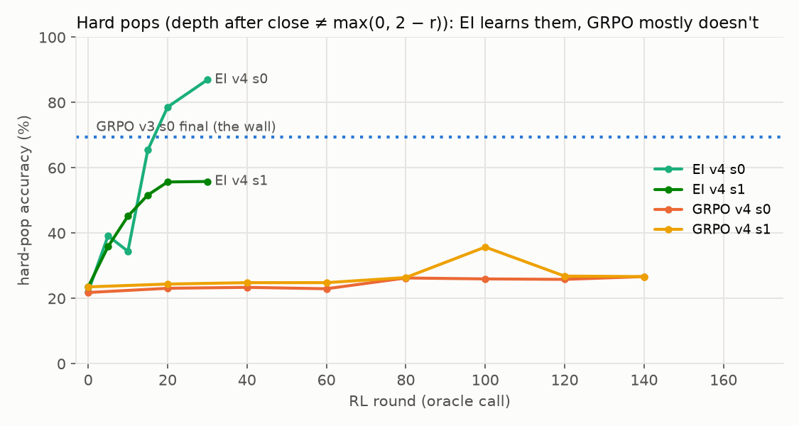
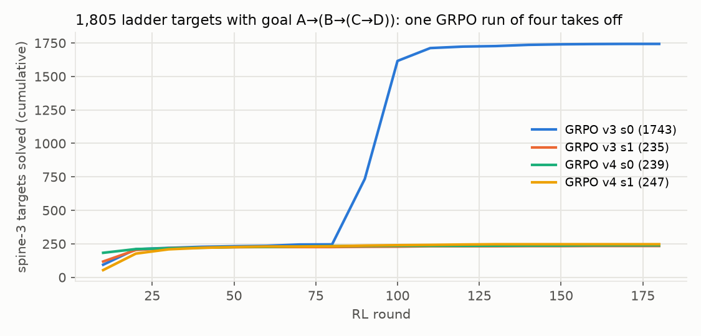
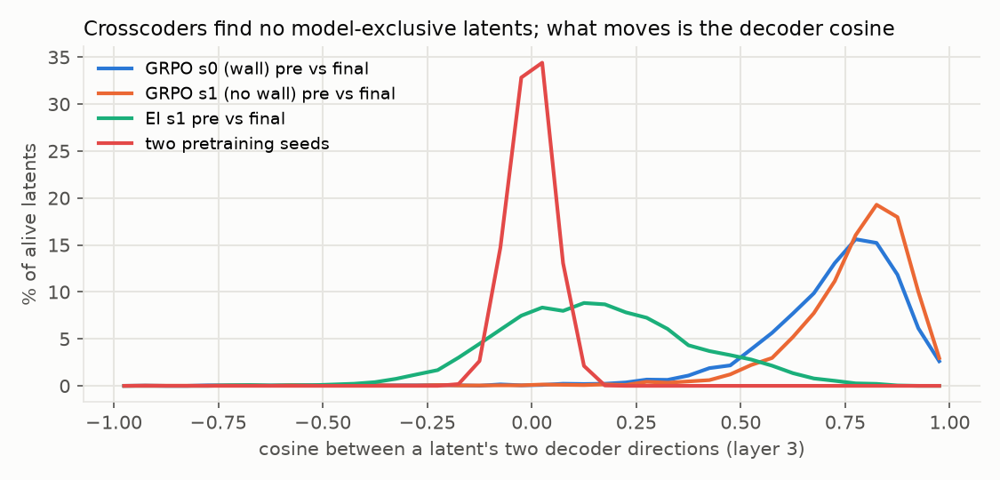

# What the GRPO wall was: model diffing depth-3 boxes

Status: done (overnight 2026-10-14 → 15). Working folder, all numbers and code:
[code/experiments/current/model_diff_20261014](../../code/experiments/current/model_diff_20261014/README.md).

Question: GRPO seed 0 of the [long-RL experiment](../../.claude/notes/long-rl-what-models-learn.md) suddenly learned
depth-3 nested assumption boxes (spine-3 ladder targets 15% → 97%); seed 1, same recipe, never did. What changed inside
the model? Do crosscoders / SAEs find it?

## Configuration

- Models: untied run-198 trunk (6 layers, d 384, ~10M params). GRPO v3 s0 (wall), v3 s1 and v4 s0/s1 (no wall), EI v2
  s0/s1 and v4 s0/s1; pretrained and final checkpoints, plus v4 trajectories (HF `robbiethompson2018/nd-rl-checkpoints`).
- Shared corpus of 13.6M tokens of Lean-accepted proofs with structural labels; crosscoders / SAEs / diff-SAEs trained
  on one RunPod A40 (BatchTopK, 8,192 latents, k 32; diff-SAE 4,096 / 16).
- Causal tests: weight transplants, residual patching, head patching, latent steering and ablation, free generation
  judged by Lean.

## Observations

**1. The blocker is closing boxes, not opening them.** After a run of consecutive box closes, the next `exact` must
cite the `have` that opened the box just closed. Every pretrained model (8 seeds) uses a shortcut that is exact on its
≤ 6-line pretraining proofs: *depth after the r-th consecutive close = max(0, 2 − r)*. On a depth-3 proof it pops one
level too far and ends the proof with a box still open. In free generation that is the first error in 95% (g0_pre) and
93% (g1_fin) of failed depth-3 samples.

**2. Only runs that took off fix it.** GRPO without a wall stays at the pretrained level on "hard" pops (k ≠ 2 − r);
EI learns them over ~10 rounds; the GRPO wall model reaches 69%. Runs that start at depth 4 stay ~40% everywhere.

**3. The wall is when depth-3 proofs start to succeed.** All four GRPO runs solve ~240 spine-3 targets early by proofs
that avoid the third box (2-3% reach depth 3). The 2,089 proofs of v3 s0's takeoff rounds all go through depth 3 with
hard pops. Seeds of such proofs existed in another run (v4 s1) that never took off; the takeoff looks stochastic.

**4. Mechanism.** The fix is a small, distributed change to blocks 0-2 at the closing tokens: g0_fin's blocks 0-2
transplanted into g0_pre take the key pop from 28% to 63%, and in free generation blocks 0-3 take spine-3 targets
solved from 1/60 to 45/60 (g0_fin: 52/60; blocks 3-5: 1/60); any single component does nothing; patching g0_fin's residual
into g0_pre only at the closing tokens takes k=1 pops 7% → 88%. Downstream, "pointer" heads in layers 3-5 attend to a
box header and copy its opener's name; they existed before RL and pointed at the wrong header; afterwards they land on
the right one. No single head is causal. True depth was already linearly decodable before RL (90% on the pops the model
got wrong) but not used.

**5. Crosscoders find no new features.** No model-exclusive latents for GRPO (wall or not) or EI, at any layer; a
positive control between two *different* pretraining seeds finds essentially none either: both compute the same
structural features in unrelated bases. The informative statistic is decoder cosine (what a shared feature writes),
which moves a little for GRPO and almost completely for EI (basis drift under a 72% weight change).

**6. A diff-SAE finds a sparse, readable handle.** An SAE on h_fin − h_pre (GRPO s0, layer 3): its top 20 latents of
4,096, added to the pretrained model at the closing tokens, take held-out k1 r2 pops 27% → 60% (top 100: 72%, = the full
difference). They read as *D_start-aware run-position features*, e.g. "first close of a run that started at depth ≥ 2"
(96-98% at depth 3, ~2% at depth 1). The crosscoder needs ~100 latents for the same effect.

**7. Attribution patching fails here.** The first-order estimate of the change has the wrong sign (−226 vs a real
27% → 73% gain), and the latents it ranks highest do nothing when steered. Use causal tests to pick latents.

## Interpretation (not proven)

Pretraining taught a local close-counting rule; successful RL re-weighted early layers so the closing tokens carry where
the run started, and existing pointer heads did the rest. It is closer to eliciting an already-represented quantity than
to building a new feature, yet 3 of 4 GRPO runs never made the change. Why GRPO s0 did is unresolved: all pretrained
seeds are equally bad on hard pops.

## Limitations and next step

Teacher-forced except for the free-generation check; one dictionary seed per configuration; no v3 intermediate
checkpoints, so the takeoff is not observed from the inside. Next: re-run GRPO from g0_pre and g1_pre with fresh RL
seeds and checkpoints every 5 rounds (~$2-3 per run) to separate pretraining luck from RL luck; and add pretraining
proofs whose deep closing runs follow non-trivial interiors, predicting no GRPO wall.
