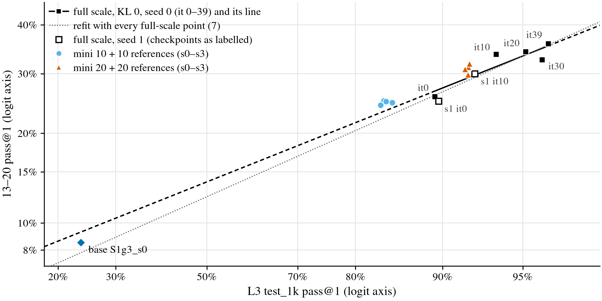
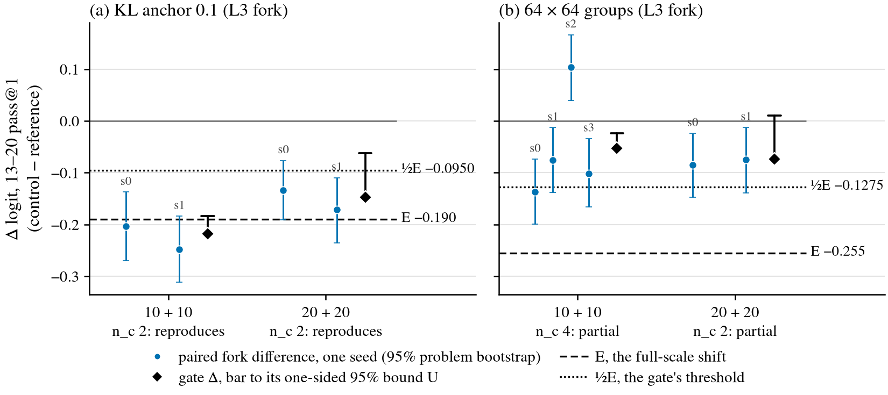

# RL generalization testbed: a mini RL run, validated against known full-scale effects

Status (2026-10-18, about 3:30 am PT; drafted by agent:claude for Leon):
- **The validation gate is not decided yet.** At 20 + 20 iterations (remedy A), G0 and G1 pass and the KL 0.1
  control reproduces. G0's ceiling check is met only through a recorded deviation (B0, below). The 64 × 64 control
  is partial at two seeds. As pre-registered, g64 forks at seeds 2 and 3 are running, and the gate will be re-applied
  at n_c 4: **PENDING**.
- **No knob has been run.**
- **The full-scale g64 replicate is PENDING.** Its seed 1 failed (`--ban_stop`) and seed 2 is training.

Working folder: [`code/experiments/current/rl_generalization_20261016/`](../../code/experiments/current/rl_generalization_20261016/)
(branch `leon/thinking`; launcher `leon/grpo-v2` at 79105ffe). Background: the
[thinking-traces summary](../2026-10-05-thinking-traces/README.md).

## Summary

**Question.** Which RL knobs change how the thinking prover generalizes? There are two targets:
- longer proofs: the 13–20- and 21–30-line sets, against 10–15-line training pools;
- another source: Charles149.

The knobs should be judged with in-distribution competence (L2 and L3 `test_1k`) held fixed or accounted for.

**Approach.** A full-scale L3 fork costs about 2.5 GPU-h per knob. Instead, the study builds a small "mini" testbed:
- both GRPO stages run from the Stage-1 base on 1,000-row subsets of the pools, for a few iterations;
- before any knob is read, a pre-registered gate checks that the mini learns, is low-noise, and reproduces two known
  harmful full-scale effects: a KL anchor of 0.1 (kl1) and 64 × 64 groups (g64).

**State of the evidence.**
- *At 10 + 10 iterations:* the mini learned and was quiet (seed SD 0.017 logit), and kl1 reproduced. g64 stayed
  partial at four seeds, so the gate said NO-GO and called for remedy A.
- *At 20 + 20 iterations:*
  - the mini learns (13–20 pass@1 31.0% against the base's 8.5%) and is quiet (0.042 logit);
  - it sits on the full-scale ID→OOD line;
  - kl1 reproduces (−3.0 points), but g64 is partial again (−1.6 points at two seeds, against −5.5 at full scale);
  - its B64 in-distribution read (91.9%) is above the gate's 90% ceiling. A recorded deviation handled this with a
    no-thinking (B0) read.
- *Next:* the gate is re-applied once g64's seeds 2 and 3 land. If g64 is still partial, the mini is retired and Leon
  decides whether knobs go to full-scale forks (remedy C).

## Setup

**Model and curriculum.**
- *Model:* every mini run starts from Stage-1 `S1g3_s0`. This is the 9.56M-parameter proof-state prover with per-step
  think blocks, pretrained on search traces at budgets 0/64/256. The RL seed sets only sampling and data order.
- *Stage L2-mini:* `grpo_think_vs`'s L2 command (KL anchor 0.02).
- *Stage L3-mini:* `grpo_think_vs_mb_kkl0`'s L3 command: the merged recipe at KL 0, with the 3-premise rows as extra
  targets in 0.33 of each batch.
- *Both stages:* 256 targets × 16 attempts per iteration, effort budgets 0/64/256, a 10-step AdamW warmup and rolling
  checkpoints every 2 iterations.
- *Code:* `code/experiments/current/thinking_traces_20261005/grpo_v2/launch/line.sh` on `leon/grpo-v2` (not on
  `leon/thinking`).

**Mini subsets.** These are in `/scratch/cowifornia/nd-rl/think/runs/pools/mini/`, built by `build_mini.py` with an
md5 pass record:
- 1,000 L2 rows of 10–12 lines (273 / 417 / 310 rows at 10 / 11 / 12 lines);
- 1,000 L3 rows of 13–15 lines (804 / 159 / 37 rows);
- the 369 3-premise rewrites of those L3 rows, used as L3's extra targets.

**Iterations.**
- 10 + 10: references at `leon/grpo-v2` 74864c28, controls at c00f45a6. The cooldown is the last 2 L3 iterations.
- Then remedy A, 20 + 20 at 79105ffe: the same subsets, init and flags. `--decay_frac 0.2` gives a 4-iteration
  cooldown.

**Validation wave.**
- 4 references at seeds 0–3.
- 2 controls, each an **L3-only fork** of the reference's L2-mini at the same seed:
  - `kl1`: KL anchor 0.1 instead of 0, at seeds 0 and 1;
  - `g64`: 64 targets × 64 attempts instead of 256 × 16, the same attempts per iteration, at seeds 0 and 1, plus 2
    and 3 if partial.
- The base is read once.

**Reads.** All are plain reads at B64 and T 0.8 of the last L3-mini checkpoint. textbook72 is sealed and never read.

| set | what | k |
|---|---|---|
| L2 / L3 `test_1k` | held-out in-distribution, 1,000 problems each | 8 |
| 13–20 | the 986 valid items of t1320_n1000 | 8 |
| 16–20 | its 616 items with `min_lines` ≥ 16 (the same read) | 8 |
| 21–30 | t2130_n1000 | 8 |
| Charles149 | the clean 149 rows of the charles173 read | 64 |
| L3 test B0 | L3 `test_1k` at think budget 0: the 20 + 20 references, the base, full-scale `mb` and `kkl0` at seed 0 | 8 |
| L2 / L3-mini train subsets | memorisation check (20 + 20 references only) | 8 |

**Statistics** ([PREREGISTRATION.md](../../code/experiments/current/rl_generalization_20261016/PREREGISTRATION.md) § 3).
- *Per run:* x_r is the logit of the set-mean pass@1, the unbiased estimator from k, with p clipped to [0.005, 0.995].
  pass@5 is the unbiased estimator from k.
- *Intervals:* 95% problem bootstraps, 4,000 draws. Pooled values use a hierarchical bootstrap (seeds, then problems).
  Differences are paired on problems.
- *Gate statistic, on 13–20 pass@1:* Δ_c is the control's seed-mean x minus the references' seed-mean x.
  - s_ref is the SD of the 4 references' x (df 3).
  - SE = s_ref · √(1/n_c + 1/n_r).
  - U = Δ + t(0.95, 3) · SE, with t = 2.353.
  - The test is unpaired, so it is conservative: forks share an L2-mini with references 0 and 1.
- *Expected shifts E,* from seed-0 full-scale pilots:
  - kl1: −0.19 logit (kl1 − kkl0: −4.2 / −3.5 points at 13–20 pass@1 / pass@5);
  - g64: −0.255 (g64 − merged: −5.5 / −5.4).
- *Classes:*
  - **reproduces**: Δ ≤ ½E, U < 0, and the 16–20 pass@1 and 21–30 pass@5 point estimates are both below 0;
  - **partial**: Δ < 0 otherwise;
  - **fails**: Δ ≥ 0.
- *G0, the setup learns:*
  - all 4 references finish with every read;
  - at most 1 rolls back;
  - their mean 13–20 pass@1 is in [12%, 60%] and at least the base + 5 points;
  - their mean L3 test pass@1 is ≤ 90%.
- *G1, noise:* s_ref ≤ 0.11 logit.
- *G3, informational:* the references are placed against the full-scale `kkl0` trajectory line, logit(13–20) on
  logit(L3 test).
- *Decision:*
  - GO if G0 and G1 pass and both controls reproduce;
  - a partial g64 gets forks at seeds 2 and 3, then the gate is re-applied at n_c 4;
  - if g64 is still partial, the 10 + 10 configuration goes to remedy A;
  - at 20 + 20, remedy A is spent, so the mini is retired and Leon decides (§ 6).

## Results (observed)

### Known full-scale effects (the targets)

These are the knob pilots of 2026-10-15
([EXPERIMENT_QUEUE.md](../../code/experiments/current/thinking_traces_20261005/EXPERIMENT_QUEUE.md),
[v2_results_ynez.md](../../code/experiments/current/thinking_traces_20261005/matched_eval/v2_results_ynez.md) § 7):
- each is the merged recipe's L3 (KL 0.02) forked from `grpo_think_vs_s0_L2_it39.pt`, seed 0;
- the cells are Δ pass@1 / pass@5 on 13–20, in points, knob minus the merged recipe;
- `rr` (nothing changed) gives the noise band, about 1–1.5 points.

| rr | kl0 | kl1 | g64 | t12 (T 1.2) | i78 (2× iterations) | ch4 (clip 0.4) | x66 | p3 |
|---|---|---|---|---|---|---|---|---|
| −1.2 / −0.9 | +1.6 / +1.3 | −2.7 / −2.2 | **−5.5 / −5.4** | −2.2 / −3.0 | −1.5 / −1.5 | −1.7 / −1.2 | +0.5 / +1.7 | 0.0 / +1.7 |

- kl0 over 3 seeds pooled: +1.7 [+0.8, +2.6] / +2.4 [+0.7, +4.0].
- The mini reference's L3 is at KL 0, so kl1's target is kl1 − kkl0: −4.2 / −3.5 points, or −0.188 logit, rounded to
  −0.19.

### (a) The 10 + 10 gate: NO-GO, remedy A

Source: [results/gate.md](../../code/experiments/current/rl_generalization_20261016/results/gate.md); verdict 8:47 pm
PT, 2026-10-17.

- **G0 PASS.**
  - All 4 references finished with every read, with 0 rollbacks.
  - 13–20 pass@1 is 24.9%, against the base's 8.5% (+16.3 points).
  - L3 test is 84.1% (≤ 90%).
- **G1 PASS:** s_ref is 0.017 logit (95% interval for σ [0.010, 0.064]), about the size of k8 attempt noise alone.
- **kl1 reproduces** (n_c 2):
  - Δ −0.218 logit (−3.8 points), U −0.183;
  - secondaries: 16–20 −0.320, 21–30 pass@5 −0.304.
- **g64 is partial at n_c 4:**
  - Δ −0.053 logit (−0.9 points) against ½E −0.1275, U −0.024;
  - paired seed differences: −0.137, −0.075, +0.104, −0.102.
- **Decision: remedy A.** Leon chose to follow the pre-registration (queue, 9:10 pm PT).
- The kl1 and g64 seed-1 L3 forks were rerun from scratch after serrano power failures (flag `crash-rerun`).

Pooled pass@1 / pass@5, % of the set
([mini_table.md](../../code/experiments/current/rl_generalization_20261016/results/mini_table.md) has the intervals):

| arm | seeds | L2 test | L3 test | 13–20 | 16–20 | 21–30 | Charles149 |
|---|---|---|---|---|---|---|---|
| base S1g3_s0 | 0 | 35.1 / 60.7 | 23.6 / 52.7 | 8.5 / 23.4 | 5.2 / 16.3 | 0.5 / 2.2 | 38.7 / 55.8 |
| reference | 0–3 | 83.5 / 94.7 | 84.1 / 97.9 | 24.9 / 49.6 | 19.9 / 43.0 | 5.2 / 14.6 | 62.0 / 73.6 |
| kl1 (L3 fork) | 0, 1 | 80.2 / 93.4 | 80.5 / 96.8 | 21.0 / 44.6 | 15.3 / 36.4 | 3.8 / 11.2 | 58.6 / 71.2 |
| g64 (L3 fork) | 0–3 | 82.1 / 94.1 | 81.9 / 96.9 | 23.9 / 48.5 | 19.1 / 42.2 | 5.1 / 14.2 | 60.6 / 72.2 |

### (b) The 20 + 20 gate (remedy A): g64 forks at seeds 2 and 3, PENDING

Source: [results/gate_mini20.md](../../code/experiments/current/rl_generalization_20261016/results/gate_mini20.md)
and [mini20_table.md](../../code/experiments/current/rl_generalization_20261016/results/mini20_table.md), generated at
3:25 am PT on 2026-10-18. The gate uses 20 + 20 runs only; nothing is pooled with the 10 + 10 runs.

Per run and pooled, pass@1 / pass@5, % of the set (95% intervals in `mini20_table.md`):

| arm | seed | L2 test | L3 test | 13–20 | 16–20 | 21–30 | Charles149 | L3 test B0 |
|---|---|---|---|---|---|---|---|---|
| base S1g3_s0 | 0 | 35.1 / 60.7 | 23.6 / 52.7 | 8.5 / 23.4 | 5.2 / 16.3 | 0.5 / 2.2 | 38.7 / 55.8 | 11.5 / 29.4 |
| reference | 0 | 91.1 / 97.7 | 92.0 / 99.3 | 31.3 / 56.5 | 25.8 / 49.8 | 7.6 / 19.4 | 68.1 / 77.9 | 75.9 / 91.0 |
| reference | 1 | 90.1 / 97.1 | 91.8 / 99.0 | 30.9 / 56.7 | 25.2 / 49.8 | 7.0 / 19.3 | 66.5 / 77.7 | 77.4 / 92.1 |
| reference | 2 | 90.3 / 97.1 | 92.1 / 99.3 | 31.9 / 57.1 | 26.4 / 50.5 | 7.1 / 18.7 | 66.1 / 76.4 | 75.3 / 89.9 |
| reference | 3 | 90.0 / 97.0 | 92.0 / 99.1 | 29.8 / 55.4 | 24.2 / 48.1 | 6.9 / 18.1 | 65.4 / 77.8 | 76.7 / 91.2 |
| **reference, pooled** | 0–3 | 90.4 / 97.2 | **91.9** / 99.2 | **31.0** / 56.4 | 25.4 / 49.6 | 7.2 / 18.9 | 66.5 / 77.4 | **76.3** / 91.1 |
| kl1 (L3 fork) | 0 | 88.4 / 95.9 | 90.6 / 99.3 | 28.5 / 55.4 | 23.5 / 49.0 | 6.6 / 17.1 | 65.8 / 76.2 | — |
| kl1 (L3 fork) | 1 | 88.3 / 96.1 | 90.2 / 99.1 | 27.3 / 52.7 | 22.3 / 46.1 | 5.8 / 15.4 | 65.0 / 76.5 | — |
| **kl1, pooled** | 0, 1 | 88.4 / 96.0 | 90.4 / 99.2 | 27.9 / 54.0 | 22.9 / 47.5 | 6.2 / 16.3 | 65.4 / 76.4 | — |
| g64 (L3 fork) | 0 | 89.4 / 96.5 | 91.0 / 99.2 | 29.5 / 54.7 | 24.5 / 49.0 | 7.0 / 18.6 | 66.3 / 75.6 | — |
| g64 (L3 fork) | 1 | 89.8 / 96.7 | 90.4 / 99.0 | 29.3 / 55.7 | 23.7 / 49.6 | 6.8 / 18.7 | 63.3 / 74.5 | — |
| **g64, pooled** | 0, 1 | 89.6 / 96.6 | 90.7 / 99.1 | 29.4 / 55.2 | 24.1 / 49.3 | 6.9 / 18.7 | 64.8 / 75.1 | — |
| g64 (L3 fork) | 2, 3 | PENDING | PENDING | PENDING | PENDING | PENDING | PENDING | — |

Paired differences against the reference at the same seeds (points, pass@1 / pass@5, 95% paired intervals):

| comparison | L3 test | 13–20 | 16–20 | 21–30 | Charles149 |
|---|---|---|---|---|---|
| reference − base | +68.3 / +46.5 | +22.4 [+20.6, +24.3] / +33.0 | +20.2 / +33.2 | +6.6 / +16.7 | +27.7 / +21.6 |
| kl1 − reference (s0, s1) | −1.4 [−2.3, −0.7] / +0.0 | −3.2 [−4.4, −1.9] / −2.6 | −2.6 / −2.3 | −1.1 / −3.1 | −1.9 [−3.9, −0.2] / −1.4 |
| g64 − reference (s0, s1) | −1.2 [−2.1, −0.3] / −0.1 | −1.7 [−2.9, −0.5] / −1.4 | −1.4 / −0.5 | −0.4 / −0.7 | −2.4 [−4.6, −0.5] / −2.7 |

**Learning and noise.**
- *G0's learning checks pass.* All 4 references finished with every read, with 0 rollbacks. Their mean 13–20 pass@1
  is 31.0%, against the base's 8.5% (+22.4 points).
- *G1 passes:* s_ref is 0.042 logit on 13–20 pass@1 (95% interval for σ [0.024, 0.155]). The references' 13–20
  pass@1 spans 29.8–31.9%.
- *s_ref per metric, pass@1 in logit:*

  | L2 test | L3 test | 16–20 | 21–30 | Charles149 |
  |---|---|---|---|---|
  | 0.060 | 0.018 | 0.051 | 0.046 | 0.052 |

- *Wave-2 seeds* (§ 6, mechanical): s_ref is 0.042, at or below 0.050, so each knob is screened at **1 seed**.
- *Training subsets:* the L3-mini train subset reads 94.0–94.6% pass@1. Against L3 test that is a gap of +0.324 to
  +0.430 logit; the L2 gap is +0.011 to +0.144.

**The ceiling problem and the B0 deviation.**
- *What failed.* The references' mean B64 L3 test pass@1 is **91.9%** (92.0, 91.8, 92.1, 92.0), above G0's ≤ 90%. Read
  mechanically, that is NO-GO, and since remedy A was spent the mini would be retired.
- *The deviation* ([PREREGISTRATION.md](../../code/experiments/current/rl_generalization_20261016/PREREGISTRATION.md)
  § 6, ba275d73, 2:27 am PT). Leon had delegated decisions overnight at about 2:25 am PT, and agent:claude wrote this
  before any B0 read existed. Its reasons:
  1. Remedy C cannot pass the B64 check either. Full-scale L3 runs read 94.9–96.9% B64 L3 test pass@1 (`kg64`,
     `kkl1`, `kkl0`, `krr`, `kt12` at seed 0, from the eval rows; `kt12` is 96.85%, which § 6 rounds to 96.8%). Even
     the shared L2 start reads 89.3%.
  2. G0's clause names its own fix: "add B0 or a hard ID subset before knob work". `test_1k` has no usable hard
     subset: the 15-line stratum has only 44 problems.
  3. G3 puts the references on the full-scale line: a mean residual of +0.083 logit, against the line's residual SD of
     0.082.
- *The rule, fixed in advance.* The ceiling check alone uses the references' **B0** L3 test pass@1 and passes at a mean
  of ≤ 90.0%. Everything else in G0 is unchanged.
- *The result:* a B0 mean of **76.3%** (75.9, 77.4, 75.3, 76.7). It is reported as "met by the clause's fix (B0)",
  never as "passed".
- *The completion* (963d90b3, 2:36 am PT):
  - the B0 check was predictable: the references' B0 *training* pass at L3-mini it 20 was 77.5–81.0%;
  - P1 stays B64 L3 test pass@1. B0 becomes only the competence axis of the § 4.3 residuals, with B64 as the
    sensitivity check;
  - no retire branch starts anything overnight.
- *The errata* (efdc89a8, 3:07 am PT):
  - at B0 the full-scale runs also read under 90%: `grpo_think_vs_mb` s0 and `grpo_think_vs_mb_kkl0` s0 are both
    88.7%, so reason 1 holds only at B64;
  - keeping the mini therefore rests on reasons 2 and 3, on cost (1.2–1.9 GPU-h per mini20 run against about 2.5 h)
    and on the measured noise.

**G3 against later full-scale points.** The deviation's line used the five seed-0 points:
logit(13–20) = −1.826 + 0.386 · logit(L3 test). More full-scale points have landed since:

| line | points | fit | residual SD | 20 + 20 references' mean residual |
|---|---|---|---|---|
| as the deviation cited | 5 (seed 0) | −1.826 + 0.386 x | 0.082 | +0.083 |
| in `gate_mini20.md`, 3:25 am PT | 6 (adds seed 1 it0) | −1.984 + 0.438 x | 0.081 | +0.115 |
| `summary_figures.py`, about 3:35 am PT | 7 (adds seed 1 it10) | −1.960 + 0.432 x | 0.076 | +0.107 |

The 10 + 10 references sit at a mean residual of +0.075 against the seed-0 line ([Figure 1](#figures)).

**The controls** (n_c 2 each; 0 of 2 failed runs each):
- **kl1 reproduces:** Δ −0.147 logit (−3.0 points), U −0.062. Secondaries: 16–20 −0.139 (−2.5 points), 21–30 pass@5
  −0.182 (−2.6 points).
- **g64 is partial:** Δ −0.074 logit (−1.6 points) against ½E −0.1275, U +0.011. Secondaries: 16–20 −0.068 (−1.3
  points), 21–30 pass@5 −0.014 (−0.2 points).
- *Paired seed differences on 13–20 pass@1, in logit:*

  | control | seed 0 | seed 1 |
  |---|---|---|
  | kl1 | −0.134 [−0.191, −0.076] | −0.171 [−0.235, −0.109] |
  | g64 | −0.085 [−0.148, −0.024] | −0.074 [−0.139, −0.012] |

  See [Figure 2](#figures).
- *Both controls also lower in-distribution competence:* L3 test −1.4 and −1.2 points pass@1. The § 4.3 residuals that
  would separate competence from generalization are not computed yet ("needs trajectories").
- *On Charles149,* kl1 is −1.9 points, against a full-scale −0.5 (null). g64 is −2.4 points, against a full-scale
  −2.2.

**Decision** (8d3f69d6, 3:27 am PT). g64 forks at seeds 2 and 3, then the gate is re-applied at n_c 4. If g64 is still
partial at n_c 4, the mini is retired and kl1's class decides nothing.

At drafting, g64 seed 2's L3-mini was at it 1 of 20 and seed 3 had not started.

| n_c 4 gate | Δ (logit) | U | 16–20 Δ | 21–30 pass@5 Δ | class | decision |
|---|---|---|---|---|---|---|
| g64 | PENDING | PENDING | PENDING | PENDING | PENDING | PENDING |

### (c) The full-scale g64 replicate: PENDING

Source: [results/g64_replicate.md](../../code/experiments/current/rl_generalization_20261016/results/g64_replicate.md).

**Criterion** (§ 6), computed as Δ = `kg64` − `mb` at the replicate seed, on 13–20 pass@1 in logit:
- it **replicates** if Δ ≤ −0.1275 and its 95% problem-bootstrap interval excludes 0;
- it **does not replicate** if Δ > −0.1275;
- between the two, there is no call.

It changes neither E nor the gate.

**Seed 1 failed** (§ 4.6, recorded 11:20 pm PT, Oct 17):
- `--ban_stop 0.005` ended it at its last iteration, it 39 of 39. Its think ban mass had risen from about 0.0006
  (its 1–20) to 0.0057.
- It had rolled back once (it 22, lr × 0.5).
- The line exited 3 with no `_it39.pt`, so no reads ran.
- The failure rate is **1 of 2** full-scale kg64 runs (seeds 0, 1).

**Seed 2 replaces it,** paired with `grpo_think_vs_mb` s2. At 3:26 am PT it was training (it 27 of 39). Its Δ and
call: **PENDING**.

**Seed 0** (the pilot behind E), kg64 − merged, logit [95%] / points:

| 13–20 pass@1 | 16–20 pass@1 | 21–30 pass@5 | 13–20 pass@5 | Charles149 pass@1 |
|---|---|---|---|---|
| −0.255 [−0.308, −0.201] / −5.5 | −0.266 [−0.337, −0.196] / −5.2 | −0.267 [−0.390, −0.150] / −4.3 | −0.222 [−0.290, −0.151] / −5.4 | −0.104 [−0.204, −0.007] / −2.2 |

### (d) The thinking gap on L3 test: B64 − B0 (observation)

| model | B64 L3 test pass@1 | B0 L3 test pass@1 | gap (points) |
|---|---|---|---|
| 20 + 20 references, pooled | 91.9% | 76.3% | ≈ 16 (14.4–16.8 per seed) |
| base S1g3_s0 | 23.6% | 11.5% | ≈ 12 |
| full-scale `grpo_think_vs_mb_kkl0` s0 | 96.0% | 88.7% | ≈ 7 |

The full-scale `grpo_think_vs_mb` s0 reads 88.7% at B0 but has no B64 L3 test read. The 10 + 10 references have no B0
read.

## Interpretation and caveats (interpretation, not results)

**What the mini reproduces.**
- It learns, from the same base, a large share of what full-scale RL learns on the long sets. The 20 + 20 references
  reach 31.0% on 13–20 pass@1, against 36.0% for full-scale `kkl0` s0 at it39.
- Its seed noise is low: 0.017 and 0.042 logit, against the 0.11 limit. At 10 + 10 it was about the size of k8
  attempt noise alone.
- Its ID→OOD relation lies on the full-scale trajectory line: 20 + 20 residuals of about +0.08 to +0.12 logit, against a
  line SD of about 0.08. G3 is informational, and its line rests on 5–7 points from one or two seeds.
- KL 0.1's harm reproduces in sign and roughly in size: 115% of E at 10 + 10 (−0.218 / −0.19) and 77% at 20 + 20
  (−0.147 / −0.19).

**What it does not reproduce.**
- *g64's size.* g64 reaches 21% of E at 10 + 10 (−0.053 / −0.255) and 29% at 20 + 20 (−0.074 / −0.255). One of the
  four 10 + 10 seeds went the other way (+0.104).
- *What n_c 4 would need* (arithmetic, not a prediction): for g64 to reach ½E, seeds 2 and 3 must average x ≤ −0.98.
  That is a shift of about −0.18 logit against the reference mean, more than twice the seed-0 and seed-1 shifts.
- *Open hypotheses for the gap,* not tested:
  - the full-scale g64 effect is a single seed-0 estimate, and its replicate is pending;
  - it was measured on the merged recipe at KL 0.02, while the mini's L3 runs at KL 0;
  - group shape may matter differently in the mini's learning regime than in full scale's saturated L3, as the design
    review anticipated
    ([DESIGN_REVIEW.md](../../code/experiments/current/rl_generalization_20261016/DESIGN_REVIEW.md) Q4).

**The ceiling and the deviation.**
- At 20 + 20 the B64 ID read is close to its ceiling: L3 test 91.9% pass@1, 99.2% pass@5. A competence axis read at
  B64 is therefore compressed.
- Substituting B0 applies the clause's named fix; it is not a test that the mini passed. Given B0 training pass of
  77.5–81.0%, the check was always going to be met, and the completion amendment says so.
- The deviation is reported as such in every write-up of the knob wave. Any GO is tagged as reached through it.

**The competence axis: B0 against B64.**
- B0 measures competence without thinking, while every OOD read is at B64.
- The mini's B64 − B0 gap (≈ 16 points) is about twice full scale's (≈ 7), so more of the mini's B64 ID score comes
  from thinking.
- A knob that changes how thinking is used can move B0 and B64 differently. § 6 therefore reports both residuals and
  flags any knob whose call differs between them.

**Single-replicate limits.**
- Both E values come from one seed-0 full-scale contrast each. Full-scale rerun noise is about 0.05 logit (`krr`).
- At n_c 2 the gate's SE is 0.036 logit, and s_ref itself rests on 4 references (σ interval [0.024, 0.155]).
- The 16–20 and 21–30 secondaries count only by the sign of their point estimate.

**Hardware.**
- serrano's repeated hard power-offs were traced to power delivery under load
  ([EXPERIMENT_QUEUE.md](../../code/experiments/current/thinking_traces_20261005/EXPERIMENT_QUEUE.md);
  `/scratch/cowifornia/nd-rl/think/runs/vitals/CRASH_REPORT.md`).
  - A full CPU load plus 5 GPUs at 150 W survived 47 min, and 5 × 200 W survived 5 min.
  - 5 × 250 W (about 1.5 kW) killed the box, and a replacement PSU died within a minute at stock limits.
- The study's jobs now run on at most 3 GPUs. The GPUs read a 200 W limit from 2026-10-18 on. Power limits change
  speed, not the computation.

## What's next

1. **The n_c 4 gate (PENDING).** g64 forks at seeds 2 and 3 from the 20 + 20 references' L2-minis.
   - *If g64 reproduces and kl1 still reproduces:* GO, tagged as reached through the B0 deviation. Wave 2 then runs at
     20 + 20:
     - 1 seed per knob for screening, and 2 fresh seeds to confirm each screening hit;
     - every arm gets a B0 L3 test read;
     - references s0 and s1 get trajectory reads (L2 it 8, L3 it 0 / 8 / 16, at B0 and B64) for the § 4.3 lines;
     - reference seed 4 runs last, as a drift check.
   - *Wave-2 knobs:*
     - temperature 0.7 and 1.3;
     - length reward −0.1 and +0.5;
     - pool size 250;
     - loss on action-only and think-only tokens;
     - positive-only and negative-only advantages, as L3 forks;
     - the statement-size twins.
2. **If g64 is still partial or fails at n_c 4:** the mini is retired as the knob testbed and nothing starts
   overnight. **Leon decides on remedy C:** full-scale L3 forks from `grpo_think_vs_s{0,1,2}_L2_it39.pt`, 3 seeds,
   about 2.5 h a job.
3. **The full-scale g64 replicate (seed 2, PENDING).** It bears only on whether the full-scale g64 effect is a reliable
   reference. If seed 2 also fails, full-scale g64 is "unstable".
4. **To fill in here:** the g64 seed 2 and 3 rows, the n_c 4 gate row, and the replicate's Δ. Rerun
   `analysis/mini_results.py` and `analysis/summary_figures.py`.

## Figures

Generated by [`analysis/summary_figures.py`](../../code/experiments/current/rl_generalization_20261016/analysis/summary_figures.py)
from the eval rows, with mini_results.py's loaders:

```
cd /scratch/cowifornia/nd-rl/think/nd-rl && ND_OFFLINE=1 PYTHONDONTWRITEBYTECODE=1 OMP_NUM_THREADS=2 PYTHONPATH=. \
    nice code/.venv/bin/python code/experiments/current/rl_generalization_20261016/analysis/summary_figures.py
```



**Figure 1: the mini references sit on the full-scale ID→OOD line.** L3 test_1k pass@1 against 13–20 pass@1, both on
logit axes (point estimates). The figure shows:
- *Full scale, black squares:* `grpo_think_vs_mb_kkl0` (merged recipe, KL 0 in L3), seed 0, at L3 it 0 (the shared L2
  checkpoint), 10, 20, 30 and 39. Reads are L3 test k8 and t1320 k4 (k16 at it39).
- *Solid black line:* their OLS line in logit, −1.826 + 0.386 x (residual SD 0.082), dashed where extrapolated.
- *Grey dotted line:* the refit on all 7 full-scale points available at drafting, which adds seed 1's it0 and it10
  (open squares).
- *Mini:* circles are the four 10 + 10 references and triangles the four 20 + 20 references (k8). The diamond is the
  base S1g3_s0.

The 20 + 20 references' mean residual against the seed-0 line is +0.083 logit. PDF / SVG:
[pdf](figures/fig_g3_line.pdf), [svg](figures/fig_g3_line.svg).



**Figure 2: KL 0.1 reproduces its full-scale harm in both configurations; 64 × 64 groups stay short of half of it.**
The y axis is Δ logit of 13–20 pass@1, control minus reference.
- *Blue points:* per seed, the paired fork difference against the reference at the same seed (the same L2-mini), with
  95% problem-bootstrap intervals (4,000 draws; attempt and problem noise only).
- *Black diamonds:* the gate's unpaired Δ (seed-mean logits against all four references), with a bar to its one-sided
  95% bound U = Δ + 2.353 · SE.
- *Dashed line:* E, the full-scale seed-0 shift. *Dotted line:* ½E, the gate's threshold.
- The 20 + 20 g64 seeds 2 and 3 are PENDING.

PDF / SVG: [pdf](figures/fig_controls.pdf), [svg](figures/fig_controls.svg).

## Files, branch and commits

**Working folder** ([`rl_generalization_20261016/`](../../code/experiments/current/rl_generalization_20261016/)):
- [DESIGN_REVIEW.md](../../code/experiments/current/rl_generalization_20261016/DESIGN_REVIEW.md): the read-only review
  of the mini plan and the existing-data observations.
- [KNOB_PROPOSALS.md](../../code/experiments/current/rl_generalization_20261016/KNOB_PROPOSALS.md): the knob
  proposals.
- [PREREGISTRATION.md](../../code/experiments/current/rl_generalization_20261016/PREREGISTRATION.md): § 3 is the gate;
  § 6 holds the dated amendments (remedy A, the g64 replicate, the clarification, the G0 deviation and its completion,
  and the errata).
- Results:
  - [results/gate.md](../../code/experiments/current/rl_generalization_20261016/results/gate.md) and
    [results/mini_table.md](../../code/experiments/current/rl_generalization_20261016/results/mini_table.md): 10 + 10;
  - [results/gate_mini20.md](../../code/experiments/current/rl_generalization_20261016/results/gate_mini20.md) and
    [results/mini20_table.md](../../code/experiments/current/rl_generalization_20261016/results/mini20_table.md):
    20 + 20;
  - [results/g64_replicate.md](../../code/experiments/current/rl_generalization_20261016/results/g64_replicate.md).
- Analysis:
  - [analysis/mini_results.py](../../code/experiments/current/rl_generalization_20261016/analysis/mini_results.py)
    generates every results file;
  - [analysis/summary_figures.py](../../code/experiments/current/rl_generalization_20261016/analysis/summary_figures.py)
    generates these figures;
  - the design-review scripts are `traj.py`, `slope.py`, `hazard.py` and the others in `analysis/`.
- Context from the thinking-traces study:
  [EXPERIMENT_QUEUE.md](../../code/experiments/current/thinking_traces_20261005/EXPERIMENT_QUEUE.md) (knob pilots,
  PSU diagnosis) and [RL_RESULTS.md](../../code/experiments/current/thinking_traces_20261005/RL_RESULTS.md) (the first
  RL phase).

**Branch `leon/thinking`** (analysis and notes):

| commit | time (PT, 2026-10-18) | what |
|---|---|---|
| ba275d73 | 2:27 am | pre-registration: the deviation on the remedy-A G0 ceiling check |
| 963d90b3 | 2:36 am | pre-registration: the deviation completed after its audit |
| efdc89a8 | 3:07 am | pre-registration: errata to the G0 deviation |
| d752f676 | 3:16 am | analysis: the B0 deviation in the mini20 gate |
| 8d3f69d6 | 3:27 am | the mini20 gate decision: g64 forks at seeds 2 and 3 |

**Launcher.** `leon/grpo-v2` at 79105ffe, the mini20 variant of `line.sh`. The 10 + 10 runs used 74864c28 (references)
and c00f45a6 (forks).

**Runs.** All under `/scratch/cowifornia/nd-rl/think/runs/`:
- `grpo_v2/grpo_think_vs_mini{,20}[_kkl1|_kg64]_s<seed>_L{2,3}/` (training);
- `eval/v2/` (reads).
