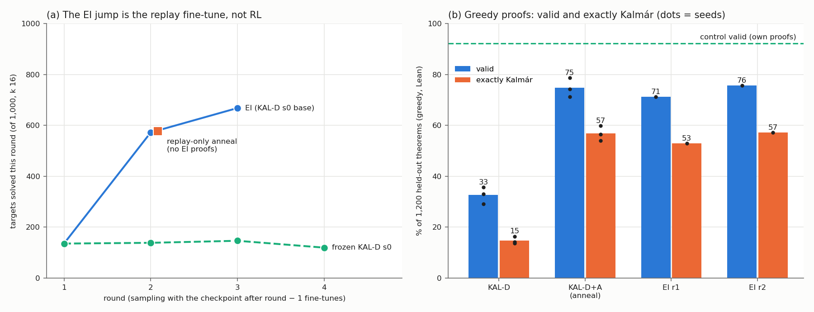

# kalmar-pretrain: our 9.56 M model, pretrained on Kalmár-construction proofs of K12's theorems, did not learn the construction and is far below the K12 control in distribution. A 600-step replay-only fine-tune lifts it to 98.7–98.8 % teacher-forced agreement and 71–79 % greedy, and at one seed it matches the EI ladder's round-1 → 2 jump

Status: completed 2026-10-20 and reviewed 2026-10-20. **No hard-constraint violation, nothing quarantined.** The
reviewer rebuilt K12-Kalmár with their own code and recomputed from the raw files:
- teacher-forced agreement and free generation;
- every solve table and the generalisation verdicts;
- the ladder, the cut-offs and the compute.

Every number they recomputed reproduces. A few cells were not recomputed: the pb variant's pair tokens and term size,
K12's box depth, the state-conflict count and the builder tests.
- **The pre-registered result stands:**
  - KAL-D did not learn the construction (3 / 3 seeds).
  - It is far below the K12 control in distribution.
  - It does not generalise, except a weak "partially" on G3 that comes only from the ratio leg. Seeds are combined by
    the executor's arm-mean rule, a post hoc choice: per seed, G1(b) s0 is also "partially".
- **The exploratory result (Addendum 3) stands as measured, at three seeds.** The replay-only fine-tune (KAL-D+A)
  reaches 98.7–98.8 % agreement and 71–79 % greedy validity. At k 32 it beats the control on textbook72, G3, G1 as is
  and ≥ 17, and trails it on holdout250 (KAL-D+A read at batch 1,024, the control at 2,048).
- **"The EI jump is the fine-tune, not RL" rests on one seed (s0) and one round:** 578 vs 572 targets. Which part of
  the fine-tune matters is not separated: the learning rate, the ≈ 150× larger batch, AdamW without Muon or MTP, or the
  +13.5 % tokens.
- **Nine wordings need fixing** (see "The review's corrections" below).
- **Not run:** KAL-D's pre-registered pass@256, and the pre-registered 2× re-read of strata with truncated actions.

Question (Dan, 2026-10-18): "create a training set of the proofs this prover generates … pretrain the model on those
proofs, with the same approximate number of theorems in the pretrain set … I am curious if we can teach a model to use
Kalmár's construction by pretraining on such proofs, and whether that generalizes well." The prover is
[`code/tools/tt_prover.py`](../../code/tools/tt_prover.py). Brief:
[`BRIEF_kalmar-pretrain.md`](../../docs/proposals/state-env/BRIEF_kalmar-pretrain.md) (proposal 29,
[proposal note](../../docs/proposals/2026-10-18-kalmar-pretrain.md)). Related, not a review input: the report
[Kalmár's construction vs our model](../../docs/project_strategy/kalmar-vs-model-efficiency/README.md) (cost per
theorem).

**Plain-language summary:** [`plain_summary.md`](plain_summary.md). This is the executor's 799-word summary with the
review's corrections marked *[review]*; with them it is about 850 words.

## Configuration

- **Repository.** Fork `dan-pandori/nd-takehome`, branch `dan_kalmar-pretrain`, from `origin/dan_create-or-elicit`.
  It ran on agent2, every role at `--effort max`.
  - **Pre-registration** `preregistration/kalmar-pretrain.md`, commit
    [`84ae22cf`](https://github.com/dan-pandori/nd-takehome/commit/84ae22cf) at 2026-10-19 01:44:06Z. The first pod
    (`kal-1`) started at 01:50:40Z.
  - **Addendum 1** (the EI ladder, `12611c8e`, 03:28:08Z). It predates the first ladder launch (12:22Z) and the end of
    KAL-D training (11:57–12:31Z). The control's and KAL-C's first read-outs were already in the log (02:22–03:00Z),
    so its expectations were written knowing them.
  - **Addendum 2** (`2c3501b4`, 13:10:57Z): KAL-D's sampled reads and the ladder at batch 1,024, after batch 2,048 ran
    out of memory. It was committed 15–22 s after the relaunches it records, before any of them finished.
  - **Addendum 3** (`abe58261`, 2026-10-20 00:11:14Z), exploratory: the replay-only fine-tune. It was written after
    the EI round-2 numbers it cites.
  - **DONE** [`9c997fe8`](https://github.com/dan-pandori/nd-takehome/commit/9c997fe8) (2026-10-20 09:40Z). Deliverables:
    - `run_kalmar_pretrain.md`, `run_kalmar_pretrain_plain.md`, `numbers.md` § kalmar-pretrain, `log.md`,
      `next_steps.md`;
    - the builder `kalmar/kalmar.py` with `kalmar/build.py` and tests in `kalmar/test_kalmar.py`;
    - `data/kalmar/README.md` (dataset statistics);
    - `figures/kalmar_pretrain.png` and `figures/kalmar_anneal.png`, copied here byte for byte.
  - **Review** [`review_kalmar-pretrain.md`](https://github.com/dan-pandori/nd-takehome/blob/3813b53c/review_kalmar-pretrain.md),
    in two commits:
    - [`2cb1720a`](https://github.com/dan-pandori/nd-takehome/commit/2cb1720a): §Recount (phase 1, committed before
      the executor's write-ups were read);
    - [`3813b53c`](https://github.com/dan-pandori/nd-takehome/commit/3813b53c): §Compare and §Verdict, with errata
      from an adversarial check of the review.

    The reviewer kit is `review_kal/`, with outputs in `review_kal/out/`. It holds the reviewer's own builder `kc.py`,
    their own Lean harness `rlean.py` (Lean 4.34.1), and their recount scripts.
- **Timeline.** Executor Mon 2026-10-19 01:20 – Tue 10-20 09:40 UTC; reviewer 09:32–11:37; librarian from 11:38.
- **Data: K12-Kalmár, shared-lemma variant ("sl", the one trained on).** These are Kalmár proofs of K12's 155,000
  theorems, written as ND records, so `lean_seq` rendering and `state_env.decompose` apply unchanged. The construction:
  - excluded middle X ∨ ¬X is derived once per atom at the top;
  - nested ∨-eliminations then split on the atoms in the order P, Q, R, S;
  - in each branch, the prover's structural recursion (`prove` / `split`) runs;
  - the first false premise closes the branch by ex falso;
  - a formula already in scope is cited (memo);
  - R is used when a box's conclusion was found outside it.

  The file is `data/kalmar/train_kal_sl.jsonl.gz`. Reviewer's values, over all 155,000 proofs:

  | per proof | K12 (its own proofs) | K12-Kalmár sl |
  |---|---|---|
  | ND lines, mean / p50 / p99 / max | 7.00 / 7 / 12 / 12 | 107.88 / 95 / 285 / 527 |
  | proof-state actions (lines + 1), mean / max | 8.00 / 13 | 108.88 / 528 |
  | box depth, mean / max | — | 4.25 / 6 |
  | term size (`lean_check` inference nodes), mean / max | 4.53 / 14 | 92.23 / 423 |
  | (state, action) pairs | 1,239,995 | 16,876,247 |
  | pair tokens, mean / total | 774.95 / 120.1 M | 21,120.6 / 3.274 B |
  | longest state per proof, mean / max (tokens) | 104.5 / 386 | 229.3 / 655 |
  | canonical `lean_seq` tokens, mean / max | 126.8 / 467 | 1,755 / 15,691 |
  | longest pair (tokens) | 392 | 733 (state 513 + action 219 + eos) |

  - The prover's own per-branch layout ("pb") would average 150.64 lines, with 23,504,837 pairs.
  - The algorithm's longest action on any read set is 305 tokens (G2), and at most 172 tokens elsewhere.
- **Models.** Every arm uses the same network: ALiBiGPT 6 × 384, **9,560,832 params**, `lean_staten`, trained from
  scratch with `state_train.py --recipe best` (Muon + AdamW, MTP 0.3, 18,432-token batches), seeds 0 / 1 / 2.

  | label | checkpoint | training |
  |---|---|---|
  | **control** | best-state's `stage1_best12_s{0,1,2}_b1200.pt` (bucket `best-state/ckpts/bs/`) | K12 (155,000 theorems, 1,239,995 pairs); 23,951 / 23,987 / 24,123 steps = 3.67–3.69 epochs; 1,200 A40-s |
  | **KAL-C** (compute-matched) | `ckpts/kalmar/stage1_kalC_s{0,1,2}.pt` | K12-Kalmár sl; 24,020 steps = **0.135** epochs; RTX 3090 |
  | **KAL-D** (data-matched) | `ckpts/kalmar/stage1_kalD_s{0,1,2}.pt` | K12-Kalmár sl; 656,285 steps = 3.676 epochs, 36,885 s for s0 on an RTX 3090; snapshots at steps 24,020 / 100k / 200k / 350k / 500k |
  | **KAL-D+A** (Addendum 3, exploratory) | `ckpts/kalmar/anneal/kalDA_s{0,1,2}.pt` | KAL-D plus the ladder's fine-tune command without EI proofs: 600 AdamW steps, lr 3e-4 → 3e-5, 128 records per step, on 20,000 replayed K12-Kalmár records; 1.63 B tokens per seed, +13.5 % on KAL-D's 12.03 B |
  | **EI r1 / r2** (Addendum 1) | `ckpts/kalmar/ladder/la_kal_ei_s0_r{1,2}.pt` | KAL-D s0 plus 1 or 2 EI rounds |

- **Checker: Lean alone.**
  - Every count goes through `lean_gate`: Lean 4 on the literal text, behind the reject-only `lean_prefilter`.
  - `nd_verify` is unmodified (tree `9437bb72…`) and judges nothing. `artifacts/TEST_RUN_DONE` is unchanged.
  - No evaluation file is read by training code. `val300` feeds only the logged validation loss, with no selection and
    no early stopping.
- **Read sets.**
  - **tf1200:** 1,200 theorems from `data/p2/heldout.jsonl` (150 with 1 atom, 350 each with 2 / 3 / 4), none in a K12
    renaming class. It is used for teacher forcing and free generation. `val300` is its first 300.
  - holdout250, rr600 ("Q" = L_true 13–16), and ge17 + long2 ("≥ 17", 91 theorems).
  - Charles's release: candidate_v0, candidate_v1, batch3, hand_proved_14.
  - textbook72, for scoring only.
  - **G1:** 200 four- and five-premise theorems. Each is a p2 held-out theorem with 2–3 premises, plus distractor
    premises over its own atoms. They are read as is ("G1(a)") and with the environment writing the premise lines
    ("G1(b)").
  - **G2:** 240 valid sequents above K12's p99 size, 80 per total-size bin (40–49 / 50–59 / 60–79), with ≤ 3 premises.
  - **G3:** create-or-elicit's 106 σ-covered held-out strict classical theorems.
- **Caps and read settings.**
  - Caps: `max_steps` 1,024 actions, `max_action` 512 tokens.
  - Greedy and teacher-forced reads ran at batch 1,024.
  - Sampled reads: T 0.8, k 32, sample seed 1. The control and KAL-C ran at batch 2,048; KAL-D and KAL-D+A at 1,024,
    because 2,048 ran out of memory on KAL-D's long attempts (Addendum 2).
  - Guided = `guided_eval.py --arm logical`, with at most 10 rejections per attempt. pass@k is the unbiased estimator
    from k 32.
  - The control's k 256 column combines two protocols:
    - stored best-state reads (holdout250, rr600, long2, textbook72), at `max_steps` 96 and sample seed 0;
    - new reads elsewhere, at batch 2,048.
  - KAL-D's pre-registered k 32 + 224 extension was not run. The executor dropped it at $18.93 spent, applying the
    pre-registered $35 gate early because the remaining reads projected to ≈ $40 (disclosed).
- **Pods and cost:** 16 pods, **101.69 pod-hours, $46.04** of the $50 budget (`podbudget kalmar-pretrain`;
  `~/podhours.log`).
  - **9 A40 (secure, $0.59/h):** 60.98 h, $35.99. They ran the sampled reads, the ladder, the anneal control and some
    greedy reads.
  - **7 RTX 3090:** 40.71 h, $10.05. Six community pods at $0.22/h ran the training and the greedy reads. One secure
    pod at $0.50/h (`kal-15`) ran KAL-D+A s1.
  - **Pre-registered estimates:** ≈ 47–56 pod-hours (≈ $20–30) for the main design; ≈ $38 with the ladder (Addendum 1);
    ≤ $45 with Addendum 3.
  - **Budget events:** Dan raised the hour figure from 90 h to 300 h at 2026-10-19 03:24 UTC, with dollars binding. The
    80 % warning fired at 2026-10-20 03:50 UTC ($40.07).
- **Compute.** The run wrote 1,413 results-registry rows (bucket `registry/kalmar-pretrain/`). Per arm, seeds summed
  (the review's grouping, with its errata applied):

  | arm | GPU-hours | GPU | training steps | training tokens | generated tokens | Lean checks |
  |---|---|---|---|---|---|---|
  | KAL-D training | 30.36 | RTX 3090 | 1,968,855 (3 × 656,285) | 36.09 B | — | — |
  | KAL-C training | 1.35 | RTX 3090 | 72,060 (3 × 24,020) | 1.32 B | — | — |
  | KAL-D+A training | 8.72 | A40 5.98 + 3090 2.74 | 1,800 | 4.88 B | — | — |
  | EI fine-tunes (2 rounds) | 6.07 | A40 | 1,200 | 3.28 B | — | — |
  | control reads | 3.25 | A40 2.91 + 3090 0.34 | — | — | 219 M | 101,430 |
  | KAL-C reads | 8.65 | A40 7.82 + 3090 0.84 | — | — | 414 M | 7,764 |
  | KAL-D reads | 12.93 | A40 10.84 + 3090 2.09 | — | — | 560 M | 18,987 |
  | KAL-D+A reads | 8.66 | A40 8.29 + 3090 0.37 | — | — | 382 M | 31,055 |
  | EI r1 / r2 reads (from `numbers.md`; reproduced) | 0.19 | A40 | — | — | 14 M | 1,978 |
  | frozen ladder: rounds 1–3 and its failed batch-2,048 launch | 2.02 | A40 | — | — | 69 M | 2,151 |
  | EI ladder sampling | **not recorded** | A40 | — | — | — | — |

  - **The EI ladder's sampling rows never reached the registry.** The 0.09 GPU-h / 16,000 attempts once read as such
    are its failed batch-2,048 launch (the review's second erratum). Its rounds took 13,001 s and 15,065 s by
    `round_<r>.json`. The executor puts the whole EI ladder at ≈ 13.4 A40-hours of wall clock, from its log.
  - **Lost rows:** the frozen arm's round-4 rows (2,441 s by `round_4.json`).
  - **Inherited:** the control's own training (1,200 A40-s per seed) is best-state's.
  - **Flagged > 1.25×, by design:**
    - KAL-D used 27.3× the control's training steps at the same per-step token budget, and ≈ 30× its GPU-seconds, on
      a slower card.
    - KAL-D+A carries KAL-D's training plus the fine-tune.
  - **Matched comparisons:** KAL-C is matched on steps × token budget (440 M training tokens per seed, against ≈ 442 M
    padded for the control). EI and frozen are matched on attempts per round.
- **Bucket.** `hf://buckets/dan-pandori/nd-rl/kalmar-pretrain/`:
  - `ckpts/kalmar/`: KAL-D, KAL-C, the snapshots, `ladder/` and `anneal/`;
  - `data/kalmar/`: K12-Kalmár and the read sets;
  - `artifacts/kalmar/`: read rows, ladder found files, dumps and logs.

  Registry rows are at `hf://buckets/dan-pandori/nd-rl/registry/kalmar-pretrain/`.

## Observations

All numbers are the reviewer's, in the review's wording where it differs from the executor's. Values are per seed
(s0 / s1 / s2) unless stated.
- **TF** (teacher-forced agreement) is the share of the algorithm's states at which the model's greedy action equals the
  algorithm's.
- **Exact-follow** is a Lean-accepted attempt whose text is the algorithm's proof, with names shifted.

**1. K12-Kalmár is what the brief asked for.**
- **Rebuild.** The reviewer's independent construction reproduces all 155,000 training proofs and their per-action
  step tags exactly. It does the same for every record of every read set.
- **Lean, three ways:**
  - all 155,000 accepted by the executor's full check (`lean_gate.check_sources`, the judge's Lean call;
    `artifacts/kalmar/lean_check_train_sl.json`);
  - 614 / 614 by a route that uses no run code (the reviewer's builder, ND → Lean renderer and harness). Its controls
    fail as they should: Or.inl / Or.inr flipped, 0 / 200 pass; proof paired with another theorem, 0 / 150;
  - 150 / 150 canonical `lean_seq` texts by `lean_check`, with term size and token counts equal to the stored ones.
- **Teacher-forced verdicts** were re-derived on CPU in fp32 on 1,727 states (16 tf1200 records). Of the 1,727, the
  stored verdicts reproduce on 1,726 for KAL-D s0, 1,724 for control s0, 1,727 for KAL-C s0 and 1,726 for KAL-D+A s0.
  Each mismatch is a single state, consistent with bf16-vs-fp32 near-ties.

**2. KAL-D did not learn the construction.** There were two pre-registered criteria:
- (i) TF ≥ 99 % overall and ≥ 95 % on every step type with ≥ 500 states;
- (ii) greedy exact-follow ≥ 90 % at 1–2 atoms and ≥ 60 % at 4 atoms.

Neither holds on any seed of KAL-D, KAL-C or KAL-D+A. All reads are on tf1200 (137,984 states per model):

| model | TF | worst step type (≥ 500 states) | records fully agreeing (of 1,200) | greedy success | greedy exact-follow |
|---|---|---|---|---|---|
| control | 0.278 / 0.302 / 0.228 | ¬⊥, ∨− ≈ 0.00 | 0 / 0 / 0 | 0.918 / 0.944 / 0.905 | 0 |
| KAL-C | 0.938 / 0.932 / 0.934 | ∧+ 0.58–0.62 | 123 / 81 / 126 | 0.269 / 0.141 / 0.223 | 0.102 / 0.066 / 0.106 |
| **KAL-D** | **0.946 / 0.938 / 0.950** | ∧+ 0.60 / 0.61 / 0.74 | 170 / 164 / 192 | **0.331 / 0.291 / 0.356** | **0.141 / 0.137 / 0.163** |
| KAL-D+A | 0.9875 / 0.9870 / 0.9879 | ∧+ 0.87 / ¬⊥ 0.89 / ¬⊥ 0.88 | 647 / 678 / 715 | 0.713 / 0.743 / 0.787 | 0.539 / 0.565 / 0.598 |
| EI r1 / r2 (s0) | 0.9870 / 0.9893 | ∧+ 0.87 / 0.90 | 637 / 687 | 0.713 / 0.757 | 0.529 / 0.572 |

- **Criterion (ii):**
  - KAL-D's exact-follow is 0.20 / 0.17 / 0.18 at 1–2 atoms and 0.07 / 0.08 / 0.11 at 4 atoms.
  - KAL-D+A's is 0.64 / 0.64 / 0.68 and 0.43 / 0.45 / 0.51.
- **KAL-D's greedy success by atom count** (1 / 2 / 3 / 4 atoms):
  - s0: 0.49 / 0.39 / 0.29 / 0.24;
  - s1: 0.31 / 0.34 / 0.29 / 0.24;
  - s2: 0.31 / 0.39 / 0.40 / 0.31.
- **KAL-D's TF by step type** (the review's labels, with `numbers.md`'s in brackets):

  | step type | s0 / s1 / s2 |
  |---|---|
  | close (box close) | 0.997 / 0.986 / 0.994 |
  | lem (X ∨ ¬X derivation) | 0.999 / 0.991 / 0.999 |
  | efq (ex falso) | 0.986 / 0.982 / 0.984 |
  | split (∨E) | 0.966 / 0.977 / 0.967 |
  | ¬(A→B) (leaf → false) | 0.93 / 0.92 / 0.92 |
  | ∧− (leaf ∧ false) | 0.93 / 0.89 / 0.90 |
  | ∨− (leaf ∨ false) | 0.93 / 0.89 / 0.92 |
  | ¬¬A (leaf ¬¬A) | 0.92 / 0.89 / 0.91 |
  | →I with A false (leaf → (A false)) | 0.90 / 0.89 / 0.89 |
  | →I with B true (leaf → (B true)) | 0.82 / 0.83 / 0.85 |
  | ∨+ (leaf ∨ true) | 0.72 / 0.71 / 0.79 |
  | ¬⊥ (leaf ¬⊥) | 0.64 / 0.77 / 0.82 |
  | ∧+ (leaf ∧ true) | 0.60 / 0.61 / 0.74 |
  | premise lines | 0.87 / 0.93 / 0.94 |

  KAL-C's and the control's per-type values are in `numbers.md`'s E1 table. The review reproduces every row of it.
- **KAL-D s0 by box depth:** 0.97 / 0.99 / 0.96 / 0.92 / 0.90 at depths 0–4, then 0.99 / 0.99 at depths 5–6. It is
  not monotone.
- **KAL-D s0 by position decile:** 0.985 in the first, ≈ 0.93 through the middle, 0.959 in the last.
- **Leaf agreement by the depth of the formula written** (KAL-D s0): 98.6 / 71.9 / 81.0 / 86.8 / 83.7 / 74.7 /
  61.6 % at depths 0–6+. This is not monotone either, so the pre-registered "falls with formula depth" is a miss.
- **KAL-D snapshots** (mid-schedule checkpoints, so the learning rate is still high):

  | step | TF | greedy success / exact-follow (s0; s1; s2) |
  |---|---|---|
  | 24,020 | 0.875 / 0.864 / 0.858 | 0.065 / 0.010; 0.062 / 0.018; 0.070 / 0.015 |
  | 100k | 0.871 / 0.878 / 0.881 | 0.144 / 0.016; 0.067 / 0.023; 0.094 / 0.022 |
  | 200k | 0.899 / 0.875 / 0.877 | 0.110 / 0.029; 0.127 / 0.018; 0.059 / 0.008 |
  | 350k | 0.908 / 0.912 / 0.906 | 0.141 / 0.044; 0.195 / 0.044; 0.183 / 0.063 |
  | 500k | 0.935 / 0.926 / 0.928 | 0.230 / 0.125; 0.253 / 0.053; 0.208 / 0.096 |
  | final (656k) | 0.946 / 0.938 / 0.950 | 0.331 / 0.141; 0.291 / 0.137; 0.356 / 0.163 |

  KAL-C ran 24,020 steps on its own complete schedule. It reaches TF 0.932–0.938, about what KAL-D's snapshots reach at
  500k steps.
- **Sampled (k 8, T 0.8), per attempt:**
  - KAL-D success 0.183 / 0.138 / 0.164; exact-follow **0.068 / 0.060 / 0.062**;
  - KAL-C exact-follow 0.040 / 0.024 / 0.039;
  - control exact-follow 0.
- **Valid deviations, KAL-D greedy.** There are 228 / 185 / 231 Lean-accepted deviating attempts.
  - In term size, 119 / 115 / 152 are smaller than the algorithm's proof and 91 / 55 / 64 larger; summed size is
    0.98 / 0.91 / 0.93 of the algorithm's.
  - The control writes no exact-follow attempt: all its accepted proofs are shorter, K12-style ones.
- **Compounding.** The share of theorems with every state agreeing falls with the algorithm's proof length. The
  definition of `numbers.md`'s "independent errors" column is not stated (the review lists it as not derivable).

**3. In distribution, KAL-D is far below the K12 control.** The margin exceeds the MDD, the batch effect and, on
holdout250, even the extreme truncation bound (item 5). Theorems solved at k, per seed:

| set | control plain k32 | KAL-C plain k32 | KAL-D plain k32 | KAL-D+A plain k32 | control guided k32 | KAL-C guided k32 | KAL-D guided k32 | control plain k256 |
|---|---|---|---|---|---|---|---|---|
| holdout250 | 165/170/160 | 24/19/11 | 35/24/41 | 133/130/146 | 194/205/196 | 44/52/28 | 53/58/66 | 184/195/182 |
| rr600 at L_true 13–16 (400) | 189/152/121 | 2/4/0 | 8/8/13 | 126/117/161 | 312/287/287 | 17/28/19 | 39/29/45 | 271/237/216 |
| ≥ 17 (ge17 70 + long2 21) | 17/16/13 | 1/0/0 | 0/0/2 | 34/28/40 | 58/52/48 | 6/6/2 | 8/4/10 | 35/27/23 |
| release, without its 5 four-premise problems (182) | 60/51/58 | 17/6/20 | 35/29/36 | 89/74/86 | 88/84/91 | 42/33/28 | 51/50/60 | 72/71/76 |
| hand_proved_14 | 0/0/0 | 0/0/0 | 0/0/0 | 0/0/0 | 0/0/0 | 0/0/0 | 0/0/0 | 0/0/0 |
| textbook72 (scoring only) | 25/22/24 | 14/5/11 | 21/18/20 | 40/42/41 | 35/37/34 | 26/19/18 | 30/30/33 | 32/27/27 |
| G1 as is (200) | 0/11/26 | 7/5/6 | 35/15/17 | 65/48/61 | 3/21/50 | 25/38/24 | 54/40/35 | 1/13/30 |
| G2 (240) | 0/2/3 | 0/0/0 | 0/0/0 | 2/2/3 | 6/3/5 | 1/4/0 | 2/2/1 | 1/3/5 |
| G3 (106) | 12/9/19 | 14/7/4 | 19/18/17 | 52/58/59 | 16/12/19 | 22/23/7 | 29/34/26 | 17/14/20 |

- **The rr600 row and "Q".** The row counts all 400 rr600 theorems at L_true 13–16. The executor's "Q" is the 380
  generator theorems among them, a valid definition. It changes 7 of 21 reads, by −1 (six reads) or −3 (KAL-D+A s2
  plain).
- **The release's 5 four-premise problems** are solved by no model in any read.
- **pass@1 on holdout250:**
  - KAL-D 0.024 / 0.012 / 0.027;
  - KAL-C 0.008 / 0.009 / 0.004;
  - KAL-D+A 0.246 / 0.261 / 0.310;
  - control 0.263 / 0.297 / 0.324 (0.273 / 0.305 / 0.324 from its stored k 256 rows).
- **Guided − plain at k 32 on holdout250,** in points of the set: control +11.6 / +14.0 / +14.4, KAL-C
  +8.0 / +13.2 / +6.8, KAL-D +7.2 / +13.6 / +10.0.
  - Guided ≥ plain in every arm × set × seed cell; no cell has guided < plain.
  - The equal cells are hand_proved_14, control s2 on G3, KAL-C s2 on G2 and KAL-D s0 on batch3.
- **Batch effect** (Addendum 2): the same checkpoint read at batch 2,048 and 1,024 differs by ≤ 6 theorems per set
  (control s0, KAL-C s0, plain only). The arm differences on holdout250 and rr600 are 120–145.
- **Seed statistics.** With 3 seeds the IQM is the mean. Arm differences, plain pass@32, with 95 % intervals from
  resampling seeds:

  | comparison | difference (theorems) | 95 % interval |
  |---|---|---|
  | KAL-D − control, holdout250 | −131.7 | [−141.0, −122.7] |
  | KAL-D − control, rr600 at L_true 13–16 | −144.3 | [−179.3, −113.0] |
  | KAL-D − control, textbook72 | −4.0 | [−6, −2]: inside the pre-registered MDD of 9 and the batch effect, not claimed |
  | KAL-D − control, G3 | +4.7 | [−0.7, +9.0] |
  | KAL-D+A − control, textbook72 | +17.3 | [+15.7, +19.0] |
  | KAL-D+A − control, G3 | +43.0 | [+37.3, +48.7] |
  | KAL-D+A − control, ≥ 17 (91) | +18.7 | [+13.0, +24.7] |
  | KAL-D+A − control, G1 as is | +45.7 | [+31.3, +60.0] |
  | KAL-D+A − control, holdout250 | −28.7 | [−37.3, −19.0] |

  Greedy on tf1200, KAL-D − control: −58.8 / −65.3 / −54.9 pp per seed.
- **KAL-D pass@256 was not measured.** At pass@32, KAL-D is far below the control's pass@32 on every
  in-distribution set. So the missing pass@256 is very unlikely to reverse a sign there. The rr600 Q truncation
  bound in item 5 does not exclude it.

**4. Generalisation: "does not", except a weak "partially" on G3.**
- **The pre-registered rule** divides KAL-D's greedy rate on the set by its tf1200 greedy rate, weighted to the set's
  atom mix:
  - ≥ 0.7, and above the control's pass@32 by more than the MDD → generalises;
  - < 0.3 → does not;
  - otherwise → partially.

| test | KAL-D greedy | ratio to in-distribution | control pass@32 (same seed) | verdict s0 / s1 / s2 |
|---|---|---|---|---|
| G1(b), premise lines supplied | 0.105 / 0.050 / 0.105 | 0.34 / 0.17 / 0.28 | 0.920 / 0.885 / 0.955 | partially / does not / does not |
| G2 [40, 49] | 0 / 0 / 0 | 0 | 0 / 0.025 / 0.025 | does not ×3 |
| G2 [50, 59] | 0 / 0 / 0 | 0 | 0 / 0 / 0.013 | does not ×3 |
| G2 [60, 79] | 0 / 0 / 0 | 0 | 0 | does not ×3 |
| G3 | 0.104 / 0.085 / 0.113 | 0.33 / 0.29 / 0.31 | 0.11 / 0.08 / 0.18 | partially / does not / partially |
| hand_proved_14 | 0 / 0 / 0 | 0 | 0 | does not ×3 |
| ≥ 17 (91) | 0 / 0 / 0.022 | 0 / 0 / 0.06 | 0.19 / 0.18 / 0.14 | does not ×3 |

- **Aggregation is post hoc.** The rule does not say how to combine seeds. The executor chose the arm mean after the
  second claim check: G3 0.31 → "partially", G1(b) 0.27 → "does not".
  - Per seed, G1(b) s0 and G3 s0 / s2 are "partially".
  - "Does not generalise" holds on 3 / 3 seeds for G2, ≥ 17 and hand_proved_14. For G1(b) it holds only under the
    arm mean.
- **The "partially" cells pass only the ratio leg.** KAL-D's in-distribution rate is ≈ 0.3, so the ratio is weak.
  In each of them KAL-D is at or below the control.
- **G1 as is:**
  - greedy: KAL-D 0.055 / 0.035 / 0.040, control 0 / 0.03 / 0.085;
  - pass@32: KAL-D 35 / 15 / 17 of 200, control 0 / 11 / 26.
- **G1(b) pass@32** (premise lines supplied): control 184 / 177 / 191, KAL-D 38 / 30 / 41, KAL-C 24 / 39 / 21 of 200.
- **KAL-C:** "does not" everywhere, except G1(b) "partially" on s0 / s1.
- **KAL-D+A:** "partially" on G3 ×3, G1(b) s0 / s2 and ≥ 17 s2; "does not" elsewhere.

**5. Caps: the pre-registered truncation rule fired, and its 2× re-read was not run.**
- **Step cap.** The 1,024-action cap was never reached in an eval read; the longest attempt took 730 steps. In the
  free reads, one row hit it (KAL-D s2, G2 greedy).
- **Action cap (512 tokens).** Pooled, 3.01 % of KAL-D's plain attempts end in a truncated action, against KAL-C
  2.35 % and the control 0.87 %. Per stratum, over base sets, these exceed the pre-registered 0.1 %:
  - 140 of 302 eval-read strata (max 16.05 %, KAL-C s2 plain on G2);
  - 128 of 195 free reads (max 50.83 %, KAL-C s2 greedy on G2);
  - 5 of the 12 stored control reads.
- **The pre-registered rule was "re-read at 2× the cap". No read at `max_action` 1,024 exists.** A truncated action is
  a runaway, since the algorithm's longest action is ≤ 305 tokens and K12's is 219.
- **Extreme bound:** count every theorem with 0 successes and ≥ 1 truncated attempt as solved.
  - holdout250: KAL-D ≤ 59 / 111 / 109, against the control's 165 / 170 / 160. The sign is safe.
  - all 600 rr600: KAL-D's ceiling is 54 / 236 / 186, against 298 / 241 / 198. It cannot flip.
  - rr600 Q (380): KAL-D's ceiling is 34 / 161 / 123, against 189 / 152 / 121. **s1 and s2 could cross** if every
    truncated attempt had succeeded.
  - G2: KAL-D gains up to +92 / +138 / +116 of 240.

**6. The EI ladder from KAL-D s0** (Addendum 1; k 16 at T 0.8 on 1,000 targets per round). The EI arm stopped after
round 3's sampling (budget), and the frozen arm ran 4 rounds. "Exact" means the ND string equals the algorithm's proof.

| arm, round | new distinct proofs | exact Kalmár | actions / algorithm's | shorter deviations | longer deviations | cumulative targets solved (of 1,000) |
|---|---|---|---|---|---|---|
| EI r1 (= frozen r1) | 313 | 0.201 | 0.994 | 0.396 | 0.329 | 135 |
| EI r2 | 2,029 | 0.139 | 0.997 | 0.412 | 0.395 | 576 |
| EI r3 | 2,100 | 0.035 | 0.994 | 0.430 | 0.487 | 673 |
| frozen r2 | 213 | 0.075 | 0.990 | 0.432 | 0.404 | 164 |
| frozen r3 | 198 | 0.081 | 1.003 | 0.404 | 0.429 | 183 |
| frozen r4 | 154 | 0.026 | 1.004 | 0.416 | 0.481 | 188 |

- **Targets solved within each round:** EI 135 (KAL-D s0) → 572 (EI r1 model) → 668 (EI r2, from the log); frozen
  135 / 138 / 146 / 119.
- **Held-out greedy (`val300`):** 0.290 → 0.717 for EI, while the frozen arm stays at 0.290.
- **Transfer greedy:** 0.070 → 0.335 for EI; the frozen arm stays at 0.070.
- **Pre-registered verdicts.** The criteria were set for round 8 and applied at round 3, as stated.
  - "Keeps the algorithm" fails: 3.5 % of round 3's new proofs are exact, against a bar of 50 %.
  - "Finds shorter proofs" holds: 43.0 % shorter deviations, against a bar of 30 %.
  - **Neither distinguishes EI from frozen sampling.** Frozen r4 has 41.6 % shorter deviations, and EI r1 (frozen
    r1) 39.6 %. The executor also notes a deduplication bias: a theorem's exact proof counts as new only once, so the
    exact share falls with the round.
- **After the ladder, on tf1200:**
  - EI r1 / r2 TF is 0.9870 / 0.9893, against KAL-D s0's 0.9460;
  - greedy exact-follow is 0.529 / 0.572, against 0.141.

**7. Exploratory, not pre-registered: the replay-only fine-tune (KAL-D+A, Addendum 3).**
- **Construction.** KAL-D is fine-tuned with exactly the ladder's command, minus the EI proofs: 600 steps, AdamW,
  lr 3e-4 → 3e-5, 128 whole records per step, on 20,000 replayed K12-Kalmár records.
  - `replay20k_s` holds 2,180,885 / 2,183,457 / 2,181,683 pairs for s0 / s1 / s2.
  - The replay sets are subsets of the training file.
- **Against EI** (the EI models exist at s0 only; KAL-D+A's s1 and s2 are given for reference):
  - Targets at k 16, sampling seed 2: KAL-D+A s0 solves **578 / 1,000**. EI round 2 (EI r1 model, seed 2) solved 572,
    and the base re-read at the same settings 133.
  - Held-out greedy (`val300`): KAL-D+A 0.707 / 0.720 / 0.763; EI r1 0.717.
  - On tf1200: KAL-D+A's TF and greedy success are 0.9875 / 0.9870 / 0.9879 and 0.713 / 0.743 / 0.787; EI r1's are
    0.9870 and 0.713.
  - KAL-D+A s0 is within 1.5 % of EI r1 on every one of these. Addendum 3's reading, "annealing explains the jump",
    holds as read, **for one seed and one round**.
- **What changed at once** (not separated by this run):
  - the learning rate: 3e-4 → 3e-5, against the recipe's 3e-4 floor;
  - the batch: 128 whole proofs, ≈ 2.71 M tokens (≈ 150× the 18,432-token batches);
  - the optimizer: AdamW on every weight without MTP, against Muon on the matrices + AdamW and MTP 0.3;
  - the data: ≈ 76,800 records, about 0.5 epoch of K12-Kalmár. That is 1.63 B tokens per seed, +13.5 % on KAL-D's
    12.03 B.
- **The executor's token comparison** (both numbers reproduce): KAL-D's last 156,285 steps (2.865 B tokens,
  500k → 656k) added +9.55 pp greedy validity, against the fine-tune's +42.1 pp from 1.63 B. The executor reads this as
  "extra tokens explain little". The review still lists the extra tokens among the ingredients the run did not
  separate.
- **Against the control, at three seeds:**
  - Greedy validity (every arm read at batch 1,024): holdout250 36.7 vs 38.1 %, G3 35.2 vs 7.2 %.
  - Plain pass@32, theorems solved (KAL-D+A read at batch 1,024, the control at 2,048): holdout250 136.3 vs 165.0, G3
    56.3 vs 13.3, textbook72 41.0 vs 23.7.
  - Beyond the MDD, and for textbook72 and G3 far beyond the ≤ 6-theorem batch effect, it beats the control's k 32
    read on textbook72 (+17.3), G3 (+43.0), G1 as is (+45.7) and the pre-registered ≥ 17 (91 theorems:
    +18.7 [+13.0, +24.7]; ge17 alone +11.3). It trails on holdout250 (−28.7).
  - candidate_v0 (+19.7, MDD 17.0) and long2 (+7.3, MDD 5.8) are also beyond the executor's MDD. Their margins over it
    (2.7 and 1.5 theorems) are within the batch effect.
- **Release sets, greedy validity, means of 3 seeds** (KAL-D+A vs control): candidate_v0 37.9 vs 15.7 %, batch3
  40.5 vs 14.3 % (14 problems), candidate_v1 16.7 vs 13.0 %, hand_proved_14 0 vs 0.
- **Still not "learned"** (item 2): TF 0.987–0.988 < 0.99, worst step type 0.87–0.89, exact-follow at 1–2 atoms
  63–69 %.

**8. The control and four or five premises.** On G1 the control's attempts end in `PR position` rejections in
94.7 / 90.4 / 75.7 % of attempts: it writes the premise lines wrongly when there are more than three. **Once the
environment writes the premise lines (G1(b)), it solves 184 / 177 / 191 of 200 at k 32.** Its greedy count there is
125 / 108 / 143 of 200 (executor's table, reproduced).

**9. What KAL-D writes when it disagrees: one seed, KAL-D s2.** This covers all 6,903 teacher-forced disagreements.
The reviewer's own classifier gives every class count identically:

| class | count (share) |
|---|---|
| a formula of the problem, not the next one due | 3,077 (44.6 %) |
| a formula found nowhere in the problem (copy / substitution) | 2,148 (31.1 %) |
| closes a box too early / too late | 450 (6.5 %) |
| same formula, other justification | 445 (6.4 %) |
| malformed formula / action | 429 (6.2 %) |
| no eos within 512 tokens | 175 (2.5 %) |
| polarity: F for ¬F or ¬F for F | 96 (1.4 %) |
| exact cites another name | 83 (1.2 %) |

- **"Mostly bookkeeping"** is the first two classes, 75.7 %, for this seed only.
- **"Asserts something false"** is scored only where every hypothesis in scope is true under the branch's valuation
  (read from the atom hypotheses): 4,002 of the 6,903 disagreements under the run's rule. The model writes a formula
  false in its branch in 671 of them (16.8 %): other-subformula 414, corrupted 205, polarity 48, malformed 4.
  - That is at least 9.7 % of all disagreements.
  - Under the reviewer's stricter scoring rule it is 667 / 3,309 = 20 %. The reviewer's classifier cannot parse the 4
    malformed formulas.

**10. Lean re-check, splits, hygiene.**
- **Lean re-check of counted proofs** (literal stored text; Lean 4.34.1; axioms ⊆ {propext, Classical.choice,
  Quot.sound}):
  - 1,050 / 1,050 accepted, 150 per group: control, KAL-C, KAL-D, KAL-D+A, EI greedy, the EI dump and the frozen dump.
  - Controls in the same harness, run after the seven groups:
    - first Or.inl / Or.inr flipped, 1 / 266 pass (a benign no-op);
    - text paired with another theorem, 0 / 200;
    - `exact sorry`, 0 / 30;
    - texts the prefilter rejected before Lean, 0 / 300 Lean-valid (pool 44,597).
- **Splits.** No theorem of tf1200, val300, holdout250, rr600, ge17, long2, candidate_v1, batch3, hand_proved_14, G1,
  G2, G3 or `ei_transfer200` falls in a K12 renaming class.
  - Two exceptions, both inherited with their sets: candidate_v0 has 1 (`textbook_9d21fccc…`), and textbook72 has 1
    (`textbook_3ed45280…`, the known premise-swapped twin).
  - The EI targets are disjoint from every pool.
- **textbook72.** No textbook72 sequent appears in any artefact, data file, log, document or the pre-registration,
  apart from the scoring reads (by design), the builder's code fixtures and the training file's one known twin class
  (the reviewer's scan did not cover the training file; erratum 12 adds it).
  - `data/kalmar/textbook72_kal_sl.jsonl` holds lengths and hashed names only.
  - The training data holds the one known twin class, as K12 does.
  - **Code fixtures:** 5 textbook72 renaming classes occur 6 times as hand-written examples: the default example of
    `kalmar/kalmar.py` and 5 fixtures in `kalmar/test_kalmar.py`. The review calls this a hygiene note rather than a
    leak (the set is public in the fork) and asks for them to be replaced.

## The review's corrections to the executor's files

The fork's files are not corrected. These apply wherever the executor's wording is quoted. The reading copy
[`plain_summary.md`](plain_summary.md) applies (c), (d), (e) and (g).
- (a) "TF falls with box depth (97.6 → 89.4)" (`numbers.md`, expectations): it falls from depth 1 to depth 4 and
  recovers at depths 5–6.
- (b) G1 as is, greedy "hit" (`numbers.md`): per seed, the pre-registered convention, 2 of 6 cells exceed 5 % (KAL-D s0
  5.5 %, control s2 8.5 %). The pass@32 half misses on 5 of 6 cells: only control s0's 0 % meets ≤ 5 %.
- (c) The plain summary's "about one wrong step in six asserted something false": say "of the checkable wrong steps of
  one seed (KAL-D s2)". The share is 16.8 % under the run's rule, 20 % under a stricter one, and ≥ 9.7 % of all.
- (d) "The jump is the fine-tune, not RL", in the run doc and **the title of `kalmar_anneal.png` (a)**: add "at one
  seed, over one round".
- (e) "Errors were mostly bookkeeping (76 %)" (run doc): label it KAL-D s2.
- (f) The inherited "+≤ 2 solved at 2× the cap" (`numbers.md`, truncation disclosure) was measured on best-state's K12
  models, not on KAL-D. KAL-D's pooled truncation (3.01 %) is 3.5× the control's (0.87 %), and its upper bound is +87
  solved on holdout250 (s1).
- (g) The plain summary's "one set of externally collected problems": give all four release sets (item 7).
- (h) `numbers.md`'s ladder expectation "after round 8, TF ≥ base − 1 and exact-follow ≥ base − 5 … hit": say "at r2;
  r8 not reached".
- (i) Hygiene: replace the textbook72-class code fixtures in `kalmar/kalmar.py` and `kalmar/test_kalmar.py`.

**Also from the review:**
- **Run doc, "rr600 17 vs 246":** this is all 600 theorems, not the pre-registered Q.
- **Run doc, "No generalisation, except partially on G3":** this holds under the arm-mean aggregation. Say that the
  aggregation is a post hoc choice.
- **Not derivable from the stored files:**
  - "0 attempts reached 90 steps" in the stored control reads (pre-registration and `numbers.md`);
  - the definition of the compounding table's "independent" column;
  - the first-deviation step types of rejected attempts.

## Expectations against outcomes (the review's scoring, per seed)

- **Hits:**
  - control TF ≤ 40 % (22.8–30.2 %);
  - control greedy 0.90–0.95 (0.905–0.944);
  - KAL-C below the control on holdout250 pass@32 (11–24 vs 160–170);
  - guided ≥ plain everywhere;
  - control hand_proved_14 0;
  - G3 control pass@256 ≤ 30 (14–20);
  - ladder actions per accepted proof within ±10 % of the algorithm's (0.99–1.00);
  - Addendum 3's "annealing explains the jump", as read (one seed; see the confound in item 7).
- **Missed, and by how much:**
  - **KAL-D TF:** expected ≥ 99.5 %, and ≥ 98 % on every type → 93.8–95.0 %, with ∧+ at 0.60–0.74. Expected to
    fall with formula depth → not monotone.
  - **KAL-C TF:** expected 97–99.5 % → 93.2–93.8 %.
  - **KAL-D greedy at 1 / 2 / 3 / 4 atoms:** expected ≥ 98 / 95 / 90 / 75 % → 31–49 / 34–39 / 29–40 / 24–31 %.
  - **KAL-D exact-follow within 5 points of success:** the gaps are 13.4–30.0 points.
  - **KAL-C greedy:** expected 80–95 % at 1–2 atoms, 50–80 % at 3, 20–60 % at 4 → 15–32 %, 15–27 % and 9–20 % (at
    4 atoms s0's 20 % is inside the band; s1 and s2 are below it).
  - **KAL-D sampled exact-follow:** expected ≥ 60 % → 6.0–6.8 %.
  - **pass@1 on holdout250:** KAL-D expected ≥ 0.75 → 0.012–0.027. Control expected 0.3–0.5 → 0.273 / 0.305 / 0.324
    (s0 below).
  - **KAL-C above the control on hand_proved_14:** 0 = 0.
  - **Guided gain on holdout250:** KAL-D expected ≤ 3 points → +7.2–13.6. Control expected 3–9 → +11.6–14.4.
  - **G1(a) ≤ 5 % for both arms:** greedy misses on 2 of 6 cells, pass@32 on 5 of 6.
  - **G1(b):** KAL-D greedy expected ≥ 60 % → 5.0–10.5 %. Control pass@32 expected ≤ 20 % → 89–96 %.
  - **G2:** KAL-D greedy expected ≥ 60 / 40 / 20 % per bin → 0 everywhere. The control was expected not to beat KAL-D
    and does on s1 and s2 (2–3 of 240 at k 32).
  - **G3:** KAL-D pass@32 expected ≥ 90 / 106 → 17–19.
  - **Ladder round 1:** expected to solve ≥ 90 % of targets → 13.5 %.
  - **Ladder exact share:** expected ≥ 70 % in round 1, then within ±15 points → 20.1 → 13.9 → 3.5 %.
  - **EI cumulative − frozen:** expected ≤ 3 points → +49.0 points at round 3 (673 vs 183).
- **Partial:** the lowest step types were expected to be ex falso, ∨+ and ∧−. They are ∧+, ¬⊥, ∨+ and →I with B
  true, so only ∨+ was right.
- **Untested:**
  - KAL-D's pass@256 rows (at pass@32 KAL-D is far below each bar; e.g. holdout250 24–41 against ≥ 235);
  - the ladder's "after round 8" row, since round 8 was not reached. At round 2, TF and exact-follow rose (+4.3 and +43
    points) rather than fell.

## Limitations

- **EI against the anneal: one seed (s0), one round.** The anneal's four ingredients are not separated, so "annealing"
  is a label, not a mechanism.
- **The KAL-D+A − control comparisons are exploratory, from one fine-tune recipe.** They cross batch sizes (1,024 vs
  2,048). KAL-D+A carries KAL-D's training (27.3× the control's steps) plus the fine-tune.
- **KAL-D's pass@256 does not exist.** The pre-registered 2× re-read of truncated strata was not run. On rr600 Q
  (s1, s2) and G2, the extreme bound cannot exclude a sign change.
- **Generalisation verdicts are aggregated post hoc** (arm mean). G3's "partially" passes only the ratio leg.
- **The error classes and the "asserts something false" share come from one seed** (KAL-D s2).
- **The ladder stopped after round 3's sampling.** Its round-8 criteria were applied at round 3. Its expectations were
  written knowing KAL-C's and the control's first read-outs. Its sampling compute is unrecorded.
- **The builder's tests and default example sit in textbook72 classes**, not yet replaced.

## Next steps

The review's next measurements:
1. **Separate the anneal.** Run 3 seeds per arm, reading TF and greedy on tf1200 (≈ 3 A40-hours per seed, ≈ 9 per
   arm before reads), all against KAL-D:
   - KAL-D's own recipe (Muon + MTP, 18,432-token batches), continued for 1.63 B tokens with the learning rate decayed
     to ≈ 0;
   - the ladder fine-tune at constant lr 3e-4;
   - the ladder fine-tune with Stage-1-sized batches.
2. **Close the pre-registered cap rule** with re-reads at `max_action` 1,024 where truncation could matter: KAL-D
   s1 / s2 on rr600 Q and holdout250, and KAL-D and the control on G2.
3. **EI against the anneal at a second seed:** KAL-D s1, one EI round, against KAL-D+A s1's targets read at k 16.
4. **Re-read KAL-D+A − control** on textbook72 and G3 with the control at batch 1,024, and guided, to free the
   exploratory lead of the batch confound.

The executor's `next_steps.md` (costs unreviewed) adds five proposals:
- **The same fine-tune on the K12 control** (≈ $1 per seed on a 3090, plus greedy reads). If K12 models gain as much,
  the project's RL-vs-pretraining comparisons need an annealed baseline.
- **A replay-only arm for every ladder whose fine-tune replays pretraining data** (≈ $2 per ladder).
- **Let the environment write premise lines** (≈ $1, re-reads only).
- **A shorter, state-friendlier construction** (≈ $10 per arm).
- **Hybrid K12 + K12-Kalmár pretraining** (≈ $10).

## For kalmar-complexity (queued next)

`kalmar-complexity` branches from the fork's `origin/dan_kalmar-pretrain`. That branch carries the review and
`review_kal/`.
- Its reviewed per-step-type agreement is item 2 above, and `numbers.md`'s E1 table for KAL-C and the control (every
  row reproduced).
- Its error analyses (`kalmar/error_classes.py`, `kalmar/error_truth.py`) are one seed, KAL-D s2 (item 9), and carry
  the review's scoring caveat.
- The training logs are `artifacts/kalmar/logs/train_kal{C,D}_s*.log` (also in the bucket). They log train, MTP and
  validation loss every 600 s, about every 10,000 steps for KAL-D.
- The builder's default example and test fixtures sit in textbook72 classes (item 10).

## Figures

Byte-identical copies of the executor's figures. Their numbers are the executor's. The review reproduced the tables
they plot, except panel (c) of the first figure: of its pooled table, the review compared only the KAL-D s0 and
control s0 rows. The review did not check the figures panel by panel; it flags only the anneal figure's title.

- (a) TF by step type, 3 arms, seed mean and range.
- (b) Greedy validity (solid) and exact-follow (dashed) by atom count on tf1200.
- (c) Plain pass@32 against the algorithm's proof length, pooled over holdout250, rr600, ≥ 17 and the release
  (n = 1,128).
- (d) KAL-D's snapshots. They are mid-schedule checkpoints.

- **The title of panel (a) overstates.** Per the review's correction (d), read it as "the EI jump is the replay
  fine-tune, not RL, **at one seed, over one round**".
- In (b), KAL-D and KAL-D+A have three seeds; EI r1 and r2 are s0 only.
