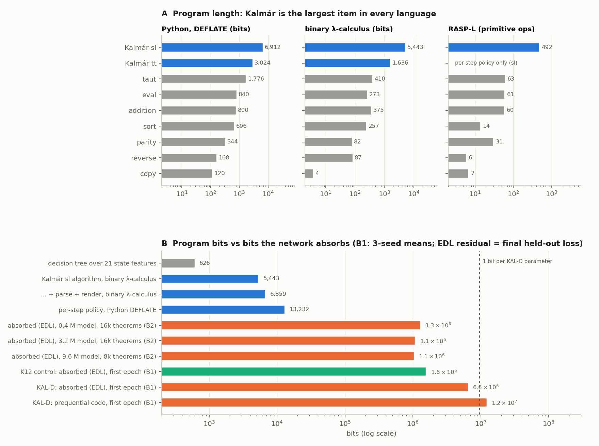
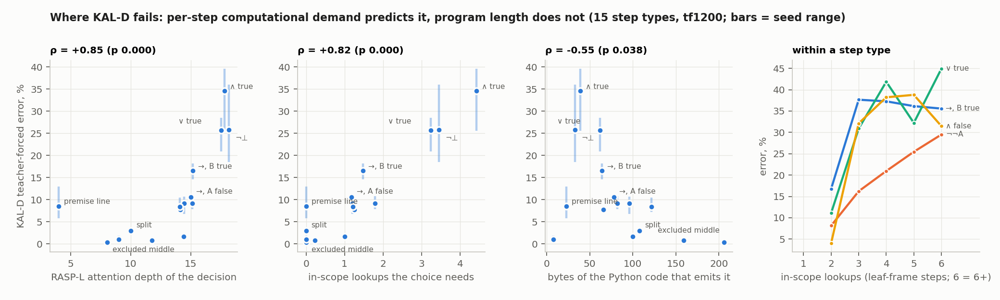
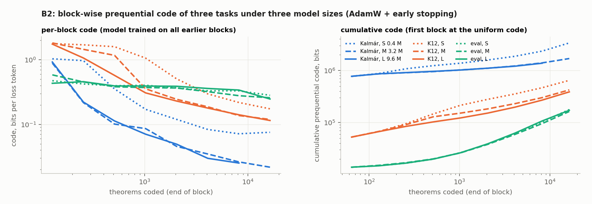

# kalmar-complexity: Kalmár's construction is 5,443 bits of binary λ-calculus (864 B of compressed Python) and the largest item of the calibration set in every language. KAL-D's error by step type is ranked by per-step computational demand, not by program length; showing the next needed subformula, which is also the formula the step writes, cuts opener-step error 94 %

Status: completed 2026-10-20 and reviewed 2026-10-20. **No hard-constraint violation, nothing quarantined.** With their
own code and on fresh samples, the reviewer:
- re-ran every program against the builder on a fresh 1,000-theorem sample, with their own λ-calculus parser,
  evaluator and codecs, and checked the programs' outputs in Lean;
- recounted the programs' byte, token and bit counts;
- recomputed B1 from the raw training curves and B2 from the block files, with their own token counts;
- rebuilt the Q4 per-state demand measures (equal to the executor's on all 137,984 states) and re-derived Q4 and B3
  from the stored verdicts and result files.

Every number they recomputed reproduces, up to small stated differences: Q4's predictors agree within 0.03, and their
state-level test uses df 6 where the executor's used 9. Not recomputed: the RASP-L rendering program and per-state
effective depth, the per-type false-formula counts, and the `exec_rasp_*` predictor values.
- **What stands (the review's verdict):**
  - every program reproduces its builder, and Lean accepts its outputs;
  - Kalmár's shared-lemma construction is the largest item of the calibration set in Python, binary λ-calculus (BLC),
    binary combinatory logic (CL) and the run's RASP, and the languages order the items alike;
  - KAL-D's first-epoch prequential code is 1.24–1.26 × 10⁷ bits, with exact token counts;
  - B2's block codes reproduce; S ≫ M at every prefix, and L vs M is unresolved, as the run says;
  - KAL-D's per-type teacher-forced error is ranked by per-step computational demand, not by the length of the code
    that emits the step;
  - in 3 / 3 paired seeds, putting the next needed subformula into the state cuts opener-state error 94 %, and the
    across-type demand–error correlation vanishes;
  - the hard constraints, splits, timing and spend are clean.
- **Must be reworded** (details under "The review's corrections" below):
  - absorbed bits must name their residual: 6.3–7.1 Mbit against the final model's held-out loss, 1.7–2.1 Mbit
    against the loss at the end of epoch 1;
  - B2's absorbed bits are mostly the first block's uniform code (52–73 %);
  - B3 hands the model the formula it must write (up to a leading ¬), not only where the search ends;
  - 96 of the RASP-L program's 492 operations are not RASP-L;
  - several ratios are one language's or one seed's;
  - program length *anti*-predicts error within the 9 leaf types;
  - the run doc's list of missed expectations is incomplete.
- **Not supported as worded:**
  - "smaller models trained on a tenth of the data … ended just as good" (only size M comes close, on another theorem
    set);
  - B3 as evidence that the per-step *search*, as distinct from having the formula's text adjacent and copyable, is
    what makes those steps hard.

Question (Dan, 2026-10-19): what is the minimum description length of Kalmár's constructive proof algorithm, as a handle
on "how many bits of information would we realistically have to instill into a model to learn this algorithm"? Dan
holds this loosely and invited pushback: another measure may describe it better. Brief:
[`BRIEF_kalmar-complexity.md`](../../docs/proposals/state-env/BRIEF_kalmar-complexity.md) (proposal 31,
[proposal note](../../docs/proposals/2026-10-19-kalmar-complexity.md)). Out of scope: how many bits pretraining and RL
each supply (a later investigation; everything here is in bits for it). The models and data are kalmar-pretrain's
([summary](../2026-10-19-kalmar-pretrain-not-learned-far-below-k12-control-in-distribution-replay-fine-tune-matches-ei-jump-at-one-seed/README.md)).

**Plain-language summary:** [`plain_summary.md`](plain_summary.md). This is the executor's 800-word summary with the
review's corrections marked *[review]*; with them it is about 1,050 words.

## Configuration

- **Repository.** Fork `dan-pandori/nd-takehome`, branch `dan_kalmar-complexity`, from `origin/dan_kalmar-pretrain`. It
  ran on agent1 (`ubuntu-s-2vcpu-2gb-sfo2`), every role at `--effort max`. Nothing is merged into the fork's `dan`.
  - **Pre-registration** `preregistration/kalmar-complexity.md`, commit
    [`68f7ada4`](https://github.com/dan-pandori/nd-takehome/commit/68f7ada4) at 2026-10-20 12:30:36Z, before any
    program, B1 number or pod. Its header says "≈ 12:45", after the commit.
    - It was written knowing kalmar-pretrain's per-type agreement, so the Q4 predictions are not blind to the outcome
      (disclosed).
    - B1 is not blind for KAL-D s0: the executor saw the first 30 lines of its training log (disclosed).
  - **Addendum 1** ([`a32add38`](https://github.com/dan-pandori/nd-takehome/commit/a32add38), 13:16:43Z): B2 and
    B1-snap details, before the first pod (`kc-1` 13:17:34Z; first B2 job 13:19:09).
  - **Addendum 2** ([`c27a65d2`](https://github.com/dan-pandori/nd-takehome/commit/c27a65d2), 15:48:50Z): B3, a causal
    test that is not in the brief, added because Q4 is correlational. It predates `kc-3` (16:00:34) and the first B3
    job (16:01:24). Later edits only replace header times ("≈ 16:10" became "15:49").
  - **DONE** [`a9cc4a1b`](https://github.com/dan-pandori/nd-takehome/commit/a9cc4a1b) (17:19:23Z; STATUS line
    `KALMAR-COMPLEXITY DONE 2026-10-20T17:19:51Z`), then
    [`7b0312af`](https://github.com/dan-pandori/nd-takehome/commit/7b0312af), which corrects timestamps written ahead
    of time. Deliverables:
    - `run_kalmar_complexity.md` (403 words), `run_kalmar_complexity_plain.md` (800 words), `numbers.md`
      § kalmar-complexity, `log.md`, `next_steps.md` § kalmar-complexity;
    - `kalmar_complexity/programs/` (each program with its checker and test), `kalmar_complexity/measures.csv` (285
      rows, one per algorithm × measure), `kalmar_complexity/literature.md` with `lit_notes/`;
    - four figures, copied here byte for byte.
  - **Review** [`review_kalmar-complexity.md`](https://github.com/dan-pandori/nd-takehome/blob/0fe457ee/review_kalmar-complexity.md),
    in two commits:
    - [`e716166c`](https://github.com/dan-pandori/nd-takehome/commit/e716166c) (18:23:36Z): §Recount, phase 1, done in
      `~/review/kalmar-complexity` with the executor's write-ups removed;
    - [`0fe457ee`](https://github.com/dan-pandori/nd-takehome/commit/0fe457ee) (18:41:10Z): §Compare and §Verdict.

    The reviewer's scripts are `review/kalmar-complexity-recount/rv_*.py`, with outputs in `out/` (`out/b2_counts.json`,
    13 MB, is not committed; `rv_b2.py count` regenerates it).
  - **The reviewer's disclosure.** Before recounting, the reviewer saw commit subjects that state the B3 result, and
    Addendum 2, which quotes two Q4 values. Their BLC and CL bit counts are not blind (they read the BLC README's
    results table); their test outcomes are (own parser, machine, codecs and seed).
  - **Gates** (`~/orchestrator.log`): GATE1 PASS with one warning, "304 source paths cited in numbers.md not found
    locally" (the sparse checkout); GATE2 PASS.
- **Timeline.** Executor Tue 2026-10-20 12:20–17:20 UTC; reviewer 17:20–18:41; librarian from 18:42.
- **Algorithms.**
  - **K-sl:** K12-Kalmár, the shared-lemma variant with memo that kalmar-pretrain trained on (`kalmar/kalmar.py`,
    `sl`). Each proof derives excluded middle once per atom, then splits on the atoms in turn and proves every
    subformula or its negation in each branch.
  - **K-tt:** nd-rl [`code/tools/tt_prover.py`](../../code/tools/tt_prover.py): a per-atom split, no memo, written as
    a Lean term. The fork's copy is byte-identical to nd-rl `origin/dan`'s.
  - On the reviewer's 1,000-theorem sample, K-sl's proofs average 109.0 ND lines (median 95, maximum 353) and 110.0
    actions. Term size is kalmar-pretrain's (reviewed there): mean 92.23 `lean_check` inference nodes, max 423, over
    all 155,000 proofs, against K12's 4.53. This run judges no model proof, so it has no term-size table of its own.
- **Models.** Every learned number below names one of these. The review's table:

  | label | checkpoint | size, architecture | format | from scratch? | trained on |
  |---|---|---|---|---|---|
  | **KAL-D** s0–s2 (kalmar-pretrain) | `stage1_kalD_s{0,1,2}.pt` | 9,560,832 params, ALiBiGPT `best`, 6 × 384 | `lean_staten` (state → action) | yes | K12-Kalmár sl: 155,000 theorems, 16,876,247 pairs; Muon + MTP; 656,285 steps = 3.68 epochs |
  | **control** s0–s2 (best-state) | `stage1_best12_s{0,1,2}_b1200.pt` | same | `lean_staten` | yes | K12's own proofs (`data/kh/train_k12.jsonl`, cap 12), 1,239,995 pairs; 23,951 steps = 3.67 epochs |
  | KAL-C, KAL-D+A (kalmar-pretrain) | `stage1_kalC_s*` (24,020 steps); `anneal/kalDA_s*` (KAL-D + 600 fine-tune steps) | 9.56 M | `lean_staten` | yes | as kalmar-pretrain's review defines them |
  | **B2** S / M / L | not saved (block models are trained and discarded) | 426,240 / 3,220,480 / 9,560,832 params; ALiBiGPT 2 × 128 / 4 × 256 / 6 × 384 | `lean_staten` | yes | for block k, theorems [0, 64 · 2^k) in K12's order, minus 10 % held out; AdamW, early stopping |
  | **B3** STD / FOC s0–s2 | not saved | 3,220,480 (size M) | `lean_staten`; FOC states also carry the focus formula | yes | Kalmár pairs of K12 theorems [0, 8,192), STD or FOC states; AdamW; 20,000 steps |

- **Read set: tf1200.** 1,200 held-out theorems from `data/p2/heldout.jsonl`, i.e. 137,984 states of their Kalmár sl
  proofs; `val300` is its first 300. Under both of the reviewer's keys (atom renaming, and renaming plus premise
  order), **0 / 1,200** tf1200 and **0 / 300** val300 theorems share a class with K12 [0, 155,000) (KAL-D, the
  control), [0, 16,884) (B2) or [0, 8,192) (B3). tf1200 has 1,200 distinct classes.
- **Checker: Lean alone, where anything is judged.** This run judges no model proof.
  - `nd_verify`'s tree equals `origin/main`'s (`9437bb72…`), and no file under `kalmar_complexity/` imports it.
    `state_env` uses `nd_verify.verify.parse_formula` as a parser only. `artifacts/TEST_RUN_DONE` is unchanged.
  - No training code reads an evaluation file. `b3_focus.py` reads `tf1200` only after training, for the read-out.
    No textbook72 or test file is read anywhere.
  - The reviewer checked the programs' own outputs in Lean 4.34 on 150 fresh theorems (seed 314159): K-tt 150 / 150,
    K-sl's `lean_seq` text 150 / 150 (with `.1 / .2 / .elim` attached to the name and `maxRecDepth 4000`, as
    `lean_gate` does), 20 corrupted negatives 0 / 20. No text uses `sorry` or automation.
- **Programs** (`kalmar_complexity/programs/`; shared test protocol `common.py`: 1,000 K12 theorems by
  `random.Random(20261020).sample`, plus fresh seeds; each test takes `--seed S --n N`):
  - `python/`: hand-golfed Python (`ksl_alg.py`, `ksl_nd.py`, `ksl_seq.py`, `parse.py`, `ktt_alg.py`, `ktt_lean.py`,
    `kpol.py`, `calib/`), with `measure.py`; tests `test_python.py`, `test_kpol.py`, `test_calib.py`;
  - `policy/`: the explicit per-step policy `policy.py` (state → action); `test_policy.py`;
  - `blc/`: BLC and binary-CL programs, toolchain and evaluator (agent-written); `test_blc.py`;
  - `rasp/`: a RASP-L interpreter, the per-step policy as a RASP-L program, and calibration programs (agent-written);
    `test_rasp.py`;
  - `dtree/`: `features.py` (21 generic state features and template labels), `build_rows.py`, `fit_tree.py`.
- **Absorbed bits.**
  - **B1** (`b1_preq.py`, no pods): the first-epoch prequential code from kalmar-pretrain's logged training curves,
    L_preq = Σ_i loss_i × N × Δe_i / ln 2 over epoch 1, with exact loss-token counts (`count_tokens.py`). The logged
    `train_loss` is the interval mean of the pre-update next-token loss on action tokens (the MTP auxiliary loss
    excluded), sampled every 20th step: every 600 s for KAL-D (16–17 points in epoch 1), every 30 s for the control (12
    points). EDL = L_preq − N × L∞, with three residuals L∞: (a) the final model's train loss, (b) its held-out loss
    (val300 for KAL-D), (c) the train loss at the end of epoch 1.
  - **B1-snap** (`b1_snap.py`, one pod): the per-step-type held-out code of 24 kalmar-pretrain checkpoints on tf1200,
    integrated over steps 24,020–178,581 of KAL-D's first epoch. It is an approximation.
  - **B2** (pods): a block-wise prequential code in the style of Blier & Ollivier. Blocks end at 64 · 2^k theorems in
    K12's order; block 0 (64 theorems) is coded at the uniform code, log2 111 bits per token. Each later block is coded
    by a fresh model trained on everything before it (AdamW, early stopping on 10 % of the prefix). EDL = code − N ×
    the last model's per-token code on the next 500 theorems. Tasks: Kalmár (K-sl state → action), K12's own proofs, and
    formula evaluation ("eval", 32 loss tokens per theorem). Sizes S / M / L to 16,384 theorems, except L on Kalmár
    (8,192, the pre-registered first cut). Two protocols:
    - **v1:** stop after 4 validations without improvement. Every Kalmár job, and K12 and eval at L.
    - **v2:** patience 3,000 steps, no stop before 5,000. K12 and eval at S / M / L. It was added because v1 stopped
      eval after a few hundred steps.

    Command (queues `pod/kc/queue{1,1b,2,2b}.sh`): `python3 kalmar_complexity/b2_preq.py --task {kal,k12,eval}
    --size {S,M,L} --max_thm {16384, or 8192 for Kalmár L} [--seed 1] [--patience_steps 3000 --es_min 5000 --cap
    20000] --out artifacts/kc/b2/<job>.json`.
- **B3** (Addendum 2): size M on the Kalmár pairs of K12 theorems [0, 8,192), 3 paired seeds. STD are the standard
  states; FOC states also show the next needed subformula ("the focus"). Same algorithm, actions and proofs. Command:
  `python3 kalmar_complexity/b3_focus.py --arm {STD,FOC} --seed {0,1,2} --size M --n_thm 8192 --out
  artifacts/kc/b3/<arm>_s<seed>.json` (`pod/kc/queue3.sh`), read out by `b3_analysis.py` on tf1200.
- **Q4** (`q4_states.py`, `q4_join.py`, `q4_tree_paths.py`, `q4_analysis.py`): the outcome is KAL-D's teacher-forced
  error per step type on tf1200, from kalmar-pretrain's stored verdicts (`artifacts/kalmar/tf/*__tf1200.json`),
  over 15 step types with ≥ 500 states. Per-state demand measures:
  - `explored`: in-scope lookups made by the post-order search for the next needed subformula;
  - `target_h`, `focus_h`: formula heights; `decl_len`: tokens of the formula the action writes; `act_len`;
    `depth`: open frames before the action;
  - `log2_ops`: log2(1 + `policy.py`'s operations), i.e. Levin's Kt minus the constant program;
  - `rasp_*`: RASP-L depth and operations on the step's decision path;
  - `py_bytes`: bytes of the code in `ksl_alg.py` that emits the step;
  - `tree_path`: tests on the decision tree's path;
  - `b2_bits_*`: B2's per-type bits; `log_freq`: a frequency baseline.
- **Pods and cost:** 3 pods, all **A40, secure cloud, $0.59/h** (community RTX 3090s were out of stock): **8.46
  pod-hours, $5.01** of the $15 budget (RunPod billing, the reviewer's sum; re-read per pod by the librarian:
  $2.0445 + $2.2901 + $0.6802; `podrm` booked $5.00).
  - `kc-1` (13:17–16:44, 3.45 h, $2.04): B2 Kalmár L, B1-snap, then the v2 K12 / eval queue.
  - `kc-2` (13:18–17:10, 3.86 h, $2.29 billed; $2.28 by `podrm`): B2 Kalmár M / S at seeds 0 and 1, K12 and eval v1.
  - `kc-3` (16:00–17:08, 1.15 h, $0.68): the six B3 jobs, run together.
  - **Pre-registered estimate:** B1-snap 1 GPU-h and B2 ≈ 10–15 GPU-h, with B2 to stop launching at $12; Addendum 2
    added ≈ 3 A40-hours for B3.
- **Compute.** The run wrote 100 results-registry rows: 20 (arm, seed) pairs × `gpu_seconds`, `train_steps`,
  `train_tokens`, `gen_tokens` and `lean_checks` (bucket `registry/kalmar-complexity/`). There are no generated tokens
  and no Lean checks. Per arm (`numbers.md`; the review: "R as labelled"):

  | arm | seeds | GPU-seconds (A40, job wall-clock on a shared card) | training steps | training tokens |
  |---|---|---|---|---|
  | B2 Kalmár L (8,192 theorems) | s0 | 11,851 | 102,981 | 1.88 B |
  | B2 Kalmár M | s0 / s1 | 10,345 / 6,907 | 122,333 / 123,338 | 2.24 B / 2.26 B |
  | B2 Kalmár S | s0 / s1 | 4,854 / 3,742 | 122,755 / 125,140 | 2.25 B / 2.29 B |
  | B2 K12 L, v1 | s0 | 5,059 | 28,666 | 0.52 B |
  | B2 eval L, v1 | s0 | 4,290 | 23,750 | 0.43 B |
  | B2 K12 v2 L / M / S | s0 | 7,272 / 4,486 / 2,171 | 35,308 / 34,681 / 38,130 | 0.64 / 0.63 / 0.69 B |
  | B2 eval v2 L / M / S | s0 | 7,039 / 4,301 / 1,652 | 34,770 each | 0.63 B each |
  | B1-snap (24 checkpoints on tf1200) | — | 1,146 (the review: 1,086) | 0 | 0 |
  | B3 STD (size M) | s0 / s1 / s2 | 3,674 / 3,700 / 3,688 | 20,000 each | 0.367 B each |
  | B3 FOC (size M) | s0 / s1 / s2 | 3,686 / 3,702 / 3,694 | 20,000 each | 0.367 B each |

  - **The GPU-seconds are wall time, not exclusive GPU time.** Jobs shared cards; for example, the six B3 jobs ran
    together on `kc-3` for ≈ 1.0 h each. The 20 rows sum to 97,259 s (27.0 h); the review counts 26 jobs and 27.1 h of
    job wall-clock. That is ≈ 3.2× the 8.46 pod-hours billed.
  - **Matched:** B3's two arms (20,000 steps and 3.665 × 10⁸ training tokens each; all six stopped at the step cap).
  - **Flagged > 1.25×, by design:**
    - B2 compares code lengths at equal theorem counts, not at equal compute. At the same size, each Kalmár job used
      2.9–3.6× the training steps and tokens of the K12 and eval v2 jobs, and 1.5–2.9× their GPU-seconds
      (librarian's arithmetic from the rows above). At 8,192 theorems Kalmár has 13.5 M loss tokens, K12 1.0 M.
    - Kalmár L used 1.1–3.2× the GPU-seconds of Kalmár S and M, on half the theorems (the executor's flag): 1.15×
      M s0 (below 1.25×), 1.7× M s1 and 2.4–3.2× S.
- **Bucket.** `hf://buckets/dan-pandori/nd-rl/kalmar-complexity/`, 124 objects in all: `artifacts/kc/` (results, B2 / B3
  / decision-tree / Q4 files, 67 pod logs), `data/kc/` (one file) and `artifacts/kalmar-complexity/registry/`. Registry
  rows are at `hf://buckets/dan-pandori/nd-rl/registry/kalmar-complexity/`. No checkpoints were produced: B2 and B3
  models were scored in place and discarded. The programs and figures are in git.

## Observations

All numbers are the reviewer's, in the review's wording where it differs from the executor's.

**1. Every program reproduces its builder on a fresh sample.** The reviewer's sample is 1,000 K12 theorems
(`random.Random(271828)`); the executor used seeds 20261020, 7, 13 and 99.
- **Python:** K-sl → ND text 1,000 / 1,000 token-exact; K-sl → canonical `lean_seq` 1,000 / 1,000; K-tt → Lean source
  1,000 / 1,000. The golfed per-step policy `kpol` matches the builder's action on 109,957 / 109,957 states. Negative
  control: K-sl's text equals the per-branch builder's on only 37 / 1,000 theorems, the one- and zero-atom ones.
- **BLC and binary CL**, under the reviewer's own bit-string parser (which checks closedness), call-by-need machine
  and codecs, and Tromp's 9-rule bracket abstraction:
  - every λ-program is exact on 1,000 / 1,000 theorems, end to end (`render(ksl(parse(word)))`, run on the encoded
    prompt and its output decoded), and every calibration program on 300 / 300 random cases;
  - the CL terms, run end to end through the same machine: 50 / 50 theorems each for K-sl and K-tt (the executor's
    test ran CL on 3 inputs);
  - negative controls: K-sl's output equals the per-branch builder's proof on 5 / 100 theorems (one-atom cases), and
    K-tt's equals another prompt's Lean text on 0 / 100.
- **RASP-L:** the decision program plus the plain-Python content renderer is exact on 109,957 / 109,957 states (1,000 /
  1,000 theorems). The reviewer's own naive evaluator (scalar maps, causal select and aggregate by enumeration) agrees
  with the executor's numpy kernels on 917 / 917 states (10 theorems, seeds 161803 and 161804). The RASP rendering
  program was not re-run.
- **Decision trees:** every tree is exact on its fit rows and on the fresh 109,957 states; the three also run on
  tf1200 (`tree_b3`, `tree_u_b1`, `tree_u_b3`) are exact on all 137,984 states.

**2. Program lengths (Q1).** Algorithm, rendering and parse are reported separately. Every value is equal to the
executor's.

| piece | Python raw B | Python DEFLATE B | Python xz B | Qwen3 tokens | GPT-2 tokens | BLC bits | binary CL bits |
|---|---:|---:|---:|---:|---:|---:|---:|
| K-sl algorithm | 1,907 | 864 | 906 | 897 | 1,195 | 5,443 | 23,921 |
| K-sl rendering, ND text | 465 | 293 | 321 | 244 | 308 | 616 | 3,776 |
| K-sl rendering, `lean_seq` | 977 | 562 | 596 | 475 | 615 | — | — |
| parse (prompt → sequent) | 251 | 153 | 162 | 122 | 156 | 800 | 2,900 |
| K-sl algorithm + ND rendering | 2,372 | 1,093 | 1,137 | 1,141 | 1,503 | 6,059 | 27,697 |
| K-sl parse + algorithm + ND rendering | 2,623 | 1,199 | 1,241 | 1,263 | 1,659 | 6,859 | 30,597 |
| K-sl parse + algorithm + `lean_seq` rendering | 3,135 | 1,453 | 1,485 | 1,494 | 1,966 | — | — |
| K-tt algorithm | 749 | 378 | 394 | 377 | 491 | 1,636 | 7,442 |
| K-tt rendering, Lean text | 1,024 | 571 | 600 | 514 | 655 | 4,204 | 24,245 |
| K-tt algorithm + rendering | 1,773 | 866 | 880 | 891 | 1,146 | 5,840 | 31,687 |
| K-tt parse + algorithm + rendering | 2,024 | 972 | 990 | 1,013 | 1,302 | 6,640 | 34,587 |
| K-sl per-step policy `kpol` (state → action) | 3,794 | 1,654 | 1,658 | 1,838 | 2,387 | — | — |

- **Python** is hand-golfed. DEFLATE is raw zlib at level 9, xz raw LZMA2 9e; gzip -9 adds 18 bytes to each DEFLATE
  value. The tokenizers' files are md5-identical to the hub's `Qwen/Qwen3-8B` and `openai-community/gpt2`; our model's
  own tokenizer (`lean_tok`) cannot spell Python.
- **Mechanical minification** (python-minifier; raw / DEFLATE bytes, upper bounds with unused code included):
  `kalmar/kalmar.py` (builder and renderer) 5,863 / 2,416; `tt_prover.py` 3,474 / 1,685; `gen.py` (the K12 generator,
  all knobs) 17,076 / 5,324; `policy.py` 7,453 / 2,761; the decision tree's feature extractor (`features.py` plus the
  `policy.py` it imports) 10,509 / 3,962.
- **BLC / binary CL** use Tromp's encodings, with data entering and leaving as Scott-encoded terms. CL is plain bracket
  abstraction of the golfed λ-term, so an upper bound. CL / BLC is 4.4–6.1 for the Kalmár programs, 3.6 for parse and
  2.0–3.5 for the calibration programs.
- **Call-by-need β-steps on the reviewer's sample** (mean / median / max): K-sl algorithm 58,856 / 39,410 / 401,019;
  K-sl end to end 62,403 / 42,155 / 422,419; K-tt end to end 12,642 / 9,914 / 72,954.

**3. The "RASP-L" program is RASP-L plus flagged extensions.**
- **Size** (the reviewer's walk of the program graph, `build_decision(9)`, H = 9 formula levels): **492 operations**
  counting selects (427 without; inputs and constants excluded). By kind: 65 selects, 151 aggregates (134 max, 17
  min), 2 selector-widths, 248 sequence maps and 26 token maps. **Attention depth 41.**
- **96 of the 492 nodes are non-RASP-L by the executor's own interpreter:** 61 composite-valued nodes (16-bit truth
  tables), 34 multi-field selects and 1 count-arithmetic node. A further 24 selects use an arbitrary vectorised
  predicate. The taut calibration program has 41 flagged nodes of 63. So a "RASP-L length" or "attention depth" for
  Kalmár or taut is a length in this extended language, not in RASP-L.
- **Scaling with formula levels H:** ops = 240 + 28·H and depth = 5 + 4·H exactly for H ≥ 5.
- Not recomputed by the reviewer: the rendering program (52 ops, +3 layers; total 544 ops, 6,991 source tokens, 401
  lines) and the per-state effective depth (the smallest program that still decides a state: 4 for premise lines, 8.0
  excluded middle, 9.5 splits, 13.2 fixed lemma-box steps, 14.4 after-recursion steps, 17.2 [13, 33] recursion steps).

**4. The decision tree decides a template, not an action.**
- The executor's headline tree (`tree_u_b3`, beam 3, fitted on the 473 distinct rows of 4,000 theorems) has **46
  leaves / 45 tests / depth 11, 626.4 bits**, under the stated code: a node costs 1 bit, a test log2 21 + log2
  #values, a leaf log2 40. The seven trees fitted on 421–473 distinct rows cost 624–640 bits.
- Its 40 labels are the step tag plus the rule head. It does not choose the formula or the cited lines.
- Its 21 features come from `features.py`, which runs the whole per-step policy ("only to read the frame analysis") and
  encodes Kalmár's case table (`needed_children`). The extractor is 3,962 DEFLATE bytes as mechanically minified; the
  golfed policy itself is 1,654. **So the ≈ 630 tree bits are conditional on most of the algorithm.**

**5. Levin's Kt is program length to within 11 bits.** Program bits = 8 × DEFLATE bytes; time = mean Python calls per
theorem on the reviewer's sample.

| program | Kt (bits) | program bits | log2 time |
|---|---:|---:|---:|
| K-sl algorithm | 6,921 | 6,912 | ≈ 9 (mean 507 calls) |
| K-sl + `lean_seq` rendering | 10,787 | 10,776 | ≈ 11 |
| K-tt algorithm | 3,033 | 3,024 | ≈ 9 |
| K-tt + Lean rendering | 6,938 | 6,928 | ≈ 9.6 |

In BLC, K-sl's Kt is 5,443 + log2 39,136 = 5,458 bits. The log-time term is ≈ 0.1 % of Kt.

**6. Calibration (Q2): Kalmár sl is the largest item in every language.**

| algorithm | Python DEFLATE B (builtins / none) | BLC bits | binary CL bits | RASP ops / attention depth / flagged ops |
|---|---|---:|---:|---|
| copy | 15 | 4 | 8 | 7 / 3 / 0 |
| reverse | 21 | 87 | 197 | 6 / 2 / 0 |
| parity | 22 / 43 | 82 | 185 | 3 / 1 / 1 (count arithmetic); 31 / 5 / 0 with a scratchpad |
| sort | 11 / 87 | 257 | 749 | 2 / 1 / 0 (unique tokens); 14 / 2 / 1 (repeats) |
| addition (binary) | 19 / 100 | 375 | 1,163 | 60 / 7 / 0 |
| eval (a formula's truth value) | 105 | 273 | 713 | 61 / 13 / 1 |
| taut (truth-table validity) | 222 | 410 | 1,430 | 63 / 13 / 41 |
| Kalmár tt (algorithm) | 378 | 1,636 | 7,442 | — |
| Kalmár sl (algorithm) | 864 | 5,443 | 23,921 | 492 / 41 / 96 (per-step decision) |

- Every calibration program is correct on the reviewer's own random cases: Python 2,000 / 2,000 each (with and without
  builtins), BLC 300 / 300 each.
- **Kalmár sl against taut, the largest calibration item:** 3.9× in Python DEFLATE (864 B vs 222), 13.3× in BLC (5,443
  vs 410), 16.7× in CL (23,921 vs 1,430) and 7.8× in RASP ops (492 vs 63). **K-tt is second** in Python, BLC and CL
  (there is no RASP program for it); in BLC it is 4.0× taut.
- **Rank agreement** (Spearman over the 9 items, and over the 7 calibration items only):

  | pair | ρ, 9 items | ρ, calibration only |
  |---|---:|---:|
  | Python DEFLATE (no builtins) vs BLC | +0.97 | +0.93 |
  | Python DEFLATE vs CL | +0.93 | +0.86 |
  | Python DEFLATE vs RASP | +0.95 (n 8) | +0.93 |
  | BLC vs CL | +0.98 | +0.96 |
  | BLC vs RASP | +0.86 | +0.79 |
  | Python raw with builtins vs BLC | +0.75 | +0.46 |

  - Across the four languages without builtins, ρ is 0.79–0.98; the weakest pair the review names is CL vs RASP
    (+0.79), which the run doc's quoted range (0.86–0.97) omits.
  - With 9 items, much of the agreement comes from the two Kalmár programs being largest everywhere. Within the 7
    calibration items the languages still agree, except Python *with* builtins, where sort is 9 bytes (`s=sorted`).
  - RASP ranks parity higher than Python does: with a scratchpad it takes 31 ops, rank 5 of 8, against 7 of 9 in
    Python.
- **The K12 generator is not golfed.** `gen.py`, mechanically minified with all its knobs, is 5,324 DEFLATE bytes:
  6.2× the golfed K-sl, but **2.2× the mechanically minified builder** (2,416), which is the like-for-like comparison
  available. Both are upper bounds.

**7. B1: KAL-D's first-epoch prequential code is 1.24–1.26 × 10⁷ bits.** The reviewer recomputed the token counts from
the data (the pair counts equal the checkpoints' `pairs`), read the curves from the checkpoints with CPU torch (all
62 / 62 / 59 KAL-D points equal the printed `train_kalD_s*.log` lines) and recomputed every column.

| model | N loss tokens per epoch | curve points in epoch 1 | L_preq bits (bits/token) | L_preq, next-point variant | EDL (a) final train | EDL (b) final held-out | EDL (c) end of epoch 1 |
|---|---:|---:|---|---:|---:|---:|---:|
| KAL-D s0 | 255,006,351 | 17 | 1.26 × 10⁷ (0.0492) | 1.14 × 10⁷ | 6.97 × 10⁶ | 6.54 × 10⁶ | 1.67 × 10⁶ |
| KAL-D s1 | 255,006,351 | 17 | 1.24 × 10⁷ (0.0488) | 1.13 × 10⁷ | 6.78 × 10⁶ | 6.27 × 10⁶ | 2.09 × 10⁶ |
| KAL-D s2 | 255,006,351 | 16 | 1.24 × 10⁷ (0.0487) | 1.12 × 10⁷ | 7.31 × 10⁶ | 7.06 × 10⁶ | 2.12 × 10⁶ |
| control s0 | 19,375,057 | 12 | 3.79 × 10⁶ (0.1955) | 2.56 × 10⁶ | 2.55 × 10⁶ | 1.47 × 10⁶ | 1.45 × 10⁶ |
| control s1 | 19,375,057 | 12 | 3.64 × 10⁶ (0.1877) | 2.45 × 10⁶ | 1.93 × 10⁶ | 1.70 × 10⁶ | 1.57 × 10⁶ |
| control s2 | 19,375,057 | 12 | 3.87 × 10⁶ (0.1997) | 2.59 × 10⁶ | 2.63 × 10⁶ | 1.61 × 10⁶ | 1.35 × 10⁶ |

- **The absorbed bits depend on the residual.** KAL-D's EDL is 6.3–7.1 × 10⁶ against the final (3.7-epoch) model's
  held-out loss (0.66–0.74 bits per parameter; 1,150–1,300× the 5,443-bit BLC program), but **1.7–2.1 × 10⁶ against
  KAL-D's own end-of-epoch-1 loss (310–390×)**. KAL-D exceeds the control on every seed under every residual.
- **The control is sensitive to discretisation.** Taking each interval's loss from the next logged point instead of the
  interval mean moves KAL-D by −9 % but the control by −33 %. The control's first logged point (step 196, 3 % of its
  epoch) averages 1.34 nats/token, so its total depends on the first interval.
- **Not quantified:** the logged loss is a mean of per-batch means, so batches are not weighted by their loss tokens.
  B1 inherits any length–loss correlation; the logs cannot measure it. Steps 1–19 were never sampled (the executor
  bounds them at ≤ 1.8 × 10⁵ bits for KAL-D and ≤ 2.7–2.9 × 10⁵ for the control).
- The logs carry only aggregate loss, so B1 has no per-step-type breakdown; B1-snap approximates one.

**8. B1-snap: the snapshot approximation runs 13–20 % above the training stream.**
- **CPU re-score:** the reviewer's fp32 scoring of KAL-D s0 over the first 30 tf1200 records (4,405 states) reproduces
  the pod's per-state code: total within 0.03 %, median |Δ| 5 × 10⁻⁵ nats, 56 states differing by > 0.05 nats (bf16).
- **Integration:** over steps 24,020 → 178,581 the snapshot-based code sums to 1.11 / 1.16 / 1.11 × 10⁷ bits (s0 /
  s1 / s2), against 0.98 / 0.97 / 0.96 × 10⁷ from the logged curve over the same window (1.13 / 1.20 / 1.15×).
- **Excess bits by type:** Σ excess 6.0 / 6.4 / 6.4 × 10⁶. The largest totals are →I-B, lem, ¬¬ and →−; the largest
  per token ∧+, ¬⊥, →I-A, ∨+ and ¬¬ (≈ 0.05–0.10 bits/token).
- **s0's snapshot loss barely improves through epoch 1:** its held-out code is 0.0379 → 0.0383 → 0.0342 nats per token
  at steps 24,020 / 100,000 / 200,000 (epoch 1 ends at step 178,581), and 0.0163 at the end.
- KAL-D's final per-type code ranks the types like their error at ρ = +0.88 / +0.63 / +0.63 (+0.73 pooled): the
  pre-registered ≥ 0.8 holds for s0 only.

**9. B2: every block's token count, prequential total, EDL and asymptote reproduces, but Kalmár's "absorbed bits"
are mostly the uniform code of the first 64 theorems.**

| job | task | size | seed | protocol | L_preq bits | L∞ bits/token | EDL bits | block 0's share of EDL | at 8,192 theorems: L_preq / EDL | blocks at the step cap | training GPU-h |
|---|---|---|---:|---|---:|---:|---:|---:|---|---:|---:|
| kal_L_s0 | Kalmár | L | 0 | v1 | 1.374 × 10⁶ | 0.0233 | 1.059 × 10⁶ | 0.73 | 1.374 × 10⁶ / 1.059 × 10⁶ | 3 / 8 | 3.22 |
| kal_M_s0 | Kalmár | M | 0 | v1 | 1.69 × 10⁶ | 0.0217 | 1.102 × 10⁶ | 0.70 | 1.395 × 10⁶ / 1.10 × 10⁶ | 4 / 9 | 2.76 |
| kal_M_s1 | Kalmár | M | 1 | v1 | 1.771 × 10⁶ | 0.0255 | 1.078 × 10⁶ | 0.71 | 1.444 × 10⁶ / 1.118 × 10⁶ | 5 / 9 | 1.86 |
| kal_S_s0 | Kalmár | S | 0 | v1 | 3.369 × 10⁶ | 0.0756 | 1.319 × 10⁶ | 0.58 | 2.346 × 10⁶ / 1.325 × 10⁶ | 5 / 9 | 1.28 |
| kal_S_s1 | Kalmár | S | 1 | v1 | 3.375 × 10⁶ | 0.0708 | 1.457 × 10⁶ | 0.52 | 2.436 × 10⁶ / 1.497 × 10⁶ | 5 / 9 | 0.99 |
| k12_L_s0 | K12 | L | 0 | v1 | 3.873 × 10⁵ | 0.1012 | 1.792 × 10⁵ | 0.29 | 2.7 × 10⁵ / 1.538 × 10⁵ | 4 / 9 | 1.39 |
| v2_k12_L_s0 | K12 | L | 0 | v2 | 3.877 × 10⁵ | 0.1014 | 1.793 × 10⁵ | 0.29 | 2.692 × 10⁵ / 1.518 × 10⁵ | 7 / 9 | 2.00 |
| v2_k12_M_s0 | K12 | M | 0 | v2 | 4.234 × 10⁵ | 0.0998 | 2.183 × 10⁵ | 0.24 | 3.004 × 10⁵ / 1.784 × 10⁵ | 7 / 9 | 1.23 |
| v2_k12_S_s0 | K12 | S | 0 | v2 | 6.449 × 10⁵ | 0.1574 | 3.215 × 10⁵ | 0.16 | 4.654 × 10⁵ / 2.876 × 10⁵ | 9 / 9 | 0.60 |
| eval_L_s0 | eval | L | 0 | v1 | 2.227 × 10⁵ | 0.1051 | 1.676 × 10⁵ | 0.08 | 1.194 × 10⁵ / 1.615 × 10⁴ | 5 / 9 | 1.18 |
| v2_eval_L_s0 | eval | L | 0 | v2 | 1.717 × 10⁵ | 0.1051 | 1.166 × 10⁵ | 0.12 | 1.07 × 10⁵ / 4.233 × 10⁴ | 9 / 9 | 1.94 |
| v2_eval_M_s0 | eval | M | 0 | v2 | 1.631 × 10⁵ | 0.0241 | 1.505 × 10⁵ | 0.09 | 9.548 × 10⁴ / 2.79 × 10⁴ | 9 / 9 | 1.18 |
| v2_eval_S_s0 | eval | S | 0 | v2 | 1.772 × 10⁵ | 0.1887 | 7.824 × 10⁴ | 0.17 | 1.033 × 10⁵ / 2.951 × 10⁴ | 9 / 9 | 0.45 |

Kalmár L codes 8,192 theorems (13.5 M loss tokens), every other job 16,384 (Kalmár 27.1 M, K12 2.06 M, eval 0.52 M).
Training GPU-h is the sum of the blocks' `secs`. At 8,192 theorems, L∞ is the per-token code of the block that starts
there.

- **Block 0 dominates Kalmár's EDL.** Block [0, 64) holds 113,516 loss tokens at log2 111 ≈ 6.79 bits each, 0.77 × 10⁶
  bits: at 8,192 theorems, 73 % of size L's EDL, 69–70 % of size M's and 51–58 % of size S's (52–58 % at 16,384). K12's
  share is 29–34 % at size L; eval's is 8–17 % at 16,384 theorems and 32–81 % at 8,192.
- **Without block 0** (the review's addendum table; per theorem in parentheses, and as a multiple of the 5,443-bit BLC
  program):

  | job | EDL | EDL without block 0 | per theorem (without) | × BLC program (without) |
  |---|---:|---:|---|---|
  | Kalmár L s0 (8,192 theorems) | 1.06 × 10⁶ | 2.9 × 10⁵ | 129 (35) | 195 (53) |
  | Kalmár M s0 / s1 | 1.10 / 1.08 × 10⁶ | 3.3 / 3.1 × 10⁵ | 67 / 66 (20 / 19) | 202 / 198 (61 / 57) |
  | Kalmár S s0 / s1 | 1.32 / 1.46 × 10⁶ | 5.6 / 6.9 × 10⁵ | 80 / 89 (34 / 42) | 242 / 268 (102 / 128) |
  | K12 v2 L / M / S | 1.8 / 2.2 / 3.2 × 10⁵ | 1.3 / 1.7 / 2.7 × 10⁵ | 11 / 13 / 20 (8 / 10 / 17) | 33 / 40 / 59 (23 / 31 / 50) |
  | eval v2 L / M / S | 1.2 / 1.5 / 0.8 × 10⁵ | 1.0 / 1.4 / 0.6 × 10⁵ | 7 / 9 / 5 (6 / 8 / 4) | 21 / 28 / 14 (19 / 25 / 12) |

  The ordering Kalmár > K12 > eval survives without block 0; the ratios roughly halve.
- **Size dependence at 8,192 theorems** (prequential code): S (2.35 / 2.44 × 10⁶) is far above M (1.39 / 1.44 × 10⁶),
  far outside the seed spread. **L (1.374 × 10⁶) is below M s0 by 0.021 × 10⁶, inside M's seed-to-seed spread of
  0.049 × 10⁶: by the pre-registered rule, L < M is not established.**
- **Kalmár > K12 > eval** in EDL at 8,192 theorems: Kalmár L 1.06 × 10⁶, K12 L 1.52–1.54 × 10⁵, eval L 1.6 × 10⁴ (v1) /
  4.2 × 10⁴ (v2). Kalmár has 13.5 M loss tokens there, K12 1.0 M and eval 0.26 M.
- **Protocols differ across tasks.** Kalmár's B2 numbers are all v1, while K12 and eval have v2 runs. At L, v1 and v2
  agree within 0.1 % for K12, but eval's v2 L_preq is 23 % below v1's.
- **Shape:** Kalmár's per-block code per token falls monotonically, and so does its cumulative EDL / N (5.6–5.9 →
  0.04–0.08 bits per token, every size and seed); there is no rise-then-fall. Eval's cumulative EDL / N *rises* at the
  last prefix, because its asymptote model codes 0.024–0.105 bits/token against 0.25–0.39 before.
- **Many blocks stop at the step cap** (20,000 steps or 30 epochs): 3–5 of 8–9 per Kalmár job, 7–9 of 9 per v2 job.
  These codes are upper bounds for this training budget.
- **The asymptote is not like-for-like with KAL-D.** After the last block, M codes 0.022–0.026 bits/token on the next
  500 K12 theorems (16,384–16,884) and L 0.023 (on 8,192–8,692); S codes 0.071–0.076, 3× higher. KAL-D's 0.021–0.024
  (0.0235 for s0) is on val300, a different theorem set.
- **Eval is slow** in this family: ≈ 0.25–0.28 bits/token after 8,192 theorems at every size (v2), a code, not an
  accuracy; one seed per size. Only size M (v2) breaks through, when trained on all 16,384 theorems (0.024 bits/token on
  the next 500).
- **Per type** (bits per occurrence over the prequential blocks, seed 0): highest ∧+ (S 9.0, M 4.1, L 6.1 bits), ∨+,
  `pr` (premise lines), →I-B and ¬⊥; lowest close (≈ 0.1–0.2), end and lem.

**10. Q4: KAL-D's per-type error is ranked by per-step computational demand, not by the length of the code that emits
the step.** The reviewer's own state table (builder re-run per tf1200 record, own scope stack and split valuation)
equals the executor's demand measures on all 137,984 states. KAL-D's teacher-forced agreement on tf1200 is 94.6 / 93.8
/ 95.0 % (kalmar-pretrain's verdicts).

| step type | states | KAL-D error s0 / s1 / s2 | mean | KAL-D+A mean | KAL-C s0 |
|---|---:|---|---:|---:|---:|
| leaf:and+ | 1,427 | 0.3959 / 0.3854 / 0.2558 | 0.3457 | 0.1023 | 0.3840 |
| leaf:bot- | 639 | 0.3599 / 0.2300 / 0.1847 | 0.2582 | 0.1064 | 0.2426 |
| leaf:or+ | 4,520 | 0.2770 / 0.2854 / 0.2095 | 0.2573 | 0.0715 | 0.2657 |
| leaf:imp+B | 11,908 | 0.1816 / 0.1689 / 0.1460 | 0.1655 | 0.0255 | 0.1704 |
| leaf:imp+A | 5,295 | 0.1027 / 0.1095 / 0.1058 | 0.1060 | 0.0258 | 0.1246 |
| leaf:and- | 9,336 | 0.0679 / 0.1065 / 0.1016 | 0.0920 | 0.0302 | 0.0978 |
| leaf:not+ | 5,884 | 0.0785 / 0.1074 / 0.0901 | 0.0920 | 0.0249 | 0.1547 |
| pr | 1,409 | 0.1299 / 0.0688 / 0.0575 | 0.0854 | 0.0007 | 0.0525 |
| leaf:or- | 4,536 | 0.0725 / 0.1052 / 0.0754 | 0.0844 | 0.0240 | 0.0836 |
| leaf:imp- | 6,240 | 0.0712 / 0.0822 / 0.0787 | 0.0774 | 0.0161 | 0.1276 |
| split | 8,900 | 0.0343 / 0.0226 / 0.0330 | 0.0300 | 0.0023 | 0.0227 |
| efq | 9,286 | 0.0141 / 0.0181 / 0.0162 | 0.0161 | 0.0021 | 0.0074 |
| end | 1,200 | 0.0042 / 0.0192 / 0.0058 | 0.0097 | 0.0039 | 0.0100 |
| close (all `close:*`) | 44,290 | 0.0035 / 0.0142 / 0.0064 | 0.0081 | 0.0015 | 0.0113 |
| lem | 23,086 | 0.0014 / 0.0094 / 0.0015 | 0.0041 | 0.0000 | 0.0022 |

| predictor (per step type, n = 15) | source | ρ vs KAL-D mean error (perm. p) | s0 / s1 / s2 | vs KAL-D+A mean | partial ρ given log frequency (p) |
|---|---|---|---|---|---|
| B2 bits per occurrence, S | reviewer | +0.85 (0.000) | +0.91 / +0.83 / +0.84 | +0.60 | +0.78 (0.001) |
| RASP effective depth | executor | +0.85 (0.000) | +0.74 / +0.87 / +0.89 | +0.90 | +0.85 (0.000) |
| RASP cone depth | executor | +0.84 (0.000) | +0.75 / +0.89 / +0.91 | +0.91 | +0.84 (0.000) |
| B2 bits per occurrence, L | reviewer | +0.84 (0.000) | +0.93 / +0.80 / +0.80 | +0.55 | +0.75 (0.003) |
| B2 bits per occurrence, M | reviewer | +0.82 (0.001) | +0.92 / +0.77 / +0.77 | +0.52 | +0.71 (0.004) |
| RASP cone ops | executor | +0.82 (0.000) | +0.73 / +0.87 / +0.89 | +0.89 | +0.81 (0.000) |
| `explored` (in-scope lookups) | reviewer | +0.82 (0.000) | +0.77 / +0.86 / +0.88 | +0.85 | +0.79 (0.000) |
| `log2_ops` (Kt minus the program) | executor | +0.78 (0.001) | +0.69 / +0.81 / +0.82 | +0.84 | +0.76 (0.001) |
| `target_h` | reviewer | +0.78 (0.001) | +0.72 / +0.79 / +0.83 | +0.79 | +0.78 (0.001) |
| `tree_path` | reviewer | −0.76 (0.002) | −0.65 / −0.80 / −0.82 | −0.85 | −0.71 (0.002) |
| `log_freq` | reviewer | −0.60 (0.018) | −0.68 / −0.61 / −0.50 | −0.56 | — |
| `py_bytes` (code that emits the step) | reviewer | −0.55 (0.038) | −0.62 / −0.52 / −0.46 | −0.43 | −0.08 (0.771) |
| `act_len` | reviewer | +0.52 (0.049) | +0.55 / +0.55 / +0.55 | +0.33 | +0.59 (0.019) |
| `focus_h` | reviewer | +0.49 (0.069) | +0.44 / +0.59 / +0.62 | +0.50 | +0.59 (0.016) |
| `decl_len` | reviewer | +0.42 (0.121) | +0.47 / +0.39 / +0.43 | +0.15 | +0.53 (0.041) |
| `depth` | reviewer | +0.27 (0.332) | +0.16 / +0.34 / +0.39 | +0.39 | +0.48 (0.066) |
| RASP descent | executor | +0.25 (0.364) | +0.29 / +0.20 / +0.12 | +0.18 | −0.19 (0.503) |

- "Executor" values were not recomputed by the reviewer. The RASP values are means over the executor's 1,000-theorem
  *training-distribution* sample (seed 20261020), not over tf1200. `py_bytes` uses the executor's mapping of
  `ksl_alg.py` snippets to step types. There is no per-type BLC predictor.
- **Within the 9 `leaf:*` types** (n = 9; |ρ| ≥ 0.68 for p ≈ 0.05):
  - positive: RASP effective depth +0.92 (p 0.001), target height +0.82 (0.011), B2 bits M / L +0.83 / +0.80, lookups
    +0.67 (0.06);
  - negative: **program-snippet bytes −0.80 (0.014)**, depth −0.87, tree path −0.82;
  - given frequency: RASP effective depth +0.87 (p 0.002), target height +0.73 (0.027), B2 bits M +0.72 (0.035),
    lookups +0.52 (0.15), **code bytes −0.68 (0.045)**: the shortest instructions (∧+, ∨+, ¬⊥) are the hardest steps.
  - Across all 15 types, a large share of every positive ρ comes from separating the 9 leaf types (high error) from
    the 6 structural ones.
- **State level:** a logistic regression of error on 15 type dummies, with and without 6 standardised demand measures:
  LR = 6,530 / 7,502 / 5,888 (df 6, p ≈ 0) for s0 / s1 / s2; the best single measure is `explored` (LR 4,936–6,374),
  then target height. The p-values treat 137,984 states as independent, but states are clustered in 1,200 proofs. (The
  executor's version, df 9: LR 6,043–7,651.)
- **Error classes, KAL-D s2 only** (kalmar-pretrain classified one seed; 6,903 disagreements): "other subformula"
  (45 %) rises with RASP effective depth (ρ +0.94) and lookups (+0.93); "corrupted" (31 %) with lookups (+0.76);
  "malformed" (6 %) with the declared formula's length (+0.86).
- Not recomputed by the reviewer: the executor's false-formula assertions per type (671 of 4,002 scored disagreements;
  ρ +0.81 with RASP depth and with lookups).

**11. B3: in 3 / 3 paired seeds, putting the next needed subformula into the state cuts opener-state error 94 %, but
that subformula is the formula the step writes.**
- **Openers** are the states that need the search: 23,573 of tf1200's 137,984 (17 %). The reviewer's count equals the
  executor's, and the per-type errors equal the files' (max |Δ| 1e-16).
- **At all 23,573 / 23,573 opener states, the formula the next action declares is exactly the focus formula or its
  negation.** So FOC inserts, as a copyable span, the formula the step must write (up to a leading ¬). It does not
  insert only "where the search is".

| quantity | STD s0 / s1 / s2 | FOC s0 / s1 / s2 | 3-seed means, STD → FOC | relative change (of means; per seed) |
|---|---|---|---|---|
| opener-state error (23,573 states) | 0.3349 / 0.3079 / 0.3160 | 0.0154 / 0.0232 / 0.0196 | 0.3196 → 0.0194 | −0.939; −0.954, −0.925, −0.938 |
| other-state error (114,411) | 0.0248 / 0.0194 / 0.0289 | 0.0161 / 0.0183 / 0.0165 | 0.0244 → 0.0170 | −0.303; −0.349, −0.058, −0.429 |
| all states | 0.0777 / 0.0687 / 0.0780 | 0.0160 / 0.0191 / 0.0170 | 0.0748 → 0.0174 | −0.768; −0.794, −0.722, −0.782 |
| other states without `pr` | 0.0167 / 0.0113 / 0.0210 | 0.0081 / 0.0103 / 0.0085 | 0.0163 → 0.0089 | −0.453; −0.518, −0.087, −0.597 |
| `pr` states (1,409) | 0.669 / 0.671 / 0.664 | 0.662 / 0.659 / 0.663 | | |

| step type | states | opener states | STD error (mean) | FOC error (mean) | relative change | mean `explored` |
|---|---:|---:|---:|---:|---:|---:|
| leaf:and+ | 1,427 | 1,427 | 0.4681 | 0.0315 | −0.93 | 4.43 |
| leaf:bot- | 639 | 639 | 0.3672 | 0.0000 | −1.00 | 3.45 |
| leaf:or+ | 4,520 | 4,520 | 0.3174 | 0.0360 | −0.89 | 3.24 |
| leaf:not+ | 5,884 | 2,942 | 0.1801 | 0.0039 | −0.98 | 1.79 |
| leaf:imp+B | 11,908 | 5,954 | 0.1590 | 0.0205 | −0.87 | 1.48 |
| leaf:imp+A | 5,295 | 1,765 | 0.1324 | 0.0254 | −0.81 | 1.18 |
| leaf:imp- | 6,240 | 2,080 | 0.1170 | 0.0129 | −0.89 | 1.25 |
| leaf:or- | 4,536 | 1,134 | 0.1132 | 0.0167 | −0.85 | 1.22 |
| leaf:and- | 9,336 | 3,112 | 0.0975 | 0.0088 | −0.91 | 1.20 |
| pr | 1,409 | 0 | 0.6681 | 0.6615 | −0.01 | 0.00 |
| split | 8,900 | 0 | 0.0336 | 0.0112 | −0.67 | 0.00 |
| lem | 23,086 | 0 | 0.0239 | 0.0149 | −0.38 | 0.00 |
| end | 1,200 | 0 | 0.0233 | 0.0183 | −0.21 | 0.00 |
| efq | 9,286 | 0 | 0.0167 | 0.0072 | −0.57 | 1.00 |
| close | 44,290 | 0 | 0.0044 | 0.0019 | −0.56 | 0.23 |

- **The demand–error correlation vanishes:** Spearman across the 15 types of error against mean `explored` is +0.60 /
  +0.63 / +0.62 under STD (3-seed mean +0.61, p 0.020) and −0.11 / −0.08 / −0.13 under FOC (mean −0.02, p 0.947).
- **All six models stopped at the 20,000-step cap.** Their best validation step was 19,000 or 20,000; none
  early-stopped. Held-out loss: STD 0.0165 / 0.0153 / 0.0169 → FOC 0.0044 / 0.0053 / 0.0048 nats/token.
- **The `pr` read-out is an artefact.** Premise-line states are wrong about 66 % of the time in both arms, against
  6–13 % for KAL-D: at name base 0 nothing in a premise state tells the model the base it must write.
- **Other states improve under FOC as well,** though they are identical in both arms: −30 % (3-seed means), −45 %
  without `pr`, and −53 % without the 1,200 first states (the executor's second read-out; per seed −61 / −13 / −67 %, the
  reviewer's).
  With the first states out, ρ(error, lookups) is +0.90 → +0.25 (the executor's +0.92 → +0.27).

**12. Literature (Q5).** `kalmar_complexity/literature.md` and `lit_notes/` (agent-written; 25 sources opened, 17
screened, 8 read in depth, unchecked claims marked UNVERIFIED) cover Kolmogorov and Levin complexity, MDL and
prequential codes for neural networks (Blier & Ollivier; Voita & Titov), RASP, RASP-L and length generalisation,
simplicity bias, and excess description length. **The review did not assess it.**

## The review's corrections to the executor's files

The fork's files are not corrected. These apply wherever the executor's wording is quoted. The reading copy
[`plain_summary.md`](plain_summary.md) applies those of (a)–(h) that bear on its sentences.
- (a) **Absorbed bits name their residual** (run doc #7, #14; plain #23). 6.3–7.1 Mbit is KAL-D's first-epoch code
  minus what the *final* model pays on held-out data; against its end-of-epoch-1 loss the excess is 1.7–2.1 Mbit,
  310–390× the BLC program, not ≈ 1,000×. The recommendation's "≈ 6.6 Mbit for KAL-D" should state residual (b), with
  1.9 Mbit under (c).
- (b) **B2's absorbed bits are mostly block 0's uniform code** (run doc #7, #9; `numbers.md` #41, #43; plain #24).
  "≥ 100× for every estimate" holds only with that convention: without it, Kalmár L / M is 53–61× the program. In the
  run doc, "1.1–1.5 × 10⁶ per 16,384 theorems" is per 8,192 for L, and the "≈ 0.02 bits/token floor" holds for M and
  L, not S.
- (c) **B3 hands the model the formula it must write** (run doc #13, #15; plain #28; `STATUS.md`'s "handing the model
  the search result"; the title of `kalmar_complexity_b3.png`). "Showing the next needed subformula … same algorithm
  and proofs" is accurate; "nothing else changed" and "hand the model the search result" should say that the shown
  subformula is the step's own declared formula up to ¬. Also report that all six models stopped at the 20,000-step
  cap while still improving, and that the other states fell too (−30 %, −53 % without first states).
- (d) **RASP-L:** 96 of the 492 operations are non-RASP-L extensions; say so wherever "492 ops, depth 41" appears (run
  doc #3; `kalmar_complexity.png`'s panel A; by extension, the RASP depth on the first axis of
  `kalmar_complexity_q4.png`). "Needs ≈ 40 layers"
  (plain #27; `next_steps.md` 2's "needs 41 attention layers") should read "this program uses 41 (effective ≤ 33)".
- (e) **One seed, one language, upper bounds:**
  - the error-class correlations are KAL-D **s2** only (run doc #12; plain #26);
  - "13 times smaller" is the BLC ratio; Python DEFLATE gives 3.9×, CL 16.7×, RASP-L 7.8× (plain #20);
  - the generator's "2.2× longer" compares two python-minifier upper bounds (run doc #6; plain #21);
  - eval's slowness is a code (≈ 0.25 bits/token), not an accuracy, with one seed per size (run doc #6; plain #22);
  - the run doc's "B2 bits +0.85" is size M, per token.
- (f) **Program length:** it does not predict errors across the 15 types once frequency is controlled. Within the 9
  leaf types it *anti*-predicts (−0.68 given frequency, p 0.045).
- (g) **Not supported as worded:** "smaller models trained on a tenth of the data … ended just as good" (plain #24) and
  "M … ends where KAL-D ends" (`numbers.md` #42). Only M comes close (S ends 3× higher), and the two numbers are on
  different theorem sets: B2's next 500 K12 theorems against val300.
- (h) **"Strong" evidence** (run doc #15, "strong for this architecture (three seeds, within-type effects, an
  intervention)"; plain #29, "… an intervention that worked as predicted"): the opener prediction held, the
  pre-registered "other states < 30 %" did not, and the intervention does not separate finding the next subformula from
  having its text to copy. Within types, depth holds but lookups weaken (+0.67, p 0.06, within the leaf types).
- (i) **The run doc's list of misses is incomplete** (#16). Add: B1-snap ranking (≥ 0.8 → +0.73); the program-length bar
  (|ρ| < 0.4 → −0.55); Qwen3 tokens (897 vs ≤ 700); the K-tt Lean renderer (4,204 vs ≤ 2,500 BLC bits); the CL / BLC
  ratio (4.4 vs ≤ 4); the feature extractor (3,962 vs ≤ 800); B2 L < M unresolved. Also, the B2 per-type expectation
  was scored per loss token (`numbers.md` #45), though it was pre-registered per occurrence; per occurrence, ¬⊥ ranks
  4th–7th and split mid-table.
- (j) Smaller items: the run doc's ρ range 0.86–0.97 omits the weakest pair (+0.79; #5); `numbers.md`'s compute rows are
  wall time on shared cards, ≈ 3.2× the GPU time billed (#51); the state-level LR p-values assume independent states
  (#48).

## Expectations against outcomes (the review's scoring)

- **Hits:**
  - K-sl algorithm, Python DEFLATE 864 B (pre-registered 450–900) and xz 906 (450–950); the K-sl `lean_seq` renderer
    562 (200–600);
  - K-tt algorithm 1,636 BLC bits (1,200–4,000); the ND renderer 616 (400–2,500);
  - the decision procedure: 46–47 leaves (15–80), 624–640 bits (150–1,000), for the template only;
  - Kalmár rank 1 in Python DEFLATE, BLC, CL and RASP, ≥ 5× the next item in BLC: 13.3× taut;
  - the K12 generator 1.2–3× K-sl's length: 2.2× between the two mechanical upper bounds (6.2× against the golfed
    K-sl, not like-for-like);
  - Python DEFLATE vs BLC ρ ≥ 0.8: +0.97 (+0.93 among calibration items); RASP disagrees on parity, mildly;
  - B1: KAL-D's first-epoch code 1.24–1.26 × 10⁷ (0.5–4 × 10⁷); KAL-D EDL against the final train loss 6.8–7.3 × 10⁶
    (10⁶–2 × 10⁷); the control's 1.9–2.6 × 10⁶ (10⁵–10⁷); KAL-D > control on 3 / 3 seeds under every residual;
  - absorbed ≥ 100× the BLC program for every estimate: B1 1,150–1,340 (residuals a, b), 310–390 (c); B2 195–268.
    **This holds only with block 0's uniform code:** without it, B2 L / M fall to ≈ 53–61×;
  - B2 Kalmár L over 8,192 theorems: 1.37 × 10⁶ (0.6–12 × 10⁶), EDL 195× BLC;
  - K12's EDL below Kalmár's, eval's below both;
  - the best predictor is computational demand at ρ ≥ 0.6: met by evaluation (target) height (+0.78) and depth-type
    measures (RASP +0.85, lookups +0.82, B2 bits +0.85), **not by the named declared-formula length (+0.42, p 0.12)**;
  - the frequency baseline between −0.4 and −0.7: −0.60;
  - B2 per-type bits vs KAL-D error ρ ≥ 0.7: +0.82 / +0.84 / +0.85 (M / L / S);
  - demand adds to type at state level, LR p < 0.01 per seed: LR 5,888–7,502 (states clustered);
  - B3: opener error falls ≥ 50 %: −93.9 % (−92.5 to −95.4 % per seed); ∧+, ∨+, ¬⊥, →I-B each fall ≥ 40 %: −93 / −89 /
    −100 / −87 %; the lookups–error ρ goes from ≥ 0.6 to ≤ 0.3: +0.61 → −0.02 (STD only just at 0.6). Not falsified.
- **Missed, and by how much:**
  - K-sl algorithm raw Python 1,907 B (900–1,900), just above; K-tt algorithm + Lean renderer 866 DEFLATE B (400–850),
    just above;
  - K-sl algorithm in Qwen3 tokens: 897 (300–700);
  - K-sl algorithm in BLC: 5,443 (1,500–5,000); the K-tt Lean renderer: 4,204 (400–2,500);
  - CL / BLC: 4.4–6.1 for the Kalmár programs (1.5–4); parse (3.6) and the calibration programs (2.0–3.5) are
    inside;
  - RASP ops / attention depth: 492 (427 without selects) / 41, against 70–250 / 8–30, with 96 flagged non-RASP-L ops;
  - the feature extractor: 3,962 DEFLATE B as written (300–800); it runs the whole policy;
  - B2 EDL per token, "Kalmár rises then falls": Kalmár falls monotonically, and eval rises at the last prefix;
  - program length vs error |ρ| < 0.4: −0.55 (p 0.04), −0.08 given frequency, −0.80 within the leaf types;
  - B1-snap per-type code ranks like error at ≥ 0.8: +0.88 / +0.63 / +0.63, pooled +0.73 (s0 only);
  - B3 other-state error changes < 30 %: −30.3 % (−5.8 to −42.9 % per seed), −45 % without `pr`.
- **Partly:** B2 size dependence L < M < S: only S > M holds; L vs M is inside the seed spread.
- **Not scored by the review:** the calibration programs' BLC point predictions (no ranges): copy / reverse / parity /
  addition / sort / eval / taut 4 / 50 / 50 / 200 / 250 / 200 / 350 → 4 / 87 / 82 / 375 / 257 / 273 / 410.
- **Mostly:** B2 bits per occurrence, highest ∧+, ∨+, ¬⊥, →I-B and lowest close, lem, split. The highest are ∧+, ∨+,
  `pr`, →I-B, ¬⊥ and the lowest close, end, lem, with split mid-table.

## Limitations

- **Program lengths are upper bounds** from one program per language, written by the executor or its agents. The
  constant that translates one language into another can be as large as the programs themselves (the brief's first
  caution), so absolute numbers carry little; comparisons within one language carry more.
- **The RASP program is RASP-L plus extensions** (96 of 492 operations; 41 of taut's 63), and its depth is one
  hand-written program's, not a lower bound.
- **The decision tree decides a 40-way template, not an action**, and its features hold most of the algorithm.
- **B1 is coarse and not token-weighted:** 16–17 curve points in KAL-D's first epoch and 12 for the control, with the
  control's total sensitive (−33 %) to its first interval. The logged loss averages per-batch means; the bias this adds
  is not measured. B1 was not blind for KAL-D s0.
- **The absorbed-bits multiple moves 3–4× with the residual and the first-block convention.** B2's Kalmár runs use v1
  early stopping and the reference tasks v2, many blocks hit the step cap, B2 L and every K12 / eval cell have one
  seed, and L < M is unresolved.
- **Q4 has n = 15 step types,** and much of the across-type ρ separates leaf from structural types. The state-level
  p-values ignore clustering in proofs. The error classes are one seed's (KAL-D s2). The RASP predictors were measured
  on the training-distribution sample, not on tf1200, and were not recomputed. The pre-registration was written knowing
  the per-type agreement it predicts.
- **B3 cannot separate search from copying:** the inserted focus is the formula the step declares (up to ¬). All six
  models stopped at the 20,000-step cap while still improving, so the gap at convergence is unknown. The `pr` read-out
  is an artefact of name base 0 in both arms, and the first-states-excluded read-out was added after the first.
- **One architecture** (ALiBiGPT, ≤ 9.6 M parameters, from scratch). Whether depth helps is untested.
- **The literature section is unreviewed.**

## Next steps

The review's next measurements:
1. **B3 control arms** (size M, the same 3 paired seeds; ≈ 3 A40-hours, ≈ $2):
   - **POS:** mark the focus *inside* the target with a pointer token, without copying its text. This removes the
     search and keeps the composition of the formula.
   - **DECOY:** insert a non-needed subformula of matched length.

   If POS ≈ FOC, the search is the cause; if POS ≈ STD, the copyable text is. Train both to a higher cap (60,000
   steps), to check that the gap survives convergence.
2. **B2 first-block sensitivity** (VPS, or one pod-hour): recode Kalmár S / M with block 0 = 1, 4 and 16 theorems, and
   run Kalmár under v2, so the three tasks share one protocol.
3. **Make "M ends where KAL-D ends" like-for-like:** save B2 M's last model and score it on tf1200 / val300, where
   KAL-D's 0.021–0.024 bits/token was measured.

The executor's `next_steps.md` § kalmar-complexity (costs unreviewed) proposes:
1. **Lower the per-step demand, keep the program** (≈ $10; 3 seeds × 2 arms, KAL-D's recipe at a quarter of its
   steps): arm F adds the next needed subformula and its children's truth values to the state; arm U makes every
   in-scope lookup its own action, answered by the environment (≈ 3× more actions). *Librarian's note:* arm F would
   inherit B3's confound, since the inserted subformula is the step's own formula. The review's POS arm is the control
   for it.
2. **Depth, not size** (≈ $8): 12 and 24 layers at KAL-D's parameter count, a quarter schedule, 3 seeds. Its premise,
   "the RASP-L program needs 41 attention layers", is one program's upper bound (correction (d)).
3. **Tie B1 and B2 to one learner** (≈ $5): B2 at size L with KAL-D's own recipe (Muon + MTP), and B2 to 65,536
   theorems at size M.
4. **What the pretraining-vs-RL bits study should measure** (below).
5. **Finish the per-step program-length table** (VPS only): BLC bits per case, and a strict int8 RASP-L memo lookup
   (≈ +100 ops), so that "program length does not predict errors" holds in all three languages, not only Python.

## For the pretraining-vs-RL bits study (Dan's later investigation)

The executor's proposal (`next_steps.md` 4, unreviewed), with the review's caveats:
- **Units:** bits, under a fixed protocol: the prequential code of the action tokens of fixed external targets (not the
  model's own samples, which are biased low), minus the final model's held-out code. Per the review, every such number
  must name its residual: KAL-D's first epoch is 6.3–7.1 Mbit against the final model's held-out loss and 1.7–2.1
  Mbit against the end-of-epoch-1 loss. B2-style block codes depend on the first block's convention.
- **Pretraining's share,** from this run: KAL-D 6.3–7.1 × 10⁶ bits in its first epoch (residual b), the K12 control
  1.5–1.7 × 10⁶, and B2's small-model curves.
- **RL's share:** per round, the change in teacher-forced code of fixed targets under the round-start and round-end
  models, summed over rounds, and compared with the replay-only fine-tune (kalmar-pretrain's KAL-D+A, which matched EI's
  round-1 → 2 jump at one seed over one round).
- **Where the bits go:** by step type and by demand (lookups, RASP depth). Does RL supply bits on the high-demand steps
  that pretraining left unlearned, or sharpen the low-demand ones?
- **Floor:** report every share against the 5,443-bit BLC program and the ≈ 626-bit template tree (which is conditional
  on its feature extractor).

## Figures

Byte-identical copies of the executor's figures. Their numbers are the executor's; the review reproduced the tables they
plot but did not check the figures panel by panel. Their titles carry the corrections below.

- **(A)** Program length in Python DEFLATE (bits = 8 × bytes; no-builtins variants), BLC and RASP ops. The RASP panel
  counts 96 flagged non-RASP-L operations among Kalmár's 492 and 41 among taut's 63 (correction (d)).
- **(B)** Program bits against absorbed bits. The B1 bars use residual (b), the final model's held-out loss; against the
  end-of-epoch-1 model KAL-D's EDL is 1.7–2.1 × 10⁶ (correction (a)). The B2 "absorbed (EDL)" bars are seed 0; block 0's
  uniform code is 58 % (0.4 M), 70 % (3.2 M) and 73 % (9.6 M) of them (correction (b)). The 9.6 M bar is on 8,192
  theorems.

- Panels 1–3 are across the 15 step types (KAL-D, 3-seed means; bars are the seed range). Panel 1's depth is the
  extended-RASP program's (correction (d)). Panel 3's ρ = −0.55 is −0.08 given frequency; within the leaf types it is
  −0.80, or −0.68 given frequency (correction (f)).
- Panel 4 is within step types (error against lookups, state level, leaf-frame steps).

- **The title overstates.** Per correction (c), read "hand the model the search result" as "show the model the next
  needed subformula, which is also the formula the step writes (up to ¬)". All six models stopped at the 20,000-step
  cap.
- The bars exclude the 1,200 first states (the executor's second read-out), so the premise-line row (−61 %) and the
  excluded-middle row (−75 %) differ from the all-states table in observation 11 (−1 % and −38 %).

- The right panel starts every curve at block 0's uniform code. For Kalmár that is 0.77 × 10⁶ bits: 23 % (S), 46 % (M)
  and 56 % (L) of the plotted totals, and most of the EDL (correction (b)). Kalmár's runs are v1, K12's and eval's v2;
  one seed per curve (Kalmár S and M also have seed 1).
