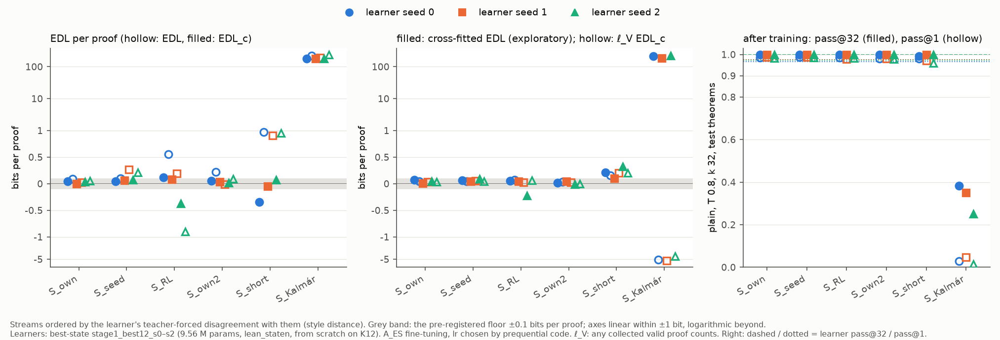

# style-edl: at fixed capability, proof style adds no detectable EDL (pre-registered verdict: against). But the styles that keep capability differ from the learner's own proofs on only 6–15 % of theorems, so a small style cost could not be seen; Kalmár's style costs ≈ 180 bits per proof and breaks capability

Status: completed 2026-10-23 and reviewed 2026-10-23. **No hard-constraint violation, nothing quarantined.** With their
own code, the reviewer:
- rebuilt all 18 streams (6 streams × 3 learner seeds) from the raw reads with their own `lean_seq` → ND parser. All
  4,608 stored stream proofs equal the rebuild, and their own eligibility count (632) and split check (0 shared
  renaming classes) agree;
- re-checked in Lean every counted proof they could find: 638 / 638 stream proofs, the 2,304 literal texts the streams
  were cut from, 6,391 accepted capability texts and all 2,852 proofs of the style-blind set V(x). None of 239 negative
  controls and none of 1,200 sampled prefilter rejections is Lean-valid;
- re-scored the learners and the 18 trained models θ* on the CPU with their own loop, within 1.5 × 10⁻⁴ bits per proof
  of the stored bits;
- recomputed EDL, EDL_c, the learning-rate choice, the floor, capability and ℓ_V from the per-proof files, never from
  the stored summaries.

Every reported number reproduces from the per-proof files, to rounding: numbers.md Tables 1–7, the bootstrap table,
`verdict.json`, `results.csv` and the figure.
- **What stands (the review's verdict):**
  - the run's materials are sound: the streams and Lean checks; the split, clean by renaming class, also against K12
    and the ladder's targets; each fit trained on exactly its prefix; pass@32 read with the EDL's own θ*;
  - **the pre-registered verdict, against, is correctly derived.** S_seed, S_RL and S_short keep capability, but none
    exceeds S_own2 (the learner's own resampled proofs) by more than the floor F = 0.1 bits per proof under both EDL
    and EDL_c in 3 / 3 seeds. S_short's EDL excess (+0.74 to +0.92) does not survive EDL_c. S_Kal exceeds it by ≈ 180
    bits per proof but fails the capability criterion on 3 / 3 seeds, robustly to truncation;
  - **Kalmár:** a large style change costs ≈ 180 bits per proof of EDL_c (≈ 1.5 per action). At this learner size and
    protocol it also breaks the learner: plain pass@32 0.25–0.38, pass@1 0.02–0.05. Under ℓ_V the cost turns negative.
    The number is for A_ES truncated at 8 passes.
- **What "against" means (the review):** "no detectable style cost for small style differences. It is not evidence
  that EDL ignores style."
  - The styles that keep capability differ from the learner's own proofs on only 6–15 % of theorems.
  - S_short's and S_RL's EDL_c vary by 0.41 and 0.49 bits per proof across seeds, 4–5× F.
  - "The data cannot separate a style cost of a few tenths of a bit per proof from zero."
- **Must be reworded** (details under "The review's corrections" below):
  - "from the split alone" → mostly from the split;
  - "at the floor" → none above S_own2 + F, and the cells span −0.40 to +0.06 bits per proof;
  - "only learnable style is charged" → a hypothesis from exploratory numbers, confounded by the learning rate;
  - the ℓ_V "dip in correct proofs" → a dip in mass on V(x);
  - A_fixed's "same ordering" → it differs (S_RL and S_own2 swap);
  - three sentences of the plain summary.
- **Missing:** the caveat that every S_Kal fit at lr* hit the 8-pass cap, the power caveat, and the learning rate's
  dependence on the stream.

Question (Dan, 2026-10-22): EDL [@donoway2026excessdescriptionlengthlearning] scores specific proof strings, so it may
charge a model for *which* valid proof it is taught (style) even when the model can already prove the theorem
(capability). If so, an EDL gap between a pretrained and an RL model can come from style alone. Show directly whether
EDL rises with style distance while capability stays fixed. Brief:
[`BRIEF_style-edl.md`](../../docs/proposals/followups/BRIEF_style-edl.md) (proposal 32,
[proposal note](../../docs/proposals/2026-10-22-style-edl.md)); background:
[the EDL note](../../docs/project_strategy/2026-10-22-edl-style-vs-capability.md).

**Plain-language summary:** [`plain_summary.md`](plain_summary.md). This is the executor's 594-word summary with the
review's corrections marked *[review]*; with them it is about 850 words.

## Configuration

- **Repository.** Fork `dan-pandori/nd-takehome`, branch `dan_style-edl`, from `origin/dan_kalmar-complexity`. It ran
  on agent1 (`ubuntu-s-2vcpu-2gb-sfo2`), every role at `--effort max`. Nothing is merged into the fork's `dan`.
  - **Pre-registration** `preregistration/style-edl.md`, commit
    [`793a95e0`](https://github.com/dan-pandori/nd-takehome/commit/793a95e0) at 2026-10-23 04:05:37Z, 1 min 8 s before
    the first pod (`sedl1`, 04:06:45Z). It came after the S_own pilot on the VPS CPU (seed 0), which the brief allowed,
    and discloses it. The $10 budget was registered at 03:18:11 and again at 04:05:27.
  - **Addendum 1** ([`dfa286d9`](https://github.com/dan-pandori/nd-takehome/commit/dfa286d9), 04:26:02Z), before any
    stream but S_own was scored (the first scored stream started 04:26:25). It records the stream-build facts. It
    makes S_Kal a candidate on the same terms as the other streams, and adds the per-proof attribution analysis A1.
  - A_fixed's E = 4 was set by the pilot's rule; its queue was last modified at 04:30:00. The cross-fit queue was
    written at 04:59:55, after S_short's EDL (04:46–04:50), so the cross-fit is post hoc. It is labelled exploratory
    everywhere the reviewer looked. `common.py` (A, scoring) and `edl_run.py` did not change after scoring began.
  - **DONE** [`ae20620a`](https://github.com/dan-pandori/nd-takehome/commit/ae20620a) (08:22:24Z; STATUS line
    `STYLE-EDL DONE 2026-10-23T08:22:24Z`), after the results commit
    [`3e3b7c7c`](https://github.com/dan-pandori/nd-takehome/commit/3e3b7c7c). Deliverables:
    - `run_style_edl.md` (397 words), `run_style_edl_plain.md` (594 words), `numbers.md` § style-edl, `log.md`
      § style-edl;
    - `style_edl/`: code, `results.csv` (one row per seed × stream), `streams_manifest.json` (theorem ids, split,
      classes, sources, sha256 of every proof and file) and a README;
    - `figures/style_edl.png`, copied here byte for byte.
  - **Review** [`review_style-edl.md`](https://github.com/dan-pandori/nd-takehome/blob/e378b944/review_style-edl.md),
    in two commits:
    - [`9274b1c4`](https://github.com/dan-pandori/nd-takehome/commit/9274b1c4) (09:11:44Z): §Recount, phase 1, done
      in `~/review/style-edl` with the executor's write-ups removed;
    - [`e378b944`](https://github.com/dan-pandori/nd-takehome/commit/e378b944) (09:21:31Z): phase 2 and §Verdict.

    The reviewer's scripts are `review/style-edl-recount/` (`rv_core.py`, `r1_*.py` … `r11_tables.py`, and the phase-2
    `p2_compare.py`, `p2_xfit_attr.py`, `p2_decomp.py`), with outputs in `out/`.
  - **The reviewer's disclosure.** Before recounting, the reviewer saw commit subjects that state the verdict
    ("against"). They also read an auto-memory note from the executor's session: the gate's EDL_c ≈ 0.04, S_short's
    ≈ 0.9-bit split artefact, names carrying 6.2 of 6.7 bits, and the Kalmár fits at the 8-pass cap. And they read
    Addendum 1's build facts and printed some raw run lines while learning the formats. No number of theirs uses a
    stored `summary` field.
  - **Gates** (`~/orchestrator.log`): GATE1 PASS with one warning, "344 source paths cited in numbers.md not found
    locally" (the sparse checkout); GATE2 PASS.
- **Timeline.** Executor Fri 2026-10-23 03:18–08:22 UTC, one invocation; reviewer 08:24–09:21; librarian from 09:22.
- **Models.** Every number below names one of these. The review's table:

  | label | checkpoint | size, architecture | format | from scratch? | trained on |
  |---|---|---|---|---|---|
  | **learner L_s**, s = 0, 1, 2 (best-state's K12 base; kalmar-pretrain's control) | `ckpts/bs/stage1_best12_s{s}_b1200.pt`; md5 9c436c35 / f7ae9a9e / 354c4428 | 9,560,832 params, ALiBiGPT `best`, 6 × 384 | `lean_staten` (state → action) | yes | K12 (`data/kh/train_k12.jsonl`, 155,000 theorems, md5 800b5486…, cap 12) |
  | **r8_s** (source of S_RL only) | `ckpts/bs/ladder/la_T1_best12_s{s}_r8.pt` (best-state's T1 EI ladder, round 8 of 8) | 9.56 M, same | `lean_staten` | no: EI from L_s | `data/ladder/rl_targets.jsonl` (4,495), k 32, T 0.8 |
  | **θ\*(s, S)** | `ckpts/style_edl/s{s}/{S}/theta_es_lr{lr*}_E0_o0.pt` | 9.56 M | `lean_staten` | no: fine-tuned from L_s | the 128 stream proofs of stream S; A_ES at lr*; data order 0 |
  | block models | not saved | 9.56 M | `lean_staten` | no: fine-tuned from L_s | the first n stream proofs, n ∈ {8, 16, 32, 64} |

  The learners and the ladder are from best-state
  ([summary](../2026-09-30-best-state-robbies-recipe-wins-after-rl-level-frozen-at-cap12/README.md)); kalmar-pretrain
  used the same bases as its control
  ([summary](../2026-10-19-kalmar-pretrain-not-learned-far-below-k12-control-in-distribution-replay-fine-tune-matches-ei-jump-at-one-seed/README.md)).
- **Theorems.** tf1200 (`data/kalmar/tf1200_kal_sl.jsonl`, md5 b99c3b8d): kalmar-pretrain's 1,200 held-out theorems.
  - **Eligible** iff, for every seed s, all of the following hold. At least 29 / 32 attempts of the selection read are
    Lean-valid (plain, k 32, T 0.8, seed 1; the brief's "pass@32 ≥ 0.9" read as a per-theorem success rate). L_s's
    and r8_s's greedy proofs are Lean-valid. The k 4 draw (T 0.8, seed 3) has a Lean-valid attempt. minlen finds a
    proof. And every stream proof replays in the environment, with its literal canonical text accepted by Lean.
  - **632** theorems are eligible. The reviewer's exclusions (s0 / s1 / s2): selection read < 29 / 32 on
    358 / 295 / 278, base greedy proof invalid 98 / 67 / 115, r8 greedy invalid 5 / 14 / 12, no valid k 4 attempt
    50 / 39 / 92. minlen found all 1,200 with 0 timeouts; its longest proof is 6 lines.
  - **256 were sampled** (seed 20261023): one theorem set for all three seeds, so the streams are paired across seeds.
    They were split 128 stream / 128 test by renaming class, with atom-count strata balanced. The atom mix (1 / 2 / 3 /
    4 atoms) is 71 / 175 / 190 / 196 for the eligible pool, 16 / 34 / 36 / 42 for the stream half and 15 / 34 / 37 / 42
    for the test half.
  - **Disjointness** (the reviewer's key, atom permutation × premise multiset): the halves share 0 classes. tf1200,
    the 256 and both halves share 0 classes with K12 (155,000 records, 154,382 classes), with the ladder's 4,495
    targets and with `data/rl_targets.jsonl` (3,000).
- **Streams** (one Lean-checked proof per theorem; the same theorems in every stream):

  | stream | proofs for learner s | role (the brief's) |
  |---|---|---|
  | S_own | L_s's greedy proof | gate: EDL ≈ 0 expected |
  | S_own2 | the first Lean-valid attempt of L_s's k 4, T 0.8, seed 3 draw | gate: the noise floor; also the decision rule's comparator (pre-registration) |
  | S_seed | L_{(s+1) mod 3}'s greedy proof | mild style change |
  | S_short | the shortest proof from `minlen.Search` (bound 14 lines, 120 s, `lemmas=True`) | moderate |
  | S_RL | r8_s's greedy proof | the case in question |
  | S_Kal | the K12-Kalmár shared-lemma proof (tf1200's `proof` field) | large (secondary) |

  Every S_Kal proof used fits the learner's caps: at most 381 actions (cap 1,024), longest action 77 tokens (cap 512).
- **Checker: Lean alone.**
  - `nd_verify`'s tree equals `origin/main`'s (`9437bb72…`), and no `style_edl/` script imports it.
    `search_short.py` calls `minlen.Search`, whose internal check is not used to judge.
  - Every Lean gate record of the run says `judge: lean-only`. `artifacts/TEST_RUN_DONE` is unchanged.
  - textbook72 is not read anywhere, and no test file is used for training. The reviewer checked all 540 fits: each
    trained on exactly the first n stream proofs of its data order.
- **Scoring** (`style_edl/common.py`). Teacher-forced NLL in bits (fp32) of the action tokens plus `<eos>`.
  - The names the environment assigns are not coded: the `have` name, and the binder of a box or of the first Or.elim
    branch. One name base per theorem (sha1 mod 33) shifts every name, the same for every stream and model.
  - With every action token coded, S_own s0's stream half costs 6.64 bits per proof against 0.42 with names masked
    (the review). The all-token code is a secondary column in `results.csv`.
- **Algorithm A and EDL** (`style_edl/edl_run.py`).
  - **Prequential blocks** [0, 8), [8, 16), [16, 32), [32, 64), [64, 128). Block [0, 8) is coded by the learner, and
    every later block by A trained on the proofs before it. θ* = A(all 128). L_test = θ*'s mean bits per proof on the
    128 test proofs of the same stream. Two data orders (order 0 = the builder's order, order 1 = one fixed
    permutation), the same in every stream.
  - **A_ES (primary):** from L_s's weights; AdamW (0.9, 0.95, wd 0), constant lr, gradient clip 1, batches of 8 whole
    proofs, the Stage-1 name shift, MTP off, bf16 autocast. It validates on a quarter of the prefix (positions i mod 4
    = 3), trains up to 8 passes and stops after 2 without improvement. Then it retrains p* passes on all n proofs.
  - **Learning rate:** lr ∈ {1e-5, 1e-4, 1e-3}, fixed in advance and chosen per seed × stream by the mean prequential
    code over the two orders; log₂ 3 bits are added for the choice.
  - **A_fixed (secondary):** E passes on all n, no validation. E = 4 was chosen on the S_own pilot: mean prequential
    code 30.3 bits at E = 4, 33.5 at E = 2 and 37.6 at E = 1 (best lr per E), more than the 1-bit tie rule apart.
  - **EDL** (the brief's) = Σ block bits + log₂ 3 − 128 × L_test, per proof (÷ 128) and per action.
  - **EDL_c** = EDL − M. M = Σ of the learner's stream bits − 128 × its mean test bits: the difficulty mismatch
    between the halves, which no training changes. EDL_c has the same expectation as EDL without that mismatch.
  - **Cross-fit** (exploratory, post hoc): the same protocol with the halves swapped. Swapping flips M's sign, so the
    mean of the two directions cancels the mismatch exactly.
- **Capability check** (`guided_eval.py`). k 32, T 0.8, sample seed 2 (not the selection seed), caps `max_steps`
  1,024 and `max_action` 512, batch 1,024, on the 128 test theorems. Before: L_s. After: θ*(lr*, order 0).
  - Read both **plain** (primary) and **guided** (`--arm logical`, ≤ 10 rejections; the policy's best-system number).
  - "Capability fixed" (the brief's): plain pass@32 ≥ 0.9 and within 0.03 of before, on every seed. pass@1 within
    0.05 is reported as a stricter reading.
- **Style distance:** 1 − TF agreement. TF agreement is the fraction of actions in which every coded token is the
  learner's teacher-forced argmax.
- **ℓ_V** (the style-blind score): −log₂ Σ_{y ∈ V(x)} p(y | x). V(x) is every distinct Lean-valid proof the run
  collected for x: the 18 stream files, the selection and k 4 reads, and the plain capability reads of the learners
  and of every θ*. That is 2,852 proofs for the 256 theorems, mean 11.1 per theorem (2–56). It is computed on re-fits
  of the lr* runs; memory-efficient attention's backward is not bit-deterministic, so the re-fits match the primary
  fits closely but not exactly (Observation 7).
- **Floor and decision rule** (pre-registered).
  - F = max(0.1; over seeds, |EDL_c(S_own) − EDL_c(S_own2)|; over seeds and both gate streams, the order-to-order
    difference). The measured parts were ≤ 0.043 and ≤ 0.031, so **F = 0.100**, the pre-registered minimum.
  - **"EDL is inflated by style at fixed capability"** iff one of S_seed, S_RL, S_short (and, after Addendum 1,
    S_Kal) passes the capability criterion on all three seeds and its EDL and its EDL_c both exceed S_own2's by more
    than F in 3 / 3 seeds.
  - **"Against"** if no capability-fixed stream does, if the excess appears in EDL but not in EDL_c, or if ℓ_V keeps
    ≥ 80 % of the excess.
  - **Gate:** |EDL_c(S_own)| ≤ 0.3 bits per proof on seed 0.
- **Commands** (queues `pod/sedl/`; caps `C="--max_steps 1024 --max_action 512 --batch 1024"`, `TF` = tf1200):

  ```
  # reads (q1_reads.sh): greedy reads of L_s and r8_s, the selection read, and S_own2's draw
  python3 kalmar/kal_free.py --ckpt ckpts/bs/stage1_best12_s${s}_b1200.pt --in $TF --k 1 --temperature 0 --seed 0 $C --out ...
  python3 guided_eval.py --ckpt ckpts/bs/stage1_best12_s${s}_b1200.pt --arm plain --k 32 --seed 1 --temperature 0.8 --sets $TF $C --out ...
  python3 guided_eval.py --ckpt ckpts/bs/stage1_best12_s${s}_b1200.pt --arm plain --k 4 --seed 3 --temperature 0.8 --sets $TF $C --out ...
  # S_short (q1_minlen.sh); then style_edl/build_streams.py on the VPS
  python3 style_edl/search_short.py --in $TF --out data/style_edl/short/tf1200_minlen14.jsonl --bound 14 --time 120 --procs $P
  # EDL (q2_pilot.sh, q3_edl.sh, q3k_kal.sh); the cross-fit (q3x_xfit.sh, q3x2.sh) swaps --stream and --test
  python3 style_edl/edl_run.py --ckpt $L --stream $D/s$s/$S.stream.jsonl --test $D/s$s/$S.test.jsonl --lrs 1e-5,1e-4,1e-3 \
      --orders 0,1 --arm $S --lseed $s --algo es --save_theta ckpts/style_edl/s$s/$S --out artifacts/style_edl/edl/s$s/$S.json
  python3 style_edl/edl_run.py <same> --algo fixed --epochs 4 --out artifacts/style_edl/edl/s$s/$S.fixed.json
  # capability (q4_cap.sh, q4k_cap.sh): plain on all 256 theorems, guided on the 128 test theorems
  python3 guided_eval.py --ckpt <L_s or θ*> --arm {plain,logical} --sets {all256,test128} --k 32 --seed 2 --temperature 0.8 $C --out ...
  # ℓ_V re-fits (q5_lv_a.sh, q5_lv_b.sh), after style_edl/build_vset.py
  python3 style_edl/edl_run.py --ckpt $L --stream ... --test ... --lrs <lr*> --orders 0,1 --algo es --arm $S --lseed $s \
      --vset data/style_edl/vset.jsonl --out artifacts/style_edl/lv/s$s/$S.json
  # analysis on the VPS
  python3 style_edl/analyze.py --fixed_E 4; then verdict.py, compute_rows.py, numbers_section.py, figure.py
  ```
- **Pods and cost:** 3 pods, **6.72 pod-hours, $1.88 billed** of the $10 budget: $1.86 of GPU and $0.02 of disk.
  These are RunPod's billing per pod, re-read by the librarian: $1.0401 + $0.7560 + $0.0804. The run quotes $1.86,
  and the review the same from `~/podhours.log`: the GPU part. No community RTX 3090 was in stock.
  - `sedl1`, secure RTX A5000 at $0.27/h, 04:06:45–07:55 (3.81 h, $1.04): the reads, minlen, the S_own pilot, every
    EDL cell except seeds 1–2's Kalmár cells, every cross-fit cell except seed 1's Kalmár cell (seed 2's moved here,
    `q3x2.sh`), every capability read except seeds 1–2's Kalmár reads, and the ℓ_V re-fits except s1 / s2 Kalmár.
  - `sedl2`, secure RTX A5000 at $0.27/h, 05:09:07–07:55 (2.77 h, $0.76): seeds 1–2's Kalmár EDL cells, seed 1's
    Kalmár cross-fit, seeds 1–2's Kalmár capability reads and their ℓ_V re-fits.
  - `sedl3`, secure A40 at $0.59/h, 07:57:14–08:04 (0.14 h, $0.08): the guided S_Kal s2 read, redone alone after its
    first try ran out of GPU memory (≥ 15.6 GB) while sharing `sedl2` with two jobs. It is the run's only failed job.
  - **Operational slip** (`log.md`, 06:07): the executor misread a queue log, and `sedl1` started a duplicate of
    `edl_s1_S_Kal`. It was killed (RC 143) and its outputs deleted; `sedl2`'s complete run is used. `log.md` puts the
    cost at ≈ 20 GPU-minutes, but by `sedl1`'s queue and job logs the duplicate ran at most ≈ 2 minutes, between
    06:05:13 (the previous job's end) and 06:07:08 (the queue's end) (librarian's check; the review does not mention it).
  - **Pre-registered estimate:** ≈ $1.5–4 (reads ≈ 1 h, minlen ≈ 1 h of CPU, EDL 1–2 h, capability ≈ 1 h, ℓ_V ≈ 0.5 h).
- **Compute.** The run wrote 542 results-registry rows: `gpu_seconds`, `train_steps`, `train_tokens`, `gen_tokens`,
  `attempts`, `actions` and `lean_checks`, with arm and seed, in 128 files under the run's
  `artifacts/style-edl/registry/` (Bucket, below). Three rows come from a VPS smoke test and should be left out (the
  review): they are the "other" row below. Per arm, summed over phases
  (EDL, A_fixed, cross-fit, ℓ_V, capability reads) and the three seeds (`artifacts/style_edl/compute.csv`; the
  review: reproduces):

  | arm | GPU-seconds | training steps | training tokens | generated tokens | Lean checks |
  |---|---|---|---|---|---|
  | S_own | 1,789 | 12,683 | 39.0 M | 3.01 M | 23,828 |
  | S_own2 | 1,529 | 8,169 | 26.6 M | 3.09 M | 24,332 |
  | S_seed | 1,676 | 12,461 | 38.3 M | 3.01 M | 23,921 |
  | S_RL | 1,730 | 12,050 | 38.1 M | 3.05 M | 24,103 |
  | S_short | 1,659 | 12,841 | 36.1 M | 2.87 M | 23,720 |
  | S_Kal | 26,960 | 20,084 | 3,426.2 M | 22.05 M | 2,071 |
  | learner (capability reads) | 485 | 0 | 0 | 3.18 M | 24,635 |
  | shared reads (stream build) | 829 | 0 | 0 | 13.45 M | 90,915 |
  | other (VPS smoke test, CPU) | 78 | 12 | 0.03 M | 0 | 0 |

  - **GPU-seconds are process wall time** on cards sometimes shared by 2–3 jobs, all on RTX A5000s except two rows: the
    redone guided read (A40; its row also counts the failed A5000 attempt) and the smoke test (VPS CPU). The rows sum
    to 36,735 s (10.2 h; 36,658 s without the smoke test), ≈ 1.5× the 6.72 pod-hours billed.
  - **Matched:** proofs (128 + 128), algorithm and lr grid, by design; not tokens.
  - **Flagged > 1.25× by design** (the executor's flag): S_Kal used ≈ 90× the training tokens of the short streams
    (3,426 / 38 M). It also used ≈ 15–18× their GPU-seconds (librarian's arithmetic). Per A_ES cell it took
    1,958–3,004 GPU-s and 434–442 M tokens, against 38–88 GPU-s and 1.8–4.8 M for a short stream (the review).
  - **Also > 1.25× against the comparator S_own2 (librarian's arithmetic, informational; not flagged in the run or
    the review):** every other short stream used 1.36–1.57× S_own2's training steps and tokens over all phases, and
    1.84–2.48× in the primary A_ES fits alone, summed over the lr grid (1.58–1.92× its GPU-seconds there). A_ES's
    early stopping sets how long each fit trains, so training length varies by stream: at lr*, only 7 / 30 of
    S_own2's fits reached the 8-pass cap, against 20–23 / 30 for S_own, S_seed and S_RL (Observation 10). For S_short
    this sits beside the learning-rate confound the review raises.
- **Bucket.** `hf://buckets/dan-pandori/nd-rl/style-edl/`, 867 objects:
  - `artifacts/style_edl/` (643): reads, capability rows, EDL / cross-fit / ℓ_V per-proof files, logs, `verdict.json`,
    `bootstrap.json`, `compute.csv`, `term_sizes.json`;
  - `artifacts/style-edl/registry/` (128);
  - `ckpts/style_edl/` (54): θ* for every seed × stream × lr, order 0. The review found all 54 in the bucket and
    re-scored the 18 lr* models;
  - `data/style_edl/` (42): streams, sets and V(x).

  The shared registry prefix `hf://buckets/dan-pandori/nd-rl/registry/style-edl/` holds 127 of the 128 registry
  files: all but the VPS smoke test's. Code, the manifest,
  `results.csv` and the figure are in git.

## Observations

All numbers are per seed s0 / s1 / s2 unless stated, in bits, with the environment-assigned names not coded, from the
review's own recount unless marked as the executor's. The learners are L_s and the trained models θ* (see Models).

1. **The styles that keep capability are mostly the learner's own** (the review's T1, on the 256 theorems).

   | stream | identical to the learner's greedy proof | mean actions | TF agreement under the learner | style distance (seed mean) |
   |---|---|---|---|---|
   | S_own | 1.000 / 1.000 / 1.000 | 4.52 / 4.55 / 4.44 | 0.9965 / 0.9974 / 0.9982 | 0.0026 |
   | S_own2 | 0.910 / 0.926 / 0.934 | 4.71 / 4.74 / 4.68 | 0.9776 / 0.9860 / 0.9800 | 0.0188 |
   | S_seed | 0.941 / 0.938 / 0.941 | 4.55 / 4.44 / 4.52 | 0.9863 / 0.9859 / 0.9844 | 0.0145 |
   | S_short | 0.871 / 0.848 / 0.883 | 4.26 / 4.26 / 4.26 | 0.9578 / 0.9578 / 0.9633 | 0.0403 |
   | S_RL | 0.945 / 0.922 / 0.938 | 4.64 / 4.64 / 4.52 | 0.9848 / 0.9756 / 0.9836 | 0.0187 |
   | S_Kal | 0.000 / 0.000 / 0.000 | 116.13 (every seed) | 0.2736 / 0.3123 / 0.2273 | 0.7289 |

   - **Lengths.** ND lines = actions − 1. Term size (`lean_check` inference nodes; the executor's, mean over seeds and
     halves): S_own 2.03, S_own2 2.20, S_seed 2.03, S_RL 2.11, S_short 1.88, S_Kal 96.4; ND lines 3.50, 3.71, 3.50,
     3.60, 3.26, 115.1. The reviewer's own node count, a different definition, gives 2.09–2.48 for the short streams
     (seed means; S_short lowest) and 110.22 for S_Kal, in the same order (claim 16: "consistent across
     definitions").
   - S_short is minimal among the proofs held: no proof in any other stream of any seed is shorter in ND lines than
     the minlen proof of the same theorem.
   - The Kalmár TF agreement reproduces kalmar-pretrain's E1 for the same checkpoints (0.278 / 0.302 / 0.228, on all
     1,200 theorems) within 0.01 (claim 17).

2. **EDL and EDL_c** (A_ES, bits per proof unless stated; the review's T2).

   | stream | lr* | starting loss, block [0, 8) | L_test (θ*) | EDL | EDL_c | EDL_c per action | M |
   |---|---|---|---|---|---|---|---|
   | S_own | 1e-5 (all) | 0.58 / 0.52 / 0.47 | 0.127 / 0.186 / 0.109 | 0.095 / 0.024 / 0.056 | 0.043 / −0.005 / 0.037 | 0.0093 / −0.0010 / 0.0082 | 0.052 / 0.029 / 0.018 |
   | S_own2 | 1e-5 | 1.56 / 0.56 / 0.74 | 0.582 / 0.564 / 0.595 | 0.225 / −0.014 / 0.093 | 0.054 / 0.039 / 0.014 | 0.0113 / 0.0081 / 0.0028 | 0.171 / −0.052 / 0.079 |
   | S_seed | 1e-5 | 0.81 / 1.94 / 0.88 | 0.185 / 0.236 / 0.222 | 0.100 / 0.269 / 0.215 | 0.046 / 0.065 / 0.073 | 0.0100 / 0.0143 / 0.0158 | 0.054 / 0.204 / 0.142 |
   | S_short | **1e-4** | 3.29 / 2.83 / 3.18 | 0.171 / 0.239 / 0.226 | 0.968 / 0.910 / 0.951 | −0.340 / −0.047 / 0.073 | −0.0786 / −0.0108 / 0.0169 | 1.309 / 0.957 / 0.878 |
   | S_RL | 1e-5 | 1.83 / 1.26 / 1.43 | 0.521 / 0.760 / 1.546 | 0.555 / 0.196 / −0.897 | 0.116 / 0.082 / −0.370 | 0.0238 / 0.0171 / −0.0794 | 0.439 / 0.115 / −0.527 |
   | S_Kal | **1e-4** | 1,340 / 1,255 / 1,411 | 88.4 / 96.6 / 89.9 | 224.3 / 190.4 / 239.8 | 178.9 / 182.1 / 176.7 | 1.533 / 1.561 / 1.514 | 45.4 / 8.2 / 63.0 |

   - **Gate passed:** S_own s0 EDL_c 0.043 (orders 0.045 / 0.041), against ≤ 0.3.
   - **lr\*** is the same in every seed. The closest call is s2 S_RL: 81.6 bits at 1e-5 against 82.0 at 1e-4.
   - Per action, the starting loss is 10.8–12.1 bits for S_Kal, 0.65–0.76 for S_short and 0.10–0.13 for S_own. S_Kal's
     EDL is 1.63–2.05 bits per action.

3. **The pre-registered decision: against** (the review's T3; excess over S_own2, bits per proof, F = 0.100).

   | stream | EDL excess | > F in 3 / 3? | EDL_c excess | > F in 3 / 3? | capability criterion, 3 / 3 seeds |
   |---|---|---|---|---|---|
   | S_own | −0.130 / 0.038 / −0.037 | no | −0.011 / −0.043 / 0.024 | no | pass |
   | S_seed | −0.125 / 0.283 / 0.123 | no | −0.008 / 0.027 / 0.059 | no | pass |
   | S_short | 0.744 / 0.923 / 0.858 | **yes** | −0.395 / −0.085 / 0.060 | no | pass |
   | S_RL | 0.330 / 0.210 / −0.989 | no | 0.062 / 0.043 / −0.383 | no | pass |
   | S_Kal | 224.0 / 190.4 / 239.7 | **yes** | 178.8 / 182.1 / 176.7 | **yes** | **fail** |

   - Seeds above F under EDL / EDL_c / cross-fit / ℓ_V EDL_c: S_seed 2 / 0 / 0 / 0, S_RL 2 / 0 / 0 / 0, S_short
     3 / 0 / 2 / 3, S_Kal 3 / 3 / 3 / 0 (claim 10).
   - "Against" holds on both pre-registered grounds: no capability-fixed stream exceeds S_own2 by more than F under
     both EDL and EDL_c in 3 / 3 seeds, and S_short's excess "appears in EDL but not in EDL_c".
   - Under EDL_c, none of the nine capability-fixed cells is above S_own2 + F (the review: "none above S_own2 + F; the
     cells span −0.40 to +0.06 bits per proof"). Under the brief's EDL, 7 of the 9 are.

4. **S_short: the split corrections disagree, and part of the excess comes from the learning rate** (the review's
   `p2_decomp.py`). S_short − S_own2, bits per proof:

   | correction | s0 / s1 / s2 |
   |---|---|
   | the brief's EDL (none) | +0.744 / +0.923 / +0.858 |
   | EDL_c, pre-registered (subtracts the learner's own stream / test mismatch) | −0.395 / −0.085 / +0.060 |
   | cross-fit, mean of both directions (exploratory, reported) | +0.193 / +0.056 / +0.330 |
   | … of which on proofs **identical** to the learner's greedy proof | +0.085 / +0.035 / +0.087 |
   | … of which on differing proofs | +0.109 / +0.020 / +0.243 |
   | class-stratified EDL_c (A1's reweighting; computed in `results.csv` as `strat_EDL_c_pp`, not reported) | +0.005 / +0.401 / +1.097 |

   - The split put more differing proofs in the stream half than in the test half (21 vs 12, 26 vs 13, 21 vs 9). That
     is the whole of S_short's M (1.31 / 0.96 / 0.88 bits per proof); for s0, 21 × 11.8 − 12 × 6.9 ≈ 165 bits ≈ 1.29
     per proof.
   - EDL_c subtracts the learner's cost mismatch but not the learnability mismatch. On s0 it swings from −0.34
     (primary) to +0.76 (swapped).
   - **The same-proof part is not style:** 0.035–0.087 bits per proof sit on proofs identical to the learner's own,
     which only A's lr can produce (1e-4 for S_short, 1e-5 for S_own2). Per same proof, EDL_c is 0.15 / 0.12 / 0.15
     for S_short against 0.03 / 0.02 / −0.02 for S_own2.
   - The review: "Three reasonable split corrections give S_short's excess as negative, small-positive or up to +1.1
     bits per proof." The pre-registered rule uses EDL_c, so "against" is the correct pre-registered outcome.

5. **Capability** (k 32, T 0.8, sample seed 2, the 128 test theorems; every after-read loaded θ*(lr*, order 0); the
   review's T4).

   | model | plain pass@32 | plain pass@1 | guided pass@32 | guided pass@1 | criterion |
   |---|---|---|---|---|---|
   | learner L_s | 1.000 / 1.000 / 1.000 | 0.966 / 0.976 / 0.972 | 1.000 / 1.000 / 1.000 | 0.993 / 0.997 / 0.997 | – |
   | θ*(S_own) | 1.000 / 1.000 / 1.000 | 0.985 / 0.988 / 0.983 | 1.000 / 1.000 / 1.000 | 1.000 / 1.000 / 1.000 | pass |
   | θ*(S_own2) | 1.000 / 1.000 / 1.000 | 0.980 / 0.981 / 0.978 | 1.000 / 1.000 / 1.000 | 0.999 / 1.000 / 0.998 | pass |
   | θ*(S_seed) | 1.000 / 1.000 / 1.000 | 0.988 / 0.987 / 0.986 | 1.000 / 1.000 / 1.000 | 1.000 / 1.000 / 1.000 | pass |
   | θ*(S_short) | 0.992 / 1.000 / 1.000 | 0.979 / 0.970 / 0.959 | 1.000 / 1.000 / 1.000 | 1.000 / 0.998 / 0.995 | pass |
   | θ*(S_RL) | 1.000 / 1.000 / 1.000 | 0.985 / 0.978 / 0.983 | 1.000 / 1.000 / 1.000 | 0.999 / 0.998 / 1.000 | pass |
   | θ*(S_Kal) | 0.383 / 0.352 / 0.250 | 0.029 / 0.047 / 0.015 | 0.602 / 0.602 / 0.594 | 0.118 / 0.135 / 0.103 | **fail** |

   - The stricter pass@1 reading (within 0.05) also passes for every stream but S_Kal, whose pass@1 falls by
     0.937 / 0.929 / 0.957.
   - θ*(S_short) s0 misses one theorem (heldout_4047, 0 / 32 plain), the only test theorem any non-Kalmár θ* misses
     (15 cells).

6. **Kalmár: a large EDL, not at fixed capability.**
   - EDL_c 178.9 / 182.1 / 176.7 bits per proof (1.53 / 1.56 / 1.51 per action). On the test set (seed means), the
     learner codes a Kalmár proof in ≈ 1,286 bits and θ* in 91.6; the block models trained on the first 8, 16, 32 and
     64 proofs give 551, 391, 262 and 163.
   - **Every S_Kal fit at lr\* (30 / 30) stopped at the 8-pass cap,** so A_ES is truncated for S_Kal and its EDL
     depends on `max_passes` (the review; missing from the write-up).
   - **Capability broke** (Observation 5). θ*(S_Kal)'s accepted proofs are 15–43 ND lines on average per arm, and
     20–55 % contain a double-negation-derived excluded-middle line, the first Kalmár split. Its failures are mostly
     environment binder and name errors; s2 plain, for example, has 2,695 binder mismatches and 530 unbound names in
     4,096 attempts.
   - **Not caused by the caps.** Truncation is ≤ 0.1 % of attempts in every capability read except θ*(S_Kal) s1 plain,
     at 1.32 % (108 / 8,192). Even if every truncated attempt on test had been valid, θ*(S_Kal) plain pass@32 would be
     at most 0.398 / 0.539 / 0.258.

7. **The style-blind score ℓ_V** (the review's T5, bits per proof).

   | stream | EDL_V | EDL_V,c | single-string EDL_c | EDL_V,c excess over S_own2 |
   |---|---|---|---|---|
   | S_own | 0.063 / 0.056 / 0.049 | 0.042 / 0.038 / 0.039 | 0.043 / −0.005 / 0.037 | 0.009 / 0.010 / 0.036 |
   | S_own2 | 0.054 / 0.046 / 0.013 | 0.033 / 0.028 / 0.003 | 0.054 / 0.039 / 0.014 | – |
   | S_seed | 0.069 / 0.076 / 0.058 | 0.048 / 0.058 / 0.048 | 0.046 / 0.065 / 0.073 | 0.015 / 0.030 / 0.045 |
   | S_short | 0.181 / 0.221 / 0.211 | 0.160 / 0.203 / 0.200 | −0.340 / −0.047 / 0.073 | **0.127 / 0.175 / 0.197** |
   | S_RL | 0.098 / 0.040 / 0.073 | 0.076 / 0.023 / 0.063 | 0.116 / 0.082 / −0.370 | 0.044 / −0.006 / 0.060 |
   | S_Kal | −5.095 / −5.560 / −3.961 | −5.116 / −5.578 / −3.971 | 178.9 / 182.1 / 176.7 | −5.149 / −5.606 / −3.974 |

   - **S_Kal:** ℓ_V removes all of the excess and turns it negative (EDL_V,c / EDL_c = −0.029 / −0.031 / −0.022).
     Training on Kalmár proofs costs valid mass. On test, θ*(S_Kal)'s ℓ_V is 12.9 / 13.1 / 12.4 bits against the
     learner's 0.220 / 0.146 / 0.156.
   - **S_short and S_RL:** their single-string EDL_c excesses are negative (seed means −0.140 and −0.093), so the
     pre-registered "share removed" is not defined. Under ℓ_V both are positive: S_short +0.166 (above F in 3 / 3
     seeds), S_RL +0.033. On the uncorrected EDL, ℓ_V takes S_short's excess from 0.842 to 0.166 (80 % removed).
   - **Where S_short's ℓ_V excess comes from** (numbers.md's reading and its own caveat, which the review asks the
     run doc and plain summary to restore): the intermediate fits put less mass on V(x) than the learner or θ*; for
     example, block [16, 32), seed 0, order 1 gives 1.08 bits per theorem against the learner's 0.24 (the executor's
     value, not recounted). The intermediate models' own samples are not in V(x), so part of this dip may be valid
     proofs outside V(x). That was not checked. The review calls it a dip in mass on V(x).
   - **Re-fit agreement.** The ℓ_V runs' single-string bits differ from the primary fits' by ≤ 0.08 bits per proof
     on the lr-1e-5 streams, ≤ 0.34 on S_short and ≤ 8.0 on S_Kal (of ≈ 90–1,300). The EDL differs by ≤ 0.003 per
     proof (S_Kal 0.03–0.16). ℓ_V ≤ the single-string code holds wherever both are stored, up to 2 × 10⁻⁵ bits of
     batching noise.

8. **Secondary and exploratory: A_fixed and the cross-fit** (the review's T6, EDL_c per proof).

   | stream | A_fixed lr* | A_fixed EDL_c | cross-fit, mean of both directions (exploratory) |
   |---|---|---|---|
   | S_own | 1e-5 (all) | 0.068 / 0.026 / 0.048 | 0.075 / 0.011 / 0.049 |
   | S_own2 | 1e-5 | 0.059 / 0.025 / 0.007 | 0.017 / 0.043 / −0.007 |
   | S_seed | 1e-5 / 1e-4 / 1e-5 | 0.074 / 0.069 / 0.076 | 0.059 / 0.049 / 0.088 |
   | S_short | 1e-4 | −0.297 / −0.128 / −0.026 | 0.210 / 0.098 / 0.323 |
   | S_RL | 1e-5 | 0.099 / 0.084 / 0.032 | 0.053 / 0.047 / −0.221 |
   | S_Kal | 1e-3 | 199.5 / 214.8 / 236.6 | 214.1 / 185.0 / 224.6 |

   - **Cross-fit** (post hoc): S_short's excess over S_own2 is +0.193 / +0.056 / +0.330, above F in 2 / 3 seeds.
     S_seed's is +0.042 / +0.006 / +0.095 and S_RL's +0.036 / +0.004 / −0.214.
   - **A_fixed:** S_short's EDL_c is negative in all three seeds (under A_ES in s0 and s1: −0.340 / −0.047 / +0.073),
     and S_Kal's is large, as under A_ES; S_RL's is positive in all three seeds under A_fixed. Its ordering (seed
     means), S_short < S_own2 < S_own < S_RL < S_seed < S_Kal, differs from A_ES's by one swap: S_RL and S_own2 trade
     places. The review says "only the extremes agree", but by its own two orderings S_own and S_seed also keep their
     places (librarian's reading). The middle four lie within 0.13 of one another.

9. **Per-proof attribution A1** (Addendum 1; the review's T7). Each stream's proofs are split into *same* (identical
   to the learner's greedy proof) and *differ*. Differing proofs, stream + test half:

   | stream | differing proofs | learner bits per differing proof (stream half) | θ* bits per differing test proof | EDL_c per differing proof | EDL_c per same proof |
   |---|---|---|---|---|---|
   | S_own2 | 12+11 / 12+7 / 10+7 | 5.41 / 3.77 / 5.95 | 4.74 / 7.57 / 7.71 | 0.15 / −0.21 / 0.13 | 0.026 / 0.023 / −0.015 |
   | S_seed | 9+6 / 10+6 / 10+5 | 2.43 / 5.05 / 3.97 | 2.44 / 3.81 / 3.94 | −0.39 / −0.04 / 0.15 | 0.057 / 0.072 / 0.050 |
   | S_short | 21+12 / 26+13 / 21+9 | 11.79 / 7.82 / 10.79 | 1.07 / 1.44 / 1.44 | −0.53 / 1.52 / 5.92 | 0.154 / 0.119 / 0.146 |
   | S_RL | 10+4 / 11+9 / 9+7 | 11.38 / 8.84 / 7.73 | 12.56 / 8.83 / 26.65 | 1.22 / 0.97 / −7.94 | 0.084 / −0.005 / 0.063 |

   - The per-class EDL_c of the differing proofs is noise-dominated: −7.9 to +5.9 bits per differing proof, resting on
     4–13 differing test proofs per cell.
   - S_RL s2's negative EDL_c (−0.370 per proof) comes from four test proofs on which θ* got worse by +17.7, +16.7,
     +7.7 and +7.4 bits.
   - The executor's reading, "only learnable style is charged", rests on this table and on a pooled cross-fit (0.60 /
     0.93 / 4.16 bits per differing S_short proof). θ*(S_short) codes its differing test proofs at 1.1–1.4 bits each,
     against the learner's 6–13 on the same proofs (claim 25), while S_RL's and S_seed's deviations are not learned.
     The review accepts it only as a hypothesis from exploratory numbers on 14–39 differing proofs per cell,
     confounded by the learning rate.

10. **Per-block curve** (A_ES at lr*, mean over 3 seeds × 2 orders, bits per proof; the review's T9).

    | stream | [0, 8) learner | [8, 16) | [16, 32) | [32, 64) | [64, 128) | θ* on test | fits with p* = 8 (cap) |
    |---|---|---|---|---|---|---|---|
    | S_own | 0.521 | 0.240 | 0.210 | 0.175 | 0.138 | 0.141 | 23 / 30 |
    | S_own2 | 0.951 | 1.246 | 0.788 | 0.474 | 0.630 | 0.580 | 7 / 30 |
    | S_seed | 1.209 | 0.686 | 0.428 | 0.278 | 0.312 | 0.215 | 22 / 30 |
    | S_short | 3.103 | 0.356 | 1.105 | 2.105 | 0.524 | 0.212 | 9 / 30 |
    | S_RL | 1.506 | 0.400 | 1.192 | 1.401 | 0.526 | 0.942 | 20 / 30 |
    | S_Kal | 1,335.3 | 310.5 | 372.0 | 284.8 | 178.4 | 91.6 | 30 / 30 |

    For the short streams, the block means follow where the few differing proofs fall more than they follow learning
    (see S_short's [32, 64)).

11. **Seed summaries** (n = 3, so the interquartile mean is the mean; bootstrap 95 % interval over seeds; the review's
    T8, bits per proof).

    | stream | EDL: IQM [95 % CI] | EDL_c: IQM [95 % CI] |
    |---|---|---|
    | S_own | 0.058 [0.024, 0.095] | 0.025 [−0.005, 0.043] |
    | S_own2 | 0.101 [−0.014, 0.225] | 0.035 [0.014, 0.054] |
    | S_seed | 0.195 [0.100, 0.269] | 0.061 [0.046, 0.073] |
    | S_short | 0.943 [0.910, 0.968] | −0.105 [−0.340, 0.073] |
    | S_RL | −0.049 [−0.897, 0.555] | −0.057 [−0.370, 0.116] |
    | S_Kal | 218.1 [190.4, 239.8] | 179.3 [176.7, 182.1] |

    - **Spearman ρ(style distance, EDL_c)** over the six streams (seed means) is **0.143**, against ≥ 0.8 expected. ρ
      with EDL is 0.714, with the cross-fit 0.543, with ℓ_V EDL_c −0.200.
    - EDL_c order (seed means): S_short (−0.105) < S_RL (−0.057) < S_own (0.025) < S_own2 (0.035) < S_seed (0.061) ≪
      S_Kal (179.3).

12. **Checks** (the reviewer's, Lean 4.35.0 on the VPS; the pods ran 4.34.1).
    - Stream proofs, rendered by the reviewer's own ND → Lean translator: 638 / 638 accepted; every (seed, stream) cell
      256 / 256. The literal texts the streams were cut from (greedy L_s and r8_s, first accepted k 4 text): 2,304 /
      2,304, all in the strict `lean_seq` vocabulary with no `sorry`, `admit` or automation.
    - Negative controls: 239 / 239 rejected (120 ND proofs whose last line claims the negated conclusion, 119 literal
      texts with one atom changed).
    - Capability reads: 120 accepted texts per arm on the test theorems, one per theorem, for 3 learners and 15 θ*,
      plain and guided: 4,320 / 4,320. Every distinct accepted text of the six S_Kal arms: 2,071 / 2,071.
    - V(x): 2,852 / 2,852 Lean-valid. Three proofs use the `n.elim` form on a negation (`Not.elim`), which the policy
      counts as valid.
    - Prefilter rejections: 0 of 1,200 sampled (600 of 2,001 capability-read rejections, 600 of 6,261 build-read
      rejections) are Lean-valid.
    - Truncation: 144 attempts in all (108 + 9 + 24 + 3); the executor's denominator is 390,752 and the reviewer's
      394,848 (immaterial). Peak memory 7.48–7.72 GB in the greedy reads at batch 1,024.

## The review's corrections to the executor's files

The fork's files are not edited; these are the review's corrections, with its claim numbers.

- **(a) "at the floor"** (run doc 2) **and STATUS's "within the 0.1-bit floor of S_own2's"** (claims 21–22). The nine
  capability-fixed cells span 0.46 bits per proof, 4.6× F, and S_short s0 (−0.395) and S_RL s2 (−0.383) lie ≈ 0.4
  below S_own2. Say: "none above S_own2 + F; the cells span −0.40 to +0.06 bits per proof".
- **(b) "from the split alone"** (run doc 3) **and STATUS's "EDL_c and a cross-fit remove it"** (claims 23–24). Say
  "mostly from the split": the exploratory cross-fit leaves +0.06 to +0.33 (2 / 3 above F), and the class-stratified
  correction, computed in `results.csv` but not reported, leaves +0.005 to +1.10.
- **(c) "Only learnable style is charged"** (run doc 4, plain summary 4; claim 25). Present it as a hypothesis from
  exploratory numbers. The 0.6 / 0.9 / 4.2 bits per differing proof are the pooled cross-fit; single-direction values
  are −0.53 / 1.52 / 5.92 on 9–13 differing test proofs. Give the number of differing proofs (14–39 per cell) and the
  lr confound (S_short at 1e-4, the others at 1e-5; 0.035–0.087 bits per proof of S_short's cross-fit excess on
  proofs identical to the learner's).
- **(d) The ℓ_V "dip in correct proofs"** (run doc 6, plain summary 6; claim 27). It is a dip in mass on V(x). Add
  numbers.md's own caveat, which the run doc and plain summary drop: it may be valid proofs outside V(x), not checked.
- **(e) A_fixed's "the same ordering"** (numbers.md expectations; claim 18). It is not the same, and it is not marked
  as a miss. The review says only the extremes agree; by its own two orderings the difference is one swap, S_RL with
  S_own2 (librarian's reading; Observation 8). The middle four lie within 0.13 of one another.
- **(f) Plain summary** (claims 28–29): "still proves every held-out theorem" (one theorem in one cell is missed);
  "style alone creates no EDL gap" (say "no detectable gap"); "EDL charges for style only when it is systematic and
  quite different" (not established: one large-style stream, which also lost capability, cannot show it). Applied in
  the [reading copy](plain_summary.md).
- **(g) Missing from the write-up** ("Not supported, or missing" 1–3):
  - every S_Kal fit at lr* hit the 8-pass cap, so S_Kal's EDL is a function of `max_passes`;
  - the power caveat ("What 'against' means" above, and Limitations); the pre-registered F (0.2–0.5) also came out
    at its 0.1 minimum, which is not reported as a miss (claim 19);
  - lr depends on the stream (1e-4 for S_short and S_Kal), so any EDL difference between S_short and S_own2 mixes
    style with the amount of training.
- **(h) Unstated choice** (claim 31): `results.csv`'s all-token EDL columns pick lr by the all-token code (s1 S_seed
  then takes 1e-4), so they differ from a recount at the primary lr by up to 0.028 bits per proof.
- **(i) Kalmár add** (claim 26): the numbers reproduce, and the failure causes are mostly environment binder and name
  errors; the 8-pass cap caveat belongs with them.

Everything else the reviewer compared reproduces (claims 1–17, 19–20, 30): the pool and split, the streams and their
Lean checks, every numbers.md table, the bootstrap table, ρ, compute, truncation, peak memory and spend. ND lines
reproduce, and the term sizes are consistent across the two definitions.

## Expectations against outcomes (the review's scoring)

| pre-registered expectation | outcome | hit? |
|---|---|---|
| gate: \|EDL_c(S_own) s0\| ≤ 0.3 | 0.043 | hit |
| F ≈ 0.2–0.5 | 0.100 (the minimum; measured parts ≤ 0.043) | miss (lower) |
| S_own: start 0.3–0.8; EDL and EDL_c −0.2 to 0.2; distance ≤ 0.01 | 0.47–0.58; EDL 0.024–0.095; EDL_c −0.005 to 0.043; 0.0026 | hit |
| S_own2: start 1.5–5; EDL 0–0.5; EDL_c 0–0.5; distance 0.01–0.05 | 1.56 / 0.56 / 0.74; EDL −0.014 for s1; EDL_c 0.014–0.054; 0.0188 | start miss; EDL marginal miss (s1); EDL_c and distance hit |
| S_seed: start 1–3; EDL, EDL_c 0–0.5; distance 0.01–0.05 | 0.81 / 1.94 / 0.88; EDL 0.10–0.27; EDL_c 0.046–0.073; 0.0145 | start miss (2 / 3); rest hit |
| S_RL: start 1.5–8; EDL, EDL_c 0.2–2; distance 0.03–0.15 | 1.26–1.83; EDL 0.555 / 0.196 / −0.897; EDL_c 0.116 / 0.082 / −0.370; 0.0187 | miss |
| S_short: start 5–25; EDL, EDL_c 1–8; distance 0.1–0.4 | 2.83–3.29; EDL 0.91–0.97; EDL_c −0.340 / −0.047 / 0.073; 0.0403 | miss |
| S_Kal: start 200–800 (2–6 per action); EDL 30–300 (0.3–3 per action); EDL_c 30–300; distance 0.6–0.8 | 1,255–1,411 (10.8–12.1 per action); EDL 190–240 (1.63–2.05 per action); EDL_c 177–182; 0.729 | start miss (higher); rest hit |
| EDL_c order S_own ≈ S_own2 ≈ S_seed < S_RL < S_short ≪ S_Kal | S_short < S_RL < S_own < S_own2 < S_seed ≪ S_Kal | miss, except S_Kal ≫ |
| per action: S_short and S_Kal within 3×, both above S_RL | EDL_c per action −0.024 vs 1.536; S_short below S_RL (−0.013) | miss |
| ρ(distance, EDL_c) ≥ 0.8 | 0.143 | miss |
| plain pass@32 before ≥ 0.99 | 1.000 (all seeds) | hit |
| pass@32 after ≥ 0.98 for S_own, S_own2, S_seed, S_RL, S_short | ≥ 0.992 everywhere | hit |
| S_Kal pass@32 after 0.85–1.0 ("even odds of failing") | 0.383 / 0.352 / 0.250 | miss; fails the criterion |
| pass@1 before 0.93–0.98 | 0.966 / 0.976 / 0.972 | hit |
| pass@1 after within ±0.03 for S_own, S_own2, S_seed, S_RL | +0.002 … +0.021 | hit |
| S_short pass@1 change −0.10 to +0.02 | +0.013 / −0.006 / −0.014 | hit |
| S_Kal pass@1 falls by 0.1–0.5 | falls by 0.937 / 0.929 / 0.957 | miss (larger) |
| ℓ_V removes ≥ 60 % of S_short's and S_RL's EDL_c excess | those excesses are negative (−0.140, −0.093); under ℓ_V they are +0.166 and +0.033 | not met (premise failed) |
| S_Kal EDL_V,c ≤ 20 % of EDL_c | −2.2 % to −3.1 % | hit |
| A_fixed: same ordering; S_own EDL negative unless lr* = 1e-5 | lr* = 1e-5 and EDL 0.12 / 0.055 / 0.066; ordering S_short < S_own2 < S_own < S_RL < S_seed < S_Kal | lr part hit; ordering differs from A_ES |
| Addendum 1: S_seed, S_RL, S_short within ≈ 1 bit per proof of S_own2 (S_short 0.1–1.5, S_RL 0–0.8) | EDL excess: S_short 0.74–0.92, S_RL 0.33 / 0.21 / −0.99, S_seed ≤ 0.28 | hit on EDL, except S_RL s2 |
| A1: differing proofs cost the learner 4–20 bits (< 1 for same proofs) | 2.4–11.8 bits; same proofs 0.2–0.4 | mostly hit |
| A1: differing proofs' EDL_c 0–4 bits per proof; same proofs within ±0.2 | differing −7.9 … +5.9; same −0.015 … +0.154 | differing miss; same hit |

The pre-registration expected the claim to hold through S_short. Addendum 1, written after the build showed that the
alternative styles are mostly the learner's own, already lowered that to "at most even odds" for S_short.

## What this means for the project's EDL comparisons (interpretation)

The [EDL note](../../docs/project_strategy/2026-10-22-edl-style-vs-capability.md) asks whether an EDL gap between a
base and an RL model can be style rather than capability. On this run's evidence, with the review's limits:
- **Base vs RL on theorems both prove, here:** r8's greedy proofs are identical to the base's on 92–95 % of these
  short theorems (mean 4.5 actions), and their EDL_c excess over the base's own resample is not above F in any seed
  (0.062 / 0.043 / −0.383). At this resolution, about ±0.4 bits per proof across seeds, no style cost is visible.
- **A large style difference does cost EDL:** a learner that proves every test theorem pays ≈ 180 bits per proof to
  take up Kalmár's style. But the pre-registered test asks for capability to stay fixed through training, and it did
  not. So the run cannot say how much of that cost is style alone.
- **Untested:** harder theorems, where valid proofs differ more between models; a style shift of moderate size with
  enough differing proofs to measure it (the review's next measurement 2).

## Limitations

- **Power** (the review): the capability-fixed streams differ from the learner's own proofs on only 6–15 % of
  theorems (style distance 0.015–0.040, against S_Kal's 0.73). S_short's and S_RL's EDL_c vary by 0.41 and 0.49 bits
  per proof across seeds (S_seed's by 0.03), 4–5× F. F was built from S_own and S_own2 only, whose differences are
  ≤ 0.043, so it understates the noise of the streams being tested.
- **The only large style change also changed capability:** S_Kal's pass@1 fell by 0.93–0.96. The run cannot separate
  style from capability for a large style shift.
- **A_ES is truncated for S_Kal:** all 30 fits at lr* hit the 8-pass cap. The cap also bound in 20–23 of 30 lr-1e-5
  fits of S_own, S_seed and S_RL (Observation 10); the review raises the cap only for S_Kal.
- **The lr depends on the stream** (1e-4 for S_short and S_Kal, 1e-5 for the rest; the review), so any EDL difference
  between S_short and S_own2 mixes style with the amount of training. Summed over the lr grid, A_ES also trained the
  other short streams for 1.9–2.5× S_own2's steps (Configuration, Compute).
- **EDL_c is not an unbiased correction when the halves differ in composition,** and the three split corrections
  disagree for S_short (Observation 4). The cross-fit is post hoc and exploratory.
- **One theorem set,** short theorems (3.3–3.7 ND lines on average outside S_Kal) that all three learners prove at
  ≥ 29 / 32; one learner size (9.56 M); names not coded (a pre-registered deviation; the all-token code is reported
  as a secondary).
- **ℓ_V counts only the collected proofs** V(x); valid proofs outside V(x) are not counted, and the intermediate
  models' own samples are not in it.

## Next steps

The review's next measurements, which would settle what is left open:
1. **A large style change at fixed capability.** Kalmár, or a partial Kalmár variant, with a capability-preserving A:
   replay the learner's own proofs during fine-tuning, or choose the pass count under a pass@32 ≥ 0.9 constraint.
   Raise `max_passes` until the cap does not bind.
2. **A moderate style change with power.**
   - Use S_short only on theorems where minlen ≠ the learner's greedy proof: ≈ 30–39 per seed in the 256, more from
     the 632 eligible and from other held-out pools, so that nearly every proof is a differing proof.
   - Stratify the split by same / differ, so that M ≈ 0.
   - Fix the lr across streams, at both 1e-4 and 1e-5.
   - Measure the floor from the tested streams' own variability: ≥ 6 data orders, or a bootstrap over theorems.

The executor wrote no `next_steps.md` section for this run. Nothing is launched; see the
[week-43 digest](../../docs/digests/2026-43.md).

## Figure



`style_edl.png` (byte-identical to the fork's `figures/style_edl.png`; the review reproduced it). Left: EDL (hollow)
and EDL_c (filled) per proof, streams ordered by style distance; the grey band is the floor ±0.1 bits per proof, and
the axis is linear within ±1 bit and logarithmic beyond. Middle: the cross-fitted EDL (filled; exploratory, post hoc)
and ℓ_V EDL_c (hollow). Right: plain pass@32 (filled) and pass@1 (hollow) on the 128 test theorems after training,
with the learner's values dashed and dotted. All models are 9,560,832-param `lean_staten` learners from scratch on K12
(best-state's `stage1_best12_s0–s2`) fine-tuned by A_ES at lr*. The review's caveats apply: every S_Kal fit at lr*
stopped at the 8-pass cap; S_short's ℓ_V excess is a dip in mass on V(x), possibly valid proofs outside it; and the
three split corrections disagree for S_short (Observation 4).
