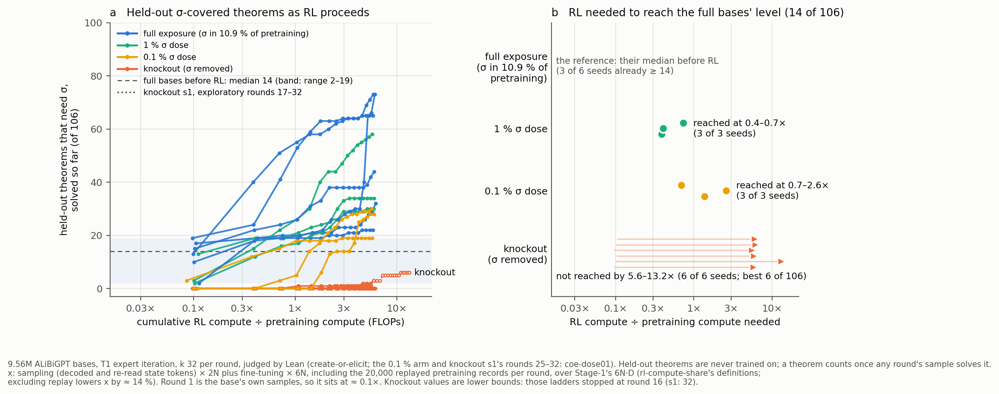

# coe-dose01: with σ in 0.1 % of pretraining, expert iteration brings the σ-covered held-out capability to the full bases' median before RL (14 of 106 strict members) on 3 / 3 seeds, at 0.69–2.58× pretraining FLOPs, median 1.37× (1 % dose: 0.39–0.73×; knockout: not by 5.6–6.1×, s1 not by 13.2×); the pre-registered reading is "graded"

Status: completed 2026-11-01 and reviewed 2026-11-01. **No hard-constraint violation, nothing quarantined.** Working
with their own code on the raw files (round, alloc, mix and found files, the Lean gate dumps, read rows, registry rows,
pod logs) and before reading the executor's write-ups, the reviewer:
- recounted y from the round and found files on every ladder except full s0–s2 (whose round-1 values they took from
  create-or-elicit's files), and recomputed with their own implementation of rl-compute-share's `review_rcs/ourruns.py`
  definitions the FLOP ratios of the 0.1 % and 1 % ladders, knockout s1 (r1–32) and full s5. The other ladders' x
  values are the published extraction's; in phase 2 the review found the executor's re-run identical to them;
- re-derived the 106 strict σ-covered held-out members from the definition (own G4ip prover and truth tables);
- re-checked in Lean every counted literal text in this run's dumps: 14,690 / 14,690 for the 0.1 % arm and 713 / 713
  for knockout s1's rounds 25–32, after negative controls;
- checked the `args.json` diff, split disjointness by renaming class, the compute rows, the statistics, the spend and
  textbook72 leaks.

The review notes an exposure caveat: before phase 1 the reviewer's context already held the run's headline (a memory
note, the commit subjects, a STATUS line). Every number was nevertheless re-derived from raw files, and none was
copied.

- **What stands (the review's verdict): every headline number.** The 0.1 % σ arm (9.56 M ALiBiGPT `lean_staten`, from
  scratch on K12^0.1%) crosses 14 / 106 strict σ-covered held-out members on 3 / 3 seeds, at r3 / r5 / r8 (s2 / s0 / s1)
  = 0.69 / 1.37 / 2.58× RL ÷ pretraining FLOPs. It ends round 16 at 30 / 28 / 19 (s0 / s1 / s2), with
  contraposition_conv acquired on 3 / 3 (plain reads). Its bases wrote 1 / 0 / 2 free positive reductios and solved 0 / 0 / 3 members. Knockout s1 reaches 6 / 106
  by 13.23×. The tests hold (crossing vs knockout p = 0.0033; r16 y p = 0.012), as do the pre-registered reading
  "graded", the compute record (at the ladder level), the spend ($39.35) and the args diff. Gate 0 holds, and the
  misses are reported.
- **Must be reworded (no number changes):**
  1. "full: none" and "Full models start at the bar" hold for the full bases' median by construction. Per seed, 3 of
     6 start below the bar and cross at r2, at 0.39–0.43×, which overlaps the 1 % arm's 0.39–0.73×.
  2. "EI amplified it" / "RL found the trace and amplified it": free reductios rose from 1 / 0 / 2 to 697 / 1,116 /
     464 per round, but the same mix replays ≈ 20 σ records per round. Without a replay-only control the rise cannot
     be attributed to RL alone. (The knockout ladders, which replay no σ, also grew free reductios, so RL alone can
     grow them.) s1's base wrote none.
  3. The figure README's full s5 caveat ("compute rows about 30 % below its siblings'"): the registry rows are fine.
     The ladder's round files were never tracked locally, so the extraction had no state re-prefill for full s5 and
     drew its curve too far left. Fixed in the nd-rl copy (below).
  4. Minor: "Other rows: create-or-elicit's ladders" should also name trajectory / rl-continue, whose ladders are
     full s0–s2; and the knockout bound is > 5.6–6.1× for five seeds and > 13.2× for s1.
- **Caveats the write-ups should add:** one σ draw per dose (all three 0.1 % seeds share the same 155 σ records; the two
  doses share 17 of them), and cut-offs in the samples y comes from (below).
- **Not supported:** no headline claim falls here. The labelled interpretation "needed more compute the rarer the trace
  was" rests on two crossing doses, one σ draw each, and 3 seeds per dose (crossing-x Mann–Whitney p = 0.10). It stays
  labelled.

Review: [`review_coe-dose01.md`](https://github.com/dan-pandori/nd-takehome/blob/4c932eec/review_coe-dose01.md)
(fork `dan-pandori/nd-takehome`, branch `dan_coe-dose01`; §Recount `323c654f`, §Compare and §Verdict `4c932eec`; kit
`review_cd01/`). Run files at DONE [`ec488738`](https://github.com/dan-pandori/nd-takehome/commit/ec488738):
`run_coe_dose01.md`, `numbers.md` § coe-dose01, `log.md` § coe-dose01, `summary_coe_dose01.md`,
`artifacts/coe-dose01/{summary,compute}.md`, pre-registration `preregistration/coe-dose01.md` (commit `feff6b1c`).
Brief: [`BRIEF_coe-dose01.md`](../../docs/proposals/state-env/BRIEF_coe-dose01.md);
[proposal 33](../../docs/proposals/2026-10-31-coe-dose01.md).

**The figure** for the midterm write-up, with this run's rows, the review's corrections and the full s5 fix:
[`docs/writeups/2026-10-31-rl-needed-to-reproduce-sigma/`](../../docs/writeups/2026-10-31-rl-needed-to-reproduce-sigma/README.md).
**Plain-language summary** with the review's corrections marked: [`plain_summary.md`](plain_summary.md).

Question (Dan, 2026-10-31): for the midterm write-up, how much RL does it take to reproduce a capability? The
capability is solving the 106 strict σ-covered held-out members of create-or-elicit's classical families (σ: the
classical reductio, Lean's `Classical.byContradiction`; no ladder trains on these theorems). The bar is the
full-exposure bases' median before any RL update, 14 of 106. With a 1 % σ dose, RL reaches the bar at 0.39–0.73×
pretraining compute; with σ removed it does not by 5.6–9.5× (before this run). Two dose levels and a lower bound cannot
tell a threshold from a graded response, and a 0.1 % arm can.

## Configuration

- **Models (0.1 % arm, new):** `ckpts/coe/stage1_dose01_s{0,1,2}.pt` and ladders `la_dose01_s{0,1,2}`.
  `best_model.ALiBiGPT` 6 × 384, **9,560,832 parameters** (+1,875,584 MTP head in Stage 1, not saved), `lean_staten`
  (proof-state format), from scratch on **K12^0.1%** (`data/coe/train_k12dose01.jsonl`, md5 `5fed3787…`). Best recipe
  (`state_train.py --recipe best --mode lean_staten --cap 12 --budget_secs 1200`), 1,201 s on one NVIDIA A40: 23,918 /
  24,010 / 24,231 steps, 3.64–3.69 epochs of pairs, D = 439.5 / 441.2 / 445.3 M training tokens. The Stage-1 config is
  the 1 % arm's except `data` / `out`.
- **K12^0.1%** (the review's own σ predicate: DN citing, after reiteration, a NEGI line): 155,000 records, **155 σ
  (0.100 %)**. It is K12⁻ (σ removed, 0 σ) with 155 refill records replaced by 155 σ records. K12^1% has 1,550, and
  **only 17 of the 155 are among them**: the two doses are independent draws, not nested.
- **Ladders:** T1 expert iteration for 16 rounds with the 1 % arm's settings: the 4,495 targets at k 32, T 0.8, batch
  1,024; 600 fine-tune steps per round (128 records per step); the mix holds accepted proofs plus **20,000 replay records
  per round from the arm's own pretraining set** (≈ 20 σ records per round at 0.1 %: 21.3 / 20.4 / 19.2 on average for
  s0 / s1 / s2, 11–31 in single rounds); Lean alone. Each round also samples the 832 tracked transfer theorems (which
  hold the 106) at k 32, with greedy reads on them and on heldout1000. Each 0.1 % ladder's `args.json` differs from the same seed's 1 % ladder
  only in `init`, `name` and `train`. The ladder seed equals the Stage-1 seed.
- **Priority 2: knockout s1, rounds 25–32.** `stage1_ko_s1.pt` (same architecture, K12⁻), resumed from
  create-or-elicit's `la_ko_s1_r24.pt` (md5 `1520ed6c`) with Addendum 6's procedure: `state_ladder_ei.py --resume
  --start_round 25 --rounds 8`, differing from the r21–24 launch only in `start_round` / `rounds`. It started only
  after every seed had finished 2 rounds, as the pre-registered budget rule requires.
- **Inherited arms** (same architecture, format and checker): create-or-elicit's 1 % dose s0–s2 (K12^1%), knockout
  s0–s5 (K12⁻) and full s3–s5 (K12), which the review recounted from create-or-elicit's own found_transfer files; and
  full s0–s2, trajectory (r1–8) + rl-continue (r9–16)'s `la_T1_best12_s0–2` (create-or-elicit's `old_full`), whose
  round-1 values the review took from create-or-elicit's `old_full_s*.json` without recounting.
- **Measures.** y = strict members first solved by round r's k 32 transfer sample, cumulative. x = cumulative RL
  compute after round r's sampling ÷ Stage-1 compute (2N per decoded and per re-prefilled state token, 6N per
  fine-tune token including replay, Stage 1 6N·D; evals excluded). Crossing = the first round with y ≥ 14.
- **Reads** (k 256, T 0.8, batch 512, max_action 512, max_steps 96, `read1054`): base plain (x0) and guided (g0, ≤ 10
  rejections per attempt), and r16 plain. **No r16 guided read**, a stated deviation from the policy's guided
  default: after a slowdown the pre-registered condition (priorities 1 + 2 projected ≤ $39) failed. The 1 % arm has no
  r16 guided read either. The read settings were kept although cut-offs exceed the policy's 0.1 %, to stay comparable
  with the inherited arms.
- **Judge:** Lean alone (post-2026-09-27). `nd_verify` is unmodified and not used to judge anything.
- **Gate 0:** the pre-registration was committed at 20:25:51 UTC 10-31 and the first pod created at 20:26:32. The
  budget ($45 / 90 h) was registered at 20:13:07.
- **Pods and cost:** 4 × NVIDIA A40 SECURE at $0.59/h. cd01-s0 17.16 h, cd01-s1 18.50 h, cd01-s2 19.40 h (one per
  0.1 % seed), cd01-k1 11.65 h (knockout s1): **66.70 pod-hours, $39.35** of $45 at the GPU rate; ≈ $39.54 projected with disk at
  RunPod's billed $0.5928/h, of which $34.20 was billed by 17:30 UTC 11-01 (librarian, from RunPod billing; see
  [spend](../../docs/infra/spend.md)). A slowdown on all four pods (≈ 05:30–08:30 UTC 11-01, cause not
  identified) cost ≈ 8.06 pod-hours (≈ $4.75).
- **Bucket** (public): `hf://buckets/dan-pandori/nd-rl/coe-dose01/` (515 objects, 22.72 GB): Stage-1 and ladder
  checkpoints (`ckpts/coe/stage1_dose01_s*.pt`, `ckpts/coe/ladder/la_dose01_s*_r{1..16}.pt`, `la_ko_s1_r{25..32}.pt`),
  ladder round / alloc / found files, rounds JSONs, read rows, Lean gate dumps, logs, registry copy, `rl_needed/`.
  Registry rows also at `hf://buckets/dan-pandori/nd-rl/registry/coe-dose01/`.

## Observations (the review's numbers)

### RL needed to reach 14 of 106

| pretraining (9.56 M `lean_staten`, from scratch) | RL ÷ pretraining FLOPs at the first round with y ≥ 14 | seeds |
|---|---|---|
| full exposure, K12 (σ in 10.9 %) | none for the median (the bar's definition); 3 of 6 start below it and cross at r2, 0.39–0.43× | 6 |
| 1 % σ dose, K12^1% | 0.39 / 0.41 / 0.73× (r2 / r2 / r3) | 3 of 3 |
| **0.1 % σ dose, K12^0.1%** | **1.37 / 2.58 / 0.69× (s0 r5 / s1 r8 / s2 r3); median 1.37×** | **3 of 3** |
| knockout, K12⁻ | not reached by 5.58–6.13× (five seeds, 16 rounds), nor by 13.23× (s1, 32 rounds; y 6) | 0 of 6 |

The bar reproduces: the six full bases' round-1 y are 13 / 10 / 17 (full s3–s5, recounted) and 15 / 2 / 19 (old full
s0–s2, from create-or-elicit's files, not recounted), median 14.

y and x by round, 0.1 % arm (bold: the first round with y ≥ 14):

| round | s0 y / x | s1 y / x | s2 y / x |
|---|---|---|---|
| r1 | 0 / 0.11× | 0 / 0.10× | 3 / 0.09× |
| r2 | 0 / 0.40× | 0 / 0.40× | 12 / 0.37× |
| r3 | 3 / 0.70× | 0 / 0.72× | **15 / 0.69×** |
| r4 | 5 / 1.03× | 0 / 1.07× | 18 / 1.03× |
| r5 | **14 / 1.37×** | 0 / 1.42× | 18 / 1.38× |
| r6 | 17 / 1.73× | 6 / 1.80× | 18 / 1.75× |
| r7 | 21 / 2.09× | 13 / 2.18× | 18 / 2.12× |
| r8 | 23 / 2.47× | **14 / 2.58×** | 18 / 2.50× |
| r12 | 28 / 4.03× | 25 / 4.22× | 19 / 4.08× |
| r16 | 30 / 5.67× | 28 / 5.94× | 19 / 5.71× |
| after r16, incl. the last fine-tune | x 5.91× | x 6.20× | x 5.95× |

Knockout s1, rounds 24–32: y 5, 5, 5, 6, 6, 6, 6, 6, 6; x after each round's sampling 9.52× (r24) to 13.23× (r32),
13.51× including the last fine-tune. At r32 its members are contraposition_conv 5 and generated 1.

**Statistics** (seeds as units): the crossing indicator by r16 is 3 / 3 for the 0.1 % arm against 0 / 6 for the
knockout, one-sided Boschloo **p = 0.0033** (against the 1 % arm's 3 / 3, p = 1). r16 y, exact one-sided Mann–Whitney:
0.1 % > knockout p = 0.012 (the smallest attainable), 1 % > 0.1 % p = 0.10. IQM (the mean at n = 3) of r16 y with a
bootstrap 95 % interval: **0.1 % 25.7 [19.0, 30.0]**, 1 % 40.7 [30.0, 58.0], knockout 0.25 [0, 1.75] (n 6), full s3–s5
39.7 [22, 65]. The 0.1 %-vs-1 % gap (15) is inside the pre-registered minimum detectable difference (≈ 46). s2's
crossing (0.69×) lies inside the 1 % arm's range; the crossing-x Mann–Whitney 0.1 % > 1 % is p = 0.10.

**Pre-registered reading: "graded"** (≥ 2 / 3 seeds cross by r16, and the crossing seeds' median x, 1.37×, is above
0.73×, later than every 1 % seed). The reviewer evaluated the rule mechanically. The pre-registration gave this reading
P = 0.5 and the threshold reading ("0.1 % behaves like the knockout") 0.15.

### Round 1: the bases (0.1 % arm)

- Free positive reductio proofs (the first DN line citing a derived line has a positive conclusion G, and neither
  `~ ~ G` nor `~G > F` occurs in the sequent), distinct proofs first found in round 1: **1 / 0 / 2** (s0 / s1 / s2).
  The 1 % arm's bases wrote 170–219 and the knockout's 0 (create-or-elicit's counts, quoted by the run; the review's
  own reductio recount covers this run's ladders only).
- Strict members solved in round 1: 0 / 0 / 3 (the 1 % arm's 3 / 13 / 2).
- Base reads (k 256): plain 0 / 0 / 6 of 106 (s2: contraposition_conv 6 / 18); guided 0 / 0 / 9 (s2:
  contraposition_conv 9 / 18 = 50 %, at the acquisition bar). No family is acquired in any base plain read.
- p2 held-out greedy (5,000, Stage-1 bases): 0.893 / 0.865 / 0.835. That is in or below the knockout bases' range
  (0.867–0.895), not near the 1 % arm's (0.917–0.945) or full s3–s5's (0.958–0.968). The 0.1 % mean (0.865) is below the
  knockout mean (0.883) at comparable Stage-1 steps, which the run does not explain.

### During RL (0.1 % arm)

- Free positive reductio proofs first found per round, r1 → r16: s0 1 → 697, s1 0 → 1,116, s2 2 → 464. The same mixes
  replay ≈ 20 σ records per round (above), so the rise cannot be attributed to RL alone without a replay-only control
  (review, item 2). The knockout ladders, which replay none, also grew them: knockout s1 from 11 to 123 per round
  over rounds 16–24 (create-or-elicit), then 113–154 per round over rounds 25–32 (143 at r32), a plateau.
- σ-covered trained targets solved, r1 → r16: 0 → 42, 0 → 41, 2 → 29. Knockout s1 stays at 9 over rounds 24–32, with
  contraposition_conv's training share flat at 0.33.

### Round-16 plain reads (k 256)

| read (9.56 M `lean_staten`) | strict solved / 106 | by family (cc / dno / em / nc / pe / pes / gen) | acquired (≥ 50 %) | strict-stratum cut-off |
|---|---|---|---|---|
| 0.1 % s0 r16 | 31 | 18 / 0 / 0 / 10 / 0 / 2 / 1 | contraposition_conv, negated_conditional, generated | 1.56 % |
| 0.1 % s1 r16 | 28 | 18 / 0 / 0 / 9 / 0 / 0 / 1 | contraposition_conv, negated_conditional, generated | 3.15 % |
| 0.1 % s2 r16 | 19 | 18 / 0 / 0 / 0 / 0 / 0 / 1 | contraposition_conv, generated | 8.46 % |
| knockout s1 r32 | 5 | 4 / 0 / 0 / 0 / 0 / 0 / 1 | generated | 3.78 % |

Families (members): contraposition_conv 18, demorgan_nand_to_or 4, excluded_middle 37, negated_conditional 15, peirce
12, peirce_sequent 19, generated 1. Plain against plain, contraposition_conv is acquired during RL on 3 / 3 seeds and
negated_conditional on s0 and s1. (s2's base *guided* read already had contraposition_conv at 50 %.) `generated` has a
single member.

### Lean, proof length, splits and leaks

- **Lean re-check of the literal texts.** The reviewer's harness runs one theorem per line, `#print axioms` per theorem,
  and accepts axioms ⊆ {propext, Classical.choice, Quot.sound}. Controls first: untouched counted texts pass 240 / 240;
  the same texts on another member's statement 0 / 199; `sorry` 0 / 20; prefilter-rejected texts 0 / 240.
  Or.inl↔Or.inr and .1↔.2 flips pass 12 / 288, and every passing flip traced is a no-op. **Result: 14,690 / 14,690**
  counted texts of the 0.1 % arm and **713 / 713** of knockout s1 r25–32 pass, and y recomputed from accepted texts
  equals y in every round. 0 of 2,837 sampled prefilter-rejected texts pass Lean. (The executor's own re-check, on
  re-rendered first-solving proofs: 77 / 77 for the 0.1 % arm and 6 / 6 for knockout s1, goal-negated copies rejected.)
- **Proof length** of 150 sampled counted texts per ladder: term size median 14 / 12 / 11 (knockout s1 17), pruned
  lines 13 / 13 / 12 (15); Spearman ρ between them 0.78–0.93.
- **Splits** (renaming classes, premise-order invariant): the headline pool (transfer_track832, which holds the 106)
  shares no class with any training file or mix, and the RL targets share none with any evaluation pool. The
  pretraining sets share 21 classes with the
  Stage-1 held-out 5,000 (4 with heldout1000) and 1 with textbook72, all premise-order twins with 0 literal prompts,
  inherited from K12 (≤ 0.42 pp on the p2 greedy rate).
- **textbook72:** the reviewer's strict scan (with a positive control: 215 / 216 rendered statements caught) finds 0
  textbook72 sequents in the 156 non-binary files the run committed. The read rows in the bucket hold textbook72
  prompts by design (scoring), as create-or-elicit's do.

### Compute (registry rows, A40; per ladder, the rounds of this run)

| ladder | attempts | generated tokens (sample + eval) | fine-tune steps / tokens | Lean checks | GPU-s total |
|---|---|---|---|---|---|
| 0.1 % s0 (16 rounds) | 2.30 M | 535 M + 115 M | 9,600 / 1.55 B | 2.15 M | 54,970 |
| 0.1 % s1 (16 rounds) | 2.30 M | 553 M + 119 M | 9,600 / 1.63 B | 2.18 M | 59,050 |
| 0.1 % s2 (16 rounds) | 2.30 M | 542 M + 122 M | 9,600 / 1.56 B | 2.17 M | 62,200 |
| knockout s1 (rounds 25–32) | 1.15 M | 323 M + 72 M | 4,800 / 0.96 B | 1.22 M | 36,570 |
| 1 % arm, per ladder (16 rounds) | 2.30 M | 553–564 M + 113–119 M | 9,600 / 1.63–1.67 B | 2.16–2.21 M | 53,560–58,780 |

Each 0.1 % ladder's totals (GPU-seconds, generated and prefill tokens, attempts, fine-tune steps and tokens, Lean
checks) are within 0.94–1.10× of the 1 % arm's mean, so no 1.25× flag at the ladder level (the policy's unit). By phase, s2's eval GPU-seconds are 1.33× the 1 % mean (s1 1.22×): the slowdown, not extra work,
since its eval tokens are 1.06×. The arms are matched on protocol (attempts, steps, records per round). Reads: base
plain 3,394–4,740 GPU-s, base guided 10,194–14,310, r16 plain 4,461–6,099, knockout r32 plain 4,732; Stage 1
1,283–1,286 GPU-s each.

## Expectations against outcomes (the review's scoring)

| pre-registered (`feff6b1c`, before the first pod) | outcome | |
|---|---|---|
| y at r1: 0–3 per seed | 0 / 0 / 3 | hit |
| free positive reductio proofs in round 1: 3–100; ≥ 1 on ≥ 2 / 3 seeds | 1 / 0 / 2 | **interval missed on 3 / 3**; ≥ 1 on 2 / 3 holds |
| y at r16: point 18, 80 % interval 3–45 | 30 / 28 / 19 | hit |
| first round y ≥ 14: point r6 (≈ 1.8×), interval r3 … not reached | r5 1.37×, r8 2.58×, r3 0.69× | within |
| arm: 2 / 3 reach by r16 (P(3 / 3) ≈ 0.3); crossing median x 1.0–3.0× | 3 / 3; 1.37× | point missed (an outcome given P 0.3); median hit |
| r16 plain read: point 22 (3–50); ≥ 1 family acquired on 2 / 3, contraposition_conv likeliest | 31 / 28 / 19; contraposition_conv on 3 / 3 | hit |
| base plain read: 0 families on ≥ 2 / 3 | 0 / 0 / 0 | hit (guided base: s2 contraposition_conv at 50 %) |
| p2 held-out greedy 0.91–0.95 | 0.893 / 0.865 / 0.835 | **missed on 3 / 3** (by 0.017–0.075) |
| x at r16 5.6–6.1× (with the last fine-tune 5.9–6.4×) | 5.67 / 5.94 / 5.71× (5.91 / 6.20 / 5.95×) | hit |
| compute: every per-ladder quantity 0.95–1.05× the 1 % mean | 0.94–1.06× for tokens / attempts / steps; 0.98–1.10× for GPU-s | **partly missed**; no 1.25× flag at the ladder level (by phase, s2's eval GPU-s is 1.33×, the slowdown) |
| reading rule | graded | hit (P 0.5) |
| knockout s1 r32: y point 7 (5–12); P(y ≥ 14) 0.1 | 6; not reached | hit |
| knockout s1 r32 plain read: point 7 (5–14) | 5 | hit (lower edge) |
| knockout s1 x at r32 ≈ 13× | 13.23× (13.51×) | hit |
| knockout s1 free positive reductios per round at r32: 150–500 | 143 | **missed** (just below) |

The run reports the same four misses (round-1 reductios, held-out greedy, compute match, knockout r32 reductios) and the
arm-level point estimate.

## The review's corrections to the executor's files

The executor's files on the fork are unchanged. The corrections are applied, marked *[review]*, in the nd-rl copies:
the figure README ([`docs/writeups/…`](../../docs/writeups/2026-10-31-rl-needed-to-reproduce-sigma/README.md)) and
[`plain_summary.md`](plain_summary.md).
- `run_coe_dose01.md`: the table's "full: none" row (item 1); "EI amplified it to 464–1,116 per round by r16" (item 2;
  the numbers reproduce, the causal word does not); "Other rows: create-or-elicit's ladders" also covers trajectory /
  rl-continue's full s0–s2 (item 4). No number changes.
- `summary_coe_dose01.md`: "Full models start at the bar" (item 1); "RL found the trace and amplified it, on every seed"
  (item 2). Both are corrected in `plain_summary.md`, which also gains the two caveats.
- `rl_needed/README.md`: the full s5 caveat (item 3) and the knockout bound (item 4); both corrected in the nd-rl
  README.
- `numbers.md`: the full arm is called "create-or-elicit … full s0–s5", in the same loose sense as item 4. Its Lean
  re-check medians (term size 11.5 / 13 / 7, ND lines 12 / 14.5 / 8) are of the first-solving proofs, a different
  population from the review's 150 sampled counted texts. The review calls this a different population, not a
  discrepancy.

**The full s5 fix** (review item 3 and next measurement 5) was applied by the librarian in the nd-rl figure folder.
`la_full_s5/round_*.json` was never tracked on the fork, so the extraction had no state re-prefill for that ladder and
put it at r16 4.01×. The review computed 6.17× from the bucket's round files. The librarian copied those 16 files from
the create-or-elicit bucket folder (sha256-equal to the create-or-elicit reviewer's copies) and re-ran the extraction
and the figure. The unchanged scripts first reproduced the executor's `rl_curve.json` and PNG byte for byte. With the
fix, the other 17 ladders are byte-identical, and full s5 reads r1 0.106×, r16 6.17× (6.44× with the last fine-tune),
equal in all 16 rounds to the reviewer's own FLOP code. Only full s5's line moves, and no table number changes. The
copies live on agent2 in `~/rl_needed_inputs/` (`COE_BUCKET` in the script), and the script now stops if any
ladder's round file is missing instead of silently dropping its state re-prefill; with the files present its output
is byte-identical.

## Interpretation (labelled; not tested here)

- The executor reads the result as fitting the elicitation picture: RL amplified a behaviour the base showed only at a
  trace level, and needed more compute the rarer the trace was. The review keeps this labelled: it rests on two
  crossing doses with one σ draw each and three seeds per dose (crossing-x p = 0.10). Review item 2's replay confound
  applies to "amplified".
- The figure README's reading of the knockout row: between the 0.1 % dose and none, the requirement rises from ≈ 1.4×
  (the median crossing) to more than 5.6–6.1× (five knockout seeds) and more than 13.2× (s1). Knockout s1's free
  reductios levelled off over rounds 25–32 while its y moved 5 → 6, so more RL of this kind looks unlikely to get there
  soon. Where between 0.1 % and none the requirement rises (0.01 %) is untested.

## Limitations

- **n = 3 per dose and one σ draw per dose.** All three 0.1 % seeds train on the same 155 σ records, which overlap the
  1 % arm's draw in 17. The 0.1 %-vs-1 % contrast confounds dose with draw, and every 0.1 %-vs-1 % difference is
  descriptive (crossing p = 1, r16 y p = 0.10, crossing x p = 0.10). Only the contrast with the knockout is resolved,
  with 3 + 6 seeds.
- **Replay.** Each round replays 20,000 pretraining records, ≈ 20 of them σ at 0.1 % (≈ 200 at 1 %, 0 in the knockout).
  Part of the recovery may be replayed exposure rather than RL on the model's own proofs, and no replay-only control
  ran.
- **Cut-offs.** The ladders' own k 32 transfer samples (max_action 256, max_steps 48), which y comes from, cut off up
  to 1.7 / 3.1 / 2.8 % (s0 / s1 / s2) of all transfer attempts per round in late rounds. These are lower bounds from
  the round files, and per-stratum shares are not derivable. In the r16 reads the strict stratum is cut off at 1.56 /
  3.15 / 8.46 %, and excluded_middle (37 of the 106) at 3.6 / 6.0 / 20.7 %; knockout s1 r32 at 3.78 %. A truncated
  attempt counts as a failure, so y can only be biased down on long-proof families. The 1 % arm ran the same protocol,
  so the arms stay comparable.
- **No r16 guided read**, against the policy's guided default (budget; the base guided reads exist). Not run, as
  pre-registered: base x1 and r8 reads, the timing read, standard A, along-the-ladder scoring.
- **One organism:** 9.56 M ALiBiGPT bases, T1 expert iteration, one family set. The bar is one choice: a bar of 5 of
  106 would let knockout s1 count, at 7.25× (round 19).
- The 0.1 % bases' mean p2 held-out greedy rate (0.865) is below the knockout bases' mean (0.883): s0 (0.893) is
  inside the knockout range, s1 and s2 below it. The run does not explain this.

## Next steps (the review's)

1. A second, independent 155-record σ draw at 0.1 % (3 seeds) separates dose from draw. With the measured spread, more
   seeds per dose are needed before calling the 0.1 %-vs-1 % crossing difference. (The pre-registration put a dose-arm
   seed at ≈ $10.)
2. A replay-only control at 0.1 %, the same mixes without the RL records, tests whether the recovery needs RL on the
   model's own proofs or comes from the ≈ 20 replayed σ records per round.
3. The 0.01 % dose would show where between 0.1 % and none the requirement rises.
4. Re-run the r16 reads (or excluded_middle alone) at max_action 1,024 / max_steps 192 to bound the cut-off bias.
5. Fix the full s5 curve: done in the nd-rl figure folder (above).

## Figure

Panel a: held-out strict members solved so far against cumulative RL ÷ pretraining FLOPs, per ladder. Panel b: the
compute at which each seed first reaches 14 of 106; arrows are knockout seeds that never did, ending at their last
round. Figure and data: the nd-rl figure folder, with full s5's curve fixed by the librarian (above).
