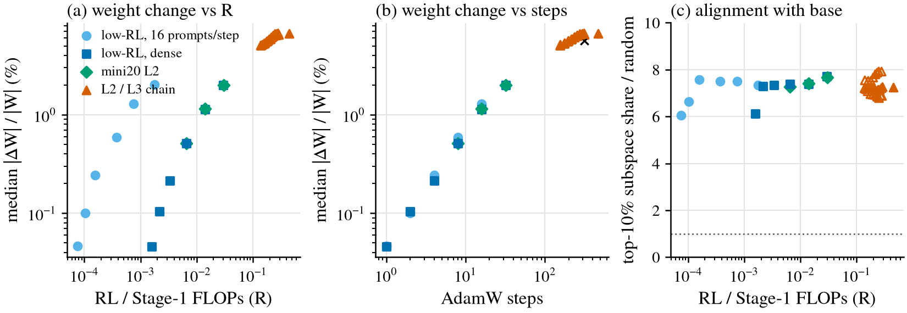
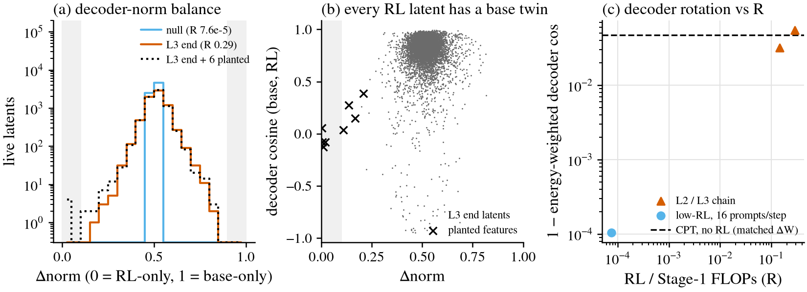
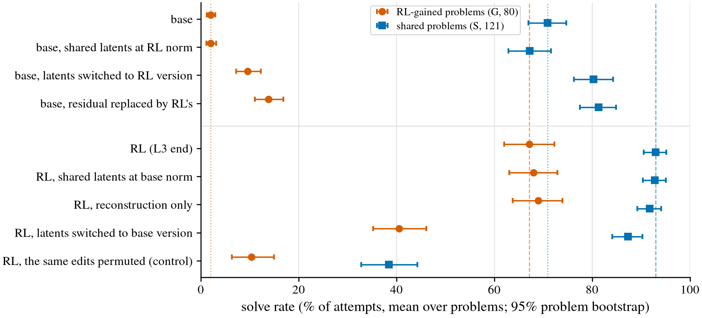
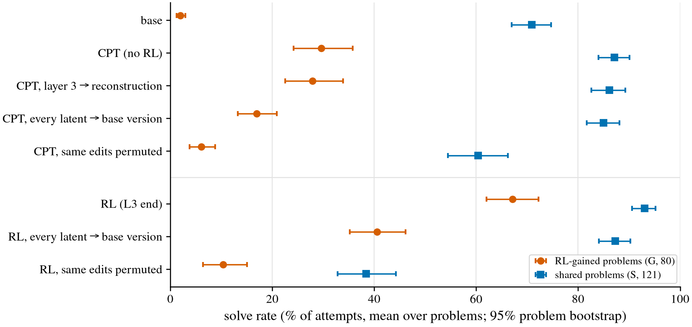
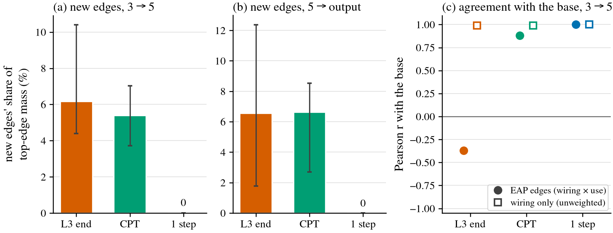
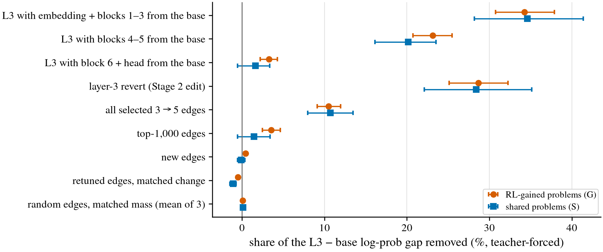

# Circuit diffing: does GRPO create features the Stage-1 base lacks?

Status (2026-11-04, written by agent:claude for Leon):
- Stages 0–2 were done on 2026-11-01 for the seed-0 primary pair: base `S1g3_s0` against the L3
  end.
- **Stage 3 was done on 2026-11-04** on ynez GPU 2. It has two parts:
  - **Part A:** a drift control for the layer-3 revert, with a full-size base-vs-CPT crosscoder
    and CPT's own solve rates.
  - **Part B, reduced:** edge attribution for layer 3 → 5 and layer 5 → output, on the L3 end
    against a drift null (CPT) and a 1-step null, with path patching in the L3 end.
- Not run: the layer 1 → 3 hop, the L2 end, and the seeds 1–2 replicates (queue H).
- **Follow-up, done 2026-11-04:** CPT gains a lot on its own, so a CPT control was run on the
  paper's Charles149 reads, in
  [`cpt_control_20261105`](../../code/experiments/current/cpt_control_20261105/README.md). CPT
  reaches RL at pass@1024; RL leads at pass@1.

Working folder: [`code/experiments/current/circuit_diffing_20261101/`](../../code/experiments/current/circuit_diffing_20261101/)
(branch `leon/circuit-diffing`). Pre-registration, with the sha256 of each version in the log:
[`PREREG.md`](../../code/experiments/current/circuit_diffing_20261101/PREREG.md). Running
record: [`log.md`](../../code/experiments/current/circuit_diffing_20261101/log.md).

## Question

Leon (2026-11-01) asked for a mechanistic version of the paper's claim that RL creates
capability rather than eliciting it. The test: does post-training create circuits the
pretrained base lacks? Elicitation predicts no new circuits, only upweighted ones.

Stage 3 (Leon, 2026-11-04: "how is that not new circuits?"): no new *features* were found, but
does RL's gain use new feature-to-feature *wiring* absent from the base, beyond what weight drift
produces? Or does it retune wiring the base already has?

The models are the ~10M-parameter thinking prover (6 Peri-LN blocks, d = 384) and its GRPO
continuation. RL ends at about 0.29× Stage-1 FLOPs. On Charles149 the L3 end beats its base by
+10.7 points at pass@1024.

## Bottom line

**Answer to "new circuits or retuned wiring?" (seed 0).** Not new circuits.
- RL adds no features the base lacks (Stages 1–2).
- It adds no feature-to-feature wiring beyond what training without RL also produces (Stage 3).
- The wiring from layer 3 to layer 5 between existing features is nearly unchanged: r 0.99
  with the base.
- The edges that look new carry no more of the gain than random edges.

What RL does change is spread thinly over things the base already has:
- **Rotations of existing features.** Continued pretraining ("CPT") rotates them as much, and they
  hold the same share of either model's gain.
- **Many small changes to existing edges.**
- **How existing features are used for RL's chosen actions.**

The pre-registered rule for Part B returns **"mixed / inconclusive"**:
- "New wiring" fails clearly.
- "Retuned wiring" also misses its bar. The 1,000 strongest edges carry only 3.5% of the
  teacher-forced gap, against a 10% threshold. All 138k scored edges together carry 10.5%.

**A second finding that matters for the paper.** Continued pretraining of the base on its own
data ("CPT"), with no RL, at RL's AdamW steps and trained tokens:
- succeeds in 29.6% of attempts on the RL-gained problems, against the base's 2.0% and RL's 67.1%;
- on the paper's full Charles149 read (seeds 0–2, k1024), reaches RL at large k (RL − CPT
  −2.0 [−6.5, +2.2] points at pass@1024), but not at small k (+16.4 [+11.2, +21.6] at pass@1).
  See [`cpt_control_20261105`](../../code/experiments/current/cpt_control_20261105/README.md).

**Observed, Stages 0–2** (2026-11-01).
1. **No RL-only features.** BatchTopK crosscoders (8,192 latents, k 32) find 0 RL-only and 0
   base-only latents at layers 1, 3 and 5.
   - A planted control recovers 4 of 6 synthetic RL-only features, with no false positives.
   - A new feature carrying ≥ ~0.01% of RL variance in one latent would have been found.
2. **Rotation, not magnitude.**
   - Shared latents' decoders rotate: energy-weighted cosine 0.945 at the L3 end, against 1.000
     for the 1-step null.
   - Latents whose norm changes more than 2× carry 0.03% of variance.
3. **The rotations matter causally at layer 3.**
   - Rescaling latents to the other model's norms does nothing in either direction.
   - Reverting every latent to its base version inside RL removes 41% [34, 47] of the G gap.
   - The base with RL's whole layer-3 residual recovers only 18% [14, 23].
4. **Weight diffing cannot tell RL from drift.** CPT's ΔW has the same rank and subspace
   alignment as RL's.

**Observed, Stage 3** (2026-11-04). Solve rates are % of attempts with 95% paired problem
bootstrap intervals.

5. **CPT is not base-like.** Solve rates on G and S:

   | model | G | S |
   |---|---|---|
   | base | 2.0% | 70.9% |
   | CPT, no RL | **29.6% [24.1, 35.7]** | 87.1% |
   | RL | 67.1% | 93.0% |

   - CPT matches RL's trained tokens (0.98×) and AdamW steps (312). It has 0.64× RL's full R,
     which counts sampling.
   - No G or S problem shares a renaming class with any Stage-1 record.
   - At full size, CPT's crosscoder rotates shared latents as much as RL's: energy-weighted
     cosine 0.948 against 0.945, with the same 5% tail (0.51).
6. **Part A: the revert removes the same share of either model's own gain.**
   - Reverting CPT's latents costs it little on S: relative drop 2.5% [−0.1, 5.1]. This is the
     pre-registered "benign" reading: the revert is not generic damage.
   - It removes **46.0% [36.0, 55.1] of CPT's own G gain**, against **40.9% [34.4, 47.4] for
     RL**. The difference is +5.1 [−6.0, +15.7] points (exploratory).
7. **Part B: no new wiring beyond drift.** Results for the layer 3 → 5 EAP edges.
   - **New-edge mass:**

     | model | share of the top-1,000 edge mass in new edges |
     |---|---|
     | L3 end | 6.2% [4.4, 10.4] |
     | CPT | 5.4% [3.7, 7.0] |
     | 1-step null | 0.0% |

     L3 − CPT is +0.8 [−1.3, +5.6] points.
   - **Unweighted wiring** (how much latent i drives latent j) agrees with the base at r 0.99
     for both RL and CPT, with 98% sign agreement.
   - **Patching in the L3 end** (share of the teacher-forced log-prob gap on G removed):

     | patched | share removed |
     |---|---|
     | new edges | 0.4% [0.2, 0.6] |
     | random edges of matched mass | 0.1% |
     | top-1,000 edges | 3.5% [2.4, 4.6] |
     | all 138k scored edges | 10.5% [9.1, 11.9] |
     | base's whole blocks 4–5 | 23.1% [20.7, 25.5] |

8. **What is RL-specific: the same features, pushed towards different actions.**
   - On L3's own proof tokens, RL's EAP edges *disagree* with the base: r −0.37, and 63.6% of
     the top-edge mass flips sign. Its node attributions are anti-correlated with the base's:
     r −0.58 at layer 3, −0.39 at layer 5.
   - CPT stays aligned with the base: r 0.88, 0.90 and 0.91.
   - The unweighted wiring is unchanged, and swapping in the base's block 6 and head removes only
     3.3% of the gap. (Interpretation: the flip comes from what upstream changes feed an
     unchanged readout.)

**Interpretation** (kept apart from the results above).
- **Neither pole fits.**
  - "Elicitation = upweighting" fits badly: magnitudes are inert, and directions matter.
  - "Capability = new circuits" finds no support. There are no new nodes, and no new edges beyond
    non-RL training. The edges that look new carry ~0% of the gain.
  - The gain is distributed: rotations of existing features, many small edge changes and
    upstream changes in blocks 1–3. Swapping the base's blocks 1–3 into RL removes 34%.
- **The revert share is not an RL signature.** Continued pretraining stores its own, smaller gain
  in feature rotations in the same way. RL's rotations differ in how much gain they carry, not in
  kind.
- **For the paper, the base-vs-RL comparison needs a CPT baseline.** Part of what the paper calls
  RL's gain on G is reached by more pretraining-style training at matched steps. One explanation
  is that the Stage-1 base is un-annealed (a cosine to a 30% floor). That is a hypothesis.
  capability-defs J7 (2026-10-05) argues against it: J7 annealed a similarly un-annealed base for
  much longer, and the result was lateral. The matched control on Charles149 is in
  `cpt_control_20261105`.

## Setup

**Models.** All checkpoints were read-only.
- Base: `S1g3_s{0,1,2}`.
- RL, seed 0: L2 end (`grpo_think_vs_s0_L2` it39, R 0.146) and L3 end
  (`grpo_think_vs_mb_kkl0_s0_L3` it39, R 0.289).
- Low-RL checkpoints `kp16_st{1..32}`, `kdense_st{1..32}` and `mini_it{2,4,8}`, copied from ynez.
- Seeds 1 and 2, L2 and L3 ends.
- R comes from `high_rl_passk_20261030/lowrl_compute.tsv`, or is recomputed with the same rule.

**Stage 0** (`stage0_weights.py`). Per 2-D matrix:
- relative ‖ΔW‖;
- effective rank;
- the share of ΔW energy in the base's top-10% singular subspaces, against the random
  expectation;
- update sparsity.

**Stage 1** (`rollouts.py`, `crosscoder.py`, `stage1_analyze.py`).
- **Data.** Paired activations of base and RL on identical token sequences, about 19M tokens
  from three sources:
  - each model's own rollouts on 1,200 L2 and L3 pool problems (4 attempts each, budgets
    0 / 64 / 256, temperature 1);
  - the base's rollouts on the same problems;
  - 60,000 Stage-1 pretraining pairs.

  Charles149, 13–20, 21–30 and textbook72 were not used.
- **Crosscoder.** One residual layer each. BatchTopK, selecting on f · (‖dᴬ‖ + ‖dᴮ‖), with
  AuxK; 8,192 latents; k 32; 40M training tokens; each model scaled to E‖a‖² = d.
- **Classes.** Minder et al.'s Δnorm (RL-only < 0.1), plus Latent Scaling, ν^ε and ν^r < 0.3.
- **Quality.** At layer 3, FVU is 0.008 for both models. Splicing the reconstruction keeps
  next-token loss at 100% recovered.
- **Planted control** (`--plant`). Six synthetic features, each a random function of token and
  position mod 29 or 331, are added to the RL model's activations only. They fire on 0.2–4.7% of
  tokens with magnitude 2–8; a typical activation norm is 19.6.

**Weight-drift control** (`cpt.py`). `S1g3_s0` trained further on its own pretraining pairs
with GRPO's optimizer: AdamW, 312 steps, about 260k tokens per step, lr 1.5e-4. Its median
relative weight change is 5.6%, against 6.5% for the L3 end. Stage 3 measured its solve rates;
it is not base-like (Bottom line, item 5).

**Stage 2** (`problems.py`, `patching.py`, `stage2.py`).
- **Problems.**
  - G is 80 problems the base practically never solves but RL does: base rate < 1% in 1,024
    attempts on Charles149 (20 problems), or 0 of 12 on 13–20 (60), with RL ≥ 10% or ≥ 8 of 16.
  - S is 121 problems both solve at ≥ 30% (Charles149: 72; 13–20: 49).
- **Sampling.** 32 attempts per problem at the read setting (plain arm, B64, temperature 0.8),
  all judged by Lean.
- **Patching.** The crosscoder runs inside `sample.think_generate` at every token. The other
  model runs alongside on the same tokens, to supply its half of the encoder input.

**Stage 3** (2026-11-04, ynez GPU 2; [`PREREG.md`](../../code/experiments/current/circuit_diffing_20261101/PREREG.md), Stage 3 section, hashed
before any job).
- **Part A** (`crosscoder.py`, `stage2.py`).
  - A full-size base-vs-CPT crosscoder at layer 3: the L3-end recipe, with CPT's own rollouts.
  - CPT's own solve rates.
  - `cpt_revert` (every live latent switched to its base version), `cpt_revertperm` and
    `cpt_recon`, at the Stage 2 setting.
- **Part B** (`traces.py`, `edges.py`, `stage3_analyze.py`).
  - **Sequences.** The L3 end's own Lean-accepted attempts: up to 2 per problem on the 80 G
    problems and on 80 of the S problems. That is 6,951 step sequences, 998k tokens, and the same
    tokens in every model.
  - **Nodes.** The latents of each pair's own crosscoders at layers 3 and 5. The joint code f
    is identical in both models. The top 256 latents per model by attribution are kept, about
    80% of the attribution.
  - **Edges, 3 → 5.** EAP: the forward-mode JVP of latent i's write through each model's own
    blocks 4–5, read by a common encoder at layer 5, times dM/df_j. M is the log-prob of the
    accepted action tokens. The "unweighted" edges drop the dM/df_j factor.
  - **New edge.** In the top 1,000 by |e^RL| and |e^base| < 0.2 |e^RL|.
  - **Pairs.** L3 end, CPT (the drift null) and `kp16_st1` (the 1-step null). Layer-5 crosscoders
    for CPT and `kp16_st1` were trained for this.
  - **Path patching.** Teacher-forced in the L3 end. The selected edges' contributions to
    layer-5 pre-activations are swapped for the base's, cross-fitted over 2 folds of G.
    Conditions: new edges; 3 matched-mass random sets; a matched-change "retuned" set; the top
    1,000; all 138k scored edges. References swap in the base's blocks 1–3, 4–5, or 6 + head.

## Results

### Stage 0: weight diffing



Medians over the 36 block matrices; numbers in
[`stage0.md`](../../code/experiments/current/circuit_diffing_20261101/stage0.md).

| model | R | relative ‖ΔW‖ | effective rank / full | energy share in base top-10% (random 1%) |
|---|---|---|---|---|
| `kp16_st1` (1 AdamW step) | 7.6e-5 | 0.047% | 0.65 | 4.8% (6.1×) |
| `kp16_st32` | 1.8e-3 | 2.0% | 0.44 | 6.4% (7.4×) |
| `kdense_st32` | 3.0e-2 | 2.0% | 0.44 | 6.4% (7.7×) |
| L2 end | 0.146 | 5.1% | 0.41 | 6.3% (7.2×) |
| L3 end, seeds 0 / 1 / 2 | 0.28–0.29 | 6.5 / 6.6 / 6.7% | 0.42 / 0.42 / 0.43 | 6.3 / 6.4 / 6.1% |
| CPT (no RL) | — | 5.6% | 0.42 | 6.7% (8.0×) |

- ΔW size follows AdamW steps, not R. One step gives 0.05% in both low-RL arms, although their
  R differs 21×; 32 steps give 2.0% in both, although their R differs 17×.
- ΔW geometry is fixed from the first step on: about 7× random alignment with the base's top
  singular subspaces, and an effective rank near 0.42.
- CPT, which trains only on the base's own data, has the same geometry.

### Stage 1: crosscoders



Numbers in [`stage1.md`](../../code/experiments/current/circuit_diffing_20261101/stage1.md).

| pair (seed 0) | layer | live latents | RL-only candidates (Δnorm < 0.1) | strict RL-only | base-only | Δnorm range | energy-weighted decoder cos |
|---|---|---|---|---|---|---|---|
| null `kp16_st1` | 3 | 7,083 | 0 | 0 | 0 | 0.48–0.52 | 1.000 |
| L2 end | 3 | 7,125 | 0 | 0 | 0 | 0.20–0.73 | 0.968 |
| L3 end | 3 | 7,093 | 0 | 0 | 0 | 0.20–0.82 | 0.945 |
| L3 end | 5 | 7,918 | 1 (removed by Latent Scaling) | 0 | 0 | 0.08–0.89 | 0.925 |
| L3 end | 1 | 4,204 | 0 | 0 | 0 | 0.27–0.71 | 0.967 |
| CPT, no RL (Stage 3, full size) | 3 | 7,317 | 0 | 0 | 0 | 0.14–0.84 | 0.948 |
| CPT, no RL (Stage 3, full size) | 5 | 7,963 | 0 | 0 | 0 | 0.14–0.86 | 0.938 |
| null `kp16_st1` (Stage 3) | 5 | 7,878 | 0 | 0 | 0 | 0.49–0.53 | 1.000 |
| L3 end + 6 planted features | 3 | 7,097 | 4 | **4, all planted** | 0 | 0.00–0.82 | 0.934 |

**Reduced CPU crosscoders** (4,096 latents, 6M tokens; superseded for CPT by the full-size rows
above;
[`stage1_cpu.md`](../../code/experiments/current/circuit_diffing_20261101/stage1_cpu.md)):

| pair (seed 0) | layer | live | strict RL-only / base-only | Δnorm range | energy-weighted decoder cos | cos 5% quantile |
|---|---|---|---|---|---|---|
| L3 end | 3 | 1,823 | 0 / 0 | 0.31–0.76 | 0.946 | 0.55 |
| CPT, no RL (base rollouts stand in for B's) | 3 | 1,801 | 0 / 0 | 0.27–0.80 | 0.953 | 0.66 |

**Planted control** (`eval.json`, `planted`). Features 1, 2, 3 and 5 are each recovered by one
latent with Δnorm ≤ 0.02, precision ≥ 0.998 and recall 0.79–1.0.
- Feature 4 is the weakest: 0.2% of tokens at magnitude 2, about 0.002% of variance. Its latent
  has Δnorm 0.11, just over the threshold.
- Feature 6 is split over 3 redundant latents, each with Δnorm 0.13–0.21. Latent Scaling alone
  (|ν| < 0.2) flags 7 of the 8 planted latents.

**What changes, if not new features.**
- The decoder cosines of shared latents spread out: 5% are below 0.51 at the L3 end, against
  1.00 for the null.
- Latents with cosine < 0.5 carry 0.24% of RL variance. The well-aligned latents (cosine ≥ 0.8)
  carry over 70%.
- Latents that fire only on RL rollouts or only on base rollouts are as common in the null as at
  the L3 end (137 / 113 vs 126 / 130). They are rare latents subject to sampling noise.

**Exploratory.** 11 latents of the L3-end crosscoder have their RL direction absent from the
base by Latent Scaling alone (|ν^ε| and |ν^r| < 0.3); the null has 0. All have Δnorm 0.3–0.55,
so they are shared latents with a rotated decoder, not RL-only ones.
- Interpretation ([`interpret_L3_s0_L3_n8192_k32_seed0.md`](../../code/experiments/current/circuit_diffing_20261101/interpret_L3_s0_L3_n8192_k32_seed0.md)):
  they fire on token-level syntax in proof states. Examples are an atom inside a hypothesis
  formula, the `:` after a hypothesis name, name tokens such as `n23`, and `<act>` after
  pretraining states.
- They fire at the same rates on RL and base rollouts, and each carries ≤ 0.003% of variance.
- The most-rotated high-energy latents are similar: `:` after hypothesis names, name tokens, and
  `:=` in actions. None looks like an RL-specific behaviour.

### Stage 2: causal tests (layer 3)



Numbers in [`stage2.md`](../../code/experiments/current/circuit_diffing_20261101/stage2.md).
Solve % is the mean over problems of the success rate in 32 attempts, with 95% paired problem
bootstrap intervals.

| condition | G solve % | S solve % | share of the RL − base gap on G |
|---|---|---|---|
| base | 2.0 [1.2, 2.9] | 70.9 [67.0, 74.7] | — |
| base, shared latents at RL norm | 2.0 [1.1, 3.1] | 67.2 [62.9, 71.6] | recovers 0% [−1, 1] |
| base, every latent switched to its RL version | 9.6 [7.2, 12.2] | 80.3 [76.3, 84.3] | recovers 12% [8, 15] |
| base, layer-3 residual replaced by RL's | 13.9 [11.1, 16.9] | 81.3 [77.5, 84.9] | recovers 18% [14, 23] |
| RL (L3 end) | 67.1 [62.0, 72.3] | 93.0 [90.6, 95.2] | — |
| RL, shared latents at base norm | 68.0 [63.0, 72.9] | 92.8 [90.4, 95.1] | removes −1% [−5, 3] |
| RL, layer 3 replaced by its reconstruction | 69.0 [63.8, 73.9] | 91.8 [89.3, 94.1] | removes −3% [−7, 1] |
| RL, every latent switched to its base version | 40.5 [35.2, 46.1] | 87.3 [84.1, 90.3] | removes 41% [34, 47] |
| RL, the same edits permuted among latents (control) | 10.4 [6.4, 15.0] | 38.4 [32.8, 44.3] | removes 87% [80, 93] |

- **The crosscoder is faithful inside the sampler.** Running RL on its reconstruction alone
  keeps its solve rate.
- **Magnitude reweighting is inert.** Every shared latent set to the other model's decoder norm
  changes neither model's behaviour.
- **Direction changes carry part of the gain.**
  - Putting every latent back to its base version removes 41% of RL's G gain but only 26% of its
    S gain.
  - The relative drops are 40% on G and 6% on S, a selectivity of +33.5 [+27.0, +40.1] points.
  - The same edit vectors, applied to the wrong latents, are far more destructive on both G and
    S (selectivity +25.8 [+17.6, +34.2]). So the real edits stay on-manifold.
- **Layer 3 alone is not enough.** Replacing the base's whole layer-3 residual with RL's
  recovers 18% of the G gap and 47% of the S gap.

### Stage 3, part A: drift control for the revert (layer 3)



Numbers in [`stage3.md`](../../code/experiments/current/circuit_diffing_20261101/stage3.md). Each condition is driven by its own model, with its own
crosscoder.

| condition | edit / ‖h‖ | G solve % | S solve % | relative drop on S | own G gain removed |
|---|---|---|---|---|---|
| base | — | 2.0 [1.2, 2.9] | 70.9 [67.0, 74.7] | | |
| CPT (no RL) | — | 29.6 [24.1, 35.7] | 87.1 [84.0, 90.1] | | |
| CPT, layer 3 → its reconstruction (fidelity) | 0.27 | 27.9 [22.5, 33.9] | 86.1 [82.6, 89.3] | 1.2% [−0.5, 2.9] | 6.2% [−1.6, 13.5] |
| CPT, every latent → base version | 0.30 | 16.9 [13.2, 20.9] | 85.0 [81.7, 88.1] | 2.5% [−0.1, 5.1] | 46.0% [36.0, 55.1] |
| CPT, the same edits permuted | 0.41 | 6.1 [3.8, 8.8] | 60.4 [54.5, 66.2] | 30.7% [24.7, 36.8] | 85.1% [76.2, 93.5] |
| RL (L3 end) | — | 67.1 [62.0, 72.3] | 93.0 [90.6, 95.2] | | |
| RL, every latent → base version | 0.34 | 40.5 [35.2, 46.1] | 87.3 [84.1, 90.3] | 6.1% [3.6, 8.7] | 40.9% [34.4, 47.4] |
| RL, the same edits permuted | 0.46 | 10.4 [6.4, 15.0] | 38.4 [32.8, 44.3] | 58.7% [52.8, 64.4] | 87.1% [80.4, 93.3] |

- **Pre-registered reading: "benign."**
  - The revert costs CPT 2.5% of its S rate, at or below the 8% threshold, and 3.6 [0.3, 7.1]
    points less than it costs RL.
  - CPT's S stays 14.1 [10.9, 17.3] points above the base.
  - So the revert edit is not a generic perturbation that damages any drifted model.
- **The reading's conclusion, "RL's rotations are special", does not follow.** It assumed CPT had
  learned nothing, and CPT gained 27.6 [22.4, 33.4] points on G.
- **Exploratory:** the revert removes a similar share of each model's own G gain: 46% for CPT,
  41% for RL.
- **The full-size crosscoder** (`stage1.md`):
  - CPT: 0 CPT-only and 0 base-only latents; energy-weighted decoder cosine 0.948, 5% quantile
    0.51.
  - L3 end: 0.945 and 0.51.
  - The reduced CPU crosscoder's heavier RL tail (0.55 against 0.66) does not hold at full size.
- **The CPT gain.**
  - Compute: 82.1M trained tokens against the L3 chain's 84.0M; 312 AdamW steps; R 0.186
    against RL's 0.289, which includes sampling.
  - Contamination: none. Checked against all 154,630 S1g3 records by renaming class.
  - Learning rate: Stage 1 ended un-annealed, at a cosine floor of 30% of peak. CPT and GRPO
    both re-warm AdamW to 1.5e-4 and end at 4.5e-5.
  - Whether the base is undertrained is a hypothesis that capability-defs J7 argues against.

### Stage 3, part B: edges, layer 3 → 5 and layer 5 → output



| pair | new edges, 3 → 5 (of 1,000) | new-edge mass, 3 → 5 | new-edge mass, 5 → out | EAP r with base | wiring r with base | node attribution r (L3 / L5) |
|---|---|---|---|---|---|---|
| L3 end (RL) | 57 | 6.2% [4.4, 10.4] | 6.6% [1.8, 12.4] | −0.37 | 0.99 | −0.58 / −0.39 |
| CPT (drift null) | 58 | 5.4% [3.7, 7.0] | 6.6% [2.7, 8.5] | 0.88 | 0.99 | 0.90 / 0.91 |
| `kp16_st1` (1-step null) | 0 | 0.0% | 0.0% | 1.00 | 1.00 | 1.00 / 1.00 |

- **L3 − CPT new-edge mass:** +0.8 [−1.3, +5.6] points (3 → 5) and −0.1 [−4.6, +7.5] (5 → out).
  Across the sensitivity grid (top 300 / 1,000 / 3,000; ε 0.1 / 0.2 / 0.3), L3's mass is
  1.08–1.39× CPT's, never the pre-registered 2×.
- **The wiring is the same.** The unweighted edges agree with the base for both trained models:
  98% sign agreement in the top 1,000, and a median magnitude ratio of 0.97 (L3) and 0.99 (CPT).
- **The EAP disagreement for L3 is reliable, not noise.** Split-half r is 0.87 for L3 and 0.92
  for the base.
  - It enters through dM/df, that is, how features push towards L3's chosen action tokens.
  - 590 of L3's top 1,000 edges flip sign, against 42 for CPT.



**Path patching in the L3 end.** Teacher-forced on L3's own accepted proofs. The gap is
M_L3 − M_base: 27.4 nats per attempt on G and 9.6 on S. Exploratory references are marked †.

| condition | G gap removed | S gap removed |
|---|---|---|
| new 3 → 5 edges (63–75) | 0.4% [0.2, 0.6] | −0.1% [−0.5, 0.3] |
| random edges, matched mass (mean of 3) | 0.1% [−0.1, 0.2] | 0.1% [0.0, 0.3] |
| "retuned", matched change (1 edge, see caveats) | −0.5% [−0.7, −0.3] | −1.1% [−1.5, −0.7] |
| top-1,000 edges | 3.5% [2.4, 4.6] | 1.5% [−0.5, 3.4] |
| all 138k scored edges (descriptive) | 10.5% [9.1, 11.9] | 10.7% [8.0, 13.5] |
| base's blocks 4–5 | 23.1% [20.7, 25.5] | 20.2% [16.1, 23.5] |
| base's embedding + blocks 1–3 † | 34.2% [30.7, 37.9] | 34.6% [28.2, 41.4] |
| base's block 6 + head † | 3.3% [2.2, 4.3] | 1.6% [−0.5, 3.4] |
| Stage 2's layer-3 revert, teacher-forced | 28.7% [25.1, 32.3] | 28.4% [22.1, 35.1] |
| converse: the base given L3's new edges | recovers 1.1% [0.6, 1.5] | recovers 1.4% [0.4, 2.3] |

- **The decision rule** returns "mixed / inconclusive".
  - It fails criterion 1 (new-edge mass ≥ 2× both nulls) and criterion 2 (new edges remove
    ≥ 20%). It meets criterion 3 (random ≤ 5%).
  - The "retuned" reading needs the retuned or top-1,000 set to remove ≥ 10%. They remove
    −0.5% and 3.5%.
  - The hop is not moot: blocks 4–5 carry 23% of the gap.
- **The hop's share is diffuse.** All 138k edges among the selected latents carry 10.5%, about
  half of what swapping blocks 4–5 removes. The top 1,000 carry 3.5%, and the new ones 0.4%.
- **The teacher-forced gap is not selective.** The swaps remove similar shares on G and S. The
  layer-3 revert removes 29% of the log-prob gap, against 41% of the solve-rate gap.

### Pre-registered predictions

| prediction | outcome |
|---|---|
| P0.1: `rel` rises with R (ρ ≥ 0.9); < 0.2% at `kp16_st1`; 1–30% at L3 end | holds (ρ 0.91; 0.047%; 6.5%) |
| P0.2: ≥ 75% of matrices have effective rank ≥ 0.5 | **fails**: 28% (median 0.42) |
| P0.3: median alignment 0.5–5×, outside share ≥ 90% | **half**: alignment 7.3× (fails), outside 93.7% (holds) |
| P0.4: seeds within ±30% | holds |
| P0.5: sparsity < 5% | holds (0.01%) |
| P1.1: FVU ≤ 0.10, loss recovered ≥ 90% | holds (0.008; 100%) |
| P1.2: null N_RL ≤ 3, ≥ 99% shared | holds (0; 100%) |
| P1.3: L3 end N_RL 5–100 | **fails**: 0, so the pre-registered "no RL-only features" branch applies |
| P1.4–P1.7: N_RL vs R, seeds, crosscoder seed, firing | moot at N_RL = 0; seeds and replicate pending (GPU) |
| P2.1: references match the categories | holds |
| P2.2: reconstruction keeps ≥ 80% | holds (103% G, 99% S) |
| P2.3: `base_replace` recovers 20–80% of the G gap | **fails, narrowly**: 18% [14, 23] |
| P2.4: `base_transplant` ≥ half of `base_replace` | holds (12% vs 18%) |
| P2.5: `base_rescale` < 15% | holds (0%) |
| P2.6: `rl_revert` removes ≥ 30% with selectivity > 0; `rl_unscale` < 15% | holds (41%; +33.5; −1%) |
| P2.10: `rl_revertperm` removes less of the G gap than `rl_revert` | **fails**: it removes more (87%), with lower selectivity |
| Stage 3 A: `cpt_revert` drops S by ≤ 8% and lands within 5 points of the base ("benign") | **holds** (2.5%; +14.1 points). But the premise that CPT learned nothing fails (G +27.6 points), so "RL's rotations are special" does not follow |
| Stage 3 B, criterion 1: new-edge mass ≥ 2× CPT and ≥ 2× the 1-step null, with the L3 − CPT interval above 0 | **fails** (6.2% against 5.4%; +0.8 [−1.3, +5.6]) |
| Stage 3 B, criterion 2: new edges remove ≥ 20% of the G gap | **fails** (0.4%) |
| Stage 3 B, criterion 3: matched random edges remove ≤ 5% | holds (0.1%) |
| Stage 3 B, "retuned": the retuned or top-1,000 set removes ≥ 10% | **fails** (−0.5%, 3.5%; all 138k edges, which are descriptive only, remove 10.5%) |
| Stage 3 B, not moot: swapping blocks 4–5 removes ≥ 10% | holds (23.1%) |
| Stage 3 B verdict | **mixed / inconclusive**: not new wiring; retuned wiring only diffusely |

## Interpretation and open hypotheses

- **Supported, at this resolution.** GRPO's gain is not carried by new features at layers 1, 3
  or 5. Nor is it carried by new feature-to-feature edges from layer 3 to 5 beyond what non-RL
  training produces.
- **Retuned rather than new, but diffusely.**
  - The 3 → 5 wiring between existing latents is essentially the base's (r 0.99).
  - Within this hop, the gain is spread over many small edge changes plus paths the latent
    graph does not capture (error terms, unselected latents). It does not sit in a few new or
    strongly changed edges.
  - The largest single block of the teacher-forced gap sits in blocks 1–3 (34% when swapped)
    and blocks 4–5 (23%).
- **What is RL-specific.**
  - CPT changes features, edges and weights about as much as RL does, and keeps using features
    the base's way: its attributions correlate with the base's at r ≈ 0.9.
  - RL uses the same features, through the same wiring, *against* the base's direction on its
    own proof tokens: attributions at r −0.4 to −0.6.
  - Block 6 and the head are not where this lives (3% when swapped). So it is driven by
    upstream changes to what the features encode in context, not by a new readout.
  - Hypothesis, untested: this is what "new computation over existing features" looks like at
    this scale. The base's features feed a different decision because their contents and
    mixing have shifted slightly everywhere.
- **The size of the representational change is not a capability signature.** CPT drifts as
  much as RL in weights, rotation and edge statistics, and it gains capability too.
- **Open.**
  - Is the RL-specific attribution flip a property of RL, or of the operating point? L3 is
    confident on its own tokens, while CPT and the base are not. Running the same analysis on
    CPT's own accepted proofs would separate the two. It was not run.
  - The 1 → 3 hop and the L2 end were not run.
  - Seeds 1 and 2 were not run.

## Is this a usable "new circuits" metric for the paper?

**No.** None of the candidates separates RL from non-RL training at matched steps:
- the RL-only latent count is 0 everywhere;
- the rotation index is the same for CPT, at full size;
- the new-edge mass is the same for CPT;
- the revert share is the same for CPT (46% against 41%).

What the paper can use:
- **A negative mechanistic result.** At this scale, GRPO's gain is not carried by new features
  or new feature-to-feature edges, and it is not magnitude reweighting either. RL reuses the
  base's features and wiring, and changes are spread thinly across the network.
- **A caution for the main comparison.** Continued pretraining at RL's step count reaches a
  29.6% success rate on the RL-gained problems, against the base's 2.0% and RL's 67.1%. On the
  paper's Charles149 read, pooled over seeds 0–2 (CPT control):
  - pass@1024: CPT 88.6% against RL's 86.6% and the base's 74.5%. All 9 problems RL solves and
    the base does not are also solved by CPT.
  - pass@1: CPT 54.2% against RL's 70.5% and the base's 32.6%.

  So the base-vs-RL comparison should use CPT as the baseline. Against that baseline, RL's edge
  is in sampling efficiency, not in large-k coverage.

## Limitations and next steps

- **Seeds.** One base and RL seed for Stage 1 classification at layers 1 and 5 and for Stage 2.
  Seeds 1 and 2 have Stage 0 only; their crosscoders are queued.
- **Single layers.** Per-layer crosscoders cannot see a feature the base computes at a different
  layer, or a feature spread across layers. An acausal multi-layer crosscoder would.
- **Detection floor.** About 0.01% of variance for a one-latent feature. A new feature split
  over several latents can evade Δnorm, as planted feature 6 did. Latent Scaling alone catches
  it, and found 11 such latents for real; all looked like ordinary syntax features.
- **Stage 2 caveats.**
  - G's 13–20 problems are defined from only 12 base attempts.
  - The relative-drop selectivity partly reflects how fragile harder, longer problems are.
  - The permuted control is an off-manifold perturbation, so it is not a perfect magnitude match.
  - The `edit / ‖h‖` numbers in `stage2.md` include padded positions and are indicative only.
- **GPU.** Serrano had 3 or more other-user GPU jobs from 11:33 am to 1:05 pm and from 3:43 pm
  onwards, so this run had 0–1 GPUs.
- **Stage 3 caveats.**
  - One seed and one latent hop (3 → 5). Edges are linear (gradient × activation) and confined
    to the selected latents, about 80% of the attribution. Paths through error terms are not
    scored.
  - The metric is the teacher-forced log-prob of L3's own accepted actions, not the solve rate.
    The layer-3 revert removes 29% of the log-prob gap against 41% of the solve-rate gap.
  - EAP edges include dM/df and so depend on each model's operating point on L3's tokens. The
    unweighted edges separate wiring from use.
  - The matched-change "retuned" set has a single edge. Individual sign-flipped edges change
    more than the whole new-edge set, so it is not a matched control. The top-1,000 and all-edges
    conditions carry the retuned reading instead.
  - `swap13` and `swap6h` were added after the L3 and CPT edge scores were seen, and before
    patching. They are exploratory.
  - `cpt_recon` ran out of memory at batch 256 and was rerun at batch 64: G 27.9%, S 86.1%,
    94% and 99% of CPT's clean rates. The base-vs-CPT crosscoder is faithful inside the sampler.
- **CPT caveats.** CPT's rollouts, crosscoders and solve rates are now measured.
  - Its record order is fixed (`train.finetune` seed 0).
  - "The base is un-annealed" is a hypothesis. capability-defs J7 is a precedent against it.
- **Next.**
  1. The CPT control on the paper's Charles149 reads (`cpt_control_20261105`). Done
     2026-11-04: CPT matches RL at pass@1024; RL leads at pass@1.
  2. Edges on CPT's own accepted proofs, to test whether RL's attribution flip is an
     operating-point effect.
  3. Seeds 1 and 2 (queue H), and an acausal multi-layer crosscoder.

## Reproduce

From the worktree root, with `ND_OFFLINE=1 PYTHONDONTWRITEBYTECODE=1` and the main checkout's
interpreter; replace `M` with `code.experiments.current.circuit_diffing_20261101`:

```bash
python -m M.stage0_weights                                  # CPU, 40 s
python -m M.rollouts --gpu 0 --models base:0,L3:0,kp16_st1:0   # ~2 min per model
python -m M.rollouts --pretrain
python -m M.crosscoder --gpu 0 --b L3:0 --layer 3           # ~8 min on a 3090
python -m M.crosscoder --gpu 0 --b L3:0 --layer 3 --plant --out <dir>_plant
python -m M.stage1_analyze
python -m M.problems
python -m M.stage2 --gpu 0 --cc <crosscoder dir> --conditions rl_clean,base_clean,...
python -m M.stage2_analyze && python -m M.figures
# Stage 3 (ynez: CIRCUITS_RUNS=<mirror> CIRCUITS_ALLOWED_GPUS=2 CUDA_DEVICE_ORDER=PCI_BUS_ID)
python -m M.rollouts --gpu 2 --models cpt_lr0.00015:0
python -m M.crosscoder --gpu 2 --b cpt_lr0.00015:0 --layer 3   # and --layer 5; kp16_st1:0 --layer 5
python -m M.stage2 --gpu 2 --b cpt_lr0.00015 --cc <cpt crosscoder dir> \
    --conditions rl_clean,rl_revert,rl_revertperm,rl_recon
python -m M.traces --gpu 2                                     # ~2 min
python -m M.edges score --gpu 2 --x L3                         # ~15 min each; also cpt, kp16
python -m M.edges patch --gpu 2                                # ~17 min
python -m M.stage1_analyze && python -m M.stage3_analyze        # CPU
```

Artifacts are in `/scratch/cowifornia/nd-rl/circuits/` on serrano: `seqs/`, `crosscoders/`,
`stage2/`, `stage3/`, `ckpts/` (the low-RL copies and CPT) and `logs/`. Stage 3 ran from
`ynez:/scratch/cowifornia/nd-rl/circuits/`, with its queue logs in `logs/` there.
