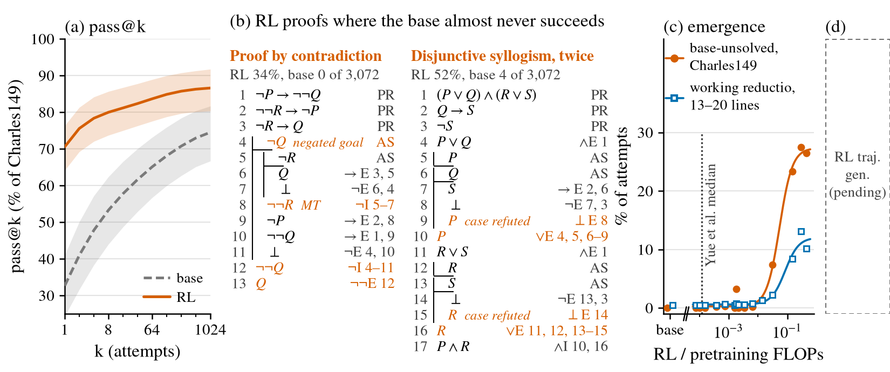

# Proof strategies under GRPO with thinking traces: the base already uses every textbook strategy; RL raises success and shifts toward proof by contradiction, and the problems the base cannot solve emerge in an S-curve near 5 % of pretraining compute

Status: completed 2026-11-01, as CPU analysis of existing reads; no model was sampled or trained.
- Branch `leon/high-rl-paper` at `1ab6ab7`, uncommitted (the coordinating agent integrates).
- Working folder, with code, the pre-registration, the log and every number:
  [`code/experiments/current/proof_strategies_grpo_20261101/`](../../code/experiments/current/proof_strategies_grpo_20261101/README.md).

Question (Leon, 2026-11-01): rerun Dan's proof-strategy experiment on our GRPO + thinking-trace
models. Which strategies does RL add relative to the pretraining corpus and the base model? Do they
emerge S-shaped in RL compute? Build Figure 1, "capability emergence", for the high-RL regime paper.

## The figure

[`fig1_emergence.pdf`](../../docs/papers/high-rl-regime/figures/fig1_emergence.pdf). Draft caption:
[`caption.md`](../../code/experiments/current/proof_strategies_grpo_20261101/caption.md).

- **(a) pass@k on Charles149** (149 textbook problems), base vs RL end, means over 3 seeds with 95 %
  bands. pass@1 is 32.6 → 70.5 %; pass@1024 is 74.5 → 86.6 %.
- **(b) Two RL proofs, both identical to the textbook's own proof.** On these problems the base
  succeeds in 0 and 4 of 3,072 attempts; RL succeeds in 34 % and 52 % of its 3,072.
  - The first is a proof by contradiction that opens from the negated goal and uses modus
    tollens. It is the only one of the 9 never-base-solved problems with a short proof that uses a
    rare strategy.
  - The second uses two disjunctive syllogisms.
  - These strategies occur in 1.5 %, 0.13 % and 1.2 % of the Stage-1 corpus's proofs.
- **(c) Emergence against RL / pretraining FLOPs.**
  - RL's success rate on the 32 problems base seed 0 never solves stays at about 0 through Yue
    et al.'s median ratio (1.2e-4). It then rises in an S-shape to 27.5 % of attempts, with its
    midpoint at a ratio of 0.054.
  - The rate of accepted 13–20-line proofs using a working proof by contradiction rises 30×, from
    0.4 % to 13.1 % (midpoint 0.083).
- **(d)** Pending.

## Configuration

- **Classifier.** Dan's v1.2 classifier, unchanged, from his fork at `e6bfe0ea`. It reproduces his
  K12 table exactly. Our models write Lean have-chains, which are converted to his ND format by the
  fork's own inverse.
- **Pretraining corpus.** The 154,630 programmatic search proofs of K12 theorems that S1g3 was
  trained on, replayed from the trained actions.
- **Model proofs.** Every Lean-accepted attempt in the existing reads.
  - Charles149 at k 1,024: base and L3 end for seeds 0–2, plus 16 seed-0 checkpoints from R
    7.6e-5 to 0.45.
  - 13–20-line problems (250) at k 512, the same checkpoints.
  - Five smaller-k sets.
- **Units.**
  - "% of attempts" (A) counts accepted attempts that use the strategy.
  - "% of proofs" (B) is the share of a solved problem's accepted attempts that use it.
  - "Like for like" restricts B to problems both models solve.
- **Pre-registration.** Expectations were frozen at 11:09 am PT, before the first count of a model
  proof (sha256 in the log).

## Observations

1. **Our corpus is not K12.** The S1g3 corpus uses the textbook strategies more than K12 does, but
   still far less than textbooks do.

   | % of proofs | S1g3 corpus | Dan's K12 | Charles149 reference proofs | GRPO pools L2 / L3 |
   |---|---:|---:|---:|---:|
   | working proof by contradiction | 1.47 | 0.04 | 17.45 | 40.2 / 46.6 |
   | template-only proof by contradiction | 0.92 | 10.75 | 0.00 | 0 / 0 |
   | modus tollens | 0.13 | 0.05 | 7.38 | 8.1 / 13.4 |
   | disjunctive syllogism | 1.19 | 0.03 | 14.09 | 10.4 / 7.8 |
   | working proof of a negation | 5.56 | 2.15 | 28.86 | 31.5 / 50.2 |
   | genuine proof by cases | 6.04 | 8.79 | 34.23 | 61.1 / 76.5 |
   | classical-only theorems | 3.9 | 4.0 | 20.1 | 39.5 / 44.5 |

   The corpus's search proofs use a reductio only when the theorem needs one: 22.7 % on its
   classical-only theorems, 0.6 % otherwise. The GRPO training pools are a different world: 40–45 %
   of their theorems need a reductio.

2. **The base already has every strategy.** When the base solves a Charles149 problem, it uses each
   textbook strategy at about the rate of the textbook's own proofs:
   - working reductio 17.5 %, modus tollens 9.9 %, disjunctive syllogism 19.1 %;
   - working ¬-introduction 32.8 %, genuine cases 33.4 %.

   Nothing RL writes is new in kind.

3. **What RL changes on Charles149** (L3 end vs base, seed 0).
   - **Success with every strategy rises.** Per attempt:
     - working reductio 3.0 → 16.6 %;
     - disjunctive syllogism 7.2 → 14.0 %;
     - working ¬I 8.8 → 19.4 %;
     - genuine cases 11.4 → 25.0 %.
   - **Strategy choice like for like (117 problems).** The shift is toward proof by contradiction:
     - working reductios +5.3 points [+1.7, +9.5];
     - template (idle) reductios +12.9 points [+8.3, +18.0], from 1.5 to 14.4 %;
     - proofs that open by assuming the negated goal, 6.2 → 13.0 %;
     - modus tollens −2.1 points; the others within ±1.1.
   - **RL's proofs are longer** (9.0 → 12.3 pruned lines) and carry more dead lines (0.08 → 0.38
     per proof).

4. **On the 13–20-line problems the shift is much larger** (192 problems both solve). Working
   reductios rise from 7.1 to 34.6 % of proofs, and template ones from 4.9 to 34.7 %. On the
   problems that need no reductio at all, working reductios go from 3.2 to 33.0 %.

5. **What RL's new solves look like.** At seed 0, RL solves 16 Charles149 problems that the base
   never solves in 1,024 attempts; the base solves none that RL misses. Pooled over three base
   seeds, 9 problems remain RL-only.
   - The seed-0 RL-only problems are 44 % classical-only, against 20 % of the set.
   - RL's proofs there are long (19 lines) and use a working reductio in 67 % and disjunctive
     syllogism in 39 %. On problems the base also solves, the rates are 23 % and 18 %.

6. **Emergence against RL compute.** Each pre-registered curve is flat near Yue et al.'s median
   and S-shaped in log R, by the pre-registered test (logistic beats a line by ΔAIC ≥ 2, with the
   midpoint inside the range):
   - the base-unsolved solve rate: ΔAIC +54.7, midpoint 0.054;
   - working reductio per attempt: ΔAIC +56.7 on Charles149 and +35.9 on 13–20 lines.

   Across checkpoints, these curves track the pass@1024 gap (ρ 0.96–0.97) more closely than the
   pass@1 gap (0.83–0.84).

7. **Against Dan's expert-iteration ladders.**
   - Dan's working reductios rose 13–30× in count, 5–9× as a share, from 0.2–0.5 % of new
     proofs.
   - Ours rise 5.6× (Charles149) and 30× (13–20 lines) per attempt, and 2.3× and 7.4× as a share
     of distinct proofs.
   - Our levels are about 10–130× higher. The base starts at 6–22 % of distinct proofs, because its
     search-proof corpus contains working reductios.

## Interpretation (untested)

- **The capability gain is real.** RL's success on problems the base cannot solve switches on
  between about 1 % and 15 % of pretraining compute.
- **The strategy story is not "RL discovers a new strategy".** The base can already write every
  textbook strategy. What RL changes is how reliably a long proof gets composed, and it makes proof
  by contradiction a default opening, often idle.
- **That default plausibly comes from the curriculum.** 40–45 % of the GRPO training theorems need
  a reductio. A GRPO run on a pool with the corpus's 4 % classical-only share would separate
  transfer of the curriculum's habit from discovery.

## Validation

- **Dan's classifier.** It reproduces his K12 summary (117 / 117 cells). His 39 tests pass, also
  after a round trip through our Lean surface.
- **Hand-built tests.** 13 proofs in our Lean surface get the expected labels; Lean accepts all 13
  and rejects a broken control.
- **Conversion.** The ND → Lean → ND round trip keeps every label on 2,000 / 2,000 K12 proofs.
  Corpus replays match on 154,630 / 154,630 records.
- **Reviewer's blind reimplementation.** It agrees with Dan's classifier on every record:
  168,566 distinct model proofs and the whole corpus.
- **Blind spot-check.** An independent subagent, given the taxonomy only, labelled 100 proofs. It
  agrees on 100 / 100 for every "uses" label, every working flag and the primary label. Limits:
  the sample has no excluded-middle positive, and the labeller used its own scripts for pruning.
- **Lean and the sealed set.** Lean re-accepts the displayed proofs (6 / 6 texts). No displayed
  problem is in a textbook72 class, and textbook72 was not read.

## Limitations and next step

- **Pre-registration misses.**
  - E1: the base's modus tollens and disjunctive syllogism rates are above the expected ranges.
  - E2: template reductios moved by more than 10 points, and dead lines rose instead of falling.
  - E5: the curves track pass@1024 more closely than pass@1.
  - E7: fold changes far above 3×.
- **Deviation in panel (c).** The pre-registered selection rule picked modus tollens on
  Charles149, whose share of proofs does not rise. The figure shows the pre-registered fallback
  (the base-unsolved solve rate) and the rule's 13–20-line pick.
- **Seeds and checkpoints.** The R axis uses seed-0 checkpoints from several runs, not one
  trajectory. RL-only counts are sensitive to the base seed.
- **No per-iteration count.** No GRPO run dumped rollouts.
