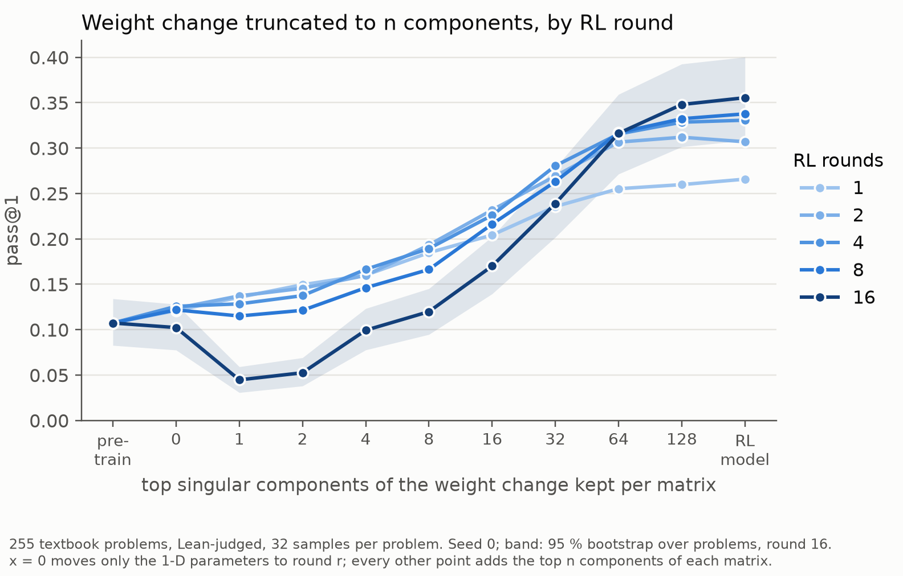
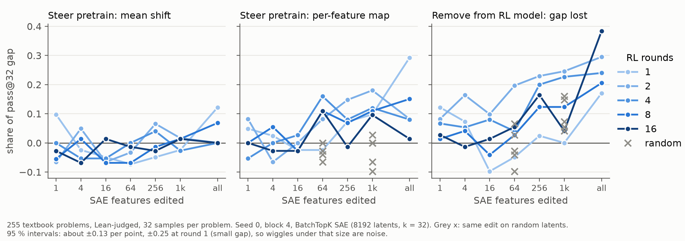

# What RL changes: weight-change SVD by round, and SAE steering

Done 2026-11-01 for the SPAR midterm. Working folder: `code/experiments/current/rl_diff_figs_20261101/` (protocol in its
`README.md`, all tables in `numbers.md`). Three seeds of Dan's `la_T1_best12` ladder, 255 textbook problems, 32 samples per
problem, Lean only. Spend about $6 on two RTX 6000 Ada pods.

**Weight change.** The top 64 singular components per matrix (of at most 384) recover 0.87-0.95 of the pass@1 gap at every
round from 1 to 16, while the squared-norm share they hold falls from 0.89 to 0.76. Fewer components do steadily worse as
rounds accumulate: n = 16 recovers 0.67 at round 1 and 0.27 at round 16. At round 16, n = 1 lands below the pretrain in
all three seeds (-0.22 pass@1, -0.33 pass@32).

**Activations.** Steering the pretrain with SAE features recovers little of the gap. At round 16 no arm run on all three
seeds is above 0.08 on the mean. In seed 0 alone, the 1024-feature map recovers 0.10-0.18 at every round, against -0.10 to
+0.03 for random features, with intervals of about ±0.13 (wider at round 1). Removing the top 256 mapped features from the RL model loses 0.13, against about 0.01 for
random features. Removing all of them loses 0.39, with no control possible at that size.

**Interpretation, not shown directly.** The RL change is not a few directions, and later rounds add weight movement that
does not change the textbook score much. The drop below pretrain at n = 1 suggests the top component needs the rest of the
change to compensate for it; nothing here tests that.

**Limits.** Convention `full` (1-D parameters moved to round r) replaced `base` after `base` failed the check against
Charles's Figure 4 at low n; with all matrices moved and 1-D parameters held, seed 0 reaches only 0.86 of the pass@32 gap.
Levels are on 255 problems, not Charles's 443, so they don't share an axis with his figures. The SAE ran at blocks 4 and 2
only, and many arms were compared without multiplicity correction.
