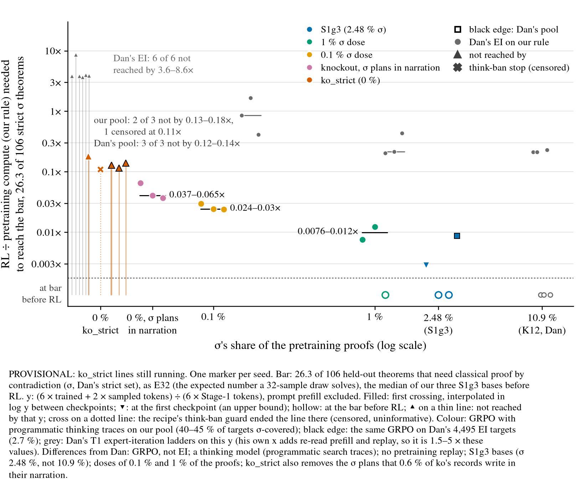
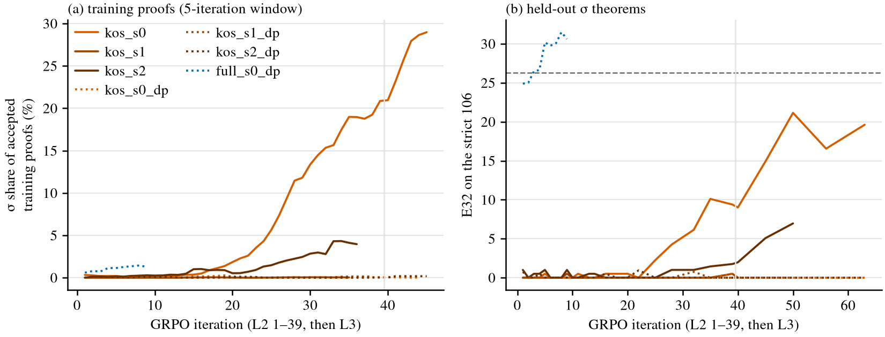

# Knockout / dose with GRPO and thinking traces: how much RL brings proof by contradiction back?

Status: DRAFT. The six ko_strict lines (three on our pool, three on Dan's pool) are still running,
and the sections marked PENDING are filled in when they end (projected 20:00Z–01:00Z on
2026-11-03). Every other line is finished. Nothing is pushed.

Question: Dan's create-or-elicit / coe-dose01 chart asks how much RL compute it takes to solve
the full bases' median number of 106 held-out theorems that need classical proof by contradiction
(σ), as a function of σ's share of the pretraining proofs. This rerun uses Leon's GRPO +
thinking-trace pipeline instead of expert iteration. Leon asked for it ("can you rerun this
properly to match dans"), for the midterm report's section "How much RL is needed to recover rare
or fully excluded proof strategies?".

Working folder (pre-registration, amendments, scripts, run log, numbers):
[`code/experiments/current/knockout_grpo_20261103/`](../../code/experiments/current/knockout_grpo_20261103/README.md),
branch `leon/knockout-grpo` (from `leon/high-rl-paper` at `50d0336`).

## Main result (observed)

**With our pool, GRPO brings σ back from a knockout base by R ≈ 0.04 (0.037–0.065 across 3 / 3
seeds).** That is under 1 GPU-hour per seed. Dan's expert iteration did not get there by 3.6–4.0
on the same y (his 5.6–6.1×), and one seed did not get there by 8.6.

Three confounds keep this from being an algorithm comparison:

- **The pool.** 40–45 % of our pool's targets are strict σ-covered, against 2.7 % of Dan's EI
  targets.
- **The narration channel.** The ko corpus has no σ proofs, but 637 of its 154,630 records
  (0.41 %) plan the classical detour in their thinking narration at the effort level the bases
  trained on (515 of them with the NEGI half). At either effort level the count is 949, the
  records ko_strict removed.
- **The corpus.** S1g3 search traces, not K12 proofs.

The two controls below address the first two, and they are PENDING.

y: R = (6 × trained + 2 × sampled tokens) ÷ (6 × Stage-1 tokens), with prompt prefill excluded.
Bar: **26.31 of 106 (24.8 %)**, the median E32 of our three S1g3 (full) bases before RL. E32 is
the expected number of the 106 that a 32-sample draw solves. It is an unbiased pass@32, computed
from 64 samples per checkpoint and 256 per base. First crossing: the first checkpoint at or above
the bar, interpolated linearly in log R from the checkpoint before it. Held: Amendment 1's window,
which needs at least 3 consecutive checkpoints at or above the bar, the last at 2 × or more of the
first one's R.

| arm (σ share of the proofs) | seed | base E32 (% of 106) | first crossing R (bracketing checkpoints) | GPU-h | held window (checkpoints) |
|---|---|---|---|---|---|
| full, S1g3 (2.48 %) | 0 | 22.34 (21.1 %) | ≤ 0.0029 (the first checkpoint) | 0.03 | c 1–3 |
| | 1 | 26.31 (24.8 %) | at the bar before RL | 0 | — |
| | 2 | 29.33 (27.7 %) | at the bar before RL | 0 | — |
| 1 % dose | 0 | 14.39 (13.6 %) | 0.0076 (c 2–3) | 0.09 | c 3–6 |
| | 1 | 14.39 (13.6 %) | 0.0123 (c 4–5) | 0.16 | c 5–10 |
| | 2 | 32.63 (30.8 %) | at the bar before RL | 0 | — |
| 0.1 % dose | 0 | 12.29 (11.6 %) | 0.0298 (c 10–11) | 0.31 | c 11–20 |
| | 1 | 6.67 (6.3 %) | 0.0243 (c 9–10) | 0.20 | c 10–20 |
| | 2 | 5.21 (4.9 %) | 0.0241 (c 7–8) | 0.37 | c 8–16 |
| ko: no σ proofs, σ plans in 0.41 % of the trained narration | 0 | 0.73 (0.7 %) | 0.0653 (c 18–20) | 0.81 | c 20–39 |
| | 1 | 0.36 (0.3 %) | 0.0403 (c 14–16) | 0.56 | c 16–32 |
| | 2 | 1.04 (1.0 %) | 0.0368 (c 11–13) | 0.51 | c 13–25 |
| ko_strict: no σ proofs or plans | 0–2 | 0.00 / 0.00 / 0.33 | PENDING | | |

c is the GRPO iteration: L2 has 39 iterations, then L3 follows. Every first crossing held; in
each line the held window starts at the first-crossing checkpoint. d1_s0 and d1_s1 have
different weights and per-theorem results, so their equal base E32 (14.3876 and 14.3877) is a
coincidence.

The medians order 1 % (0.0076) < 0.1 % (0.024) < ko (0.040). Dan's arms order the same way.

### Dan's ladders on our y

Dan's numbers are recomputed from his registry rows with our rule (`dan_axis.py`). His x also
counts the re-read state prefill and the 20,000 replayed pretraining records per round.

- **After round 1** his values are 1.53–1.90 × ours.
- **At round 1** they are 4.98–5.41 ×. Round 1 is sampling only, so the prefill makes up most of
  it. His three round-1 crossings (bases at the bar before RL) are drawn on the floor, like ours.

`numbers.md` gives the ratio for every ladder.

| Dan's arm (σ share) | ladders | his crossing x | on our y | his GPU-h to the crossing |
|---|---|---|---|---|
| full, K12 (10.9 %) | 6 | 3 at the bar before RL (round 1); 0.39–0.43 | 0.21–0.23 | 1.1–1.3 |
| 1 % dose | 3 | 0.39, 0.41, 0.73 | 0.20, 0.21, 0.44 | 1.2–2.0 |
| 0.1 % dose | 3 | 0.69, 1.37, 2.58 | 0.41, 0.86, 1.66 | 1.8–5.5 |
| knockout | 6 | not reached by 5.6–6.1 (s1: 13.2) | not reached by 3.6–4.0 (s1: 8.6) | 9.9–24.2, not reached |

At matched doses, our first crossings are about 28 × (1 %) and 35 × (0.1 %) below Dan's medians
on the same y. In GPU-hours they are 0.09–0.37 against 1.2–5.5. These GPU-hours are on different
hardware: ours ran on RTX 3090s, his on A40 / A6000.

## Controls

### Dan's pool (Amendment 2)

This control is the same GRPO, with Dan's 4,495 EI targets as the L2 / L3 pool. Only 2.7 % of
them are strict σ-covered.

- **full_s0_dp: first crossing R 0.0088.** The interpolation runs between c 2 (E32 25.02 at R
  0.00641) and c 3 (26.48 at R 0.00918). The crossing held over c 3–7 (complete at R 0.0212), and
  the last checkpoint is c 9 (30.6 at R 0.0268). On our pool, full_s0 was ≤ 0.0029.
- **kos_s0–2_dp, on the ko_strict bases.** PENDING. At R ≈ 0.10 (10:25Z), E32 was ≤ 0.94 on every
  seed.

**σ in the accepted training proofs** (`train_sigma.py`): this is the share of distinct
Lean-accepted training proofs that are σ by Dan's classifier (DN of a NEGI line).

- *Observed:* on Dan's pool it stays at 0–0.8 % per iteration on all three kos_*_dp lines, from
  L2 iteration 1 to L3 iteration 6. 3.5–11.7 % of those proofs use DN, which is expected from the
  2,471 targets with ¬¬ in the sequent (DN of a premise).
- *Observed:* on full_s0_dp it is 0.6–2.2 %.
- *Interpretation, not observed:* Dan's pool puts little σ pressure on GRPO.

### ko_strict (Amendment 3): no σ in the proofs or the narration

ko_strict removes the 949 ko records whose e64 or e256 narration plans `|- G :=
Classical.byContradiction |- ( ~ ( ~ G ) )`, and refills each slot in place from Dan's pool with a
σ⁺-free, plan-free record of the same length.

- **Bases are weaker than ko's.** E32 is 0.00, 0.00 and 0.33 of 106, against ko's 0.73, 0.36 and
  1.04.
- **Lines with our pool: PENDING.** At 10:25Z:
  - kos_s0 had E32 0 → 10.1 by R 0.10, rising, and its σ share of accepted training proofs went
    0.3 % (L2 iteration 1) → 17 % (L2 iteration 37) → 31 % (L3 iteration 4).
  - kos_s2's σ share went 0 → 10 % by L2 iteration 33 (5-iteration window ≈ 4 %), with E32 ≤ 1.0.
  - kos_s1's σ share stayed ≤ 0.1 %, with E32 ≤ 0.5.
- **Censoring by the think-ban guard (informative).** The recipe's guard ended kos_s1 in L3
  iteration 2 (R 0.109) and kos_s2_dp in L3 iteration 62 (R 0.240). That is the pre-registered
  stop rule. Both lines had almost no σ when they stopped: at most 0.1 % and 0.3 % of accepted
  training proofs (5-iteration window). So the censoring falls on lines that were not finding σ.
  The arm is reported both ways:
  - **Primary, conservative:** a censored line counts as "not reached by R_stop".
  - **Secondary:** censored lines excluded. This flatters the arm and is labelled as such.
  - The figure draws a censored line as a cross on a dotted line.
- **What the guard measures.** `sample.phase_bans` (f35d3daf:112, the same at fa28f6eb:99) never
  samples `<eos>`, a nested `<think>`, `<pad>` or the effort tokens inside a think block.
  `ban_think` is the mean full-vocabulary probability on those tokens at the scored think
  positions (grpo.py:837). Above 1e-3 it raises an alarm and may roll back; above 0.005 it stops
  the run. It bans control tokens, not σ text.
- **Think-ban events per line** (`think_ban.py`, distinct iterations). The guard fired only on
  ko_strict lines here: kos_s1 19 of 41 iterations (1 stop), kos_s2 28 of 76, kos_s2_dp 29 of 101
  (1 stop), kos_s0_dp 10 of 106. kos_s0 (σ share up to 42 %) and kos_s1_dp had 0. The other 13
  lines had 0.
- **Exposure.** The 13 lines without alarms ran 3–41 iterations, almost all of them in L2. The
  ko_strict lines are the only ones that ran long L3. Leon's full-base L3 runs with this recipe
  alarm too: grpo_think_vs_mb_kkl0_s1_L3 2 of 39, vs_mb_s1 6 of 39, vs_s1 12 of 39, vs_mb_kg64_s1
  15 of 39 (max mass 5.7e-3, above the stop level), vs_mb_ki78_s0 22 of 78. So the guard is not
  specific to ko_strict.
- **The real exception is L2.** kos_s1 alarmed on 17 of its 39 L2 iterations and kos_s2 on 3. No
  other L2 run alarmed: not the 16 others here, and not Leon's grpo_think_vs_s0–2_L2 (max 5.6e-4).
- **Not a σ detector.** Within a line, ban mass and σ share trend up together (Spearman 0.25–0.90
  on levels) but their changes are uncorrelated (−0.02 to 0.22 on first differences). On our pool,
  the L2 iteration-1 mass is 2.4–3.5 × Dan's pool's on the same ko_strict base. Mechanism note
  (diagnostic A, `ban_diag.py`, CPU): 500 ko_strict corpus records (54,699 think positions) were
  scored teacher-forced under seven checkpoints. On corpus narration the banned mass is 0.9–1.1e-5
  for the kos_s1 base, kos_s1 at L2 iteration 39 and kos_s1 at its stop. Those last two measured
  2.1e-3 and 6.5e-3 on their own samples, so kos_s1's mass lives in the narration it writes
  itself, not in corpus-like text. ko_s1 at L2 iteration 32 also gives 1.0e-5. Only kos_s2_dp's
  stop checkpoint rises on corpus text (8.4e-5, against 1.3e-5 at its L3 iteration 6), and 46 % of
  that is a nested `<think>`. Its largest positions (up to 0.06) begin a new goal line right after
  a ¬¬ hypothesis line (`n5 : ( ¬ ( ¬ Q ) )`). That narration is common in Dan's pool (2,471
  targets with ¬¬ in the sequent) and the line had no σ. Positions after
  `Classical.byContradiction` narration carry 1–2 % of the mass in every ko_strict checkpoint.

## Pre-registered predictions

The predictions were written before any model was read.

| | prediction | outcome |
|---|---|---|
| P1 | bar between 10 and 50 of 106 (80 %) | **hit**: 26.31 |
| P2 | each ko base E32 < 2 (85 %); all three below every full base (90 %) | **hit**: 0.36–1.04 against ≥ 22.34 (ko_strict 0–0.33) |
| P3 | 3 / 3 d1 seeds reach (75 %), median ≤ 0.3 (60 %) | **hit**: 3 / 3 (one at the bar before RL), median 0.0076 |
| P4 | ≥ 2 / 3 d01 seeds reach (65 %), median above d1's (70 %) | **hit**: 3 / 3, 0.024 > 0.0076 |
| P5 | ≤ 1 / 3 ko seeds reach within the budget (60 %) | **miss**: 3 / 3 ko seeds reach by R 0.065. ko_strict: PENDING |
| P6 | if ko does not reach: 1 % < 0.1 % < ko (60 %) | condition not met; the order holds anyway |
| P7 | Dan's 16-round ladders on our rule are below his 5.6–6.1 × (85 %) | **hit**: 3.6–4.0 |

## Interpretation (not observed)

- The gap to Dan is large at every dose, not only at the knockout, so most of it is not specific
  to σ. Two candidate causes remain: GRPO reaches the strict σ theorems with far fewer tokens than
  T1 EI, and our pool is rich in σ-covered targets.
- The full_s0_dp crossing (0.0088, against Dan's 0.21–0.23 at 10.9 %) means a σ-poor pool alone
  does not slow GRPO down on a base that already has σ. That is one seed.
- Whether GRPO creates σ from zero depends on ko_strict.

## Caveats

- **Three confounds against Dan:**
  - the algorithm (GRPO against T1 EI, with no pretraining replay);
  - the model and corpus (a thinking model trained on S1g3 search traces, at σ 2.48 % against
    K12's 10.9 %);
  - the pool's σ pressure.
- **y is read from snapshot checkpoints.** Dan's y is cumulative over rounds. The Dan-matched
  cumulative y (union of first-32 solves every 35 iterations) is in `numbers.json` for the lines
  that ran that far.
- **Read settings:** k 64, plain decoding, budget 64, T 0.8. The bar comes from 3 full bases, and
  2 of the 3 were at the bar before RL, so the full arm has only one RL crossing.
- **Incident (`log.md`):** two d1 lines were killed by an out-of-memory error from co-located
  reads and resumed from their rolling checkpoints.
- **Hardware:** RTX 3090 here, A40 / A6000 for Dan.

## Compute

- About 27 GPU-h used by 10:25Z: Stage-1 bases, base reads and GRPO lines with their co-located
  reads.
- About 72 GPU-h more if all six ko_strict lines run to the cap (T_L3 364), about 100 GPU-h in
  all. The limit agreed with the coordinator is 180.

## Configuration

- **Code:** GRPO L2 at `fa28f6eb`, L3 at `f35d3daf` (kkl0 recipe), each with a `--snap_iters`
  patch. Stage-1: train.py at `cd089700`, 24,000 steps, seeds 0–2. Traces: searchtrace.py at
  `79749ce`.
- **Corpora:** S1g3 with Dan's K12⁻ removal and per-length refill (`ko`), his dose rule (`d01`,
  `d1`), and `ko_strict`.
- **Records:** hashes and commands are in the working folder's `log.md`. PREREG.md sha256 is
  `f35fc350…`, amendment2.md `bc7f0c75…` and amendment3.md `bda6eb52…`.
- **Artifacts:** `/scratch/cowifornia/nd-rl/knockout_grpo/` on serrano. ynez and temescal hold
  their own runs under the same path.
