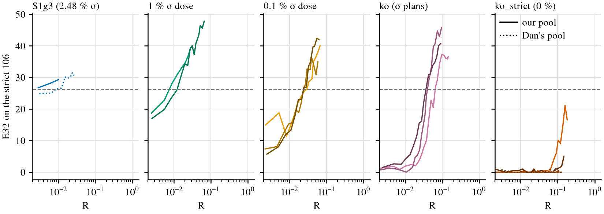

# Knockout / dose with GRPO and thinking traces: how much RL brings proof by contradiction back?

**Status.** Complete. Every line of the pre-registered primary and of the guard-relaxed
continuations (Amendment 4, secondary) has ended; kos_s0_gr, the last, reached its cap (c 403)
at 05:02Z on 2026-11-04. Nothing is pushed.

**Question.** Dan's create-or-elicit / coe-dose01 chart asks how much RL compute it takes to solve
the full bases' median number of the 106 held-out theorems that need classical proof by
contradiction (σ), as a function of σ's share of the pretraining proofs. This rerun uses Leon's
GRPO + thinking-trace pipeline instead of expert iteration. Leon asked for it ("can you rerun this
properly to match dans"), for the midterm report's section "How much RL is needed to recover rare
or fully excluded proof strategies?".

**Working folder:**
[`code/experiments/current/knockout_grpo_20261103/`](../../code/experiments/current/knockout_grpo_20261103/README.md)
on branch `leon/knockout-grpo`. It holds the pre-registration, Amendments 1–4, the scripts, the
run log and the numbers.

## Main results (observed)

**Definitions.**
- **y (R):** (6 × trained + 2 × sampled tokens) ÷ (6 × Stage-1 tokens), with prompt prefill
  excluded.
- **Bar:** each system is measured against its own bar. The rule is the same, the median of
  that system's own full bases before RL; the measure differs.
  - **Ours:** **26.31 of 106 (24.8 %)**, the median E32 of our three S1g3 (full) bases, from
    snapshot reads.
  - **Dan's:** **14 of 106**, the median round-1 count of his 6 K12 full bases, on his
    cumulative measure: theorems a 32-sample draw has solved in any round so far. Every grey
    point in the figure uses his bar and his measure; only the compute axis is ours.
  - A cumulative count can only grow, so it reaches a bar no later than a snapshot read would.
    It favours Dan's side, and every "our crossing is N × earlier" below is conservative.
- **E32:** the expected number of the 106 that a 32-sample draw solves. It is an unbiased
  pass@32 from 64 samples per checkpoint (256 per base).
- **First crossing:** the first checkpoint at or above the bar, interpolated linearly in log R
  from the checkpoint before it.
- **Held:** Amendment 1's window, at least 3 consecutive checkpoints at or above the bar, the last
  at 2 × or more of the first one's R.
- **c:** the GRPO iteration count (L2 has 39 iterations, then L3; the cap is c 403).

1. **With our pool, GRPO restores σ from the knockout base in under 0.07 × pretraining
   compute.** The ko base has no σ in its proofs, but 0.41 % of its records plan the σ detour in
   their narration. All 3 seeds crossed, at R 0.037–0.065 (median 0.040), in 0.5–0.8 GPU-h each.
   Dan's EI knockouts did not reach his bar (14, cumulative) by 3.6–4.0 on the same y (his own
   5.6–6.1×), and one did not by 8.6.
2. **With the narration plans also removed (ko_strict), no seed reached the bar before the
   recipe's think-ban guard ended it.** That held on both pools:
   - our pool, 3 / 3 censored at R 0.109, 0.441 and 1.224;
   - Dan's pool, 3 / 3 censored at R 0.240, 0.261 and 0.376.
   Two of the three our-pool seeds did acquire σ from bases that read 0.00 and 0.33:
   - **kos_s0:** E32 25.0 by R 1.22, against the bar of 26.31. σ went from 0.3 % of its accepted
     training proofs at the first iteration to 46–51 %.
   - **kos_s2:** E32 13.4 by R 0.44, with σ reaching 41–48 % of its accepted training proofs.
   - **kos_s1:** σ stayed at 0.1 % or less.
   - **Dan's pool:** σ stayed at 0.9 % or less on all three seeds, and E32 at 0.9 or less.
   - **Secondary, like for like with Dan's knockout point:** on the Dan-matched cumulative count
     (Dan's measure on our reads, against our bar of 27 on it), the primary kos_s0 reached the bar
     at c 140 (28 theorems, R 0.50). That is well before its censoring at 1.224 and inside Dan's
     horizon (his bar not reached by 3.6–4.0). kos_s2 had 13 by R 0.41, kos_s1 0 by R 0.09, and
     the three Dan's-pool seeds 0 by R 0.17–0.37. The figure marks kos_s0's cumulative crossing
     with an open hexagon.
3. **The doses order as Dan's do, about 30 × lower, each against its own bar.** The median first
   crossings are 1 % 0.0076 < 0.1 % 0.024 < ko 0.040. Dan's medians on our y are 0.21 and 0.86.
4. **Secondary (Amendment 4): with the guard's stop raised 10 ×, 1 of the 6 ko_strict lines
   reached the bar.** kos_s0 (our pool) crossed at R 1.37 and stayed above the bar at every read
   to its cap at R 2.36 (E32 32.5, best 34.7). Its hold window would need a read at R ≥ 2.87, so
   it is not held. Of the other five:
   - kos_s2 was at E32 12.3 when it was stopped for machine availability at R 1.48;
   - the relaxed guard stopped three again, at R 0.36–0.71, all at E32 0.0;
   - kos_s0_dp reached its cap at R 1.37 with E32 0.00.

**Three confounds against Dan stay open:**
- **The pool.** 40–45 % of our pool's targets are strict σ-covered, against 2.7 % of Dan's EI
  targets.
- **The narration channel.** The ko-against-ko_strict difference is large.
- **The corpus.** S1g3 search traces, not K12 proofs.

### Per line

| arm (σ⁺ share of the proofs) | seed | base E32 (% of 106) | first crossing R (checkpoints) | GPU-h | held window |
|---|---|---|---|---|---|
| full, S1g3 (2.48 %) | 0 | 22.34 (21.1 %) | ≤ 0.0029 (the first checkpoint) | 0.03 | c 1–3 |
| | 1 | 26.31 (24.8 %) | at the bar before RL | 0 | — |
| | 2 | 29.33 (27.7 %) | at the bar before RL | 0 | — |
| 1 % dose | 0 | 14.39 (13.6 %) | 0.0076 (c 2–3) | 0.09 | c 3–6 |
| | 1 | 14.39 (13.6 %) | 0.0123 (c 4–5) | 0.16 | c 5–10 |
| | 2 | 32.63 (30.8 %) | at the bar before RL | 0 | — |
| 0.1 % dose | 0 | 12.29 (11.6 %) | 0.0298 (c 10–11) | 0.31 | c 11–20 |
| | 1 | 6.67 (6.3 %) | 0.0243 (c 9–10) | 0.20 | c 10–20 |
| | 2 | 5.21 (4.9 %) | 0.0241 (c 7–8) | 0.37 | c 8–16 |
| ko: no σ proofs; σ plans in 0.41 % of the trained narration | 0 | 0.73 (0.7 %) | 0.0653 (c 18–20) | 0.81 | c 20–39 |
| | 1 | 0.36 (0.3 %) | 0.0403 (c 14–16) | 0.56 | c 16–32 |
| | 2 | 1.04 (1.0 %) | 0.0368 (c 11–13) | 0.51 | c 13–25 |
| ko_strict: no σ proofs or plans, our pool | 0 | 0.00 (0.0 %) | not reached by 1.224 (censored; best 25.0) | 9.0 | — |
| | 1 | 0.00 (0.0 %) | not reached by 0.109 (censored; best 0.5) | 1.4 | — |
| | 2 | 0.33 (0.3 %) | not reached by 0.441 (censored; best 13.4) | 4.5 | — |
| ko_strict, Dan's pool | 0 | 0.00 | not reached by 0.376 (censored; best 0.5) | 3.8 | — |
| | 1 | 0.00 | not reached by 0.261 (censored; best 0.8) | 3.6 | — |
| | 2 | 0.33 | not reached by 0.240 (censored; best 0.9) | 2.8 | — |
| full, Dan's pool | 0 | 22.34 | 0.0088 (c 2–3) | 0.08 | c 3–7 |

- **Censored** means the recipe's think-ban stop, the pre-registered stop rule. Primary,
  conservative reading: a censored line is "not reached by R_stop".
- Every first crossing held, and each held window starts at the first-crossing checkpoint.
- d1_s0 and d1_s1 have different weights and different per-theorem results; their nearly equal
  base E32 (14.3876 and 14.3877) is a coincidence.

E32 against R for every line (the dashed grey line is our bar, 26.31). Shades are seeds. Dashed and
dash-dot lines are the guard-relaxed continuations, which repeat their source line up to the
resume point.

**Dan-matched cumulative count** (secondary; PREREG's "Dan-matched cumulative y"). This is the
union of first-32 solves at the base and then every 35 iterations, Dan's measure on our reads.
Its bar is 27, the median of our three full bases' first-32 counts: our analogue of his 14, by
the same rule. `numbers.md` has the table.
- **kos_s0:** reaches 27 at c 140 (R 0.50). It reads 0, 9, 22, 26, 28, 28, 30 and 32 at
  c 0–245, before its censoring at R 1.224.
- **kos_s2:** 13 by c 105 (R 0.41), before its censoring at 0.441.
- **kos_s1:** 0 by c 35 (R 0.09), censored at 0.109.
- **Dan's pool:** 0 on all three seeds, by R 0.17–0.37.
- **ko_s0:** 34 at its first round, c 35 (R 0.13). ko_s1 and ko_s2 crossed (snapshot) before
  c 35, so they have no round past the base.
- Dan's measure is cumulative; our primary is the snapshot E32.

### Dan's ladders on our y

Dan's numbers are recomputed from his registry rows with our rule (`dan_axis.py`). His x also
counts the re-read state prefill and the 20,000 replayed pretraining records per round:
- **After round 1:** his values are 1.53–1.90 × ours.
- **At round 1:** they are 4.98–5.41 ×. Round 1 is sampling only, so the prefill dominates. His
  three round-1 crossings (bases at the bar before RL) are drawn on the floor, like ours.

`numbers.md` gives the ratio for every ladder.

Every number in this table is against **his** bar, 14 of 106 on his cumulative measure.

| Dan's arm (σ share) | ladders | his crossing x | on our y | his GPU-h to the crossing |
|---|---|---|---|---|
| full, K12 (10.9 %) | 6 | 3 at the bar before RL (round 1); 0.39–0.43 | 0.21–0.23 | 1.1–1.3 |
| 1 % dose | 3 | 0.39, 0.41, 0.73 | 0.20, 0.21, 0.44 | 1.2–2.0 |
| 0.1 % dose | 3 | 0.69, 1.37, 2.58 | 0.41, 0.86, 1.66 | 1.8–5.5 |
| knockout | 6 | not reached by 5.6–6.1 (s1: 13.2) | not reached by 3.6–4.0 (s1: 8.6) | 9.9–24.2, not reached |

- **Each comparison below is against each system's own bar.** Ours is a snapshot E32 and his is a
  cumulative count, which favours his side, so these ratios understate the gap.
- At matched doses, our first crossings are about 28 × (1 %) and 35 × (0.1 %) below Dan's
  medians on the same y. In GPU-hours they are 0.09–0.37 against 1.2–5.5. The hardware differs:
  RTX 3090 here, A40 / A6000 for Dan.
- At the knockout, ko beats his horizon by about 55–110 ×. ko_strict was censored at 0.11–1.22,
  before his horizon, so the primary can't be compared at his knockout point.
- **Like for like at the knockout:** on the same cumulative measure, each against its own bar,
  the primary kos_s0 reached 27 at R 0.50, inside its censored run; Dan's knockouts did not reach
  14 by 3.6–4.0. The other five ko_strict lines did not reach 27 (kos_s2 at 13 by R 0.41; the rest
  at 0).
- With the guard relaxed (secondary), kos_s0 crossed the snapshot bar at 1.37 (10.0 GPU-h), below
  his 3.6–4.0; the other five ko_strict lines ended at R 0.36–1.48 without reaching.

## Controls

### Dan's pool (Amendment 2)

This is the same GRPO with Dan's 4,495 EI targets as the L2 / L3 pool. Only 2.7 % of them are
strict σ-covered.

- **full_s0_dp: first crossing R 0.0088,** between c 2 (E32 25.02 at R 0.00641) and c 3 (26.48 at
  R 0.00918). It held over c 3–7, and the last checkpoint is c 9 (30.6 at R 0.0268). On our pool,
  full_s0 was ≤ 0.0029.
- **kos_s0–2_dp:** E32 ≤ 0.9 throughout; censored at R 0.240–0.376.
- **σ in the accepted training proofs** (`train_sigma.py`, distinct Lean-accepted training proofs
  that are σ by Dan's classifier, DN of a NEGI line):
  - *Observed:* 0–0.9 % per iteration on the kos_*_dp lines, and 0.6–2.2 % on full_s0_dp. On the
    kos_*_dp lines, 3.5–11.7 % of those proofs use DN, which the 2,471 targets with ¬¬ in the
    sequent lead you to expect (DN of a premise).
  - *Interpretation, not observed:* Dan's pool puts little σ pressure on GRPO.

### ko_strict (Amendment 3): no σ in the proofs or the narration

ko_strict removes the 949 ko records whose e64 or e256 narration plans `|- G :=
Classical.byContradiction |- ( ~ ( ~ G ) )`, and refills each slot in place from Dan's pool with a
σ⁺-free, plan-free record of the same length.
- **Bases.** E32 0.00, 0.00 and 0.33 of 106, against ko's 0.73, 0.36 and 1.04.
- **The narration channel matters.** ko recovered by R 0.065 on every seed. ko_strict did not
  reach the bar on any seed before its stop. On the two seeds that acquired σ, the 5-iteration σ
  share of accepted training proofs passed 1 % at c 18 / 15, 10 % at c 28 / 47 and 25 % at
  c 42 / 57 (kos_s0 / kos_s2).
- **σ grows from a near-zero base rate.** kos_s0's first iteration already had 2 σ proofs among
  608 accepted. The base can compose DN and NEGI, which it saw separately, at a low rate, and GRPO
  amplifies it.

### Censoring by the think-ban guard (informative)

- **What the guard measures.** `sample.phase_bans` (f35d3daf:112, the same at fa28f6eb:99) never
  samples `<eos>`, a nested `<think>`, `<pad>` or the effort tokens inside a think block.
  `ban_think` is the mean full-vocabulary probability on those tokens at the scored think
  positions (grpo.py:837). Above 1e-3 it raises an alarm and may roll back; above 0.005 it stops
  the run. It bans control tokens, not σ text.
- **It ended all six ko_strict lines,** at R 0.109–1.224. The censoring is informative in both
  directions:
  - four of the stopped lines had almost no σ (kos_s1 and the three Dan's-pool lines);
  - kos_s2 (E32 13.4) and kos_s0 (25.0, just under the bar) were stopped while they had σ.
  - Primary: censored counts as "not reached by R_stop". With censored lines excluded, the arm
    has no evaluable lines at all; that reading flatters it and is not used.
- **Learning rate.** kos_s0 had used all three rollbacks by L3 iteration 89, so it trained at
  lr × 0.125 from then on.
- **Exposure.** The 13 lines without alarms ran 3–41 iterations, almost all in L2. The ko_strict
  lines are the only ones that ran long L3. Leon's full-base L3 runs with this recipe alarm too:

  | run | alarmed iterations | note |
  |---|---|---|
  | grpo_think_vs_mb_kkl0_s1_L3 | 2 of 39 | |
  | vs_mb_s1 | 6 of 39 | |
  | vs_s1 | 12 of 39 | |
  | vs_mb_kg64_s1 | 15 of 39 | max 5.7e-3, above the stop level |
  | vs_mb_ki78_s0 | 22 of 78 | |

  The guard is not specific to ko_strict.
- **The real exception is L2.** kos_s1 alarmed on 17 of its 39 L2 iterations and kos_s2 on 3. No
  other L2 run alarmed: not the 16 others here, and not Leon's grpo_think_vs_s0–2_L2 (max
  5.6e-4).
- **Not a σ detector.** Within a line, ban mass and σ share trend up together (Spearman 0.25–0.90
  on levels), but their changes are uncorrelated (−0.02 to 0.22 on first differences). On our
  pool, the L2 iteration-1 mass is 2.4–3.5 × Dan's pool's on the same ko_strict base.
- **Mechanism note** (diagnostic A, `ban_diag.py`, CPU). 500 ko_strict corpus records (54,699
  think positions) were scored teacher-forced under seven checkpoints.
  - On corpus narration the mass is 0.9–1.1e-5 for the kos_s1 base, kos_s1 at L2 iteration 39 and
    kos_s1 at its stop. Those last two measured 2.1e-3 and 6.5e-3 on their own samples, so the
    mass lives in narration the models write themselves.
  - Only kos_s2_dp's stop checkpoint rises on corpus text, to 8.4e-5. 46 % of that is a nested
    `<think>` at the start of a goal line after a ¬¬ hypothesis line, a pattern common in Dan's
    pool.
  - Positions after `Classical.byContradiction` narration carry 1–2 % of the mass.
- **Think-ban events per line** (`think_ban.py`, distinct iterations; numbers.md has the table):

  | line | alarmed iterations | stops |
  |---|---|---|
  | kos_s0 | 162 of 273 | 1 |
  | kos_s1 | 19 of 41 | 1 |
  | kos_s2 | 64 of 115 | 1 |
  | kos_s0_dp | 48 of 144 | 1 |
  | kos_s1_dp | 15 of 125 | 1 |
  | kos_s2_dp | 29 of 101 | 1 |
  | every other line | 0 | 0 |

### Guard-relaxed continuation (Amendment 4, secondary, exploratory)

Each censored ko_strict line continued with `--ban_stop 0.05` (10 × the recipe's 0.005) and
nothing else changed, to its own c 403 or the hold window. It resumed from its last rolling
checkpoint before the stop. kos_s0 resumed instead from its stop's alarm checkpoint, a logged
deviation: grpo writes no rolling checkpoint on an alarmed iteration. A health stop (reward or
E32 below 0.5 × its peak for 25 iterations) never fired.

| line | outcome (guard relaxed) | last read (c, R, E32) | σ share of accepted training proofs |
|---|---|---|---|
| kos_s0_gr | **first crossing R 1.37** (c 251–280), not held by the cap (the window needs a read at R ≥ 2.87); reads since: 26.8, 27.4, 30.6, 29.0, 33.9, 33.2, 34.0, 34.7, 32.5 | c 403, 2.359, 32.5 (best 34.7) | 42.6 % (L3 it 235–283), 44.1 % (it 305–364; no dump for it 284–304) |
| kos_s2_gr | not reached; **stopped for machine availability** at R 1.476 | c 282, 1.476, 12.3 (best 14.4) | 47.0 % (L3 it 76–260) |
| kos_s1_gr | not reached; relaxed guard stopped it at R 0.711 | c 158, 0.711, 0.0 (best 1.0) | 0.0 % (it 1–131) |
| kos_s0_dp_gr | **not reached by the cap**, R 1.371 | c 403, 1.371, 0.00 (best 0.5) | 0.1 % (it 101–328; no dump for it 329–363) |
| kos_s2_dp_gr | not reached; relaxed guard stopped it at R 0.685 | c 210, 0.685, 0.0 (best 0.9) | 0.1 % (it 46–180) |
| kos_s1_dp_gr | not reached; relaxed guard stopped it at R 0.362 | c 158, 0.362, 0.0 (best 0.8) | 0.0 % (it 86–121) |

- **Dan's pool.** On the Dan's-pool lines the ban mass grew geometrically: kos_s1_dp_gr went from
  0.0035 to 0.05 in 36 iterations while its reward stayed flat at 0.86–0.89. Relaxing the stop
  bought 35 and 118 iterations past the original stops on the two lines that hit 0.05;
  kos_s0_dp_gr ran 259 more, to its cap.
- **Our pool.** kos_s0_gr alarmed on every iteration (its 3 rollbacks were used before the
  resume). Its mass stayed at 0.005–0.007 to about L3 it 340, then rose to 0.017 at its cap.
  kos_s1_gr hit 0.05 at L3 it 131.
- **Machine events** (`log.md`):
  - temescal crashed at 21:58Z and was migrated;
  - another user's processes arrived on kos_s2_gr's GPU twice, so it was stopped for machine
    availability;
  - a stale-copy sync removed 54 metrics rows, rebuilt from the registries and logs (trained
    tokens estimated, under 0.5 % effect on R).
- **Interpretation (not observed).** In 1 of 6 ko_strict lines, kos_s0 with our pool, GRPO took
  the knockout base past the bar once the guard was relaxed, at R 1.37. That is well inside Dan's
  EI horizon (his bar not reached by 3.6–4.0 on this y). The other our-pool line with σ, kos_s2,
  was at half the bar when the machines ran out.

## Pre-registered predictions

These were written before any model was read.

| | prediction | outcome |
|---|---|---|
| P1 | bar between 10 and 50 of 106 (80 %) | **hit**: 26.31 |
| P2 | each ko base E32 < 2 (85 %); all three below every full base (90 %) | **hit**: 0.36–1.04 against ≥ 22.34 (ko_strict 0–0.33) |
| P3 | 3 / 3 d1 seeds reach (75 %), median ≤ 0.3 (60 %) | **hit**: 3 / 3 (one at the bar before RL), median 0.0076 |
| P4 | ≥ 2 / 3 d01 seeds reach (65 %), median above d1's (70 %) | **hit**: 3 / 3, 0.024 > 0.0076 |
| P5 | ≤ 1 / 3 ko seeds reach within the budget (60 %) | **miss** for ko: 3 / 3 by R 0.065. ko_strict: 0 / 3 before censoring, at R 0.11–1.22 (not within the budget's cap); guard relaxed (secondary): 1 / 3, at R 1.37 |
| P6 | if ko does not reach: 1 % < 0.1 % < ko (60 %) | condition not met for ko; the order 1 % < 0.1 % < ko < ko_strict holds |
| P7 | Dan's 16-round ladders on our rule are below his 5.6–6.1 × (85 %) | **hit**: 3.6–4.0 |

## Interpretation (not observed)

- **The gap to Dan is large at every dose,** not only at the knockout, so most of it is not
  specific to σ. The two candidate causes, GRPO's token efficiency against T1 EI and our pool's σ
  richness, cannot be separated with one full_s0_dp seed. That seed crossed at 0.0088 on Dan's
  σ-poor pool, so on a base that already has σ the pool does not slow GRPO much.
- **A trace of σ in the narration is enough.** ko had σ plans in 0.41 % of its trained narration
  and no σ proofs. Its fast recovery says GRPO can turn even that into σ proofs. Without the plans
  (ko_strict), σ is acquired slowly or not at all.
- **ko_strict, our pool:** two of three seeds acquire σ (E32 13–25 by R 0.44–1.22) before the
  guard stops them. With the guard relaxed (secondary), kos_s0 crossed the bar at R 1.37 and every
  read since has stayed above it, but the hold window (a read at R ≥ 2.87, twice the first read
  above the bar) lies beyond its cap. kos_s2 was at about half the bar when it was stopped for
  machine availability. So σ can be acquired from a base with no σ in its proofs or narration,
  on one seed in three, at about a third of Dan's EI horizon on this y (each against its own
  bar). On the Dan-matched cumulative count the primary kos_s0 got there by R 0.50, before its
  censoring.
- **ko_strict, Dan's pool:** nothing happens on any seed by R 0.24–0.38, consistent with Dan's EI
  knockouts.

## Caveats

- **Confounds against Dan:**
  - the algorithm (GRPO against T1 EI, with no pretraining replay);
  - the model and corpus (a thinking model on S1g3 search traces, σ 2.48 % against K12's
    10.9 %);
  - the pool's σ pressure;
  - the narration channel (ko against ko_strict).
- **Censoring.** The guard ended all six ko_strict lines far short of the cap. The guard-relaxed
  series is secondary and exploratory: six lines, three per pool; kos_s0_gr resumed from an
  alarm checkpoint (a logged deviation); and its crossing has no hold window.
- **Machine events and repairs (`log.md`, 2026-11-03 21:58Z to 2026-11-04):**
  - temescal crashed at 21:58Z, cause inconclusive (no kernel log without sudo). kos_s0_gr and
    kos_s0_dp_gr were copied, verified and resumed on serrano from their newest checkpoints; the
    iterations in progress were lost.
  - A stale-copy sync then overwrote serrano's records of those two lines. Training and
    checkpoints were untouched (the sync excluded `ckpts/`, with no `--delete`; the snapshots'
    weights equal the resumed run's alarm checkpoints), and no other line's records changed. 54
    metrics rows were rebuilt from the registries and logs (trained tokens estimated; under 0.5 %
    effect on R). The Lean dumps of kos_s0_gr L3 it 284–304 and kos_s0_dp_gr it 329–363 are
    lost, so their σ shares cover the intact ranges only. kos_s0_dp_gr's last three reads were
    rerun read-only from its snapshots.
  - Other users' processes arrived on kos_s2_gr's ynez GPU after its gated launch (GPU 1 about
    23:20–00:55Z, GPU 2 about 01:00–01:08Z); it was stopped and recorded at its last read. Its
    seconds per iteration in those windows are inflated. The queue gates a GPU only at launch.
- **The two bars differ in measure.** Ours is a snapshot E32 of 26.31; Dan's is a cumulative
  count of 14. Both use the same rule, the median of the system's own full bases before RL. The
  cumulative measure favours his side. The Dan-matched cumulative count (bar 27) is given above.
- **Reads:** k 64, plain decoding, budget 64, T 0.8.
- **The bar** comes from 3 full bases, and 2 of the 3 were at the bar before RL, so the full arm
  has only one RL crossing.
- **Incidents (`log.md`):**
  - two d1 lines were killed by an out-of-memory error from co-located reads and resumed;
  - a crash-recovery job briefly relaunched kos_s1 after its think-ban stop, was killed before
    its first iteration, and the records were restored.
- **Hardware:** RTX 3090 here, A40 / A6000 for Dan.

## Compute

- Primary (all lines, bases, reads): 44.8 GPU-h from the queue records, plus about 1 GPU-h of
  init reads run outside the queue.
- Amendment 4 (guard-relaxed): 42.3 GPU-h from the queue records on all three machines,
  kos_s0_gr 8.6 of it. About 0.3 GPU-h of training was lost to the machine events
  (iterations in progress at the temescal crash and at kos_s2_gr's stops).
- Total: 87.2 GPU-h from the queue records, about 88 with the init reads.
- The limit agreed with the coordinator is 180 GPU-h.

## Configuration

- **Code:** GRPO L2 at `fa28f6eb`, L3 at `f35d3daf` (kkl0 recipe), each with a `--snap_iters`
  patch. Stage-1: train.py at `cd089700`, 24,000 steps, seeds 0–2. Traces: searchtrace.py at
  `79749ce`.
- **Corpora:** S1g3 with Dan's K12⁻ removal and per-length refill (`ko`), his dose rule (`d01`,
  `d1`), and `ko_strict`.
- **Records:** hashes and commands are in the working folder's `log.md`. PREREG.md sha256 is
  `f35fc350…`, amendment2.md `bc7f0c75…`, amendment3.md `bda6eb52…` and amendment4.md
  `7121dcc1…`.
- **Artifacts:** `/scratch/cowifornia/nd-rl/knockout_grpo/` on serrano. ynez and temescal hold
  their own runs under the same path.
