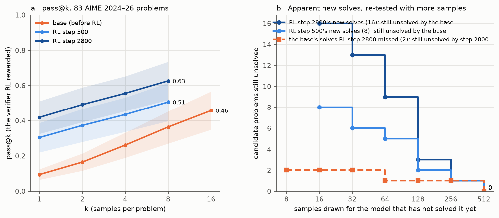
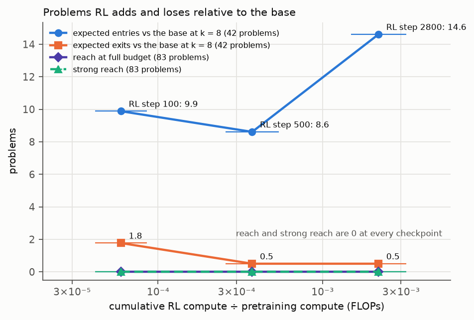
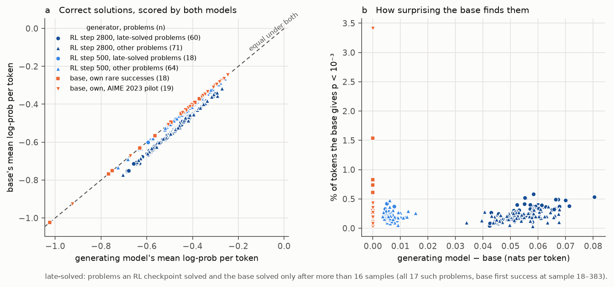

# olmo-rlzero-pilot: along Olmo 3.1 7B RL-Zero-Math's RL trajectory, RL raises pass@1 on 83 AIME 2024–26 problems from 0.094 (base) to 0.419 (step_2800), but RL's own verifier credits the base with all 17 RL-only solves within 383 samples (median 73): reach and strong reach are 0, and step_2800's reverse is 0, at K ≤ 512; read by hand, 10 of the 17 resolving base solutions are sound; the pre-registered verdict is "inconclusive"

Status: completed 2026-11-03 and reviewed 2026-11-03. **No hard-constraint violation, nothing quarantined.** Before
reading the executor's write-ups, the reviewer did the following with their own code:
- ran AI2's `MathVerifier` from upstream open-instruct source (bb58c66), the way RL ran it, and re-graded all 4,572
  samples whose text is stored: 914 are `rl`-correct, and there are **0 disagreements** with the executor's grades.
  Every stored text equals the decode of its token ids;
- rebuilt the 315-cell (model × problem) table from the raw rows: **all 315 cells equal `results.csv`**;
- recomputed pass@k, the matched-k entries and exits, reach both ways round, the verdict inputs, the likelihood phase
  (250 items) and the compute axis;
- checked three things against their sources: the problems and answers against MathArena (byte for byte), the template
  against open-instruct, and the decoding settings in all 17 job meta files and vLLM engine lines. They also re-derived
  the speculative-decoding gate from the graded rows;
- ran their own Dolci contamination scan, and re-aggregated the executor's raw midtraining scan;
- had six reader sub-agents read 30 full solution texts (the 20 that decide the headline and 10 more) and check the
  mathematics. The reviewer confirmed two of the verdicts by their own reading.

The review notes an exposure caveat. Before phase 1, the reviewer's context already held the headline: the commit
subjects, and a memory note the executor had written. The reviewer's tables were still computed with their own code
from the raw rows; `results.csv` and `compute_axis.csv` were compared only afterwards.

- **What stands (the review's verdict).** It stands under RL's verifier, the pre-registered primary grade. The models
  are base `Olmo-3-1025-7B` `main` and RL-Zero-Math `step_0100` / `0500` / `2800`, 7.3 B, pretrained. What stands:
  - every pass@k, the matched-k entries and exits, and the compute axis;
  - the 17 candidates: RL's verifier credited all 17 RL-only solves to the base within 383 samples (median 73). Strong
    reach, reach and reverse are all 0 at K ≤ 512 for step_2800, and reach is 0 at every checkpoint;
  - the pre-registered verdict, "inconclusive", which was correctly derived and reported;
  - the 78 late-solved RL solutions sit inside the base's per-token log-probability range;
  - the contamination exclusions;
  - the spend: $39–40 of $50.
- **Must be reworded** (the review's items):
  1. **"Complete solutions"** (plain summary and `numbers.md`). The claims "with complete worked solutions, not lucky
     guesses" and "every one is a complete solution … with a correct 'Answer:' line" are wrong. The hand-check replaces
     them:
     - of the 17 resolving base solutions, 10 are sound, 6 reach the official answer through a flawed step, and 1
       (aime2024_20) is a guess;
     - none has an `Answer:` line; all box their answer, and 2 are cut at 16,384 tokens;
     - on aime2024_20, all 5 RL successes are guesses too. On aime2026_26, all 5 share the base's gap: none verifies
       the seven-value count.
  2. **aime2025_14.** step_2800's draw-280 success is a guess: it computes 34, then boxes 60. The base's only credit
     there is probably the verifier accepting a restated 60° angle (its text is lost). So on the evidence neither model
     solves aime2025_14. The reverse count stays 0, but not because step_2800 can solve it.
  3. **"In the base's support."** Qualify it as the pre-registered per-token range, and add the whole-solution gap: a
     median 731 nats for step_2800's late-solved solutions. "Every correct RL solution" becomes "every scored RL
     solution (213 of 718), against the base's own solutions including AIME 2023".
  4. **"Outputs unchanged"** (write-up and memo) → "no detectable change in pass@1 or length (exact speculative
     sampling)".
  5. **Expectations vs outcomes.** Add the five omitted misses, especially step_0100's: pass@1 already 0.30, and 2×
     length, at 4–9 × 10⁻⁵ of pretraining compute.
  6. **Smaller items:**
     - label the step_0100 table's length column;
     - put the 7 weight-distance pairs into an artefact, or call them log-only;
     - report or drop the promised templated-relatives sensitivity;
     - fix the memo's "three verbatim" and "none is a catalogue price";
     - change "sharpening alone never does" to "generally does not".
- **Not supported:**
  - "not lucky guesses";
  - any reading of "reach 0" stronger than **"credited by RL's verifier"**.

  A single base success removed 16 of the 17 candidates from reach: only aime2025_25 had 2 base successes. RL's strong
  reach needed ≥ 2 successes including a fresh one. The rule is asymmetric, and one of those single base successes is
  a guess. This weakens no number, but it limits the inference. "The base can do everything RL can" is shown at the
  level of the verifier's credit. At the level of sound derivations, it is shown for 10–16 of the 17 problems, and on
  the other two the RL solutions are no better.

Review: [`review_olmo-rlzero-pilot.md`](https://github.com/dan-pandori/nd-takehome/blob/525e2e0e/review_olmo-rlzero-pilot.md)
(fork `dan-pandori/nd-takehome`, branch `dan_olmo-rlzero-pilot`; §Recount `dfb3a406`, §Compare and §Verdict
`525e2e0e`; kit `review/olmo-rlzero-pilot-recount/`). Run files at the executor's last commit
[`046d217a`](https://github.com/dan-pandori/nd-takehome/commit/046d217a) (DONE `08595ca4`):
- `run_olmo_rlzero_pilot.md`, `numbers.md` § olmo-rlzero-pilot, and `log.md`;
- `olmo_pilot/`: code, the problem manifest, `results.csv`, `likelihood.csv`, `plain_summary.md` and `decision_32b.md`;
- the pre-registration `preregistration/olmo-rlzero-pilot.md`: Part A `255151cd`, Part B `01d95ecc`.

Brief: [`BRIEF_olmo-rlzero-pilot.md`](../../docs/proposals/followups/BRIEF_olmo-rlzero-pilot.md);
[proposal 34](../../docs/proposals/2026-11-02-olmo-rlzero-pilot.md).

Copies here, with the review's corrections marked *[review]*:
- **the plain-language summary**: [`plain_summary.md`](plain_summary.md);
- **the 32B decision memo**: [`decision_32b.md`](decision_32b.md). It holds the measured sampling prices, the 32B
  model and checkpoints, three costed designs, and the changes the pilot suggests.

Question (Dan, 2026-11-02): our controlled results say RL mostly amplifies what pretraining contains. Does that hold
for a real open model with public RL checkpoints? The near-frontier test is Olmo 3.1 Think 32B: its RL used ≈ 14 %
as many GPU-hours as its pretraining, and 46 RL checkpoints are public. It is expensive, so this pilot runs first on
Olmo 3.1 7B RL-Zero-Math. There RL starts straight from the base, with no SFT or DPO in between. It has 28 public
checkpoints and public RL data, and an RL share of ≈ 10⁻³. The pilot is two things:
- a from-base trajectory test at large k. Olmo 3's own report claims "RLVR pushes the model beyond its initial
  capabilities" from pass@32 alone;
- a pipeline and throughput test that turns the 32B estimate into a measured cost.

## Configuration

- **Models** (all 7.3 B `Olmo3ForCausalLM`, pretrained, not from scratch, bf16; natural-language maths, no Lean):
  - **base**: `allenai/Olmo-3-1025-7B` @ `main`. This is `stage3-step11921` (identical shard LFS oids, checked by the
    review): 7.30 B parameters, no post-training.
  - **RL**: `allenai/Olmo-3.1-7B-RL-Zero-Math` at `step_0100`, `step_0500` and `step_2800` (= `main`). This is RLVR
    straight from the base on `allenai/Dolci-RL-Zero-Math-7B` @ 93b5e498 (last data upload 2025-11-19), with
    open-instruct's RL-Zero math recipe at commit bb58c66.
  - **The RL start.** step_0100 is at relative L2 distance 2.59 × 10⁻⁴ from base `main` (one shard, 136 tensors). The
    comparison with other base revisions is in `log.md` only: 1.2 × 10⁻² to `stage3-step11000` and 0.31 to
    `stage2-step47684`. The pulled-back `weight_dist.jsonl` holds only the rl100–base and rl200–rl100 rows. So the
    start revision is measured but not reproducible from the pulled-back files.
- **Problems.** MathArena AIME 2024 I/II, 2025 I/II and 2026 I/II: 90 problems, all after the Dec 2023 data cutoff.
  The review checked all 120 statements and answers byte for byte (with the AIME 2023 pilot set). The **headline set
  is 83**, after 7 contamination exclusions decided at 02:30 UTC, before any evaluation sampling:
  - aime2024_13: a digit-changed variant in the RL data;
  - aime2024_22 and aime2024_24: RL-data variants, confirmed by reading;
  - aime2024_16, aime2024_27 and aime2024_28: in midtraining at 8-gram containment 1.00, 0.82 and 0.52;
  - aime2026_01: verbatim in both, with the same answer.

  The rule: 8-gram containment ≥ 0.5 against Dolci-RL-Zero-Math-7B or the 14 math, reasoning and instruction subsets
  of the Dolmino midtraining mix (6,465 shards, 35,963,968 documents), or a variant confirmed by reading among
  IDF-weighted matches ≥ 0.3. The web and code subsets of midtraining and the pretraining mix were not scanned. AIME
  2023 (30 problems, contaminated) served for Stage 0, the gate, and 19 of the 37 base likelihood controls in phase
  L; it enters no evaluation number.
- **Sampling** (every model and phase): RL's template `olmo_thinker_rlzero`, temperature 1.0, top-p 1.0, at most
  16,384 response tokens, EOS stop only. Runs used vLLM 0.11.0 (the version open-instruct pinned for RL) with bf16
  weights, KV cache auto and prefix caching on. Every evaluation job used n-gram speculative decoding (4 draft tokens);
  Stage 0 was plain. A pre-registered gate on AIME 2023 adopted speculation (base, 8 × 30):
  - throughput 758.7 / 557.2 = 1.36 against a rule of ≥ 1.25;
  - pass@1 difference CI [−0.035, 0.054];
  - mean-length difference CI [−1,131, 729] tokens.

  Both intervals contain 0. In the review's words, that is no detectable change in pass@1 or length; speculative
  sampling is exact only in exact arithmetic.
- **Grade.** A sample is correct iff open-instruct's `MathVerifier` accepts it, run **the way RL ran it** (`rl`). In
  RL it runs in a worker thread, where `is_equiv`'s `signal.alarm` timeout raises and returns False, so only
  `hendrycks_is_equiv` can reward. The verifier never reads an `Answer: N` line, which is what the prompt asks for. It
  rewards only `\boxed{}`, a Minerva phrase, the last `$…$` pair, or the whole output. Two more grades are reported
  beside it: `main` (the same verifier with sympy live, in the main thread) and `ansline` (the integer on the last
  `Answer:` line, else the last `\boxed{}`).
- **Design** (pre-registration Part B, the ≈ $43 default; the brief's k-512 design would cost ≈ $1,000 at Stage 0's
  prices, see Deviations). Phases:
  - **F (fixed budget, all 90 problems):** base 16, step_2800 8, step_0500 8 and step_0100 8 samples per problem
    (step_0100 ran on a seeded 45-problem half, 42 headline; see Deviations). Matched k = 8 for every between-model
    comparison.
  - **C (confirmation):** fresh samples for each headline reach candidate from the RL checkpoints that solved it: 16
    each for step_2800 and 8 each for step_0500, instead of the registered 24 (budget rule, below).
  - **E (adaptive extension):**
    - reach candidates go to the base, and reverse candidates (base ≥ 1 in F, step_2800 0 / 8) to step_2800;
    - sampling is sequential until the first `rl`-correct chunk, up to K. Chunks were 16 samples in passes 1 and 2
      (registered: 32), and pass 3 was restarted with 32;
    - pass 1 used K = 128, then 256 for the three still unsolved, then 512 for one. Passes 2 and 3 were pre-registered
      and budget-gated.
  - **P (probe):** 64 Dolci prompts × 1 sample per checkpoint, for the compute axis's low bound.
  - **L (likelihood):** the RL checkpoints' correct solutions on the candidates and controls, teacher-forced under the
    base and under the generating checkpoint.
- **Definitions** (Part A, as amended in Part B):
  - **Reach of checkpoint c:** ≥ 1 correct sample of c in its fixed budget, and 0 correct base samples in the base's
    whole budget on that problem.
  - **Reverse:** the same with base and c swapped, with c given the same extension rule.
  - **Strong reach:** a reach problem where c has ≥ 2 correct samples including ≥ 1 fresh confirmation sample; the
    base also has 0 `ansline`-correct samples; the base budget there is ≥ K* (the extension budget actually reached);
    and the problem is not flagged as contaminated.
  - **Verdict rule:**
    - "RL extended reach" needs ≥ 3 strong-reach problems, exceeding the reverse count by ≥ 2.
    - "Elicitation only" needs two clauses: (a) 0 strong reach, or strong reach ≤ reverse; and (b) the base's pass@k
      reaches the final's within the 95 % interval at matched k = 8 (and, on the candidates, at the extension
      budget).
    - Anything else is "inconclusive at this budget".
- **Compute axis** (rl-compute-share's definitions): 6ND with N = 7.3 × 10⁹ and D = 6.08 × 10¹² tokens, and 32
  prompts × 8 samples per RL step.
  - The low bound uses the probe lengths, oversampling 1, no extra forward pass and no prompt tokens.
  - The high bound uses the AIME lengths, oversampling 3, one extra forward pass and 180 prompt tokens.
  - The oversampling of 1–3 for active sampling is an assumption, not a measurement.
- **Gate 0.** The budget ($50 / 90 pod-hours) was registered at 01:04 UTC. Part A of the pre-registration was
  committed at 01:20:39, before the first pod (01:21:38). Part B was committed at 03:33:40, after Stage 0 and before
  any evaluation-set sampling: the gate ran 03:34–04:07 on AIME 2023 only, and phase F started at about 04:09.
- **Pods and cost** (RunPod; the review's table plus the librarian's billing read). Every pod has been deleted.

  | pod | GPU | used for | hours | RunPod billed |
  |---|---|---|---|---|
  | `orz-a` | A100-SXM4-80GB, community, $1.39/h | Stage 0, the midtraining scan, the gate, F_base and P_base. Its host failed at 07:54, so the F_s0100 job running on it is void. Three recovery attempts failed (a restart at ≈ 08:15, starts at 14:33 and 16:09; stopped at 08:23 and 14:40), and the pod was terminated at 16:15 | 7.24 | $8.96 |
  | `orz-b` | H200, community, $3.59/h | the Stage-0 likelihood test and the CPU weight-distance check (its 7-pair output was never pulled back, hence log-only); GPU work failed on a broken CUDA stack, and the pod was deleted | 0.23 | $0.82 |
  | `orz-c` | A100 80GB PCIe, secure, $1.79/h | F_s2800, P_s2800, E1_base | 7.21 | $12.98 |
  | `orz-d` | A100-SXM4-80GB, community, $1.39/h | F_s0500, P_s0500, the void F_s0100b, then C_s2800, E1_s2800 and C_s0500. After `orz-c`'s deletion at 11:07 it ran everything left: passes 2 and 3, phase L, and step_0100's half and probe | 11.85 | $16.50 |

  The table sums to 26.52 pod-hours and $39.26 billed so far ($38.93 GPU and $0.32 disk, rounded). The RunPod
  balance fell $39.36 ($209.90 → $170.54), and that is the ledger figure, **$39.36**. `podbudget` derives $40.26 from
  the listed rates and booked hours.
- **Bucket** (public): `hf://buckets/dan-pandori/nd-rl/olmo-rlzero-pilot/` (132 objects, ≈ 0.17 GB). It holds:
  - `artifacts/olmo_pilot/`: samples with texts and token ids, grades, likelihood items and scores, the midtraining
    scan and `meta/weight_dist.jsonl` (the job meta files and logs are in git);
  - `olmo_pilot/` (code and results), `pod/olmo_pilot/`, `figures/` and `docs/`;
  - `data/olmo_pilot/`: the Dolci-RL-Zero-Math-7B parquet @ 93b5e498.

  Registry rows are at `hf://buckets/dan-pandori/nd-rl/registry/olmo-rlzero-pilot/`. No model weights were uploaded.
  Lost with `orz-a` (never pulled back) were the sample texts of F_base (1,440), P_base (64) and g_spec_base (240), and
  the last 96 of s0_base's 480. Their grades survive.

## Observations (the review's numbers)

All numbers below use the `rl` grade on the 83 headline problems unless a row says otherwise.

### pass@k (Chen estimator on phase-F samples, problem-bootstrap 95 % intervals)

| model (7.3 B, pretrained) | problems | pass@1 | pass@8 | pass@16 |
|---|---|---|---|---|
| base `Olmo-3-1025-7B` `main` | all (83) | 0.094 [0.066, 0.125] | 0.364 [0.275, 0.455] | 0.458 [0.349, 0.566] |
| | aime2024 (24) | 0.107 [0.060, 0.156] | 0.448 [0.274, 0.625] | 0.542 [0.333, 0.750] |
| | aime2025 (30) | 0.096 [0.046, 0.154] | 0.326 [0.179, 0.480] | 0.400 [0.233, 0.567] |
| | aime2026 (29) | 0.082 [0.039, 0.134] | 0.335 [0.197, 0.482] | 0.448 [0.276, 0.621] |
| RL-Zero-Math `step_0500` | all (83) | 0.304 [0.223, 0.390] | 0.506 [0.398, 0.614] | — |
| | aime2024 (24) | 0.417 [0.250, 0.583] | 0.667 [0.458, 0.833] | — |
| | aime2025 (30) | 0.263 [0.133, 0.408] | 0.433 [0.267, 0.600] | — |
| | aime2026 (29) | 0.254 [0.134, 0.388] | 0.448 [0.276, 0.621] | — |
| RL-Zero-Math `step_2800` (= `main`) | all (83) | 0.419 [0.330, 0.509] | 0.627 [0.518, 0.723] | — |
| | aime2024 (24) | 0.536 [0.365, 0.703] | 0.750 [0.583, 0.917] | — |
| | aime2025 (30) | 0.342 [0.200, 0.496] | 0.533 [0.367, 0.700] | — |
| | aime2026 (29) | 0.401 [0.254, 0.556] | 0.621 [0.448, 0.793] | — |
| RL-Zero-Math `step_0100` (its half) | all (42) | 0.301 [0.208, 0.399] | 0.643 [0.500, 0.786] | — |
| | aime2024 (17) | 0.316 [0.162, 0.478] | 0.588 [0.353, 0.824] | — |
| | aime2025 (10) | 0.300 [0.100, 0.525] | 0.600 [0.300, 0.900] | — |
| | aime2026 (15) | 0.283 [0.150, 0.433] | 0.733 [0.533, 0.933] | — |

- step_2800's pass@1 is ≈ 4.5× the base's. The paired pass@8 difference step_2800 − base is **0.262 [0.179, 0.352]**.
- Solved within phase F: base 38 of 83 (16 samples); step_0500 42 and step_2800 52 (8 samples each).
- The executor's intervals differ from these by at most one bootstrap step (2,000 vs the review's 10,000 resamples).

**step_0100** was sampled on 45 of the 90 problems (42 headline; see Deviations). On those same 42:

| model | pass@1 | pass@8 | expected entries / exits vs base at k = 8 |
|---|---|---|---|
| base | 0.116 [0.074, 0.161] | 0.450 [0.323, 0.577] | — |
| step_0100 | 0.301 [0.208, 0.399] | 0.643 [0.500, 0.786] | 9.88 / 1.77 |
| step_0500 | 0.402 [0.283, 0.524] | 0.643 [0.500, 0.786] | 8.61 / 0.50 |
| step_2800 | 0.562 [0.440, 0.685] | 0.786 [0.667, 0.905] | 14.61 / 0.50 |

**Mean response length and truncation** (phase F, headline, per sample). The cap is RL's own response length, so
truncation is part of the protocol. RL ran with `mask_truncated_completions False`.

| model | mean tokens | share cut at 16,384 |
|---|---|---|
| base | 5,863 (5,593 on the 42) | 15.2 % |
| step_0100 (its 42) | 11,309 | 31.5 % |
| step_0500 | 11,755 | 24.2 % |
| step_2800 | 11,745 | 18.1 % |

step_2800 writes 2.00× the base's length, and step_0100 already writes 2.02× (on the same 42).

### Matched k = 8: expected entries into and exits from the solved set

| comparison | problems | entries | exits |
|---|---|---|---|
| step_0500 vs base | 83 | 14.04 | 2.27 |
| step_2800 vs base | 83 | 22.77 | 1.00 |
| step_2800 vs step_0500 | 83 | 12.00 | 2.00 |
| step_0100 vs base | 42 | 9.88 | 1.77 |
| step_0500 vs step_0100 | 42 | 3.00 | 3.00 |

The paired problem bootstrap of the entry differences vs base:
- step_2800 − step_0500: **+8.73 [2.97, 15.23]** on 83 problems. Entries grow.
- step_0500 − step_0100: −1.27 [−5.50, 2.50] on 42. No growth is detected between steps 100 and 500.
- step_2800 − step_0100: +4.73 [1.23, 8.73] on 42.

### Reach both ways round, and how the candidates resolved

| checkpoint | reach (c's F) | reach (c's F + C) | strong reach | reverse (c's whole budget) | reach / reverse under `main` | under the review's integer read-out |
|---|---|---|---|---|---|---|
| step_0100 | 0 | 0 | 0 | 7 | 0 / 7 | 0 / 6 |
| step_0500 | 0 | 0 | 0 | 13 | 0 / 13 | 0 / 12 |
| step_2800 | 0 | 0 | 0 | 0 | 0 / 0 | 1 / 0 (aime2025_14) |

The intermediates' reverse counts rest on 8 samples of c; only step_2800 got the reverse extension, so they are not
symmetric.

- **The 17 reach candidates** are the headline problems that step_2800 or step_0500 solved in F (≥ 1) and the base
  did not (0 of 16). step_2800 has 16 of them and step_0500 8. The extension followed its rule exactly, and **RL's
  verifier credited the base on every candidate**. The base's first successes came at draws 18, 25, 31, 39, 45, 46,
  64, 73, 73, 77, 79, 83, 91, 104, 168, 248 and 383 (median 73). Each of these first successes is also
  integer-correct. step_0100's six F solves where the base had 0 in F are all among the 17.
- **The 2 reverse candidates** (base ≥ 1 in F, step_2800 0 / 8), plus aime2025_22 by symmetry, were all credited to
  step_2800 by RL's verifier (the aime2025_14 credit is a guess; see the hand-check):
  - aime2024_29 at its 53rd sample;
  - aime2025_14 at its 280th of 288;
  - aime2025_22, a reach candidate that only step_0500 had solved. The base then solved it in its extension, so
    step_2800 got the symmetric extension and solved it at its 12th sample.
- **At K = 128 the picture was different.** After the base's first 128 samples, three candidates were still unsolved:
  aime2024_10, aime2024_26 and aime2025_25. step_2800 had F + C successes of 1 + 3, 3 + 3 and 1 + 3 on them, and all
  three met the strong-reach definition at K* = 128. Reverse stood at 1, or 2 counting aime2025_22. So after pass 1
  the rule sat on its "RL extended reach" threshold. Passes 2 and 3 removed all three, with first successes at 168
  (aime2024_10), 383 (aime2024_26) and 248 (aime2025_25).
- **Confirmation** (fresh samples): step_2800 had ≥ 1 fresh correct sample on 14 of its 16 candidates (16 each), and
  step_0500 on 5 of 8 (8 each).
- **The verdict** by the pre-registered rule, as amended in Part B, is **"inconclusive at this budget"**:
  - it is not "extended": strong reach is 0 and reverse is 0;
  - "elicitation only" fails its clause (b). Clause (a) holds, since strong reach is 0. But at matched k = 8 the base
    (0.364 [0.275, 0.455]) does not reach the final (0.627 [0.518, 0.723]): the gap is 0.262 [0.179, 0.352]. On the
    candidates at the extension budget, clause (b) would hold, because RL's verifier credited the base on all 17
    within 512 samples (383 at most).

### What the base's resolving solutions are (hand-check of 30 texts)

The brief asked for a hand-check of 20 counted successes. The reviewer chose the 20 that decide the headline: the base's
first success on each of the 17 candidates, and step_2800's resolving success on the 3 reverse or symmetric problems.
Six reader sub-agents read each full text and checked the mathematics, mostly by script. **In all 30 texts the
verifier matched the response's own last `\boxed{}`**, so there are no extraction artefacts. The derivations vary:

| problem | sample | tokens | role | derivation |
|---|---|---|---|---|
| aime2024_09 | base E1 c5 i2 | 15,922 | base's 1st success (83rd) | FLAWED: limit direction backwards, invalid algebra; boxes 480 |
| aime2024_10 | base E2 c10 i7 | 6,784 | (168th) | GENUINE |
| aime2024_14 | base E1 c6 i7 | 12,340 | (104th) | GENUINE |
| aime2024_18 | base E1 c1 i1 | 4,071 | (18th) | GENUINE (minor slips) |
| aime2024_20 | base E1 c4 i14 | 8,263 | (79th) | **GUESS**: tries formulas until one gives a clean number ("not sure… tentatively… 80") |
| aime2024_26 | base E3 c19 i30 | 13,566 | (383rd) | FLAWED: assumes a coordinate equals 100; the count is right |
| aime2025_12 | base E1 c4 i8 | 9,041 | (73rd) | FLAWED: two sign errors pick the mirror region (same area) |
| aime2025_21 | base E1 c1 i14 | 16,384 (cut) | (31st) | FLAWED (borderline genuine): proceeds "without resolving the contradiction" |
| aime2025_22 | base E1 c4 i8 | 9,075 | (73rd) | GENUINE |
| aime2025_24 | base E1 c2 i6 | 8,872 | (39th) | FLAWED: n = 140, t = 9 instead of 139, 10, and the errors cancel |
| aime2025_25 | base E2 c15 i7 | 16,384 (cut) | (248th) | GENUINE (later self-retracted, then truncated) |
| aime2025_29 | base E1 c3 i15 | 14,535 | (64th) | GENUINE |
| aime2026_03 | base E1 c2 i12 | 7,438 | (45th) | GENUINE |
| aime2026_22 | base E1 c4 i12 | 8,207 | (77th) | GENUINE |
| aime2026_23 | base E1 c5 i10 | 10,169 | (91st) | GENUINE |
| aime2026_24 | base E1 c1 i8 | 12,766 | (25th) | GENUINE |
| aime2026_26 | base E1 c2 i13 | 14,212 | (46th) | FLAWED: right candidates {12, 132}, miscounts, takes the greatest |
| aime2024_29 | step_2800 E1 c3 i12 | 14,140 | reverse resolved (53rd) | GENUINE |
| aime2025_14 | step_2800 E3 c17 i23 | 11,321 | reverse resolved (280th) | **GUESS**: computes m+n+p = 24+7+3 = 34, then boxes 60 |
| aime2025_22 | step_2800 E2 c9 i3 | 10,664 | symmetric extension resolved (12th) | GENUINE |

The base's tally is **10 genuine, 6 flawed but arriving, 1 guess**. For the two weakest base resolutions, every RL
success on the same problem was read too:
- **aime2024_20:** all 5 are guesses (3 from step_2800, 2 from step_0500). They land on 1/s = Σ 1/a without deriving
  it, as the base did.
- **aime2026_26:** none of the 5 is genuine (3 from step_2800, 2 from step_0100). Each reaches the S = 0 candidates and
  takes the larger without verifying the count, the base's own flaw.

So on these two problems RL raised the rate of the same incomplete answer: step_2800's 3 / 24 against the base's
1 / 80 on aime2024_20, and 3 / 24 against 1 / 48 on aime2026_26. It did not produce a better derivation. (The
reviewer corrected one rubric error: on aime2026_26 both n = 12 and n = 132 give seven values, and the problem asks
for the greatest n, so the base's sample is FLAWED, not a guess.)

### aime2025_14: the base's only credit is probably a verifier false positive

- **The base's credit.** Its only `rl` success in 16 samples (F_base chunk 0, i 9) is 549 tokens long. It has no
  integer read-out, and it is not `ansline`-correct.
- **Why that is suspicious.** The statement contains `$\angle B=\angle E=60^{\circ}$`, and the answer is 60. The
  verifier strips `^{\circ}` and accepts a response whose last `$…$` restates that angle. The review demonstrated
  this: "…where $\angle B = 60^\circ$, we get…" earns 1 when the answer is 60, while "Answer: 60" earns 0. The
  sample's text is among the lost F_base texts, so it cannot be read.
- **step_2800's credit** is the confirmed guess above.

On the evidence, neither model solves aime2025_14. It is the one problem whose solved status hinges on an `rl`-correct
base sample with no correct stated integer. Six other base samples share that property (1 each on aime2024_25,
aime2025_01, aime2025_02 and aime2026_08, and 2 on aime2025_17), but their problems all have other integer-correct base
successes.

### Likelihood (phase L, 250 scored items; teacher-forced, vLLM prompt log-probs, bf16)

The review found the phase's integrity clean:
- every item's token ids equal the stored sample's;
- every item is `rl`-correct;
- every prompt equals the template tokenisation;
- the stored per-token log-probs reproduce the item statistics.

There is no "reach" group, because there are no reach problems. The substitute is "late": up to 4 randomly chosen
`rl`-correct solutions per problem from each RL checkpoint on the 17 candidates (step_2800 60, step_0500 18).

| group | items (problems) | base mean log p / token (median) | own (median) | gap own − base, median [p10, p90] | summed gap, median (nats) | inside base_own range | inside base_own + pilot | inside, other problems only |
|---|---|---|---|---|---|---|---|---|
| late | 78 (17) | −0.546 | −0.492 | 0.053 [0.006, 0.066] | 646 | 1.00 | 1.00 | 1.00 |
| ckpt_other | 135 (37) | −0.454 | −0.431 | 0.043 [0.005, 0.060] | 192 | 0.90 | 1.00 | 0.90 |
| base_own | 18 (17) | −0.435 | −0.435 | 0.000 | 0 | 0.89 | 0.94 | 0.83 |
| base_own_pilot | 19 (9) | −0.334 | −0.334 | 0.000 | 0 | 0.37 | 0.95 | 0.37 |

- **Control ranges.** The 2.5–97.5 % range (the pre-registered criterion) of base_own, the base's own correct
  solutions, all on the 17 candidates, is −0.915 to −0.345 (n = 18). Adding the contaminated AIME 2023 pilot gives
  −0.936 to −0.246 (n = 37). Part A asked for controls "on other problems"; a leave-same-problem-out variant gives
  the same 1.00 for "late".
- **By generator** (the executor's numbers, reproduced): the per-token gap is 0.057 at step_2800 on the late-solved
  problems and 0.053 on the others; step_0500's is 0.006 and 0.006. The whole-solution gap (median) is **731 / 388
  nats for step_2800** and 76 / 46 for step_0500.
- **What the criterion shows.** In the review's reading, the per-token criterion is weak evidence of "support". For
  the late solutions (median 12,566 tokens) the median summed gap is **646 nats**: for the median solution, the base
  gives that exact text about e^−646 times the generator's probability.
- Only 213 of the RL checkpoints' 718 successes were scored. step_0100's solutions were never scored, because phase L
  ran before step_0100's phase F.

### Contamination and the nearest RL training prompt

- **Dolci, the review's own scan.** It used three measures: word 8-gram containment, 8-gram containment with numbers
  masked, and character 50-grams. Five evaluation problems are at ≥ 0.3 on any measure: aime2024_13 (masked 1.00),
  aime2024_22 (0.40), aime2024_24 (0.31) and aime2026_01 (verbatim), all excluded, and aime2026_14 (0.375), kept.
  - aime2026_14 matches boilerplate only (a tetrahedron problem) and is rightly kept.
  - The aime2024_22 match reads "smallest … changes to 8" against the problem's "greatest … changed to 1": a variant.
- **Midtraining, re-aggregated from the executor's raw per-shard output** (6,465 shards, 35,963,968 documents, 14
  subsets, no duplicate shards). Every evaluation problem at ≥ 0.5 is excluded: aime2024_16 (1.00), aime2024_27
  (0.82), aime2024_28 (0.52) and aime2026_01 (1.00). The review read the best snippets of the problems between 0.3
  and 0.5, including the candidates aime2024_26 (0.39) and aime2025_12 (0.32): boilerplate or shared polynomials, not
  variants.
- **The templated-relatives sensitivity** (promised in the log, never reported). The review computed it: ≤ 0.015 on
  pass@1 and pass@8 of the base, step_0500 and step_2800, and no effect on reach.
- **Nearest RL training prompt** (brief item 6; the executor's statistics, reproduced from the stored values):
  - by IDF-weighted 5-gram containment, the candidates are no closer to the RL data than the other headline problems
    (median 0.082 vs 0.066, permutation p = 0.33);
  - by MiniLM embedding cosine they are slightly closer (0.706 vs 0.653, p = 0.018). This check was not
    pre-registered, and the review did not recompute the embeddings.

  The two templated RL-data relatives the embedding check found (aime2024_12, aime2025_15) are not candidates.

### Compute axis (cumulative RL ÷ pretraining compute; reproduced to 4 significant figures)

| step | low | high | geometric mean | mean response tokens: Dolci probe / AIME F |
|---|---|---|---|---|
| 0 (base) | — | — | — | 4,868 / 5,872 |
| 100 | 4.15 × 10⁻⁵ | 8.56 × 10⁻⁵ | 5.96 × 10⁻⁵ | 9,854 / 11,284 |
| 500 | 2.57 × 10⁻⁴ | 5.43 × 10⁻⁴ | 3.73 × 10⁻⁴ | 9,332 / 11,790 |
| 2800 | 1.49 × 10⁻³ | 3.22 × 10⁻³ | 2.19 × 10⁻³ | 9,743 / 11,712 |

The AIME lengths here are phase-F means over every problem sampled: all 90, or step_0100's 45-problem half.

### Compute per arm (registry rows `artifacts/olmo-rlzero-pilot/registry/`; one A100-80GB per job)

The registry has 156 rows covering 21 sampling jobs. For each of the 18 jobs with a meta file, the review found the
rows equal it; there GPU-seconds are model load plus generation. P_base's are estimated, and the void runs' are
wall-clock times from the logs. No training and no Lean: `train_steps`, `train_tokens` and `lean_checks` are 0
throughout, and verifier checks equal samples.

| model | phase | GPU-h | generated tokens | samples |
|---|---|---|---|---|
| base | Stage 0 + gate (AIME 2023) | 2.10 | 4.53 M | 720 |
| base | F | 3.04 | 8.46 M | 1,440 |
| base | E (extension, K 128 → 512) | 4.28 | 10.44 M | 1,472 |
| base | P (estimated: meta lost) | 0.13 | 0.31 M | 64 |
| step_2800 | Stage 0 | 0.44 | 0.73 M | 60 |
| step_2800 | F | 3.58 | 8.43 M | 720 |
| step_2800 | C | 1.51 | 3.57 M | 256 |
| step_2800 | E (reverse and symmetric) | 1.97 | 4.14 M | 344 |
| step_2800 | P | 0.31 | 0.62 M | 64 |
| step_0500 | F | 3.29 | 8.49 M | 720 |
| step_0500 | C | 0.31 | 0.77 M | 64 |
| step_0500 | P | 0.26 | 0.60 M | 64 |
| step_0100 | F (the 45-problem half) | 1.55 | 4.06 M | 360 |
| step_0100 | P | 0.27 | 0.63 M | 64 |
| step_0100 | void runs (F_s0100, F_s0100b; none used) | 1.52 | 0 recorded | 0 |
| all | likelihood scoring | 0.13 | 0 (4.38 M tokens scored) | 250 items |

- **Totals.** 24.68 GPU-h in jobs (sampling 24.55) and 55.8 M generated tokens recorded. The void runs record 0
  generated tokens, but F_s0100b's own log shows 2,050,941 tokens at 08:55 UTC. So the rows understate generated
  tokens by at least ≈ 2 M (review R6).
- **Matching.** The pre-registration matches the arms at k = 8 for every between-model comparison. Reach and reverse
  compare budgets of different sizes instead: c's fixed budget against the base's whole budget for reach, and c's
  whole budget for reverse. By design, therefore, **the base drew more than 1.25× step_2800's samples**, and over the
  whole run 1.36× its tokens, though not 1.25× its GPU-h. The ratios are the librarian's, from the registry rows:
  - in phase F: 2.0× the samples (16 vs 8 per problem), but 1.00× the tokens and 0.85× the GPU-h;
  - over the whole run: 2.56× the samples (3,696 vs 1,444), 1.36× the tokens and 1.22× the GPU-h (sampling rows;
    1.23× with the likelihood-scoring rows).

  `numbers.md` flags this ("by design"); the write-up has no per-arm table (the review's policy note).

## Expectations against outcomes

The review's scoring (Part B's B4; `rl` grade, 83 headline problems):

| expectation (Part B, committed before evaluation sampling) | outcome | |
|---|---|---|
| base pass@1 0.03–0.08 | 0.094 | **miss** (above) |
| base pass@8 0.12–0.28 | 0.364 | **miss** (above) |
| base pass@16 0.18–0.35 | 0.458 | **miss** (above) |
| step_2800 pass@1 0.10–0.25 | 0.419 | **miss** (above) |
| step_2800 pass@8 0.25–0.50 | 0.627 | **miss** (above) |
| step_0100 pass@1 within ± 0.03 of the base's | 0.301 vs 0.116 (same 42) | **miss** |
| step_0500 between base and final | 0.304 | hit |
| step_2800 mean length ≥ 1.4 × base | 2.00 × | hit |
| step_0100 mean length within ± 20 % of base | 2.02 × (same 42) | **miss** |
| step_2800 reach 2–8 after pass 1 | 3 after pass 1 (0 after pass 3) | hit |
| strong reach 0–3 | 0 (3 at K* = 128) | hit |
| reverse 1–5 | 1 after pass 1, 0 at the end | hit after pass 1, **miss** at the end |
| entries vs base grow 0100 < 0500 < 2800 | 0100 9.88 vs 0500 8.61 (same 42), then 2800 14.61 | **miss** for 0100 < 0500 |
| 0500 → 2800 growth within noise | +8.73 [2.97, 15.23] | **miss** (outside noise) |
| ≥ 75 % of reach solutions in support; gap 0.05–0.3 nats | no reach solutions; the "late" substitute 100 %, gap 0.053 | not testable as registered |
| verdict: inconclusive ≈ 55 % | inconclusive | the most probable outcome |
| spend ≤ $45 | $40.26 (podbudget) | hit |
| speculative decoding adopted (≈ 60 %) | adopted | — |

The write-up's expectations line omits five of these misses (the review's list):
- base pass@8 0.364 against 0.12–0.28, and base pass@16 0.458 against 0.18–0.35;
- step_2800 pass@8 0.627 against 0.25–0.50;
- step_0100 pass@1 0.30 against "base ± 0.03";
- step_0100 length 2.0× against "± 20 %";
- the step_0500 → step_2800 entry growth, +8.7 [3.0, 15.2] against "within noise".

The line does not state the reverse miss at the end either (the librarian's observation).

In the review's words, the step_0100 misses are informative: most of the change happens in the first 100 steps.

**Stage 0** (Part A's expectations, scored by the executor in Part B; the review reproduces the B1 table exactly):
- **Throughput** (base `main`, one A100-SXM4-80GB): 557 tok/s against 800–2,000, so $0.69 per million generated
  tokens against $0.2–0.6. The executor called both "too optimistic by ≈ 1.5–2×"; against the nearest edges of the
  ranges the misses are 1.4× and 1.15×.
- **Format:** 2 of the base's 41 integer-correct samples fail `rl`, against the expected 10–50 %.
- **step_2800 on AIME 2023:** mean length 12,249 tokens against 4,000–10,000, and a cut share of 21.7 % against
  2–15 %.
- **Just outside:** base mean length 6,353 against 1,500–6,000.
- **Inside:** base cut share (17.5 % in 3–25 %), base pass@1 0.085 (2–12 %) and pass@16 0.367 (20–45 %), and step_2800
  pass@1 0.383 (15–40 %; its pass@16 was not measured).
- **Weight distance** (moved into the main run): step_0100 is < 10⁻³ from base `main` (2.59 × 10⁻⁴), as expected. The
  "≥ 10× smaller than to another base revision" leg rests on log-only rows.

## The review's corrections to the executor's files

The executor's files on the fork are unchanged. The corrections to the plain summary and the memo are applied, marked
*[review]*, in the nd-rl copies: [`plain_summary.md`](plain_summary.md) and [`decision_32b.md`](decision_32b.md).

- **`run_olmo_rlzero_pilot.md`:**
  - "all 17 … were solved by the base when re-sampled" reproduces only under RL's verifier; by hand, the 17 resolving
    solutions are 10 sound, 6 flawed but arriving and 1 a guess;
  - in "fell to step_2800 at draws 12–280", the draw-280 success (aime2025_14) is a guess;
  - "gate: 1.36×, outputs unchanged" overstates (item 4);
  - "RL's solutions are in the base's support" needs the criterion and the whole-solution gap (item 3);
  - "By reach: elicitation only, up to 512 samples" stands only as an informal reading under RL's verifier, with the
    aime2025_14 and confirmation caveats;
  - the expectations line and the deviations list are incomplete (above);
  - it is 476 words against the brief's 400.
- **`numbers.md`:**
  - "every one is a complete solution of 4,071–16,384 tokens with a correct 'Answer:' line (`ansline` agrees)" is
    wrong. None of the 17 has an `Answer:` line; all box the right integer, so `ansline` agrees through its
    `\boxed{}` fallback, and 2 are cut at 16,384 tokens;
  - the reverse problems' draws are listed out of order;
  - the step_0100 table's "mean tokens" column mixes phases. For step_0500 and step_2800 it averages F + C + E
    samples per problem (10,918 / 10,992); phase F alone gives 10,998 / 10,970;
  - on aime2025_14, the conclusion goes further than `numbers.md` does (above).
- **`plain_summary.md`:**
  - "with complete worked solutions, not lucky guesses" is not supported;
  - "the RL model solved [the 3 reverse problems] with more attempts" needs the aime2025_14 caveat;
  - "every correct RL solution falls inside the range" is overgeneralised;
  - "sharpening alone never does" and "genuinely new problems never appeared" are too strong. Each holds only at
    ≤ 512 samples on 83 problems, and the second only under RL's verifier.
- **`decision_32b.md`:**
  - "outputs unchanged" (item 4);
  - "none is a catalogue price": the B200 ($5.98/h) and 2 × H100 ($5.38/h) rates were never billed in this pilot;
  - "three verbatim in midtraining": the containments are 1.00, 0.82 and 0.52;
  - its "Found" paragraph states the claims that items 2–3 and the "Not supported" note qualify; the librarian
    applied those qualifications there.
- **Two corrections to the review's own phase 1:**
  - the base-revision weight comparison was measured, but only in the log;
  - step_0100's half reproduces exactly as `random.Random(20261103).sample(eval_pids, 45)`, with the seed stated in
    `log.md`.

## Deviations from the pre-registration and the brief

- **The brief's sampling design was not run.** At Stage 0's measured prices ($0.69 per million generated tokens for
  the base, ≈ $1.0 for step_2800), k = 512 on base and final, 6 × 64 intermediates and base extension to 2,048 is
  ≈ 1.2 × 10⁹ tokens, ≈ $1,000. The executor asked Dan in `QUESTIONS.md` (03:33 UTC) and, unanswered, followed its
  default: Part B's ≈ $43 design. So the test is at k ≤ 512, with three RL checkpoints instead of seven.
- **The budget rule** (07:56 UTC, before any C or E result) followed the orz-a host failure and RunPod's lack of
  community capacity. It cut confirmation to 16 samples per problem for step_2800 and 8 for step_0500, instead of 24.
  step_0100's confirmation was never run. Extension chunks were 16 samples, not 32, in passes 1 and 2 (pass 3 was
  restarted at 13:32 with 32, because one problem with one chunk of 16 in flight cost ≈ 40 % more per token).
- **step_0100.** Its first phase-F run was lost with orz-a, and its second (F_s0100b) was stopped "for budget" after
  160 samples on 20 problems. Neither is used in any count. It was then run on a seeded random half: 45 of the 90
  problems, 42 headline, `random.Random(20261103)`. The rule was declared at 08:56, before any step_0100 result was
  used. The half is not stratified by year (20 / 10 / 15). step_0100 has no confirmation and no likelihood phase.
- **aime2025_22** got a symmetric extension for step_2800, because the base had solved it only in its extension.
- **Lost texts.** The texts of F_base (1,440), P_base and g_spec_base were never pulled back. So **137 of the base's
  155 counted successes (all its phase-F ones) cannot be re-graded or read**. Every RL arm's counted successes were
  re-graded from text (step_2800 389, step_0500 225, step_0100 104), and so were the base's 18 extension successes.
- **Likelihood controls** are on the same problems, plus the contaminated AIME 2023, not "on other problems". This is
  harmless: the leave-same-problem-out variant gives the same result.
- **The weight-distance pairs** (7 computed by `pod/olmo_pilot/wd.sh`) are not in the pulled-back artefact; only 2
  rows from the killed first run are.
- **The templated-relatives sensitivity**, promised in the log (05:20), was never reported. The review computed it
  (see Observations): no effect on reach.

## Interpretation (labelled; not tested here)

- **The executor's reading** (memo): "At ≈ 10⁻³ of pretraining compute, this RL elicits." The review limits this
  reading. It is shown at the level of RL's verifier's credit, up to 512 samples on 83 problems. At the level of sound
  derivations it is shown for 10–16 of the 17 problems, and on the other two the RL solutions are no better. It is one
  RL run (n = 1 trajectory).
- **Early change.** In the review's reading, most of the change happens in the first 100 RL steps. On the same 42
  problems, step_0100 (4–9 × 10⁻⁵ of pretraining compute) has all of step_2800's length increase, 68 % of its entries
  (9.88 of 14.61), 57 % of its pass@8 gain and 41 % of its pass@1 gain (0.116 → 0.301, against step_2800's 0.562). No
  growth in entries is detected between steps 100 and 500. (The shares are the librarian's, from the review's
  numbers.)
- **The same incomplete answer.** On aime2024_20 and aime2026_26, RL raised the rate of the base's own incomplete
  answer, and did not write a better derivation. This is two problems, read by hand.
- **Small RL.** The plain summary suggests that RL this small (≈ 10⁻³ of pretraining compute) may be exactly the
  regime where RL only sharpens. That is the reason for the 32B test, and it is untested here.

## Limitations

- **One model, one RL run** (AI2's): an n = 1 trajectory with three RL checkpoints (step_0100 on half the
  problems). The set is 83 problems, at ≤ 512 samples per problem on the candidates. A problem the base fails 512 times
  might still fall at 5,000.
- **The grade is RL's verifier**, as the brief requires. It rewards `\boxed{}`, a Minerva phrase, the last `$…$` or
  the whole output, never an `Answer:` line. It can credit a restated statement quantity (the review's
  demonstration), and that is probably the base's only credit on aime2025_14, whose text is lost. AIME answers are
  integers 0–999, so at base budgets of hundreds of samples, a guess or a statement-restating response can be credited.
  In the review's words, without a final-answer-only grade, a hand-check and the symmetric confirmation rule this setup
  "can manufacture 'base solves it'".
- **The strong-reach rule is asymmetric.** A single base success removes a candidate, while RL's strong reach needs
  ≥ 2 successes including a fresh one. 16 of the 17 candidates were removed by a single base success, one of them a
  guess.
- **Lost texts.** 137 of the base's 155 counted successes cannot be re-graded or read (above).
- **No minimum detectable difference** is stated for the headline quantity in the pre-registration, which is a gap
  against the policy. The write-up has no per-arm compute table either; it is above.
- **Contamination.** The web and code subsets of midtraining and the pretraining mix were not scanned. AIME 2024 lost
  6 of 30 problems to contamination.
- **Truncation.** 15–32 % of phase-F samples hit the 16,384-token cap, which is RL's own; a cut sample can still be
  credited if its `\boxed{}` came earlier (2 of the 17 base first-successes). This far exceeds the policy's ≈ 0.1 %
  cut-off guidance, which is written for Lean proof sampling. Here the cap is fixed by the RL recipe the brief asked
  to match.
- **The compute axis's oversampling** of 1–3 is an assumption. The base revision's discrimination from a neighbouring
  stage-3 checkpoint rests on log-only rows.
- **Policy defaults that do not apply.** Lean is not involved (natural-language maths, judged by AI2's verifier as the
  brief requires), and there is no guided read-out, which applies to proof-state models.

## Next steps

The review's next measurements:
1. **Confirm the base's resolutions symmetrically**, for ≈ $6–9 by the review's estimate at this pilot's measured
   $0.50–0.75 per M tokens (≈ $7–10 with aime2025_14's 256 samples, by the same arithmetic):
   - re-sample the base on the 17 candidates until a second `rl`-correct success, up to 512. That is about 1,650
     samples (the first-success positions sum to 1,647), at ≈ 7,200 tokens each;
   - re-sample it on aime2025_14 (256 samples);
   - hand-check each resolving solution, or grade it with a final-answer-only reading.

   This turns "credited" into "confirmed", by the same rule RL's confirmation used.
2. **Change the 32B design.** Add a pre-registered secondary grade that reads only the response's final stated
   answer; a blinded hand-check (or a judge) of every candidate-resolving solution; and the symmetric confirmation
   rule above.

**The 32B test, as the memo prices it** (projections from a throughput model calibrated on this pilot, at $0.83 per
M tokens on an H200 with speculation). The review reproduces M0's fixed phase ($55) from the memo's inputs, and calls
the rest a model, not a measurement:
- **M0**, this pilot's design (DPO 16, final 8, 3 RL checkpoints × 8, extension to 256): ≈ $110;
- **M1** (DPO 32, final 16, 5 RL checkpoints × 8, extension to 512): ≈ $205;
- **M2** (M1 with extension to 2,048): ≈ $320.

The brief's scale would cost ≈ $2,400. None of these prices includes the review's additions. The memo's other
recommendations: spend on the extension, not the fixed phase; extend symmetrically; take fresh confirmation samples;
drop AIME 2024; gate speculation (and an FP8 KV cache); pull outputs off pods as each job ends. See
[`decision_32b.md`](decision_32b.md).

## Figures

The review read these three figures in phase 2 and raised nothing against them. The librarian checked the plotted
values against the review: the pass@k points, the survival counts, the entries and exits, and the likelihood group
totals. The pass@k bands are the executor's 2,000-resample intervals (`passk.csv`), within one bootstrap step of the
review's.

Panel a: pass@k on the 83 headline problems (`rl` grade), with bootstrap bands. Panel b: the candidate problems still
unsolved, against the samples drawn for the model that had not yet solved them. These are step_2800's 16 and
step_0500's 8 reach candidates for the base, and the 2 reverse problems for step_2800 (aime2025_22's symmetric
extension is not drawn). **"Unsolved" means not credited by RL's verifier.** Of the base's resolving solutions, 10 of
17 are sound by hand, and step_2800's draw-280 success on aime2025_14 is a guess.

Expected entries and exits against the base at k = 8, on the 42 problems step_0100 was sampled on. Reach and strong
reach at full budget (83 problems; step_0100: its 42) are 0 at every checkpoint, by RL's verifier. The x-axis is
cumulative RL ÷ pretraining FLOPs, with low–high bars and points at the geometric mean.

Panel a: the base's mean log-prob per token against the generating model's, for the 250 scored correct solutions.
Panel b: the share of tokens the base gives p < 10⁻³, against the per-token gap. "Late-solved" means the 17
candidates. Inside the base's per-token range is the pre-registered criterion. The whole-solution gap is a median 731
nats for step_2800's late-solved solutions.
