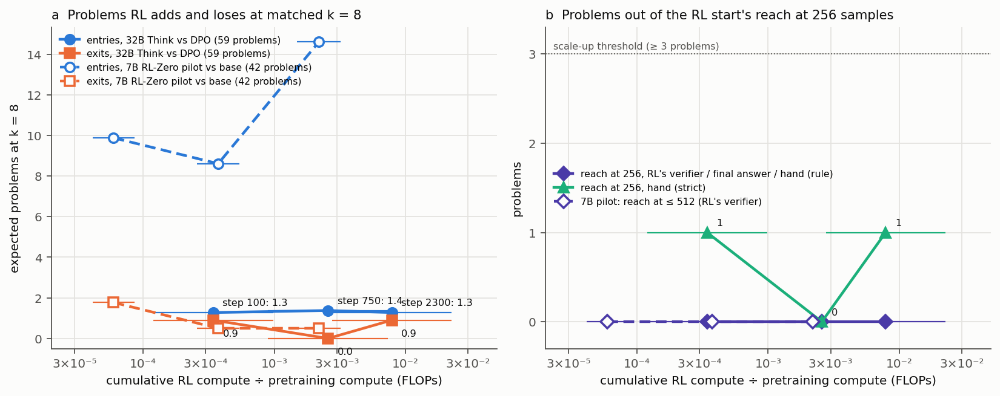

# olmo-think32b: along Olmo 3.1 Think 32B's RL run, pass@1 by RL's verifier on 59 AIME 2025–26 problems rises only from 0.716 (the DPO start) to 0.746 (step 2,300), and one problem is a reach candidate: on aime2025_28 the DPO model is credited 7 times in 256 samples by RL's verifier but states the answer once, and under the strict reading none of its 7 credited solutions is rigorous; no reverse problem; the pre-registered verdict is "inconclusive" ("no reach at 256" under RL's verifier alone)

Status: completed 2026-11-04 and reviewed 2026-11-04. **No hard-constraint violation, nothing quarantined.** Before
reading the executor's write-ups, the reviewer did the following with their own code (kit
`review/olmo-think32b-recount/`):
- re-graded all 3,456 stored texts. They used open-instruct's own `ground_truth_utils.py` and `math_utils.py` at
  `7e780f2fea`, called through `async_call` in a worker thread as RL called them, and their own final-answer grader,
  written from the pre-registration's text. There are **0 disagreements** with the executor's graded rows (`rl`,
  `final`, the diagnostic `main`, `think_end` and the extracted final value). Grading `F_s2300`'s 480 samples against
  the answer + 1 credits none under either grade. Every stored text equals the decode of its token ids;
- rebuilt the 240-cell model × problem table from the raw rows. Compared in phase 2, **240 / 240 cells equal
  `results.csv`** on all 14 fields compared;
- recomputed pass@k, the matched-k entries and exits, the candidates, every extension chunk and the stopping rule, the
  verdict under each grade, the compute axis, the likelihood statistics from the stored per-token scores (87 items),
  and the registry rows (45 in phase 1; all 105 in phase 2, with 0 differences);
- checked these against their sources: the problems and answers against MathArena, the chat template against
  open-instruct (byte for byte), the decoding settings in all 14 sampling jobs' meta files, and the four Hub commits
  and shard hashes. They also ran their own contamination scan of all 102,026 Dolci-Think-RL-32B prompts;
- repeated the hand check, blind, on the 42 solutions that decide a candidate. Fourteen read-only reader sub-agents
  read 3 items each, against a rubric the reviewer wrote before opening any of the executor's hand-check files. The
  reviewer then assigned every aime2025_28 solution a class. In phase 1, 25 of the 37 classes rested on the readers'
  step records; the final classes came out of phase 2, with 16 of the 42 items read by the reviewer themself
  (`read_by_reviewer`; correction 7).

The review states two limits on its blindness:
- the git subjects visible when the session started named some outcomes (R = {aime2025_28}, V = {aime2026_14},
  "7/32 doubly", "s0750: six flawed", "s0100 revised to flawed", "39 solutions"). The reviewer re-derived all of
  them, and the readers saw none;
- the reviewer set their solution classes after reading their readers' labels, and two subtypes (T and S, below)
  after reading the executor's notes. Only the strict criterion does not depend on labels.

An adversarial reader then checked the review against the kit's outputs and found 23 problems, none of which changes
a verdict. The review lists its corrections (§Recount corrections), and this summary uses the corrected text. The main
correction withdraws a "middle" lowest-terms standard, which the reviewer had defined after reading their readers'
labels.

- **What stands (the review's verdict).** The models are `dpo` = `allenai/Olmo-3-32B-Think-DPO` `main`, and `s0100` /
  `s0750` / `s2300` = `allenai/Olmo-3.1-32B-Think` `step_0100` / `step_0750` / `main` (= `step_2300`); all 32 B,
  pretrained. What stands:
  - every grade on every stored text;
  - all fixed-phase numbers, the candidates, the extension tallies, the stopping-rule compliance, the compute axis,
    the cost and the compute rows;
  - the pre-registered verdict: **inconclusive** under the final-answer and hand grades, and "no reach at 256" under
    RL's verifier. The hand verdict is inconclusive under every lowest-terms standard the reviewer tried (strict, the
    executor's rule, the readers' labels, lenient). That is because `dpo` has only one doubly-credited success on
    aime2025_28, and reach needs ≥ 3 problems;
  - no reverse problem;
  - `s2300` and `s0100` are hand-confirmed on aime2025_28, and `s0750` is not, under the strict reading and under the
    executor's rule;
  - the description of aime2025_28. Under RL's verifier `dpo` solves it (7 / 256), and it states the answer once.
    The two `dpo` solutions that the executor's rule accepts (one of them stated) argue the crux by residue
    representatives, and none of its 7 credited solutions is rigorous. In the review's words, "Whether `dpo` 'can'
    solve it depends on that standard."
- **Must be reworded** (the review's items):
  1. **Finding 4 (likelihood).** The review's wording: RL's solutions are "inside the range of `dpo`'s correct
     solutions on other problems (29 / 29). Against `dpo`'s own credited solutions on aime2025_28, the
     pre-registered comparator, 9 / 29 (step 2,300: 0 / 12, all *more* likely than any of `dpo`'s own): a miss
     against ≥ 75 %". The change of comparator belongs among the deviations, and "(RL's solutions are shorter)" is
     wrong for step 2,300 by the mean length (28,137 tokens against `dpo`'s 27,702; by the median it is
     shorter).
  2. **The hand-check rule's timing.** The write-up already says "fixed mid-run". `numbers.md` should say "adopted
     during the hand check, after the first readers' labels on `dpo`'s aime2025_28 solutions (03:43 UTC); written to
     its file at 04:35, before the consistency pass". The plain summary's "my pre-written rule" has to go.
  3. **"This RL sharpens rather than extends, with aime2025_28 open"** keeps the "open", but it draws a general
     conclusion from an inconclusive screen. The review's wording: "on 58 of the 59 problems RL only sharpened; on
     aime2025_28 it is open whether the DPO model can solve it soundly (none of its 7 credited solutions is rigorous;
     one stated solution argues the crux informally)". In the plain summary, "a rare, shaky success" presupposes a
     real `dpo` success; "a rare, contested success" would be fair.
  4. **The expectations line** gains the misses it omits (see Expectations).
  5. **The plain summary:** "the RL models produced fully rigorous solutions" becomes steps 100 and 2,300; "exactly as
     in RL training" becomes "with RL training's settings"; "confirmed each label" becomes "confirmed 34, overturned
     5".
  6. **State the cap:** "within 256 samples at RL's 32,768-token cap; 43 % of `dpo`'s samples on aime2025_28 hit it".
- **Not supported:**
  - "in DPO's support … as expected", read as the pre-registered likelihood test, which it fails;
  - "sharpens rather than extends" as the general conclusion of an inconclusive screen of 59 problems.

Review: [`review_olmo-think32b.md`](https://github.com/dan-pandori/nd-takehome/blob/08da2e82/review_olmo-think32b.md)
(fork `dan-pandori/nd-takehome`, branch `dan_olmo-think32b`; §Recount `e18cf32c`; §Recount corrections, §Compare and
§Verdict `08da2e82`; kit `review/olmo-think32b-recount/`). Run files at the executor's DONE commit
[`88525f75`](https://github.com/dan-pandori/nd-takehome/commit/88525f75):
- `run_olmo_think32b.md`, `numbers.md` § olmo-think32b, and `log.md`;
- `olmo32/`: the code, the problem manifest with contamination scores, `results.csv`, `handcheck.csv`,
  `likelihood.csv`, `plain_summary.md` and `scaleup_memo.md`. The figure is `figures/olmo32_reach.png`;
- the pre-registration `preregistration/olmo-think32b.md`: Part A `04019155`, Part B `d78ea069`.

Brief: [`BRIEF_olmo-think32b.md`](../../docs/proposals/followups/BRIEF_olmo-think32b.md);
[proposal 35](../../docs/proposals/2026-11-03-olmo-think32b.md). The 7B pilot it follows:
[olmo-rlzero-pilot](../2026-11-03-olmo-rlzero-pilot-base-credited-on-all-17-rl-only-solves-within-383-samples-reach-0-at-k512-verdict-inconclusive/README.md).

Copies here:
- **the plain-language summary**, with the review's corrections marked *[review]*: [`plain_summary.md`](plain_summary.md);
- **the scale-up memo**, with the review's corrections marked *[review]*: [`scaleup_memo.md`](scaleup_memo.md). It
  says what remains after 256 samples, and what 1,024 or 2,048 would cost at this run's measured prices;
- **the figure**, unchanged: [`olmo32_reach.png`](olmo32_reach.png).

Question (Dan, 2026-11-03, in the brief): the 7B pilot looked like Yue et al.'s low-RL picture. There RL raised AIME
pass@1 from 0.09 to 0.42, yet RL's verifier credited the base on all 17 problems RL newly solved, within 383 samples.
This run asks the same question at Olmo 3.1 Think 32B. That model comes from one continuous RL run that starts at
`Olmo-3-32B-Think-DPO`: steps 1–750 are the original Olmo 3 Think 32B, and steps 751–2,300 are the extra 21 days.
Its RL is ≈ 14 % of pretraining GPU-hours. Does it solve AIME problems that its DPO start does not solve within 256
samples? The run is a screening test: "If several problems stay out of the DPO model's reach at 256 samples, Dan will
consider funding a larger extension afterwards."

## Configuration

- **Models** (all 32 B `Olmo3ForCausalLM`, pretrained, bf16; natural-language maths, no Lean):
  - `dpo`: `allenai/Olmo-3-32B-Think-DPO` @ `main` (`97604023f260`), the RL start (Olmo 3 32B base → Think SFT →
    DPO);
  - `s0100`, `s0750` and `s2300`: `allenai/Olmo-3.1-32B-Think` @ `step_0100` (`e7b80281ff56`), `step_0750`
    (`418fb27467ff`, Olmo 3 Think 32B's final checkpoint) and `main` (`97ade57a9cc5`). These are RLVR on
    Dolci-Think-RL-32B. `main` and `step_2300` have identical LFS sha256 on all 14 shards;
  - all four have 64 layers (16 full attention, 48 sliding-window 4,096), 8 KV heads, YaRN to 65,536 positions, and
    EOS 100257 (the review read the Hub metadata);
  - **tokenizer.** The pre-registration says the tokenizer files are identical across the four. The review found that
    4 of 6 files are (`tokenizer.json`, `vocab.json`, `merges.txt`, `special_tokens_map.json`). `tokenizer_config.json`
    and `chat_template.jinja` differ between `dpo` and the RL checkpoints: the RL repositories embed a chat template
    and use a different default system prompt. This is immaterial here, because the sampler passes RL's template
    explicitly.
- **Problems.** AIME 2025 I/II and 2026 I/II from MathArena (`aime_2025` @ `c94da77eb22b`, `aime_2026` @
  `d61f48680530`): 60 problems, whose texts and answers the review found identical. All 60 were sampled. The
  **headline set is 59**, without aime2026_01, which the pilot excluded (containment 1.00 in the RL-Zero data and the
  7B's midtraining mix). The exclusion was carried over, as pre-registered.
  - **Contamination.** The executor scanned, by word 8-gram containment, every Dolci-Think-RL-32B prompt (102,026),
    every Dolci-Think-DPO-32B row (200,000) and every Dolci-Think-SFT-32B conversation (2,253,684). No problem reaches
    the exclusion threshold of 0.5. The three matches ≥ 0.3 read as answer-format boilerplate on other problems.
  - The reviewer's own scan of the RL prompts finds a highest 8-gram containment of 0.375 (aime2026_14). The best matches
    for both candidates are boilerplate on unrelated problems. The reviewer did not re-scan the DPO (1.9 GB) or SFT
    (33.5 GiB) corpora.
- **Sampling** (every model and job):
  - open-instruct's `olmo_thinker` template at `7e780f2fea`, byte for byte (its sha256 is in all 14 jobs' meta), with
    no BOS;
  - temperature 1.0, top-p 1.0, at most 32,768 response tokens, and EOS as the only stop. These are the settings of
    the Think RL script (`scripts/train/olmo3/32b_think_rl.sh`);
  - vLLM 0.11.0, torch 2.8.0+cu128, bf16, TP 1 on one H200 per job. RL ran in eager mode, which differs only in
    numerics. `generation_config="vllm"` keeps the repositories' T 0.6 / top-p 0.95 out of the sampler;
  - **storage.** Every stored text equals the decode of its ids. The 654 `length` finishes all stop at exactly 32,768
    tokens, and all 2,802 `stop` finishes end in EOS.
- **Grades** (pre-registered):
  - **`rl` (primary):** open-instruct's `MathVerifier` as RL ran it. RL called it off the main thread, where sympy's
    `is_equiv` is dead, so only `hendrycks_is_equiv` can reward. (The review's unit test: `\boxed{\dfrac{140}{2}}`
    against 70 scores False in the worker thread and True on the main thread.) It reads the whole decoded response,
    thinking included;
  - **`final` (secondary):** the text after the last `</think>`. In it, the last `\boxed{…}` holding an integer counts,
    or else the integer on the last line that contains "answer";
  - **doubly credited** means credited by both `rl` and `final`;
  - **hand:** a blinded sub-agent labels each credited solution that decides a candidate. The labels are sound;
    flawed (the right answer through a wrong or unjustified step that matters, such as an unproved pattern claim); or
    guess. The reader sees the problem, the answer and the response, but not the model, the phase or the side. The
    executor confirms or overturns each label.
- **Design** (pre-registration Part A):
  - **fixed phase:** `dpo` draws 16 samples per problem and each RL checkpoint 8, on all 60 problems (seeds
    2001–2004);
  - **candidates**, on the union of the `rl` and `final` definitions. Reach R: `dpo` 0 / 16 and some RL checkpoint
    ≥ 1 / 8. Reverse V: `dpo` ≥ 1 / 16 and `s2300` 0 / 8;
  - **defender extension** (`dpo` on R, `s2300` on V): chunks of 48, up to 256 samples per model per problem with the
    fixed phase included. Sampling stops after the chunk in which the defender's doubly-credited count reaches 2. A
    hand gate checks the defender's first two doubly-credited successes;
  - **challenger confirmation**, where the defender is not hand-confirmed at 256: fresh chunks of 16, until ≥ 2
    doubly-credited sound successes with ≥ 1 of them fresh, capped at 256;
  - **one confirmation rule for every model:** ≥ 2 credited successes within 256, ≥ 1 of them from samples drawn after
    the problem became a candidate (for defenders every success qualifies).
- **Verdict rule**, under each grade G (`rl`, `final` and hand; the headline is the hand row):
  - **"Reach candidates for scale-up":** ≥ 3 problems where `s2300` is confirmed under G and `dpo` has no G-credited
    success within 256. Under the hand grade, `dpo` must have no sound solution among all its credited samples;
  - **"No reach at 256":** every reach candidate is confirmed for `dpo` under G (hand: ≥ 2 sound successes);
  - **"Inconclusive":** anything else.
- **Compute axis** (rl-compute-share's inputs). Pretraining is 6ND = 1.094 × 10²⁴ FLOPs (N 3.2 × 10¹⁰, D 5.7 ×
  10¹²) and 9.769 × 10⁵ GPU-hours. RL FLOPs have three estimates:
  - low: 64 prompts per step × 8 samples × 10,000 tokens × 8N;
  - middle: 128 × 8 × the measured mean length × 8N;
  - high: 128 × 8 × 32,768 × 10N.

  RL GPU-hours are 5 d × 224 GPUs over steps 1–750 and 21 d × 224 over steps 751–2,300, linear within each.
- **Gates.** The budget ($150 / 120 h) was registered at 18:45:33 UTC on 11-03. Part A of the pre-registration was
  committed at 19:01:04, before the first pod (19:08:32). Part B was committed at 20:23:49, after Stage 0 (on AIME
  2024 only) and 22 s before the first evaluation job (`F_dpo`, 20:24:11). Stage 0's re-costing projected $85–112,
  below the gate of min($140, balance − $45) = $140, so the pre-registered design ran unchanged.
- **Pods and cost** (RunPod; both pods deleted):

  | pod | GPU | jobs | pod-hours (UTC) | RunPod billed |
  |---|---|---|---|---|
  | `ot32-a` | 1 × H200 141 GB, secure, $5.29/h | Stage 0, the contamination scan, `F_dpo`, `F_s2300`, `E1_s2300`, `C1_s2300` | 9.29 (11-03 19:08 → 11-04 04:25) | $49.49 ($49.16 GPU) |
  | `ot32-b` | the same | `F_s0100`, `F_s0750`, `E1a_dpo`, `C1`–`C2_s0100`, `C1`–`C4_s0750`, `L_dpo` | 12.57 (11-03 20:35 → 11-04 09:09) | $66.95 ($66.49 GPU) |

  The total is 21.86 pod-hours and **$115.65** of $150 at the GPU rate (the run, the review and `podbudget`). RunPod
  billed $116.44 with disk, which equals the balance drop ($370.54 → $254.10). Every multi-GPU and community
  configuration the executor tried was out of stock (Part B1). The pod poller's search for a second pod (three rounds,
  20:24–20:35 UTC) also found nothing cheaper than another secure H200 (`~/runs/olmo-think32b/poll_ot32-b.log`).
- **Bucket** (public, 272 files): `hf://buckets/dan-pandori/nd-rl/olmo-think32b/`. It holds:
  - `artifacts/olmo32/`: every sample's text and token ids, the grades, the job meta files and vLLM logs, the
    likelihood items and scores, the contamination scans, and the hand-check items, labels and key;
  - `olmo32/` (code and tables), `pod/olmo32/`, and `docs/` (the write-up, the pre-registration and the figure).

  The 105 registry rows are at `hf://buckets/dan-pandori/nd-rl/registry/olmo-think32b/`. No weights were uploaded.
  The review checked that all 34 run rows of `artifacts/MANIFEST.jsonl` match the local files' sha256 and size. It
  also scanned all 272 bucket files for tokens and found none; the scan's positive control passes.

## Observations (the review's numbers)

All numbers below are on the four models above, under the `rl` grade, on the 59 headline problems, unless a row says
otherwise.

### Stage 0 (`dpo`, AIME 2024, 30 × 8 = 240 samples, seed 1001; never an evaluation number)

| quantity | value |
|---|---|
| tokens per sample, mean / median | 17,589 / 15,306.5 |
| tokens, failing / correct (`rl`) samples | 29,937 / 13,654 |
| cut at 32,768 | 31 (12.9 %) |
| throughput (the reviewer's own integral of the vLLM log) | 1,103 tok/s over 3,776 s; 44.7 resident sequences on average |
| price at $5.29/h | $1.33 per million generated tokens |
| uncut samples: close `</think>` / box an answer after it / box an answer anywhere | 100 % / 92.8 % / 100 % |
| pass@1 `rl` / `final` | 0.758 / 0.700 |
| `rl` ≠ `final` | 14 (5.8 %), all `rl`-only: 13 stop (EOS) in the write-up before stating an answer, and 1 is cut |

Every Part B1 number that the reviewer recomputed reproduces. The KV-cache size, the 11.3× concurrency, the $6.5 and
the 20:21:38 finish come from logs and billing that the review did not recompute; the job's meta `utc_end` is
20:21:33. The planned `s0_rl` job (`s2300`
on AIME 2024) was dropped to keep Stage 0 within its $8.

### pass@k (fixed phase; 10,000-resample problem bootstrap, 95 % intervals)

Every cell has its planned n: `dpo` 16 and each RL checkpoint 8, on all 60 problems.

| model | pass@1 `rl` | pass@1 `final` | pass@2 `rl` | pass@4 `rl` | pass@8 `rl` | pass@8 `final` | pass@16 `rl` |
|---|---|---|---|---|---|---|---|
| `dpo` | 0.716 [0.622, 0.802] | 0.686 [0.594, 0.770] | 0.796 | 0.838 | 0.858 [0.766, 0.940] | 0.858 | 0.864 [0.780, 0.949] |
| `s0100` | 0.706 [0.610, 0.792] | 0.686 [0.593, 0.773] | 0.792 | 0.840 | 0.864 [0.763, 0.949] | 0.864 | — |
| `s0750` | 0.748 [0.652, 0.833] | 0.739 [0.644, 0.824] | 0.817 | 0.854 | 0.881 [0.797, 0.949] | 0.864 | — |
| `s2300` | 0.746 [0.652, 0.831] | 0.739 [0.644, 0.824] | 0.819 | 0.859 | 0.864 [0.763, 0.949] | 0.864 | — |

The executor's `passk.csv` has the same 34 point estimates. Its interval endpoints differ by at most 0.017 (one
problem in 59), which is bootstrap noise.

- **Paired differences in pass@1 against `dpo`:**
  - `rl`: `s0100` −0.011 [−0.040, +0.017]; `s0750` +0.032 [+0.002, +0.061]; `s2300` +0.030 [0.000, +0.060];
  - `final`: `s0100` 0.000; `s0750` +0.053 [+0.019, +0.088]; `s2300` +0.053 [+0.017, +0.090];
  - the minimum detectable difference at 80 % power is ≈ 0.04 under `rl` (paired SE ≈ 0.015) and 0.046–0.053 under
    `final`. The pre-registration estimated ≈ 0.07.
- **Lengths** (mean / median tokens; share cut at 32,768): `dpo` 19,910 / 19,448, 13.7 %; `s0100` 19,131 / 18,955,
  10.0 %; `s0750` 18,351 / 17,365, 10.4 %; `s2300` 18,091 / 17,518, 8.7 %.
- **`rl`-only samples** (credited by `rl` and not by `final`): 28 / 9 / 4 / 3 of 944 / 472 / 472 / 472 (`dpo` /
  `s0100` / `s0750` / `s2300`). None is `final`-only. Of `dpo`'s 28, 24 end the write-up (EOS) before stating an
  answer and 4 are cut at 32,768. The RL checkpoints' are 9 EOS; 3 EOS and 1 cut; and 1 EOS and 2 cut. The `main`
  grade never differs from `rl` in this data.

### Matched k = 8: expected entries into and exits from the solved set, against `dpo`

| checkpoint | expected entries | expected exits | observed entries | observed exits |
|---|---|---|---|---|
| `s0100` | 1.28 [0.00, 3.51] | 0.90 [0, 2.7] | aime2025_28 | aime2026_14 |
| `s0750` | 1.38 [0.04, 3.65] | 0 | aime2025_28 | — |
| `s2300` | 1.28 [0.00, 3.51] | 0.90 [0, 2.7] | aime2025_28 | aime2026_14 |

`s0100` and `s2300` solve the same 51 problems at least once in 8 (identical sets), which is why their rows match.
Under `final`, `s0750` has no observed entry, because its only fixed-phase credit on aime2025_28 is `rl`-only; its
expected entries are then 0.38.

### Candidates

- **R = {aime2025_28}** (AIME 2025 II problem 13, answer 248) and **V = {aime2026_14}**. The sets are the same under
  `rl`, under `final`, under their union and under "credited by either grade". Adding the excluded problem back
  changes nothing: every model solves aime2026_01 in every fixed-phase sample.
- aime2025_28 in the fixed phase (`rl`): `dpo` 0 / 16; `s0100` 1 / 8; `s0750` 1 / 8 (`rl`-only); `s2300` 3 / 8.
- aime2026_14 in the fixed phase (`rl`): `dpo` 3 / 16; `s0100` 0 / 8; `s0750` 1 / 8; `s2300` 0 / 8.
- Seven problems were solved by no model in the fixed phase: aime2025_13, 14, 15 and 30, and aime2026_15, 29 and 30.

### Extension and confirmation

The draw order is the fixed phase, then each job in order, then (chunk, i).

| model × problem | draws | credited draws (D = `rl` and `final`; rl = `rl` only) | cut at 32,768 |
|---|---|---|---|
| `dpo` × aime2025_28 (defender) | 256 | 36 rl, 78 rl, 98 rl, 104 rl, **108 D**, 218 rl, 256 rl | 111 (43 %) |
| `s2300` × aime2025_28 | 40 | 3 D, 5 D, 6 D, 9 D, 13 rl, 16 rl, 17 D, 19 D, 25 D, 27 D, 28 D, 29 D | 20 (50 %) |
| `s0750` × aime2025_28 | 256 | 15 doubly and 6 `rl`-only (the first D at draw 15) | 128 (50 %) |
| `s0100` × aime2025_28 | 256 | 4 D, 182 D, 228 D, 230 D, 238 D, and 4 `rl`-only | 75 (29 %) |
| `s2300` × aime2026_14 (defender) | 56 | **21 D, 52 D** | 52 (93 %) |
| `dpo` × aime2026_14 | 16 | 10 D, 14 D, 16 D | 13 (81 %) |

- **The totals on aime2025_28** (`rl` / `final`): `dpo` 7 / 1 in 256; `s0100` 9 / 5 in 256; `s0750` 21 / 15 in 256;
  `s2300` 12 / 10 in 40. In its 240 extension samples, `dpo`'s stated final answers are none 163 times, 208 70 times,
  248 once, and 6 others (36 twice, 984, 936, 748 and 346).
- **The stopping rule was followed.** The reviewer reconstructed every chunk:
  - `E1a_dpo` ran 5 chunks of 48, one in flight at a time. The doubly-credited count never reached 2, so it ran to
    256;
  - `E1_s2300` reached 2 within one chunk of 48 and stopped;
  - the challenger jobs (chunks of 16, 2–3 in flight) each stopped after the first chunk, in chunk order, at which
    their target was met. The later chunks already in flight were kept: 1 for `C1_s2300`, and 2 each for `C1_s0750`,
    `C2_s0750`, `C3_s0750`, `C1_s0100` and `C2_s0100`. `C4_s0750` had no stop target and ran its 40;
  - no cell exceeds 256, and the continuation jobs' chunk numbering has no gap and no overlap.
- **Confirmation under `rl`:** on aime2025_28, `dpo` is confirmed (7 successes, the second at draw 78). So are
  `s2300`, `s0750` and `s0100`, each with ≥ 1 fresh success. On aime2026_14, `s2300` is confirmed (2 of 56).
- **Confirmation under `final`:** on aime2025_28, `dpo` is **not** confirmed. It has 1 success in 256 (draw 108), and
  its six `rl`-only successes are five EOS stops in the write-up before an answer and one sample cut at 32,768.
  `s2300`, `s0750` and `s0100` are confirmed. On aime2026_14, `s2300` is confirmed.
- **The cap shapes the candidates.** In these six cells, 29–93 % of samples hit RL's 32,768-token cap, against 9–14 %
  overall (`s0100` and `s0750` on aime2026_14 are cut in 8 / 8 and 7 / 8). In the review's words, "the reach question
  is therefore answered at RL's cap. A model that needs more tokens is credited less, and it is not known how many cut
  samples would have finished correctly."

### Hand check (42 deciding solutions, read blind; the reviewer's classes)

**What decides a candidate**, by the pre-registered rules:
- every credited `dpo` sample on aime2025_28 (7), since the hand-reach clause reads "no sound one among all its
  credited samples";
- every doubly-credited sample of `s2300` (10), `s0750` (15) and `s0100` (5) on aime2025_28, since a challenger is
  confirmed by ≥ 2 doubly-credited sound successes, ≥ 1 of them fresh;
- `s2300`'s 2 and `dpo`'s 3 doubly-credited samples on aime2026_14.

That is 42 solutions of 54–88 KB each. All 108 evidence fragments the readers quoted occur in the item texts.

**The crux on aime2025_28** is the rubric's step A2, lowest terms: exact division by 3 and coprimality at every step.
One argument recurs in several solutions: plugging the
residues 1 and 2 into (a² + b² − ab)/3. In the review's words, "That is invalid, because a quotient by 3 is not
determined mod 3." The readers did not apply A2 consistently: they called this argument "flawed" in some items and
"sound" in others. So the reviewer assigned every aime2025_28 solution a class (the final classes came out of phase 2;
the reviewer read 15 of the 37 aime2025_28 items themself, `read_by_reviewer`):

| class | meaning |
|---|---|
| P | a general forward proof: a mod-9 expansion with a = 3m+1, b = 3n+2 or equivalent (or an explicit S² − 3ab link), with a prime argument for coprimality |
| T | a general residue-representative transition |
| S | an S-divisibility induction that presupposes the recurrence |
| C | exactness or coprimality shown only from small cases, or assumed |
| X | a wrong modular or arithmetic step that happens to give 248 |
| G | a guess |

Four readings are compared, three of them derived from the classes:
- **strict:** only P is sound. It is the only class whose criterion does not depend on reading labels, and it agrees
  with the executor's strict labels on 38 / 38 common items;
- **the executor's rule, as applied in its notes:** P and T are sound;
- **the readers' own labels;**
- **lenient:** P, T, S and C are sound. In the review's words, it counts C as sound, "which the pre-registered
  'flawed' (an unproved pattern claim) excludes. It is a bound, not a reading of the pre-registration."

| cell | classes (draws) | strict | the executor's rule (P, T) | the readers' labels | lenient |
|---|---|---|---|---|---|
| `dpo` × aime2025_28: sound among its 7 credited (of them doubly) | C 36, 78, 256; T 104, 108; X 218; G 98 | none | {104, 108} (108) | {104} (none) | {36, 78, 104, 108, 256} (108) |
| `s2300` × aime2025_28: doubly sound; confirmed? | P 3, 5, 27; T 25, 28, 29; S 19; C 6, 9, 17 | {3, 5, 27} ✓ | {3, 5, 25, 27, 28, 29} ✓ | {3, 5, 27, 29} ✓ | all 10 ✓ |
| `s0750` × aime2025_28 | S 37, 58, 60; T 93; X 144; C the other 10 | none ✗ | {93} ✗ | {37, 58, 60, 93} ✓ | 14 ✓ |
| `s0100` × aime2025_28 | P 182, 228; S 4; X 230; C 238 | {182, 228} ✓ | {182, 228} ✓ | {4, 182, 228} ✓ | 4 ✓ |
| aime2026_14: `s2300`'s 2, `dpo`'s 3 | all P | all ✓ | all ✓ | all ✓ | all ✓ |
| hand-reach problems | | aime2025_28 | none | none | none |
| hand verdict | | Inconclusive | Inconclusive | Inconclusive | Inconclusive |

`dpo`'s draw 104 is `rl`-only (its write-up stops at "3." before the answer). Draw 108 is its only doubly-credited
solution.

**What holds under every rule:**
- `s2300` is hand-confirmed on aime2025_28. Under the strict rule this rests on draws 3 and 5 (fixed phase) and 27
  (fresh), each of which the reviewer read; each proves exactness by the general mod-9 expansion. The strict
  confirmation needs only draws 3 and 27, the executor's pair; draw 5 adds a third;
- `s2300` is hand-confirmed on aime2026_14 (draws 21 and 52). All 5 aime2026_14 solutions are complete general
  derivations (the reviewer read `r640333`'s write-up);
- `s0100` is hand-confirmed on aime2025_28 (fresh draws 182 and 228 under the strict rule);
- `dpo` is never hand-confirmed on aime2025_28: it has only one doubly-credited success in 256.

**What depends on the rule:**
- whether `dpo` has any sound solution on aime2025_28. It has none under the strict rule, so aime2025_28 counts as
  one hand-reach problem. It has two under the executor's rule (104, `rl`-only, and 108, stated), one under the
  readers' labels (104) and five under lenient;
- whether `s0750` is hand-confirmed: not under the strict rule or the executor's rule, but yes under the readers'
  labels and lenient.

**Against the executor's hand check** (39 solutions, `olmo32/handcheck.csv`; review C4):
- **overlap:** 38 of the executor's 39 items are among the reviewer's 42. The executor's extra item is `s0750`'s
  `rl`-only fixed-phase sample. The reviewer's extras are `dpo`'s draws 14 and 16 on aime2026_14 and `s2300`'s fixed
  draws 5 and 6 on aime2025_28. None of these four is needed for any decision;
- **the strict reading:** the reviewer's labels equal the executor's on all **38 / 38** common items;
- **the executor's rule:** applied to the reviewer's classes, it reproduces the executor's final labels on 38 / 38
  common items, and the executor's counts. That agreement is not blind, because the reviewer assigned the T / S
  subtypes after reading the executor's notes. The executor's counts, sound under its rule / rigorous (strict): `dpo`
  2 / 0 of 7, `s0100` 2 / 2 of 5, `s0750` 2 / 0 of 16, `s2300` 5 / 2 of 8; on aime2026_14, `dpo` 1 / 1 of 1 and
  `s2300` 2 / 2 of 2. `s0750`'s second item that is sound under the rule (h4984ee, the fixed-phase `rl`-only sample)
  is not in the reviewer's set;
- **the readers' own labels** differ from the executor's on 7 of the 38 common items: `dpo` 108; `s0100` 4; `s0750`
  37, 58 and 60; `s2300` 25 and 28. The readers accepted S-divisibility inductions, and they were inconsistent on
  representative transitions. This changes `s0750`'s confirmation, but no verdict and no confirmation of `s2300` or
  `s0100`. The readers' labels agree with the strict reading on 35 / 42 items, and with the executor's rule on 35 / 42;
- **the rule as written** (`olmo32/handcheck_rule_aime2025_28.md`): "sound = any general argument (algebra, mod 9, or
  a general representative transition, the last a minor gap); flawed = persistence only observed on specific terms or
  specific residues, then asserted; or a wrong case analysis". As applied in the executor's notes, an S-divisibility
  induction that presupposes the recurrence is also flawed ("circular"). That unwritten clause decides `s0750`;
- **process.** The log at 03:43 shows that the rule was first formulated to overturn reader d1a's "flawed" on
  h9fea38, `dpo`'s only doubly-credited solution. That was after d1a's and d1b's labels on `dpo`'s extension
  solutions, and before the 04:35 rule file. The consistency pass re-read only the five earlier sound labels, not the
  earlier flawed ones. The reviewer's independent readers find those earlier flawed ones flawed (`dpo` 36 and 78;
  `s2300` 9 and 17), so the asymmetry changed nothing. Readers c5 and cp1 saw the rule text, as the executor reports;
- **what the rule decides.** It turns the hand row from "aime2025_28 is a reach problem" (strict) into "`dpo` has a
  sound, stated solution". It leaves the pre-registered verdict, "inconclusive", unchanged. The write-up and
  `numbers.md` report both readings, which the review calls "the right presentation".

### The verdict under each grade (pre-registered rules)

| grade | aime2025_28 | verdict |
|---|---|---|
| `rl` | `dpo` confirmed (7 in 256) | **No reach at 256** |
| `final` | `dpo` has 1 success in 256: not confirmed, and not a reach problem either | **Inconclusive** |
| hand (the headline) | `dpo` is never confirmed. Reach problems: 1 under the strict rule; 0 under the executor's rule, the readers' labels and lenient | **Inconclusive** under every rule, since reach needs ≥ 3 problems and "No reach" needs `dpo` confirmed |

Under the strict reading, reach holds for `s0100` and `s2300` and not for `s0750` (1 / 0 / 1). On the reverse
candidate, aime2026_14, `s2300` is confirmed under every grade (2 sound successes in 56), so `s2300` lost no problem.

### Likelihood (`dpo` scoring the stored token ids; 87 items, 1.84 M tokens)

- **Items.** All 87 items' response ids equal the stored samples, and all 87 prompts equal the template. There are 29
  RL solutions on aime2025_28: 12 from `s2300`, 9 from `s0100` and 8 from `s0750` (one fixed-phase `rl`-only draw, 3
  from C1 and 4 from C2). The job ran before `C3_s0750` and `C4_s0750`, so 13 of `s0750`'s 21 credited solutions are
  not scored. The reference sets are `dpo`'s own 7 credited solutions on aime2025_28, and 51 `dpo` solutions on other
  problems (the first `rl`-credited fixed-phase sample per problem).
- **Against the pre-registered comparator,** `dpo`'s own credited solutions on the same problem: **9 / 29 (31 %)** of
  RL's solutions lie inside the 2.5–97.5 % range of the 7 per-token means, [−0.623, −0.511] nats. That is step 100 8
  / 9, step 750 1 / 8 and step 2,300 0 / 12, all of step 2,300's above the range. The expectation was ≥ 75 %, so
  this is a **miss**. *[librarian, read from the kit's `out/ll_recount.json`, not stated in the review: the other 7
  of step 750's also lie above the range, and step 100's ninth below it.]*
- **Against the 51-solution reference on other problems:** 29 / 29 lie inside its range, [−0.783, −0.330]. The review
  calls that reference "useful, because 7 solutions are too few for a 2.5–97.5 % range", and `numbers.md` names it
  correctly. The write-up, though, calls the result "as expected" and does not list the change as a deviation.
- **The per-token gap is positive** (RL's solutions are more likely per token under `dpo` than `dpo`'s own), and it
  grows with the step:
  - per-token means: `s0100` −0.554, `s0750` −0.474, `s2300` −0.418, against `dpo`'s own −0.560;
  - gaps: +0.006 / +0.087 / +0.142 nats per token. Pooled over the 29 the gap is +0.085 against the same-problem set
    and +0.079 against the reference, both inside the expected ≤ 0.1. Step 2,300's +0.142 is not;
  - step 2,300's solutions are more likely per token than every one of `dpo`'s own 7 on the problem.
- **Whole solutions:** −14,702 / −11,830 / −11,795 nats against `dpo`'s −15,579. `numbers.md`'s "(RL's solutions are
  shorter)" is wrong for step 2,300 by the mean: 28,137 tokens against `dpo`'s 27,702 (by the median it is shorter,
  27,949 against 28,989). Its higher whole-solution log-likelihood comes from the per-token gap.

### Compute axis (cumulative RL ÷ pretraining)

| step | FLOPs low | FLOPs middle (the executor's) | FLOPs middle (the review's) | FLOPs high | GPU-hours |
|---|---|---|---|---|---|
| 100 | 1.198 × 10⁻⁴ | 4.675 × 10⁻⁴ | 4.6 × 10⁻⁴ | 9.811 × 10⁻⁴ | 3.67 × 10⁻³ |
| 750 | 8.982 × 10⁻⁴ | 3.385 × 10⁻³ | 3.30 × 10⁻³ | 7.358 × 10⁻³ | 2.75 × 10⁻² |
| 2,300 | 2.755 × 10⁻³ | 1.015 × 10⁻² | 0.997 × 10⁻² | 2.257 × 10⁻² | 0.1431 |

The executor's columns are `olmo32/compute_axis.csv`'s, with step 100's GPU-hours at the review's precision (the CSV
rounds it to 0.0037); the review's middle column is from its kit (R12). The low, high and GPU-hour columns are
identical in the two recounts. For the middle column the review uses each
checkpoint's own fixed-phase mean length (19,131 / 18,351 / 18,091 tokens). The executor integrates the measured
length along the trajectory, which the review calls "better than my per-checkpoint constant". Using the three
checkpoints' average length instead moves the review's middle column by ≤ 3.2 %.

### Compute per arm (registry rows; one H200 per job)

The registry has 105 rows (15 jobs × 7 metrics), all equal to the reviewer's per-job derivation. GPU-seconds are
model load plus generation, from each job's meta. Nothing was trained and nothing went through Lean:
`train_steps`, `train_tokens` and `lean_checks` are 0 throughout, and verifier checks equal samples.

| model | phase | jobs | GPU-h | generated tokens | samples |
|---|---|---|---|---|---|
| `dpo` | Stage 0 (AIME 2024) | 1 | 1.09 | 4,221,316 | 240 |
| `dpo` | fixed | 1 | 4.64 | 18,869,038 | 960 |
| `dpo` | extension (aime2025_28) | 1 | 2.37 | 6,928,957 | 240 |
| `dpo` | likelihood scoring | 1 | 0.10 | 0 (1.84 M tokens scored) | 87 items |
| `s0100` | fixed / confirmation (aime2025_28) | 1 / 2 | 2.25 / 2.06 | 9,069,378 / 6,882,391 | 480 / 248 |
| `s0750` | fixed / confirmation (aime2025_28) | 1 / 4 | 2.16 / 2.46 | 8,700,441 / 7,355,594 | 480 / 248 |
| `s2300` | fixed / extension (aime2026_14) / confirmation (aime2025_28) | 1 / 1 / 1 | 2.12 / 0.56 / 0.35 | 8,577,569 / 1,552,783 / 970,448 | 480 / 48 / 32 |

- **Totals:** 20.17 GPU-hours in jobs, 73,127,915 generated tokens and 3,456 samples, against 21.86 billed
  pod-hours. The rest is setup, downloads and idle time.
- **Matching across arms.** `dpo`'s fixed phase used 2.06–2.19× the GPU-hours of each RL checkpoint's (16 against 8
  samples per problem, by the brief's design). `numbers.md`'s "2.2×" holds only against step 2,300. On aime2025_28,
  `dpo`, `s0100` and `s0750` each drew 256, and `s2300` 40. Both are stopping rules, and the cap is symmetric (review
  R14). By the librarian's arithmetic from the rows above, `dpo`'s 240 extension samples there used 6.7× the GPU-hours
  of `s2300`'s 32 fresh ones (8,532.7 against 1,270.5 GPU-seconds).

## Expectations against outcomes

The review's scoring (R15, with its correction 11; `out/expectations.txt`), on the four models above and the 59
headline problems (the Stage 0 rows: `dpo` on AIME 2024):

| expectation (pre-registration, before any data) | outcome | |
|---|---|---|
| pass@1 and pass@8 (`rl`) of all four models in their ranges (e.g. `dpo` 0.62, 0.50–0.74) | all inside; pass@1 is 0.04–0.10 above every point expectation | hit |
| `final` within 0.02 of `rl` on every pass@1 | `dpo` differs by 0.030 (the RL checkpoints by 0.006–0.019) | **miss** |
| `s2300` − `dpo` pass@1 (`rl`) +0.05 to +0.12 | +0.030 (+0.053 under `final`) | **miss** |
| tokens per sample: `dpo` 14k (10–20k), `s2300` 15k (10–22k) | 19.9k (near the top) and 18.1k | hit |
| cut at 32,768: 3–15 % | 8.7–13.7 % | hit |
| expected entries at k = 8 (`s2300` vs `dpo`): 2–5 | 1.28 | **miss** |
| expected exits at k = 8: 0.5–2 | 0.90 | hit |
| \|R\| = 3 (1–6); \|V\| = 1 (0–3) | 1; 1 | hit |
| `dpo` confirmed within 256 on all but 0–2 reach candidates under `rl`, "the same under `final`, and one fewer by hand" | `rl` confirms 1 of 1, `final` 0 of 1 | depends on the reading: a **miss** if "the same" means the `rl` count (then "one fewer by hand", 0, is met), a hit if it means "all but 0–2" |
| median draw of `dpo`'s first success on a reach candidate ≈ 50 (17 to beyond 256) | 36 (`rl`), 108 (doubly) | hit |
| verdict: Inconclusive 50 %, No reach 35 %, Reach 15 % | Inconclusive | hit (the modal outcome) |
| likelihood: ≥ 75 % of RL's credited candidate solutions inside `dpo`'s own range | 31 % against the pre-registered same-problem set (29 / 29 against the 51-problem reference) | **miss** |
| likelihood: mean per-token gap ≤ 0.1 nats | +0.085 pooled; step 2,300 +0.142 | hit pooled; **miss** for step 2,300 |
| Stage 0: `dpo` AIME 2024 pass@1 0.55–0.80 | 0.758 (`rl`), 0.700 (`final`) | hit |
| Stage 0: ≥ 95 % of uncut samples close `</think>` and box an answer | 100 % close it; 92.8 % box after it, 100 % box somewhere | a **miss** if the write-up was meant, a hit if anywhere |
| Stage 0: `rl` and `final` disagree on ≤ 3 % | 5.8 % | **miss** |
| Stage 0: 1,500–3,000 tok/s, written for 4 × A100 PCIe | 1,103 tok/s on one H200 (a different GPU); $1.33 per million tokens | **miss** / not comparable |

The write-up's expectations line omits these misses (review C6): the entries (1.28 against 2–5), the gap between
`dpo`'s `final` and `rl` pass@1 (0.030 against ≤ 0.02), "`dpo` confirmed … the same under `final`" (a miss if "the
same" means the `rl` count), the likelihood range (31 % against ≥ 75 % for the pre-registered comparator), and two
Stage 0 format points: 92.8 %, which Part B1 calls "as expected" (a miss if the write-up was meant), and 5.8 %, which
Part B1 does report. It does report the RL gain (+0.03 against +0.05–0.12) and step 2,300's larger
likelihood gap.

## The review's corrections to the executor's files

The executor's files on the fork are unchanged. The corrections to the plain summary and the memo are applied, marked
*[review]*, in the copies here: [`plain_summary.md`](plain_summary.md) and [`scaleup_memo.md`](scaleup_memo.md).

- **`run_olmo_think32b.md`** (the review's C1 finds the rest reproducing):
  - finding 4 (likelihood) must name its comparator; against the pre-registered one it is a miss (reword item 1, C5);
  - "this RL sharpens rather than extends, with aime2025_28 open" (item 3);
  - the expectations line omits the misses above (item 4, C6), and the deviations omit the change of likelihood
    comparator (C5);
  - "within 256 samples" should say "within 256 samples at RL's 32,768-token cap; 43 % of `dpo`'s samples on
    aime2025_28 hit it" (item 6, C7);
  - the memo's "aime2025_28 to 1,024 ≈ $27–40" reproduces at the run's measured prices. The $27 assumes a $3.59/h
    community H200 that was not available during the run (C1);
  - length, the review's count with no correction asked: 364 words counting only tokens with a letter or digit (the
    figure link removed); `wc -w` gives 406, because it also counts table pipes and rules (limit 400).
- **`numbers.md`** (the review's C2 finds the rest reproducing):
  - the rule's timing sentence ("written 04:35 UTC on 2026-11-04, before the consistency-pass labels") is incomplete
    (item 2, C4);
  - "(RL's solutions are shorter)" is wrong for step 2,300 by the mean (above);
  - the list of `dpo`'s stated answers on aime2025_28 is partial, and says so only implicitly;
  - "2.2×" holds only against step 2,300.
- **`plain_summary.md`** (C3; items 2, 3 and 5): "exactly as in RL training"; "I confirmed each label" (34 confirmed, 5
  overturned, all from flawed to sound under the rule); "my pre-written rule"; "the RL models produced fully rigorous
  solutions" (step 750 did not: 0 rigorous of 16 checked); "about as likely … even slightly more", which understates
  the likelihood gap; "a rare, shaky success". The plain summary's "roughly 1 % of pre-training's compute … and 14 %
  of its GPU time" reproduces.
- **`scaleup_memo.md`** (C3): "under a strict proof standard it never does" is true of the 7 credited samples; say "in
  none of its 256 samples".
- **The pre-registration** (C7): the tokenizer-identity sentence holds for 4 of the 6 files (immaterial, above). Its
  header says "written 18:45–19:10 UTC", but the commit is at 19:01:04.
- **The review's corrections to its own phase 1.** An adversarial reader found 23 problems in phase 1, none of which
  changes a verdict, and the review lists 11 corrections. The main one withdraws the "middle" class. With it gone,
  `s0750` is hand-confirmed only under the readers' labels and lenient, not under the executor's rule (phase 1 had it
  confirmed under every rule but the strict one). The others complete the kit's output files and refine numbers or
  wording: the scan of all 272 bucket files, the SFT corpus size, "every Part B1 number I recomputed", the minimum
  detectable difference under `final`, the scope of the 29–93 % cut share, the R11 and R12 wording, the composition of
  `s0750`'s 8 scored solutions, and the expectation scoring above.

## Deviations from the pre-registration and the brief

- **GPUs.** Part A ranked 4 × A100 80 GB at TP 4 first. Every multi-GPU and community configuration the executor
  tried was out of stock, so the run used single secure H200s at TP 1, which is one of the brief's options. The pre-registration's planned deviations stand: no n-gram speculation and no FP8 KV cache.
- **Stage 0 without its RL job.** `s0_rl` (`s2300` on AIME 2024) was dropped to keep Stage 0 within $8 ($6.5
  billed).
- **The contamination scan** ran on the GPU pod at `nice 19`, because no CPU pod was available. It overlapped Stage
  0's sampling, which the log notes for the throughput reading.
- **The hand-check rule for aime2025_28** was fixed mid-run, after the first readers' labels (above). The write-up
  says "fixed mid-run" and reports the strict reading beside it; that the rule came after the labels is the review's
  finding (C4, from the 03:43 log entry).
- **The likelihood comparator.** The pre-registration compares RL's solutions with `dpo`'s own credited solutions on
  the same problem. The run's headline uses the 51-problem reference instead, and the write-up does not list the
  change (C5). The scoring job ran before the last two `s0750` jobs, so 13 of `s0750`'s credited solutions are not
  scored.
- **Idle time.** `ot32-b` idled 08:10–08:37 because the executor checked late (≈ $2.4 at the GPU rate, by the
  librarian's arithmetic).

## Interpretation (labelled; not tested here)

- **The executor's reading** ("At up to 2.3 × 10⁻² of pretraining FLOPs (0.14 of GPU-hours), this RL sharpens rather
  than extends, with aime2025_28 open") is stronger than an inconclusive screen supports. The review's wording: "on 58
  of the 59 problems RL only sharpened; on aime2025_28 it is open whether the DPO model can solve it soundly". It is
  one RL run (n = 1 trajectory) and one start checkpoint.
- **Beside the 7B pilot** (the librarian's juxtaposition of two reviewed results). The pilot's models are different:
  `Olmo-3.1-7B-RL-Zero-Math`, 7.3 B, RLVR straight from the base, at a 16,384-token cap. There RL raised pass@1 on 83
  AIME 2024–26 problems from 0.094 to 0.419, with 22.8 expected entries at k = 8 (step_2800, on the 83 problems; the
  figure's hollow points use the 42-problem half, 14.6 at step_2800). Here RL starts from
  the DPO model, after SFT and DPO, which already has pass@1 0.716 on 59 AIME 2025–26 problems; step 2,300 gains
  +0.030, with 1.28 expected entries. The figure puts both on the compute axis.
- **The cap and a stable wrong answer.** 43 % of `dpo`'s samples on aime2025_28 hit 32,768 tokens, and 70 of its 240
  extension samples state 208. The memo notes that 208 is also `s0100`'s commonest stated answer there. Whether `dpo`
  "cannot" solve the problem or "runs out of room" is the review's next measurement 2.

## Limitations

- **One model, one RL run** (AI2's), with three RL checkpoints, 59 problems, and at most 256 samples per model per
  problem at RL's 32,768-token cap. A problem `dpo` fails 256 times might still fall at 1,024.
- **The hand standard for aime2025_28's crux was set after reading labels**, both the executor's rule and the
  reviewer's T / S classes. Only the strict criterion does not depend on labels. The verdict does not depend on the
  standard, but the description of aime2025_28 does.
- **The grades.** RL's verifier credits samples whose write-up never states an answer: 6 of `dpo`'s 7 credits on
  aime2025_28 are `rl`-only (five write-ups stop before an answer, and one is cut at 32,768). AIME answers are integers 0–999.
- **Contamination.** The reviewer re-scanned only the RL prompts. The DPO and SFT scans are the executor's.
- **Likelihood.** The pre-registered comparator has only 7 solutions, too few for a 2.5–97.5 % range, and 13 of
  `s0750`'s credited solutions are not scored.
- **Detectable differences.** The pre-registration estimated a minimum detectable pass@1 difference of ≈ 0.07; the
  review measures ≈ 0.04 under `rl` and 0.046–0.053 under `final`. Reach counts are counts under a stopping rule,
  not estimates, and no training seeds are involved, so `NOISE_FLOOR.md` does not apply (pre-registration).
- **Truncation.** 8.7–13.7 % of fixed-phase samples, and 29–93 % in the candidate cells, hit the 32,768-token cap,
  which is RL's own. *[librarian]* The policy's ≈ 0.1 % cut-off guidance (`AGENT_POLICY.md`, sampling settings) is
  written for `sample.py`'s proof sampling; here the brief asked to match the RL recipe.
- **Policy defaults that do not apply.** There are no proofs, so the Lean re-check, term sizes and renaming-class
  splits do not apply (C7); nor, *[librarian]*, does the guided read-out, which is for proof-state models. The
  review's analogues are the re-grade of every text and the RL-data contamination scan.

## Next steps

The brief's scale-up condition, "several problems stay out of the DPO model's reach at 256 samples", is not met:
there is one candidate, and it is out of reach only under the strict hand reading. The review's next measurements:
1. **aime2025_28, `dpo` to 1,024 samples** (the memo's ≈ $40 at the secure H200 rate), with the hand standard fixed
   *before* reading. Pre-register the strict reading as the label and the representative rule as a sensitivity
   check, so that "`dpo` has a sound solution" is decided by a pre-set rule.
2. **A longer cap on the same problem,** e.g. 256 `dpo` samples with responses up to ≈ 64k tokens (the
   65,536-position YaRN context includes the prompt). This separates "cannot" from "runs out of room". The cost
   scales with the longer samples and was not measured here.
3. **For more candidates,** the memo's `s2300` × 64 on the 7 problems no model solved (≈ $25 secure), before any
   `dpo` extension.

The memo's prices are projections at this run's measured $0.052 per `dpo` sample on aime2025_28 (28,871 tokens per
sample at 820 tok/s on a secure H200). Extending to 1,024 costs ≈ $40 secure, or $27 at a community rate that was not
available. Extending to 2,048 costs ≈ $93 / $63. Hand checks are not in these costs. See
[`scaleup_memo.md`](scaleup_memo.md).

## Figures

- **Panel a:** expected entries (blue) and exits (orange) at matched k = 8 against the RL start. Filled: 32B Think
  against DPO, on 59 problems (`rl` grade). Hollow: the 7B pilot's RL-Zero-Math against its base, on the 42 problems
  its step_0100 was sampled on.
- **Panel b:** problems out of the RL start's reach at 256 samples (32B). There are 0 at every checkpoint under RL's
  verifier, the final answer and the executor's hand rule, and 1 / 0 / 1 under the strict hand reading. The pilot's
  reach at ≤ 512 (RL's verifier) is 0 at every checkpoint.
- **x-axis:** cumulative RL ÷ pretraining FLOPs, at the geometric mean of the low and high estimates, with bars from
  low to high.

The review checked the figure (C1): panel b's strict-hand points (1 / 0 / 1) and its zeros match its recount, and the
pilot's points are labelled 7B and 42 problems. The librarian checked panel a's labelled 32B values (1.3 / 1.4 / 1.3
entries and 0.9 / 0.0 / 0.9 exits) against the review's R7.
