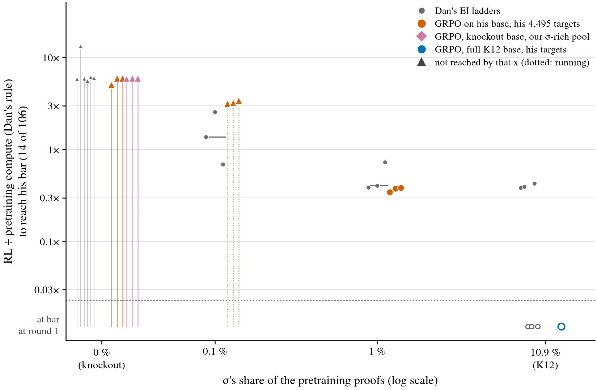
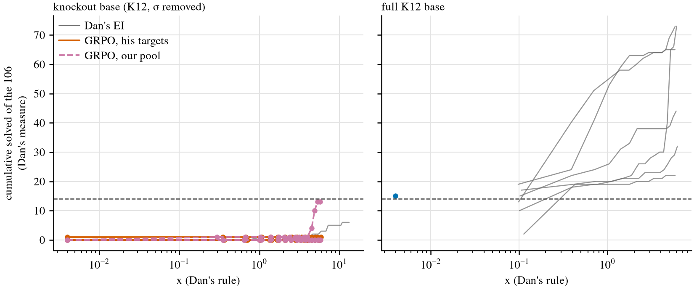
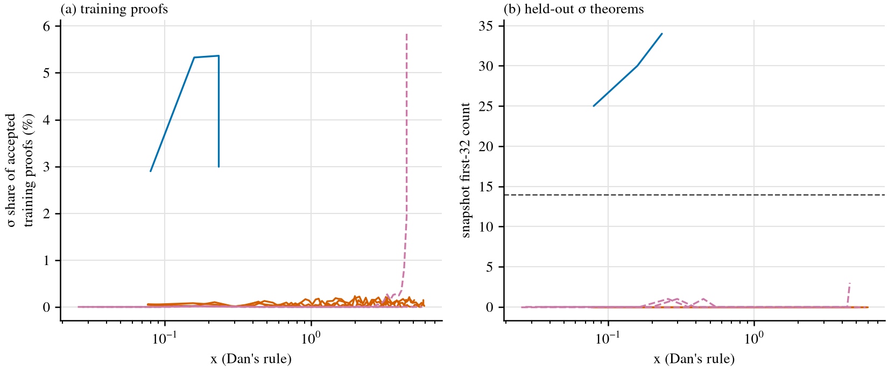

# GRPO on Dan's knockout bases: can GRPO learn proof by contradiction where EI did not?

**Status.** The original arms are DONE. Amendment 1, his 0.1 % and 1 % dose bases, is IN
PROGRESS.
- The primary and reference arms ended by 12:01Z on 2026-11-05. The secondary lines ended
  at 08:55Z (dkoour_s2), 14:30Z (dkoour_s0) and 15:34Z (dkoour_s1).
- **Amendment 1:** the three 1 % lines are done (by 19:12Z). The three 0.1 % lines are
  running, all on A40 pods, because no lab GPU is usable under the rules.
  - dd01_s1 and dd01_s2 run on rp-d3 and rp-d4, which Leon approved at 20:14Z. temescal's CUDA
    is broken, and another user's job keeps cycling on ynez. They resumed at 20:24Z with no
    iterations lost.
  - dd01_s0 runs on rp-d5, under Leon's standing permission for GPUs taken by another user. It
    moved from serrano and resumed at 21:52Z with no iterations lost.
- The five earlier Runpod pods were deleted after their backups were verified. They cost $15.75,
  of which rp-d1 and rp-d2 (amendment 1) cost $2.04. The three new pods are billing on top of
  that.
- Nothing is pushed.

**Question (Dan).** "It would be cool to know if GRPO can actually learn proof-by-contradiction
off the 0% proof-by-contradiction pretrain (where EI failed to learn it)." Leon: "run this too".

**Answer (primary arm).** No. GRPO did not learn proof by contradiction from his 0 %-σ
knockout bases within one ladder of his compute. We read it on his own measure: his cumulative
count of k 32 draws on his 106 strict σ held-out theorems, against his bar of 14.
- **Counts.** His three bases with his 4,495 targets reached 0, 1 and 0 of the 106. That
  matches his EI on the same bases (0, 3 and 0 by his round 16).
- **The one solve.** dko_s1's single theorem was already solved by its base before any RL. No
  GRPO checkpoint solved any of the 106 in its first 32 draws at its last read.
- **σ in training.** σ stayed at 0.05–0.09 % of the accepted training proofs throughout.
- **Compute.** dko_s1 and dko_s2 ran to his round-16 x. dko_s0 stopped at the 15 GPU-h cap at
  x_dan 5.07 of 5.84 (87 % of his ladder).

**Secondary arm: one seed of three started σ late, and stopped just short of his bar.** Here
the knockout base trains on our σ-rich pool.
- **dkoour_s0.** σ in its accepted training proofs stayed under 1 % until about iteration 384
  (x_dan about 4.4). It then rose to 33 % over its last 50 iterations, peaking at 46 % at
  iteration 443.
  - Its snapshots went from 0 of the 106 solved in the first 32 draws (it 380) to 3, 6, 10, 10
    and 12 (it 390–430), then 9 and 9. E32 rose from 0 to 10.7.
  - On his measure it ended at **13**, one below his bar of 14, at his round-16 x (the
    cumulative count by round 13–16 was 4, 10, 13, 13).
  - His EI on the same base, with his targets, had 0 through round 16. EI with our pool was
    not run.
- **dkoour_s2.** Finished at 0, with σ at 0.00 % throughout.
- **dkoour_s1.** Finished at 0 of the 106 at his round-16 x (5.93), with σ at 0.00 % throughout.
- **Reading.** We have one seed's takeoff (dkoour_s0), not a rate. The takeoff came only when
  the training problems reward σ, never with his targets. GRPO can start σ from a 0 %-σ base
  when the problems demand it, but on one of three seeds and only in the last quarter of the
  ladder.

**Amendment 1: his σ-dose bases.** These are the primary recipe on his 0.1 % and 1 % σ-dose
Stage-1 bases, 3 seeds each. Leon asked for GRPO points beside his EI at every dose;
PREREG.md, Amendment 1, was frozen before any dose line ran.
- **1 %: every seed reaches his bar at its round-2 draw, at the same compute as his EI or
  less.**

  | seed | GRPO: round, x at crossing | his EI: round, x at crossing | GRPO ÷ EI |
  |---|---|---|---|
  | s0 | 2, 0.35 | 2, 0.39 | 0.89 |
  | s1 | 2, 0.38 | 2, 0.41 | 0.93 |
  | s2 | 2, 0.39 | 3, 0.73 | 0.53 |

  - σ in the accepted training proofs is 2.0 %, 3.1 % and 2.0 %. His knockout bases gave
    0.05–0.09 %.
  - All three held the bar (stop rule "reached and held"). They took 1.2–1.9 GPU-h each.
- **0.1 %: pending.** dd01_s0 is at 0 of the 106 through its read at x_dan 1.42 (it 220). His EI
  crossed this seed at round 5 (x 1.37). At 21:53Z, dd01_s1 is at cumulative 0 through round 2
  (his EI crossed at round 8, x 2.58). dd01_s2 is at cumulative 1 through round 3, the round at
  which his EI crossed this seed (x 0.69).
- **Reading so far.** With σ in the pretraining at 1 %, GRPO crosses as early as his EI. At
  0 %, neither crosses within one ladder. The 0.1 % dose decides where in between GRPO's
  threshold lies.

**Working folder:**
[`code/experiments/current/knockout_danbase_20261104/`](../../code/experiments/current/knockout_danbase_20261104/README.md)
on branch `leon/knockout-grpo`. It holds the pre-registration (frozen before any line ran), the
run log, the scripts and the numbers.

## Design

- **The same bases as his EI.** These are his create-or-elicit Stage-1 checkpoints
  `stage1_ko_s0–s2`, on K12⁻ with no σ proofs, plus his full base `stage1_full_s3` as a
  reference. They came read-only from his bucket, and their md5s match his registry. His own
  round-1 draw, re-run with his code, gives 0 / 0 / 0 of the 106 on the knockout bases (his
  0 / 0 / 0) and 17 on full_s3 (his 13).
- **The same problems, environment and measure.**
  - **Problems:** his 4,495 rl_targets.
  - **Environment:** his state environment with its caps of 256 tokens per action and 48 steps.
  - **Held-out set:** his 106 strict σ theorems, read with his own code (`generate`, `judge`)
    at T 0.8.
  - **Measure:** his own, a cumulative count of k 32 draws. We take 16 draws, one per round of
    his same-seed ladder, each at the latest checkpoint whose compute (on his rule) is within
    his x for that round.
  - **Bar:** his, 14.
- **Only the algorithm differs.** We use Leon's GRPO (`code.thinking.grpo` at f35d3daf, no
  thinking): 256 prompts × 16 per iteration, T 1.0, PPO clip, unlikeliness reward, no KL and no
  replay. His EI fine-tunes on its accumulated verified proofs plus 20,000 replayed pretraining
  records per round.
- **Arms.**
  - **Primary:** the knockout base with his targets, 3 seeds.
  - **Secondary:** the knockout base with our σ-rich pool (L2_pool, 39.5 % of targets
    strict-σ), 3 seeds. It asks whether GRPO learns σ at all when the problems reward it.
  - **Reference:** the full base with his targets, 1 seed.
- **Budget per line.** A line ends at the first of three events:
  - one ladder of his compute (his round-16 x, 5.80–5.93);
  - 15 GPU-h;
  - reaching the bar and holding it.
- **Machines.** The lines ran on serrano, temescal and ynez under a supervisor. It respawned
  dead lines from their checkpoints, moved lines off GPUs that other users took, and gave the
  primary lines priority (`log.md`).

## Results (observed)

<!-- AUTO:lines -->
| line | arm | base (first 32 of the 106) | his measure, by matched round | reached his bar (14)? | x_dan at the end (his round-16 x) | ended | GPU-h | σ in accepted training proofs: all / last 50 iterations |
|---|---|---|---|---|---|---|---|---|
| dko_s0 | **primary**: knockout base, his 4,495 targets | 0 | 0, 0, 0, 0, 0, 0, 0, 0, 0, 0, 0, 0, 0, 0 | no: 0 of 106 by x_dan 5.07 | 5.07 (5.84) | GPU-h cap: 15.0 ≥ 15 | 15.1 | 0.09 % / 0.14 % |
| dko_s1 | **primary**: knockout base, his 4,495 targets | 1 | 1, 1, 1, 1, 1, 1, 1, 1, 1, 1, 1, 1, 1, 1, 1, 1 | no: 1 of 106 by x_dan 5.93 | 5.93 (5.93) | compute cap: x_dan 5.93 ≥ his round-16 x 5.93 | 14.3 | 0.05 % / 0.04 % |
| dko_s2 | **primary**: knockout base, his 4,495 targets | 0 | 0, 0, 0, 0, 0, 0, 0, 0, 0, 0, 0, 0, 0, 0, 0, 0 | no: 0 of 106 by x_dan 5.94 | 5.94 (5.90) | compute cap: x_dan 5.92 ≥ his round-16 x 5.90 | 11.8 | 0.07 % / 0.07 % |
| dfull_s3 | reference: full K12 base, his targets | 15 | 15 | at the bar before RL (15 at round 1) | 0.26 (5.80) | reached (Dan's measure at x_dan 0.000) and held | 0.5 | 4.45 % / 4.45 % |
| dkoour_s0 | secondary: knockout base, our σ-rich pool | 0 | 0, 1, 1, 1, 1, 1, 1, 1, 1, 1, 1, 1, 4, 10, 13, 13 | no: 13 of 106 by x_dan 5.86 | 5.86 (5.84) | compute cap: x_dan 5.86 ≥ his round-16 x 5.84 | 12.3 | 5.13 % / 33.22 % |
| dkoour_s1 | secondary: knockout base, our σ-rich pool | 0 | 0, 0, 0, 0, 0, 0, 0, 0, 0, 0, 0, 0, 0, 0, 0, 0 | no: 0 of 106 by x_dan 5.93 | 5.93 (5.93) | compute cap: x_dan 5.93 ≥ his round-16 x 5.93 | 12.7 | 0.00 % / 0.00 % |
| dkoour_s2 | secondary: knockout base, our σ-rich pool | 0 | 0, 0, 0, 0, 0, 0, 0, 0, 0, 0, 0, 0, 0, 0, 0, 0 | no: 0 of 106 by x_dan 5.94 | 5.94 (5.90) | compute cap: x_dan 5.94 ≥ his round-16 x 5.90 | 10.0 | 0.00 % / 0.00 % |
| dd01_s0 | **dose 0.1 %**: his 0.1 % σ base, his 4,495 targets | 0 | 0, 0, 0 | no: 0 of 106 by x_dan 0.81 | 0.81 (5.67) | running | 2.2 | 0.02 % / 0.01 % |
| dd01_s1 | **dose 0.1 %**: his 0.1 % σ base, his 4,495 targets | — | — | no: 0 of 106 by x_dan 0.27 | 0.27 (5.94) | waiting | 1.8 | 0.09 % / 0.09 % |
| dd01_s2 | **dose 0.1 %**: his 0.1 % σ base, his 4,495 targets | — | — | no: 0 of 106 by x_dan 0.20 | 0.20 (5.71) | waiting | 1.9 | 0.05 % / 0.05 % |
| dd1_s2 | **dose 1 %**: his 1 % σ base, his 4,495 targets | 1 | 1, 18 | **yes**: round 2, x_dan 0.39 (x_ours 0.074) | 0.72 (5.93) | reached (Dan's measure at x_dan 0.386) and held | 1.9 | 1.95 % / 2.70 % |
| dd1_s0 | **dose 1 %**: his 1 % σ base, his 4,495 targets | 1 | 1, 23 | **yes**: round 2, x_dan 0.35 (x_ours 0.066) | 0.44 (5.73) | reached (Dan's measure at x_dan 0.346) and held | 1.2 | 2.02 % / 2.22 % |
| dd1_s1 | **dose 1 %**: his 1 % σ base, his 4,495 targets | 13 | 13, 19 | **yes**: round 2, x_dan 0.38 (x_ours 0.072) | 0.48 (5.95) | reached (Dan's measure at x_dan 0.377) and held | 1.3 | 3.05 % / 3.30 % |
<!-- /AUTO:lines -->

His EI on the same bases, from his registry rows:

<!-- AUTO:dan -->
| his ladder | held-out count by round (rounds 1–16) | x at round 16 | crossing |
|---|---|---|---|
| la_ko_s0 | 0, 0, 0, 0, 0, 0, 0, 0, 0, 0, 0, 0, 0, 0, 0, 0 | 5.84 | not reached by round 16 |
| la_ko_s1 | 0, 0, 0, 1, 1, 1, 1, 1, 1, 1, 1, 1, 2, 2, 2, 3 | 5.93 | not reached by round 16 |
| la_ko_s2 | 0, 0, 0, 0, 0, 0, 0, 0, 0, 0, 0, 0, 0, 0, 0, 0 | 5.90 | not reached by round 16 |
| la_full_s3 | 13, 40, 51, 55, 58, 58, 60, 62, 63, 64, 64, 64, 65, 65, 65, 65 | 5.80 | round 2, x 0.39 |
| la_dose1_s0 | 3, 15, 22, 26, 30, 40, 44, 44, 47, 50, 52, 54, 55, 56, 57, 58 | 5.73 | round 2, x 0.39 |
| la_dose1_s1 | 13, 19, 19, 21, 23, 24, 25, 30, 33, 34, 34, 34, 34, 34, 34, 34 | 5.95 | round 2, x 0.41 |
| la_dose1_s2 | 2, 12, 16, 17, 20, 21, 23, 26, 29, 29, 29, 29, 29, 30, 30, 30 | 5.93 | round 3, x 0.73 |
| la_dose01_s0 | 0, 0, 3, 5, 14, 17, 21, 23, 26, 27, 28, 28, 29, 29, 29, 30 | 5.67 | round 5, x 1.37 |
| la_dose01_s1 | 0, 0, 0, 0, 0, 6, 13, 14, 14, 14, 17, 25, 26, 27, 28, 28 | 5.94 | round 8, x 2.58 |
| la_dose01_s2 | 3, 12, 15, 18, 18, 18, 18, 18, 19, 19, 19, 19, 19, 19, 19, 19 | 5.71 | round 3, x 0.69 |
<!-- /AUTO:dan -->

## Pre-registered predictions

Scored against PREREG.md (frozen before any knockout line was read).

| | prediction | probability | outcome |
|---|---|---|---|
| P1 | primary: no dko seed reaches his bar (14, cumulative) within one ladder | 70 % | **held**: 0, 1, 0. dko_s0 ended at the GPU-h cap at 87 % of its ladder. |
| P2 | primary: σ stays under 1 % of the accepted training proofs on all three dko seeds | 75 % | **held**: 0.09 %, 0.05 % and 0.07 % overall; at most about 0.2 % in any 50-iteration window |
| P3 | secondary: at least 1 of 3 dkoour seeds reaches his bar within one ladder | 35 % | **not met**: dkoour_s0 13 (one below), dkoour_s1 0, dkoour_s2 0 |
| P4 | secondary: σ exceeds 5 % of the accepted training proofs on at least 1 dkoour seed | 50 % | **met**: on dkoour_s0, 5.1 % over the whole run, 33 % over its last 50 iterations (peak 46 % at it 443). dkoour_s2 0.00 %; dkoour_s1 0.00 % so far |
| P5 | reference: dfull_s3 reaches his bar at its first matched draw after the base (round 2) | 80 % | **not met as registered**: it was already at the bar at round 1 (base draw 15, his 13), so the line ended "reached and held" before his round-2 x and has no round-2 draw |
| P6 | pass@1 reward on Dan's pool passes 0.8 within 50 iterations on every dko seed | 70 % | **held**: it passed at iterations 12, 16 and 13 |
| P7 | amendment 1, dose 1 %: at least 2 of 3 seeds reach his bar within one ladder | 70 % | **held**: 3 of 3, all at round 2 |
| P8 | amendment 1, dose 0.1 %: at least 1 of 3 seeds reaches his bar within one ladder | 50 % | **pending** |
| P9 | amendment 1, dose 1 %: on the seeds that cross, GRPO's x at the crossing is within 2× of his EI's on the same seed | 45 % | **held**: 0.89×, 0.93×, 0.53× |
| P10 | amendment 1: dd1_s1 is at the bar at round 1, its base draw (his round-1 count is 13) | 40 % | **not met**: base draw 13, one below; it crossed at round 2 (19) |
| P11 | amendment 1, dose 1 %: σ in the accepted training proofs exceeds 1 % on at least 2 of 3 seeds | 60 % | **held**: 2.0 %, 3.1 %, 2.0 % |

## Caveats

- **The algorithms differ in more than the update rule.** Training temperature is 1.0 for
  GRPO and 0.8 for his EI. GRPO has no pretraining replay. A GRPO iteration samples 4,096
  attempts; an EI round samples 143,840.
- **Our draws are fresh draws, not his.** RTX 3090 sampling does not reproduce his A40 stream;
  his full_s3 round-1 count is 13, ours 17 and 15. Our reads sample only the 106 (64 per
  theorem; the first 32 form the draw), while his sample all 832 transfer theorems.
- **Matched draws.** Each of our 16 draws comes from the latest checkpoint at or below his
  round's x. Our model at that point has trained on all the compute spent so far, while his
  round-r draw comes before round r's fine-tune.
- **dko_s0 ran out of GPU-h before his compute.** It stopped at the pre-registered 15 GPU-h
  cap at x_dan 5.07 of his round-16 x 5.84. His EI on the same base had 0 through round 16.
- **dko_s1's 1 is the base's.** Its round-1 draw (the base) solved that one theorem. No
  GRPO checkpoint solved any of the 106 in its first 32 draws at its last read; the cumulative
  count keeps the base's solve.
- **Three secondary lines ran partly on Runpod A40 pods** (rp-s0, rp-s1 and rp-s2), with the
  same code and environment; the files were copied by the coordinator on Leon's approval. An
  A40 iteration took 65–135 s, against 60–90 s on the lab's GPUs.
- **Amendment 1 machine events.** temescal's CUDA broke with its GPU 0 fault at 09:29Z, though
  nvidia-smi still answered. dd01_s1 and dd01_s2 therefore ran GRPO on the CPU for an hour
  (3 iterations) and their base reads failed. Both were ended and restarted from the base
  elsewhere. Their base reads (round 1 of his measure) were then made separately on serrano
  GPU 1, with the same code and arguments (`baseread_dd01.sh`). dd1_s2 finished its hold on a
  pod (rp-d1, reused from dd1_s0) after another user's job took its ynez GPU.
- **dd01_s1 and dd01_s2 continue on pods.** The same job displaced them from ynez at about 19:12Z,
  and the temescal fault left no other lab GPU under the rules. On Leon's approval they moved to
  A40 pods (rp-d3 and rp-d4), resuming from it 35 and it 25 of serrano's backup, with the same code
  and environment. An A40 iteration has taken longer than a lab iteration (see above). x_dan
  counts compute, not time, so the pods do not change x itself, but they reach the 15 GPU-h cap at
  a lower x than a lab GPU would.
- **dd01_s0 continues on a pod too.** Another user's job took serrano GPU 1 at about 21:25Z. It
  moved at its it 220 checkpoint to rp-d5 and resumed there at 21:52Z, with no iterations lost.
- **Machine events.** Lines were respawned and moved: one OOM, other users' processes, ynez's
  reboot, and a GPU reserved for another experiment. Lost iterations are listed below.

## Compute

<!-- AUTO:compute -->
- Lines: 87.0 GPU-h in all (segment wall time, reads included), plus about 0.4 GPU-h for the base check and 0.2 for the pilot.
- Iterations lost to deaths and moves (superseded rows): {'dko_s0': [[11, 11], [501, 501]], 'dko_s2': [[1, 8]], 'dd01_s1': [[1, 3]], 'dd01_s2': [[1, 3], [1, 2]]}.
<!-- /AUTO:compute -->

## Configuration

- **Code:** GRPO is `code.thinking.grpo` at f35d3daf, with the `snap_iters` and
  `danbase_log` patches (logging only). His code is state_train / state_ladder_ei / eval_set at
  13e41bbd, and coe_sigma / coe_rounds at 624982dc.
- **Records:** PREREG.md sha256 is `dac8e2df…`. The run log, every respawn and every move are
  in the working folder's `log.md`.
- **Artifacts:** `/scratch/cowifornia/nd-rl/knockout_danbase/` on serrano, temescal and ynez.
  The supervisor's state and events are in `sup/`.
