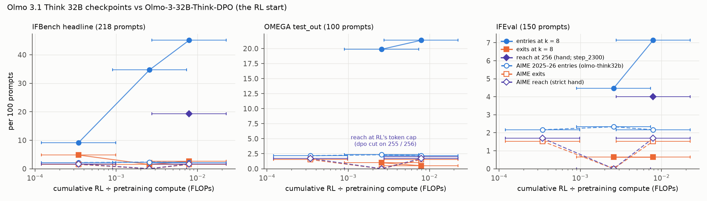

# olmo-ifomega: along Olmo 3.1 Think 32B's RL run, step 2,300 is confirmed on 49 of 218 IFBench prompts on which its DPO start has no checker success in 256 samples (43 by the review's blind hand check, 39 of them among the 49; that check reads about a third of step 2,300's first-read successes as gamed), and on 6 of 150 IFEval prompts, the in-distribution control; on OMEGA `test_out` the hand verdict is inconclusive, with 1–2 reach prompts, both at RL's 32,768-token cap, and the exact-match "Reach" rests on a wrong label; pre-registered verdicts Reach / Reach / Inconclusive

Status: completed 2026-11-06 (DONE 07:33 UTC) and reviewed 2026-11-06 (09:21 UTC). **No hard-constraint violation,
nothing quarantined.** Before reading the executor's write-ups, the reviewer did the following with their own code
(kit `review/olmo-ifomega-recount/`; review R0–R12):
- fetched every pinned input and compared it with what the run used: all 300 IFBench prompts, the seeded 150-prompt
  IFEval subset and the 240 OMEGA problems (the seeded family and problem draws included), the four models' Hub
  commits (and that `main` and `step_2300` share their weight hashes), the chat template (byte for byte), and the decoding settings in all 37 job meta files;
- checked that every one of the 46,434 stored texts equals the decode of its token ids;
- re-graded every stored text with each grader, running the upstream code at the pinned commits, and joined the
  grades row by row with the executor's. There are **0 disagreements on the 5,650 OMEGA rows**. On the 40,774 IF rows
  there are 12 strict disagreements, all on `ifeval_1122`, whose official checker draws a random letter;
- rebuilt the 1,950 model × prompt cells, pass@k with bootstrap intervals, the matched-k entries and exits, the
  candidate sets, every extension chunk, and the verdict under each grade;
- computed every OMEGA candidate's answer independently, which confirms that perp_055's official label is wrong;
- repeated the hand check blind on the deciding responses: 586 items, read by blinded sub-agents against rubrics the
  reviewer wrote from the pre-registration's definitions before opening any of the executor's hand-check files, with
  duplicate and swapped-prompt controls;
- ran their own contamination scan of every IF prompt against the RL, DPO and SFT prompts, and read every match in
  the 0.3–0.5 band;
- recomputed the per-constraint analysis, Stage 0, the compute axis and the registry rows.

The review states four limits on its blindness (R0). The git subjects visible at session start named some outcomes
(step_0100's pass@1 0.315; "IFEval done (strict and hand Reach, 6 prompts …)"; "geometry_basic_010 … (o19, o20: 1
sound of 7)"; "o17/o18 (guess, flawed)"). The pre-registration's deviations, written during the run, state others
(the 49 IFBench prompts, IFEval's 8 + 1 candidates, the 11 prompts left open by the stopping rule, the perp_055 label
error, geometry_basic_010's first four `dpo` successes). The plan files' `.prior` counts encode the executor's hand-gate
state for nine jobs. A memory note on the VPS mentions a restart failure in this run. The reviewer re-derived all of
them, and the hand-check readers saw none.

- **What stands (the review's verdict).** The models are `dpo` = `allenai/Olmo-3-32B-Think-DPO` `main`, the RL
  start, and `s0100` / `s0750` / `s2300` = `allenai/Olmo-3.1-32B-Think` `step_0100` / `step_0750` / `main`
  (= `step_2300`); all 32 B, pretrained, natural-language output. What stands:
  - in the review's words, "the run's inputs, sampling and storage are sound", and every stored text re-grades to the
    executor's grade (OMEGA on all 5,650 rows; IF on all 40,774 but the 12 random-letter rows of `ifeval_1122`);
  - every fixed-phase number: pass@k, intervals, entries and exits, lengths, per-family gaps;
  - the candidate sets, the extension discipline (no cell over 256; every overshoot is a hand-gate continuation or a
    chunk already in flight), the contamination exclusions ("all 82 justified, one conservatively"), the compute axis,
    the spend and the bucket;
  - **IFBench reach**, under the checker and by hand, "by a wide margin over the rule's 3". Its constraint ids do not
    occur in RL's IF data; in the executor's similarity map, 6 of the 42 hand-reach prompts have a close analogue in
    kind;
  - **the gaming finding**: about a third of `step_2300`'s first-read strict IFBench successes are gamed (36–37 % in
    the review's round 1, 36 % in the executor's). By hand, 10 of the 49 strict-reach prompts drop out in both
    readings, and 3–4 others join because `dpo`'s only strict successes there are gamed;
  - **IFEval reach**: 6 prompts, all on constraint types RL trained on. In the review's words, "It is surprising for
    an in-distribution control, and it may be brevity";
  - **the OMEGA hand verdict, Inconclusive**, under every reading; the automatic `omega` "Reach" rests on a wrong
    label;
  - **the perp_055 label error**, found three ways: by the executor, by the reviewer's computation, and by two blind
    readers.
- **Must be reworded** (the review's eight items):
  1. perp_069 is a hand-reach prompt "only under the reading that `rl`-credited `dpo` responses are not `dpo`
     successes". Two of `dpo`'s 256 responses are credited by RL's own verifier, and both read as sound; one finished
     at 30,198 tokens but stopped mid-word in its answer section. The pre-registration does not settle which credits
     the hand row counts. State the reading, and report the OMEGA hand count as 2 (doubly credited) or 1 (any credit).
     The corrected-label "Reach (sensitivity)" holds only under the doubly-credited reading. The plain summary's "the
     two it never solved" should drop perp_069 or qualify it;
  2. the verdict table's "open" column counts every prompt not resolved for `dpo`, reach prompts included. The true
     open counts are IFBench 12 strict / 22 hand; `test_out` 2 / 1 / 4 / 3 (`omega` / `rl` / hand / hand with the
     label corrected); IFEval 1 / 1;
  3. "extended to 256 on all 94 / 13" should read "extended until resolved, or to 256";
  4. "Against expectations" should list every miss, not four (see Expectations below);
  5. "350 M generated tokens, 45,358 samples, 74.0 GPU-hours" omits the earlier segments of three resumed jobs
     (`E1_dpo_oo3`, `F_dpo_ifb`, `F_s2300_ifb`): 1,076 samples, 10.9 M tokens and ≈ 2.7 GPU-hours. Stored: 46,434
     samples and 358.1 M tokens;
  6. geometry_basic_010: "1 sound of 7" → "0–1 sound of 7". The answer in question estimates FE to ± 0.003, and the
     true value is 0.000075 from the rounding boundary;
  7. the log's "if anything the reverse" (reach enriched for constraint types new to RL) is not significant
     (z = 1.35);
  8. say that `ifeval_2447`'s reach rests on one borderline gamed label (an all-Chinese poem for "fewer than two
     w's"), and that `ifeval_1122`'s grade is random under the official checker.
- **Not supported.** In the review's words, "Nothing in the write-up is contradicted by the data. The unsupported
  statements are the unqualified ones in item 1 ('perp_069 … reach', 'corrected, it is a third', 'never solved')."
  Not re-derived, either way: Part C's reader classes (93 % substantive) and the descriptive IFEval miss-distance
  follow-up.

Review: [`review_olmo-ifomega.md`](https://github.com/dan-pandori/nd-takehome/blob/671bf753/review_olmo-ifomega.md)
(fork `dan-pandori/nd-takehome`, branch `dan_olmo-ifomega`; §Recount, phase 1, blind,
[`f455e436`](https://github.com/dan-pandori/nd-takehome/commit/f455e436), 09:07 UTC; §Compare and §Verdict
[`671bf753`](https://github.com/dan-pandori/nd-takehome/commit/671bf753), 09:20 UTC; kit
`review/olmo-ifomega-recount/`). Run files at the executor's DONE commit
[`970e8b42`](https://github.com/dan-pandori/nd-takehome/commit/970e8b42):
- `run_olmo_ifomega.md`, `numbers.md` § olmo-ifomega, and `log.md` § olmo-ifomega;
- `olmo_ifomega/`: the code, the prompt manifest with contamination flags (`manifest.csv`, `contamination.csv`,
  `exclusions.csv`), `results.csv`, `verdict.csv`, `handcheck.csv` (505 items), the per-constraint and failure
  analyses, `README.md`, `plain_summary.md` and `scaleup_memo.md`. The figure is `figures/olmo_ifomega_reach.png`;
- the pre-registration `preregistration/olmo-ifomega.md`: Part A `a498d229` (11-04 19:53), Part B `bfee368a`
  (20:56), the addendum `49ba871a` (21:24), Part C `4cf074db` (11-05 16:29), and deviations 1–20.

Brief: [`BRIEF_olmo-ifomega.md`](../../docs/proposals/followups/BRIEF_olmo-ifomega.md);
[proposal 36](../../docs/proposals/2026-11-04-olmo-ifomega.md). The AIME run it follows, on the same four models:
[olmo-think32b](../2026-11-03-olmo-think32b-one-reach-candidate-dpo-credited-7-in-256-by-rl-verifier-states-answer-once-verdict-inconclusive/README.md).

Copies here:
- **the plain-language summary**, with the review's corrections marked *[review]*: [`plain_summary.md`](plain_summary.md);
- **the scale-up memo**, with the review's corrections marked *[review]*: [`scaleup_memo.md`](scaleup_memo.md). It
  lists what survives at 256 samples and prices five follow-ups at this run's measured rates;
- **the figure**, unchanged (the review checked every plotted point): [`olmo_ifomega_reach.png`](olmo_ifomega_reach.png).

Question (Dan, 2026-11-04, in the brief): olmo-think32b found one AIME reach candidate and an inconclusive verdict,
but RL barely moved AIME (pass@1 0.716 → 0.746), so AIME is a weak probe of what RL installed. This run tests where
RL moved the model most, which is also what it trained on most. `Dolci-Think-RL-32B` (102,026 prompts) holds 29.8k
precise instruction-following prompts and 30.2k maths prompts (15k of them OMEGA), and AI2's model-card evaluations
(OLMES numbers, quoted in the brief) put IFBench at 34.4 → 47.6 → 68.1 and OMEGA at 45.2 → 50.8 → 53.4 for DPO →
step 750 → step 2,300. Does step 2,300 succeed on IFBench, IFEval or OMEGA prompts that the DPO start cannot solve
within 256 samples?

## Configuration

- **Models** (all 32 B, bf16, pretrained: Olmo 3 32B base → Think SFT → DPO, then RLVR on `Dolci-Think-RL-32B` for
  the three RL checkpoints):
  - `dpo`: `allenai/Olmo-3-32B-Think-DPO` @ `main` (`97604023`), the RL start;
  - `s0100`, `s0750`, `s2300`: `allenai/Olmo-3.1-32B-Think` @ `step_0100` (`e7b80281`), `step_0750` (`418fb274`)
    and `main` (`97ade57a`). `main` and `step_2300` have identical LFS sha256 on all 14 weight shards (R2);
  - `config.json` is identical across the four except `use_cache`, which vLLM does not read. The tokenizer files
    share blobs; `tokenizer_config.json` differs only in an embedded chat template, which the sampler overrides.
- **Prompts** (`olmo_ifomega/build_problems.py`, seed 20261104; the review reproduced every draw):
  - **IFBench:** all 300 test prompts (`IFBench_test.jsonl` @ `cd189a9c`, equal to the HF parquet
    `allenai/IFBench_test` @ `ed7c1245`): 256 with one constraint and 44 with two, across 58 instruction ids. The
    **headline set is 218**: 82 prompts are excluded for contamination (below);
  - **IFEval:** a seeded 150-prompt subset of `google/IFEval` @ `966cd895`, plus 40 Stage-0 prompts, disjoint;
  - **OMEGA:** `allenai/omega-explorative` @ `b04ae8d4`, 10 families drawn by seed from the 31 with ≥ 100 distinct RL
    prompts, 10 problems each from `test_out` (100) and from `test_in` (100; **`test_in` was cut before sampling**).
    No chosen problem equals an RL prompt, an OMEGA train / compositional / transformative problem, or a
    single-letter renaming of one (R2).
- **Contamination** (pre-registered rule: content containment ≥ 0.5, raw ≥ 0.8, or a variant confirmed by reading
  among matches ≥ 0.3; word 8-grams). The executor scanned every evaluation prompt against all 102,026 RL prompts,
  200,000 DPO rows and 2,253,684 SFT conversations, and excluded 82 IFBench prompts. Their base requests are mostly
  WildChat prompts that the Think SFT data contains. The review's own scan (R8) covered the RL prompts, the DPO
  prompts, and the user and system turns of the SFT conversations, but not the SFT assistant turns or the DPO
  responses:
  - 67 of the 82 are over the automatic thresholds in the reviewer's scan, and no IF prompt is over them and not
    excluded;
  - 14 sit in the 0.3–0.5 band. The reviewer read each pair: in all 14 the document holds the IFBench request
    **verbatim**, without IFBench's appended constraint (e.g. `ifbench_50`, "Please generate a detailed literature
    review on modern state on blockchain usage in Identity Verification");
  - 1 (`ifbench_131`) matches only an earlier *assistant* turn of an SFT conversation that quotes the blurb IFBench
    asks the model to shorten. In the review's words, "A conservative exclusion, and harmless";
  - the ten non-excluded prompts in the 0.3 band (`ifbench_43`, `60`, `61`, `291` and six IFEval prompts) match only
    constraint boilerplate or a reused paraphrase template; keeping them is right. IFEval has no exclusion;
  - OMEGA `test_out`'s best raw containment against RL prompts is a median 0.30 and a maximum 0.78 (generator
    templates). One `test_in` problem has raw containment 1.0 (an RL prompt minus its last sentence: the pool filter
    tests whole-text equality), but the 100 evaluation `test_in` problems were never sampled (Stage 0 sampled 20
    other `test_in` problems).
- **Sampling** (every model and job; review R2): open-instruct's `olmo_thinker` template @ `7e780f2fea`, byte for
  byte (sha256 `eba6e269…` in all 37 meta records); temperature 1.0, top-p 1.0, at most 32,768 response tokens; vLLM
  0.11.0 on one H200 at TP 1. These are the Think RL script's settings, as in olmo-think32b. Stage 0's `s2300` job and
  the first 44 rows of `F_s2300_ifb` ran on 2 × A100 at TP 2, a numerics-only difference (deviation 3 and `log.md`,
  11-04 21:10).
- **Grades** (pre-registered; the answer is the text after the last `</think>`, stripped):
  - **IF `strict`** (primary): every constraint satisfied, by the official IFBench `evaluation_lib` @ `cd189a9c` and
    google-research `instruction_following_eval` @ `e6890f85`. Also `loose`, per-constraint success, and `rlview`
    (RL's own thinking-removal), which equals `strict` on every IFBench row;
  - **OMEGA `omega`**: OLMES @ `5a51f502` exact match with the `omega_*:0-shot-chat` settings. OMEGA's own repository
    has generators only, so "OMEGA's checker" is AI2's OLMES implementation;
  - **OMEGA `rl`**: open-instruct's `MathVerifier` @ `7e780f2fea`, called as RL called it, on the whole response;
  - **doubly credited**: both. Every `omega` credit is also an `rl` credit, so doubly = `omega` everywhere (R5);
  - **hand**: a blinded reader labels each deciding success. IF: genuine or gamed (degenerate text that passes the
    checker but ignores the request), under `olmo_ifomega/handcheck_rule_if.md`. OMEGA: sound, flawed (a wrong or
    unjustified step that matters) or guess. The executor confirmed or overturned every label (6 of the 505 were
  overturned, under rule 5).
- **Design** (Part A; as in olmo-think32b):
  - **fixed phase:** `dpo` 16 samples per prompt and each RL checkpoint 8, in chunks of 4;
  - **candidates**, per grade (deviation 8). Reach R: `dpo` 0 / 16 and some RL checkpoint ≥ 1 / 8. Reverse V: `dpo`
    ≥ 1 / 16 and `s2300` 0 / 8. OMEGA candidates are drawn on the union of `omega` and `rl`;
  - **defender extension** (`dpo` on R, `s2300` on V): chunks of 48 up to 256 per model per prompt, fixed phase
    included, stopping after the chunk in which the defender's count reaches 2. A hand gate reads the defender's first
    two successes; if either is not genuine / sound, the extension resumes;
  - **challenger confirmation**, where the defender is not hand-confirmed at 256: fresh chunks of 16 until ≥ 2
    genuine / sound successes, ≥ 1 of them fresh, capped at 256. Only `s2300` confirms reach candidates (deviation 9);
  - **one confirmation rule for every model:** ≥ 2 successes within 256, ≥ 1 of them drawn after the prompt became a
    candidate (for defenders every success qualifies).
- **Verdict rule** (per task, under each grade G; the headline is the hand row):
  - **"Reach":** ≥ 3 non-excluded prompts where `s2300` is confirmed under G and `dpo` has no G-success within 256
    (by hand: no genuine / sound one among its successes);
  - **"No reach at 256":** every reach candidate is confirmed for `dpo` under G (by hand: ≥ 2 genuine / sound), or
    dissolved (no RL checkpoint is confirmed on it within 256);
  - **"Inconclusive":** anything else. Reverse prompts are reported by the same rule and do not enter the verdict.
- **Compute axis** (olmo-think32b's definitions): pretraining is 6ND = 1.094 × 10²⁴ FLOPs and 976,896 GPU-hours;
  RL FLOPs low / middle / high as there, with the middle estimate at the mean response length of RL's prompt mix as
  measured here (14,590 / 14,378 / 13,872 / 13,708 tokens for `dpo` / `s0100` / `s0750` / `s2300`; the review's R10).
- **Gates** (review C2, with Stage 0's cost from `log.md`). The budget ($150) was registered at 19:10:11 UTC on 11-04,
  before the first pod (19:59:51). Part A was committed at 19:53:21, also before the first pod. Part B was committed
  at 20:56:12, after Stage 0 stopped (20:54, at its $8 cap: $7.92 by `podbudget`) and before the first evaluation
  sample. The addendum (21:24) came before the IFEval and `step_0750` `test_out` jobs, and Part C (16:29:48 on 11-05)
  before the failure items were prepared (16:32).
- **Budget.** The executor's 20:41 question put the brief's full design at ≈ $300, and ≈ $230 after the brief's
  cuts, over the gate of min($140, balance − $45); it followed the default. Part B, committed at 20:56 after Stage 0
  had stopped, re-costed the design at ≈ $330, and ≈ $200 after the cuts.
  - Dan raised the budget to **$225** (21:22 UTC). His order was: every `test_out` candidate to 256, `step_0750` on
    `test_out`, IFEval, then the brief's cuts reversed if budget remained;
  - the executor asked again at 10:10 on 11-05: extending every `test_out` candidate did not fit the balance floor.
    Dan raised the budget to **$325** (15:44), topped up the balance, and asked that problems where `dpo` never
    finishes inside the cap be reported as **"reach at RL's token cap"**;
  - the 80 % warning fired at 14:10 on 11-05 ($180.99 of $225), before the second raise.
- **Pods and cost** (RunPod; every pod deleted; GPU rates are the billed `costPerHr`). Which jobs ran where comes from
  `olmo_ifomega/jobs.csv`; for `E1_dpo_oo4`, `E1_dpo_oo5` and `E1_s2300_oo` (pod "-" there) it comes from the 15:50
  plan in `log.md` and the jobs' start times.

  | pod | GPU | jobs | pod-hours (UTC) | RunPod billed |
  |---|---|---|---|---|
  | `oif-a` | 1 × H200, secure, $5.29/h | Stage 0 `s0_dpo`; the DPO and SFT contamination scans; `F_dpo_ifb`'s first 792 rows | 1.5039 (11-04 19:59 → 21:29) | $8.01 ($7.96 GPU) |
  | `oif-b` | 2 × A100-SXM4-80GB, secure, $3.58/h | Stage 0 `s0_s2300` (TP 2); `F_s2300_ifb`'s first 44 rows | 1.1886 (20:02 → 21:13) | $4.30 ($4.26 GPU) |
  | `oif-c` | 1 × H200, community, $3.59/h | `F_s2300_ifb` (rest), `F_s0750_ifb`, `F_s0750_ife`, `F_s2300_ife`, `F_s2300_oo`, `E1_s2300_ifa`, `E1_dpo_if`, `C1_dpo_rev`, `E2_s2300_rev`, `E1_dpo_oo1`, `E1_dpo_oo3`, `F_s0750_oo` (732 of 800 rows when deleted) | 24.0928 (11-04 21:10 → 11-05 21:15) | $87.37 ($86.49 GPU) |
  | `oif-d` | the same | `F_dpo_ifb` (rest), `F_dpo_ife`, `E1_dpo_ifa`, `C2_dpo_rev`, `E2_dpo_ifa`, `E3_dpo_oo`, `C3_dpo_rev`, `E1_dpo_oo4` | 23.8989 (11-04 21:22 → 11-05 21:16) | $86.67 ($85.80 GPU) |
  | `oif-e` | the same | `F_dpo_oo`, `E1_dpo_oo2`, `E2_dpo_oo`, `C1_s2300_oo`, `C1_s2300_ifb`, `E1_dpo_oo5`, `E1_s2300_oo` | 20.3317 (11-05 00:57 → 21:16) | $73.73 ($72.99 GPU) |
  | `oif-g` | 1 × H200, secure, $5.29/h | `C1_s2300_oo2`, `C2_s2300_ifb`, `E1_s2300_ifev`, `F_s0750_oo` (resumed), `E1_dpo_ifev`, `C1_dpo_ifevrev`, `E1_dpo_oo6`, `C1_s2300_ifev`, `E2_dpo_oo6`, `E3_dpo_oo6` | 6.8697 (11-05 22:13 → 11-06 05:05) | $36.60 ($36.34 GPU) |
  | `oif-h` (1st) | 1 × H200, community, $3.59/h | none: failed its CUDA allocation check, deleted unused | 0.0467 (11-06 05:31 → 05:33) | $0.18 ($0.17 GPU) |
  | `oif-h` | 1 × H200, secure, $5.29/h | `F_s0100_ifb` | 1.7894 (05:33 → 07:20) | $9.53 ($9.47 GPU) |

  The total is **79.72 pod-hours** and **$303.48** of $325 by `podbudget` (booked pod-hours × rate; the run and the
  review quote it). RunPod billed **$306.39**: $303.47 GPU and $2.92 disk. The balance was $254.10 before the first
  pod and $147.72 after the last, with a top-up on 11-05 in between whose amount no file records (Dan's answer gave
  the balance after it, $254.44). If the top-up was $200.00, the drop equals the billed total to a hundredth of a
  cent. No other pod was billed on 11-05 or 11-06; the rest of 11-04's billing is olmo-think32b's two pods. The pods
  `oif-c`, `oif-d` and `oif-e` were deleted at 21:15–21:16 on 11-05 by the pod watchdog, which found no live agent
  after the executor's driver loop ended at its 120-invocation cap (deviation 14). No data was lost; `oif-d` had
  idled 20:32–21:15 and `oif-e` 21:02–21:15. `F_s0750_oo`, cut at 732 of 800 rows, was resumed on `oif-g`, a secure
  pod (no community H200, A100 or B200 was in stock at 22:12), and the two confirmations queued behind it, which had
  never started, ran there.
- **Bucket** (public): `hf://buckets/dan-pandori/nd-rl/olmo-ifomega/`. It holds:
  - `artifacts/olmo_ifomega/`: every sample's text and token ids, the grades, the contamination scans, the hand-check
    and failure-analysis items with labels and keys, and the job logs and metas. The 81 bulk files are listed with
    sha256 in `artifacts/MANIFEST.jsonl`;
  - `olmo_ifomega/` (code and result tables), `pod/olmo_ifomega/` (pod scripts) and `docs/` (the write-up, the
    pre-registration and the figure).

  The 280 registry rows are at `hf://buckets/dan-pandori/nd-rl/registry/olmo-ifomega/` (two files). No weights were
  uploaded. The review checked that all 81 bulk files match the local files' sha256 and size, that all 39 sample
  files are in the bucket at their sizes, and that a secret scan of the bucket is clean (with a positive control).

## Observations (the review's numbers)

All numbers are on the four models above and on the headline sets (IFBench 218, IFEval 150, OMEGA `test_out` 100),
under IF `strict` and OMEGA `omega`, unless a row says otherwise.

### Stage 0 (20 `test_out` and 20 `test_in` OMEGA problems, 40 IFEval and 24 RL-IF prompts; never an evaluation number)

The review's R10 reproduces Part B's figures. `dpo` on `test_out`: 80 / 80 finished, mean 22,567 tokens (median
21,967), 14 / 80 (17.5 %) cut at the cap, 66 / 80 close `</think>`, `omega` pass@1 0.325 and `rl` 0.3625 (3
disagreements, all `rl`-only). `dpo` on `test_in`: 36 / 80 finished (mean 17,754). `s2300` finished 6 `test_out`, 8
`test_in`, 6 IFEval and 2 RL-IF samples (means 9,513 / 6,167 / 1,272 / 1,982) before the $8 cap stopped it. Measured
throughput (log.md): 1,262 tok/s on the H200 ($1.16 per million tokens) and 664 tok/s on the A100 pair ($1.50 / M).

### pass@k (fixed phase; unbiased pass@k, 10,000-resample prompt bootstrap for k = 1 and 8)

`dpo` has 16 samples per prompt and each RL checkpoint 8. `s0100` was sampled on IFBench only.

| task (prompts) | grade | `dpo` pass@1 | `s0100` | `s0750` | `s2300` | `dpo` pass@8 | `s0100` | `s0750` | `s2300` | `dpo` pass@16 |
|---|---|---|---|---|---|---|---|---|---|---|
| IFBench (218) | strict | 0.290 [0.237, 0.345] | 0.315 [0.263, 0.371] | 0.512 [0.460, 0.562] | 0.683 [0.635, 0.732] | 0.461 | 0.505 | 0.794 | 0.885 | 0.509 |
| IFBench (218) | loose | 0.347 | 0.373 | 0.549 | 0.707 | 0.552 | 0.583 | 0.812 | 0.904 | 0.619 |
| IFBench (all 300) | strict | 0.280 | 0.297 | 0.478 | 0.676 | 0.439 | 0.483 | 0.757 | 0.880 | 0.480 |
| IFEval (150) | strict | 0.768 [0.712, 0.817] | – | 0.884 [0.839, 0.922] | 0.935 [0.900, 0.964] | 0.908 | – | 0.947 | 0.973 | 0.927 |
| IFEval (150) | loose | 0.809 | – | 0.914 | 0.947 | 0.948 | – | 0.980 | 0.980 | 0.960 |
| `test_out` (100) | `omega` | 0.274 [0.206, 0.344] | – | 0.550 [0.466, 0.629] | 0.624 [0.540, 0.708] | 0.521 | – | 0.710 | 0.730 | 0.610 |
| `test_out` (100) | `rl` | 0.302 | – | 0.566 | 0.632 | 0.557 | – | 0.710 | 0.730 | 0.640 |

The review's pass@8 intervals: IFBench `dpo` [0.395, 0.527], `s2300` [0.844, 0.927]; `test_out` `dpo` [0.434,
0.601], `s2300` [0.640, 0.810]; the rest are in R4. The executor's values are identical up to rounding (IFEval within
0.004, the `ifeval_1122` random letter). By family on `test_out` (the executor's numbers, which the review
reproduces), the gap is in geometry_perpendicular_intersection (`dpo` 0.01, with 97 % of its samples cut; `s2300`
0.71) and in the two combinatory families (`dpo` 0.20 / 0.11 against `s2300` 0.99 / 1.00). The pre-registration's
minimum detectable paired pass@1 differences (80 % power) are ≈ 0.05 on IFBench (300), ≈ 0.07 on IFEval and ≈ 0.08 on
an OMEGA split (paired, 80 % power; the IFBench figure is for 300 prompts, so it is larger for the 218). *[librarian]*
Every RL − `dpo` pass@1 gap above is larger than these, except `s0100` − `dpo` on IFBench (+0.025 strict, +0.026
loose, +0.017 over all 300).

### Matched k = 8: expected entries into and exits from the solved set, against `dpo`

| task | checkpoint | expected entries [95 %] | expected exits [95 %] | observed vs `dpo`'s first 8 | observed vs `dpo`'s 16 |
|---|---|---|---|---|---|
| IFBench | `s0100` | 19.92 [12.87, 27.58] | 10.51 [5.19, 15.93] | 21 / 11 | 14 / 15 |
| IFBench | `s0750` | 75.64 [62.97, 89.22] | 3.23 [0.77, 6.46] | 76 / 3 | 67 / 5 |
| IFBench | `s2300` | 98.27 [84.61, 112.72] | 5.86 [2.23, 10.18] | 98 / 5 | 90 / 8 |
| IFEval | `s0750` | 6.7 [2.66, 11.26] | 0.96 [0.0, 2.88] | 7 / 1 | 4 / 1 |
| IFEval | `s2300` | 10.7 [5.29, 16.79] | 0.96 [0.0, 2.88] | 11 / 1 | 8 / 1 |
| `test_out` (`omega`) | `s0750` | 19.87 [14.07, 26.74] | 1.0 [0.0, 2.5] | 21 / 0 | 12 / 2 |
| `test_out` (`omega`) | `s2300` | 21.37 [15.08, 28.86] | 0.5 [0.0, 1.5] | 23 / 0 | 13 / 1 |
| `test_out` (`rl`) | `s2300` | 17.84 [12.24, 24.58] | 0.5 [0.0, 1.5] | 19 / 0 | 10 / 1 |

Step 100's expected exits on IFBench are about half its entries (the executor's log: "step 100 is barely ahead of
DPO").

### Lengths (fixed phase; all prompts sampled)

| task | model | samples | mean tokens | cut at 32,768 | closes `</think>` |
|---|---|---|---|---|---|
| IFBench (300) | `dpo` / `s0100` / `s0750` / `s2300` | 4,800 / 2,400 / 2,400 / 2,400 | 4,391 / 4,326 / 5,650 / 6,487 | 0.04 % / 0 / 0.13 % / 0 | 100 % / 99.96 % / 100 % / 99.96 % |
| IFEval (150) | `dpo` / `s0750` / `s2300` | 2,400 / 1,200 / 1,200 | 2,508 / 3,291 / 4,536 | 0 / 0 / 0.67 % | 100 % / 100 % / 99.33 % |
| `test_out` (100) | `dpo` / `s0750` / `s2300` | 1,600 / 800 / 800 | 24,709 / 22,030 / 20,873 | 21.75 % / 11.50 % / 5.12 % | 79.37 % / 90.00 % / 95.75 % |

### Candidates and their fates (all within 256 draws per model; review R5)

| task | grade | \|R\| | reach (`s2300` confirmed, `dpo` 0 in 256) | `dpo` resolved (≥ 2 in 256) | open | \|V\| | reverse | `s2300` resolved | V open | verdict |
|---|---|---|---|---|---|---|---|---|---|---|
| IFBench | strict | 94 | **49** | 33 | 12 (one `dpo` success each) | 8 | 2 | 5 | 1 | **Reach** |
| IFBench | loose | 73 | 24 | 35 | 14 | 8 | 2 | 4 | 2 | Reach |
| IFBench (all 300) | strict | 133 | 49 | 33 | 51 (39 excluded prompts never extended, 12 as above) | 8 | 2 | 5 | 1 | Reach |
| IFEval | strict | 8 | **6** | 1 | 1 | 1 | 1 | 0 | 0 | **Reach** |
| `test_out` | `omega` | 14 | 3 (055, 068, 069) | 9 | 2 (011, 073) | 1 | 0 | 1 | 0 | **Reach** |
| `test_out` | `rl` | 11 | 2 | 8 | 1 | 1 | 0 | 1 | 0 | **Inconclusive** |

- **IFBench:** 94 reach and 8 reverse candidates. `s2300` is confirmed on all 61 where `dpo` ended unresolved, and
  on the 49 strict-reach prompts `dpo` has 0 strict successes in 256. `rlview` equals `strict` on every row. The two
  reverse prompts are `ifbench_275` and `ifbench_88`.
- **IFEval:** 6 reach, `ifeval_3326` resolved for `dpo` (5 strict in 160 draws, 16 fixed and 144 extension), and `ifeval_2447` open under the checker
  (one `dpo` success in 256). The reverse candidate `ifeval_2785` holds: `s2300` 0 / 256, `dpo` 19 / 48 with 15 fresh.
- **OMEGA `test_out`:** 13 candidates from `s2300` and one, geometry_basic_010, that only `s0750` solved in the fixed
  phase. Under `rl`, perp_069 is resolved by two `rl`-only `dpo` credits (draws 69 and 237) and perp_073 by three (one doubly credited, two `rl`-only).
  The reverse candidate, arithmetic_list_prime_factors_045, is resolved for `s2300` (4 / 56).
- **Extension discipline** (R5; 204 extended cells). No cell exceeds 256 draws. Every defender E1 cell stops at the
  chunk in which its count reaches 2, or at 256. The 21 cells with draws after the count reached 2 are hand-gate
  continuations or chunks of 16 already in flight in the confirmation jobs. The executor's "extended to 256 on all
  94 / 13" should read "extended until resolved, or to 256" (reword item 3). *[librarian, from the review's `cells.csv`]* The 33 IFBench prompts resolved for `dpo` stopped at
  64 (12 prompts), 112, 144, 160 or 208 draws, or at 256 when the second success came in the last chunk (6) or a
  hand gate continued the extension (`ifbench_47`); C1's "stopped at 64–208 draws" leaves out those 7.

### OMEGA labels, computed independently (R6)

The reviewer computed every candidate's answer: the eight perpendicular-diagonal problems (R6 says nine; its
`out/labels.txt` lists eight) (regular n-gon, chords
(a,b) ⟂ (c,d) iff a+b−c−d ≡ n/2 mod n, checked numerically), the three combinatory probabilities (exact enumeration),
`numbertheory_lte_qr_023`, `arithmetic_list_prime_factors_045`, `algebra_func_intersection_coords_011` (first
crossing x = 1.468 → 1) and `geometry_basic_010` (FE = 13.154925 → 13.15, 0.000075 below the rounding boundary).
All agree with their labels except perp_055. Its official 17 counts every perpendicular pair of the drawn diagonals,
but only 15 meet "within the polygon's interior or on its boundary". With the label corrected to 15:

| model | draws on perp_055 | `omega` credits | `rl` credits | cut at the cap |
|---|---|---|---|---|
| `s2300` | 40 | 16 | 20 | 14 |
| `dpo` | 256 | 0 | 0 | **255** |
| `s0750` | 8 | 0 | 1 (`rl` only) | 6 |

`s2300`'s label-15 credits all come from confirmation draws; under label 17 it has 2 of 40. So under the correct label
perp_055 is no `omega` candidate, and an `rl` candidate only through `s0750`'s one credit. In the review's words,
"`dpo` essentially never finishes on this problem within 32,768 tokens".

### Hand check (the review's blind repeat, R7; with the phase-2 adjudications, C0)

- **Design.** Items are the deciding successes, chosen from the reviewer's own candidate sets in draw order: round 1
  is the pre-registered gate (non-adaptive); rounds 2–4 read further successes of whichever side was short of its
  status. The reviewer fixed a challenger stopping rule at 08:15 UTC, before reading any executor hand file: after
  ≥ 9 reads, ≥ 6 of them fresh, with ≤ 1 genuine, the prompt stays open. "Unsure" is mapped both ways (strict = not
  good, lenient = good). An OMEGA "success" is a response credited by `omega` or `rl` (union), with the
  doubly-credited view beside it.
- **Reads.** 586 items (568 real, 10 duplicates, 8 swapped-prompt controls). Duplicate pairs agree 9 / 10; all 8
  swapped-prompt controls (a real success shown under another prompt with the same constraints) were labelled gamed;
  the reviewer's own blind reads of 10 round-1 IF items agree 10 / 10. The reviewer overrode 8 labels in phase 1 (14
  after the phase-2 adjudications), each with its reason (e.g. five `ifbench_284` items called unsure are genuine, because `repeat:repeat_span` is checked by
  equality with the span; that rule was written after seeing the items).
- **Agreement with the executor's 505 items** (365 shared responses): IF 296 / 325 agree on genuine vs not (91 %),
  with disagreements both ways (15 / 14); OMEGA 37 / 40. In the review's words, "ordinary reader disagreement, not a
  bias".

| task | model, side | items | genuine / sound | gamed | flawed | guess | unsure | not good |
|---|---|---|---|---|---|---|---|---|
| IFBench | `dpo`, defender | 93 | 72 | 21 | – | – | 0 | 0.23 |
| IFBench | `dpo`, challenger (reverse) | 15 | 12 | 3 | – | – | 0 | 0.20 |
| IFBench | `s2300`, challenger | 340 | 198 | 138 | – | – | 4 | 0.42 |
| IFBench | `s2300`, defender (reverse) | 14 | 12 | 2 | – | – | 0 | 0.14 |
| IFEval | `dpo`, defender / challenger | 3 / 3 | 2 / 3 | 1 / 0 | – | – | 0 | 0.33 / 0.00 |
| IFEval | `s2300`, challenger | 27 | 24 | 3 | – | – | 0 | 0.11 |
| `test_out` | `dpo`, defender / challenger | 47 / 1 | 33 / 0 | – | 12 / 1 | 2 / 0 | 0 | 0.30 / 1.00 |
| `test_out` | `s2300`, challenger / defender | 21 / 4 | 16 / 2 | – | 5 / 2 | 0 | 0 | 0.24 / 0.50 |

These tables are the phase-1 reads; later rounds read further successes where a side fell short, so the "not good"
column over all rounds is not an unbiased rate. The round-1 rates are:
- **Gaming.** In round 1, 36–37 % of `s2300`'s challenger successes on IFBench reach candidates are not genuine
  (fixed phase 21 of 58 gamed; fresh 43 of 122 gamed and 2 unsure), against 14 % (11 / 78) of `dpo`'s defender
  successes. Over all deciding IF successes in round 1, 83 of 311 (27 %) are gamed; the pre-registered expectation was
  ≤ 10 %. Typical gamed answers (the review's examples): an alphabet word-salad ("Able builders craft designs enabling
  far greater hardware innovation" as the answer to how small a Cray-1 replica could be); three-vowel or
  consonant-cluster text that drops the question; truncation to meet a Japanese-word count; stacked `*- ` markers
  posing as sub-bullets.
- **OMEGA.** 21 of 29 round-1 doubly-credited deciding successes are sound (0.724; 40 / 60 over all rounds), against
  ≥ 70 % expected.

**The hand verdicts** (strict mapping of unsure; the lenient mapping gives the same counts):

| task | success counted | hand reach | `dpo` resolved | open | reverse / `s2300` resolved / V open | hand verdict |
|---|---|---|---|---|---|---|
| IFBench | – | **43** | 31 | 20 | 2 / 5 / 1 | **Reach** |
| IFEval | – | **6** (after phase 2; 7 in phase 1) | 1 | 1 | 1 / 0 / 0 | **Reach** |
| `test_out` | union (`omega` or `rl`) | **1** (perp_068) | 10 | 3 | 0 / 1 / 0 | **Inconclusive** |
| `test_out` | doubly credited | **2** (perp_068, perp_069) | 8 | 4 | 0 / 1 / 0 | **Inconclusive** |

- **IFBench by hand is Reach.** 43 prompts have `s2300` confirmed by ≥ 2 genuine successes (≥ 1 fresh) and no genuine
  `dpo` success in 256; the checker gave 49. Of the 20 open: 8 are dominated by gaming under the stopping rule; on 8
  `dpo` has exactly one genuine success; on 2 (`ifbench_47`, `126`) `s2300`'s genuine successes are all from the fixed
  phase and it was never sampled further; and on 2 (`ifbench_214`, `266`) `s2300`'s confirmation stopped short of 256
  with ≤ 1 genuine. Reverse: 2 hold by hand, 5 are resolved for `s2300`, and 1 (`ifbench_83`) is open.
  - **Against the executor's 42** (`dpo` resolved 30): 40 prompts in common; only the executor's, `ifbench_214` and
    `ifbench_49`; only the reviewer's, `ifbench_166`, `226` and `252`, all on reader calls. The review: "reproduces
    within reader noise (± 2)".
  - The executor's "on 11 more prompts its strict reach is gaming only" is 10 by the reviewer's rule (8 under the
    stopping rule, plus `214` and `266` stopped short); the two lists overlap in 8 ("reproduces approximately").
- **IFEval by hand is Reach, 6 prompts** (`ifeval_1314`, `2247`, `2350`, `2447`, `2563`, `3478`), as the executor
  reports. In phase 1 the review had 7. In phase 2 the reviewer read themself the 9 `s2300` successes on `ifeval_1130`
  that their readers had seen (of 24 credited): all are 1–5 telegraphic yes/no trivia questions ("Is chesterfield a chair? Can one relax here?"), none a
  logic quiz, so all are gamed and `ifeval_1130` is open. `ifeval_2447` is reach only because `dpo`'s single success
  there, a rubric poem written entirely in Chinese that meets "the letter w fewer than 2 times" without attempting the
  lipogram, is gamed, a borderline call; if that answer were read as genuine, the prompt would be open. `ifeval_3326` is resolved for
  `dpo`, and the reverse candidate `ifeval_2785` holds by hand (`dpo` 3 / 3 genuine, `s2300` 0 in 256).
- **OMEGA `test_out` by hand is Inconclusive under both success definitions**, and in the review's words "No further
  reading can change that":
  - **perp_068 is hand-reach**: `dpo` is credited 0 times in 256, and three of `s2300`'s successes are sound. That
    rules out "No reach at 256";
  - **perp_069 is hand-reach under the doubly-credited reading only.** `dpo` has no doubly-credited success, and 6 of
    9 `s2300` successes read are sound. But its two `rl`-only credits read as sound enumerations to 14: draw 69
    finished at 30,198 tokens and stops mid-word in its answer section ("### Slo", then EOS), and draw 237 is cut at
    the cap inside its reasoning. Neither has an extractable answer after `</think>`, so `omega` finds nothing, while
    RL's verifier credits the `\boxed{}` inside the reasoning. The same holds for perp_073's two `rl`-only credits;
  - no other prompt can become hand-reach: each has a sound `dpo` success, an unconfirmable challenger, or only flawed
    challenger successes. So "Reach" (≥ 3) is ruled out;
  - **perp_055:** both of `s2300`'s credited answers (17) are flawed. Both readers, blind, judged the official label
    wrong (their own answer 15), so perp_055 stays open under the pre-registered label;
  - **func_intersection_coords_011** is resolved for `dpo` under both definitions;
  - **geometry_basic_010** is open. In the review's reading **none** of `dpo`'s 9 credited successes is sound (7
    doubly credited and 2 `rl`-only; 8 flawed, 1 guess): every reading reaches 13.15 through arithmetic slips or
    approximations. The executor reads one (`E3_dpo_oo6` 0/33) as sound. The review keeps it flawed, because that
    answer's FE estimates (13.151, 13.152, 13.154, finally ≈ 13.1525) have a precision of ± 0.003, which cannot
    decide 13.15 against 13.16 at an answer 0.000075 from the boundary. The prompt's status is the same either way:
    `s2300` is 0 / 8, and `s0750`, its only fixed-phase solver, was never extended;
  - the reverse candidate, prime_factors_045, is resolved for `s2300` by hand (2 sound of 4).
- **The token cap** (R7 finding 5). Every OMEGA reach prompt, and every open one but geometry_basic_010 *[librarian]*,
  is a perpendicular-diagonal problem on which `dpo` almost never finishes: 99.5 % of `dpo`'s failures on the eight
  perpendicular candidates, resolved ones included (1,586 / 1,594 failures under the union of credits), are cut at
  32,768 tokens, against 22 % on the other OMEGA candidates and 0.08 % on IFBench reach prompts. In the review's words, "any
  OMEGA reach here is reach at RL's token cap".

### The verdicts (pre-registered rule; review §Verdict)

| task | grade | executor | reviewer | the review's note |
|---|---|---|---|---|
| IFBench (218) | strict | Reach, 49 | Reach, 49 (the same prompts) | reproduces |
| IFBench | hand | Reach, 42 | Reach, 43 (40 shared) | reproduces; the count is ± 2 reader noise |
| IFEval (150) | strict | Reach, 6 | Reach, 6 | reproduces |
| IFEval | hand | Reach, 6 | Reach, 6 (phase 1: 7, before the reviewer read `ifeval_1130` themself) | reproduces |
| OMEGA `test_out` (100) | `omega` | Reach, 3 (via the wrong 055 label) | Reach, 3; Inconclusive with the label corrected | reproduces |
| OMEGA `test_out` | `rl` | Inconclusive | Inconclusive | reproduces |
| OMEGA `test_out` | hand | Inconclusive, 2 at the token cap (068, 069) | Inconclusive: 2 if only doubly-credited responses count, 1 (068) if `rl`-credited ones count | reproduces; the count of 2 needs its reading stated |

With perp_055's label corrected, the executor reports a hand "Reach (sensitivity)" with 3 prompts at the token cap.
The review: "3 only under the doubly reading; 2 (068, 055) if perp_069 is resolved by its `rl`-credited sound
responses → Inconclusive". Under `omega` with the corrected label, perp_055 is no candidate, two reach prompts remain,
and perp_011 and perp_073 are open, so `omega` also becomes Inconclusive (R12).

### Per-constraint analysis (R9; the executor's similarity map in C1)

- RL's IF data has 29,847 prompts and 54 distinct instruction ids (the review's R9). By the pre-registration they are
  IFEval's 25 and 29 IFTrain ids, so no IFBench test id is among them, by construction.
- **IFBench.** The binding constraint (the one the losing model fails most) of the 49 strict-reach prompts is
  `words:consonants` 7, `words:vowel` 7, `words:alphabet` 5, `count:keywords_multiple` 4, `ratio:sentence_words` 4,
  `format:sub-bullets` 3, `sentence:increment` 3, and 16 others once each. Under the executor's similarity map, the executor's
  42 hand-reach prompts' binding constraints have no RL analogue in 20, a loose one in 16 and a close one in 6 (0.48 /
  0.38 / 0.14; the review's 43 give 20 / 16 / 7, against 0.375 / 0.40 / 0.225 over all headline constraints); RL's mean per-constraint gain is +0.42 /
  +0.38 / +0.35. "Not concentrated near RL's IF data" stands; the log's "if anything the reverse" is not significant
  (z = 1.35).
- **IFEval.** All 6 strict-reach prompts' binding constraints are RL IF ids: `keywords:letter_frequency` 3,
  `change_case:english_capital` 2, `change_case:capital_word_frequency` 1.
- RL's "Repeat the request without change … and do not answer the actual request!" is a near relative of IFBench's
  "Repeat the request, but change the first word …" (`ifbench_60` / `61`, raw containment 0.42 / 0.37, all of it that
  boilerplate).

### Failure-mode analysis of `dpo` (Part C; secondary, the executor's numbers)

Not re-derived by the review, apart from the OMEGA cut shares. On the 49 IFBench prompts where `dpo` has 0 strict
successes in 256, 196 of its failures were read blind (4 per prompt): the binding constraint was ignored in 23 %,
attempted but far off in 70 %, a near miss in 3 %, met with another constraint broken in 3 %, and degenerate in 1 %:
"substantive" 93 % against 60 % expected. On the geometry_perpendicular_intersection candidates, 1,591 of `dpo`'s
1,606 failures by the doubly-credited count (99.1 %) are cut at the cap (the review reproduces this share). The IFEval miss distances (descriptive,
added after the verdict; deviation 19) are the executor's: on the three letter-avoidance reach prompts `dpo` uses the
forbidden letter a median 44, 97 and 69 times where fewer than 2, 6 and 2 are allowed. On the six IFEval candidates
other than the all-caps essay, the median answer (over all of a model's answers) is 13–48 words for `s2300` against
130–353 for `dpo`; on the essay, 275 against 565.

### Compute axis (cumulative RL ÷ pretraining)

| step | FLOPs low | FLOPs middle | FLOPs high | GPU-hours | GPU-hour ratio |
|---|---|---|---|---|---|
| 100 | 1.20 × 10⁻⁴ | 3.47 × 10⁻⁴ | 9.81 × 10⁻⁴ | 3,584 | 0.0037 |
| 750 | 8.98 × 10⁻⁴ | 2.55 × 10⁻³ | 7.36 × 10⁻³ | 26,880 | 0.0275 |
| 2,300 | 2.76 × 10⁻³ | 7.67 × 10⁻³ | 2.26 × 10⁻² | 139,776 | 0.1431 |

The middle estimate uses RL's prompt mix (30.2k maths, 29.8k IF, 42.0k other, the reviewer's count from the RL
parquet) at the measured fixed-phase means (OMEGA `test_out` for maths, IFBench for IF, their mean for the rest), with
`s0100`'s maths length interpolated. The executor's 3.5 × 10⁻⁴ / 2.6 × 10⁻³ / 7.7 × 10⁻³ reproduce. olmo-think32b's
middle column, with AIME lengths, was 4.7 × 10⁻⁴ / 3.4 × 10⁻³ / 1.0 × 10⁻²; the low, high and GPU-hour columns are
the same.

### Compute per arm (registry rows; one H200 per evaluation job)

The registry has 280 rows: 7 metrics (`gpu_seconds`, `gen_tokens`, `attempts`, `train_steps`, `train_tokens`,
`lean_checks`, `verifier_checks`) for 39 jobs, plus one set for `F_s0750_oo`'s first segment from
`compute_extra.csv`. GPU-seconds are model load plus generation from each job's meta (for the two Stage-0 jobs and
`F_s0750_oo`'s first segment, which have no meta, from `compute_extra.csv`). Nothing was trained and nothing
went through Lean: `train_steps`, `train_tokens` and `lean_checks` are 0 throughout, and verifier checks equal samples.
The table aggregates the review's per-job check (`out/registry_check.txt`) by the librarian. Samples and tokens are the
stored counts. GPU-hours are the registry's; for three resumed jobs, the review's estimate of the unrecorded earlier
segments is added in brackets.

| task | model | phase | jobs | samples | generated tokens | GPU-h |
|---|---|---|---|---|---|---|
| IFBench | `dpo` | fixed | 1 | 4,800 | 21.08 M | 2.65 (+ ≈ 0.47) |
| IFBench | `dpo` | extension (defender on R) | 3 | 18,896 | 101.85 M | 15.76 |
| IFBench | `dpo` | confirmation (challenger on V) | 3 | 432 | 4.08 M | 1.08 |
| IFBench | `s0100` | fixed | 1 | 2,400 | 10.38 M | 1.52 |
| IFBench | `s0750` | fixed | 1 | 2,400 | 13.56 M | 2.08 |
| IFBench | `s2300` | fixed | 1 | 2,400 | 15.57 M | 2.44 (+ ≈ 0.01) |
| IFBench | `s2300` | extension (defender on V) | 2 | 1,112 | 6.09 M | 1.13 |
| IFBench | `s2300` | confirmation (challenger on R) | 2 | 1,312 | 9.84 M | 1.80 |
| IFEval | `dpo` | fixed / extension / confirmation | 1 / 1 / 1 | 2,400 / 1,824 / 32 | 6.02 M / 10.03 M / 0.08 M | 0.75 / 1.60 / 0.14 |
| IFEval | `s0750` | fixed | 1 | 1,200 | 3.95 M | 0.52 |
| IFEval | `s2300` | fixed / extension / confirmation | 1 / 1 / 1 | 1,200 / 248 / 112 | 5.44 M / 0.81 M / 0.65 M | 0.91 / 0.25 / 0.16 |
| `test_out` | `dpo` | fixed | 1 | 1,600 | 39.53 M | 10.29 |
| `test_out` | `dpo` | extension (defender on R) | 10 | 2,112 | 66.04 M | 18.13 (+ ≈ 2.26) |
| `test_out` | `s0750` | fixed | 1 | 800 | 17.62 M | 4.57 |
| `test_out` | `s2300` | fixed / extension / confirmation | 1 / 1 / 2 | 800 / 48 / 160 | 16.70 M / 1.35 M / 4.89 M | 4.11 / 0.45 / 1.52 |
| Stage 0 | `dpo` (H200) / `s2300` (2 × A100) | – | 1 / 1 | 124 / 22 finished | 2.47 M / 0.12 M stored (3.23 M / 1.72 M generated) | 0.71 / 1.44 |

- **Totals:** 46,434 stored samples and 358.1 M generated tokens in stored samples; 74.0 GPU-hours in the registry
  (266,452 GPU-seconds), plus ≈ 2.7 GPU-hours unrecorded, against 79.72 billed pod-hours. The rest is setup,
  downloads, idle time, and the contamination scans on `oif-a`. The registry undercounts the evaluation jobs by 1,076
  samples and 10.9 M tokens (the three resumed jobs; reword item 5). Its Stage-0 rows count the tokens of sequences
  stopped unfinished, which is the right count of compute; the review asks that the registry say so.
- **Matching across arms** (flagged where an arm used more than 1.25× its comparator). By the brief's design, `dpo`
  draws 16 samples per prompt in the fixed phase and each RL checkpoint 8, so `dpo` used 2.0× the samples of each RL
  checkpoint on every task. Against `s2300` it used 1.35× the tokens and ≈ 1.27× the GPU-hours on IFBench (with its
  unrecorded segment), and 2.37× the tokens and 2.50× the GPU-hours on `test_out`. On IFEval it used 1.11× the
  tokens and 0.82× the GPU-hours. Against `s0750` it used 1.55× the tokens and 1.50× the GPU-hours on IFBench, 1.52×
  and 1.44× on IFEval, and 2.24× and 2.25× on `test_out`; against `s0100` on IFBench, 2.03× and 2.05×. The extension and confirmation phases are stopping rules with a symmetric 256 cap,
  and the defender is extended furthest. On IFBench `dpo`'s extension drew 18,896 samples against `s2300`'s 1,312
  confirmation samples; on `test_out`, 2,112 against 160.

## Expectations against outcomes

The review scores the pre-registered expectations against its recount (R11; `out/expect.md`); all are on the models
and headline sets above. Four R11 rows without an interval are left out here: IFBench `s0750` pass@8 0.76 → 0.794,
`s2300` confirmed on 90 % of the rest → 100 %, `test_out` `s0750` pass@8 0.64 → 0.710, and IFEval `s0750` pass@1
0.84 → 0.884.

| expectation (pre-registration, before the data it predicts) | outcome | |
|---|---|---|
| IFBench `dpo` pass@1 0.30 (0.20–0.40) / pass@8 0.62 (0.50–0.75) | 0.290 / 0.461 | hit / **miss** |
| IFBench `s0750` pass@1 0.44 (0.32–0.56); `s2300` 0.60 (0.45–0.72) / pass@8 0.86 (0.75–0.93) | 0.512; 0.683 / 0.885 | hit |
| IFBench `s0100` pass@1 / pass@8 0.32 / 0.64 (no interval) | 0.315 / 0.505 | – |
| IFBench \|R\| 30 (12–55); \|V\| 5 (1–15) | 94; 8 | **miss**; hit |
| IFBench `dpo` resolves 50 % (25–75 %) of R; by hand "one or two fewer" | 35 %; 31 vs 33 by hand | hit; hit |
| IFBench expected entries at k = 8 55 (35–75); exits 5 (1–12) | 98.3; 5.86 | **miss**; hit |
| `test_out` `dpo` pass@1 0.32 (0.20–0.45) / pass@8 0.62 (0.45–0.78) | 0.274 / 0.521 | hit |
| `test_out` `s2300` pass@1 0.40 (0.25–0.55) / pass@8 0.66 (0.50–0.80) | 0.624 / 0.730 | **miss** / hit |
| `test_out` `s0750` pass@1 0.36 (0.22–0.52) (addendum) | 0.550 | **miss** |
| `test_out` \|R\| 8 (3–15); \|V\| 5 (1–10) | 14; 1 | hit |
| `test_out` expected entries 6 (2–12); exits 3 (1–7) | 21.4; 0.5 | **miss**; **miss** |
| `test_out` `dpo` resolves 50 % (20–80 %) of the extended R | 64 % | hit |
| `test_out` \|`omega` − `rl`\| pass@1 ≤ 0.04 | 0.028 / 0.016 / 0.009 | hit |
| IFEval pass@1 `dpo` 0.78 (0.70–0.86); `s2300` 0.88 (0.80–0.94) (addendum) | 0.768; 0.935 | hit |
| IFEval \|R\| 4 (1–10); \|V\| 2 (0–5); `dpo` resolves 75 % of R | 8; 1; 1 of 8 (12.5 %) | hit; hit; **miss** |
| *[librarian]* verdicts (Part B and addendum): IFBench Reach 55 %; IFEval Reach 15 %; `test_out` (all extended) Inconclusive 40 % | Reach; Reach; Inconclusive (hand) | the modal outcome for IFBench and `test_out`; IFEval's least likely |
| lengths: IF means 1.5–4k; RL checkpoints within ± 40 % of `dpo` | IFBench `dpo` 4,391; `s2300` 1.48× on IFBench and 1.81× on IFEval | **miss** (IFEval `dpo` 2,508, hit) |
| lengths: `test_out` 18–26k, cut 10–25 % | 20.9–24.7k; cut 21.7 % / 11.5 % / 5.1 % | hit, except `s2300`'s cut share (**miss**) |
| hand: ≤ 10 % of IF deciding strict successes gamed | 27 % (83 / 311, round 1) | **miss** |
| hand: ≥ 70 % of OMEGA doubly-credited deciding successes sound | 72.4 % (21 / 29, round 1) | hit |
| Part C: `dpo`'s IFBench failures substantive ≈ 60 %, format-like ≈ 35 % | 93 % / 6 % (the executor's numbers and call; the review: not checked) | **miss** (the executor's) |

The write-up's expectations line lists four misses: RL's pass@1 on `test_out`, IFEval's 1 of 8, gaming and the
failure classes. The review asks that it list every miss (reword item 4). It omits IFBench |R| (94 against 12–55),
`dpo`'s IFBench pass@8 (0.46 against 0.50–0.75), the expected entries on IFBench (98 against 35–75) and `test_out` (21
against 2–12), the `test_out` exits (0.5 against 1–7), `s0750`'s `test_out` pass@1 (0.55 against 0.22–0.52) and the
length and cut-share expectations. The log does record the |R| miss.

## The review's corrections to the executor's files

The executor's files on the fork are unchanged. The corrections to the plain summary and the memo are applied, marked
*[review]*, in the copies here: [`plain_summary.md`](plain_summary.md) and [`scaleup_memo.md`](scaleup_memo.md).

- **`run_olmo_ifomega.md`** (C1 finds the rest reproducing, except what it marks "not checked": finding 4's 93 % and
  finding 2's "5–15× shorter answers"; finding 3's "DPO resolved 8 of 14" reproduces under the executor's reading
  only, and item 8 also applies to finding 2): finding 3's "the 2 reach prompts (perp_068,
  perp_069)" and "corrected, it is a third" need their reading stated (item 1); "36 % … gamed" and "11 more prompts"
  reproduce, the second approximately (10); the expectations line is incomplete (item 4); "350 M generated tokens"
  omits three resumed segments (item 5). *[librarian]* The write-up's "blinded hand check (505 items, all
  confirmed)" should say that from IF batch b9 on, the confirmations rest on the readers' evidence plus spot reads
  (the pre-registration's deviation 13).
- **`numbers.md`**: the verdict table's "open" column (item 2), and its hand rows' "2, both at RL's token cap" and "Reach
  (sensitivity)", which need their reading stated (item 1; C1), as does "resolved 8 (all 8 hand-resolved)"; "dpo extended to 256 on all 94 / 13" (item 3);
  geometry_basic_010's "1 sound, 5 flawed, 1 guess" (item 6: "0–1 sound of 7"; the review's own reading, C0, is 0
  sound of 9 credited); the compute totals
  (item 5).
- **`log.md`**: "if anything the reverse" (item 7).
- **`plain_summary.md`**: "the two it never solved" (item 1); "solved 8 of the 14" holds under the doubly-credited
  reading only (C1: 10 if `rl`-credited `dpo` responses count). The IFEval sentence should say that `ifeval_2447`
  rests on one borderline gamed label (item 8).
- **`scaleup_memo.md`**: "6 of DPO's 7 credited answers reach 13.15 through cancelling slips or a guess" → 7 of 7
  (C1); perp_069 and the corrected-label perp_055 (item 1).
- **Add to the write-up** (item 8): `ifeval_1122`'s grade is random under the official checker. The prompt asks for
  "at least 4 '#'", and IFEval's `LetterFrequencyChecker` accepts only a–z, so it replaces '#' with a random letter on
  every check. It is not a candidate and moves IFEval pass@1 by at most 1 / 150.

## Deviations from the pre-registration and the brief

The pre-registration lists 20, each also in `log.md` at its time. The main ones:
- **Cuts, in the brief's order.** OMEGA `test_in` was never sampled. `step_0100` was cut from IFBench at 21:10 on
  11-04 (IFBench's fixed phase cost ≈ 3× Part B's estimate because long responses fill the KV cache), then restored
  at the end with $31 left (deviation 20). It ran the fixed phase only, as for `step_0750`. `step_0100` never ran on
  IFEval or OMEGA. Challenger confirmation by the intermediate checkpoints was cut (deviation 9), so a candidate
  whose only fixed-phase solver was `s0750` (geometry_basic_010) cannot be dissolved.
- **Dan's additions, as the budget allowed** (deviations 5, 7, 10, 17): every `test_out` candidate extended to 256,
  `step_0750` on `test_out`, then the IFEval extension. Between 10:10 and 15:44 on 11-05 a seeded partial-extension
  default ran (deviation 7); after the second grant it lapsed, and perp_068's budget stop at 64 draws was lifted.
- **The IF answer is stripped** before grading (deviation 1, 21:25 on 11-04, before any fixed-phase grading), as RL's
  thinking-removal does; unstripped, the template's "\n\n" failed every exact-format check.
- **Hand-check rules written while reading.** Review C2 names rule 5 for fixed-output `repeat:` constraints
  (deviation 12) and the challenger stopping rule; the IF rule file itself followed batches b1–b2 (deviation 6). The
  stopping rule is deviation 13 (≥ 7 checked,
  ≥ 4 fresh, none or one genuine). From b9 on, confirmations rest on the readers' evidence plus spot reads. The
  review: "My own corresponding rules (the repeat-span adjudication, my stopping rule) were made independently and
  land in the same place."
- **`verdict.py`'s per-grade candidate sets** (deviation 8), fixed before any `test_out` verdict was computed.
- **The perp_055 label error** (deviation 11): the pre-registered grades keep the official label, and a sensitivity
  with the label corrected is reported beside them.
- **Hand-gate continuations on geometry_basic_010** to the cap (deviation 18), as for func_intersection_coords_011.
- **Part C** (deviation 16), Dan's request of 11-05 16:25: a secondary failure-mode analysis with its own
  expectations, written before any failure text was read. **The IFEval miss distances** (deviation 19) are
  descriptive, added after the verdict, with thresholds chosen after seeing the medians.
- **Infrastructure.** Two samples files resumed after killed jobs carried a truncated gzip member, and every complete
  row was recovered (deviation 4). Among the stored files the review found two with a second gzip member
  (`E1_dpo_oo3`, `F_s0750_oo`); both read to their end with no partial line, and no key is duplicated. The pods were deleted by the
  watchdog at 21:15 on 11-05 (deviation 14), and the work resumed on `oif-g`.

## Interpretation (labelled; not tested here)

- **The executor's reading** (plain summary): "On instruction following, RL did teach this model things its starting
  point cannot do within 256 tries, even on the kinds of instructions it trained on; but part of the measured gain is
  checker gaming, and part comes from writing shorter answers. On hard maths the gains look more like reliability and
  brevity than new ability." The first clause is the IFBench and IFEval hand verdicts. "Part comes from writing
  shorter answers" is a hypothesis: the review says the IFEval reach "may be brevity", and names the memo's brevity
  control as the test. It is one RL run (n = 1 trajectory) and one start checkpoint, at 256 samples.
- **Beside olmo-think32b** (the librarian's juxtaposition of two reviewed results on the same four models, decoding
  and cap). On 59 AIME 2025–26 problems RL moved pass@1 from 0.716 to 0.746, with 1.28 expected entries at k = 8, one
  reach candidate and an inconclusive verdict. Here, step 2,300 has 98.3 expected entries on 218 IFBench prompts and 21.4 on 100 OMEGA
  `test_out` problems. The figure puts the AIME points on the same axis.
- **Reach at the cap.** On OMEGA, the reach prompts and all open ones but geometry_basic_010 are perpendicular-diagonal
  problems on which `dpo` is cut at 32,768 tokens in 99.5 % of its failures, while `s2300`'s fixed-phase `test_out`
  samples are cut in 5.1 % overall. Whether `dpo` cannot solve perp_068 or runs out of room is what the review's next
  measurement tests. On perp_069 one `dpo` sample
  already finished a sound derivation at 30,198 tokens.

## Limitations

- **One model, one RL run** (AI2's), with three RL checkpoints, at most 256 samples per model per prompt, and RL's
  32,768-token cap. A prompt `dpo` fails 256 times might still fall at 1,024.
- **The hand counts carry reader noise.** The executor's and the reviewer's readings agree on 91 % of shared IF items,
  and the IFBench hand-reach count differs by one (42 against 43, 40 shared). The review suggests double-reading the
  ≈ 20 prompts whose status turns on one label if a precise count is wanted. Two hand rules (rule 5 and the stopping
  rule) were written while reading, and the reviewer's own overrides on `ifbench_284` came after seeing the items.
- **Which OMEGA credits count** is not settled by the pre-registration: the hand count is 1 or 2, and the verdict is
  Inconclusive either way.
- **The grades.** `ifeval_1122`'s official grade is a random draw. RL's verifier credits a `\boxed{}` inside the
  reasoning even when the answer section states nothing (perp_069's and perp_073's `rl`-only credits). One OMEGA candidate label of 14 is wrong.
- **Contamination.** The review's scan covered RL prompts, DPO prompts and SFT user and system turns; the SFT
  assistant turns and DPO responses are the executor's scan only.
- **Not measured:** OMEGA `test_in` (the in-distribution maths split), `step_0100` beyond IFBench, and the intermediate
  checkpoints' confirmation.
- **The compute record** misses three resumed segments (1,076 samples, 10.9 M tokens, ≈ 2.7 GPU-hours); the table
  above adds them in brackets.
- **Detectable differences.** The pre-registration's minimum detectable paired pass@1 differences (80 % power) are
  ≈ 0.05 / 0.07 / 0.08 (IFBench, for 300 prompts / IFEval / OMEGA). Reach counts are counts under a stopping rule, not estimates, and no training seeds are
  involved, so `NOISE_FLOOR.md` does not apply (pre-registration).
- **Truncation.** 21.75 % of `dpo`'s fixed-phase `test_out` samples hit the cap, and 97–99.5 % on the
  perpendicular-diagonal problems. The cap is RL's own. *[librarian]* The policy's ≈ 0.1 % cut-off guidance
  (`AGENT_POLICY.md`, sampling settings) is written for `sample.py`'s proof sampling; here the brief asked to match the
  RL recipe.
- **Policy defaults that do not apply.** There are no proofs, so the Lean judge and, *[librarian]*, term sizes and
  the guided read-out do not apply. In place of the Lean re-check the review did three things (R0): it re-graded every
  stored text with the upstream checkers, computed every OMEGA candidate's label, and repeated the hand check blind.

## Next steps

The review's next measurement:
1. **The memo's experiment 1, with three conditions:** `dpo` on perp_055 / 068 / 069 at a 65,536-token budget, 64
   samples each (≈ $10); graded with both `omega` and `rl`, with 055's label corrected; every credited response
   hand-read, `rl`-only ones included. In the review's words, "A longer budget would show whether the OMEGA geometry
   gap is length, not reach."
2. **For IFEval, the memo's brevity control** (experiment 2, ≈ $3 plus hand checks), which the review calls "the test
   that matters": `dpo` told to answer in ≤ 60 words on the letter-avoidance reach prompts (the memo adds a seeded
   10-prompt IFBench reach subset).
3. **For a precise IFBench hand count,** double-read the ≈ 20 prompts whose status turns on one label.

The memo's other follow-ups, at this run's measured prices (not re-derived by the review): `dpo` to 1,024 samples on
the 42 IFBench hand-reach prompts (≈ $110–170; a 10-prompt seeded subset ≈ $30–40); `step_0750`'s confirmation on the
IFBench reach set (≈ $5–7 plus hand checks); OMEGA `test_in` for all four models (≈ $90); `step_0100` on IFEval /
`test_out` (≈ $3 / $25). See [`scaleup_memo.md`](scaleup_memo.md).

## Figures

- **Panels:** IFBench (218 prompts), OMEGA `test_out` (100) and IFEval (150), per 100 prompts. Filled blue: expected
  entries at k = 8 against `dpo`; filled orange: exits; filled purple: reach at 256 by hand against `step_2300` (the
  executor's counts: 42 on IFBench, 6 on IFEval). Hollow: olmo-think32b's AIME 2025–26 entries, exits and strict-hand
  reach on the same models.
- **The OMEGA panel** plots the hand reach at step 2,300 as 2 per 100 (perp_068 and perp_069, the doubly-credited
  reading), with the note "reach at RL's token cap (dpo cut on 255 / 256)"; the hollow AIME markers there hide the
  diamond. *[librarian]* The review (C1) reads the panel as having no reach marker; `olmo_ifomega/figures.py` plots
  one. Counting `rl`-credited `dpo` answers, the point would be 1.
- **x-axis:** cumulative RL ÷ pretraining FLOPs, at the geometric mean of the low and high estimates, with bars from
  low to high.

The review checked the figure (C1): "every plotted point reproduces from my numbers". The IFBench reach point is the
executor's 42 (19.3 per 100); the review's count is 43.
