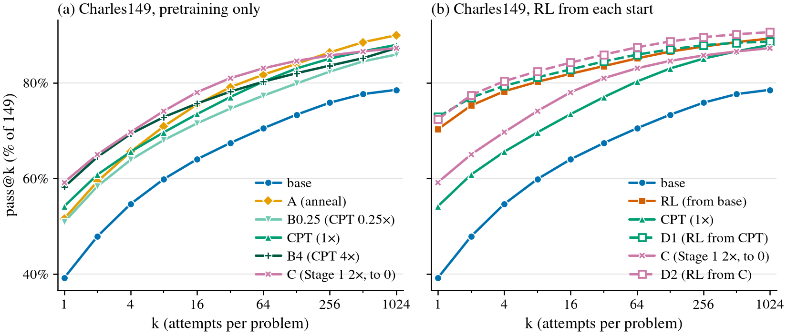

# Base saturation: the paper's base was not converged; finishing its training recovers RL's large-k coverage, and RL from a better base adds mainly pass@1

Status (2026-11-05, written by agent:claude for Leon; not reviewed): done. Seed 0 only, the paper's
Charles149 k1024 read.

Working folder:
[`code/experiments/current/base_saturation_20261105/`](../../code/experiments/current/base_saturation_20261105/README.md)
(branch `leon/base-saturation`, not pushed). It holds a pre-registration with a correction and one
amendment, committed before any read of a new model.

## Summary

**Why.** The [CPT control](../2026-11-04-cpt-control-matched-continued-pretraining/README.md) found
that 312 more AdamW steps on the base's own Stage-1 data, with no RL, reach the paper's RL at
pass@1024 on Charles149 (3 seeds). The paper's base S1g3 had stopped its LR cosine at 30% of peak,
with val loss still falling. So we asked three questions:
- Was CPT's gain just the missing anneal, or more training?
- Does a properly trained Stage 1 do as well?
- Does RL from a better base still add coverage at large k?

**Arms** (all seed 0, from S1g3's own data):

| arm | what |
|---|---|
| A | anneal only: Stage 1's trainer, 1,200 steps from S1g3 with a cosine to 0. MTP weight 0, a stated deviation |
| B0.25, CPT, B4 | the CPT recipe at 0.25×, 1× and 4× its steps |
| C | Stage 1 retrained from scratch: same seed and recipe, 2× the steps (48,000, 8.67 epochs), a cosine to 0. 40 min on an A40 |
| D1, D2 | the paper's RL recipe (L2, then L3) from CPT and from C |

**Observed** (% of 149, seed 0):

| k | base | B0.25 | CPT | B4 | A | C | RL | D1 | D2 |
|---|---|---|---|---|---|---|---|---|---|
| 1 | 39.2 | 50.9 | 54.2 | 58.2 | 51.6 | 59.2 | 70.3 | 72.9 | 72.4 |
| 5 | 56.5 | 65.3 | 66.9 | 70.6 | 67.4 | 71.1 | 78.9 | 80.0 | 81.1 |
| 64 | 70.5 | 77.3 | 80.3 | 80.2 | 81.7 | 83.0 | 85.1 | 85.9 | 87.4 |
| 1024 | 78.5 | 85.9 | 87.9 | 87.2 | 89.9 | 87.2 | 89.3 | 88.6 | 90.6 |

*(a) Pretraining-only arms. (b) RL from each start: the paper's RL from base, D1 from CPT, D2 from
C. Seed 0.*

- **Finishing the base's training recovers RL's large-k coverage.** Each further-trained
  pretraining arm (A, B0.25, CPT, B4, C) adds 7–11 points over base at pass@1024. That is 69–106% of
  RL's +10.7. Every RL − arm interval at pass@1024 includes 0.
- **The anneal alone is enough at large k.** A − base is +11.4 [+6.0, +17.4] at pass@1024. A − CPT
  is +2.0 [−1.3, +5.4], and A used about 0.27× CPT's tokens.
- **More pretraining dose does not help at large k.** B4 − CPT is −0.7 [−3.4, +2.0]. It does help
  at pass@1: +4.0 [+1.4, +6.7].
- **The retrained Stage 1 (C) gains the most of the pretraining arms at pass@1** (C − base +20.0;
  C − CPT +5.0 [−0.2, +10.2]). At pass@1024 it lands level with CPT: C − base +8.7, C − CPT −0.7.
- **RL from a better base still adds a lot at pass@1:**
  - D1 − CPT +18.7 [+13.3, +24.3];
  - D2 − C +13.2 [+7.9, +18.3];
  - D1 and D2 land at or above the paper's RL at pass@1 (72.9, 72.4 against 70.3).
- **At pass@1024, RL from a better base adds little:**
  - D1 − CPT +0.7 [−3.4, +4.7]; 5 problems only D1 solves, 4 only CPT;
  - D2 − C +3.4 [+0.0, +6.7], with the lower end exactly 0; 6 problems only D2 solves, 1 only C;
  - D2 − RL +2.1 at pass@1 and +1.3 at pass@1024.
- **Val loss** (Stage 1's held-out pairs):
  - every further-trained pretraining arm lowers it below base's 0.0692, to 0.0648–0.0672;
  - RL raises it over its start: base → RL 0.0847, CPT → D1 0.0719, C → D2 0.0707.

**Pre-registered readings** (pass@1024):

| reading | verdict | numbers |
|---|---|---|
| Unfinished anneal (H-anneal) | **holds** | A − base +11.4 ≥ ½ × CPT − base (4.7); A − CPT [−1.3, +5.4] includes 0 |
| Anneal is not the story | **fails** | A − base [+6.0, +17.4] excludes 0 |
| Undertrained (H-undertrained) | **fails** | B4 − CPT [−3.4, +2.0]. C − base is above 0, but C 87.2 < CPT 87.9 (one problem, inside the 3-point seed band) |
| Dose plateau / turns over | **holds** / **fails** | B4 − CPT −0.7 [−3.4, +2.0] |
| RL adds coverage over a better base (H-RL holds) | **fails, on the boundary** | D1 − CPT [−3.4, +4.7]; D2 − C [+0.00, +6.7] touches 0 |
| RL adds no coverage (H-RL fails) | **holds, on the boundary** | both intervals include 0, D2's only at its end. Side clause: D − start at pass@1 is above 0 for both, so the PREREG rewords the claim to "RL improves sampling efficiency over a saturated base" |

H-RL is therefore not decided at one seed. D1 says no, and D2 sits on the boundary, at +3.4, just
outside the 3-point seed band that the PREREG pre-stated.

**Interpretation** (single seed; an interpretation, not a claim):
- The paper's base S1g3 was not converged. Its LR anneal stopped at a 30% floor, and val loss was
  still falling.
- Finishing the anneal (A), a short continuation (CPT, B) or a properly trained Stage 1 (C) each
  recovers RL's large-k coverage.
- From a better base, RL (D1, D2) still adds +13 to +19 points at pass@1. At k1024 it adds +0.7 to
  +3.4, and the +3.4 is borderline.
- So the paper's "RL creates capability at large k" largely reflects an undertrained base. RL's
  robust effect here is sample efficiency.

**Open hypotheses:**
- D2's +3.4 at k1024 is real coverage that RL adds over a fully trained base.
- D's extra guard rollbacks (below) understate what the RL recipe adds.

## Evidence

- **Numbers.**
  - [`table.md`](../../code/experiments/current/base_saturation_20261105/table.md) /
    `table.json`: pass@k, every pre-registered paired gap with 95% problem-bootstrap intervals, and
    one-arm-only counts. The † rows are descriptive, added after the data.
  - [`valloss.md`](../../code/experiments/current/base_saturation_20261105/valloss.md): CPU
    teacher-forced loss on Stage 1's val split and on Charles149's reference proofs.
  - Figure: `passk.{pdf,svg,png}` in the working folder.
- **Pre-registration and record.**
  [`PREREG.md`](../../code/experiments/current/base_saturation_20261105/PREREG.md) (`994790c`,
  correction `b3fdbb3`, amendment 1 `1dc80bb`) and
  [`log.md`](../../code/experiments/current/base_saturation_20261105/log.md).
- **Reads.** Charles149, `code.thinking.eval` plain arm, B64, T 0.8, k1024 in 16 chunks of k64
  (seeds 0–15), Lean-judged, merged per theorem.
  - New reads: `/scratch/cowifornia/nd-rl/base_saturation/final/` on serrano.
  - Base, CPT and RL: the existing `think/runs/eval/v2/` reads.
- **Code run on the pods:** Stage 1 `cd089700`, CPT `32bc1da`, GRPO L2 `fa28f6eb`, GRPO L3
  `f35d3daf`, reads `cce4dfc`.
- **Compute.** Five Runpod A40 SECURE pods at $0.59/h, 11:03 pm Nov 4 to 3:29 am Nov 5 PT:
  14.21 pod-hours, **$8.38** against an $18.49 ceiling. No lab GPU was used.
- **Limitations.**
  - **One seed, one set.** The intervals cover problem sampling only. In the CPT control, RL − CPT
    at pass@1024 ranged +1.3 to −4.0 across seeds.
  - **D's RL guard rolled back more than the paper's RL did.** The paper's RL had 0 rollbacks in
    L2 and 1 in L3 (final lr ×0.5). D1 had 1 in L2 and 3 in L3 (final lr ×0.125). D2 had 1 in L2,
    at it 3, and 2 in L3 (final lr ×0.25). So D ran with less effective RL LR. D2 moved least from
    its start: val +5% and Charles149-reference loss −1%, against +22% / +30% for RL from base.
  - **C changes steps and anneal together.** A is the anneal-only control. A had no optimizer state
    to resume from, and used MTP weight 0.
  - **B4 repeats its data** about 3 times.
  - **D2's read chunks 8–15 ran on a different pod than planned** (a logged ops change). They used
    the same checkpoint and settings.

## Next steps

- **More seeds for C and D2** (s1, s2). This decides whether D2 − C at pass@1024 (+3.4, interval
  touching 0) is real, and tightens C − CPT at pass@1 (+5.0 [−0.2, +10.2]).
- **Make C, or an annealed base (A-style), the paper's base,** and rerun the paper's base-vs-RL
  comparisons from it. The CPT control already argues that CPT belongs in those comparisons as the
  baseline.
- **Open, not proposed as a run here:** whether D's extra rollbacks understate RL's large-k effect.
  The rollbacks are visible in the pulled GRPO stage logs.
