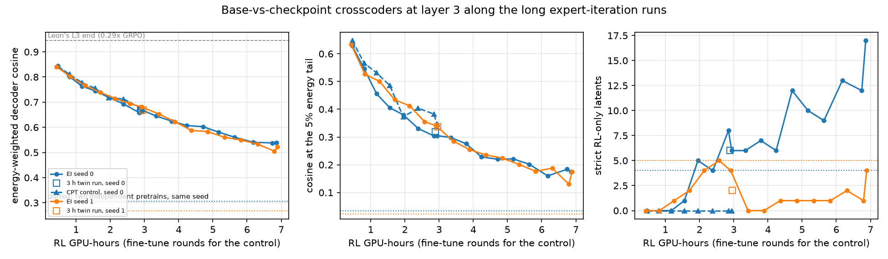

# Crosscoders along a long expert-iteration run: the base's features rotate with training steps, not with RL

Done 2026-11-06/07 on one RunPod A40 (about $5). Working folder:
`code/experiments/current/crosscoder_ladder_20261106/` (protocol and every number in its `README.md`, `ladder.md`
and `ladder.json`). Branch `robbie-experiments`.

**Question.** Leon's circuit-diffing study trained one crosscoder between his base and a GRPO end at 0.29x
pretraining FLOPs and found no RL-only features, only a rotation of shared ones (decoder cosine 0.945). Robbie's
long-RL expert-iteration runs ([`long_rl_20261014`](../../code/experiments/current/long_rl_20261014/README.md))
go to 3 h and 7 h of RL on a 10-minute pretrain, and saved a checkpoint every 5 rounds. Running Leon's Stage 1 along
them: does the rotation flatten (sharpening), keep going, or break, and do RL-only latents appear at high RL?

**Setup.** Leon's recipe: BatchTopK crosscoder at the residual stream after block 3 of 6, 8,192 latents, k 32, 40M
tokens, on paired activations of the base and the checkpoint over the checkpoint's own rollouts, the base's rollouts
and pretraining records; his Δnorm and Latent Scaling classification and his planted-feature control. 39 crosscoders
over two seeds, plus 8 for a control arm added mid-run: the EI fine-tune recipe for 36 rounds on fresh pretraining
records only, from the same base, no rollouts.

**Observed.**
- The energy-weighted decoder cosine falls smoothly with RL, 0.84 at 0.5 h, 0.67 at 3 h, 0.53 at 7 h, the same on
  both seeds within 0.02, with no flattening; its excess over the independent-model floor decays with a 5.3 h
  half-life on both seeds.
- The continued-pretraining control lands within 0.02 of the EI curve at every saved round (mean difference
  -0.009 over 8 rounds): 0.842 against 0.844 at round 5, 0.670 against 0.668 at the end.
- What differs is small: the RL model's decoder norms grow slightly (Δnorm median 0.44 against the control's
  0.48), its rotation tail is 0.05 to 0.08 heavier from round 15, and it has 1 to 8 strict RL-only latents from
  round 20 against 0 for the control. Two independent pretrains of the same seed produce 4 to 5 under the same rule,
  and seed 1's EI run never exceeds that; seed 0's reaches 17 at 7 h.
- Two pretraining runs with the same seed and recipe are independent models (block matrices differ by a relative
  1.40, crosscoder cosine 0.27 to 0.31), so that floor, not 1.0, is what a long run would reach if RL rewrote
  everything. EI's weights move by a relative 0.55 by round 5 and 0.98 by 3 h; the features move far less.
- Planted features: 4 of 6 and 5 of 6 recovered, no false positives beyond the unplanted count. FVU 0.010 to 0.017,
  splice loss recovered 1.00 everywhere.

**Interpretation, not shown directly.** At layer 3 the crosscoder cosine is a clock for optimizer steps under
this recipe, not a signature of RL: Leon's "rotation is drift" at ten times his RL compute. Any divergence metric
of this kind needs a matched continued-pretraining baseline, and with one, this EI run is not distinguishable
from more training in feature geometry. The RL-specific residue (norm shift, a heavier tail, a seed-dependent
handful of late RL-only latents) is untested causally.

**Limits.** One layer; one control seed; the control matches fine-tune steps and records, not sampling compute;
the strict RL-only thresholds are Leon's and not recalibrated to the 0.3 floor; x is RL GPU-seconds, not FLOPs; the
base is the un-annealed 198-lineage pretrain.
