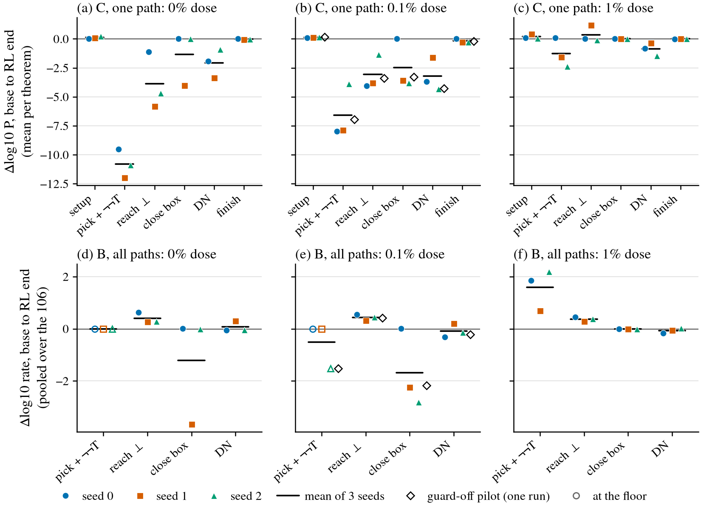

# factor-read: where RL's change on Dan's strict 106 sits along the σ route

**Status.** Completed 2026-11-06, not yet reviewed. Diagnostic read only, no training. All 21 checkpoints read
on ynez GPU 0, 9:42 pm to 11:46 pm PT, 2.11 GPU-h of the 3 GPU-h cap. All six required checks pass.

**Question.** On Dan's 106 strict σ held-out theorems, attribute the change from a base checkpoint to its RL end
to factors along the σ route (σ = a DN line citing a NEGI line). How much is selecting a route the model could
already use (elicitation), and how much is executing a link it could not (candidate capability gain)?

**In short.**
- **Two factors are at zero at base, not one.** Pick on T is 0 of 64 on 87–106 of 106 theorems. Handed the pick, no
  draw reaches ⊥ on 63–78 of 106 (59–74 %). Closing the box is about 100 %, and DN is well above zero (18.9–79.7 % pooled).
- **Handed the pick, the bases can finish some of it.** 8.5–15.0 % of forced draws are solved, on 19–34 of 106 theorems,
  including at the 0 % bases, which were trained with no σ proof. These are mostly contraposition_conv and peirce_sequent.
- **1 %: unforced gains are mostly selection.** Pick rises 0.1 / 3.1 / 0.1 % → 11.0 / 15.3 / 15.1 %, 71–84 % of B's
  positive part. Solved rises 0.9 / 11.3 / 0.9 % → 26.4 / 18.9 / 17.9 %, mainly on contraposition_conv (14 / 18 / 18 of 18 solved in
  64), whose links were already high at base. dd1_s0 adds 15 negated_conditional, by a reductio on another formula.
- **0 % and 0.1 %: execution rises, selection does not.** Reach ⊥ rises about 2–4×, and the theorems with no draw reaching ⊥
  fall on five of six lines (0 %: 71 → 30, 65 → 65, 64 → 49; 0.1 %: 63 → 22, 78 → 64, 74 → 35). The pick on T is 0 of 6,784 at every RL end, and
  unforced solves stay at or near 0. This reach gain is the candidate capability gain, and it does not become
  unforced solves.
- **The frozen reading on C does not back this at set level.** On the 106, C reads no line as selection or a link gain,
  and two of the three 1 % lines have C's pick falling while B's rises. The schema split below explains why, but
  that split and the forced-pick solves are post-hoc.

## What each group's tokens are

- **setup:** the lines before the box, including premise lines the model writes itself. **pick + ¬¬T:** one action
  that opens the box on ¬T and also writes the line's type ¬¬T. **reach ⊥:** the lines inside the box up to a valid
  ⊥. **close box:** `exact e` alone, naming the last line. **DN:** the line deriving T from the ¬¬T line.
  **finish:** the lines after DN to the end of the proof.
- **Pick and NEGI cannot be read as separate decisions here.** Assuming ¬T and committing to ¬¬T are one action, so a rise
  in pick is a rise in choosing the whole reductio on T. Close box says nothing about choosing NEGI; it is only
  whether the box gets closed.

## Configuration

- **Worktree and branch:** `leon/factor-read` from `leon/knockout-grpo` at d78d12a. Working folder:
  [`code/experiments/current/factor_read_20261106/`](../../code/experiments/current/factor_read_20261106/)
  ([PREREG](../../code/experiments/current/factor_read_20261106/PREREG.md) with Amendments 1–2,
  [log](../../code/experiments/current/factor_read_20261106/log.md),
  [frozen tables](../../code/experiments/current/factor_read_20261106/results/tables.md),
  [post-hoc tables](../../code/experiments/current/factor_read_20261106/results/posthoc.md)).
- **Outputs (hold proof text, not committed):** `/scratch/cowifornia/nd-rl/factor_read/` on serrano.
- **Set:** 106 of 106 strict σ theorems, 0 dropped. Reference proofs: all 106 found by minlen search, 0 fallback,
  each replays in the env and passes the verifier, Dan's σ flag and Lean.
  `refs.jsonl` sha256 7074e5ea166ceb1e9f0cb76db4fb290fc4a65a971cdef4aad91f25bf599d1c77.
- **Checkpoints, 21:** 9 bases (Dan's 0 %, 0.1 %, 1 % σ doses, 3 seeds each), their 9 RL ends, the guard-off pilot
  `dd01g0_s2` and 2 secondary reads (`dko_s0_it500`, `dko_s1_it630`).
- **Measures.**
  - **A, unforced:** k 64 from the start, batch 128, on the environment as Dan's lines run it.
  - **B, sampled from a forced prefix:** k 64 from each reference boundary, so each row is 6,784 draws. Counts any
    route through that stage.
  - **C, exact probability of the reference path:** log P under softmax(logits / 0.8), mean over all 33 name bases.
    The primary table leaves out the tokens the env overrides (Amendment 1), with the all-token table beside it.
- **Amendments.** Amendment 1, mine, after one base read and before any RL end: the name tokens. Amendment 2, made
  by the coordinator because its checkpoint list was wrong, not because of any result: the true RL ends of dko_s0 and
  dko_s1 are primary, and the groups are named by their tokens.
- **RL ends slightly short of the line's end,** as no later checkpoint exists: dd01_s0 695 of 696, dd1_s0 60 of 64,
  dd1_s1 60 of 63, dd1_s2 90 of 94, the pilot 290 of 293. **Alarm checkpoints:** dko_s1, dd01_s1, dd01_s2.
- **Pooled B Δlog10** uses (x + 0.5) / (n + 1). PREREG sha256 after Amendment 2:
  690439678dae5fa2b1a73265e275bb6cc445ad1544b8e0c839d4c796553f0f50.

## Observations

### By dose

| dose | x at RL end | first-32 solved, base → end | pick on T (B) | reach ⊥ (B) | DN (B) | solved from a forced pick, draws |
|---|---|---|---|---|---|---|
| 0 % | 5.07, 5.93, 5.94 | 0 / 0 / 0 → 0 / 0 / 0 % | 0 / 0 / 0 → 0 / 0 / 0 % | 11.9 / 19.5 / 23.0 → 51.3 / 36.4 / 45.0 % | 38.0 / 18.9 / 35.3 → 32.9 / 38.5 / 32.4 % | 8.5 / 9.3 / 15.0 → 31.0 / 29.0 / 28.6 % |
| 0.1 % | 4.42, 5.43, 5.63 | 0 / 0 / 0.9 → 0 / 0 / 0 % | 0 / 0 / 0.2 → 0 / 0 / 0 % | 20.0 / 15.4 / 17.3 → 70.5 / 32.4 / 48.7 % | 32.3 / 22.3 / 21.6 → 15.3 / 35.9 / 15.6 % | 9.7 / 9.4 / 9.1 → 17.5 / 26.7 / 16.4 % |
| 1 % | 0.41, 0.45, 0.69 | 0.9 / 11.3 / 0.9 → 26.4 / 18.9 / 17.9 % | 0.1 / 3.1 / 0.1 → 11.0 / 15.3 / 15.1 % | 15.9 / 17.6 / 18.1 → 44.4 / 34.6 / 43.8 % | 74.0 / 79.7 / 40.4 → 49.2 / 69.8 / 42.3 % | 13.3 / 13.0 / 14.8 → 25.9 / 30.2 / 36.6 % |

Seeds 0, 1, 2 in order. Raw counts are in the tables below. The forced-pick column is post-hoc.

### B: sampled rates from each boundary, % of 6,784 draws (raw counts)

| line | pick + ¬¬T | reach ⊥ | close box | DN |
|---|---|---|---|---|
| dko_s0 | 0.0 → 0.0 (0 → 0) | 11.9 → 51.3 (809 → 3,480) | 99.6 → 100.0 (6,759 → 6,784) | 38.0 → 32.9 (2,581 → 2,232) |
| dko_s1 (alarm) | 0.0 → 0.0 (0 → 0) | 19.5 → 36.4 (1,324 → 2,468) | 99.9 → 0.0 (6,779 → 1) | 18.9 → 38.5 (1,281 → 2,611) |
| dko_s2 | 0.0 → 0.0 (0 → 0) | 23.0 → 45.0 (1,558 → 3,052) | 100.0 → 99.9 (6,781 → 6,780) | 35.3 → 32.4 (2,393 → 2,195) |
| dd01_s0 | 0.0 → 0.0 (0 → 0) | 20.0 → 70.5 (1,357 → 4,785) | 99.9 → 100.0 (6,777 → 6,784) | 32.3 → 15.3 (2,190 → 1,041) |
| dd01_s1 (alarm) | 0.0 → 0.0 (0 → 0) | 15.4 → 32.4 (1,044 → 2,200) | 100.0 → 0.6 (6,782 → 38) | 22.3 → 35.9 (1,512 → 2,434) |
| dd01_s2 (alarm) | 0.2 → 0.0 (16 → 0) | 17.3 → 48.7 (1,171 → 3,304) | 99.9 → 0.1 (6,778 → 10) | 21.6 → 15.6 (1,468 → 1,055) |
| dd1_s0 | 0.1 → 11.0 (10 → 747) | 15.9 → 44.4 (1,080 → 3,009) | 99.9 → 100.0 (6,780 → 6,784) | 74.0 → 49.2 (5,023 → 3,336) |
| dd1_s1 | 3.1 → 15.3 (207 → 1,039) | 17.6 → 34.6 (1,197 → 2,348) | 100.0 → 100.0 (6,781 → 6,784) | 79.7 → 69.8 (5,408 → 4,734) |
| dd1_s2 | 0.1 → 15.1 (6 → 1,027) | 18.1 → 43.8 (1,225 → 2,970) | 100.0 → 100.0 (6,781 → 6,783) | 40.4 → 42.3 (2,744 → 2,867) |
| dd01g0_s2 (pilot) | 0.2 → 0.0 (16 → 0) | 17.3 → 45.0 (1,171 → 3,051) | 99.9 → 0.6 (6,778 → 44) | 21.6 → 13.0 (1,468 → 884) |
| dko_s0_it500 (secondary) | 0.0 → 0.0 (0 → 0) | 11.9 → 53.3 (809 → 3,613) | 99.6 → 100.0 (6,759 → 6,784) | 38.0 → 30.9 (2,581 → 2,099) |
| dko_s1_it630 (secondary, alarm) | 0.0 → 0.0 (0 → 0) | 19.5 → 37.6 (1,324 → 2,552) | 99.9 → 0.0 (6,779 → 2) | 18.9 → 34.8 (1,281 → 2,358) |

### C: Δlog10 of the reference path, mean per theorem (primary, name-free)

The groups add exactly to the total. "Frozen reading" is the group holding at least 50 % of the positive part, as the
prereg froze it. Setup at or above 50 %, or no group at 50 %, sets no reading.

| line | setup | pick + ¬¬T | reach ⊥ | close box | DN | finish | total | all-token total | frozen reading |
|---|---|---|---|---|---|---|---|---|---|
| dko_s0 | +0.02 | −9.52 | −1.11 | +0.00 | −1.91 | +0.00 | −12.52 | −27.99 | none (setup 87 %) |
| dko_s1 (alarm) | +0.09 | −11.99 | −5.80 | −4.01 | −3.37 | −0.07 | −25.15 | −41.02 | none (setup 100 %) |
| dko_s2 | +0.23 | −10.86 | −4.67 | −0.00 | −0.91 | −0.01 | −16.22 | −31.32 | none (setup 100 %) |
| dd01_s0 | +0.11 | −7.99 | −4.05 | +0.00 | −3.68 | +0.00 | −15.61 | −31.18 | none (setup 99 %) |
| dd01_s1 (alarm) | +0.12 | −7.87 | −3.81 | −3.58 | −1.60 | −0.27 | −17.01 | −31.82 | none (setup 100 %) |
| dd01_s2 (alarm) | +0.17 | −3.86 | −1.35 | −3.81 | −4.31 | −0.27 | −13.43 | −26.92 | none (setup 100 %) |
| dd1_s0 | +0.10 | +0.09 | +0.01 | +0.00 | −0.83 | −0.01 | −0.64 | −13.20 | none (setup 50 %, pick 47 %) |
| dd1_s1 | +0.42 | −1.57 | +1.18 | +0.00 | −0.34 | +0.02 | −0.29 | −6.54 | general execution (reach ⊥ 73 %) |
| dd1_s2 | +0.07 | −2.36 | −0.09 | +0.00 | −1.44 | +0.00 | −3.82 | −17.96 | none (setup 95 %) |
| dd01g0_s2 (pilot) | +0.16 | −6.94 | −3.39 | −3.29 | −4.28 | −0.21 | −17.95 | −32.04 | none (setup 100 %) |
| dko_s0_it500 (secondary) | +0.02 | −9.82 | −0.81 | +0.00 | −1.99 | +0.00 | −12.59 | −28.02 | none (setup 86 %) |
| dko_s1_it630 (secondary, alarm) | +0.09 | −12.82 | −5.81 | −4.10 | −3.48 | −0.06 | −26.18 | −41.99 | none (setup 100 %) |

The positive parts here are small (+0.03 to +0.23, except dd1_s1 at +1.63), so "setup" readings rest on very little.

### Pick against the rest, and where B and C disagree

- **B's share of the positive part (not frozen as a reading):** at 1 %, pick 81 / 71 / 84 %, reach ⊥ 19 / 29 / 15 %,
  DN 0 / 0 / 1 %. At 0 % and 0.1 %, pick is 0 % because it is at the floor. Reach ⊥ holds 47–100 % and DN the rest,
  and DN's share is non-zero only on two alarm checkpoints, dko_s1 (53 %) and dd01_s1 (39 %).
- **By the frozen rule, B and C disagree in sign** on reach ⊥ on all six 0 % and 0.1 % lines and the pilot (C down,
  B up), and on pick on dd1_s1 and dd1_s2 (C down, B up).
- **The name-free C is a fair estimate of a next action.** For DN it tracks B per theorem, with Spearman 0.75–0.98
  and a median log10(C / B) within ±0.03. So these disagreements are not a name-token artefact.
- **A likely reason (interpretation).** C is one exact path, averaged in log over all theorems. B counts every route
  and pools the theorems. RL's attempts lengthen and leave the reference's route, so C falls where B can rise.

### By schema (post-hoc for the solve column; rates base → end, seeds in order)

| dose, schema (n) | solved in 64, theorems | pick | reach ⊥ | DN |
|---|---|---|---|---|
| 1 %, contraposition_conv (18) | 1 → 14, 14 → 18, 1 → 18 | 0 → 61, 18 → 82, 1 → 84 | 76 → 100, 83 → 100, 86 → 99 | 90 → 99, 81 → 96, 85 → 100 |
| 1 %, peirce (12) | 0 → 0 all | 0 → 0 all | 0 → 78, 0 → 38, 0 → 84 | 84 → 82, 86 → 94, 18 → 76 |
| 1 %, peirce_sequent (19) | 0 → 0 all | 0 → 0 all | 12 → 98, 16 → 65, 14 → 90 | 11 → 3, 36 → 68, 9 → 67 |
| 1 %, excluded_middle (37) | 0 → 0 all | 0 → 0 all | 0 → 0, 0 → 0, 0 → 1 | 87 → 19, 95 → 36, 28 → 0 |
| 0 %, contraposition_conv (18) | 0 → 0 all | 0 → 0 all | 45 → 100, 68 → 100, 83 → 100 | 73 → 89, 50 → 83, 84 → 76 |
| 0.1 %, contraposition_conv (18) | 0 → 0, 0 → 0, 2 → 0 | 0 → 0, 0 → 0, 1 → 0 | 61 → 98, 77 → 100, 82 → 100 | 64 → 55, 47 → 72, 50 → 51 |

- **1 %, contraposition_conv: the clearest selection result.** Reach ⊥ and DN are already high at base; the pick is
  what moves, and solves follow. C agrees: pick +2.6 / +0.9 / +2.4, the largest gain in all three seeds.
- **Peirce family: the clearest candidate execution gain.** Reach ⊥ on peirce goes from about 0 to as high as 97 %
  (0 %: 0 → 97, 1 → 3, 0 → 89; the low seed is an alarm checkpoint). Unforced, the theorems stay unsolved with the pick at 0.
  Handed the pick, RL ends solve 9 / 0 / 11 of 12 at 0 % (base 2 / 4 / 1) and 10 / 9 / 9 of 12 at 1 % (base 1 / 1 / 0).
- **C by T's position at 1 %.** On the 31 theorems where T is a subgoal, C's largest gain is reach ⊥ (+2.35 / +1.02 / +2.21)
  rather than pick (+0.98 / +0.18 / +0.75), because of the Peirce theorems. On the 75 where T is the goal, C's pick falls
  (−0.27 / −2.29 / −3.64).
- **0 % and 0.1 %, contraposition_conv: the links are in place and the pick is not.** Reach ⊥ is near 100 % and DN
  is 51–89 %, but pick is 0 of 1,152 draws at every RL end and no theorem of the 18 is solved.
- **dd1_s0's negated_conditional (15 of 15 solved, from 0) is not on the reference's T.** It goes by a reductio on another
  formula: 686 unforced DN draws on any X, 0 on T. So the pick factor on T misses it.

### Which factor is lowest, with ties shown (post-hoc)

**The frozen bottleneck table overstates pick.** It takes the first of the lowest stages, so a tie at 0 of 64 between pick
and reach ⊥ counts as pick. That table says pick on 104–106 of 106 at every base; it was left as frozen. Pick is alone
lowest on only 23–39. C has no such ties, and gives pick lowest on 47–101 of 106 and reach ⊥ on 3–55.

| line | theorems with pick 0 of 64, base → end | theorems with reach ⊥ 0 of 64, base → end | pick alone lowest, base → end |
|---|---|---|---|
| 0 %, seed 0 | 106 → 106 | 71 → 30 | 33 → 51 |
| 0 %, seed 1 (alarm) | 106 → 106 | 65 → 65 | 39 → 1 |
| 0 %, seed 2 | 106 → 106 | 64 → 49 | 30 → 42 |
| 0.1 %, seed 0 | 106 → 106 | 63 → 22 | 37 → 26 |
| 0.1 %, seed 1 (alarm) | 106 → 106 | 78 → 64 | 23 → 1 |
| 0.1 %, seed 2 (alarm) | 98 → 106 | 74 → 35 | 26 → 0 |
| 1 %, seed 0 | 101 → 82 | 74 → 55 | 28 → 27 |
| 1 %, seed 1 | 87 → 82 | 70 → 52 | 36 → 43 |
| 1 %, seed 2 | 102 → 89 | 72 → 49 | 30 → 31 |

At alarm checkpoints "alone lowest" falls because close box itself is near 0 (padding, below), so read those rows' last column with care.

### Given the pick (post-hoc): Lean-judged solves from the forced pick boundary

| dose | forced at base: draws (theorems) | forced at RL end: draws (theorems) | unforced at RL end: draws (theorems) |
|---|---|---|---|
| 0 % | 8.5 / 9.3 / 15.0 % (31 / 34 / 26) | 31.0 / 29.0 / 28.6 % (45 / 32 / 42) | 0 / 0 / 0 % (0 / 0 / 0) |
| 0.1 % | 9.7 / 9.4 / 9.1 % (34 / 19 / 23) | 17.5 / 26.7 / 16.4 % (26 / 35 / 32) | 0 / 0 / 0.0 % (0 / 0 / 1) |
| 1 % | 13.3 / 13.0 / 14.8 % (24 / 32 / 24) | 25.9 / 30.2 / 36.6 % (40 / 52 / 44) | 21.6 / 15.9 / 16.5 % (29 / 20 / 20) |
| pilot | 9.1 % (23) | 13.1 % (23) | 0.0 % (0) |

Nearly every forced solve is itself σ: 579 of 580, 631 of 631 and 1,017 of 1,017 at the 0 % bases. So a model trained
with no σ proof completes σ on some theorems once handed the pick. Dan's knockout corpus (`train_k12ko`, by his shape report)
does keep DN (5,102 records of 155,000, written DN cites only on AS and PR lines) and NEGI (5.19 % of records); it has
0 records joining the two.

### What else changed in the attempts (post-hoc)

- **Close box's collapse is padding, not lost ability.** At the alarm checkpoints and the pilot, the next action after
  the ⊥ line is an R copy of that line in 99.4–100 % of draws. In reach continuations from the same models, the box still
  closes in 98.7–99.8 % of draws that reach a valid ⊥. Rolling and snapshot ends close at about 100 %.
- **Attempts get much longer.** Names per attempt go from 6–8 at bases to 42–46 at 0 % and 0.1 % ends, and 20–30 at
  1 % ends. Clean `done` endings fall from 39–61 % to 0.2–4.1 % at 0 % and 0.1 % ends, and to 23.7–27.9 % at 1 % ends.
- **Many refused draws run out of names.** Of draws the env refused at 0 % and 0.1 % ends, 54–87 % used all 64 names.
  At 1 % ends it is 15–33 %, and at bases about 0 %.
- **RL stopped writing canonical names.** The env changed 16–21 % of written names at bases and 88–98 % at RL ends. This
  is why Amendment 1 mattered: the name tokens alone fall 6–16 in log10.
- **Reductios on other formulas exist.** Unforced draws reaching a pick on any X, base → end: 0 % 0.4 / 1.1 / 0.0 →
  2.7 / 5.8 / 0.5 %; 0.1 % 0.2 / 2.1 / 3.0 → 4.8 / 0.7 / 10.2 %; 1 % 1.4 / 10.7 / 1.6 → 42.4 / 40.9 / 51.8 %. On the
  reference's T: 0.0 % at all 0 % and 0.1 % ends, 12.1 / 16.0 / 16.5 % at 1 % ends.

### Checks

| check | result |
|---|---|
| 1. Empty prefix equals `env_generate` | 160 draws, 0 differ; same end counts, prompt tokens, waves |
| 2. Forced state equals the env's | 424 boundaries over 33 name bases, 0 differ from `decompose` or the scorer's rows; 70 sampled replays, 0 differ |
| 3. Sampled frequency against exp(log p), k 4,000 | 7.80 vs 7.99 % (z −0.44), 21.20 vs 20.12 % (z +1.71), 50.73 vs 50.68 % (z +0.06); forward vs cached path mean 0.018 nats, largest 0.26 |
| 4. Reproduces a line's own read | `dd01g0_s2` it 0 at seed 2500: same 2 solved, byte-identical proofs, same end counts, prompt tokens and waves |
| 5. Unit tests | 11 of 11 |
| 6. Knockout control | mean log10 P(DN group) at base: 0 % −1.81 (−1.58, −1.99, −1.85), 1 % −0.42 (−0.30, −0.15, −0.82) |

Classifier QC on all 21: 0 replay mismatches, 0 disagreements with Dan's σ flag.

## Interpretation

These are readings, not observed results.

- **At 1 %, the unforced gains favour selection.** On contraposition_conv the base could already carry out the links, and
  what moved is the pick. There is also a gain from a forced pick (about 2×), so it is not selection alone.
- **Reach ⊥ is the candidate capability gain, at every dose.** Many theorems go from no draw reaching ⊥ to some, with the
  Peirce family the clearest. This is a rise in executing the inside of the box, on the theorems where it rises.
- **At 0 % and 0.1 %, RL raises execution without choosing the route.** On the theorems a forced pick can finish, selection
  is what remains missing: 0 % ends solve from a forced pick about as often as 1 % ends do (28.6–31.0 against 25.9–36.6 %),
  though at about ten times the compute.
- **On the rest of the set, selection alone would not be enough.** Reach ⊥ stays at 0 of 64 on 22–65 of 106 at the RL ends,
  mostly excluded_middle, negated_conditional and demorgan_nand_to_or.
- **DN shows no dose-wide gain.** B's DN rises on dko_s1 and dd01_s1, both alarm checkpoints, and is flat or falling
  elsewhere. C's DN falls on all nine lines.
- **This is an argument about the reference route, not all proofs.** The route the model would take to σ on its own may differ.

## Open questions

- Why do the 0 % and 0.1 % ends pad? It may be limiting unforced solves independently of the pick. The guard-off pilot pads too.
- Is the pick on T low because the model does not choose reductios, or because it chooses them on other formulas? A says both happen.
- Is the pick's fall in C about T or about the box? This needs a token split inside pick, which means a C rerun.

## Limitations and next step

- **σ route only.** Shares depend on where the boundaries sit. Forced prefixes put the model in states it may not
  reach itself, and on negated_conditional the outer T is not the model's route.
- **The pick floor.** B cannot resolve changes at 0 % and 0.1 %: 0 of 6,784 is not a measured zero. C is not floored, but
  it measures one exact path and its mean of logs is dominated by excluded_middle and negated_conditional.
- **B's pooled factors do not multiply to A.** Pick and the later links are concentrated on the same theorems, and unforced
  draws take other routes.
- **Doses are not at matched compute.** 1 % lines end at x 0.41–0.69, the others at x 4.42–5.94, under a guard that cut the lr for most of those lines.
- **Replication.** Three seeds per dose, one pilot run. Alarm checkpoints are flagged, and four primary RL ends and the pilot are a few
  iterations short. The secondary reads at it 500 and it 630 agree closely with the true ends.
- **Precision.** C's bf16 rounding is about 0.01 log10 per action.
- **Post-hoc material.** B's shares, the tie counts, the schema solve counts, the forced-pick solves and the attempt tables
  were not pre-registered. Nothing here touched a model or the proofs. `textbook72` was not opened.

**Next step.** Leon and the coordinator decide. A token split inside pick and a look at the padding would need a new, separately
approved read.
