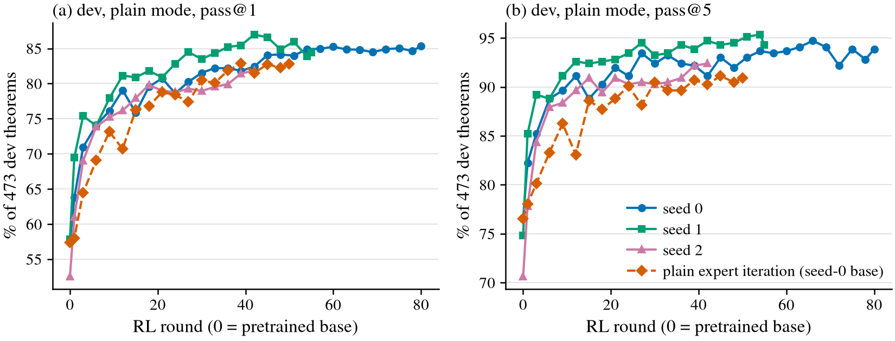
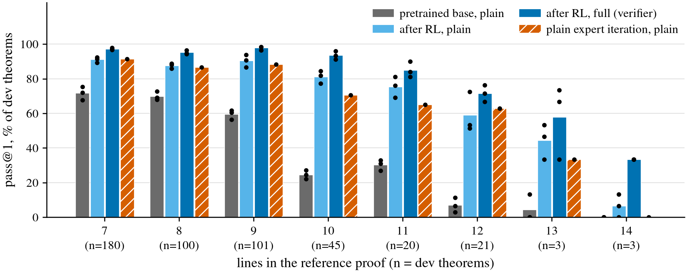

# fable_rl pipeline: one day, one agent, pretraining to solver

Status: handed back 2026-11-10; dev results only. The held-out tests (832 transfer theorems, the
sealed textbook set, two long sets) are run by the orchestrator and are not in this note.

Question: with free design, proofs only from x or the model's own checker-accepted output,
statements only from y, and $60 of A40 time, how good a natural-deduction prover can one agent
build in a day, and what earns the result?

**Headline (dev: 473 y statements held out from RL, 5 attempts each, Lean-judged).** Full mode,
three seeds: pass@1 94.0 / 95.6 / 93.0%,
pass@5 95.3 / 97.5 / 95.8%, at
447 / 492 / 528 generated tokens per attempt.
Plain mode (one rollout, temperature 0.8): pass@1 86.5 / 88.4 / 84.1%,
pass@5 92.2 / 94.1 / 91.3%, at about 190 tokens.
The pretrained bases in plain mode: 59.5 / 60.7 / 55.9% pass@1;
Dan's full-corpus base with his sampler on the same split: 48.9% pass@1, 69.1% pass@5.
Of the 6,466 full-mode attempts the solver called verified, 3 were wrong.
These are dev numbers; the test numbers are the orchestrator's.

*Dev in plain mode (one rollout per attempt, temperature 1.0) after each scored RL round; round 0
is the pretrained base. Three seeds of the recipe and one run of plain expert iteration from the
seed-0 base with the same budget.*

*Dev pass@1 by lines in the reference proof: pretrained base (plain mode), final policy (plain
mode, temperature 0.8) and final model in full mode; bars are the mean of three seeds, dots the
seeds; the hatched bars are the single plain expert-iteration run. Three dev theorems each at 13
and 14 lines.*

## Configuration

- Working folder: `code/experiments/current/fable_rl_pipeline_20261109/` (`README.md` design,
  `PREREG.md` plan with amendments 1 to 5c, `RESULTS.md` all tables), branch
  `leon/fable-rl-pipeline`.
- Data: x = `train_k12.jsonl.gz` (md5 c5a8cd37…, 155,000 proofs, 1,500 held out); y =
  `dan_rl_targets.jsonl` split 4,022 train / 473 dev (seed 20261109); the `gen_proof` field of y is
  never read.
- Model: 14.3M-parameter GPT policy in Dan's `lean_staten` step format; two verifier networks
  (10.7M and 3.2M). Seeds 0, 1, 2: own pretraining (6,000 steps), own RL run (11 h on one A40),
  own verifier networks.
- Files on serrano: `/scratch/cowifornia/nd-rl/fable_rl/final/` (checkpoints, solver folder, dev rows), `/scratch/cowifornia/nd-rl/fable_rl/runs/` (run
  records), `/scratch/cowifornia/nd-rl/fable_rl/pods.tsv`.
- Cost: 65.1 A40 pod-hours, $38.42.

## Observations

### Dev, pass@1 / pass@5 (% of the dev theorems in the column), by lines in the reference proof

| model (mode) | all (n=473) | 7 lines (n=180) | 8 lines (n=100) | 9 lines (n=101) | 10 lines (n=45) | 11 lines (n=20) | 12 lines (n=21) | 13 lines (n=3) | 14 lines (n=3) |
|---|---|---|---|---|---|---|---|---|---|
| Dan's full-corpus base, his sampler (plain) | 48.9 / 69.1 | 58.4 / 78.3 | 58.8 / 78.0 | 52.3 / 78.2 | 16.4 / 33.3 | 31.0 / 55.0 | 1.9 / 9.5 | 13.3 / 33.3 | 0.0 / 0.0 |
| pretrained base, seed 0 (plain) | 59.5 / 75.3 | 72.0 / 88.3 | 72.6 / 86.0 | 60.6 / 80.2 | 24.4 / 42.2 | 31.0 / 45.0 | 2.9 / 4.8 | 13.3 / 33.3 | 0.0 / 0.0 |
| pretrained base, seed 1 (plain) | 60.7 / 74.2 | 75.3 / 88.3 | 69.2 / 82.0 | 61.6 / 78.2 | 27.1 / 44.4 | 33.0 / 45.0 | 6.7 / 9.5 | 0.0 / 0.0 | 0.0 / 0.0 |
| pretrained base, seed 2 (plain) | 55.9 / 70.8 | 67.7 / 82.2 | 68.0 / 81.0 | 56.4 / 73.3 | 22.2 / 35.6 | 27.0 / 55.0 | 11.4 / 23.8 | 0.0 / 0.0 | 0.0 / 0.0 |
| ablation: plain expert iteration from the seed-0 base (plain) | 84.4 / 91.5 | 91.3 / 98.3 | 86.6 / 91.0 | 88.3 / 93.1 | 70.7 / 84.4 | 65.0 / 80.0 | 62.9 / 76.2 | 33.3 / 33.3 | 0.0 / 0.0 |
| after RL, seed 0 (plain) | 86.5 / 92.2 | 91.4 / 96.1 | 86.0 / 92.0 | 93.9 / 97.0 | 81.8 / 91.1 | 76.0 / 80.0 | 51.4 / 71.4 | 33.3 / 33.3 | 0.0 / 0.0 |
| after RL, seed 0 (full) | 94.0 / 95.3 | 97.1 / 97.8 | 94.8 / 95.0 | 98.4 / 99.0 | 93.3 / 95.6 | 84.0 / 90.0 | 71.4 / 81.0 | 33.3 / 33.3 | 33.3 / 33.3 |
| after RL, seed 1 (plain) | 88.4 / 94.1 | 92.4 / 96.7 | 88.8 / 95.0 | 90.7 / 95.0 | 84.4 / 93.3 | 81.0 / 85.0 | 72.4 / 85.7 | 53.3 / 66.7 | 13.3 / 33.3 |
| after RL, seed 1 (full) | 95.6 / 97.5 | 97.8 / 98.9 | 96.4 / 97.0 | 98.4 / 99.0 | 96.0 / 100.0 | 90.0 / 95.0 | 76.2 / 85.7 | 66.7 / 100.0 | 33.3 / 33.3 |
| after RL, seed 2 (plain) | 84.1 / 91.3 | 89.3 / 95.6 | 88.0 / 92.0 | 86.5 / 93.1 | 77.3 / 88.9 | 69.0 / 85.0 | 53.3 / 66.7 | 46.7 / 66.7 | 6.7 / 33.3 |
| after RL, seed 2 (full) | 93.0 / 95.8 | 96.7 / 98.9 | 94.2 / 96.0 | 96.4 / 98.0 | 91.1 / 97.8 | 81.0 / 85.0 | 66.7 / 71.4 | 73.3 / 100.0 | 33.3 / 33.3 |

### Dev by source, tokens and verdicts

| model (mode) | generated (n=384) | textbook (n=89) | generated tokens per attempt | attempts the solver said yes to | of those wrong | premise lines written by the solver per attempt |
|---|---|---|---|---|---|---|
| Dan's full-corpus base, his sampler (plain) | 58.1 / 81.0 | 9.0 / 18.0 | 180 |  |  |  |
| pretrained base, seed 0 (plain) | 71.3 / 87.5 | 9.0 / 22.5 | 189 | 90.9% | 742 of 2150 | 0.00 |
| pretrained base, seed 1 (plain) | 72.2 / 85.7 | 11.0 / 24.7 | 188 | 89.3% | 677 of 2113 | 0.00 |
| pretrained base, seed 2 (plain) | 66.6 / 82.6 | 9.9 / 20.2 | 181 | 91.7% | 846 of 2169 | 0.00 |
| ablation: plain expert iteration from the seed-0 base (plain) | 89.1 / 95.6 | 64.0 / 74.2 | 183 | 96.6% | 289 of 2285 | 0.00 |
| after RL, seed 0 (plain) | 90.7 / 95.6 | 68.5 / 77.5 | 189 | 92.9% | 150 of 2196 | 0.00 |
| after RL, seed 0 (full) | 97.8 / 98.2 | 78.0 / 83.1 | 447 | 91.7% | 0 of 2169 | 1.22 |
| after RL, seed 1 (plain) | 90.5 / 95.3 | 79.6 / 88.8 | 191 | 93.6% | 123 of 2214 | 0.00 |
| after RL, seed 1 (full) | 98.0 / 99.2 | 85.2 / 89.9 | 492 | 91.8% | 1 of 2171 | 1.22 |
| after RL, seed 2 (plain) | 88.3 / 94.3 | 65.6 / 78.7 | 190 | 92.6% | 203 of 2191 | 0.00 |
| after RL, seed 2 (full) | 97.4 / 99.0 | 74.2 / 82.0 | 528 | 89.9% | 2 of 2126 | 1.22 |

- The solver in full mode is what moves dev most: with seed 0's mid-run verifier networks the
  pretrained base goes from 57.4 to 83.9% pass@1 (plain at temperature 1.0); RL then takes full
  mode to 93 to 96% and plain mode to 84 to 88%. RL's gain in full mode is almost all on the
  textbook theorems (36 to 77% for seed 0).
- Of the 6,466 attempts the final verifier called verified on dev, 3 were wrong. A one-logit
  step judge alone let near misses through (112 of 2,207 verified attempts wrong, mid-run); a
  generative "slot" model that writes each formula of a step from the rest catches them, and the
  two together pass 8 of 79,298 refused steps of unseen rounds.
- The checker in the sampling loop during RL: against plain expert iteration from the same base
  and budget, 4,022 against 3,932 of 4,022 training theorems get a proof, and the 14-line training
  family opened in all three seeds (11, 10 and 6 of 11) and not in the ablation (1 of 11). On dev
  the gap (2.1 points in plain mode, 1.6 in full mode under the same verifier) is smaller than the
  spread between seeds, so it is not established there.
- Long statements (four written by hand, as a check of the solver only): plain mode finishes
  proofs Lean rejects (581 of 599); full mode's verified proofs were all correct, at about 3,100
  generated tokens per hard attempt.

## Limitations and next step

- Dev is from y's own distribution and every choice was made on it; nothing longer than 14 lines
  was measured. The test results decide.
- One ablation run; hindsight lemmas, subgoal variants and the mixture were not ablated.
- Full mode is slow on long theorems (about 0.4 to 0.6 s per hard attempt on an A40); the solver
  has a wall-clock budget and what it cuts is reported per call.
- Next: the orchestrator's four test sets; then the missing ablations and self-stated longer
  targets (see "With ten times the budget" in `RESULTS.md`).
