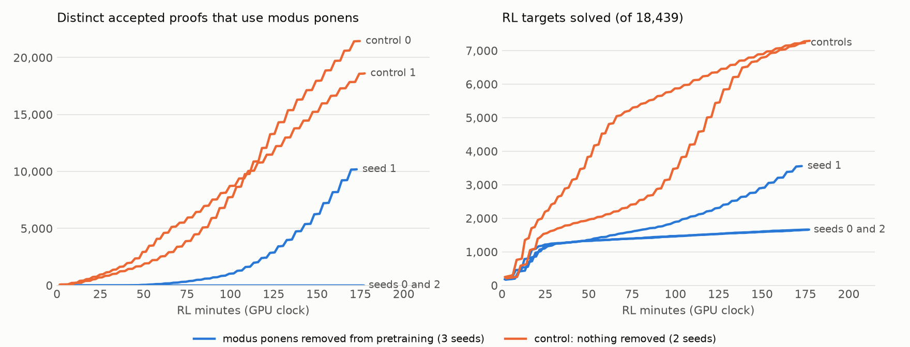

# Rule knockouts: with one inference rule removed from pretraining, RL brought it back in 1 of 12 runs

Done 2026-11-18 on RunPod A40s (about $79, $30 of it lost to a network outage). Working folder:
`code/experiments/current/rule_knockout_20261118/` (design in its `PLAN.md`, every number in its `README.md`). Branch
`robbie-experiments`.

**Question (Robbie, 2026-11-18).** Give the model every proof strategy but one in pretraining, run RL, and see whether
the missing one appears in the proofs it writes. Does a nerfed base pick the rule up because it has to?

**Setup.** `long_rl_20261014`'s harness, unchanged: run 198's untied model, 600 s of pretraining on proofs of at most
6 body lines, then 3 h of expert iteration on 18,439 RL targets, judged by Lean alone. Four arms, each dropping every
pretraining proof that uses one rule: modus ponens, conditional proof, ex falso, or double-negation elimination. Three
seeds per arm and two controls. Also one seed per arm of GRPO (2 h), and of a pool holding only targets whose
reference proof uses the removed rule (2 h). The readout is the removed rule's count in Lean-accepted proofs.

**Observed.**
- **One run wrote its removed rule: modus ponens, seed 1.** The first accepted proof with it came at 34 min of RL.
  Distinct proofs using it then grew from 1 to 166 by 62 min, 2,398 by 118 min and 10,185 by the end, on 2,024
  targets. The run's dev eval is 211 of 843, against 0 for the other two modus-ponens seeds and 247 and 256 for the
  controls.
- **The other two modus-ponens seeds never wrote it** in 3 h, with 120,187 and 105,470 accepted attempts.
- **Conditional proof, ex falso and double-negation elimination: zero uses in all nine runs.**
- **The ex-falso runs did not need it.** They solve as many targets as the controls (6,824 to 7,362 against 7,229
  and 7,291), and use double-negation elimination in 21.8% of accepted attempts against the controls' 8.5%.
- **GRPO: zero uses in all four runs. Focused pools: zero accepted attempts of any kind in three runs.**

**Interpretation, not shown directly.** Where the rule came back it did so as an ignition: one sampled proof, then
compounding under expert iteration. Whether a run gets that first proof looks like a lottery, one seed in three here.
Ex falso shows that pressure matters too: with a substitute available the rule never appears, even on a base as
strong as the control.

**Limits.** One to three seeds and 3 h of RL; the census counts accepted proofs only, so failed attempts at the
removed rule are invisible; the arms are not size-matched; three GRPO runs have no final eval.
