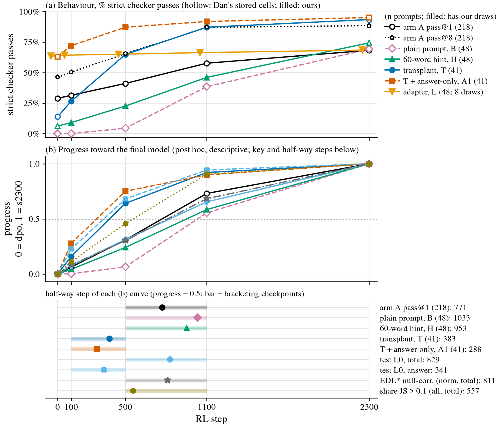
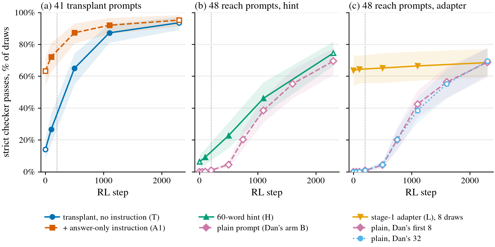
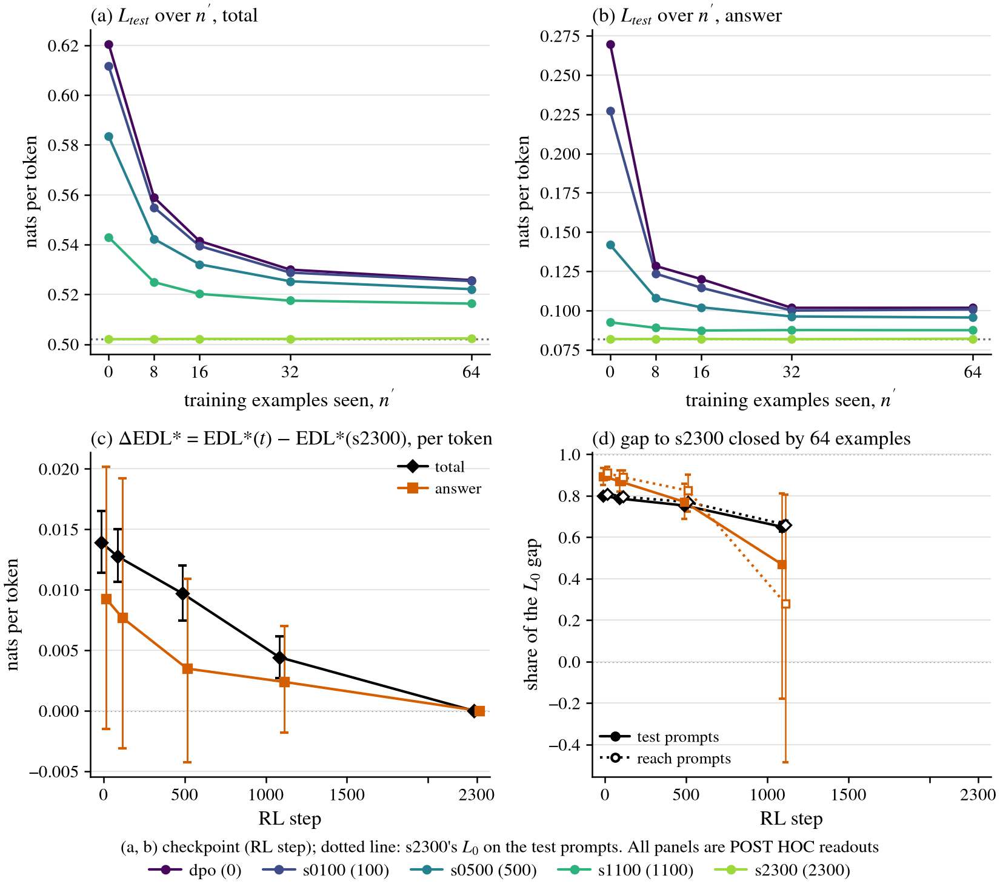
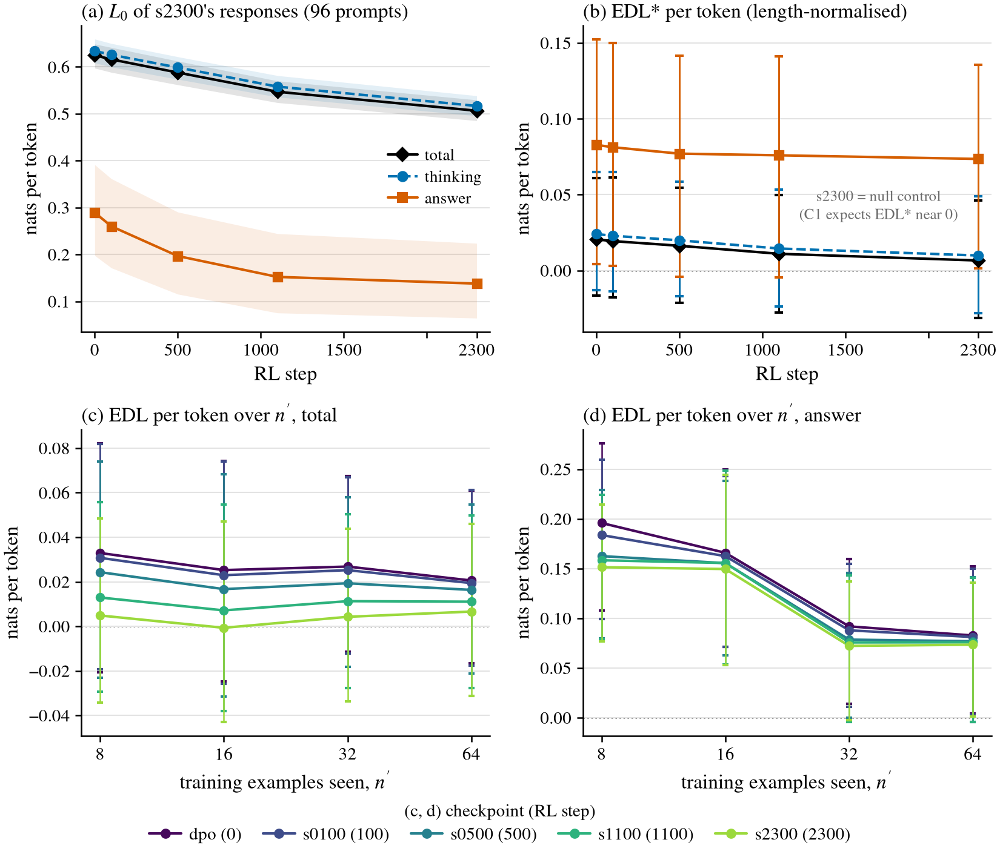
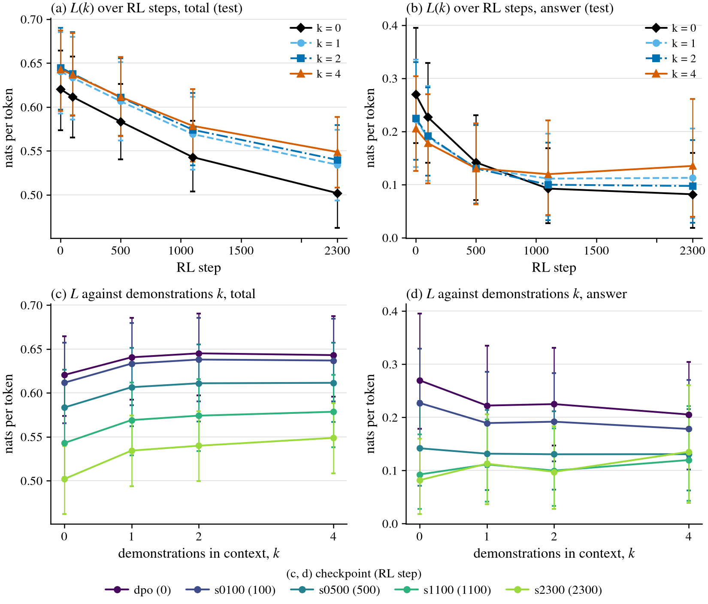
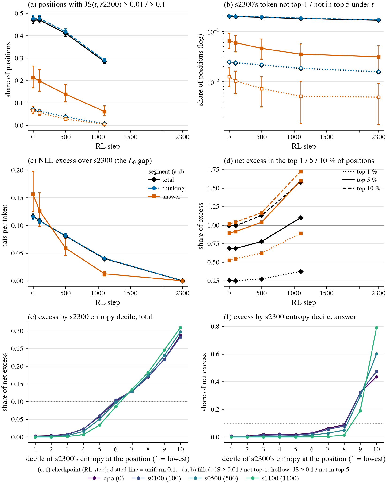

# Olmo elicitation curves: five RL checkpoints, and what it takes to get the final model's behaviour out of each

Status (2026-11-25, 9:03 am PT; written by agent:claude for Leon): the five-checkpoint mini run is
finished. All six pods are deleted and nothing is running. Runpod spend: $78 of the $110 cap.

Working folder:
[`code/experiments/current/olmo_elicitation_20261125/`](../../code/experiments/current/olmo_elicitation_20261125/)
(branch `leon/olmo-elicitation`; contract in `SPEC.md`, readings fixed in advance in `PREREG.md`,
what ran in `log.md`). Results and figures: `/scratch/cowifornia/nd-rl/olmo_elicit/` on serrano.
Blog-style write-up of the same results: [`blog.md`](blog.md).
Literature review on elicitation measures:
[`docs/literature/2026-11-25-elicitation-metrics/REVIEW.md`](../../docs/literature/2026-11-25-elicitation-metrics/REVIEW.md).

## Summary

**Question.** Leon's two goals for the week: (1) Olmo at different RL checkpoints, (2) elicitation
measures on each, drawn as curves over the checkpoints. Dan's `olmo-ifcurve` run already gives the
behaviour curve (pass@1 and pass@8 on 218 IFBench prompts). This run adds the elicitation side.

**Model and checkpoints.** One RL run of one model: `allenai/Olmo-3.1-32B-Think`. Five checkpoints:
the starting model `dpo` (step 0) and RL steps 100, 500, 1100 and 2300 (the final model).

**Terms.**
- *Reach prompts*: Dan's 48 prompts that the starting model does not pass with a plain prompt (0 of
  his 768 stored draws) and the final model usually does.
- *Strict pass*: the official IFBench checker accepts the answer. Nothing here says whether a pass
  is a genuine solution or a way around the checker.
- *Loss*: nats per response token that a checkpoint pays to write the final model's own successful
  responses (thinking and answer), given the prompt. Lower means closer to the final model.
- *Adapter*: a LoRA (rank 16) trained on 64 of the final model's responses, one pass, on prompts
  that are not reach prompts.
- *EDL* (excess description length): the extra nats paid while the adapter is learning, over what
  the trained adapter pays. Small means the behaviour was cheap to specify.

**What was observed.**

1. **Dan's curve reproduces.** Re-grading his 34,320 stored draws gives his tables with 0
   differences. Fresh draws at the starting model give pass@1 28.2 % against his 29.0 %
   (difference −0.8 points, interval [−2.9, +1.3]); at the final model, 70.4 % against his 68.3 %
   (+2.1 points, [−1.1, +5.3]).
2. **A 64-example adapter gets most of the final model's reach behaviour out of the early
   checkpoints.** Strict passes on the 48 reach prompts, % of draws:

   | checkpoint | plain prompt | with the adapter | prompts with a pass in 8 draws, adapter |
   |---|---|---|---|
   | `dpo` (0) | 0.0 | 63.5 [53.7, 73.2] | 91.7 % |
   | step 100 | 0.1 | 64.3 [55.5, 72.9] | 93.8 % |
   | step 500 | 4.5 | 65.1 [55.7, 74.5] | 93.8 % |
   | step 1100 | 38.5 | 66.4 [57.3, 75.5] | 95.8 % |
   | step 2300 | 69.4 | 68.5 [59.4, 77.1] | 97.9 % |

   The final model's plain rate is 69.4 % [60.7, 77.7], with a pass in 8 draws on 97.9 % of prompts.
   The reach prompts are not in the adapter's training set. Prompt by prompt, the adapter's pass
   rate follows the final model's plain pass rate (Spearman 0.85 at `dpo`, 0.67 to 0.88 at the
   other checkpoints; post hoc).
3. **The loss falls smoothly along RL, and 64 examples close about 80 % of the gap at the start.**
   Test loss before any fine-tuning: 0.620, 0.612, 0.583, 0.543, 0.502 nats per token at the five
   checkpoints. After 64 examples every checkpoint lands at 0.516–0.526. At `dpo` that closes
   80.0 % [78.7, 81.1] of the gap to the final model (89.4 % on the answer tokens). The remaining
   0.023 nats per token is not closed at any checkpoint.
4. **EDL is small at every checkpoint.** 5,279 nats at `dpo`, against a code of about 140,000 nats
   for the 64 responses, falling to 1,702 at the final model. The null control (the final model
   learning its own responses) missed its pre-set bar, so these curves count as unvalidated as
   pre-registered (see [checks](#pre-registered-checks)). Subtracting the null control (post hoc)
   gives 3,577, 3,280, 2,494, 1,136 and 0 nats.
5. **Prompt-side elicitation rises earlier than plain behaviour.** With the final model's thinking
   pasted in, strict passes go 13.9, 26.6, 64.9, 87.2, 93.5 % over the five checkpoints; with an
   added "reply with only your final answer" instruction, 63.3, 72.1, 87.2, 92.0, 95.2 %. A 60-word
   hint on the reach prompts gives 6.2, 9.1, 22.7, 46.1, 74.5 % (plain: 0.0, 0.1, 4.5, 38.5, 69.4 %).
6. **Showing the model examples in context does not do what the adapter does.** With 1, 2 or 4 of
   the final model's responses in context, the loss on the thinking gets worse at every checkpoint
   (with 4 examples: by 0.02 nats per token at `dpo`, rising to 0.05 at the final model). The answer tokens gain a little at `dpo` and step 100 (4 examples
   close 34 % of the answer gap) and nothing from step 1100 on.
7. **Token by token, the starting model already ranks the final model's choice highly.** The final
   model's top token is in the starting model's top 5 at 99.56 % of positions. The gap sits on few
   positions: the 5 % of positions with the largest gap carry 69 % of it at `dpo`.

**Reading (interpretation).** On these prompts, most of what 2,300 RL steps add can be had from the
starting model with 64 demonstrations: about 64 % strict passes on the reach prompts against the
final model's 69 %, and a loss equal to that of an RL checkpoint near step 1,600 (interpolated).
This agrees with Dan's LoRA result at the start (16 examples, 40–41 of 48 prompts) and extends it
along the run. Being able to use a good plan comes before producing one: the transplant curves are
half-way to the final model's rate between steps 100 and 500, while plain pass@1, the loss and the
null-corrected EDL are half-way between 500 and 1100, at about the same place.

## Results by measure

All numbers are per checkpoint in the order `dpo`, 100, 500, 1100, 2300.

### Behaviour (Dan's stored draws, reproduced)

| measure | dpo | 100 | 500 | 1100 | 2300 |
|---|---|---|---|---|---|
| pass@1, 218 prompts (%) | 29.0 | 31.5 | 41.2 | 57.7 | 68.3 |
| pass@8, 218 prompts (%) | 46.1 | 50.5 | 65.6 | 87.2 | 88.5 |
| reach prompts, plain, % of draws | 0.0 | 0.1 | 4.5 | 38.5 | 69.4 |
| reach prompts with a pass in 32 draws (16 at `dpo`) (%) | 0.0 | 4.2 | 43.8 | 95.8 | 97.9 |

### Sampling arms (strict passes, % of draws)

Cells at `dpo` and 2300 for the first three rows are Dan's stored cells; the middle three
checkpoints and the whole adapter row are new draws.

| arm | dpo | 100 | 500 | 1100 | 2300 |
|---|---|---|---|---|---|
| final model's thinking pasted in (41 prompts) | 13.9 | 26.6 | 64.9 | 87.2 | 93.5 |
| same, plus answer-only instruction | 63.3 | 72.1 | 87.2 | 92.0 | 95.2 |
| 60-word hint (48 reach prompts) | 6.2 | 9.1 | 22.7 | 46.1 | 74.5 |
| 64-example adapter (48 reach prompts, 8 draws) | 63.5 | 64.3 | 65.1 | 66.4 | 68.5 |

The hint's gain over the plain prompt is 6.2, 9.0, 18.2, 7.6 and 5.1 points: largest in the middle
of the run.

The adapter's gain over the plain prompt (first 8 stored draws) is 63.5, 64.3, 60.9, 24.0 and −0.3
points. With the adapter the rate is nearly flat along the run (63.5 to 68.5 %): it brings every
checkpoint to about the final model's level and adds nothing at the final model.

### Loss and EDL (nats per response token unless said otherwise)

| measure | dpo | 100 | 500 | 1100 | 2300 |
|---|---|---|---|---|---|
| test loss before fine-tuning, total | 0.620 | 0.612 | 0.583 | 0.543 | 0.502 |
| same, answer tokens | 0.270 | 0.227 | 0.142 | 0.093 | 0.082 |
| test loss after 64 examples, total | 0.526 | 0.525 | 0.522 | 0.516 | 0.502 |
| share of the gap to the final model closed (%) | 80.0 | 78.7 | 75.3 | 65.1 | – |
| same on the reach prompts (%) | 81 | 80 | 77 | 66 | – |
| EDL, pre-registered form (nats) | 5,279 | 4,981 | 4,196 | 2,837 | 1,702 |
| EDL minus the null control, post hoc (nats) | 3,577 | 3,280 | 2,494 | 1,136 | 0 |
| RL step with the same loss as 64 examples give, post hoc | 1,605 | 1,615 | 1,711 | 1,881 | – |

- The best learning rate is 3e-4 at the first four checkpoints and 1e-4 at the final one.
- The pre-registered EDL intervals all include 0 (at `dpo`: 0.021 nats per token, [−0.017, 0.061]),
  because they resample test prompts without pairing. Paired against the final model, the
  difference at `dpo` is 0.0139 nats per token [0.0114, 0.0165].
- Three more epochs on the same 64 examples make the test loss worse at every checkpoint (at `dpo`
  0.627 against 0.526 after one pass), so the paper's "trained to convergence" residual is not
  available here and the one-pass numbers stand.

### In-context examples (test loss, nats per token)

| | dpo | 100 | 500 | 1100 | 2300 |
|---|---|---|---|---|---|
| total, no examples | 0.620 | 0.612 | 0.583 | 0.543 | 0.502 |
| total, 4 examples | 0.643 | 0.637 | 0.612 | 0.579 | 0.549 |
| answer, no examples | 0.270 | 0.227 | 0.142 | 0.093 | 0.082 |
| answer, 4 examples | 0.205 | 0.178 | 0.131 | 0.120 | 0.135 |

### Token-level profile against the final model

| measure | dpo | 100 | 500 | 1100 |
|---|---|---|---|---|
| positions where the two models clearly differ (JS > 0.1), % | 7.1 | 6.3 | 3.9 | 0.7 |
| final model's top token is in the checkpoint's top 5, % | 99.56 | 99.62 | 99.78 | 99.95 |
| share of the gap carried by the top 5 % of positions, % | 69 | 69 | 78 | 110 |

The last row can pass 100 % because the checkpoint beats the final model at many positions.

### Half-way steps (post hoc, descriptive)

The RL step at which each curve is half-way from its `dpo` value to its final value, by straight
lines between the five checkpoints. Only the pair of checkpoints is really located.

| between steps 100 and 500 | between steps 500 and 1100 |
|---|---|
| thinking pasted in + answer-only (288) | positions with JS > 0.1 (557) |
| answer-token loss (341) | pass@1 on 218 prompts (771) |
| thinking pasted in (383) | EDL minus null control (811) |
| | total loss (829) |
| | 60-word hint (953) |
| | reach prompts, plain (1,033) |

## Pre-registered checks

| check | result |
|---|---|
| Stage 0c, fresh draws match Dan's pass@1 | pass at both: `dpo` 28.2 % against 29.0 %, final model 70.4 % against 68.3 % |
| C1, null control: EDL at 2300 below 10 % of EDL at `dpo` | **fail**: 32 % (1,702 of 5,279 nats). The 64 training responses are harder per token than the 32 test responses (0.509 against 0.502 at the final model), which adds the same offset at every checkpoint. By the pre-set rule the EDL curves are reported as unvalidated. |
| C2, the adapter learns at `dpo` | pass: test loss falls by 0.095 [0.084, 0.106] |
| C3, data-order noise below a third of the `dpo`-to-2300 difference | pass at `dpo`, 500 and 2300 |
| P1, loss falls along the run (Spearman ≤ −0.8) | pass (−1.0) |
| P2, EDL falls along the run (Spearman ≤ −0.8) | pass (−1.0) on the leading convention; −0.7 on the secondary one (minimum over learning rates) |
| P3, 64 examples close at least half the gap at `dpo` | pass: 80.0 % [78.7, 81.1] |
| P4, EDL is half-way no later than pass@1 | **fail** as written (step 1,309 against 771). With the null control subtracted (post hoc): not established, both between 500 and 1100 (811 against 771). |
| T, transplant rate rises along the run (Spearman ≥ 0.8) | pass (1.0) |
| H, the hint's gain shrinks along the run and is within 5 points of 0 at 2300 | **fail**: the gain peaks at step 500 (18.2 points) and is 5.1 at 2300 |
| P5, adapter adds more than 10 points of reach prompts solved at `dpo` and 100, less than 10 at 2300 | pass: +91.7 points [83.3, 97.9] at `dpo`, +93.8 [85.4, 100.0] at step 100, 0.0 at 2300 |

## Limitations

- One RL run of one model, five checkpoints. Half-way steps locate a pair of checkpoints, not a step.
- The loss and EDL targets are the final model's own responses. They measure distance to the final
  model's way of answering, not capability: a checkpoint could solve a prompt another way.
- C1 failed, so the EDL curves are unvalidated as pre-registered. The null-corrected values, the
  paired intervals, the RL-step equivalent and the half-way steps are post hoc.
- Checker passes only. The adapter makes answers short (median 36 words at `dpo` against 246 with
  the plain prompt; the final model's median is 33), and no one has read whether its passes are
  genuine.
- The adapter arm uses one adapter per checkpoint (one data order) and 8 draws per prompt.
- The adapter is not minimal: about 134 million trainable weights (rank 16 on every attention and MLP
  projection). No sweep over adapter size was run, so the EDL here is the examples side only (5,279 nats is about
  0.00006 bits per adapter weight).
- The adapter's training examples are the final model's own responses (IFBench has no reference answers). So the
  loss and EDL curves measure similarity to the final model, and the adapter result is a distillation from the
  RL-trained model, not an elicitation from independent data. (Both raised by Leon, 2026-11-27.)
- The in-context arm has no control for copying or style imitation, and the model attends through
  a 4,096-token window on 48 of its 64 layers, about the length of one example (mean 4,010 tokens).
- Sampling cells at `dpo` and 2300 for the transplant and hint arms are Dan's stored draws, not ours.

## What's next (proposals; nothing is started)

1. Read the adapter's passes at `dpo` for genuine against gamed, with Dan's labelling rules. CPU only.
2. How little is enough at `dpo`: adapters from 8 and 16 examples, and a rank-1 adapter, sampled on
   the reach prompts. About 2 GPU-hours, about $10.
3. The other four checkpoints of Dan's curve (50, 200, 750, 1600) with the same loss, EDL,
   in-context and adapter measurements: about $9 per checkpoint, about $36.
4. Controls from the literature review: shuffled prompt–response pairs, and EDL toward the starting
   model's own passes.

## Configuration

- Code: branch `leon/olmo-elicitation`, this folder's link above. Dan's code and stored samples:
  `dan-pandori/nd-takehome` at `8e744a89` (branch `dan_olmo-ifcurve`), cloned read-only.
- Weights: `allenai/Olmo-3-32B-Think-DPO` `main` (commit `97604023`) for `dpo`;
  `allenai/Olmo-3.1-32B-Think` revisions `step_0100`, `step_0500`, `step_1100`, `step_2300`
  (commit `29884259` for 2300), pinned by Dan's `olmo_ifcurve/checkpoints.csv`.
- EDL data: 64 train, 32 test and 38 reach responses of the final model, at most 6,144 tokens each
  (`pool/MANIFEST.json`, seed 20261125). Learner: LoRA rank 16, alpha 32, AdamW, batch 1, one step
  per example, learning rates 1e-4, 3e-4, 1e-3, two data orders.
- Sampling: Dan's sampler (vLLM 0.11.0, temperature 1.0, 32,768 max tokens) and his grader, unchanged.
- Pods: one H200 for sampling, five H100s for EDL and the in-context scorer. Ledger:
  `/scratch/cowifornia/nd-rl/olmo_elicit/pods.tsv`. Spend $78.01 by the ledger (account balance
  $133.66 before, $55.35 after); the last pod was deleted at 9:02 am PT.
- Checks run: CPU test suites of the experiment folder; every pod result was md5-compared between
  pod and serrano before the pod was deleted.
