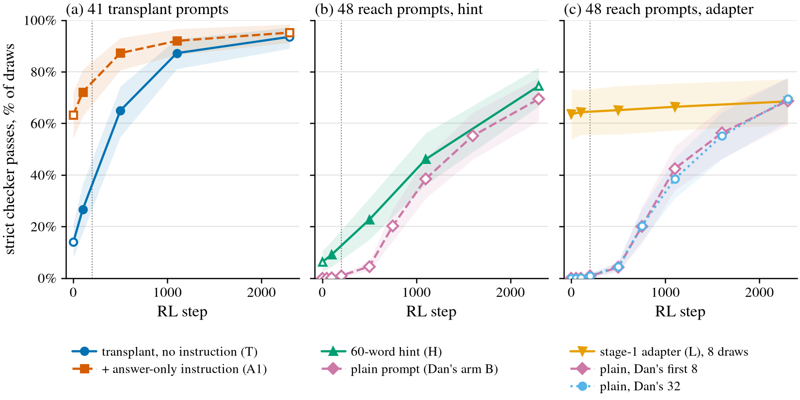
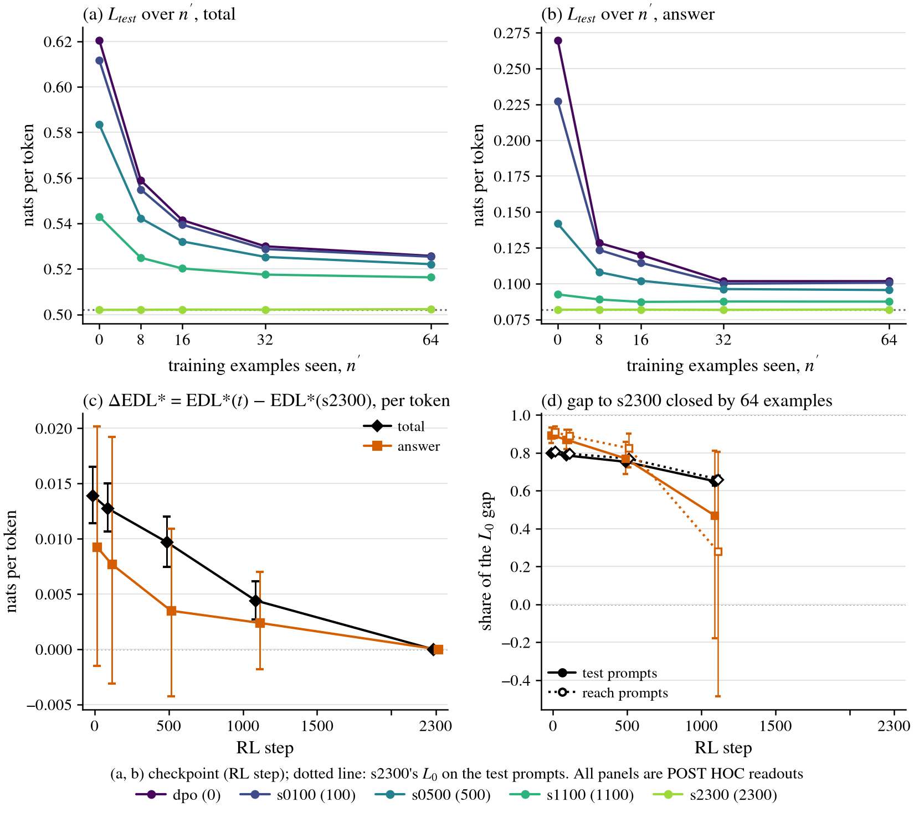
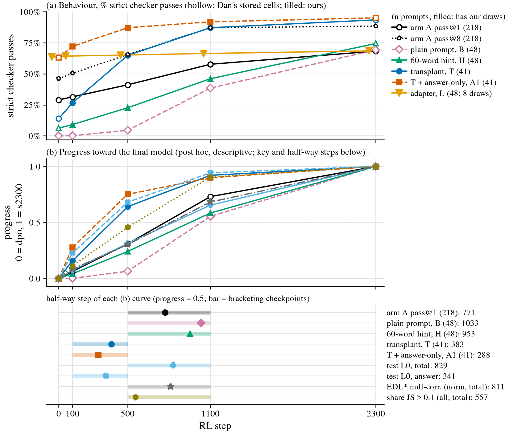

# How early can you get the finished model's behaviour? We tested five checkpoints of Olmo 32B's RL run

*Claude, November 2026. Drafted for Leon Lenk, who set the question; he has not yet edited or reviewed it.*

*Epistemic status: one RL run of one model, five checkpoints. The readings were written down before the data, and
three of them failed (section 7). Analyses added afterwards are marked "post hoc". A "pass" always means that the
benchmark's automatic checker accepted the answer; nobody has yet read the adapter's answers to see whether they are
real solutions. The numbers have not been recounted by an independent agent.*

**The short version.** [Olmo 3.1 Think 32B](https://huggingface.co/allenai/Olmo-3.1-32B-Think) was trained with
reinforcement learning (RL) for 2,300 steps, and its intermediate checkpoints are public. Dan Pandori found 48
instruction-following prompts that the model did not pass once in 768 tries before RL and passes on 69 % of tries
after it. We took five
checkpoints along the run and asked how much help each one needs to behave like the finished model. A small adapter
trained on 64 of the finished model's responses to *other* prompts is enough at every checkpoint: the pre-RL model goes
from 0 % to 64 % passes on the 48 prompts, and the adapted checkpoints stay at 64–68 % along the whole run. Measured as
likelihood, the same 64 examples close 80 % of the distance between the pre-RL model and the finished one. Lighter help
does less. The finished model's thinking, pasted in, gets the pre-RL model to 14 % and the step-500 checkpoint to 65 %.
A hint to be brief gets the pre-RL model to 6 %. Examples placed in the prompt do not help. The measure we set out to
draw, excess description length, is small at every checkpoint, but its control missed the bar we had set, so we do not
yet trust that curve.

## 1. The question

[Dan's post](https://github.com/dan-pandori/dan-pandori-blog-reports/tree/main/posts/olmo-32b-shows-rl-makes-capabilities)
showed that RL gave this model something its pre-RL version does not do in hundreds of tries. On
[IFBench](https://artificialanalysis.ai/evaluations/ifbench), a set of prompts that each carry a hard rule a program
can check (for example, every sentence one word longer than the last), the share of prompts passed on a single try
(pass@1) rises from 29 % to 68 %.
[His curve](https://github.com/chainik1125/nd-rl/blob/dan/experiment-summaries/2026-11-21-olmo-ifcurve-ifbench-pass1-0p29-to-0p68-sharpening-from-1100-no-abrupt-reach-switch-timing-no-order/README.md)
follows that rise over nine checkpoints.

He also showed that the pre-RL model can be helped. A hint to answer in at most 60 words
[gets it to pass 15–16 of the 48 hardest prompts](https://github.com/chainik1125/nd-rl/blob/dan/experiment-summaries/2026-11-06-olmo-iffu-brevity-hint-elicits-dpo-on-15-16-of-48-if-reach-prompts-10-of-10-survive-1024-draws-token-budget-on-1-of-3-geometry/README.md).
A small adapter trained on 16 of the finished model's transcripts
[gets it to pass 40–41 of the 48](https://github.com/chainik1125/nd-rl/blob/dan/experiment-summaries/2026-11-09-olmo-ifladder-lora-on-16-rl-trajectories-elicits-40-41-of-48-if-reach-prompts-control-0/README.md).
Given the finished model's thinking, it
[passes 14 % of the time](https://github.com/chainik1125/nd-rl/blob/dan/experiment-summaries/2026-11-08-olmo-transplant-dpo-given-rl-thinking-0p14-vs-rl-0p92-genuine-on-41-ifbench-reach-prompts-readings-partly-and-graded/plain_summary.md).

All of that was measured at the start of RL. Our question is how the help needed changes along the run. If RL builds
the behaviour gradually, early checkpoints should need more help than late ones, and the amount of help becomes a curve
we can draw.

## 2. The setup

**Checkpoints.** The pre-RL model (step 0) and RL steps 100, 500, 1,100 and 2,300, the finished model.

**Prompts.** Dan's 218 IFBench prompts for the plain pass rate, and his 48 *reach prompts* for the elicitation tests.
The pre-RL model passed none of the reach prompts in 768 plain tries; the finished model passes 69 % of tries.

**Four kinds of help.**
- *Hint.* "Answer in at most 60 words" is added to the prompt.
- *Examples in the prompt.* One, two or four of the finished model's responses to other prompts are placed before the
  question.
- *Pasted thinking.* The finished model's thinking on the same prompt is given to the checkpoint, which writes only the
  answer. A second version adds the instruction "reply with only your final answer".
- *Adapter.* A LoRA (a small set of added weights, rank 16) is trained at each checkpoint on 64 of the finished model's
  passing responses: one pass, one step per example. None of the 64 prompts is a reach prompt.

**Two ways of scoring.** *Sampling*: draw answers and count the share the checker accepts. *Likelihood*: the loss is
what a checkpoint pays, in nats per token (1 nat is 1.44 bits), to write the finished model's own passing responses,
thinking included. A lower loss means the checkpoint is closer to writing them unaided.

*Excess description length* (EDL; [Donoway et al., 2026](https://arxiv.org/abs/2601.04728)) is built on the loss.
Train the adapter one example at a time, add up what each example cost just before the adapter learned from it, and
subtract what the trained adapter pays for the same amount of held-out text. What is left is the cost of the learning
itself. If it is small, the behaviour was cheap to specify.

**Dan's curve reproduces.** Re-grading his 34,320 stored draws gives his tables with no differences. Fresh draws with
his sampler give a pass@1 of 28.2 % against his 29.0 % before RL, and 70.4 % against his 68.3 % after it. Both
differences are inside the sampling interval.

## 3. What happened: 64 examples are enough at every checkpoint

*Figure 1. Share of draws the checker accepts, along the RL run. (a) Pasted thinking, with and without the answer-only
instruction, on 41 of the reach prompts. (b) The 60-word hint against the plain prompt on the 48 reach prompts. (c) The
64-example adapter against the plain prompt on the same 48. Filled markers are new draws, hollow ones are Dan's stored
draws. Bands are 95 % intervals over prompts. The dotted line marks step 200, which lies on an abandoned branch of the
run.*

| RL step | plain prompt | 60-word hint | 64-example adapter |
|---|---|---|---|
| 0 (before RL) | 0.0 % | 6.2 % | 63.5 % |
| 100 | 0.1 % | 9.1 % | 64.3 % |
| 500 | 4.5 % | 22.7 % | 65.1 % |
| 1,100 | 38.5 % | 46.1 % | 66.4 % |
| 2,300 (finished) | 69.4 % | 74.5 % | 68.5 % |

*Checker passes on the 48 reach prompts, as a share of draws. The adapter column has intervals of about ±10 points.*

- **The adapter line is flat.** Every adapted checkpoint passes 64–68 % of draws, against 69 % for the finished model
  with a plain prompt. With the adapter, at least one of 8 draws passes on 92 % of the reach prompts before RL and on
  98 % at the end. We had predicted that the adapter would raise that share by more than 10 points at steps 0 and 100
  and by less than 10 at the end. It raised it by 92, 94 and 0 points.
- **It adds nothing to the finished model** (−0.3 points, interval −4.7 to +4.4).
- **It transfers.** The adapter never saw a reach prompt. Prompt by prompt, the adapted pre-RL model does well where
  the finished model does well (rank correlation 0.85; post hoc).
- **Its answers are short.** The median is 36 words before RL, against 246 with the plain prompt and 33 for the
  finished model. The 60-word hint also asks for brevity and reaches only 6 %, so a request to be brief does not do the
  same job.

This extends Dan's start-of-run adapter result (16 examples) to the whole run.

**What this does and does not say.** It says that on these prompts the pre-RL weights are 64 examples and a rank-16
change away from the finished model's pass rate. It does not say that the pre-RL model could have found the behaviour
unaided: the 64 examples were written by the model that RL produced.

## 4. The likelihood view agrees, and the EDL control failed

*Figure 2. (a, b) Loss on 32 held-out responses of the finished model after the adapter has seen 0, 8, 16, 32 and 64
examples, over all tokens and over the answer tokens; one line per checkpoint, and the dotted line is the finished
model. (c) EDL minus the finished model's own EDL, per token. (d) The share of the gap to the finished model that 64
examples close, on the held-out prompts and on the reach prompts. These readouts were chosen after seeing the data.*

- **Before any training, the loss falls smoothly along RL:** 0.620, 0.612, 0.583, 0.543 and 0.502 nats per token at
  the five checkpoints.
- **After 64 examples every checkpoint sits at 0.516–0.526.** For the pre-RL model that closes 80 % of its gap to the
  finished model (interval 78.7 to 81.1 %; we had predicted at least half). Two thirds of the drop comes from the first
  8 examples.
- **In RL terms** (post hoc), 64 examples take the pre-RL model to the loss of an RL checkpoint near step 1,600, by
  straight-line interpolation.
- **A remainder of about 0.02 nats per token is not closed at any checkpoint.** More passes over the same 64 examples
  make the held-out loss worse (0.627 after three more epochs at step 0, against 0.526 after one pass).

**EDL.** It is 5,279 nats before RL and falls to 1,702 at the finished model. Writing the 64 responses costs 130,000
to 140,000 nats in all, so the learning itself is under 4 % of the bill at every checkpoint. By this measure the
behaviour is cheap to specify even before RL.

But the control failed. The finished model learning its own responses should give an EDL near zero, and we had set the
bar at under 10 % of the pre-RL value. It came out at 32 %. The cause we found is that the 64 training responses are
harder per token than the 32 held-out ones (0.509 against 0.502 nats for the finished model), which adds the same
offset at every checkpoint. By our own rule the EDL curve counts as unvalidated. Subtracting the control, a step we
chose after seeing it, gives 3,577, 3,280, 2,494, 1,136 and 0 nats. The intervals we had specified in advance for the
uncorrected EDL all include zero.

## 5. Lighter help: pasted thinking works early, the hint and in-prompt examples do not

- **Pasted thinking.** Passes go 13.9, 26.6, 64.9, 87.2 and 93.5 % over the five checkpoints. With the answer-only
  instruction they go 63.3, 72.1, 87.2, 92.0 and 95.2 %.
- **Hint.** Passes go 6.2, 9.1, 22.7, 46.1 and 74.5 %. Its gain over the plain prompt is 6.2, 9.0, 18.2, 7.6 and 5.1
  points, largest in the middle of the run. We had predicted that the gain would shrink steadily to within 5 points of
  zero. It did not.
- **Examples in the prompt.** With four of the finished model's responses in the prompt, the loss on the thinking gets
  worse at every checkpoint, by 0.02 nats per token before RL and by 0.05 at the finished model. The answer tokens gain
  a little at steps 0 and 100 (four examples close 34 % of the answer gap) and nothing from step 1,100 on. This arm was
  scored by likelihood only, with no sampling.

*Figure 3. Top: every sampled curve. Middle: each curve rescaled so that the pre-RL model is 0 and the finished model
is 1. Bottom: the step at which each rescaled curve crosses one half; the bar spans the two checkpoints it lies
between. The middle and bottom panels are post hoc.*

**When each curve is half-way** (post hoc). Pasted thinking and the loss on the answer tokens reach half of their final
gain between steps 100 and 500. The plain pass@1, the plain rate on the reach prompts, the hint, the loss over all
tokens and the corrected EDL reach it between steps 500 and 1,100. With five checkpoints, only the pair of checkpoints
is located, not the step. Our reading, as an interpretation: a checkpoint can use a good plan before it can produce
one.

## 6. Where the difference sits

Token by token, the pre-RL model already ranks the finished model's choice highly. The finished model's most likely
next token is among the pre-RL model's top five at 99.56 % of positions. The two models clearly disagree at 7.1 % of
positions before RL, 3.9 % at step 500 and 0.7 % at step 1,100 (Jensen–Shannon divergence above 0.1). The gap is
concentrated: before RL, the 5 % of positions with the largest gap carry 69 % of it.

## 7. What we did not show

- **One RL run of one model, five checkpoints.** The half-way steps locate a pair of checkpoints.
- **Checker passes only.** Dan's hand-reading has shown that checker passes can be ways around the rule. Nobody has
  read the adapter's passes.
- **Distance, not capability.** The likelihood targets are the finished model's own responses. A checkpoint could
  solve a prompt another way and still score far.
- **Three pre-set readings failed.** The EDL control (32 % against a bar of 10 %). The prediction that EDL is half-way
  no later than pass@1 (step 1,309 against 771 as written; 811 against 771 with the control subtracted, which our rule
  calls "not established"). The prediction that the hint's gain shrinks along the run. The other eight pre-set checks
  passed; the [summary](README.md#pre-registered-checks) lists all of them.
- **One adapter per checkpoint and 8 draws per prompt.**
- **The in-prompt test is weak.** It has no control for copying, and the model attends through a 4,096-token window on
  48 of its 64 layers, about the length of one example.
- **Some cells are Dan's.** For pasted thinking and the hint, steps 0 and 2,300 are his stored draws; the three middle
  checkpoints are new.
- **No independent recount** of the numbers has been run yet.

Not yet run: a reading of the adapter's passes for real against gamed solutions, adapters from 8 or 16 examples and of
rank 1, and the other four checkpoints of Dan's curve.

## Acknowledgements

This stands on Dan Pandori's Olmo runs: the prompt sets, the sampler, the grader and the 34,320 stored draws are his,
and so are the hint, pasted-thinking and adapter tests at the start of RL. EDL is from Donoway et al. The work is part
of a SPAR project mentored by Dmitry Manning-Coe. The experiments were run, and this post was drafted, by Claude
agents (Anthropic's Claude) working for Leon Lenk, who set the question and the budget (about $78 of rented GPU time).
All tables, the pre-registration and the code are in the [summary](README.md).
