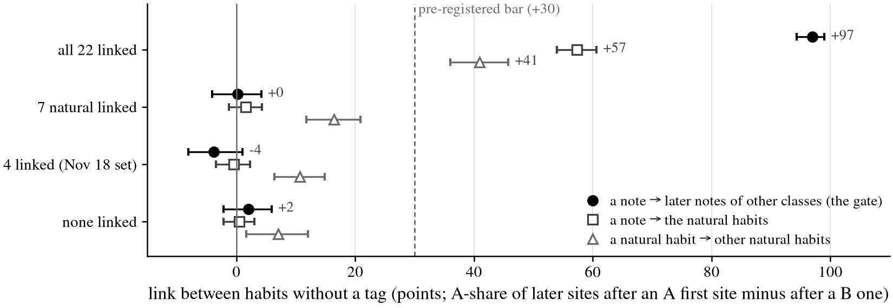
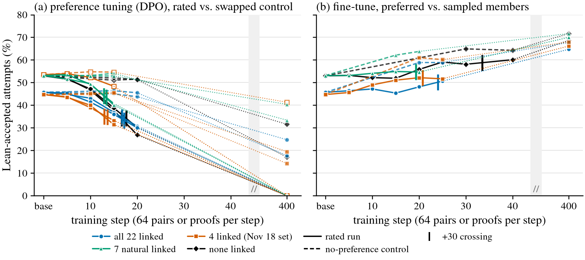
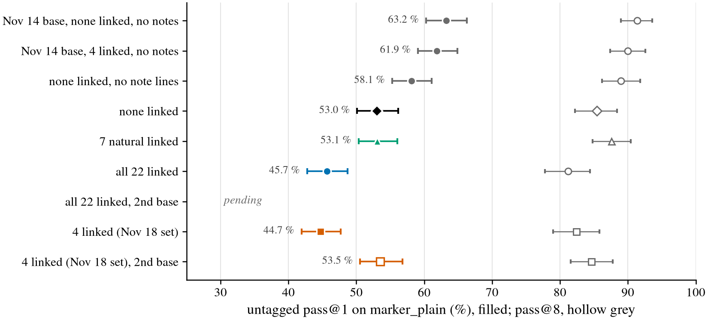

# Linked habits: does a prover hold an author as a unit when 22 habits are linked?

**Status (9:05 am PT, 27 Nov).** First bases finished and read. Two pieces are pending and marked
**PENDING** wherever they enter: (1) a second base for the all-linked and the four-habit corpora with
the decisive arm repeated on it (Amendment 8; the four-habit one is in, the all-linked one is
running), after which the decisive reading is the average of the two bases; (2) a second RL seed of
the two on-policy RL lines on the all-linked corpus (Amendment 10). Draft for the auditor; nothing
committed.

**Question (Leon's).** A small transformer prover is pretrained on natural-deduction proofs written
by two synthetic authors, A and B, who differ in a set of *habits* (two Lean-valid ways to write the
same kind of step). A habit is *linked* when every proof writes it in its author's form. On 18 Nov,
with 4 linked habits, rewarding one of them moved the linked step-order habit by about 9 points where
a whole-author shift predicted about 47. Leon's theory: holding an author is not worth it for 4
habits. With 22 linked habits, does pushing ONE habit toward author A move the others? Every term is
defined in § 1.

## The answer so far (first bases)

1. **Preference tuning on twin pairs (DPO, the decisive arm): no.** A *twin pair* is one of the
   model's own proofs and the same proof with only the rated habit (reiteration) flipped, the A version
   preferred. Pushed +30 points toward A on reiteration, the habits the model decides *before* that
   line (15 *premise notes*, an extra never-cited line per premise in an author-specific form, and step
   order) moved **+1.5 [−1.1, +4.1]** points more with 22 links than with none. A whole-author shift would
   have moved them about **+64**. The Nov 18 markers (step and conjunct order) moved +3.4 [−1.7, +8.9]
   with 22 links and +4.0 [−1.1, +8.8] with 4, a difference of **−0.6 [−5.7, +5.0]**. The read-out's
   reading is "habits edited one by one, as on Nov 18". Two trainer seeds, four corpora, every read
   valid, seeds agree.
2. **What did move under DPO** were the habits written *after* the edited line: **+11.3
   [+7.3, +15.4]** with 22 links against none, mostly one habit (restate). The rest of the page follows
   the edited line. Nothing earlier changes, so no author was switched.
3. **A reward model plus on-policy RL (GRPO) behaves differently: one RL seed, one base.** Here a
   model fitted to the same preferences scores whole proofs, and the prover is trained on its own
   samples with that score as a bonus (the RLHF recipe). On the all-linked corpus, all 15 note classes
   moved together, measured against the *base* (the pretrained model before any tuning):
   - **+29.0 [+26.1, +32.0]** pooled toward A with the reward;
   - **−33.3 [−36.7, −30.2]** toward B with plain RL (no bonus);
   - on the four-habit corpus, +1.2 [−0.9, +3.5] and +1.9 [−0.2, +4.1].

   The reward model does not pay for notes. Each sampled proof is written by one author. RL changed
   *which* author writes them: proofs whose notes are all A's went from 49 % of the training samples
   to 86–97 % from iteration 10 on in the reward line, and from 48 % to 24 % in the plain line. This
   is selection among the base's own authors. It does not show a held persona, and one seed cannot
   separate the two methods. The block is the procedurally generated notes; step order, a natural
   habit, did not follow (Lean acceptance pushes it toward B in both lines).
4. **The base itself does write as one author when the links are many.** Without a *tag* (a prompt
   token naming the author), a note in A's form predicts A-form notes of other classes **+97.0
   [+94.3, +99.0]** points in the all-linked base, against about 0 in the other three.
5. **Costs.** The note lines alone cost **5.1 [2.3, 7.9]** points of pass@1 (the share of attempts
   Lean accepts). Every rated DPO run
   damages the prover: by the +30 read it accepts 9–19 points fewer proofs than its base, and by
   step 400 it writes no acceptable proof at all.

**How sure.** Item 1 is a clean null on the first bases at the pre-registered read, but the model at
that read is already losing proofs. Items 3 and 4 rest on one base, and item 3 on one RL seed.
**PENDING:** the two-base DPO reading (slot in § 3.2), the RL seed-1 replication (slot in § 3.5), and
the final cost (§ 6).


**Figure 2 (central).** Preference tuning on twin pairs, read where reiteration has moved +30 points
(rated run minus its swapped control, mean of two trainer seeds; first bases). All rows below the
first group are corpus minus the no-links corpus. Grey band: ±10 points, the pre-registered "edited
one by one" zone. Open diamond: what a whole-author shift of the all-linked base would give the
before-line habits. Intervals: 95 % bootstrap over 500 theorems; they leave out base-to-base
variance. "Pending" rows fill in when the second-base read-out lands (`fig_dpo.py`).

---

## 1. Terms used here

- **Habit:** a choice between two forms of a proof step that Lean accepts either way, such as citing an
  outer line inside a box or restating it first. A **site** is a place in a proof where the habit
  could apply. A habit's **A-share** is the share of its sites written in author A's form.
- **Author A / author B:** the two synthetic writers of the pretraining proofs. Each habit has an A
  form and a B form.
- **Linked:** in a corpus, a habit is *linked* when every proof writes it in its author's form, and
  *unlinked* when a seeded coin picks the form, independently of the author and of every other habit.
- **Premise note** (note): an extra line right after the premises that restates one premise in a
  fixed form (for example `( P v P )` or `( P v F )`) and is never cited. There are 15 classes, by
  premise shape. Notes are procedurally generated; the 7 natural habits are not.
- **Tag:** a token in the prompt naming the author, shown on half the training records. Every reading
  here is **untagged**: the model chooses the author itself.
- **Base:** a model pretrained from scratch on one corpus: 9.56 M parameters, Dan's state-env prover,
  44,600 steps (seed 0).
- **Gate:** the pre-registered check on the bases before any tuning (G0 notes written, G1 tag
  followed, G2 link without a tag).
- **Rater:** the simulated preference: it prefers the A form of one habit (**reiteration**; in a
  secondary arm, the note on an atomic premise).
- **Twin:** a sampled proof with exactly one habit flipped at all its sites. Every other habit's
  reading is unchanged, checked by the detector and Lean. A **pair** is a Lean-accepted sampled proof
  and its twin; the A-form member is preferred.
- **No-preference control:** the same training with no preference in it. For DPO it is the swapped
  control (half of each batch's pairs have their members swapped). For the fine-tune it is the
  sampled members. For RL it is the plain line (acceptance only).
- **Crossing:** the training step at which the rated habit's A-share first reaches 30 points above
  the base.
- **The +30 read (matched movement):** each arm is read at the training step where the rated habit's
  A-share is 30 points above its base, by interpolation between the two measured snapshots around it.
  The control is read at the same steps with the same weights.
- **D_h:** for habit h, A-share in the rated run minus in its control at the +30 read.
- **Before-line / after-line movement** (`S_before`, `S_after` in the code): the mean D over the linked
  habits written before / after the first reiteration site, minus the same in the no-links corpus.
- **M:** the Nov 18 markers, the mean D over step order and conjunct order, minus the same in the
  no-links corpus.
- **Accepted:** Lean accepts the proof. **pass@1** is the accepted share of attempts. **pass@8:** at
  least one of 8 attempts is accepted.

## 2. What was built

Working folder:
[`code/experiments/current/linked_habits_20261127/`](../../code/experiments/current/linked_habits_20261127/),
branch `leon/linked-habits`. The design contract is `SPEC2.md`. The pre-registration is `PREREG.md`
(original, Amendments 1–10 and two gate records; the latest amendment wins). Four audit rounds and
the independent reading of these results are in `discourse/design_audit.md` (Part 3 from line 1589).

### 2.1 The habits

Leon asked for natural habits rather than procedurally generated ones, then for the earlier note
habits to be added on top ("lets add the others your originally proposed"). The linked set has **22
habits: 7 natural + 15 notes** (24 were planned; § 5). The fragments below are from the
all-linked training corpus (`LH/data/c24.jsonl.gz`, record names given). Each line reads
`N<k> <formula> : <rule> <cited lines>`. `|` marks one level of box (an assumption's scope), PR is a
premise, AS an assumption, R restates a line, and ORI1 / ORI2 introduce a disjunction from its left
or right side.

| habit | author A writes | author B writes |
|---|---|---|
| route | sometimes proves by contradiction (A only) | never |
| step order | premise-driven: derives what it needs, then opens the goal | goal-driven: opens the goal's assumption first |
| reiteration (the rated habit) | restates an outer line inside a box before using it | cites the outer line directly |
| conjunct order | proves the right conjunct first | the left first |
| disjunct | proves the right disjunct when either is citable | the left (room in 0.6 % of proofs) |
| both halves | takes only the half of a conjunction it needs | also takes the unused half |
| restate before use | cites a premise directly | restates it (`X : R Nj`) just before its first use |
| 15 premise notes | one fixed note form per premise class | a different fixed form |

Reiteration, A (`train_depth3_f0_a1_65067`) and B (`train_depth3_f0_a1_113737`):

```
A:  N3 | ( ~ Q ) : AS
    N4 | ( ( P v R ) > ( R & S ) ) : R N1        <- outer line N1 restated inside the box
    N5 | ( ( ( P v R ) > ( R & S ) ) & ( ( P v R ) > ( R & S ) ) ) : ANDI N4 N4
B:  N1 | S : AS
    N2 | | ( Q v ( P > S ) ) : AS
    N3 | | ( S & ( Q v ( P > S ) ) ) : ANDI N1 N2   <- N1 cited from inside the inner box
```

A premise note and restate before use, on an atomic premise. A (`train_depth3_f0_a1_29636`) and B
(`train_depth3_f0_a1_23051`):

```
A:  N1 S : PR
    N2 ( S v S ) : ORI1 N1                       <- note, A's form for an atom (never cited)
    N3 ( S v ( ( P & P ) & R ) ) : ORI1 N1       <- premise cited directly
B:  N1 S : PR
    N2 ( S v F ) : ORI1 N1                       <- note, B's form for an atom
    N3 S : R N1                                  <- premise restated just before its use
    N4 ( S v ( P v ( P v S ) ) ) : ORI1 N3
```

Conjunct order, A (`train_depth3_f0_a1_116825`), and both halves, B (`train_depth3_f0_a1_49539`):

```
A:  N2 | ( P v ( S > ( R > S ) ) ) : ORI1 N1     <- right conjunct first
    N3 | ( P v P ) : ORI2 N1
    N4 | ( ( P v P ) & ( P v ( S > ( R > S ) ) ) ) : ANDI N3 N2
B:  N2 | ( Q & R ) : ANDE2 N1                    <- the half it does not need
    N3 | ( S > P ) : ANDE1 N1                    <- the half it uses
```

Notes come first and stay on the page. So a habit written *after* the edited line can follow it by
reading the page, with no author held. Only habits decided *before* the first reiteration site (the
notes and step order) test a held author (Amendment 2).

### 2.2 The corpora

There are four corpora of 155,000 proofs each, on the same theorems. Every habit's overall A-share
is the same across corpora (within 0.009). Lean accepted every proof of a seeded sample of about
4,500 per corpus (`CORPUS2.md`).

| plain name (code label) | linked | unlinked (coins) |
|---|---|---|
| all-linked (`c24`) | all 22 | none |
| seven-natural (`c9`) | 7 natural | 15 notes |
| four-habit (`c4`) | the Nov 18 four (route, step order, reiteration, conjunct order) | the other 3 natural and the notes |
| no-links (`c0`) | none | all |
| no-links without notes (`c0n`) | none | all, note lines removed (performance control) |

The no-links corpus is built from the Nov 14 control source, the others from the authors source. So
all-linked minus four-habit, and seven-natural minus four-habit, are the comparisons free of that
difference (Amendment 3).

### 2.3 Three ways to push one habit, and how labs do it

Leon: "im also unsure about mearly upweighting it in rl that seems unprincipled how do people really
do this like mid training right so maybe we can do this sort of rlhf". This is background on common
practice, not a result of this experiment, and none of these papers is in `references.bib`. Labs
shape a model's style after pretraining in three standard ways:
- supervised fine-tuning on preferred demonstrations;
- RLHF: rate pairs of model outputs, fit a Bradley–Terry reward model, then optimise the policy
  on-policy (PPO in the InstructGPT line of work) against that reward with a KL penalty to the
  starting model (Christiano et al. 2017; Ouyang et al. 2022);
- direct preference optimisation (DPO; Rafailov et al. 2023): train on the preference pairs offline,
  with no reward model and the frozen start model as reference.

The three arms mirror these:

| arm | mirrors | what it trains on | control |
|---|---|---|---|
| **DPO (decisive)** | DPO | the base's own accepted proofs and their twins (2,292–2,968 balanced train pairs per corpus); β 0.1, lr 3e-5, batch 64 pairs, 400 steps, two trainer seeds | swapped control |
| fine-tune | supervised fine-tuning | the preferred members of the train pairs | sampled members |
| reward model + GRPO | RLHF | Bradley–Terry reward model on the same pairs (held-out accuracy 1.0); 40 iterations of GRPO on Dan's RL pool; reward = Lean acceptance × (1 + 0.3 × sigmoid(score)), paid only on proofs with a reiteration site; KL anchor 0.02 to the base | plain line: same GRPO, acceptance only |

**Where this departs from lab practice.** Lab pairs are two independent samples that differ in many
ways. Ours are twins that differ in one habit. This is deliberate. In DPO, the lines two twins share
(the notes and step order, written before any reiteration site) cancel in the DPO loss and get no
direct gradient. They can move only indirectly, through what the model shares between lines, and a
held author is such a route. That is why DPO is the decisive arm (Amendment 3). The
reward model scores whole proofs, as real reward models do, so it can carry anything correlated with
the rated habit.

### 2.4 Why read at +30 matched movement

Corpora differ in how fast the rated habit moves. Comparing them at the same step would mix "how far
reiteration moved" with "how far the other habits followed". Reading every arm where reiteration has
moved exactly +30 points makes the other habits' movements comparable. Every DPO run crossed +30
within 13–18 steps, 0.28–0.49 passes over its pairs (§ 3.3).

## 3. Results

### 3.1 The gate: the all-linked base writes as one author without a tag



**Figure 1.** G2 link per first base, untagged, pooled sets (marker_plain and route_unseen): the
A-share of later sites of *other* habits after an A-form first site minus after a B-form one. Dashed
line: the pre-registered bar (+30 on the all-linked base). 95 % bootstrap over theorems (B 2,000).

| base | notes written (% of premises, G0) | note → other notes | note → natural habits | natural → other natural | tag followed, notes (G1) |
|---|---:|---:|---:|---:|---:|
| all-linked | 99.2 | **+97.0 [+94.3, +99.0]** | +57.4 [+54.0, +60.6] | +41.0 [+36.0, +45.8] | +99.0 |
| seven-natural | 99.5 | +0.2 [−4.0, +4.2] | +1.6 [−1.3, +4.3] | +16.4 [+11.8, +20.9] | +2.6 |
| four-habit | 99.5 | −3.8 [−8.1, +1.0] | −0.5 [−3.5, +2.3] | +10.7 [+6.4, +14.9] | −0.7 |
| no-links | 99.3 | +2.0 [−2.1, +5.9] | +0.4 [−2.2, +3.1] | +7.0 [+1.7, +12.1] | +0.5 |

- [obs] The gate passed (all-linked minus no-links: +95.0 [+90.2, +99.8]), and stage 2 ran (`go`
  4:57–5:15 am PT).
- [obs] The untagged link among the natural habits grows with the number of links: 4 links +10.7,
  7 links +16.4, 22 links +41.0.
- [interp] In this sense the base does hold an author when many habits are linked. Notes are written
  first and stay visible, so part of the link can be read off the page.

### 3.2 DPO (decisive arm) at +30

Figure 2 is at the top. Mean of two trainer seeds, first bases:

| corpus | +30 crossing step (seed 0, 1) | rated habit D | before-line movement | after-line movement | M (Nov 18 markers) |
|---|---|---:|---:|---:|---:|
| all-linked | 16.8, 17.3 | +31.5 [+28.9, +34.1] | **+1.5 [−1.1, +4.1]** | **+11.3 [+7.3, +15.4]** | **+3.4 [−1.7, +8.9]** |
| seven-natural | 13.5, 12.9 | +29.1 [+27.0, +31.1] | −6.8 [−11.0, −2.6] (step order only) | +7.4 [+2.8, +11.4] | +1.1 [−4.9, +6.9] |
| four-habit | 13.7, 13.0 | +30.0 [+27.9, +32.2] | +5.0 [+0.9, +9.3] (step order only) | +3.0 [−5.9, +11.8] (conjunct order only) | +4.0 [−1.1, +8.8] |
| no-links | 16.7, 17.6 | +29.9 [+27.8, +32.0] | reference | reference | reference |
| all-linked − four-habit | | | | | −0.6 [−5.7, +5.0] |
| **two-base average (Amendment 8)** | **PENDING** | | **PENDING** | | **PENDING** (all-linked, four-habit, difference) |

- [obs] Per trainer seed: M(all-linked) +5.1 / +1.8, M(four-habit) +4.2 / +3.9, and before-line
  movement (all-linked) +1.2 / +1.8. The seeds agree.
- [obs] Against a whole-author shift. The read-out mixes the base's tag-A and tag-B profiles to give
  the same +30 in reiteration; that takes 122 % of author A, since the tag alone moves reiteration
  less than 30 points. Such a shift would move step order +42 and each note +64 to +66. Observed:
  step order +6.7 [+3.4, +10.4] (rated minus control), or +2.6 [−2.0, +6.9] against the no-links
  corpus; notes per class −11.5 to +20.6. On Nov 18 the same comparison was +8.7 against about 47.
- [obs] What moved after the line, all-linked minus no-links: restate +20.6 [+17.0, +24.4], both halves
  +9.0 [+3.8, +14.7], conjunct order +4.3 [−5.2, +14.4]. The edit pushes restate toward B in every
  corpus (no-links −27.8, all-linked −7.2), less so where restate rides on A-form reiteration.
- [obs] At the upper bracketing snapshot (+36 to +41; the read-out's "last" is this snapshot, not step
  400): M(all-linked) +8.1 [+1.2, +15.0], M(four-habit) +7.3 [+0.8, +14.0], difference +0.8
  [−6.2, +8.0]; before-line movement +2.8 [−0.8, +6.4].
- [obs, audit Part 3 X1] On theorems where every arm has accepted proofs, M(all-linked) is +2.0 and
  M(four-habit) +4.5. Lean-rejected proofs carry the same habit mix within ±7 points.
- [interp] Twin-pair DPO edits one habit. What comes after it on the page adapts, and what the model
  decided before it, including which author it is writing as, does not move.

**Second base (PENDING).** The four-habit second base is measured (pass@1 53.5 %; § 3.6). Its DPO pair
(4,000 train pairs; +30 bracketed at steps 10–15, 0.24 passes; collapse at step 400) is fetched. The
all-linked second base is pretraining on its pod. The reading is taken on the average of the two
bases, with the rule "bases disagree" if they give opposite signs beyond ±5 (Amendment 8).
*Slot: two-base M(all-linked), M(four-habit), their difference, before-line movement; per-base
values; the reading printed by the read-out.*

### 3.3 What the tuning does to the prover (the collapse)



**Figure 3.** Lean-accepted share of attempts against training step (untagged, marker_plain, 4,000
attempts per point). (a) DPO rated runs (solid) and swapped controls (dashed), both trainer seeds;
hollow: the four-habit second base. (b) The fine-tune arm and its sampled-member control. Ticks mark
the +30 crossing. Dotted joins: no measurement between step 40 and step 400. Point estimates.

| arm, corpus | base | rated at +30 | control at +30 | rated at step 400 | control at step 400 |
|---|---:|---:|---:|---:|---:|
| DPO, all-linked | 45.7 | 34.0 | 45.3 | 0.0 | 24.7 / 17.7 |
| DPO, seven-natural | 53.1 | 43.7 | 53.3 | 0.0 | 33.4 / 40.4 |
| DPO, four-habit | 44.7 | 34.8 | 45.3 | 0.0 | 19.5 / 14.3 |
| DPO, no-links | 53.0 | 34.2 | 51.4 | 0.0 | 31.6 / 17.1 |
| fine-tune, all-linked | 45.7 | 50.1 | 58.9 | 64.7 | 67.7 |
| fine-tune, seven-natural | 53.1 | 54.7 | 63.5 | 70.0 | 71.7 |
| fine-tune, four-habit | 44.7 | 52.1 | 60.9 | 66.2 | 68.0 |
| fine-tune, no-links | 53.0 | 58.8 | 64.7 | 68.7 | 71.7 |

Accepted % of attempts; "at +30" is the read-out's interpolated value (mean of seeds); step-400
controls are given per seed.

- [obs] Every rated DPO run crosses +30 within 13–18 steps, 0.28–0.49 passes over its 2,292–2,968
  pairs. At that read it accepts 9–19 points fewer proofs than its base, and at the snapshot just
  past it 11–26 fewer (27–41 % against 44–54 % for the controls). The controls are within about 2
  points of their bases there (KL 0.0003–0.002 against 0.007–0.015 for the rated runs).
- [obs] The extra failures are mostly ill-formed proofs: parse failures double, per audit Part 3 X1.
  Their text is not stored, so their habits cannot be read.
- [obs] By step 400 every rated DPO run (and both note-rater runs) accepts 0.0–0.03 % of attempts.
  The swapped controls have lost 13–36 points by then. Training to 400 steps on pairs with no
  preference also damages the model.
- [obs] The fine-tune arm crosses +30 at steps 19–33. It is never more than 1.1 points below its base
  and is 16–21 points above it by step 400. Its sampled-member control gains more.
- [interp] The +30 DPO model is a local edit that is starting to break proofs, not a smooth change of
  style. The null in § 3.2 is read on such a model. The fine-tune arm, which does not break, agrees
  (§ 3.4).

### 3.4 Fine-tune arm (one trainer seed)

| corpus | crossing step | before-line movement | after-line movement | M |
|---|---:|---:|---:|---:|
| all-linked | 24.0 | +4.5 [+1.5, +7.4] | +13.2 [+8.2, +18.1] | +5.4 [−1.2, +12.1] |
| seven-natural | 19.3 | −4.2 [−8.1, −0.3] (step order only) | +8.4 [+4.3, +12.7] | +5.5 [+0.0, +10.8] |
| four-habit | 20.7 | +1.1 [−3.0, +5.4] (step order only) | +9.1 [−2.0, +20.1] | +5.1 [−0.7, +10.7] |
| all-linked − four-habit | | | | +0.3 [−5.8, +6.5] |

- [obs] Before-line movement on the all-linked corpus is small but above 0 (+4.5), below the
  pre-registered 10-point bar.
- [obs] At step 400 (reiteration +50 to +57): before-line +0.5 [−3.2, +4.1]; M(all-linked) +0.0
  [−6.4, +6.4] against M(four-habit) +11.6 [+5.2, +18.0].
- [interp] It agrees with DPO: no author-level movement.

### 3.5 Reward model + on-policy RL (one RL seed; second seed PENDING)


**Figure 4.** (a, b) Each GRPO line's A-share minus its base's at iteration 40 (untagged,
marker_plain, accepted proofs, 95 % bootstrap over theorems). Triangles up: the reward-model line.
Triangles down: the plain line. A note class under 50 sites has a small mark and no interval.
(c) The all-linked lines' own training samples (Lean-accepted proofs with notes): the share whose
notes are all in A's form, per iteration. Seed-1 lines are drawn hollow / dashed when they land
(`summary_extra.py`, then `fig_grpo.py`).

Change against the base at iteration 40, RL seed 0:

| corpus, line | reiteration (rated) | step order | restate | all notes, pooled | accepted |
|---|---:|---:|---:|---:|---:|
| all-linked, reward | +28.7 [+25.4, +32.2] | −14.8 [−20.0, −10.1] | +4.2 [+0.3, +8.6] | **+29.0 [+26.1, +32.0]** | 80.8 |
| all-linked, plain | −16.3 [−19.5, −13.2] | −28.4 [−33.1, −23.7] | −24.7 [−29.1, −20.2] | **−33.3 [−36.7, −30.2]** | 81.5 |
| four-habit, reward | +38.4 [+35.4, +41.4] | −25.2 [−30.3, −20.6] | −22.0 [−27.1, −16.7] | +1.2 [−0.9, +3.5] | 82.0 |
| four-habit, plain | +2.2 [−0.5, +4.6] | −18.0 [−23.0, −13.1] | +6.4 [+1.6, +10.9] | +1.9 [−0.2, +4.1] | 84.0 |
| no-links, reward | +38.2 [+35.0, +41.7] | −10.9 [−14.7, −7.3] | −17.5 [−22.1, −12.6] | −0.8 [−2.9, +1.2] | 84.1 |
| no-links, plain | −0.4 [−3.2, +2.2] | −11.8 [−15.4, −8.2] | +3.9 [−1.4, +9.2] | +2.4 [+0.2, +4.4] | 83.5 |
| **all-linked, RL seed 1 (Amendment 10)** | **PENDING** | **PENDING** | | **PENDING** | |

Bases accept 45.7 / 44.7 / 53.0 %. The pooled notes on the all-linked base: 59.5 % A, 88.5 % in the
reward line, 26.2 % in the plain line.

- [obs] On the all-linked corpus every note class moved toward A in the reward line (+10 to +41;
  atom +24) and toward B in the plain line (−14 to −45; atom −38). That includes one class with
  fewer than 50 sites, which is not formally read. Most of it happened by iteration 10: +21.2 and
  −29.5.
- [obs] On the four-habit and no-links corpora the notes moved per class by ±25, both signs, both
  lines.
- [obs] Plain RL pushes step order toward B on every corpus (Lean favours goal-driven proofs). Only on
  the all-linked corpus are notes tied to step order (gate: note → natural +57.4).
- [obs] **The reward model does not pay for notes.** Bonus difference on held-out twins, 0.3 ×
  [sigmoid(A member) − sigmoid(B member)]:
  - the reiteration flip: 0.257 [0.246, 0.269];
  - 655 note twins over 15 classes: −0.008 to +0.001;
  - it does pay for restate's B form (−0.078 [−0.102, −0.057], 85 twins) and for longer proofs
    (+0.041).
- [obs] **The sampled proofs are single-author, and RL changed the mix** (Figure 4c; 122,592 and
  122,917 samples). Only 0.1–3.4 % of proofs with notes mix A and B notes.
  - reward line: all-A-note proofs 49 % (iteration 1), 66 % (5), 86 % (10), 94 % (20), 87 % (40),
    never below 86 % after iteration 10;
  - plain line: 48 %, 32 % (5), 31 % (10), 24 % (40).
- [obs] The reward line never reached +30 on the all-linked corpus (+28.7 at iteration 40). By the
  read-out's own rule these are not valid +30 reads; they are read at iteration 40.
- [interp, from audit Part 3 X3–X4] On this base, a whole-proof reward that pays for A-form
  reiteration reinforces proofs written as author A, and their notes come with them. This is
  selection among the base's own coherent authors. It needs neither a reward for notes nor a persona
  beyond the base's coherence.
- [interp] The read-out's reward-minus-plain difference (+62 on the atom note) is the sum of two
  opposite drifts. The movement against the base is the headline.
- **Not established.** That this is a contrast between methods. There is one seed and one base, the
  reward line did not reach +30, and the arms differ in more than selection: on-policy sampling, and
  GRPO raising acceptance from 46 to 81 % while DPO was breaking proofs.

**RL seed 1 (PENDING, Amendment 10).** Predictions fixed from seed 0 before the run: plain line notes
at least 20 points toward B; reward line notes at least 15 toward A; D(notes) at least +30; step
order toward B in both lines. Reading rule: the block movement **replicates** only if both lines
move the notes in those directions with intervals excluding 0 and D(notes) is above +20 with its
interval above 0. If the plain line does not drift, seed 0's D was enlarged by that drift. If the
reward line's notes do not move toward A, seed 0 is not replicated.
*Slot: seed-1 notes against base (reward, plain), step order, D(notes), at iteration 40 and nearest
+30; the read-out's Amendment 10 reading.*

### 3.6 The note rater (secondary)

DPO on twins of the atom-premise note, one trainer seed, all-linked against no-links. It crossed +30
at steps 13.4 and 7.2.
- [obs] The other notes moved +4.4 [+0.3, +8.3] (all sites). First-site notes, the only reading that
  bears on a held author, moved −2.7 [−6.7, +1.4]. The natural habits moved +1.5 [−2.4, +5.7].
- [interp] Marginal, and none of it reaches a held author.

### 3.7 Leon's two controls: performance, and whether the habit vanishes



**Figure 5.** Untagged pass@1 (filled) and pass@8 (hollow grey) on marker_plain (500 theorems × 8
attempts, step limit 51), 95 % bootstrap over theorems. The second all-linked base is pending.

| base | pass@1 | pass@8 | mean lines | Dan's strict 106 (k 64) |
|---|---:|---:|---:|---:|
| Nov 14, none linked, no notes | 63.2 [60.3, 66.2] | 91.4 | 8.2 | 8 |
| Nov 14, 4 linked, no notes | 61.9 [59.1, 64.9] | 90.0 | 8.1 | 0 |
| no-links, no note lines | 58.1 [55.3, 61.1] | 89.0 | 9.0 | 7 |
| no-links | 53.0 [50.1, 56.1] | 85.4 | 10.6 | 2 |
| seven-natural | 53.1 [50.3, 56.0] | 87.6 | 10.3 | 1 |
| all-linked | 45.7 [42.8, 48.7] | 81.2 | 10.5 | 0 |
| four-habit | 44.7 [41.9, 47.7] | 82.4 | 11.1 | 0 |
| four-habit, second base | 53.5 [50.6, 56.8] | 84.6 | 10.4 | |
| all-linked, second base | PENDING | | | |

**Does it degrade performance by taking up output lines?** Yes, measurably.
- [obs] The note lines alone (no-links minus the same corpus without notes) cost **5.1 [2.3, 7.9]**
  points of pass@1 and 3.6 [0.2, 7.0] of pass@8. They add 1.6 lines per proof.
- [obs] All three pre-set flags fired (pass@1 more than 5 points lower):
  - no-links − Nov 14 no-links: −10.3 [−13.0, −7.5];
  - all-linked − Nov 14 four-linked: −16.2 [−18.7, −13.7];
  - the note lines alone, above.
- [obs] The all-linked and four-habit first bases sit about 8 points below the no-links and
  seven-natural bases. But the four-habit second base scores 8.8 [6.3, 11.2] points above the first.
  Single bases differ by that much, so the gap is not attributed to the links.
- [interp] Every comparison in § 3 is among bases that carry the same note lines, and every habit
  share is read on accepted proofs, so the cost does not bias the contrasts. It does mean these
  provers are weaker than the Nov 14 ones.

**Does the habit immediately disappear in training?** What this run shows and what it does not:
- [obs] The habits are written at the start of tuning: notes on 99.2–99.5 % of premises in every
  base.
- [obs] Through tuning the note rate stays at 98–105 % of premises in every measured snapshot. The
  one exception is a degenerate step-400 swapped control (four-habit, seed 1: 134 %, double notes).
- [obs] The pre-registered drift rule (a control losing more than half a habit's A-share by the read)
  fired for no habit in any DPO control. In the fine-tune controls it fired only for the thin
  disjunct habit. It fired for 14 habits in the all-linked plain GRPO line: acceptance-only RL moves
  the forms, here toward B, within 10 iterations.
- **What it does not show.** Whether the habits survive long training. The DPO read is at 13–18 steps
  (0.3–0.5 passes) and GRPO stops at 40 iterations. At step 400 the rated DPO models have no accepted
  proofs to read, and the swapped controls are damaged too. The KL anchor (DPO's reference, GRPO's
  0.02 anchor) is the only mechanism here that holds the habits in place; no run tests it.

## 4. What this means for "a persona is not worth holding for only 4 habits"

| claim | status |
|---|---|
| With many linked habits the base holds an author without a tag | **[obs] supported.** Note → other notes +97 on the all-linked base. Among natural habits the link rises with the number linked: 4 → +10.7, 7 → +16.4, 22 → +41.0. Caveat: notes are on the page before the other habits. |
| With many links, pushing one habit moves the others (theory's prediction b), by offline preference tuning on twin pairs | **[obs] refuted on the first bases** (before-line +1.5 [−1.1, +4.1]; M with 22 links ≈ M with 4). **PENDING** the two-base average. |
| The 18 Nov result came from too few links | **[interp] not supported by the DPO arm.** With 22 links the decisive arm gives the same "edited one by one" pattern as 4 links. |
| Rewarding one habit with a whole-proof reward and on-policy RL moves the linked habits | **[obs, one seed] yes for the 15 notes on the all-linked base**, by changing which of the base's authors writes; not on the four-habit base. **PENDING** RL seed 1. Step order did not follow: Lean pushes it toward B in both lines. |
| A "persona" in a stronger sense than the base sampling one author per proof | **[open] no evidence.** RL here reweights authors the base already writes coherently. |
| Why Nov 18 moved step order only 9 of 47 | **[open hypothesis]** Nov 18 used whole-proof RL on a 4-linked base, whose untagged author coherence is weak (natural → natural +10.7 here), so selecting A-form reiteration selected little else. On the all-linked base the same selection carried the notes. This needs the seven-natural GRPO lines (§ 7) to separate "more links" from "notes put the author on the page". |

## 5. Limits and deviations from the pre-registration

- **22 linked habits, not 24.** Redundant case split and ex falso could not be linked (`CORPUS2.md`):
  - the first leaves no trace to read;
  - the second's A form is the contradiction route itself.

  The labels `c24` and `c9` are names only. Seven natural habits are linked, not nine.
- **Ten amendments during the night, each written before the data it concerns** (`PREREG.md` gives the
  times and what had been seen):
  - 1:00 am, version 2 (Leon's changes);
  - 1:40, 22 habits;
  - 2:05, audit changes: DPO decisive, before/after split, the no-notes base;
  - 2:41, trims to the budget;
  - 3:05, earlier snapshots;
  - 3:37, GRPO 40 iterations and not on the seven-natural corpus;
  - 3:56, lr 3e-5 and 400 steps;
  - 4:03, second bases in any case and valid-read rules;
  - 5:31, passes at the crossing;
  - 8:35, the RL seed-1 replication, written after the first-base read and labelled as such.
- **The seven-natural corpus has no GRPO lines** (budget, Amendment 6). That is the comparison that
  would separate "more links" from "notes show the author on the page".
- **One base per corpus so far**; the second bases for two corpora are pending. One RL seed (the
  second is pending). The note rater has one trainer seed. Intervals are over theorems and leave out
  base-to-base variance, which is about 9 points of pass@1 between the two four-habit bases.
- **Habit shares are read on Lean-accepted proofs only.** At the DPO read about a quarter of attempts
  are Lean-rejected and up to about 45 % are parse failures. The audit's common-theorem check gives
  M +2.0 / +4.5; the parse failures cannot be profiled.
- **The tuned DPO models at the read have lost 9–19 points of acceptance**, and they accept nothing by
  step 400. A gentler DPO replicate is the first next step (§ 7).
- **GRPO on the all-linked corpus never reached +30**; it is read at iteration 40.
- **Read-out wording** (audit Part 3 X6). Its "last" for DPO is the upper bracketing snapshot, not
  step 400. Its readings line "habits edited one by one" does not mention the +11.3 after-line
  movement. Both are reported here.
- **The no-links corpus comes from a different source** than the other three (§ 2.2).
- Numbers not printed by the frozen read-out (GRPO lines against the base, the second-base pass@1,
  the sample authors) come from `summary_extra.py`. It runs the read-out's own estimators (code
  12fc233, the same theorems and bootstrap weights) and writes `LH/read/summary_extra.json`. It
  reproduces the audit's Part 3 counts (49 → 86–94 %, 48 → 24 %).

### Pre-registered priors against outcomes (Amendment 1)

| prediction | prior | outcome |
|---|---:|---|
| all-linked note link at least +30 | 65 % | **hit**: +97.0 |
| linked habits move together, S(all-linked) at least +10 | 40 % | **miss**: +3.5 [+1.2, +5.9] |
| P1 holds (M(all-linked) at least +10 and above M(four-habit)) | 20 % | **miss** |
| "habits edited one by one" | 35 % | **the reading on the first bases**; two-base reading PENDING |
| a base flagged as degraded | 25 % | **hit**: all three flags |

## 6. Cost and compute

Runpod RTX 4090 pods (secure cloud), $0.89 / h each, from `LH/pods.tsv`:

| pod | created (PT) | deleted (PT) | hours | cost |
|---|---|---|---:|---:|
| no-links (+ no-notes base) | 3:43 am | 8:26 am | 4.72 | $4.20 |
| four-habit (+ Nov 14 bases, second base) | 3:43 am | 8:38 am | 4.92 | $4.38 |
| seven-natural | 4:22 am | 6:16 am | 1.89 | $1.69 |
| all-linked (+ second base, RL seed 1) | 4:03 am | still running | 4.74 at 8:48 am | $4.22 so far |
| **total** | | | **16.27 at 8:48 am PT** | **$14.48 so far; final PENDING** |

The budget top given to Leon is $30 (ask him at $39). No lab GPU was used. Serrano CPU work (corpus
build, read-outs, this summary) ran under 8 cores.

## 7. Next experiments worth running

1. **A gentler DPO replicate** (lr 1e-5 or below, two trainer seeds, all-linked / four-habit /
   no-links, rated and swapped). It asks whether the before-line null holds when the model is not
   breaking at the read. About 3–4 pod-hours, about $3–4.
2. **GRPO lines on the seven-natural corpus** (reward model on its existing pairs plus the reward
   and plain lines; base and pairs are on serrano). It separates "more natural links" from "notes put
   the author on the page" for the selection effect. About 2.5 pod-hours, about $2–3 per RL seed;
   two seeds about $5.
3. **GRPO on the second all-linked base.** That base has no reward model, so whether to fit one on
   its own pairs or reuse the first base's is a design decision to write down first (audit X5). About
   2.5 pod-hours, about $2–3, cheapest while the all-linked pod is still up.
4. (Cheap, optional) **A forced-prefix test on the bases**: write an A-form reiteration line into the
   prompt and read the later habits, with no tuning. It separates "follows the page" from
   corpus-specific structure for the after-line movement (audit X2). About 0.3 GPU-hours.

## 8. Pointers

- Working folder:
  [`code/experiments/current/linked_habits_20261127/`](../../code/experiments/current/linked_habits_20261127/)
  (`SPEC2.md`, `PREREG.md`, `CORPUS2.md`, `TUNING.md`, `RUNNER.md`, `discourse/design_audit.md`).
- Read-out: `LH/read/read_firstbase.{txt,json}` (code 12fc233, B 1000). Gate:
  `LH/gate/gate_v2.{txt,json}`. Additions: `LH/read/summary_extra.json`. Operator's log:
  `LH/ops_log.md`. Pods: `LH/pods.tsv`. LH = `/scratch/cowifornia/nd-rl/linked_habits` on serrano.
- Figures: `fig_gate.py`, `fig_dpo.py`, `fig_accept.py`, `fig_grpo.py`, `fig_perf.py` in the working
  folder, with shared code in `figcommon.py` and the test `test_figs.py`. They read only `LH/read/*.json`
  (the newest `read_*.json` by default) and measurement summaries. To refresh after new data:
  `summary_extra.py`, then each `fig_*.py`.
- Commits on `leon/linked-habits` for this experiment: `e9840a5` (design, pre-registration, build),
  `1d611d3` (Amendments 7–8, audits 2a–2b), `e7b3388` (stage-2 code), `64f6392` (gate record 1),
  `ad001ea` (second-base pass), `970d863` (gate record 2), `23b1fc7` (gate record correction),
  `87ca0b5` (Amendment 9), `12fc233` (fetch checks, passes in the read-out; the read-out's code),
  `db90970` (Amendment 10 and audit Part 3). The read-out fixes for the seed-1 lines (`lh_read.py`
  and others) and this summary's scripts are uncommitted in the worktree at the time of writing.
- Earlier experiment: `code/experiments/current/two_authors_20261111/` (the 18 Nov 4-habit test;
  read-out `/scratch/cowifornia/nd-rl/two_authors/analysis_20261118/`).
