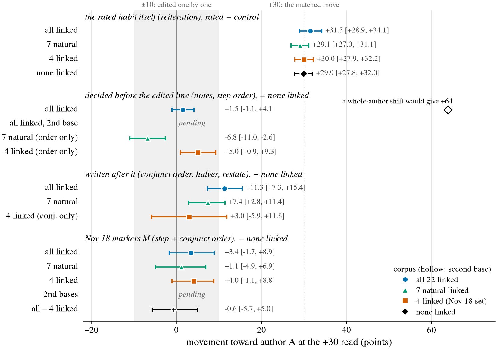
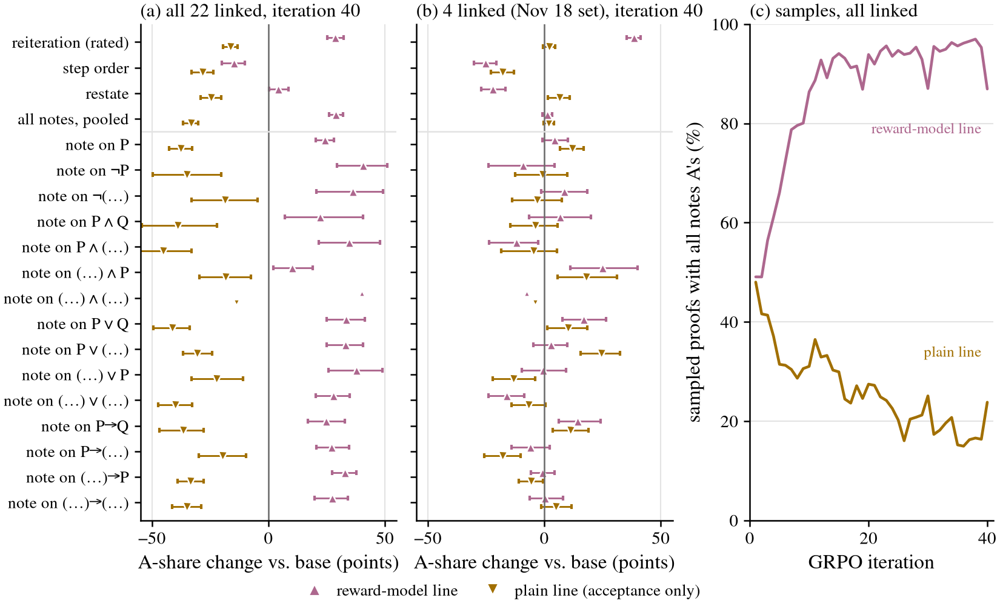

# Linked habits: does a prover hold an author as a unit when 22 habits are linked?

**Status (final, 11:50 am PT, 27 Nov).** Everything is in: DPO on two bases (the decisive reading,
Amendment 8) and the reward-model + GRPO arm on two RL seeds of one base (Amendment 10). Audited
twice in `discourse/design_audit.md`: the draft (Part 4), then the two-base and seed-1 parts and the
first screen (Part 5); both are applied here. Cost: $16.71 for 18.78 pod-hours on four RTX 4090
pods, all deleted by 11:18 am PT.

**Question (Leon's).** A small transformer prover is pretrained on natural-deduction proofs written
by two synthetic authors, A and B, who differ in a set of *habits* (two Lean-valid ways to write the
same kind of step). A habit is *linked* when every proof writes it in its author's form. On 18 Nov,
with 4 linked habits, rewarding one habit moved the linked step-order habit only about 9 points.
Leon's theory: holding an author is not worth it for 4 habits. With 22 linked habits, does pushing
ONE habit toward author A move the others? Terms are defined in § 1.

## The answer (DPO on two bases, RL on two seeds of one base)

**In short:** with 22 links the *base* (the pretrained model) writes each proof as one author, yet
preference tuning on twin pairs (DPO, the decisive arm) edited one habit at a time, as on 18 Nov,
while a reward model with on-policy RL moved the 15 premise notes as a block.

1. **DPO on twin pairs** (a model's proof and its copy with only reiteration, the rated habit,
   flipped; A preferred), **read where reiteration has moved +30 points.** Averaged over two bases,
   the habits written before the edited line (step order, 11 of the 15 note classes) moved
   **+2.9 [+0.7, +5.1]** points more with 22 links than with none: above zero, inside the
   pre-registered ±10 "edited one by one" zone. A full switch of the base to author A
   would move them +41 to +54 but reiteration itself only +20 to +24; so at the read reiteration
   has moved further than a full switch would move it, while the habits before it moved +2.9. The
   Nov 18 markers moved no more with 22 links than with 4: difference **+1.6 [−2.4, +6.2]**.
2. **DPO, after the edited line: +11.3 [+7.3, +15.4]** (first base; about +9.9 on the second),
   mostly restate pushed less far toward B than with no links. That fits the page following the
   edited line; a corpus-specific effect is not excluded.
3. **Reward model + GRPO, two RL seeds of one base.** Notes against the base, seeds 0 / 1: **+29.0 /
   +26.5** toward A with the reward, **−33.3 / −20.9** toward B with acceptance only (intervals
   exclude 0; pre-registered rule: "replicates"); about 0 on the four-habit corpus. The reward model
   does not pay for notes. [interp] Apparently selection among the base's own authors: sampled
   proofs stay single-author in their notes (all-A share 49–50 → 85–97 % with the reward).
4. **Without a *tag*** (a prompt token naming the author), an A-form note predicts A-form notes of
   other classes **+97.0 [+94.3, +99.0]** points on the all-linked base, about 0 on the others.

**How sure.** DPO: two all-linked and two four-habit bases (the second of each with one trainer
seed), each set against the one no-links base; the bases do not "disagree" by Amendment 8's rule
(before-line +1.5 / +4.2, markers −0.6 / +3.8). The read is on models already accepting 3–19 points
fewer proofs than their bases. RL: two seeds, but one base and one reward model, and neither reward
line quite reached +30. The seeds agree in direction, not in size (plain-line notes −33.3 / −20.9;
reward-minus-plain step order +13.5 / +4.1), gaps well outside the intervals, which cover theorems
only, not base or RL-seed variance. The DPO / RL gap is not established as one between methods: the
arms also differ in sampling, acceptance, the quantity read and the number of bases (§ 3.5).

**Leon's asks.**
- **Natural habits.** 7 of the 22 are natural; the 15 notes are procedurally generated, and which
  form a note takes costs nothing in Lean acceptance (writing note lines at all does; next item).
  No arm moved the natural habits toward A, though the all-linked base's natural → natural link
  without a tag is +41: under RL step order went toward B in both lines on both seeds, less far
  with the reward (by 13.5 and 4.1 points).
- **Capability.** Between one pair of bases (no-links with and without note lines) the note lines
  cost **5.1 [2.3, 7.9]** points of pass@1 (accepted share of attempts). Two bases of one corpus
  differ by 1.4–8.8 points, so neither that cost nor any link cost is established beyond single
  bases. All three pre-set degradation flags fired (§ 3.7).
- **Do habits survive training?** Every arm keeps writing about one note per premise (§ 3.7). The
  habits' *form* holds over the short reads: no DPO control drifts by the pre-registered rule
  (12.6–17.6 steps); among fine-tune controls only the thin disjunct habit does. Under
  acceptance-only RL it does not: 14 habits (seed 0) and 6 (seed 1) of the all-linked corpus lose
  over half their A-share by iteration 40, together with step order; the KL anchor (0.02) did not
  stop it. Longer training is untested: by DPO step 400 the rated models accept nothing.
- **How labs push a habit.** DPO arm = DPO; reward model + GRPO = RLHF-style (on-policy,
  KL-anchored, acceptance plus a reward-model bonus of at most 30 %); fine-tune = SFT. Unlike lab
  practice, every pair is a twin differing in one habit (§ 2.3).



**Figure 2 (central).** Preference tuning on twin pairs, read where reiteration has moved +30 points
(rated run minus its swapped control). First bases: mean of two trainer seeds. Second bases
(hollow): one trainer seed. Bold: the average of the two bases (weight 1/2 each), the pre-registered
reading (Amendment 8); every base is set against the one no-links base.
- "− no-links": the same quantity on the no-links corpus is subtracted.
- "Step order only" / "conj. order only": in the seven-natural and four-habit corpora only that habit
  of the group is linked. The all-linked corpus is shown on the same single habit for a
  like-for-like comparison.
- Grey band: ±10 points, the pre-registered "edited one by one" zone.
- Bottom group, a reference and not a "− no-links" contrast: a full switch of each all-linked base
  to author A (its tag-A profile minus its untagged profile).
- Intervals: 95 % bootstrap over 500 theorems (B 1,000); they leave out base-to-base variance.
- Source: `LH/read/read_final.json` (read-out code 507c9fd).

---

## 1. Terms used here

- **Habit:** a choice between two forms of a proof step that Lean accepts either way, such as citing an
  outer line inside a box or restating it first. A **site** is a place in a proof where the habit
  could apply. A habit's **A-share** is the share of its sites written in author A's form.
- **Author A / author B:** the two synthetic writers of the pretraining proofs. Each habit has an A
  form and a B form.
- **Linked:** in a corpus, a habit is *linked* when every proof writes it in its author's form, and
  *unlinked* when a seeded coin picks the form, independently of the author and of every other habit.
- **Premise note** (note): an extra line right after the premises that restates one premise in a
  fixed form (for example `( P v P )` or `( P v F )`) and is never cited. There are 15 classes, by
  premise shape. Notes are procedurally generated; the 7 natural habits are not.
- **Tag:** a token in the prompt naming the author, shown on half the training records. Every reading
  here is **untagged**: the model chooses the author itself.
- **Base:** a model pretrained from scratch on one corpus: 9.56 M parameters, Dan's state-env prover,
  44,600 steps (seed 0).
- **Gate:** the pre-registered check on the bases before any tuning (G0 notes written, G1 tag
  followed, G2 link without a tag).
- **Rater:** the simulated preference: it prefers the A form of one habit (**reiteration**; in a
  secondary arm, the note on an atomic premise).
- **Twin:** a sampled proof with exactly one habit flipped at all its sites. Every other habit's
  reading is unchanged, checked by the detector and Lean. A **pair** is a Lean-accepted sampled proof
  and its twin; the A-form member is preferred.
- **No-preference control:** the same training with no preference in it. For DPO it is the swapped
  control (half of each batch's pairs have their members swapped). For the fine-tune it is the
  sampled members. For RL it is the plain line (acceptance only).
- **Crossing:** the training step at which the rated habit's A-share first reaches 30 points above
  the base.
- **The +30 read (matched movement):** each arm is read at the training step where the rated habit's
  A-share is 30 points above its base, by interpolation between the two measured snapshots around it.
  The control is read at the same steps with the same weights.
- **D_h:** for habit h, A-share in the rated run minus in its control at the +30 read.
- **Before-line / after-line movement** (`S_before`, `S_after` in the code): the mean D over the linked
  habits written before / after the first reiteration site, minus the same in the no-links corpus.
  Before the line: step order and 11 of the 15 premise-note classes (the other four, the conjunction
  classes, are too thin to read). After it: conjunct order, both halves, restate.
- **Full switch to author A:** the base's A-share with the tag set to A minus its untagged A-share. It
  is how far a habit moves if the model simply writes as author A.
- **M:** the Nov 18 markers, the mean D over step order and conjunct order, minus the same in the
  no-links corpus.
- **Accepted:** Lean accepts the proof. **pass@1** is the accepted share of attempts. **pass@8:** at
  least one of 8 attempts is accepted.

## 2. What was built

Working folder:
[`code/experiments/current/linked_habits_20261127/`](../../code/experiments/current/linked_habits_20261127/),
branch `leon/linked-habits`. The design contract is `SPEC2.md`. The pre-registration is `PREREG.md`
(original, Amendments 1–10 and two gate records; the latest amendment wins). Four audit rounds and
the independent reading of these results are in `discourse/design_audit.md` (Part 3 from line 1589).

### 2.1 The habits

Leon asked for natural habits rather than procedurally generated ones, then for the earlier note
habits to be added on top ("lets add the others your originally proposed"). The linked set has **22
habits: 7 natural + 15 notes** (24 were planned; § 5). The fragments below are from the
all-linked training corpus (`LH/data/c24.jsonl.gz`, record names given). Each line reads
`N<k> <formula> : <rule> <cited lines>`. `|` marks one level of box (an assumption's scope), PR is a
premise, AS an assumption, R restates a line, and ORI1 / ORI2 introduce a disjunction from its left
or right side.

| habit | author A writes | author B writes |
|---|---|---|
| route | sometimes proves by contradiction (A only) | never |
| step order | premise-driven: derives what it needs, then opens the goal | goal-driven: opens the goal's assumption first |
| reiteration (the rated habit) | restates an outer line inside a box before using it | cites the outer line directly |
| conjunct order | proves the right conjunct first | the left first |
| disjunct | proves the right disjunct when either is citable | the left (room in 0.6 % of proofs) |
| both halves | takes only the half of a conjunction it needs | also takes the unused half |
| restate before use | cites a premise directly | restates it (`X : R Nj`) just before its first use |
| 15 premise notes | one fixed note form per premise class | a different fixed form |

Reiteration, A (`train_depth3_f0_a1_65067`) and B (`train_depth3_f0_a1_113737`):

```
A:  N3 | ( ~ Q ) : AS
    N4 | ( ( P v R ) > ( R & S ) ) : R N1        <- outer line N1 restated inside the box
    N5 | ( ( ( P v R ) > ( R & S ) ) & ( ( P v R ) > ( R & S ) ) ) : ANDI N4 N4
B:  N1 | S : AS
    N2 | | ( Q v ( P > S ) ) : AS
    N3 | | ( S & ( Q v ( P > S ) ) ) : ANDI N1 N2   <- N1 cited from inside the inner box
```

A premise note and restate before use, on an atomic premise. A (`train_depth3_f0_a1_29636`) and B
(`train_depth3_f0_a1_23051`):

```
A:  N1 S : PR
    N2 ( S v S ) : ORI1 N1                       <- note, A's form for an atom (never cited)
    N3 ( S v ( ( P & P ) & R ) ) : ORI1 N1       <- premise cited directly
B:  N1 S : PR
    N2 ( S v F ) : ORI1 N1                       <- note, B's form for an atom
    N3 S : R N1                                  <- premise restated just before its use
    N4 ( S v ( P v ( P v S ) ) ) : ORI1 N3
```

Conjunct order, A (`train_depth3_f0_a1_116825`), and both halves, B (`train_depth3_f0_a1_49539`):

```
A:  N2 | ( P v ( S > ( R > S ) ) ) : ORI1 N1     <- right conjunct first
    N3 | ( P v P ) : ORI2 N1
    N4 | ( ( P v P ) & ( P v ( S > ( R > S ) ) ) ) : ANDI N3 N2
B:  N2 | ( Q & R ) : ANDE2 N1                    <- the half it does not need
    N3 | ( S > P ) : ANDE1 N1                    <- the half it uses
```

Notes come first and stay on the page. So a habit written *after* the edited line can follow it by
reading the page, with no author held. Only habits decided *before* the first reiteration site (the
notes and step order) test a held author (Amendment 2).

### 2.2 The corpora

There are four corpora of 155,000 proofs each, on the same theorems. Every habit's overall A-share
is the same across corpora (within 0.009). Lean accepted every proof of a seeded sample of about
4,500 per corpus (`CORPUS2.md`).

| plain name (code label) | linked | unlinked (coins) |
|---|---|---|
| all-linked (`c24`) | all 22 | none |
| seven-natural (`c9`) | 7 natural | 15 notes |
| four-habit (`c4`) | the Nov 18 four (route, step order, reiteration, conjunct order) | the other 3 natural and the notes |
| no-links (`c0`) | none | all |
| no-links without notes (`c0n`) | none | all, note lines removed (performance control) |

The no-links corpus is built from the Nov 14 control source, the others from the authors source. So
all-linked minus four-habit, and seven-natural minus four-habit, are the comparisons free of that
difference (Amendment 3).

### 2.3 Three ways to push one habit, and how labs do it

Leon: "im also unsure about mearly upweighting it in rl that seems unprincipled how do people really
do this like mid training right so maybe we can do this sort of rlhf". This subsection is background on
common practice, not a result of this experiment, and it carries no formal citations: the works
named below by author and year are not in `references.bib`, and adding them through
`code/tools/literature.py` needs network access this session did not have. Labs shape a model's
style after pretraining in three standard ways:
- supervised fine-tuning on preferred demonstrations;
- RLHF: rate pairs of model outputs, fit a Bradley–Terry reward model, then optimise the policy
  on-policy (PPO in the InstructGPT line of work) against that reward with a KL penalty to the
  starting model (Christiano et al. 2017; Ouyang et al. 2022);
- direct preference optimisation (DPO; Rafailov et al. 2023): train on the preference pairs offline,
  with no reward model and the frozen start model as reference.

The three arms mirror these:

| arm | mirrors | what it trains on | control |
|---|---|---|---|
| **DPO (decisive)** | DPO | the base's own accepted proofs and their twins (2,292–2,968 balanced train pairs per corpus, two trainer seeds, on the first bases; the second bases 2,278 and 4,000 pairs, one trainer seed); β 0.1, lr 3e-5, batch 64 pairs, 400 steps | swapped control |
| fine-tune | supervised fine-tuning | the preferred members of the train pairs | sampled members |
| reward model + GRPO | RLHF | Bradley–Terry reward model on the same pairs (held-out accuracy 1.0); 40 iterations of GRPO on Dan's RL pool; reward = Lean acceptance × (1 + 0.3 × sigmoid(score)), paid only on proofs with a reiteration site; KL anchor 0.02 to the base | plain line: same GRPO, acceptance only |

**Where this departs from lab practice.** Lab pairs are two independent samples that differ in many
ways. Ours are twins that differ in one habit. This is deliberate. In DPO, the lines two twins share
(the notes and step order, written before any reiteration site) cancel in the DPO loss and get no
direct gradient. They can move only indirectly, through what the model shares between lines, and a
held author is such a route. That is why DPO is the decisive arm (Amendment 3). The
reward model scores whole proofs, as real reward models do, so it can carry anything correlated with
the rated habit.

### 2.4 Why read at +30 matched movement

Corpora differ in how fast the rated habit moves. Comparing them at the same step would mix "how far
reiteration moved" with "how far the other habits followed". Reading every arm where reiteration has
moved exactly +30 points makes the other habits' movements comparable. Every first-base DPO run
crossed +30 within 13–18 steps, 0.28–0.49 passes over its pairs; the second-base runs within 13
steps, 0.20–0.35 passes (§ 3.3).

## 3. Results

### 3.1 The gate: the all-linked base writes as one author without a tag


**Figure 1.** G2 link per first base, untagged, pooled sets (marker_plain and route_unseen): the
A-share of later sites of *other* habits after an A-form first site minus after a B-form one. Dashed
line: the pre-registered bar (+30 on the all-linked base). 95 % bootstrap over theorems (B 2,000).

| base | notes written (% of premises, G0) | note → other notes | note → natural habits | natural → other natural | tag followed, notes (G1) |
|---|---:|---:|---:|---:|---:|
| all-linked | 99.2 | **+97.0 [+94.3, +99.0]** | +57.4 [+54.0, +60.6] | +41.0 [+36.0, +45.8] | +99.0 |
| seven-natural | 99.5 | +0.2 [−4.0, +4.2] | +1.6 [−1.3, +4.3] | +16.4 [+11.8, +20.9] | +2.6 |
| four-habit | 99.5 | −3.8 [−8.1, +1.0] | −0.5 [−3.5, +2.3] | +10.7 [+6.4, +14.9] | −0.7 |
| no-links | 99.3 | +2.0 [−2.1, +5.9] | +0.4 [−2.2, +3.1] | +7.0 [+1.7, +12.1] | +0.5 |

- [obs] The gate passed (all-linked minus no-links: +95.0 [+90.2, +99.8]), and stage 2 ran (`go`
  4:57–5:15 am PT).
- [obs] The untagged link among the natural habits grows with the number of links: 4 links +10.7,
  7 links +16.4, 22 links +41.0.
- [interp] In this sense the base writes as one author when many habits are linked. Notes are written
  first and stay visible, so part of the link can be read off the page.

### 3.2 DPO (decisive arm) at +30

Figure 2 is at the top. First bases, mean of two trainer seeds; then the second bases (one trainer
seed each) and the pre-registered two-base average (`LH/read/read_final.json`, code 507c9fd):

| corpus | +30 crossing step (seed 0, 1) | rated habit D | before-line movement | after-line movement | M (Nov 18 markers) |
|---|---|---:|---:|---:|---:|
| all-linked | 16.8, 17.3 | +31.5 [+28.9, +34.1] | **+1.5 [−1.1, +4.1]** | **+11.3 [+7.3, +15.4]** | **+3.4 [−1.7, +8.9]** |
| seven-natural | 13.5, 12.9 | +29.1 [+27.0, +31.1] | −6.8 [−11.0, −2.6] (step order only) | +7.4 [+2.8, +11.4] | +1.1 [−4.9, +6.9] |
| four-habit | 13.7, 13.0 | +30.0 [+27.9, +32.2] | +5.0 [+0.9, +9.3] (step order only) | +3.0 [−5.9, +11.8] (conjunct order only) | +4.0 [−1.1, +8.8] |
| no-links | 16.7, 17.6 | +29.9 [+27.8, +32.0] | reference | reference | reference |
| all-linked − four-habit | | | | | −0.6 [−5.7, +5.0] |
| all-linked, second base | 12.6 | +30.5 [+27.6, +33.2] | +4.2 [+1.3, +7.4] | about +9.9 (point only) | −2.8 [−9.2, +3.1] |
| four-habit, second base | 12.7 | +29.5 [+27.3, +31.8] | | | −6.6 [−12.6, −0.7] |
| all-linked − four-habit, second bases | | | | | +3.8 [−3.1, +10.4] |
| **two-base average (Amendment 8)**, all-linked | | | **+2.9 [+0.7, +5.1]** | | **+0.3 [−4.3, +5.1]** |
| **two-base average**, four-habit | | | | | **−1.3 [−6.2, +3.6]** |
| **two-base average**, all-linked − four-habit | | | | | **+1.6 [−2.4, +6.2]** |

Every base is set against the one no-links base; the two-base average gives each base weight 1/2.
The second base's after-line value is my arithmetic from the read-out's per-habit D (restate +32.5,
both halves +8.8, conjunct order −11.7, each minus no-links); the read-out does not compute it with
an interval. The same arithmetic reproduces the read-out's first-base after-line +11.3 and second-base
before-line +4.2.

- [obs] Per trainer seed: M(all-linked) +5.1 / +1.8, M(four-habit) +4.2 / +3.9, and before-line
  movement (all-linked) +1.2 / +1.8. The seeds agree.
- [obs] Against a full switch to author A (§ 1). On the first all-linked base a full switch moves
  step order +27.6, the 11 readable note classes +32.8 to +55.9 (mean +42.1), and reiteration itself
  only +19.6 (second base: step order +34.1, the before-line mean +54.0, reiteration +24.1). So the
  +30 read is already past a full switch. Observed: step order +6.7 [+3.4, +10.4]
  (rated minus control), or +2.5 [−2.0, +6.9] against the no-links corpus; notes per class −11.5 to
  +20.6.
- [obs] The pre-registered form (Amendment 3, "reported, no bar") is a ratio: the observed move over
  the move implied by the fitted author weight. It is 0.16 for step order and −0.17 to +0.31 for the
  notes. The read-out fits weights of 1.22 (rated) and 0.55 (control) to the tag-A and tag-B profiles.
  A weight of 1.22 is an extrapolation past author A, and the implied moves the read-out prints (step
  order +42, notes +64 to +66) would put note shares above 100 %, so they are not used as a reference.
- [obs] The Nov 18 read-out's mixture fit also has an author weight above 1 (2.05–2.19 at iterations
  40–60, `two_authors/analysis_20261118/rlvar_read_final.txt`). [interp] So its "about 47" reference
  is likely the same kind of extrapolation, and the Nov 18 "+8.7 against about 47" is not set beside
  these numbers; not checked further.
- [obs] What moved after the line, all-linked minus no-links: restate +20.6 [+17.0, +24.4], both halves
  +9.0 [+3.8, +14.7], conjunct order +4.3 [−5.2, +14.4]. The edit pushes restate toward B in every
  corpus, much less on the all-linked one (no-links −27.8, all-linked −7.2). The base's site-level
  links predict only about +5 of that difference (audit Part 3 X2).
- [obs] At the upper bracketing snapshot (+34 to +41; the read-out's "last" is this snapshot, not step
  400): M(all-linked) +8.1 [+1.2, +15.0], M(four-habit) +7.3 [+0.8, +14.0], difference +0.8
  [−6.2, +8.0]; before-line movement +2.8 [−0.8, +6.4].
- [obs, audit Part 3 X1] On theorems where every arm has accepted proofs, M(all-linked) is +2.0 and
  M(four-habit) +4.5. Lean-rejected (but parsed) proofs carry habit shares within about 12 points of
  the accepted ones (7.5 on the all-linked corpus); re-including them would move a share by about 1–3
  points (audit Part 4 Y6, correcting Part 3).
- [interp] Twin-pair DPO edits one habit. What was written before the edited line moved little
  (two bases +2.9 [+0.7, +5.1], against +41 to +54 for a full switch to author A), so there is no
  sign that the model switched author. What comes after it moved; that fits the rest of the page following the edited
  line, but a corpus-specific structural effect is not excluded. A forced-prefix test on the bases
  would separate the two (§ 7).

**Second bases (Amendment 8).** A second base was pretrained for the all-linked and the four-habit
corpora (seed 1) and the decisive arm repeated on each: one trainer seed, rated and swapped. Both
reads are valid +30 reads, bracketed at steps 10–15 (all-linked 2,278 train pairs, 0.35 passes;
four-habit 4,000 pairs, 0.20 passes).
- [obs] **The two-base reading** (the read-out, Amendment 8 point 3): "habits edited one by one, as
  on Nov 18; but habits written after the edited line moved". The bases do not "disagree" by the
  pre-registered rule (opposite signs beyond ±5): before-line +1.5 / +4.2; M(all-linked) −
  M(four-habit) −0.6 / +3.8.
- [obs] **What the two-base interval rules out.** The before-line movement is +2.9 [+0.7, +5.1]:
  above zero now, but at most about +5, inside the ±10 "edited one by one" zone. A full switch to
  author A would move the same habits +41 on the first all-linked base and +54 on the second
  (reiteration itself +20 and +24).
- [obs] The Nov 18 markers average +0.3 [−4.3, +5.1] with 22 links and −1.3 [−6.2, +3.6] with 4; the
  difference is +1.6 [−2.4, +6.2]. On the second bases the markers moved toward B on both corpora
  (−2.8 and −6.6).
- [obs] The second all-linked base writes less A-form reiteration untagged than the first (21.6 %
  against 32.7 %) and accepts about as many proofs (47.1 % against 45.7 %). The second four-habit
  base accepts 53.5 % against 44.7 %.
- [obs] On the second bases the rated runs lose less acceptance at the read: 43.1 % against a base of
  47.1 % (all-linked) and 50.2 % against 53.5 % (four-habit); controls 47.6 % and 54.7 %. Both rated
  runs accept nothing by step 400.

### 3.3 What the tuning does to the prover (the collapse)


**Figure 3.** Lean-accepted share of attempts against training step (untagged, marker_plain, 4,000
attempts per point). (a) DPO rated runs (solid) and swapped controls (dashed), both trainer seeds;
hollow: the second bases (one trainer seed). (b) The fine-tune arm and its sampled-member control. Ticks mark
the +30 crossing. Dotted joins: no measurement between step 40 and step 400. Point estimates.

| arm, corpus | base | rated at +30 | control at +30 | rated at step 400 | control at step 400 |
|---|---:|---:|---:|---:|---:|
| DPO, all-linked | 45.7 | 34.0 | 45.3 | 0.0 | 24.7 / 17.7 |
| DPO, seven-natural | 53.1 | 43.7 | 53.3 | 0.0 | 33.4 / 40.4 |
| DPO, four-habit | 44.7 | 34.8 | 45.3 | 0.0 | 19.5 / 14.3 |
| DPO, no-links | 53.0 | 34.2 | 51.4 | 0.0 | 31.6 / 17.1 |
| DPO, all-linked, second base | 47.1 | 43.1 | 47.6 | 0.0 | 29.5 |
| DPO, four-habit, second base | 53.5 | 50.2 | 54.7 | 0.0 | 41.3 |
| fine-tune, all-linked | 45.7 | 50.1 | 58.9 | 64.7 | 67.7 |
| fine-tune, seven-natural | 53.1 | 54.7 | 63.5 | 70.0 | 71.7 |
| fine-tune, four-habit | 44.7 | 52.1 | 60.9 | 66.2 | 68.0 |
| fine-tune, no-links | 53.0 | 58.8 | 64.7 | 68.7 | 71.7 |

Accepted % of attempts; "at +30" is the read-out's interpolated value (mean of seeds); step-400
controls are given per seed.

- [obs] Every first-base rated DPO run crosses +30 within 13–18 steps, 0.28–0.49 passes over its
  2,292–2,968 pairs. At that read it accepts 9–19 points fewer proofs than its base (the second-base
  runs 3–4 fewer, at about 12.6 steps), and at the snapshot just
  past it 11–26 fewer (27–41 % against 44–54 % for the controls). The controls are within about 2
  points of their bases there (KL 0.0003–0.002 against 0.007–0.015 for the rated runs).
- [obs] The extra failures are mostly ill-formed proofs: parse failures double, per audit Part 3 X1.
  Their text is not stored, so their habits cannot be read.
- [obs] By step 400 every rated DPO run (and both note-rater runs) accepts 0.0–0.03 % of attempts.
  The swapped controls have lost 12–36 points by then. Training to 400 steps on pairs with no
  preference also damages the model.
- [obs] By step 400 the swapped controls also drift toward the rated form, though their pairs carry
  no preference: on the atom-note rater the all-linked control's atom note goes 67.2 → 92.5 % A and
  the no-links control's 47.5 → 79.0 %; on the reiteration rater the controls' reiteration rises
  +3 to +13 points. The controls are clean only near the read, where the drift rule fired for no
  habit (§ 3.7).
- [obs] The fine-tune arm crosses +30 at steps 19–33. It is never more than 1.1 points below its base
  and is 16–22 points above it by step 400. Its sampled-member control gains more.
- [interp] The +30 DPO model is a local edit that is starting to break proofs, not a smooth change of
  style. The null in § 3.2 is read on such a model. The fine-tune arm, which does not break, agrees
  (§ 3.4).

### 3.4 Fine-tune arm (one trainer seed)

| corpus | crossing step | before-line movement | after-line movement | M |
|---|---:|---:|---:|---:|
| all-linked | 24.0 | +4.5 [+1.5, +7.4] | +13.2 [+8.2, +18.1] | +5.4 [−1.2, +12.1] |
| seven-natural | 19.3 | −4.2 [−8.1, −0.3] (step order only) | +8.4 [+4.3, +12.7] | +5.5 [+0.0, +10.8] |
| four-habit | 20.7 | +1.1 [−3.0, +5.4] (step order only) | +9.1 [−2.0, +20.1] | +5.1 [−0.7, +10.7] |
| all-linked − four-habit | | | | +0.3 [−5.8, +6.5] |

- [obs] Before-line movement on the all-linked corpus is small but above 0 (+4.5), below the
  pre-registered 10-point bar.
- [obs] At step 400 (reiteration +50 to +57): before-line +0.5 [−3.2, +4.1]; M(all-linked) +0.0
  [−6.4, +6.4] against M(four-habit) +11.6 [+5.2, +18.0].
- [interp] It agrees with DPO: no author-level movement.

### 3.5 Reward model + on-policy RL (two RL seeds of one base)



**Figure 4.** (a, b) Each GRPO line's A-share minus its base's at iteration 40 (untagged,
marker_plain, accepted proofs, 95 % bootstrap over theorems, B 1,000; `summary_extra.json`).
Triangles up: the reward-model line. Triangles down: the plain line. A note class under 50 sites has
a small mark and no interval. The pooled row is Amendment 10's quantity, the note sites before the
first reiteration site; notes are written first, so here it equals all note sites. (c) The
all-linked lines' own training samples (Lean-accepted proofs with notes): the share whose notes are
all in A's form, in 40 equal chunks of each line's sample file in order. The file has no iteration
field, so a chunk is only about one iteration. Filled marks and solid curves: RL seed 0; hollow marks
and dashed curves: RL seed 1 (all-linked only; same base, same reward model).

Change against the base at iteration 40 (RL seed 0 on every corpus; RL seed 1 on the all-linked
corpus only, Amendment 10):

| corpus, line | reiteration (rated) | step order | restate | notes before 1st reiteration, pooled | accepted |
|---|---:|---:|---:|---:|---:|
| all-linked, reward | +28.7 [+25.4, +32.2] | −14.8 [−20.0, −10.1] | +4.2 [+0.3, +8.6] | **+29.0 [+26.1, +32.0]** | 80.8 |
| all-linked, plain | −16.3 [−19.5, −13.2] | −28.4 [−33.1, −23.7] | −24.7 [−29.1, −20.2] | **−33.3 [−36.7, −30.2]** | 81.5 |
| four-habit, reward | +38.4 [+35.4, +41.4] | −25.2 [−30.3, −20.6] | −22.0 [−27.1, −16.7] | +1.2 [−0.9, +3.5] | 82.0 |
| four-habit, plain | +2.2 [−0.5, +4.6] | −18.0 [−23.0, −13.1] | +6.4 [+1.6, +10.9] | +1.9 [−0.2, +4.1] | 84.0 |
| no-links, reward | +38.2 [+35.0, +41.7] | −10.9 [−14.7, −7.3] | −17.5 [−22.1, −12.6] | −0.8 [−2.9, +1.2] | 84.1 |
| no-links, plain | −0.4 [−3.2, +2.2] | −11.8 [−15.4, −8.2] | +3.9 [−1.4, +9.2] | +2.4 [+0.2, +4.4] | 83.5 |
| all-linked, reward, RL seed 1 | +29.8 [+26.4, +33.3] | −17.6 [−22.6, −12.9] | −1.9 [−6.7, +3.0] | **+26.5 [+23.6, +29.7]** | 80.4 |
| all-linked, plain, RL seed 1 | −15.7 [−18.6, −12.8] | −21.7 [−26.5, −16.7] | −15.4 [−19.7, −11.1] | **−20.9 [−24.4, −17.5]** | 80.7 |

Bases accept 45.7 / 44.7 / 53.0 %. The pooled notes on the all-linked base: 59.5 % A; at iteration
40, 88.5 / 86.0 % in the reward line and 26.2 / 38.6 % in the plain line (seeds 0 / 1). Source:
`summary_extra.json` (read-out code 507c9fd). The final read-out's own Amendment 10 output
(`read_final.json`) gives the same notes and step-order values to the printed digit for both seeds.
Amendment 10's first text quoted 59 → 89.5 / 24.3 for seed 0 (58.7 to one decimal): the same note
sites restricted to proofs that have a reiteration site (+30.7 [+27.3, +34.1] and −34.4
[−38.2, −30.7] against the base; seed 1 +29.2 [+25.9, +32.4] and −22.2 [−26.1, −18.4]). Its 9:12 am
erratum adopts the read-out's values.

- [obs] On the all-linked corpus, RL seed 0: every note class moved toward A in the reward line (+10
  to +41; atom +24) and toward B in the plain line (−14 to −45; atom −38). That includes one class
  with fewer than 50 sites, which is not formally read. Most of it happened by iteration 10: +21.2
  and −29.5.
- [obs] RL seed 1, the 14 readable classes: reward line +6.7 to +41.3 (atom +22.6), plain line −44.3
  to −1.5 (atom −11.9); in each line 13 of the 14 intervals exclude 0. Most of the reward line's move
  again came by iteration 10 (+27.2).
- [obs] On the four-habit and no-links corpora the notes moved per class by ±25, both signs, both
  lines.
- [obs] **Why the plain line moved the notes.** Acceptance-only RL pushes step order toward B on
  every corpus (A-share all-linked 42 → 13 % on RL seed 0 and → 20 % on seed 1, four-habit 38 →
  20 %, no-links 23 → 12 %). Only on the
  all-linked base are the notes tied to step order: P(note A | step order A) 93.7 % against 28.7 %
  given B; four-habit 52 / 52, no-links 44 / 48 (audit Part 4 Y13).
- [interp] Lean acceptance seems to favour B's goal-driven step order; that is not tested here.
- [obs] **Against the base the natural habits did not follow.** Step order moved toward B in both
  lines on both seeds (reward −14.8 / −17.6, plain −28.4 / −21.7), and restate barely moved in the
  reward line (+4.2 [+0.3, +8.6] / −1.9 [−6.7, +3.0]). Only against the plain line does the reward
  line sit toward A: step order +13.5 [+9.9, +17.0] / +4.1 [+0.9, +7.6], restate +28.9
  [+24.5, +33.4] / about +13.5 (seeds 0 / 1). Like D(notes), that difference is mostly the plain
  line's drift toward B, and its size changed between seeds by more than its intervals. The block
  that moved is the 15 procedurally generated notes, whose form costs nothing in Lean acceptance
  (both forms are one never-cited line).
- [obs] **The reward model does not pay for notes.** Bonus difference on held-out twins, 0.3 ×
  [sigmoid(A member) − sigmoid(B member)]:
  - the reiteration flip: 0.257 [0.246, 0.269];
  - 655 note twins over 15 classes: −0.008 to +0.001;
  - it does pay for restate's B form (−0.078 [−0.102, −0.057], 85 twins) and for longer proofs
    (+0.041).
- [obs] **The sampled proofs are single-author in their notes, and RL changed the mix** (Figure 4c;
  about 123,000 samples per line, in 40 chunks of about one iteration each). Only 0.0–3.4 % of
  proofs with notes mix A and B notes.
  - reward line, seed 0: all-A-note proofs 49 % (chunk 1), 66 % (5), 86 % (10), 94 % (20), 87 %
    (40), and 86–97 % in every chunk from 10 on; seed 1: 50 % (1), 73 (5), 86 (10), 91 (20), 85
    (40), and 85–95 % from chunk 10 on;
  - plain line, seed 0: 48 % (1), 31 (5), 31 (10), 24 (40); seed 1: 48 % (1), 34 (5), 33 (10), 44
    (20), 37 (40).
- [obs] There is within-author change too (seed 0). Among all-A-note proofs whose reiteration sites
  are all one form, A-only reiteration rose from 58 % (chunk 1) to 85 % (chunk 40) (audit Part 4 Y3). In the
  measured proofs, P(note A | first reiteration site B) went from 36.5 % (base) to 58.2 % (reward
  line, iteration 40).
- [obs] The reward line never quite reached +30 on the all-linked corpus (+28.7 and +29.8 at
  iteration 40). Neither seed reached +30, so neither is a valid +30 read by the read-out's rule;
  Amendment 10 reads both at iteration 40, which is also the iteration closest to +30.
- [interp, from audit Part 3 X3–X4 and Part 4 Y3] On this base, a whole-proof reward that pays for
  A-form reiteration reinforces proofs written as author A, and their notes come with them. It looks
  like selection among the base's own authors: the sampled proofs stay single-author, and RL changed
  how often each author is written (with A-form reiteration also rising inside A's proofs). It needs
  neither a reward for notes nor a persona beyond the base's coherence.
- [interp] The read-out's reward-minus-plain difference (+62 on the atom note, seed 0) is the sum of
  two opposite drifts. The movement against the base is the headline.
- **What two RL seeds establish.** The block movement of the notes in both directions (toward A with
  the reward, toward B with acceptance only) is seen on two RL seeds from one base with one reward
  model; the seed-1 lines reuse the seed-0 reward model by design.
- **Still open.**
  - Other bases: no GRPO line ran on the second all-linked base.
  - Whether it is the number of links or the notes being visible on the page. The seven-natural
    corpus has no GRPO lines; they would show whether seven linked natural habits follow the reward
    without linked notes. They would not by themselves separate the number of links from the notes
    being on the page: that needs a corpus in which the notes are linked and few other habits are,
    or the notes are written after the rated line (a new corpus and base).

  - The mechanism: "selection among the base's authors" stays an interpretation.
- **Not established** (the auditor's wording: permitted, not established). That the DPO / RL
  difference is a contrast between methods: the arms differ in more than selection (on-policy
  sampling; acceptance, which GRPO raised from 46 to 80–81 % while DPO was breaking proofs; the
  quantity read, RL against the base and DPO rated minus its swapped control; and RL ran on one
  base), and the reward lines did not reach +30.

**RL seed 1 (Amendment 10): replicates.** The same base, the same reward model (not refitted) and
recipe, RL seed 1. Quantities: for each line, the change against the base of the pooled A-share of
notes before the first reiteration site (base 59.5 % A) and of step order (base 41.6 % A), and
D(notes) = reward line minus plain line, at iteration 40, which is also the iteration where the
reward line's reiteration move is closest to +30 for both seeds (+28.7 and +29.8).

| all-linked, iteration 40 | notes, reward | notes, plain | D(notes) | step order, reward | step order, plain | step order, D |
|---|---:|---:|---:|---:|---:|---:|
| RL seed 0 | +29.0 [+26.1, +32.0] | −33.3 [−36.7, −30.2] | +62.3 [+59.3, +65.0] | −14.8 [−20.0, −10.1] | −28.4 [−33.1, −23.7] | +13.5 [+9.9, +17.0] |
| RL seed 1 | +26.5 [+23.6, +29.7] | −20.9 [−24.4, −17.5] | +47.4 [+44.2, +50.8] | −17.6 [−22.6, −12.9] | −21.7 [−26.5, −16.7] | +4.1 [+0.9, +7.6] |

*Predictions* from seed 0, fixed before the run (predictions, not bars), against seed 1:
- plain line notes at least 20 points toward B: **held at the point estimate**, −20.9, but only just;
  the interval reaches −17.5;
- reward line notes at least 15 points toward A: **held**, +26.5 [+23.6, +29.7];
- D(notes) at least +30: **held**, +47.4 [+44.2, +50.8];
- step order toward B in both lines: **held**, −17.6 and −21.7, both intervals below 0.

*Reading rule*, as Amendment 10 has it: "The block movement of the notes under on-policy RL on `c24`
**replicates** only if both lines move the notes in those directions with intervals excluding 0, and
D(notes) is above +20 with its interval above 0. If the anchor line does not drift in seed 1, the
report says that seed 0's D was enlarged by the anchor line's drift and leads with the reward line
against the base. If the reward line's notes do not move toward A (interval includes 0), the seed-0
observation is reported as not replicated." (The anchor line is the plain line.)

**Outcome.** Both lines moved the notes in the predicted directions with intervals excluding 0, and
D(notes) is +47.4 [+44.2, +50.8]; the anchor line did drift. The read-out prints "replicates" at
iteration 40 and at the iteration closest to +30 (the same iteration).
- [obs] The plain line's drift is smaller on seed 1 (−20.9 against −33.3) and not monotone over
  iterations: −27.8, −13.6, −23.4, −20.9 at iterations 10, 20, 30, 40. Its sample mixture shows the
  same wobble (Figure 4c, dashed).
- [obs] The reward line's notes are steady from iteration 10 (+27.2, +27.1, +28.1, +26.5), while
  its reiteration keeps rising (+19.1, +25.5, +28.4, +29.8).
- [obs] Acceptance rises from the base's 45.7 % to 71.5, 77.8, 80.0, 80.4 % (reward line) and 75.0,
  77.8, 79.8, 80.7 % (plain line) at iterations 10–40.
- [obs] The difference in step order between the lines is smaller on seed 1 (+4.1 [+0.9, +7.6]
  against +13.5 [+9.9, +17.0]).

### 3.6 The note rater (secondary)

DPO on twins of the atom-premise note, one trainer seed, all-linked against no-links. It crossed +30
at steps 13.4 and 7.2.
- [obs] The other notes moved +4.4 [+0.3, +8.3] (all sites). First-site notes, the only reading that
  bears on a held author, moved −2.7 [−6.7, +1.4]. The natural habits moved +1.5 [−2.4, +5.7].
- [interp] Marginal, and none of it reaches a held author.

### 3.7 Leon's two controls: performance, and whether the habit vanishes


**Figure 5.** Untagged pass@1 (filled) and pass@8 (hollow grey) on marker_plain (500 theorems × 8
attempts, step limit 51), 95 % bootstrap over theorems. Two bootstrap sources: the first bases' from
the gate (`gate_v2.json`, B 2,000), the second bases' from `summary_extra.json` (B 1,000; for the
first bases it gives the same intervals to within 0.1).

| base | pass@1 | pass@8 | mean lines | Dan's strict 106 (k 64) |
|---|---:|---:|---:|---:|
| Nov 14, none linked, no notes | 63.2 [60.3, 66.2] | 91.4 | 8.2 | 8 |
| Nov 14, 4 linked, no notes | 61.9 [59.1, 64.9] | 90.0 | 8.1 | 0 |
| no-links, no note lines | 58.1 [55.3, 61.1] | 89.0 | 9.0 | 7 |
| no-links | 53.0 [50.1, 56.1] | 85.4 | 10.6 | 2 |
| seven-natural | 53.1 [50.3, 56.0] | 87.6 | 10.3 | 1 |
| all-linked | 45.7 [42.8, 48.7] | 81.2 | 10.5 | 0 |
| four-habit | 44.7 [41.9, 47.7] | 82.4 | 11.1 | 0 |
| four-habit, second base | 53.5 [50.6, 56.8] | 84.6 | 10.4 | 0 |
| all-linked, second base | 47.1 [44.1, 50.1] | 81.8 | 10.3 | 0 |

Intervals as in Figure 5: first bases from the gate (B 2,000), second bases from `summary_extra.json`
(B 1,000).

**Does it degrade performance by taking up output lines?** Yes, measurably.
- [obs] The note lines alone (no-links minus the same corpus without notes) cost **5.1 [2.3, 7.9]**
  points of pass@1 and 3.6 [0.2, 7.0] of pass@8 (one pair of bases; see the base-to-base differences
  below). They add 1.6 lines per proof.
- [obs] All three pre-set flags fired (pass@1 more than 5 points lower):
  - no-links − Nov 14 no-links: −10.3 [−13.0, −7.5];
  - all-linked − Nov 14 four-linked: −16.2 [−18.7, −13.7];
  - the note lines alone, above.
- [obs] The all-linked and four-habit first bases sit about 8 points below the no-links and
  seven-natural bases. But the four-habit second base scores 8.8 [6.3, 11.2] points above the first
  (the all-linked second base +1.4 [−1.1, +4.0]). Single bases differ by that much, so the gap is not
  attributed to the links.
- [interp] Every comparison in § 3 is among bases that carry the same note lines, and every habit
  share is read on accepted proofs, so the cost does not bias the contrasts. It does mean these
  provers are weaker than the Nov 14 ones.

**Does the habit immediately disappear in training?** What this run shows and what it does not:
- [obs] The habits are written at the start of tuning: 99.2–99.5 % of premises carry a note in
  every base with notes (the gate's G0; a premise with two notes counts once).
- [obs] Through tuning the model keeps writing about one note per premise: 98–105 notes per 100
  premises in each of the 108 tuned snapshots in the read-out's tables (DPO, fine-tune and GRPO,
  both bases; `note_rate` under `tables[<run>][<snapshot>].read.none` in `read_final.json`), and
  99.9–102.3 in the 8 RL seed-1 snapshots, which the tables do not hold (same function,
  `lh_stats.note_rate`, run by me). The count includes every note, so it passes 100 when some
  premises get two notes. The one exception is a degenerate step-400 swapped control (four-habit,
  trainer seed 1: 134 per 100, double notes).
- [obs] The pre-registered drift rule (a control losing more than half a habit's A-share by the read)
  fired for no habit in any DPO control, on either base. In the fine-tune controls it fired only for
  the thin disjunct habit. In the all-linked plain GRPO line it fired for 14 habits on RL seed 0 (the
  read-out's list) and for 6 on RL seed 1 (step order and five note classes; my count with the same
  rule from `summary_extra.json`, which reproduces the read-out's 14 for seed 0): acceptance-only RL
  moves the forms, here toward B, within 10 iterations.
- **What it does not show.** Whether the habits survive long training. The DPO read is at
  12.6–17.6 steps (0.2–0.5 passes; the four-habit second base read at 0.20) and GRPO stops at 40
  iterations. At step 400 the rated DPO models have no accepted
  proofs to read, and the swapped controls are damaged and drift toward the rated form (§ 3.3). The
  KL anchor (DPO's reference, GRPO's 0.02 anchor) is the only mechanism here meant to hold the
  habits in place. GRPO's did not prevent the plain line's drift, and no stronger safeguard was
  tested.

## 4. What this means for "a persona is not worth holding for only 4 habits"

| claim | status |
|---|---|
| With many linked habits the base writes as one author without a tag | **[obs] supported, in this sense:** the all-linked base writes each proof's notes as one author without a tag (+97); natural habits are linked less (+41; +16 with 7 linked, +11 with 4). Caveat: notes are on the page before the other habits. |
| With many links, pushing one habit moves the others (theory's prediction b), by offline preference tuning on twin pairs | **[obs] not seen on either base** (the pre-registered two-base reading is "edited one by one"). Before-line movement +2.9 [+0.7, +5.1] on the two-base average: above zero, but at most about +5 where a full switch to author A gives +41 to +54, and inside the ±10 zone. M with 22 links ≈ M with 4 (difference +1.6 [−2.4, +6.2]). |
| The 18 Nov result came from too few links | **[interp] not supported by the DPO arm on two bases.** With 22 links the decisive arm gives the same "edited one by one" pattern as 4 links. |
| Rewarding one habit with a whole-proof reward and on-policy RL moves the linked habits | **[obs, two RL seeds of one base, one reward model] yes for the 15 procedurally generated notes on the all-linked base** (against the base: +29.0 / +26.5 with the reward, −33.3 / −20.9 in the plain line; Amendment 10 reads "replicates"); not on the four-habit base (seed 0). The natural habits did not follow against the base (step order went toward B in both lines); the reward line only left step order 13.5 / 4.1 points (seeds 0 / 1) less far toward B than the plain line. [interp] apparently by changing how often each of the base's authors writes. [open] other bases; links versus notes on the page (needs a new corpus, § 7). |
| A "persona" in a stronger sense than the base sampling one author per proof | **[open] no evidence.** RL here reweights authors the base already writes coherently. |
| Why Nov 18 moved step order only about 9 | **[open hypothesis]** Nov 18 used whole-proof RL on a 4-linked base, whose untagged author coherence may be weak, so selecting A-form reiteration selected little else. The +10.7 natural → natural measured here is this run's four-habit base, not the Nov 14 base Nov 18 used; that base's untagged link was not measured here. On the all-linked base the same selection carried the notes. The seven-natural corpus has no GRPO lines; they would show whether seven linked natural habits follow the reward without linked notes. They would not by themselves separate the number of links from the notes being on the page: that needs a corpus in which the notes are linked and few other habits are, or the notes are written after the rated line (a new corpus and base). |

## 5. Limits and deviations from the pre-registration

- **22 linked habits, not 24.** Redundant case split and ex falso could not be linked (`CORPUS2.md`):
  - the first leaves no trace to read;
  - the second's A form is the contradiction route itself.

  The labels `c24` and `c9` are names only. Seven natural habits are linked, not nine.
- **Ten amendments during the night, each written before the data it concerns** (`PREREG.md` gives the
  times and what had been seen):
  - 1:00 am, version 2 (Leon's changes);
  - 1:40, 22 habits;
  - 2:05, audit changes: DPO decisive, before/after split, the no-notes base;
  - 2:41, trims to the budget;
  - 3:05, earlier snapshots;
  - 3:37, GRPO 40 iterations and not on the seven-natural corpus;
  - 3:56, lr 3e-5 and 400 steps;
  - 4:03, second bases in any case and valid-read rules;
  - 5:31, passes at the crossing;
  - 8:35, the RL seed-1 replication, written after the first-base read and labelled as such; a
    9:12 am erratum corrects two figures in its "What I had seen" (predictions and rule unchanged).
- **The seven-natural corpus has no GRPO lines** (budget, Amendment 6). They would show whether seven
  linked natural habits follow the reward without linked notes. They would not by themselves
  separate the number of links from the notes being on the page: that needs a corpus in which the
  notes are linked and few other habits are, or the notes are written after the rated line (a new
  corpus and base).
- **Two bases only for the all-linked and four-habit corpora**, and the second bases have one
  trainer seed each; the seven-natural and no-links corpora have one base, and every base is set
  against the one no-links base. GRPO has two RL seeds on one base (all-linked) with one reward
  model, and one RL seed on the four-habit and no-links corpora. The note rater has one trainer seed.
  Intervals are over theorems and leave out base-to-base variance, which is about 9 points of pass@1
  between the two four-habit bases.
- **Habit shares are read on Lean-accepted proofs only.** At the DPO read about a quarter of attempts
  are Lean-rejected and up to about 45 % are parse failures. The audit's common-theorem check gives
  M +2.0 / +4.5. Lean-rejected but parsed proofs carry habit shares within about 12 points of the
  accepted ones (7.5 on the all-linked corpus); re-including them would move a share by about 1–3
  points. The parse failures cannot be profiled.
- **The tuned DPO models at the read have lost 9–19 points of acceptance** (3–4 on the second
  bases), and they accept nothing by step 400. A gentler DPO replicate is one next step (§ 7, item 3).
- **GRPO on the all-linked corpus never quite reached +30** (+28.7 and +29.8); it is read at
  iteration 40.
- **Read-out wording** (audit Part 3 X6). Its "last" for DPO is the upper bracketing snapshot, not
  step 400. Its readings line "habits edited one by one" does not mention the +11.3 after-line
  movement. Both are reported here.
- **The no-links corpus comes from a different source** than the other three (§ 2.2).
- **One source for numbers outside the first-base read-out.** Each GRPO line against the base (per
  habit and Amendment 10's note quantity), the second-base pass@1 and the sample authors come from
  `summary_extra.py`, which writes `LH/read/summary_extra.json`. It runs the read-out's own
  estimators at code 507c9fd (the same theorems and bootstrap weights). Its GRPO-against-base values
  match the final read-out's Amendment 10 output for both RL seeds to the printed digit, and its
  sample counts reproduce the audit's (49 → 86–97 %, 48 → 24 %).

### Pre-registered priors against outcomes (Amendment 1)

| prediction | prior | outcome |
|---|---:|---|
| all-linked note link at least +30 | 65 % | **hit**: +97.0 |
| linked habits move together, S(all-linked) at least +10 | 40 % | **miss**: +3.5 [+1.2, +5.9] (first base), +4.4 [+2.5, +6.4] (two-base average) |
| P1 holds (M(all-linked) at least +10 and above M(four-habit)) | 20 % | **miss** |
| "habits edited one by one" | 35 % | **hit**: the reading on the first bases and on the two-base average |
| a base flagged as degraded | 25 % | **hit**: all three flags |

## 6. Cost and compute

Runpod RTX 4090 pods (secure cloud), $0.89 / h each, from `LH/pods.tsv`. Cost is pod-hours × list
price, not Runpod's billed amount (not checked; no network). The per-pod rounded costs sum to $16.72;
the $16.71 total uses the unrounded hours.

| pod | created (PT) | deleted (PT) | hours | cost |
|---|---|---|---:|---:|
| no-links (+ no-notes base) | 3:42 am | 8:26 am | 4.72 | $4.20 |
| four-habit (+ Nov 14 bases, second base) | 3:43 am | 8:38 am | 4.92 | $4.38 |
| seven-natural | 4:22 am | 6:16 am | 1.89 | $1.69 |
| all-linked (+ second base, RL seed 1) | 4:03 am | 11:18 am | 7.25 | $6.45 |
| **total, all four pods deleted** | | | **18.78** | **$16.71** |

Timings from this run that the costs in § 7 use: one pair of GRPO lines (reward + plain, 40
iterations each, with their snapshot measurements) took 1.84 h on one 4090 (RL seed 1: 1.01 h and
0.83 h); a reward-model fit took about 2 minutes (300 steps); a rated + swapped DPO pair with its
snapshot measurements took 17 minutes (the second all-linked base).

The budget top given to Leon is $30 (ask him at $39). No lab GPU was used. Serrano CPU work (corpus
build, read-outs, this summary) ran under 8 cores.

## 7. Next experiments worth running

Costs are scaled from this run's pod-hours (§ 6) at $0.89 / h, plus about 0.3 h per pod for start-up
and transfers.
1. **The on-policy arm on the seven-natural corpus**: a reward model fitted on that corpus's own
   pairs (it has no other), then the reward and plain GRPO lines (base and pairs are on serrano).
   About 2 h of one 4090, about $2 per RL seed. In that corpus only the 7 natural habits are linked
   (+16 without a tag) and the notes are coins.
   - If the reward line moves the natural habits (step order, restate, halves) toward A *against
     the base*, with intervals above 0, on two RL seeds, seven natural links carry habits under RL
     without linked notes (on the four-habit corpus step order went −25.2 against the base in the
     reward line).
   - If the natural habits go toward B in both lines, as on the four-habit and all-linked corpora,
     seven natural links are not enough on their own. That does not show that the all-linked block
     needs the notes: on the all-linked corpus the natural habits (+41 link) did not move toward A
     against the base either.
   - Run two RL seeds (about $4): the reward-minus-plain difference in step order changed from
     +13.5 to +4.1 between the two all-linked seeds.
   - Separating the number of links from the notes being on the page needs a new corpus and base:
     notes linked with few other habits linked, or notes written after the rated line.
2. **The on-policy arm on the second all-linked base**, with the first base's reward model
   (`rm_c24_reit_s0`), so that only the base changes; fitting a new one on that base's own 2,278
   pairs would confound base and reward model (audit X5, Part 5 Z9). Then both lines; about 2 h,
   about $2 per RL seed. On that base the notes are about as tied to step order as on the first
   (P(note A | step order A / B) 87.3 / 17.4 % against 93.7 / 28.7 %; its untagged notes are 44.8 %
   A against 59.5 %; audit Part 5 Z9), so the plain line's drift toward B is expected there too.
   - If the notes again move toward A with the reward and toward B without it, the block movement
     is not a property of one base.
   - If they do not, the result is specific to the first base (with the reward model held fixed).
3. **A lower-learning-rate DPO replicate** (lr 1e-5, two trainer seeds, all-linked / four-habit /
   no-links, rated and swapped, on the existing pairs). Six DPO pairs at about 0.3 h each, more if
   the crossing comes later: about 2–3 h, about $2–3. Fix the snapshot steps in advance so that a
   later crossing is bracketed (at lr 3e-5 the crossing came at steps 12.6–17.6). The second bases
   already argue against a breaking-model artefact: they lost only 3–4 points of acceptance at the
   read and still gave before-line +4.2 [+1.3, +7.4], inside ±10.
   - If the before-line movement stays inside ±10 while acceptance stays near the base, the DPO
     null does not come from the model breaking.
   - If it rises to +10 or more on the all-linked corpus and not on the four-habit one, the null was
     an artefact of the breaking model, and prediction b gets support.
   - If acceptance still falls more than about 5 points at the +30 read, the replicate does not
     answer the question.
4. (Cheap, optional) **A forced-prefix test on the bases**: write an A-form reiteration line into the
   prompt and read the later habits, with no tuning. About 0.3 GPU-hours.
   - If the later habits follow the forced line on the all-linked base and not on the no-links
     base, the after-line movement is the page being followed; if not, it is corpus-specific
     structure (audit X2).

## 8. Pointers

- Working folder:
  [`code/experiments/current/linked_habits_20261127/`](../../code/experiments/current/linked_habits_20261127/)
  (`SPEC2.md`, `PREREG.md`, `CORPUS2.md`, `TUNING.md`, `RUNNER.md`, `discourse/design_audit.md`).
- Read-out: `LH/read/read_final.{txt,json}` (code 507c9fd, B 1,000; written 11:19 am PT, both bases
  and both RL seeds), the source of every DPO, fine-tune and GRPO read here. Frozen copy of that
  code: `/scratch/cowifornia/nd-rl/worktrees/linked-habits-frozen5/code/experiments/current/linked_habits_20261127`.
  Its numbers for everything but RL seed 1 equal `read_twobase.{txt,json}` (9:23 am PT) exactly, and
  its first-base numbers equal `read_firstbase.{txt,json}` (code 12fc233) except three GRPO validity
  flags (the no-links line's reads and the four-habit line's last read became valid; the four-habit
  +30 read and the all-linked reads still are not). Gate:
  `LH/gate/gate_v2.{txt,json}`. Additions: `LH/read/summary_extra.json`. Operator's log:
  `LH/ops_log.md`. Pods: `LH/pods.tsv`. LH = `/scratch/cowifornia/nd-rl/linked_habits` on serrano.
- Figures: `fig_gate.py`, `fig_dpo.py`, `fig_accept.py`, `fig_grpo.py`, `fig_perf.py` in the working
  folder, with shared code in `figcommon.py` and the test `test_figs.py`. They read only `LH/read/*.json`
  (the newest `read_*.json` by default) and measurement summaries. To refresh after new data:
  `summary_extra.py`, then each `fig_*.py`.
- Commits on `leon/linked-habits` for this experiment: `e9840a5` (design, pre-registration, build),
  `1d611d3` (Amendments 7–8, audits 2a–2b), `e7b3388` (stage-2 code), `64f6392` (gate record 1),
  `ad001ea` (second-base pass), `970d863` (gate record 2), `23b1fc7` (gate record correction),
  `87ca0b5` (Amendment 9), `12fc233` (fetch checks, passes in the read-out; the read-out's code),
  `db90970` (Amendment 10 and audit Part 3), `507c9fd` (the RL seed-1 job, read-out labels, this
  summary's first draft and figure code), `20d28b0` (Amendment 10 erratum, audit Part 4), `46f377c` (this summary after audit Part 4, with the
  two-base DPO reading). The final revision with RL seed 1 is uncommitted in the worktree at the time
  of writing.
- Earlier experiment: `code/experiments/current/two_authors_20261111/` (the 18 Nov 4-habit test;
  read-out `/scratch/cowifornia/nd-rl/two_authors/analysis_20261118/`).
