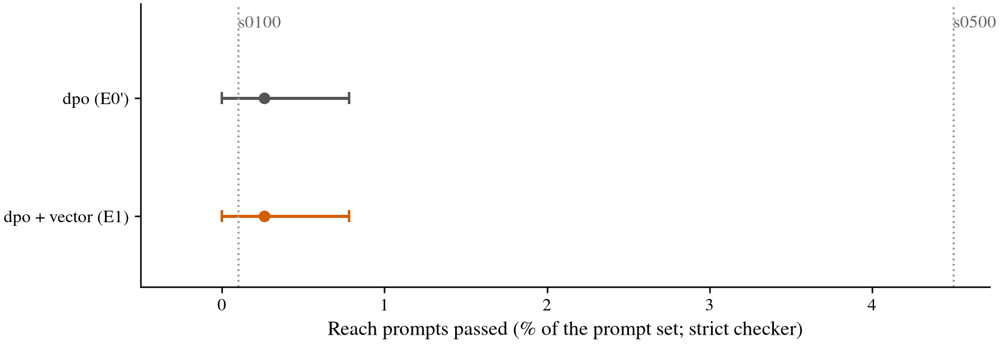

# Olmo elicitation, metrics 2: decoding, weight-space shortcuts and a steering vector against one RL run

Status (2026-11-27, 1:50 pm PT; written by agent:claude, Opus, as orchestrator, while Leon was asleep and the
coordinator decided in his place): finished. Every cell the pre-registrations released has run; the conditional cells E2,
C3, C4 and E were not released by their rules. All results are on serrano, md5-checked against the pod; `rp-m2h` was
deleted by the coordinator at 1:44 pm PT. Runpod spend $40.85 of the $60 stop.

Working folder: [`code/experiments/current/olmo_metrics2_20261127/`](../../code/experiments/current/olmo_metrics2_20261127/)
(branch `leon/olmo-elicitation`; contract `SPEC.md`; readings fixed in advance in `PREREG_temp.md`, `PREREG_rank1.md`,
`PREREG_steer.md`, each with dated amendments; what ran and when in `log.md`; design discourses in `discourse/`).
Results on serrano: `/scratch/cowifornia/nd-rl/olmo_elicit/metrics2/runs/`. Reading notes on the seven papers:
[`docs/literature/2026-11-27-elicitation-metrics-fulltext/`](../../docs/literature/2026-11-27-elicitation-metrics-fulltext/).

## Question

One RL run of `allenai/Olmo-3.1-32B-Think`: the starting model `dpo` (`allenai/Olmo-3-32B-Think-DPO`) and RL steps 100,
500, 1100 and 2300 (`s2300`, the final model). How much of the final model's IFBench behaviour (Dan's strict checker) was
cheaply recoverable before RL finished? Three measurements, each designed by a reader-implementer and an independent
auditor in at most three rounds of signed discourse, adjudicated and pre-registered before any pod result:

- **M1, decoding.** Is part of the RL gain just a better decoding setting for `dpo`? Cell C1 samples `dpo` at the model
  card's setting (T 0.6, top_p 0.95; "card decoding"), against Dan's stored T 1.0 draws.
- **M2, weight space.** Is the update low-rank enough that its top direction carries the gain (Cai et al.;
  [reading note](../../docs/literature/2026-11-27-elicitation-metrics-fulltext/cai2025predictabilityrldynamics.md)), or
  does extrapolating an early update (ExPO, Zheng et al.;
  [reading note](../../docs/literature/2026-11-27-elicitation-metrics-fulltext/zheng2024expo.md)) reach the final model?
- **M3, activation steering.** Does one mean-difference vector (final model minus `dpo`, response tokens) added to `dpo`'s
  residual stream move its behaviour?

Terms. *Checker passes*: Dan's strict IFBench checker accepts the answer; nothing here says whether a pass is a genuine
solution. *Arm A*: Dan's 218 IFBench prompts. *Reach prompts* (R): 48 prompts where `dpo` passed 0 of 768 stored draws and
`s2300` usually passes (69.4 %). *H*: 112 held-out IFBench prompts for M2 (disjoint from M2's dev set D and from R).
*f*: fraction of the `dpo` to `s2300` gap recovered, (p - p_dpo) / (p_s2300 - p_dpo). All intervals are 95 % prompt-bootstrap
intervals unless stated. pass@1 is the share of draws that pass, averaged over prompts.

## Summary

All numbers are checker passes, as pass@1 (% of draws, averaged over prompts) with 95 % prompt-bootstrap intervals, the
pre-RL checkpoint `dpo` first. Reach prompts: `dpo` 0 % stored, `s0500` 4.5 %, `s2300` 69.4 %.

| measurement | what was added to `dpo` | held-out / arm A | reach | share of the `dpo` to `s2300` gap |
|---|---|---|---|---|
| M1 | card decoding (T 0.6, top_p 0.95) | arm A 29.0 % -> **29.6 %** (+0.6 [-1.9, +3.1]) | 0.26 % -> **1.0 %** (+0.8 [-0.8, +3.1]) | arm A 1.5 % [-4.8, +7.9]; reach 1.1 % [-1.1, +4.5] |
| M1, C2 | T 0.8, top_p 1.0 (released by trigger B) | arm A 29.0 % -> **30.0 %** (+1.1 [-0.9, +3.1]) | not sampled | arm A 2.7 % [-2.5, +8.0] (a) |
| M2 | rank-1 top directions at their own size (A1u) | H 32.5 % -> **35.7 %** | **0 %** | H 0.10 [-0.03, 0.24]; R 0 |
| M2 | the same, rescaled to the update's size (A1) | **collapsed** (H 7.1 %) | **0 %** | H -0.79 [-1.24, -0.50] |
| M2 | top-16 directions at their own size (k16) | H **53.1 %** | **8.9 %** | H 0.64 [0.49, 0.82]; R 0.13 [0.07, 0.19] |
| M2 | ExPO: `dpo` + 3.5 (`s0500` - `dpo`) | H **58.5 %** | **70.3 %** | H 0.81 [0.57, 1.05]; R 1.01 [0.89, 1.14] |
| M3 | steering vector, layer 20, alpha 2.0 | 80 held-out 35.2 % -> **40.6 %** (+5.5 [+1.0, +10.5]) | 0.26 % -> **0.26 %** (0.0 [-0.8, +0.8]) | held-out 0.17 [0.03, 0.33] (a); reach 0 |

(a) Computed after the run with the same definitions and bootstrap as the pre-registered readouts; not itself
pre-registered. M3's held-out share uses stored `s2300` (67.5 % on those 80 prompts, 8 draws each).

- **M1.** The model card's decoding setting gives `dpo` nothing measurable on either set; the RL gap is not a T 1.0
  artefact. It does help `s0500` on reach (4.5 % -> 10.9 %, +6.4 [+1.7, +12.0]). `s2300`'s successful responses are not in
  `dpo`'s low-likelihood tail (PF verdict PASS). A middle setting (T 0.8, top_p 1.0) gives the same null (+1.1 points [-0.9, +3.1]).
- **M2.** Extrapolating the first 500 steps' update by 3.5 reaches `s2300`'s reach pass rate (70.3 % against 69.4 %)
  and 81 % of the held-out gap, from a weight point farther from `s2300` than `dpo` is. Cai et al.'s per-matrix rank-1
  property does not hold: the top directions recover about a tenth of the held-out gap and nothing on reach, and scaling
  them to the update's size breaks generation. Sixteen directions per matrix (22 % of the update's squared norm) recover
  most of the held-out gap but only 13 % of the reach gap.
- **M3.** A mean-difference vector that closes 31 % of the teacher-forced NLL gap (at alpha 4.0) does nothing on reach at
  alpha 2.0, the setting that passed the length guard after alpha 4.0 failed it; held-out rises 5.5 points against stored `dpo`, below the pre-registered
  trigger for the scramble controls, so its specificity was tested in NLL only, not in sampled behaviour.
- **Gates.** Several correctness gates were amended after seeing data (LoRA repeat exactness; steering zero identity and
  power; what the pre-registered alpha halving carries with it). Every amendment is dated and written before the data it judges;
  they are listed under "Departures".

## Configuration

- **Checkpoints.** `dpo` = `allenai/Olmo-3-32B-Think-DPO`; `s0500`, `s2300` from Dan's `olmo-ifcurve` run (revision
  `97604023f2602a7dfe6d31b1fc229985e0002022`), each sha256-verified against the Hub on the pod. Stored baselines are Dan's
  T 1.0 draws (dpo arm A 16 per prompt; s0500 and s2300 arm A 8 and reach 32), read only.
- **Sampler and checker.** Dan's pinned stack (vLLM 0.11.0, torch 2.8.0+cu128, transformers 4.57.1; sampler at ifcurve
  `8e744a89`, `olmo_ifomega/grade.py` strict). Final answer only, 32,768-token cap unless stated, `--chunk 1`, compiled
  engine with CUDA graphs and prefix cache, `gpu_mem 0.92`, `max_num_seqs 512`. LoRA cells: `enable_lora`,
  `max_lora_rank 16`. Steering cells: `steer/steer_patch.py` adds the vector to the residual stream after one decoder layer
  (every position, prompt and response) and logs a `STEER_ACTIVE` record with the vector's sha256.
- **Pods.** `rp-m2a` (1 x RTX PRO 6000 Blackwell, $2.69/h, 2:39-5:01 am PT): weight-space and teacher-forced work only
  (M2's SVD pass W and adapter gates, M3's vector building and selection). Its sampling speed (about 350 tokens/s,
  KV-limited) was too slow, so the coordinator moved all sampling to `rp-m2h` (1 x H200, $5.29/h, from 7:13 am PT;
  1,200-1,700 tokens/s). Pod spend (coordinator's figures): `rp-m2a` $6.39; `rp-m2h` 7:13 am to 1:44 pm PT, $34.46; total $40.85
  against the $60 stop. By measurement (H200 job time):
  M1 $9.4, M2 $16.8 (plus about $3 on `rp-m2a`), M3 $7.4 (plus about $2 on `rp-m2a`).
- **Seeds.** M1: C1 6101, S5R 6102, C2 6105. M2 (section B.1 of `discourse/rank1.md`): sampling A1 710001, A1u 710002,
  A2 710003, rank-16 710021, ExPO dev 710010 / 710011, ExPO held-out 710012; A2's random directions 710003 + crc32(tensor name). M3: E0' 1000, dev guard 3000, E1 1001,
  E2 3001-3003, scrambles 2001-2003.
- **Pre-registration.** Every cell, rule and threshold was frozen before its data existed. The amendments, each dated and
  written before the data it judges, are listed under "Departures" below.

## M1: card decoding

**Observed.**

| cell | baseline at T 1.0 | cell | difference (points) |
|---|---|---|---|
| arm A, 218 prompts, `dpo` at card decoding (C1, 2 draws per prompt) | 29.0 % | **29.6 % [24.1, 35.3]** | **+0.6 [-1.9, +3.1]** |
| reach, 48 prompts, `dpo` at card decoding (C1, 8 per prompt) | 0.26 % (fresh T 1.0 E0', 8 per prompt; 1 pass) | **1.0 %** (4 passes, all on one prompt) | **+0.8 [-0.8, +3.1]** |
| reach, `s0500` at card decoding (S5R, 8 per prompt) | 4.5 % (`s0500` stored, 32 per prompt) | **10.9 %** | **+6.4 [+1.7, +12.0]** |

- Share of the RL gain: on arm A, +0.6 points is 1.5 % [-4.8, +7.9] of the 39.4-point `dpo` to `s2300` gap (`s2300`
  68.3 %). On reach, 1.1 % [-1.1, +4.5] of `s2300`'s 69.4 %. Both are nulls at a minimum detectable effect of about 3.3
  points (arm A).
- Card decoding costs length control at `dpo`: 1.6 % of C1's arm-A draws hit the 32,768 cap (stored 0.06 %) and the
  frozen repetition flag marks 4.4 % (stored 1.0 %). That fired trigger B. Trigger A (an arm-A interval excluding 0, or
  3 or more extra reach passes on 2 or more prompts) did not fire, so C3 and C4 (`s2300` at card decoding; `dpo` at
  T 0.6 without top_p) were not run, as pre-registered.
- Secondary split (pre-registered): prompts `dpo` passed in its first 8 stored draws (100) move +1.5 [-3.9, +7.0];
  never-passed prompts (118) move -0.1 [-1.5, +1.5].
- PF (likelihood check, HF scoring under `dpo`): verdict **PASS**. `s2300`'s strict-pass responses on 47 reach prompts are
  not in `dpo`'s low-likelihood tail. The share of them that score below the lowest of the same prompt's 8 `dpo` draws
  is 3.7 % [0, 9.6] per token and 5.3 % [0, 11.7] length-adjusted, against 1/9 = 11 % if there were no shift (threshold
  for PASS: 25 %). Per token they are more likely under `dpo` than `dpo`'s own T 1.0 draws: +0.24 [0.20, 0.27] nats per
  token (median over prompts). Self-test exact; sliding-window check passed.
- C2 (`dpo` at T 0.8, top_p 1.0, arm A x 2, released by trigger B): **30.0 % [24.5, 35.8]**, **+1.1 points [-0.9, +3.1]**
  against the stored 29.0 % (2.7 % [-2.5, +8.0] of the gap, computed after the run with M1's joint bootstrap; a null). It keeps length control closer to T 1.0: 0.2 % of draws
  cut (1 of 436), repetition flag 2.3 % (C1 4.4 %, stored 1.0 %).

**Interpretation.** At `dpo`, the model card's decoding setting does not recover a measurable part of RL's gain on either
set: the gap is not an artefact of sampling `dpo` at T 1.0 instead of the card's setting. `s0500` does gain on reach
prompts at card decoding (10.9 % against 4.5 %), so after 500 RL steps the reach behaviour is present at low probability
and card decoding brings out more of it. The PF result says `s2300`'s successful responses are, per token, more likely under `dpo` than `dpo`'s own T 1.0 draws:
RL's successes are not text `dpo` finds unlikely token by token. That is a statement about per-token likelihood, not
about the probability of whole responses, and it does not make them reachable by card decoding (C1 above).

**Not shown.** C1's result is about card decoding, not temperature: C4 (T 0.6 alone) did not run. C2 does show that
T 0.8 alone (top_p 1.0) is also a null on arm A. "Sharpening" is not earned. Whether the
card's IFBench 34.4 is strict or loose stays open. Nothing here says whether passes are genuine solutions.

*Figure 1. (a) Arm-A pass@1 of `dpo` at card decoding (C1) and at T 0.8 (C2) (bars, 95 % intervals) against stored
T 1.0 `dpo` and `s2300` (lines). (b) Reach-prompt pass rate: `dpo` at T 1.0 (fresh E0') and at card decoding, stored `s2300`, `s0500` stored and at
card decoding.*

## M2: weight-space shortcuts

**Construction.** Delta = `s2300` - `dpo` for the 448 attention and MLP matrices. A1: per matrix the top singular
direction of Delta, rescaled to the matrix's whole ||Delta||_F (Cai et al.'s construction), served as a rank-1 LoRA on `dpo`.
A1u: the same direction at its own size sigma_1. A2 (control): a random rank-1 direction at A1's size. ExPO: `dpo` +
gamma (`s0500` - `dpo`) for every tensor, gamma chosen on a 64-prompt dev set by a pre-registered collapse screen.
Embeddings, lm_head and norms stay at `dpo` in the adapter cells.

**The SVD pass.** W failed its exact-SVD check twice (null 5.4 % and 2.5 % low against 0.5 %); per the pre-registered rule
the null and sigma_1 were then computed exactly. Band: signal-dominated (sigma_1 / null, norm-weighted median 12.3; no
matrix below 1.1). The top direction holds a norm-weighted median 7.5 % of each matrix's ||Delta||^2, so A1 scales it by
about 3.6. Adapter directions come from the randomized SVD (sigma_1 within 0.17 % of exact on all 448 matrices); the exact
pass changed only the null and A1u's scale. 13 matrices have sigma_2 / sigma_1 > 0.95 (worst `layers.52.mlp.gate_proj`,
0.984), where "the top direction" is nearly degenerate.

**The adapter gate (amended after seeing data).** The original criterion (each adapter's teacher-forced nats repeat
exactly) failed for all three adapters on `rp-m2a` (gate2): vLLM's LoRA kernels are not bit-deterministic. Amendment 3
(repeat within 0.1 %) passed gate3 at 0.082 %; Amendment 3a (0.5 % plus a rule that both calls of each adapter differ
from base at 10 % of tokens or more) was written before gate4, which measured 0.149 % and would have failed Amendment 3; Amendment 4 (after an
independent audit) added fail-closed base exactness, a zero-B control adapter, an A1-specific 10 % rule and a
decode-against-prefill check. On the H200, `gate_h` passed the amended gate (Amendment 4): base calls bit-exact, the zero-B
control bit-identical to base, A1 changes 237.9 and 116.9 nats on the two check examples; the decode check passed. For
A1u and A2 the 0.5 % tolerance exceeds their whole teacher-forced effect, so their "applied" status rests on the token
rule and the zero-B control. A1 raises `dpo`'s NLL on `s2300`'s own text (2,151.6 to about 2,391 nats and 4,495.5 to
about 4,612 on the two check examples); this is a gate observation, not movement toward `s2300`.

**Observed** (pass@1; f = share of the `dpo` to `s2300` gap; H: stored `dpo` 32.5 %, `s0500` 44.4 %, `s2300` 64.5 %;
R: stored `dpo` 0.0 %, `s0500` 4.5 %, `s2300` 69.4 %).

| cell | draws (H / R per prompt) | H pass@1 | f on H | R pass@1 | f on R | collapsed |
|---|---|---|---|---|---|---|
| A1, rank-1 rescaled | 2 / 4 (175 of 416 written) | **7.1 %** | **-0.79 [-1.24, -0.50]** | **0.0 %** | 0.00 | **yes**: 75 % of planned draws cut, unfinished or missing |
| A1u, rank-1 at sigma_1 | 2 / 2 | **35.7 %** | **0.10 [-0.03, 0.24]** | **0.0 %** (0 of 96) | 0.00 | no |
| A2, random rank-1 at A1's size | 1 / 2 | **30.4 %** | **-0.07 [-0.18, +0.05]** | **0.0 %** | 0.00 | no |
| k16, top-16 truncation at its own size (conditional cell) | 2 / 4 | **53.1 %** | **0.64 [0.49, 0.82]** | **8.9 %** | **0.13 [0.07, 0.19]** | no (5 cut) |
| ExPO, gamma 3.5 | 2 / 4 | **58.5 %** | **0.81 [0.57, 1.05]** | **70.3 %** | **1.01 [0.89, 1.14]** | no (0 cut) |

- A1 was killed by its pre-registered timeout (3,675 s) with 175 of 416 draws written, 73 of them at the 32,768 cap and
  58 without end of thinking (mean 15,100 tokens). As pre-registered, missing draws count as failures; if every missing
  draw had passed, H would still be at most 63.4 %. Among the 98 H draws written, 16 % passed.
- A2 sits within its interval of `dpo` (-2.2 points [-5.8, +1.5]), so the LoRA engine's zero point holds and a random
  direction at A1's size does not damage `dpo`; A1's collapse comes with its top directions, not with the size alone.
- A1u moves H by +3.2 points [-0.8, +7.4] and passes nothing on reach.
- ExPO: the gamma rule chose 3.5 (dev pass@1 63.3 % against 66.4 % at gamma 4.6, a lead under one paired SE; neither
  collapsed). Held out, 58.5 % on H and 70.3 % on reach (any pass in 4 draws on 85.4 % of reach prompts; `s2300` stored
  69.4 %). As a share of the later gap from `s0500` to `s2300`: f' 0.70 [0.28, 1.09] on H, 1.01 [0.88, 1.16] on R.
- k16 is the conditional cell PREREG_rank1 Amendment 2 fixed before A1 was sampled (A1 was not a clean null). It holds
  22 % of ||Delta||^2 pooled over the 448 matrices (norm-weighted median per matrix 19 %; the top direction alone 9 % pooled;
  computed from the SVD pass's top-16 factors). It moves H by +20.6 points [+14.8, +26.5] and reach by +8.9 [+4.7, +13.5]
  (27 % of reach prompts pass at least once in 4 draws). It was not teacher-force gated on its own: the gate's rank-16
  consistency adapters covered the rank-16 serving path, and its effect is far outside any engine noise.
- ExPO's weight point is not near `s2300`: it is 1.28 times as far from `s2300` as `dpo` is. cos(Delta_500, Delta_2300) =
  0.27, and ||Delta_2300|| is 3.2 times ||Delta_500||.

**Interpretation.** Extrapolating the first 500 steps' update by 3.5 reproduces the final model's checker-pass rate on
reach prompts and most of it on held-out prompts, through a different point in weight space. Cai et al.'s rank-1 property
does not hold here as constructed: the unscaled top directions carry about a tenth of the gap on H (interval reaching 0)
and nothing on reach, and rescaling them to the full update's size breaks generation (runaway length) rather than
recovering behaviour. The top-16 slice, about a fifth of the update's squared norm, carries most of the held-out gain but
only an eighth of the reach gain: on these prompts the gain on prompts `dpo` never passes needs more of the update than
the gain on prompts it sometimes passes. The orchestrator's priors (written before data) expected ExPO below f' 0.5 or a collapse, and A1
below f 0.5 on reach; the ExPO prior was wrong.

**Not shown.** That RL's change is low-rank or not in general (only per-matrix rank 1 and rank 16 were tried; lm_head, embeddings and norms stay at `dpo` in adapter cells). That ExPO's passes are the same responses `s2300`
gives. Anything about cost: ExPO still needs `s0500`, 500 of 2,300 RL steps.

*Figure 2. Share of the `dpo` to `s2300` gap recovered (f, 95 % interval) on held-out (H) and reach (R) prompts per cell;
0 is `dpo`, 1 is `s2300`. Open circle: collapsed (A1). On reach, A1, A1u and A2 pass nothing.*

## M3: a steering vector added to `dpo`

**Construction.** v = mean over response positions of h_s2300[l] - h_dpo[l], both models reading `dpo`'s own stored
responses to 32 arm-A non-reach prompts (V_resp); alpha v is added to the residual stream after layer l at every
position. Layer and alpha were chosen in HF by teacher-forced NLL on 16 dev prompts' `s2300` strict-pass text, under a
damage limit on `dpo`'s own text (never by pass rates, never on reach). Chosen: V_resp, layer 20, alpha 4.0 (30 of 30
settings admissible). Split-half cosine 0.985 (16 against 16 prompts).

**Manipulation check (teacher forced, 16 held-out prompts' `s2300` text, at the chosen alpha 4.0).** g, the share of the
NLL gap from `dpo` to `s2300` closed by the vector: **0.31 [0.29, 0.32]** ("substantially"; thinking 0.30, answer 0.39).
At alpha 1.0: 0.12 [0.11, 0.13] ("slightly"). Three sign scrambles of the same vector: g 0.007, -0.043 and -0.039 (all "barely
moved"; the first moves the answer tokens by 0.11). Subtracting v from `s2300` raises its NLL by only 2.5 % of the gap
(necessity ratio at alpha 1.0). Damage rise on `dpo`'s text: 0.041 nats per token at alpha 4.0 (limit 0.268), 0.010 at
alpha 2.0.

**Steering in vLLM (gates amended after seeing data).** On `rp-m2a` the pre-flight failed two checks. The compiled zero-vector
run differed from stock by mean 0.0100 nats, while stock itself varies by 0.0101 across processes. The scramble's power
factor measured 1.71 against the required 3 (chosen 3.06). Identity was moved to eager mode, where zero and stock are
bit-identical at 11,854 / 11,854 positions; the power factor went from 3 to 1.5 (Amendment 1) and was then replaced by a
direct dropped-vector test (Amendment 2). On the H200, `m3_pf_h` passed the amended pre-flight (Amendment 2): eager zero
identity exact, steered vLLM matches HF (mean 0.0116, tolerance 0.0331), the dropped-vector test detects both vectors
(0.102 and 0.057), prefix-cache repeat exact. The decode-against-prefill check passed with the alpha 4.0 vector
(steered decode vs prefill 0.0069 nats; steering moves prefill by 0.077).

**The dev guard failed once.** At alpha 4.0 (64 dev prompts x 1, 12,000-token cap): 7 of 64 draws (10.9 %) hit the cap
against a 10 % limit; length 1.29 x `dpo` (limit 1.3); pass@1 42.2 % against stored `dpo` 33.7 % (+8.5 points [+0.7,
+17.0]). As pre-registered, alpha was halved once (Amendment 3 fixed what the halved vector carries with it before its
data existed). At alpha 2.0 the guard passed: cap hits 4.7 %, length 1.00 x, pass@1 32.8 % [21.9, 43.8] (-0.9 points
[-5.4, +3.7]). E1 therefore ran at alpha 2.0. The alpha 2.0 vector passed its HF match in the pre-flight; its decode path
is covered only by the alpha 4.0 decode check (same patch and buffer).

**Observed (E1 = `dpo` + 2.0 v; E0' = `dpo` + zero vector through the same patched engine).**

| set | `dpo` | `dpo` + vector (E1) | difference (points) |
|---|---|---|---|
| reach, 48 prompts x 8 | **0.26 % [0, 0.78]** (E0', 1 of 384) | **0.26 % [0, 0.78]** (1 of 384) | **0.0 [-0.8, +0.8]** |
| held-out non-reach, 80 prompts | **35.2 % [26.0, 44.3]** (stored, 16 per prompt) | **40.6 % [30.6, 50.6]** (2 per prompt) | **+5.5 [+1.0, +10.5]** |

- As a share of the gap on the 80 held-out prompts (stored `s2300` 67.5 %): 0.17 [0.03, 0.33], computed after the run
  with M2's definition and a 10,000-draw prompt bootstrap (not a pre-registered readout).
- The two reach passes are on different prompts (`ifbench_220` for E0', `ifbench_64` for E1). Pass@8 is 2.1 % in both.
  For scale, on reach `s0100` passes 0.1 %, `s0500` 4.5 %, `s1100` 38.5 %.
- Mean length: E1 5,448 tokens over its 544 draws (1 cut, none without end of thinking); E0' 4,773 over its 384.
- The E2 trigger (reach passes at least 2 above E0', or a held-out difference of at least 6 points) did not fire, so the
  three scramble cells were not sampled. **Specificity was tested in NLL only, not in sampled behaviour.**

**Interpretation.** A vector that closes about a third of the teacher-forced NLL gap at alpha 4.0 does nothing for reach
prompts at alpha 2.0, the setting that passed the length guard after alpha 4.0 failed it (only these two were sampled). On held-out non-reach prompts E1 is
5.5 points above the stored `dpo` draws, an interval that excludes 0 but below the pre-registered 6-point trigger; the
priors written before data (auditor: 0 to +5 held-out, 0-3 % reach; orchestrator: within 6 points, reach below 4.5 %)
both hold.

**Not shown.** Whether the held-out gain is specific to this direction (E2 did not run), or partly an engine offset: the
zero-vector control E0' covers only reach prompts, so the held-out comparison is against Dan's stored draws from another
engine run (on M2's held-out set the random LoRA A2 sat 2.2 points below stored `dpo`, [-5.8, +1.5]). g was not measured
at alpha 2.0 (it lies between 0.12 at alpha 1.0 and 0.31 at alpha 4.0). Nothing about learned or gated vectors, other
layers at sampling time, or genuine passes.

*Figure 3. Reach-prompt pass@1 of `dpo` with a zero vector (E0') and with the steering vector (E1), 95 % intervals;
dotted lines: stored `s0100` and `s0500`.*

## Departures from the plan, and amendments

Amendments written **after seeing data** (each dated in its pre-registration, each before the data it judges):

- **LoRA gate (M2), PREREG_rank1 Amendments 3, 3a, 4.** Original criterion: teacher-forced nats of every adapter repeat
  exactly. Failed for all three adapters (gate2; base calls exact, LoRA calls not). See the M2 section for the sequence;
  `gate_h` on the H200 passed the amended gate (Amendment 4).
- **Steering pre-flight (M3), PREREG_steer Amendments 1, 2.** Original: compiled zero vector bit-identical to stock, and
  steered-vs-stock change at least 3 x tolerance for chosen and scramble. Failed: compiled zero 0.0100 from stock (stock
  varies 0.0101 by itself), scramble 1.71 x. `m3_pf_h` passed the amended pre-flight (Amendment 2).
- **Halved alpha (M3), PREREG_steer Amendment 3.** The halving itself was pre-registered; the amendment fixed, before the
  alpha 2.0 data existed, which checks release it and how E2 would have used halved scrambles (E2 did not run).
- **HF self-test and E0' acceptance (M1), PREREG_temp Amendment 3**, written after the `rp-m2a` nondeterminism findings
  and before PF or E0' existed. PF's self-test was exact, so its fallback was not used.

Other departures:

- **Pods.** The first pod was an RTX PRO 6000 (the account allowed one H200-class GPU and another run held it). Its
  sampling rate (about 350 tokens/s) did not fit the plan, so the coordinator moved all sampling to an H200 (option A2).
  Two partial C1 attempts on the RTX (85 and 39 rows) were never analysed and were deleted with that pod.
- **W, the SVD pass.** Not an amendment: W failed its exact-SVD check twice (null 5.4 % and 2.5 % low against 0.5 %); per
  the pre-registered rule the null and sigma_1 were then computed exactly (`Wx`).
- **ExPO writer check.** The first verification reported 128-ulp errors that were exact zero cancellations (the written
  weights were right); the verifier now uses an exact rational reference. Both ExPO checkpoints were rewritten on the H200
  and verified there.
- **A1 timeout.** A1 ran into its pre-registered timeout (3,675 s) because most draws ran to the cap. The kill left the
  gzip without an end marker; `tools/gz_repair.py` kept the 175 complete rows (none dropped), which were graded. Missing
  draws count as failures, as pre-registered.
- **M2's own $15 cap.** The pre-registered M2 cap allowed going further only on the orchestrator's go. A1's full-length
  timeout pushed M2 to about $8.8 before the ExPO and control cells; I gave that go (9:40 am PT, reported to the
  coordinator) and ran A2, A1u, ExPO and the conditional cell at their pre-registered sizes, because the binding limit
  since the coordinator's approval was the $60 total, enforced by `tools/ledger_ok.py` before every conditional cell.
  M2's final spend was about $20 ($16.8 of H200 job time plus about $3 on `rp-m2a`), about $5 over its own cap.
- **Dev guard size.** The pre-registered dev guard is 64 x 1 (a cut taken in advance); the input file made earlier was
  64 x 2 and was replaced by a 64 x 1 file before the run.
- **E0' acceptance.** E0' was accepted as M1's reach baseline with `--allow-unverified` for exactly the four fields that
  neither sidecar records (PREREG_temp Amendment 1, written before any pod).
- **PF set.** 47 of the 48 reach prompts (`ifbench_280` has no stored `s2300` strict pass), 752 sequences.
- **Analyses on serrano** ran with `python -E -s` instead of `-I` (`-I` breaks the scripts' sibling imports).

## Limitations and next step

- One RL run of one model, one benchmark family (IFBench prompts), Dan's strict checker only. Nothing here checks whether a
  pass is a genuine solution or a way around the checker.
- Most baselines are Dan's stored T 1.0 draws from an earlier engine run. Only reach has a fresh same-engine baseline
  (E0'); compiled vLLM is not bit-reproducible across processes (mean |delta log-prob| about 0.010 nats), and vLLM's LoRA
  kernels are not deterministic. The random-LoRA control A2 (-2.2 points [-5.8, +1.5] on H) bounds the adapter path's
  offset; the steering path's offset on held-out prompts is not bounded (see M3).
- M1: C3 and C4 were not triggered, so nothing is said about `s2300` at card decoding or about T 0.6 alone.
- M2: ExPO needs `s0500` (500 of 2,300 RL steps); two gammas only, chosen by a collapse screen, not tuned. Adapter cells
  leave lm_head, embeddings and norms at `dpo`; the cell that would test that (E) belonged to the clean-null branch and
  did not run. k16 had no teacher-forced gate of its own.
- M3: one vector type and one layer were sampled, at alpha 2.0 after alpha 4.0 failed the length guard; g at alpha 2.0
  was not measured; the scramble cells E2 did not run.
- Several correctness gates were amended after seeing data (listed above); the amended criteria were fixed before the
  data they judged, and the original failures are stated with their numbers.

**Next steps (proposals, not run).** (1) ExPO is the strongest result: whether it holds from `s0100`, how its passes and
lengths compare with `s2300`'s responses on the same prompts (a read of matched samples), and whether a third gamma
changes the picture. (2) The rank curve between 16 and the full update on reach (rank 64), to see where reach behaviour
appears. (3) If the M3 held-out +5.5 points matters, the pre-registered scramble cells on held-out prompts would settle
its specificity (about $2.6).
