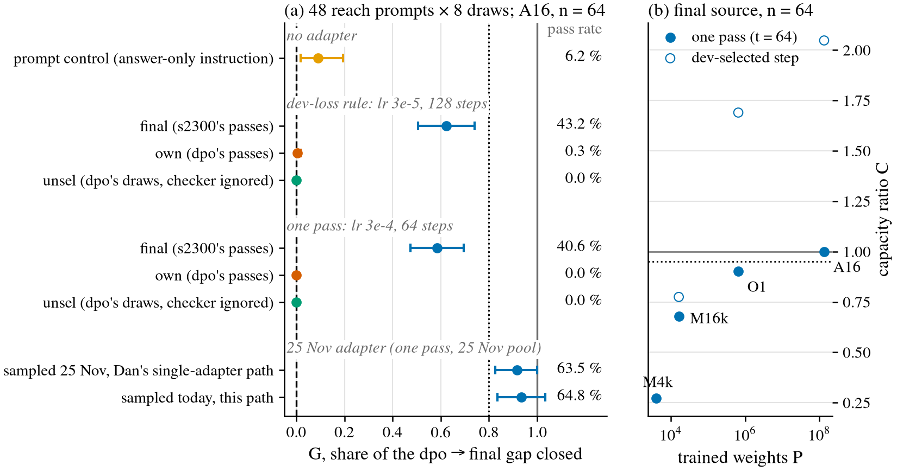

# Olmo minimal adapter, stage 1 (`dpo`): how small an adapter, how few examples, and does it need the RL model's tokens

Status: stage 1 is finished (2026-11-27; written by agent:claude for Leon, corrected at 7:40 am PT after an
independent audit, `discourse/stage1_report_audit.md`). Both pods are deleted and nothing is running. Runpod spend for
stage 1: $43.54 (rp-om1 H100 $17.22, rp-om2 H200 $26.32), under the $55 stop. Stage 2 as pre-registered is dropped.
The follow-ups in PREREG Amendment 6 are planned, not run; the coordinator and Leon decide.

Working folder:
[`code/experiments/current/olmo_minimal_adapter_20261127/`](../../code/experiments/current/olmo_minimal_adapter_20261127/)
(branch `leon/olmo-elicitation`). The design contract is `SPEC.md`. The readings fixed in advance and six amendments
are in `PREREG.md`.
- Their time stamps are self-reported. The file was first committed at 5:36 am (00bc9fc), after batch 1 had been read
  at 4:59 am. Amendments 1-3 (2:12-2:47 am) rest on file times and `log.md`.
- The experiment code was first committed after stage 1, together with PREREG through Amendment 6, this audited
  README and the audit: 156bf2b on `leon/olmo-elicitation`. The trainer gained features during and after the run (the
  `init_adapter` cells, step-0 scoring and the EDL fixes, the last at 7:20 am), so the exact code that trained the
  stage-1 cells is not in git. The training step itself was
  not changed.

What ran and when is in `log.md`. The design discourse (proposer Sonnet, auditor Opus, four turns) is in
`discourse/edl_design.md`, and the reading notes are in `literature/`. The independent audit of this report, with
replies, is in `discourse/stage1_report_audit.md`. Data, runs and figures are on serrano under
`/scratch/cowifornia/nd-rl/olmo_elicit/v2/`. Earlier run:
[2026-11-25 elicitation curves](../2026-11-25-olmo-elicitation-curves/README.md).

## Summary

*(a) G (share of the `dpo` → final-model gap closed on the 48 reach prompts) per sampled cell, with its 95 %
interval, grouped by training recipe; pass rate at the right. All sampled adapters are A16 (r16 LoRA on all
projections, 134M trained weights) on 64 examples. (b) Capacity ratio C of the final-source rungs against trained
weights, from training logs (difficulty-matched EDL, added post hoc, not pre-registered); dotted line at 0.95.*

All rates are strict checker passes as a share of 384 draws (48 reach prompts × 8). `dpo` plain: 0 %. Final model
plain: 69.4 % [60.7, 77.7].

**1a. "Minimal": how small an adapter, how few examples.** Only the training logs can answer this today, because no
sampled cell reached the final model's rate.
- On the final model's responses (n = 64), held-out loss per token falls from 0.634 at step 0 to:
  - A16 (134M weights): 0.537, 100 % of the gain.
  - O1 (rank 1 on `o_proj`, 655k): 0.540, 97 %.
  - M16k (16k weights): 0.587, 48 %.
  - M4k (4k weights): 0.612, 23 %.
- So by held-out loss, O1 (655k weights) gets 97 % of A16's gain, and the sparse-mask rungs get 48 % (16k) and 23 %
  (4k). These are fits of tokens, not behaviour: no rung below A16 was sampled.
- O1 and the M rungs are built differently (dense rank 1 on `o_proj` against a sparse mask on B with a frozen random
  A). So no size threshold between 655k and 16k weights is located.
- A capacity ratio from a difficulty-matched EDL is also reported. It was added after the logs were read, is not
  pre-registered, and the pre-registered EDL is negative for every rung. One-pass C is 0.90, 0.68 and 0.27. At
  matched steps O1 is 0.83-0.90, under the 0.95 line. The ratios also move with the size of the correction and with
  the lr chosen for A16 (details under Capacity).
- Examples, at A16: 4 examples give 65 % of the 64-example loss gain and 1 example gives 35 %.
  - n = 1 is one optimizer step at the grid-edge lr 3e-3; at the next step the dev loss jumps to 0.907.
  - n = 4 is unconverged at the lowest lr (3e-5), so its 65 % is a lower bound.
- What could not be read: the behaviour of any rung or example count below A16 n64. The search rule samples smaller
  cells only after the own-source A16 n64 cell reaches, and it did not reach. So the "smallest sufficient adapter" for
  behaviour is not measured.

**1b. "Examples generated by Olmo": what the source of the 64 examples does (A16, n = 64).**

| examples | dev-loss rule (lr 3e-5, 128 steps) | 25 Nov recipe (lr 3e-4, one pass) |
|---|---|---|
| final model's checker passes | 43.2 % [33.1, 53.9], G 0.62 [0.51, 0.74] | 40.6 % [31.0, 50.3], G 0.59 [0.47, 0.70] |
| `dpo`'s own checker passes | 0.3 % [0.0, 1.3] | 0.0 % |
| `dpo`'s own draws, checker ignored | 0.0 % | 0.0 % |
| no adapter, answer-only instruction (prompt control; no training) | 6.2 % [1.3, 13.0], G 0.09 [0.02, 0.19] | (same cell) |

- Observed: training on `dpo`'s own passes did nothing on the reach prompts at either recipe. That is the same as
  training on unselected own draws (own − unsel: +0.3 [0, +1.3] and 0.0 points).
- Observed: the final model's passes, in the same pipeline, lift the rate by 40-43 points. Final − own: +43.0
  [+32.8, +53.4] and +40.6 [+31.0, +50.3].
- Observed: own-trained adapters keep `dpo`'s style: median thinking 2,100-2,550 tokens against `dpo` plain's 2,257,
  and answers of 224-247 words against 253.
- Observed: final-trained adapters move most of the way to the final model's style: thinking 6,600-6,900 tokens
  against `s2300`'s 6,059, and answers of 58-61 words against `s2300`'s 33. The 25 Nov adapter matches `s2300`'s answer
  length (34 words).
- Observed (audit): the own adapters did train.
  - Their total update norm matched the final ones: ‖scale·BA‖ 27.9 for own, 28.4 for unsel, 28.8 for final.
  - They memorised their training responses: two gate items fell from 0.60 to 0.23 and from 0.58 to 0.32 nats per
    token.
  - Own and final used the same 64 prompts, the same order and the same A-init seed, so they differ only in the
    responses.
- Interpretation, with its scope:
  - Setup: A16 at n = 64, one round of uniform rejection sampling of `dpo`'s own passes. The prompts are ones `dpo`
    passes 44 % of the time on average (median 38 %), the selection supplies at most 147 bits, and the two recipes were chosen on
    final-source data.
  - Result: no reach passes. The same prompts with the final model's responses give 40-43 %.
  - Why: mostly a generic change of style. The final-source cells reach 35-39 % even on reach prompts whose
    instruction types never occur in training.
  - The pre-registered reading "(ii) reaches, (i) does not" does not apply as written, because (ii) did not reach
    either; only the paired difference holds.
  - For this procedure, that answers objection (b): the lift here is distillation of the final model's style.
  - It does not show that `dpo`'s own distribution cannot be elicited. No recipe was chosen on own data. Own SFT's
    effect on held-out non-reach prompts was not measured, so there is no manipulation check. No behaviour-targeted
    or iterated selection was tried. Amendment 6(c) adds the own-data recipe check at `dpo`.

**2. The pipeline gap, as it stands.**
- The 25 Nov adapter, loaded unchanged and sampled today through this path, gives 64.8 % [55.2, 74.0], G 0.93
  [0.84, 1.03]. That reproduces its 25 Nov 63.5 %, so sampling and grading are validated.
- Adapters trained here on the final model's passes give 40.6-43.2 %. At the same recipe as the 25 Nov adapter the gap
  is 24.2 points [16.2, 32.0]. Its cause is not established.
- How the pools differ.
  - The 25 Nov pool took one strict pass per arm-A prompt, excluding passes Dan's readers had labelled gamed and
    preferring labelled-genuine ones: 26 genuine, 38 unlabelled and 0 gamed of 64.
  - Ours took one checker pass uniformly: 11 genuine, 5 gamed and 48 unlabelled.
  - They share 32 of 64 prompts and 19 identical responses. They match on length, difficulty and constraint families.
- What the files already show (audit).
  - The two runs share the training step, initialisation function and loss code.
  - Identical responses score bit-identically, and the update norms differ by 3 %.
  - So a code difference is unlikely. The main candidates are which 64 responses are used (and in what order) and the
    LoRA A-init seed: the 25 Nov adapter used 523373504, while every stage-1 cell used 1581104982.
- Hand check: what is solid and what is not.
  - Solid and reader-free: about 6.5 of the 24 points are passes caught by Dan's mechanical rule-1 screen (32 of the
    25 Nov adapter's 249 passes against 7 of R-final's 156).
  - Not solid: single blinded reads put the genuine-pass gap at about +4 to +6 points, 95 % about −8 to +17 (item
    resampling only, so the true interval is wider).
  - The 25 Nov adapter was read in a separate round, whose readers agreed with Dan on 6 of 8 reference items (kappa
    0.38).
  - The direction is the opposite of a "gamed examples" story. The adapter trained on the cleaner pool games more
    (about 38 % of passes) than ours (16-17 %).
  - The data allow, but do not show, that most of the gap is gamed passes.
- Next test (Amendment 6(a), not run).
  - A training-only replication: our trainer on the 25 Nov pool in its order with its init seed, with the weights
    compared to the 25 Nov adapter on CPU. About $2 of H100 and no sampling. A match closes the trainer question.
  - Then a crossed pool × seed design, sampled, with all four corners hand-checked in one blinded round.

**3. Stage 2 as pre-registered is dropped (decision, 7:20 am).** Its readout was the smallest own-source adapter that
reaches, per checkpoint. At `dpo` no own-source cell moves at all, so there is nothing to shrink.

Amendment 6 plans three follow-ups instead:
- (a) The gap test: a training-only replication, then the crossed pool × seed design.
- (c) An own-data recipe check at `dpo`, which is also the missing manipulation check on held-out non-reach prompts.
- (b) One later checkpoint, `s1100`: own, unsel and final at A16 n64, plus a tuned own cell, at 16 draws per prompt,
  and the prompt control.

Costs, caps and order:
- (a) step 1: about $1.80, cap $3.
- (a) step 2 together with (c): about $13, cap $18.
- (b): about $20, cap $26, plus about $7 for a second seed if (a) finds a seed effect.
- Total: about $35 (about $42 with the conditional seed). The launch stop is $90 on the ledger, under the $120 cap.
- Order: the README is corrected and the code committed first, then (a) step 1 (H100 only), then (a) step 2 with (c),
  then (b).

**4. Side tasks.** The footprint numbers are below ("Token-level footprint"). The hand check is done for every
deciding cell: `handcheck.py`, rounds 1 and 2 in `v2/handcheck/`, table below.

## Question and design

- **Question A.** How small an adapter, and how few examples, bring a checkpoint to the final model's plain pass rate
  on the 48 reach prompts?
- **Question B.** Does it still work when no training token comes from an RL-trained model later than the checkpoint?
- **Checkpoint.** Stage 1 is `dpo` only, the start of the RL run of `allenai/Olmo-3.1-32B-Think`. On the 48 reach
  prompts `dpo` has 0 checker passes in the 768 reference draws (16 per prompt), and about 0.04 % in Dan's larger E1
  jobs (5 of 11,520). The final model `s2300` passes 69.4 % of its 32 new draws
  per prompt (Dan's `B_s2300`).
- **Score.** Each cell gets 8 draws on each of the 48 reach prompts (384 draws) through vLLM's LoRA path, with Dan's
  sampler settings unchanged and his strict IFBench checker. Every pass in this note is a checker pass. The headline
  is **G**, the share of the gap between `dpo` (0 %) and `s2300` (69.4 %) that a cell closes, with a 95 % two-level
  paired bootstrap interval (prompts, then draws). "Reaches" means G's lower bound is at least 0.80. It steers the
  search and is not a test of equality.
- **Example sources.** All sources use the same 64 training prompts and 32 dev prompts. These are IFBench prompts
  outside the reach set on which both `dpo` and `s2300` have an eligible draw. Examples are chosen by checker or
  filter only, with no hand labels.
  - (i) `own`: `dpo`'s own checker passes.
  - (ii) `final`: `s2300`'s passes.
  - (iv) `unsel`: `dpo`'s draws with the checker ignored.
  - (iii) independent answers: not run (reasons in `SPEC.md`).
- **Adapters.** A16 is LoRA r16 on all seven projections (134,217,728 trained weights), the same family as the
  25 Nov adapter. A1 is r1 on the same modules (8.4M). O1 is r1 on `o_proj` (655,360). The M rungs are sparse masks on
  B of a rank-1 adapter (65,536 to 256 weights). All use alpha/r = 2.
- **Training rule fixed in advance.** AdamW, constant lr, batch 1, loss on the whole response. Per rung there is a
  3-lr grid and an edge rule. The cell keeps the (lr, step) with the lowest dev loss per token on 32 held-out non-reach
  responses of the same source.
- **Prompt control.** `dpo` with no adapter, plus Dan's answer-only instruction.

## Configuration

- Pods (Runpod; ledger `v2/ledger.md`):
  - rp-om1: H100 SXM 80 GB, $4.39/h, created 2:14 am PT.
  - rp-om2: H200, $5.29/h, created 2:14 am PT.
  - Both used image `runpod/pytorch:1.0.2-cu1281-torch280-ubuntu2404`, vLLM 0.11.0, torch 2.8.0, transformers 4.57.1
    and peft 0.17.1.
  - The `dpo` weights were at commit `97604023f260`, 14 shards, 64.47 GB, verified on both pods.
- Code:
  - `build_pools.py` builds the pools.
  - `mini_train.py` trains the cells and computes EDL. It also has the fixed-recipe and `init_adapter` cells and
    the `step0-train` scoring added on the day.
  - `lora_gate.py` checks that vLLM applies each adapter as PEFT does (gate).
  - `multi_sample.py` samples with several adapters in one engine. It is Dan's sampler apart from the driver.
  - `stage_cells.py` stages the cells.
  - `analyze_cells.py` reads them out, `capacity.py` gives the EDL and capacity table, and `fig_stage1.py` draws
    the figure.
  - `handcheck.py` does the hand check (Dan's rule-1 screen, blinded items in his format). `footprint.py` is the side
    task. The pod scripts are in `pod/`.
  - Tests: `test_mini.py`, `test_sampling.py`, `test_footprint.py` and `test_capacity.py`. All 59 pass, and ruff is
    clean.
- Seeds:
  - Pools: 20261127 for the split and 20261125 for the pick.
  - Sampling: batch 1 used 660001, batch R 660003, the 25 Nov adapter 660004 and the prompt control 650000.
  - Mask and A-init: seed 0.
- Every fetch was md5-equal on pod and serrano.

## Observations

### Sampled cells (observed; checker passes; 48 reach prompts × 8 draws = 384 draws per cell)

All adapters here are A16 (P = 134,217,728) trained on n = 64 examples. G intervals are 95 % two-level paired
bootstraps; rate intervals are two-level as well. "Prompts" = reach prompts with at least one pass in 8.

| cell | recipe | pass rate | G | prompts | median thinking tokens | median answer words |
|---|---|---|---|---|---|---|
| prompt control (no adapter, answer-only instruction) | none | 6.2 % [1.3, 13.0] | 0.09 [0.02, 0.19] | 18.8 % | 2,628 | 108 |
| final (`s2300`'s passes) | dev-loss rule: lr 3e-5, 128 steps | 43.2 % [33.1, 53.9] | 0.62 [0.51, 0.74] | 79.2 % | 6,918 | 61 |
| own (`dpo`'s passes) | same recipe (Amendment 3) | 0.3 % [0.0, 1.3] | 0.00 [0.00, 0.02] | 2.1 % | 2,117 | 247 |
| unsel (`dpo`'s draws) | same recipe | 0.0 % | 0.00 | 0 % | 1,875 | 255 |
| final | one pass: lr 3e-4, 64 steps (the 25 Nov recipe; Amendment 4) | 40.6 % [31.0, 50.3] | 0.59 [0.47, 0.70] | 75.0 % | 6,601 | 58 |
| own | same | 0.0 % | 0.00 | 0 % | 2,550 | 224 |
| unsel | same | 0.0 % | 0.00 | 0 % | 2,656 | 235 |
| 25 Nov adapter (loaded, not retrained) | one pass, lr 3e-4, 25 Nov pool | 64.8 % [55.2, 74.0] | 0.93 [0.84, 1.03] | 91.7 % | 6,249 | 34 |
| 25 Nov adapter, as sampled 25 Nov (Dan's single-adapter path; stored) | same | 63.5 % [53.7, 73.2] | 0.92 [0.83, 1.0] | | | |

Reference: `s2300` plain 69.4 % [60.7, 77.7] (Dan's 32 new draws per prompt); `dpo` plain 0 %.

Paired contrasts (points of pass rate, 95 %):
- final − own: +43.0 [+32.8, +53.4] (dev-rule recipe); +40.6 [+31.0, +50.3] (one-pass recipe).
- own − unsel: +0.3 [0, +1.3] (dev-rule); 0.0 [0, 0] (one-pass).
- final one-pass − final dev-rule: −2.6 [−10.9, +5.5]. The two recipes give the same rate.
- each final cell − prompt control: +37.0 [+24.5, +49.0] (dev-rule), +34.4 [+23.4, +44.8] (one-pass).
- own and unsel cells (plain prompt) − prompt control: −6.0 to −6.3 points.

By whether the reach prompt's instruction types occur among the 64 training prompts (`types_table.py`; 13 prompts all
covered, 3 some, 32 none): the final dev-rule cell passes 60.6 % / 16.7 % / 38.7 %, the final one-pass cell 58.7 % /
20.8 % / 35.2 %. Prompts with no covered type still reach 35-39 %.

Gate: every sampled adapter passed (vLLM against PEFT per-token correlation 0.976-0.998, ratio 1.000-1.022).

### What the search rule did (observed)

- Batch 1 (prompt control, own, unsel, final; all A16 n64): nothing reaches. The pipeline check (rule 2: the final cell
  must overlap the 25 Nov adapter's window [0.77, 1.05]) fails. Rule 3 stops the own ladder.
- The own and unsel cells use the final cell's recipe (Amendment 3, written at 2:47 am before any reach result): on
  `dpo`'s own held-out passes the dev loss rose with training at every lr, so the pre-registered dev-loss rule would
  have returned an untrained adapter for those sources.
- Audit (Amendment 4): the dev-loss rule picked lr 3e-5 × 128 steps among near ties (0.5373 vs 0.5391 and 0.5404
  nats/token), while the 25 Nov adapter used lr 3e-4 × one pass. Batch R retrained final, own and unsel at the 25 Nov
  recipe. R-final also misses the window (G 0.59), so the recipe is not the explanation.
- Not run in stage 1: batch 2 (own O1, A16 n4, A16 n1; trained and staged but not sampled, by rule 3), the
  confirmation cell, the n = 1 extra examples, and every smaller final-source rung's sampling. Question A for the own
  source stops at "not shown at A16 n64"; for the final source, A16 n64 itself does not reach.
- Follow-up (PREREG note after batch R): the 25 Nov adapter itself, through this path, gives 64.8 %, G 0.93. That
  overlaps the window, so the sampling path is validated. Old minus R-final: +24.2 [+16.2, +32.0]; old minus dev-rule
  final: +21.6 [+12.8, +30.2].
- What differs between the 25 Nov adapter and R-final:
  - Same: trainer step function, optimizer (AdamW 0.9/0.999/1e-8, wd 0), clip 1, lr, steps, family and alpha/r.
  - Pool: the 25 Nov pool took one strict pass per arm-A prompt, excluding labelled-gamed passes and preferring
    labelled-genuine ones (26 genuine, 38 unlabelled, 0 gamed). Ours took one checker pass uniformly (11 genuine,
    5 gamed, 48 unlabelled). The two share 32 of 64 prompts and 19 identical responses. Sizes are similar (256,647 vs
    245,487 tokens; median 4,145 vs 4,342).
  - The LoRA A-init seed (523373504 against 1581104982) and the example order also differ.
  - These are not separated. Amendment 6(a) plans the test.

### Hand check (observed; blinded single reads, Sonnet, Dan's reader prompt; `v2/handcheck/round1`, `round2`)

Dan's mechanical rule-1 screen ran on every pass; a seeded sample of unscreened passes (round-robin over prompts) was
read blind, mixed with 24 (round 1) and 8 (round 2) of Dan's labelled `B_s2300` passes.

| cell | passes | rule-1 screened | read | read gamed | estimated gamed share of all passes |
|---|---|---|---|---|---|
| final, dev-rule recipe | 166 | 0 | 24 | 4 (17 % [7, 36]) | 17 % |
| final, one-pass recipe | 156 | 7 | 24 | 3 (13 % [4, 31]) | 16 % |
| prompt control | 24 | 2 | 22 | 3 (14 % [5, 33]) | 21 % |
| own, dev-rule recipe | 1 | 0 | 1 | 0 | – |
| 25 Nov adapter, sampled today (round 2) | 249 | 32 | 24 | 7 (29 % [15, 49]) | 38 % |
| `B_s2300` reference items, round 1 | (Dan's labelled passes) | – | 24 | 9 (38 % [21, 57]) | – |
| `B_s2300` reference items, round 2 | (Dan's labelled passes) | – | 8 | 1 | – |

Agreement with Dan's readers on the reference items:
- Overall 27 of 32, kappa 0.65. Sensitivity to Dan's "gamed" is 0.73 and specificity 0.90 (audit).
- Round 1: 21 of 24 (Dan 8 gamed, ours 9).
- Round 2, the 25 Nov adapter's round: 6 of 8, kappa 0.38. Those readers missed 2 of Dan's 3 gamed items.

The two rounds were read separately, so the 25 Nov adapter's gamed share is not calibrated against the final cells'.
Pass-weighted rather than round-robin, the estimates move little: 0.358 for the 25 Nov adapter, 0.146-0.188 for ours.
Dan's representative estimate for `s2300`'s reach passes is 36 % gamed (first four passes per prompt, 67 of 188).

### Capacity, from training logs only (final source, n = 64; `capacity.py` -> `v2/capacity.*`)

The pre-registered EDL_tok = Σ nats_i − tokens × L_dev(θ_t) is negative for every cell. The 64 training responses
are easier than the 32 dev responses at step 0 (final source: 0.607 vs 0.634 nats per token over 245,487 training
tokens), and that offset (about 6,700 nats) is larger than the signal. So the table also shows a difficulty-matched
EDL that subtracts it: EDL_corr = EDL_tok − tokens × (L0_train − L0_dev), from a step-0 scoring of every training
example (`mini_train.py step0-train`). The correction was added after the training logs were read and before any
capacity conclusion was drawn. It is not in PREREG.

| rung | P | lr at t = 64 | dev loss at 64 | EDL_64 raw (bits) | EDL_64 corrected (bits) | one-pass C | dev-selected step | C at that step |
|---|---|---|---|---|---|---|---|---|
| A16 | 134,217,728 | 1e-4 | 0.5391 | −736 | 8,916 | 1 | 128 (3e-5) | 2.05 |
| O1 | 655,360 | 1e-3 | 0.5416 | −1,608 | 8,044 | 0.90 | 128 (3e-4) | 1.69 |
| M16k † | 16,384 | 0.3 | 0.5897 | −3,609 | 6,043 | 0.68 | 128 (0.3) | 0.78 |
| M4k † | 4,096 | 1.0 | 0.6116 | −7,227 | 2,425 | 0.27 | 64 (1.0) | 0.27 |

The step-64 lr follows SPEC's rule: the lowest dev loss at step 64 among the lrs that reached step 64.

† Rows touched by the trainer bug:
- The trainer's `edl_fixed_step` (in each `cell.json`) also dropped any lr that was early-stopped after step 64. For
  M16k it dropped lr 0.3 (early stop at 512) and for M4k lr 1.0 (early stop at 256). It reported 3,247 bits (one-pass
  C 0.36) for M16k at lr 1.0 and 2,985 bits (0.34) for M4k at lr 0.3.
- The values shown are recomputed exactly from the stored per-lr logs (`runs.jsonl`, `capacity.py`); no rerun is
  needed. A rerun would differ only by bf16 nondeterminism.
- The A16 and O1 rows are unchanged under either rule, because the lrs dropped there were not the best at step 64.
- The "C at that step" column uses the dev-selected step, so the bug did not touch it.
- No sampled cell is touched: they are A16 cells, or fixed-recipe cells with one lr.
- The trainer is fixed for later runs, and `cell.json` files written in stage 1 keep the old value.

EDL depends strongly on the lr. For A16 at step 64 it is 6,588 bits at 3e-4, 8,916 at 1e-4 and 13,859 at 3e-5
(corrected). BTC's code length takes the learner with the shortest code, while this table takes the lowest dev loss
(SPEC). So the ratios carry this choice.

Bits per trained weight at t = 64 (corrected, A16-referenced, n = 64; not comparable with BTC thresholds): A16
6.6e-5, O1 0.012, M16k 0.37, M4k 0.59.

What the ratios can and cannot carry (audit S3):
- PREREG's reading "capacity-limited only if the extended C stays below 0.95" would clear O1 (1.69). That compares
  O1's 128-step EDL with A16's 64-step EDL. At matched steps O1 is 0.90 (both at 64) or 0.83 (both at their
  dev-selected steps), both under 0.95.
- The ratios depend on the correction: scaling it by ±20 % gives O1 0.875-0.920, M16k 0.59-0.74 and M4k 0.07-0.40. A
  multiplicative correction gives 0.89, 0.72 and 0.28.
- They also depend on A16's lr: O1's C could be anywhere from 0.58 to 1.22.
- O1 and the M rungs differ in construction, so no threshold is located between them (PREREG rule 6).
- The robust statement is the held-out loss above: O1 97 %, M16k 48 %, M4k 23 % of A16's gain.

Own and unsel sources: the corrected EDL is near zero or negative (−430 to +17 bits), as expected for a model's own
samples (no BTC meaning). Checker bound Σ log2(1/a_i) over the training prompts: own 1.4, 4.9, 31.9 and 146.7 bits at
n = 1, 4, 16 and 64; final 0.1, 1.8, 8.8 and 53.0; unsel 0.0, 0.4, 3.0 and 14.8 (the filter there is only stop +
`</think>` + length).

Training-set hand labels (descriptive; Dan's existing labels, most examples unlabelled): own train 1 gamed of 15
labelled, final train 5 gamed of 16 labelled. The 25 Nov pool: 26 labelled genuine, 38 unlabelled and 0 gamed
(labelled-gamed passes excluded, labelled-genuine preferred).

### Token-level footprint side task (CPU, stored data; audited)

Five checkpoints scored the final model's 134 selected responses teacher-forced, with the adapter inert (full write-up:
`v2/footprint/SECTION.md`, figure `v2/footprint/footprint.png`).
- Observed: total top-1 share of the sampled token rises from 80.1 % (`dpo`) to 83.4 % (`s2300` scoring itself), a
  paired +3.31 points [+3.17, +3.45]. Mean NLL falls from 0.618 to 0.501 nats per token. The worst-10 % share of
  nats dips from `dpo` to `s0100` (52.2 to 51.6 %, −0.53 [−0.56, −0.50]) and then rises to 58.0 %. Answer segment,
  `s2300` − `dpo`: +14.6 points [+11.5, +16.3] of worst-5 % share.
- Interpretation (not tested): most of `dpo`'s disagreements with `s2300` are reorderings among tokens it already ranks
  high (s2300's argmax is outside dpo's top 5 at 0.44 % of positions). The concentration readout is self-surprisal and
  is not a count of the positions RL changed.

## Limitations and open points

These points come from the discourse. No design change fixes them.
1. One RL run, one model, one checker and 48 prompts. The checker does not tell genuine passes from gamed ones. Dan's
   readers labelled 67 of 188 (36 %) of `s2300`'s first four reach passes per prompt as gamed (his
   `olmo_ifcurve/gaming.csv`, arm B). So the 69.4 % reference itself contains many gamed passes.
2. The design resolves about 6 points (about 0.09 in G). "Equals the final model" cannot be claimed.
3. The classification of elicitation against teaching in BTC's sense is not possible at n ≤ 64.
4. For small rungs, optimisation and capacity are not separated (3 lrs, one mask, at most 512 steps).
5. Own-source examples are prompts `dpo` already passes, after one round of selection. This is not iterated expert
   iteration or RL exploration.
6. The checker bound Σ log2(1/a_i) holds only for an exact filter. Own-source EDL has no BTC meaning.
7. Every result is conditional on the construction: B-only masks, seeded A, alpha/r = 2, dev selection on total loss.
8. Mild RL leak: the matched prompt set keeps only prompts the final model also passes.

Specific to this run:
- Amendment 3 hands own and unsel the final source's recipe, because own-sample dev loss cannot select anything. The
  two recipes tried (dev rule; 25 Nov one pass) gave the same result. A recipe tuned for own samples (more steps,
  higher lr) was not tried, and own SFT's effect on non-reach prompts was not measured. Amendment 6(c) adds both.
- Every stage-1 A16 cell used one A-init seed, so no stage-1 contrast includes seed spread.
- Two deviations, not reported at the time:
  - PREREG rule 2 says the pipeline is audited before any other cell is read, but own and unsel were read together
    with final at 4:59 am.
  - The prompt control's readout file is time-stamped 2:47 am, the same minute as Amendment 3, which says the
    control was not yet opened. `log.md` says it was read at 2:50. The order cannot be checked from the files, and
    the control does not bear on the own recipe.
- The prompt control (answers of 108 words) is not a test of brevity. `s2300` answers in 33 words.
- Selection by dev loss chose among near ties (within 0.6 %) whose update sizes differ 10×. Dev loss on whole
  responses is a flat criterion for this behaviour.
- EDL: the pre-registered formula is dominated by the train/dev difficulty offset at n = 64 with 32 dev responses. The
  corrected version needs a step-0 scoring of the training set, added after the logs were read. The trainer's
  step-64 lr rule also had a bug († rows of the capacity table). Since the report, `mini_train.py` has a corrected
  rule (`fixed_step_block`), and every training run now scores its training set at step 0 and writes the
  difficulty-matched EDL into `cell.json`. A test reproduces the stage-1 table from the stored logs.
- The hand check is one blinded Sonnet read per item, 22-24 items per cell, in two separate rounds. The readers agree
  with Dan's on 27 of 32 reference items (kappa 0.65; round 2 alone 6 of 8, kappa 0.38).

## Next step

Decisions for the coordinator and Leon. The H200 is with metrics-2 until about 12:30 pm PT. Everything below is in
`PREREG.md` Amendment 6, with its readings fixed in advance, and nothing is launched.

1. **Gap test at `dpo`, step 1 (H100 only, about $1.80).** Our trainer on the 25 Nov pool, in its order and with its
   init seed (523373504), then a CPU comparison of the weights with the 25 Nov adapter. A match closes the trainer
   question without a draw.
2. **Gap test, step 2, with the own-recipe check (about $13).**
   - A crossed pool × seed design: two new cells, with the 25 Nov adapter and R-final as the other two corners.
   - All four corners are hand-checked in one blinded round, with two reads per item.
   - At the same time, three own-source recipes at `dpo` are compared on held-out non-reach dev prompts. That is the
     missing manipulation check. The best one, if new, is sampled on the reach prompts.
3. **`s1100` (about $20).** Own, unsel, final and a tuned own cell at 16 draws per prompt, plus the prompt control.
   About $7 more for a second seed if step 2 finds a seed effect.

**Step 1 has run (8:07 am, H100, $1.86).**
- Observed: our trainer on the 25 Nov pool, in its order and with its seed, gives an adapter with a total ΔW cosine
  of 0.986 to the 25 Nov adapter (median module 0.998, norm within 0.3 %). But 15 modules, all in layers 0-4, fall
  below 0.90. By the pre-set rule that reads "no match", so step 2 and (b) are held.
- Interpretation: init, order and step-1 scores are identical. The online scores drift no more than between two of
  our own same-seed runs. So the difference looks like bf16 run-to-run drift, not a code difference. There is no
  weight-level baseline yet.
- Amendment 7 (in force since 8:11 am) adds one training-only same-seed rerun to supply that baseline.

**The Amendment 7 baseline has run (8:31 am, rp-om4): "drift".**
- Observed: the rerun was compared with the step-1 cell (same trainer, seed and data):
  - total cosine 0.986, minimum module 0.75, 13 modules below 0.90 (11 in layers 0-4);
  - the rerun against the 25 Nov adapter: total 0.991, minimum 0.815, 8 modules below 0.90.
- Interpretation: two of our own runs differ from each other at least as much as either differs from the 25 Nov
  adapter. So step 1's "no match" is bf16 run-to-run drift, and the trainer question is closed.
- Step 2 and (b) go ahead under Amendment 6, with this caveat: module-level weight agreement is limited by drift.
- Step 2's crossed cells and the 6(c) own-recipe candidates are training on the same pod. Sampling waits for the
  H200 class and for Leon to see the plan.

Already done after the report: `mini_train.py`'s step-64 EDL rule is fixed, and the step-0 scoring of the training set
runs in every training run (`log.md`).

Total about $35 (about $42 with the conditional seed). The launch stop is $90 on the ledger, under the $120 cap.

Not proposed:
- the pre-registered stage 2, since there is nothing to shrink at `dpo`;
- own-source size sweeps;
- the confirmation cell.
