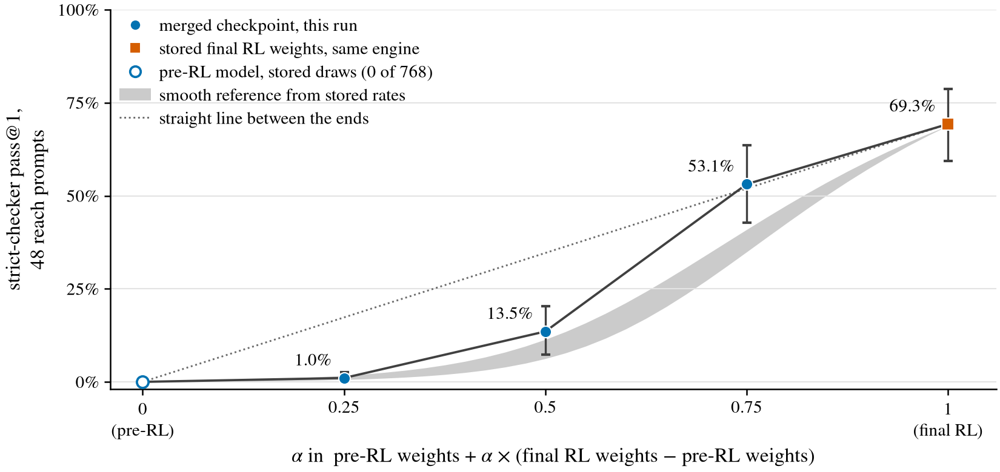

# Olmo weight interpolation: where between the pre-RL and the final RL weights does the behaviour appear?

**Question.** Dan's RL run takes Olmo from a pre-RL model to a final model. On 48 hard instruction-following prompts
the strict checker passes 0 % of the pre-RL model's answers and 69 % of the final model's. If we add only part of the
RL weight change to the pre-RL model, how much of the behaviour is there? This is the weight interpolation of the
30 Sep benchmark suite (small provers), run on Olmo at Leon's request.

**What was run.** Three mixed models (the pre-RL weights plus 25 %, 50 % and 75 % of the weight change) and the final
model itself on the same engine, 48 prompts x 4 draws each. Blinded readers then read every checker pass.

| share of the RL weight change added | strict checker pass | reader-accepted pass | task-done pass |
|---|---|---|---|
| 0 % (pre-RL model, stored draws) | 0 % (0 of 768) | 0 % | 0 % |
| 25 % | 1.0 % [0.0, 3.1] | 1.0 % [0.0, 3.1] | 1.0 % [0.0, 3.1] |
| 50 % | 13.5 % [6.8, 21.4] | 13.0 % [6.2, 20.8] | 12.5 % [6.2, 19.8] |
| 75 % | 53.1 % [41.7, 64.6] | 41.1 % [30.2, 52.6] | 45.8 % [34.4, 57.3] |
| 100 % (final model, same engine) | 69.3 % [58.3, 79.7] | 45.8 % [34.4, 57.8] | 50.5 % [39.1, 62.0] |

- **The behaviour arrives late along the line.** Half of the weight change gives about a fifth of the final checker
  rate (19.5 % [11.1, 29.2]) and 28 % [15, 46] of its reader-accepted rate; three quarters gives 77 % [66, 87] and
  90 % [71, 113].
- **That is what a gradual change produces, not evidence of a switch.** If each prompt's odds of passing moved
  steadily along the line, we would expect 6-11 % at the halfway point and 35-41 % at three quarters. We see 13.5 %
  and 53.1 %: on or above that curve, never below it. The reading fixed in advance is "below proportional at the
  midpoint, compatible with a smooth path". The small provers were much sharper (1.6 % of the RL rate at the halfway
  point, against 19.5 % here).
- **Checker gaming grows along the line.** Passes that fail the mechanical screen or that readers call gamed: 0 of 2,
  1 of 26, 23 of 102 and 45 of 133. From 75 % to 100 % the checker rate rises 16 points and the reader-accepted rate
  5 (point estimates; the intervals overlap).
- **The engine is not the cause of anything here.** The final model sampled on this engine gives 69.3 % against the
  stored 69.4 %, and its reader-accepted rate differs from the stored draws' by −1.3 points [−10.9, +8.3].

**Main limits.** 48 prompts x 4 draws, one RL run of one model, and prompts chosen because the pre-RL model never
passes them. The weights are stored as 16-bit floats, so after rounding the mixed models sit 14 %, 42 % and 86 % of
the way along the line, not 25, 50 and 75 %. A path in weight space shows where behaviour changes; it does not show
that the pre-RL model already contains it. Readers are a model (two reads agree on 92 % of answers).

Cost: $6.68 of pod time (1.26 hours of one H200). Working folder:
[`code/experiments/current/olmo_weight_interp_20261128/`](../../code/experiments/current/olmo_weight_interp_20261128/)
(pre-registration with two amendments, audit, result record). Reader check: round 5 in
[`olmo_minimal_adapter_20261127/`](../../code/experiments/current/olmo_minimal_adapter_20261127/) (`PREREG.md` 9(k), 9(l)).
Data: `/scratch/cowifornia/nd-rl/olmo_elicit/interp/` and `/scratch/cowifornia/nd-rl/olmo_elicit/v2/handcheck/round5/` on serrano.
