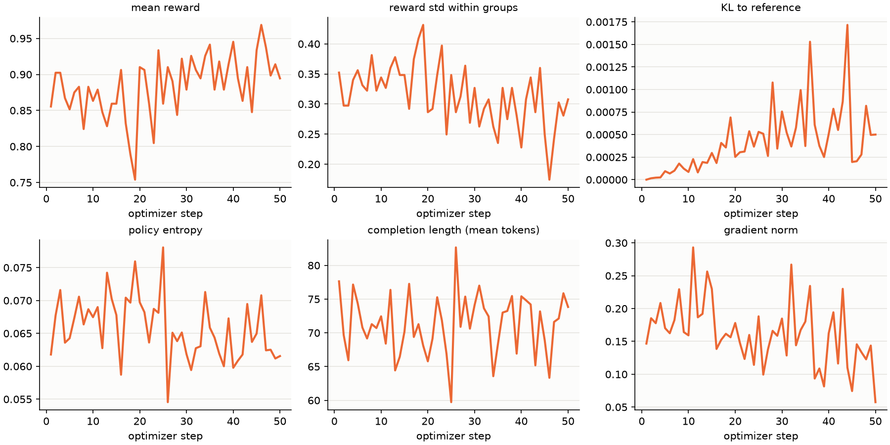
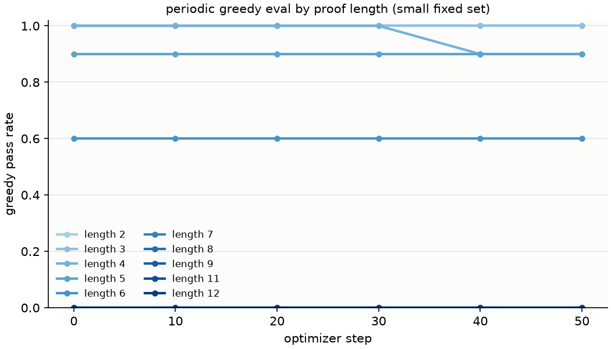
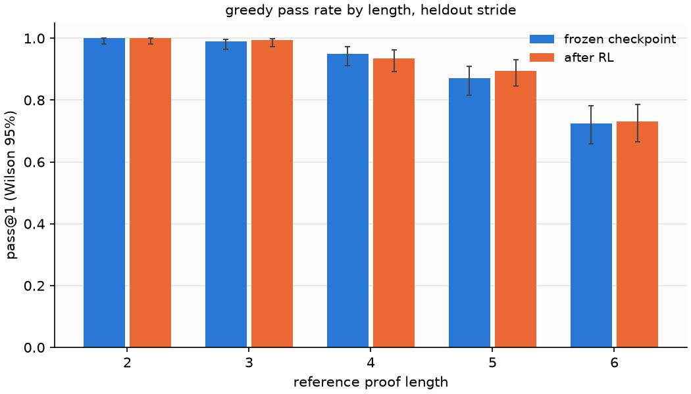
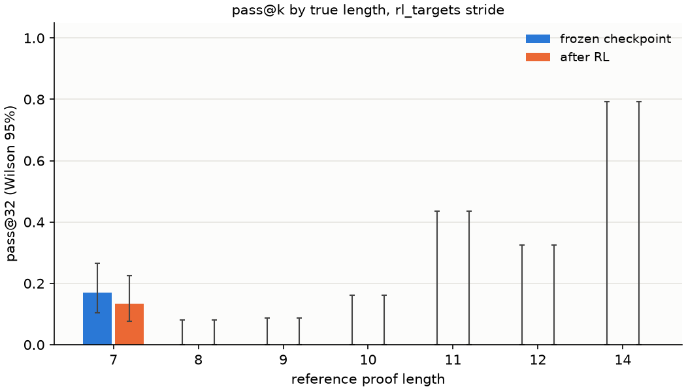

# exp-00 local check: results

Executor write-up (branch `charles/exp-00-local-check`). Numbers below are copied from
`numbers.md` (each with its source file); `review.md` is a separate session's job and nothing
here enters `summary.md` until it exists. Spec: `docs/ws3/startup.md` row exp-00; pre-registration:
`proposal.md` (commit a0b2ec6, 2026-09-23T14:58:38Z, before the first `metrics.jsonl` line).

History that must be stated in every write-up (plan section 1a): the 72 textbook problems are
Dmitry's set from `origin/dmitry/cap-comparison-textbook-eval-data`; the 14 `textbook_train`
were RL training prompts in the cap-comparison sprint, the 58 `textbook_dev` were its development
benchmark. Nothing here trained on any of them.

## Verdict on the hypothesis

The whole chain is wired: loader, tokenizer, HF wrapper (with the fork's KV cache inside HF
`generate`), binary reward through the strict verifier, TRL `GRPOTrainer`, evaluator, and the
review files. Every part of the startup.md row came out inside its expected range, and the whole
run took 14 minutes of laptop CPU against a one-hour budget.

| part | expected (proposal.md) | observed | source |
| --- | --- | --- | --- |
| (a) T1 gate | about 95% or higher | **98.35%** next-token accuracy, loss 0.0669, on all 5,000 heldout records: PASS | `run/baseline/nta.json` |
| (b) greedy by length | near 100% at 2 to 4, lower at 5 to 6 | 100 / 99.0 / 95.0 / 87.0 / 72.5% for lengths 2 to 6 (200 each) | `run/baseline/greedy_heldout.json` |
| (c) textbook 72 at k=64 | small nonzero; 0 to 1 of the 43 at reference length >= 7 | 10 / 72 (8 dev58, 2 train14); **0 / 43** at reference length >= 7 | `run/baseline/textbook.json` |
| (d) long pool pass@32 | small nonzero at 7 to 8, near zero above | 14 / 82 at true length 7, 0 / 118 at 8 to 14 | `run/baseline/long_pool.json` |
| (e) GRPO, 50 steps | mean reward rises within 50 steps; KL under 1 | mean reward 0.876 (first 5 steps) to 0.923 (last 5); max KL 0.0017; reward std within groups never zero | `run/train_summary.json`, `run/metrics.jsonl` |

Time: baseline 213 s, train 426 s, evaluate 189 s, report 1 s (`run/stages.jsonl`).

## Part (e): training curves

Mean reward per step is noisy (256 completions per step, a fresh draw of 32 prompts at lengths
3 to 5 each step) but drifts up: the first ten steps average 0.87 and the last ten 0.91. KL to
the reference model grows from 0 to about 0.001, three orders of magnitude under the "under 1"
expectation: at lr 1e-5 the policy barely moved in 50 steps. Entropy stays around 0.06 and
completion length around 70 tokens; nothing hit the 400-token cap. Gradient norm 0.06 to 0.29.

Two signatures from plan section 4 that matter for the next runs:

- `frac_reward_zero_std` averaged 0.68: two thirds of the groups had all eight samples correct
  (or all wrong), so only a third of each step carried a learning signal. Lengths 3 to 5 are
  mostly too easy for this policy at temperature 1.0; exp-01/02 should weight lengths 5 to 7.
- The periodic greedy eval (50 heldout + 20 long records) did not move at all in 50 steps
  (`numbers.md`, periodic table). That is consistent with the tiny KL, not evidence against RL.

## Evaluate stage: frozen checkpoint vs after 50 GRPO steps, equal attempts

Greedy on the 1,000-record heldout stride (k=1). `run/evaluate/comparison.json`,
`run/report/greedy_heldout.png`:

| length | control solved/n | control rate [95% CI] | RL solved/n | RL rate [95% CI] |
| --- | --- | --- | --- | --- |
| 2 | 200/200 | 1.000 [0.981, 1.000] | 200/200 | 1.000 [0.981, 1.000] |
| 3 | 198/200 | 0.990 [0.964, 0.997] | 199/200 | 0.995 [0.972, 0.999] |
| 4 | 190/200 | 0.950 [0.910, 0.973] | 187/200 | 0.935 [0.892, 0.962] |
| 5 | 174/200 | 0.870 [0.816, 0.910] | 179/200 | 0.895 [0.845, 0.930] |
| 6 | 145/200 | 0.725 [0.659, 0.782] | 146/200 | 0.730 [0.665, 0.787] |
| all | 907/1000 | 0.907 | 911/1000 | 0.911 |

Long pool (`rl_targets` stride, 200 prompts, pass@32, temperature 1.0), `run/report/long_pool.png`:

| length | control solved/n | control rate [95% CI] | RL solved/n | RL rate [95% CI] |
| --- | --- | --- | --- | --- |
| 7 | 14/82 | 0.171 [0.105, 0.266] | 11/82 | 0.134 [0.077, 0.224] |
| 8 | 0/44 | 0.000 [0.000, 0.080] | 0/44 | 0.000 [0.000, 0.080] |
| 9 | 0/40 | 0.000 [0.000, 0.088] | 0/40 | 0.000 [0.000, 0.088] |
| 10 | 0/20 | 0.000 [0.000, 0.161] | 0/20 | 0.000 [0.000, 0.161] |
| 11 | 0/5 | 0.000 [0.000, 0.434] | 0/5 | 0.000 [0.000, 0.434] |
| 12 | 0/8 | 0.000 [0.000, 0.324] | 0/8 | 0.000 [0.000, 0.324] |
| 14 | 0/1 | 0.000 [0.000, 0.793] | 0/1 | 0.000 [0.000, 0.793] |
| all | 14/200 | 0.070 | 11/200 | 0.055 |

Textbook 72 at k=64, temperature 1.0, seed 0 for both models:

| slice | frozen checkpoint | after RL |
| --- | --- | --- |
| dev58 | 8 / 58 | 8 / 58 |
| train14 | 2 / 14 | 2 / 14 |
| all | 10 / 72 | 10 / 72 |
| reference length >= 7 | 0 / 43 | 0 / 43 |

Reading of these three tables: every difference is inside the Wilson intervals. The RL model
changed (weights differ; 287 of the 1,000 greedy completions and 2,197 of the 4,608 textbook
samples differ from the frozen model's), and the 10 textbook problems it solved are not the same
10 (it lost `textbook_b5920d…` to 5 hits from 12 and gained `textbook_b3af45…` with 2 hits; all
solved problems have reference length 6 or less, or are two of the 14 `train14` without a
length). 0 to 1 solves is noise (plan section 5). No claim of lift is made from exp-00; it is a
wiring check.

## Accepted proofs at length 7 and above

All accepted long-pool proofs are at true length 7 (14 distinct prompts for the frozen model,
11 after RL, out of 82); none at 8 or above. None is trivial by the reviewer's definition
(conclusion among the premises, or `F` among the premises): 0 of 149 and 0 of 112 accepted
samples. Two examples from `run/baseline/dumps/long_pool.jsonl.gz` (the strict verifier counted
7 lines for each):

- `THM ( P > ( P v Q ) ) SEQ ( P > ( ( ~ P ) > ( ( ( ~ P ) & P ) v ( ( ~ P ) & ( P > ( P v Q ) ) ) ) ) ) PRF`
  proved as `N36 ( P > ( P v Q ) ) : PR ; N37 | P : AS ; N38 | | ( ~ P ) : AS ; N39 | | ( ( ~ P ) & ( P > ( P v Q ) ) ) : ANDI N38 N36 ; N40 | | ( ( ( ~ P ) & P ) v ( ( ~ P ) & ( P > ( P v Q ) ) ) ) : ORI2 N39 ; N41 | ( ( ~ P ) > ... ) : IMPI N38 N40 ; N42 ( P > ... ) : IMPI N37 N41 ; QED`
- `THM SEQ ( ( ~ ( ~ P ) ) > ( ( Q & ( ~ P ) ) > ( ( ( ~ ( ~ P ) ) > ( ~ ( ~ P ) ) ) & ( ~ ( ~ P ) ) ) ) ) PRF`
  proved with two nested assumptions, `IMPI N12 N12` for the inner tautology, `ANDI`, and two
  `IMPI` discharges.

These are generator-style instances (nested implications discharged in order), which is what the
cap-6 training distribution teaches; they say nothing about the textbook problems, where the
count at reference length 7 or more stayed 0 / 43 for both models.

## 20 raw training samples

Drawn from `run/completions.jsonl.gz` (all 12,800 judged GRPO rollouts) with
`pick_samples.py run/completions.jsonl.gz 20 0` (seed 0; row indices listed). 18 accepted,
2 rejected; both rejections are real rule errors caught by the verifier (an `ANDE1` that
extracts the wrong conjunct, a `NEGE` on `R` and `~Q`). Proofs start at arbitrary `N<k>`
indices, as the training augmentation intended.

### row 663, step 2: ACCEPTED (ok)
prompt: `THM ( S > R ) , S SEQ ( ( ~ ( ~ ( R & P ) ) ) > R ) PRF`  
completion: `N36 ( S > R ) : PR ; N37 S : PR ; N38 | ( ~ ( ~ ( R & P ) ) ) : AS ; N39 | R : IMPE N36 N37 ; N40 ( ( ~ ( ~ ( R & P ) ) ) > R ) : IMPI N38 N39 ; QED`

### row 1553, step 6: ACCEPTED (ok)
prompt: `THM ( R v ( S > Q ) ) , Q SEQ ( S > ( Q & ( R v ( S > Q ) ) ) ) PRF`  
completion: `N57 ( R v ( S > Q ) ) : PR ; N58 Q : PR ; N59 | S : AS ; N60 | ( Q & ( R v ( S > Q ) ) ) : ANDI N58 N57 ; N61 ( S > ( Q & ( R v ( S > Q ) ) ) ) : IMPI N59 N60 ; QED`

### row 2281, step 8: ACCEPTED (ok)
prompt: `THM ( ( ~ F ) > P ) , ( ~ ( ( ~ F ) > P ) ) SEQ F PRF`  
completion: `N31 ( ( ~ F ) > P ) : PR ; N32 ( ~ ( ( ~ F ) > P ) ) : PR ; N33 F : NEGE N31 N32 ; QED`

### row 2289, step 8: ACCEPTED (ok)
prompt: `THM S , ( S > F ) SEQ ( ~ ( ( S v R ) v ( S > R ) ) ) PRF`  
completion: `N37 S : PR ; N38 ( S > F ) : PR ; N39 | ( ( S v R ) v ( S > R ) ) : AS ; N40 | F : IMPE N38 N37 ; N41 ( ~ ( ( S v R ) v ( S > R ) ) ) : NEGI N39 N40 ; QED`

### row 3578, step 13: ACCEPTED (ok)
prompt: `THM SEQ ( ( ( Q & Q ) & P ) > ( Q > Q ) ) PRF`  
completion: `N49 | ( ( Q & Q ) & P ) : AS ; N50 | | Q : AS ; N51 | ( Q > Q ) : IMPI N50 N50 ; N52 ( ( ( Q & Q ) & P ) > ( Q > Q ) ) : IMPI N49 N51 ; QED`

### row 4242, step 16: rejected (rule check failed: ANDE1 (line 62))
prompt: `THM ( F & ( Q v Q ) ) SEQ ( Q > P ) PRF`  
completion: `N60 ( F & ( Q v Q ) ) : PR ; N61 | Q : AS ; N62 | P : ANDE1 N60 ; N63 ( Q > P ) : IMPI N61 N62 ; QED`

### row 4617, step 18: ACCEPTED (ok)
prompt: `THM SEQ ( ( S & ( Q > R ) ) > ( ( ~ ( ~ S ) ) > S ) ) PRF`  
completion: `N1 | ( S & ( Q > R ) ) : AS ; N2 | | ( ~ ( ~ S ) ) : AS ; N3 | | S : DN N2 ; N4 | ( ( ~ ( ~ S ) ) > S ) : IMPI N2 N3 ; N5 ( ( S & ( Q > R ) ) > ( ( ~ ( ~ S ) ) > S ) ) : IMPI N1 N4 ; QED`

### row 4969, step 19: rejected (rule check failed: NEGE (line 37))
prompt: `THM ( ~ Q ) , R SEQ ( ( R v ( R v S ) ) & ( ~ Q ) ) PRF`  
completion: `N35 ( ~ Q ) : PR ; N36 R : PR ; N37 F : NEGE N36 N35 ; N38 ( R v ( R v S ) ) : ORI1 N37 ; N39 ( ( R v ( R v S ) ) & ( ~ Q ) ) : ANDI N38 N35 ; QED`

### row 5866, step 22: ACCEPTED (ok)
prompt: `THM Q , ( Q > ( ( ~ ( P > P ) ) > ( ~ ( ~ S ) ) ) ) SEQ ( ( ~ ( P > P ) ) > ( ~ ( ~ S ) ) ) PRF`  
completion: `N45 Q : PR ; N46 ( Q > ( ( ~ ( P > P ) ) > ( ~ ( ~ S ) ) ) ) : PR ; N47 ( ( ~ ( P > P ) ) > ( ~ ( ~ S ) ) ) : IMPE N46 N45 ; QED`

### row 6311, step 24: ACCEPTED (ok)
prompt: `THM ( ~ ( R & P ) ) , ( ( ~ ( R & P ) ) > P ) SEQ ( P v S ) PRF`  
completion: `N27 ( ~ ( R & P ) ) : PR ; N28 ( ( ~ ( R & P ) ) > P ) : PR ; N29 P : IMPE N28 N27 ; N30 ( P v S ) : ORI1 N29 ; QED`

### row 6634, step 25: ACCEPTED (ok)
prompt: `THM ( ( R v R ) v ( S v P ) ) , ( ( ( R v R ) v ( S v P ) ) > ( ( P > F ) > ( ~ S ) ) ) SEQ ( ( P > F ) > ( ~ S ) ) PRF`  
completion: `N41 ( ( R v R ) v ( S v P ) ) : PR ; N42 ( ( ( R v R ) v ( S v P ) ) > ( ( P > F ) > ( ~ S ) ) ) : PR ; N43 ( ( P > F ) > ( ~ S ) ) : IMPE N42 N41 ; QED`

### row 6890, step 26: ACCEPTED (ok)
prompt: `THM ( ( Q v P ) > P ) , ( ( ( ( Q v P ) > P ) v Q ) > ( P v ( S & S ) ) ) SEQ ( P v ( S & S ) ) PRF`  
completion: `N56 ( ( Q v P ) > P ) : PR ; N57 ( ( ( ( Q v P ) > P ) v Q ) > ( P v ( S & S ) ) ) : PR ; N58 ( ( ( Q v P ) > P ) v Q ) : ORI1 N56 ; N59 ( P v ( S & S ) ) : IMPE N57 N58 ; QED`

### row 7808, step 30: ACCEPTED (ok)
prompt: `THM P , ( P > ( ( ( ~ R ) > ( S & S ) ) & ( ~ ( ~ P ) ) ) ) SEQ ( ( ( ~ R ) > ( S & S ) ) & ( ~ ( ~ P ) ) ) PRF`  
completion: `N22 P : PR ; N23 ( P > ( ( ( ~ R ) > ( S & S ) ) & ( ~ ( ~ P ) ) ) ) : PR ; N24 ( ( ( ~ R ) > ( S & S ) ) & ( ~ ( ~ P ) ) ) : IMPE N23 N22 ; QED`

### row 7961, step 31: ACCEPTED (ok)
prompt: `THM ( R & S ) , ( ( R & S ) > ( Q v ( S & R ) ) ) SEQ ( Q v ( S & R ) ) PRF`  
completion: `N18 ( R & S ) : PR ; N19 ( ( R & S ) > ( Q v ( S & R ) ) ) : PR ; N20 ( Q v ( S & R ) ) : IMPE N19 N18 ; QED`

### row 8268, step 32: ACCEPTED (ok)
prompt: `THM SEQ ( ( Q & P ) > ( ( ( S v Q ) & P ) > ( ( S v Q ) & P ) ) ) PRF`  
completion: `N22 | ( Q & P ) : AS ; N23 | | ( ( S v Q ) & P ) : AS ; N24 | ( ( ( S v Q ) & P ) > ( ( S v Q ) & P ) ) : IMPI N23 N23 ; N25 ( ( Q & P ) > ( ( ( S v Q ) & P ) > ( ( S v Q ) & P ) ) ) : IMPI N22 N24 ; QED`

### row 8376, step 32: ACCEPTED (ok)
prompt: `THM ( ( R > Q ) & ( ~ Q ) ) , ( ( ( R > Q ) & ( ~ Q ) ) > ( ~ R ) ) SEQ ( ~ R ) PRF`  
completion: `N51 ( ( R > Q ) & ( ~ Q ) ) : PR ; N52 ( ( ( R > Q ) & ( ~ Q ) ) > ( ~ R ) ) : PR ; N53 ( ~ R ) : IMPE N52 N51 ; QED`

### row 9558, step 37: ACCEPTED (ok)
prompt: `THM ( R v Q ) , ( ( R v Q ) > ( R & F ) ) SEQ ( ( R v Q ) & ( R & F ) ) PRF`  
completion: `N47 ( R v Q ) : PR ; N48 ( ( R v Q ) > ( R & F ) ) : PR ; N49 ( R v Q ) : R N47 ; N50 ( R & F ) : IMPE N48 N47 ; N51 ( ( R v Q ) & ( R & F ) ) : ANDI N49 N50 ; QED`

### row 10131, step 39: ACCEPTED (ok)
prompt: `THM SEQ ( ( ~ ( ~ S ) ) > ( ( ( Q > S ) v S ) > S ) ) PRF`  
completion: `N38 | ( ~ ( ~ S ) ) : AS ; N39 | | ( ( Q > S ) v S ) : AS ; N40 | | S : DN N38 ; N41 | ( ( ( Q > S ) v S ) > S ) : IMPI N39 N40 ; N42 ( ( ~ ( ~ S ) ) > ( ( ( Q > S ) v S ) > S ) ) : IMPI N38 N41 ; QED`

### row 12383, step 48: ACCEPTED (ok)
prompt: `THM SEQ ( ( ( Q & S ) > ( ~ S ) ) > ( ( ~ ( ~ ( ~ P ) ) ) > ( ~ ( ~ ( ~ P ) ) ) ) ) PRF`  
completion: `N17 | ( ( Q & S ) > ( ~ S ) ) : AS ; N18 | | ( ~ ( ~ ( ~ P ) ) ) : AS ; N19 | ( ( ~ ( ~ ( ~ P ) ) ) > ( ~ ( ~ ( ~ P ) ) ) ) : IMPI N18 N18 ; N20 ( ( ( Q & S ) > ( ~ S ) ) > ( ( ~ ( ~ ( ~ P ) ) ) > ( ~ ( ~ ( ~ P ) ) ) ) ) : IMPI N17 N19 ; QED`

### row 12418, step 48: ACCEPTED (ok)
prompt: `THM ( ( R v S ) & ( P & Q ) ) , ( ( ( R v S ) & ( P & Q ) ) > ( ~ ( ~ P ) ) ) SEQ ( ~ ( ~ P ) ) PRF`  
completion: `N60 ( ( R v S ) & ( P & Q ) ) : PR ; N61 ( ( ( R v S ) & ( P & Q ) ) > ( ~ ( ~ P ) ) ) : PR ; N62 ( ~ ( ~ P ) ) : IMPE N61 N60 ; QED`

## Conclusion (executor; the librarian rewrites this from `review.md`)

All five parts passed their expectations, so per `proposal.md` the pod can be launched and
every later run reuses this code unchanged; this file is the reference the pod's exp-01 must
match (same numbers on the same seeds, up to CUDA nondeterminism). What exp-00 does not show is
lift: 50 steps at lr 1e-5 moved the policy by KL 0.001 and no evaluation by more than noise.
Two things for exp-01: raise the share of prompts with within-group variance (lengths 5 to 7,
where the frozen policy is at 73 to 87 percent greedy and 17 percent pass@32), and expect that
"reward toward 1 within 100 steps" needs a larger learning rate than 1e-5 or more steps.
CPU throughput was 32 completions per second including the optimizer step and 50 to 108 per
second for evaluation sampling, so the pod's 50-plus target is plausible.
