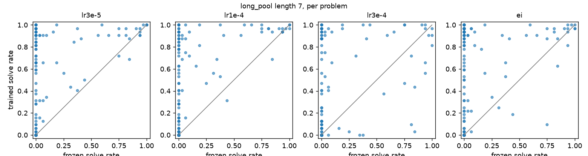

# exp-00c learning-rate sweep and expert iteration on CPU: results (executor draft)

Executor write-up, branch `charles/exp-00c-lr-ei-cpu`. Pre-registration: `proposal.md`, commit
`487f43d` (2026-09-27T23:36:25Z), before the pool filter sampled anything and before the first
`metrics.jsonl` line. Numbers come from `analysis.md` / `analysis.json` (written by `analyze.py`,
which was committed before the run) and each arm's `report/report.md`.

**Status: surprisingly good, so treat as provisional.** Per `CLAUDE.md`, a surprisingly good
result means checking for a reward bug and a leak first. An independent verifier session did
this for the two strongest arms with its own code (`verify_lr3e-5/`, `verify_ei/`) and found
neither (summary below). The plan's reviewer recount (section 6) has **not** run yet. Nothing
here goes into `summary.md` until it does, and Charles decides the conclusion.

History that must be stated in every write-up (plan section 1a): the 72 textbook problems are
Dmitry's set from `origin/dmitry/cap-comparison-textbook-eval-data`. The 14 `textbook_train` were
RL training prompts in the cap-comparison sprint and the 58 `textbook_dev` its dev benchmark.
Nothing here trained on any of them.

## What ran

All four arms start from the fixed checkpoint (sha256 `418af3f9…`) with seed 0. They train on
the same 198-prompt pool from the **train half** of `rl_targets` (131 at length 7, 4 at 8) plus
63 length-6 prompts from `train.jsonl`. The pool contains only prompts the frozen model solved
1 to 7 times out of 8 in the pre-registered filter. Every arm is evaluated on 200 prompts from
the **eval half** (160 at length 7, 40 at 8), 32 samples each at temperature 1.0. The two halves
share no renaming class.

| arm | training | samples | wall-clock (train + eval) |
| --- | --- | --- | --- |
| lr3e-5 | GRPO, 48 steps x 16 prompts x group 16, KL 0.01 | 12,288 | 531 s + 255 s |
| lr1e-4 | same, lr 1e-4 | 12,288 | 488 s + 250 s |
| lr3e-4 | same, lr 3e-4 | 12,288 | 576 s + 260 s |
| ei | 3 rounds x 21 samples per prompt, SFT on verified proofs (lr 1e-4) | 12,474 (+1.5%, k rounds up) | 238 s + 269 s |

Shared costs: the pool filter (13,296 frozen samples, 242 s) and the frozen baseline (202 s).
Total wall-clock was 56 minutes (23:36 to 00:32 UTC). The design changed once from the chat plan:
lr 1e-3 was replaced by 3e-5 before the commit (`proposal.md` says why).

## Headline: held-out length 7, and length 8

| | frozen | lr3e-5 | lr1e-4 | lr3e-4 | **ei** |
| --- | --- | --- | --- | --- | --- |
| L7 avg solve rate [95% CI] | 0.122 [0.079, 0.185] | 0.430 [0.357, 0.509] | 0.391 [0.321, 0.471] | 0.333 [0.263, 0.407] | **0.545 [0.466, 0.619]** |
| L7 problems solved at least once (of 160) | 39 | 97 | 97 | 85 | **118** |
| L7 new capability (frozen 0/32, trained >= 0.5) | - | 42 | 30 | 26 | **62** |
| L7, 39 frozen-solved: up / down / same (sign p) | - | 31 / 4 / 4 (3e-6) | 30 / 3 / 6 (1e-6) | 22 / 17 / 0 (0.52) | 29 / 8 / 2 (8e-4) |
| L7 mean paired diff, frozen-solved [bootstrap CI] | - | +0.273 [0.18, 0.37] | +0.325 [0.23, 0.43] | +0.163 [0.02, 0.31] | +0.245 [0.14, 0.36] |
| L8 avg solve rate | 0.000 | 0.005 | 0.013 | 0.011 | **0.266 [0.150, 0.428]** |
| L8 solved at least once (of 40) | 0 | 3 | 5 | 2 | **19** |
| greedy heldout 2 to 6 (frozen 0.978) | - | 0.982 | 0.978 | **0.881** | 0.978 |
| textbook 72 avg (frozen 0.101) | - | 0.113 | 0.119 | 0.084 | 0.108 |
| textbook, ref length >= 7, solved at least once | 0 / 43 | 1 / 43 | - | - | - |
| final / max KL | - | 0.010 / 0.268 | 0.028 / 0.045 | 0.019 / 0.164 | n/a |

**Selection rule (pre-registered): lr 1e-4.** lr3e-4 is excluded because greedy heldout dropped
0.097, far past the 0.02 limit. Among lr 3e-5 and 1e-4, 1e-4 has the larger mean paired
difference on the 39 frozen-solved problems (+0.325 against +0.273). Note that the rule's metric
and the overall average disagree: 3e-5 has the higher overall length-7 average (0.430 against
0.391) and more new-capability problems (42 against 30). The two are within each other's CIs,
so 3e-5 and 1e-4 are effectively tied on one seed.

## Against the pre-registration

| expected | observed | verdict |
| --- | --- | --- |
| pool 150 to 300; 90 to 170 at L7; 5 to 25 at L8 | 198; 131 at L7; **4 at L8** | L8 slightly below |
| frozen eval L7 avg 0.08 to 0.14, 30 to 40 solved | 0.122, 39 | as expected |
| frozen eval L8 0 to 2 of 40 | 0 | as expected |
| lr3e-5 max KL 0.001 to 0.01, L7 about neutral | max KL 0.268 (one spike; typical 0.01), **L7 +0.31 avg** | **missed badly: far larger lift** |
| lr1e-4 L7 paired diff 0 to +0.08, sign test maybe not significant | **+0.325**, p = 1e-6 | **missed: about 4x larger** |
| lr3e-4 50/50 between like-1e-4 and degraded | degraded (greedy -0.097), still +0.21 at L7 | degraded branch |
| EI within about 0.03 of the best GRPO arm | **EI ahead by 0.115 L7 avg and 0.25 L8 avg** | **missed: EI clearly better** |
| new capability 0 to 1 per arm; L8 0 to 2 new | **26 to 62 at L7; EI 12 new-capability and 19 solved at L8** | **missed by far** |
| wall-clock 60 to 75 minutes | 56 minutes | as expected |

## Is it real? Verification

An independent verifier session with its own scripts (`verify_lr3e-5/verify_report.md`,
`verify_ei/verify_report.md`) checked the following.

- **Re-verification.** Every sample in the frozen, lr3e-5 and EI eval dumps (19,200) re-checked
  with `strict_verify.safe_verify`: 0 disagreements. Every training reward re-checked (12,288
  GRPO and 12,474 EI): 0 disagreements. The claimed numbers reproduce exactly.
- **No verifier loophole.**
  - 0 accepted proofs are shorter than the problem's minimal length.
  - None has the conclusion or `F` among the premises, a final line that differs from the
    conclusion, or text after `QED`.
  - The rule mix is ordinary.
  - 34 and 68 proofs cite no premise. All of them are for tautology conclusions, and they are
    valid.
  - Renumbering every proof to start at `N1` changes 0 verdicts.
- **No leak.**
  - 0 exact overlap between eval prompts and the pool, the train split, the training rollouts,
    and EI's SFT records.
  - 0 overlap under `canonical_theorem` (invariant to atom renaming and premise order), both
    between the eval set and anything trained on and between the whole eval half and the whole
    train half.
  - 0 of 3,130 accepted EI eval proofs appear in the SFT data, even after renaming and
    renumbering.
  - 6 eval prompts share a renamed conclusion with a pool prompt. They improve less than the rest
    (EI 0.05 to 0.21, against 0.13 to 0.56 for the other 194), so they don't drive the gain.
- **What changed.** In every newly solved problem examined, the frozen model's closest attempt
  had the right overall shape but skipped or mis-cited one step. Examples: an `ANDI` to build an
  antecedent before `IMPE`; an `IMPE` before `NEGE`; the right premise-derived step inside the
  innermost box. EI's length-8 solves are 90% one shape: three nested assumptions, one inner
  step from a premise, then three `IMPI`s. That combines two shapes present in the SFT data. The
  frozen model tried 1,642 proofs three or more boxes deep and got none accepted; EI got 1,753.

The executor's own checks: the frozen model's line-index start matters by at most about 0.01
(only starts at N57 to 64 fail more), and greedy decoding converging on one start index is
irrelevant to verification.

## How to read it

1. **The gain is in-distribution.** Held-out `rl_targets` prompts come from the same generator
   as the training half. The textbook set, a different distribution, barely moves (avg 0.101 to
   0.108 to 0.119, all inside the CIs, with at most 1 of 43 long problems). What RL and EI
   learned here is how to finish the generator's length-7 (and, for EI, length-8) patterns
   reliably. It is not yet general proving ability.
2. **"New capability" is by the plan's definition.** Frozen 0 of 32 does not mean probability
   zero. At the frozen model's typical per-sample rates, some of these problems would appear
   given more samples. The mechanism the verifier found fits that: fixing a step the frozen model
   already almost had.
3. **EI beat GRPO at matched samples, in half the training time.** It was ahead at length 7
   (0.545 against 0.430 at best) and far ahead at length 8 (0.266 against at most 0.013). That
   is one seed, but the length-8 gap is well outside the CIs.
4. **lr 3e-5 to 1e-4 is the working range for GRPO on this model at KL 0.01.** At 3e-4 the model
   forgets short proofs; 1e-3 breaks it in one step (smoke). exp-00/00b's 1e-5 on easy prompts
   moved nothing, but that was the prompts as much as the learning rate.
5. **Diversity collapses.** Most newly solved problems have one distinct accepted proof (54 of 61
   for GRPO; 79 of 98 for EI).

## 20 raw samples per arm

Read by the executor: 20 random held-out samples per arm (seed 0; the command is in this
session's log), 80 in total. Accepted counts were 8, 8, 7 and 12 of 20. All accepted proofs are
genuine. Failures are real rule errors caught by the verifier:
- `DN` applied to the wrong formula;
- `IMPI` citing the assumption as its own conclusion;
- `ORE` with wrong box citations;
- a malformed rule name.

lr3e-4 has more malformed outputs (a stray `|` inside a formula, `PRF` emitted mid-proof), which
fits its forgetting. Where GRPO attempts a vacuous `IMPI N23 N23` on problems 3445 and 2484, EI
instead derives the needed formula from a premise inside the innermost box (`ANDE1 N20`) and
succeeds.

## Caveats

- **One seed per arm.**
- **Selection bias.** The pool is filtered to prompts the frozen model sometimes solves, and
  that filter is not charged to any arm.
- **Sample counts.** EI used 1.5% more samples than the GRPO arms.
- **EI's "distinct proof" dedup is on raw text.** The same proof with different line numbers
  counts twice. Only 297 of about 2,260 SFT records are truly distinct.
- **Periodic eval is greedy on 40 eval-set prompts.** Its length-7 jump (5/32 to 17/32 at step 12
  for lr3e-5) is a coarse signal, not the headline.
- **Pending checks.** No reviewer recount yet. lr1e-4 and lr3e-4 were not independently
  re-verified; they use the same pipeline as the verified arms.

## Provisional conclusion (for Charles to confirm after review)

On this model and budget, both RL (GRPO at lr 3e-5 to 1e-4) and expert iteration give a large,
verified lift on held-out generator problems at length 7. EI also gives one at length 8, and it
beats GRPO at matched samples. Neither moves the textbook set. Next:

1. the reviewer recount;
2. 3 seeds of EI and of GRPO at 1e-4 (the selected lr) and 3e-5;
3. a textbook-focused check: does longer training, or adding lengths 9 to 10, move the 43 long
   textbook problems at all?
4. whether the pool filter or the algorithm drives EI's lead: EI and GRPO on an unfiltered pool.
