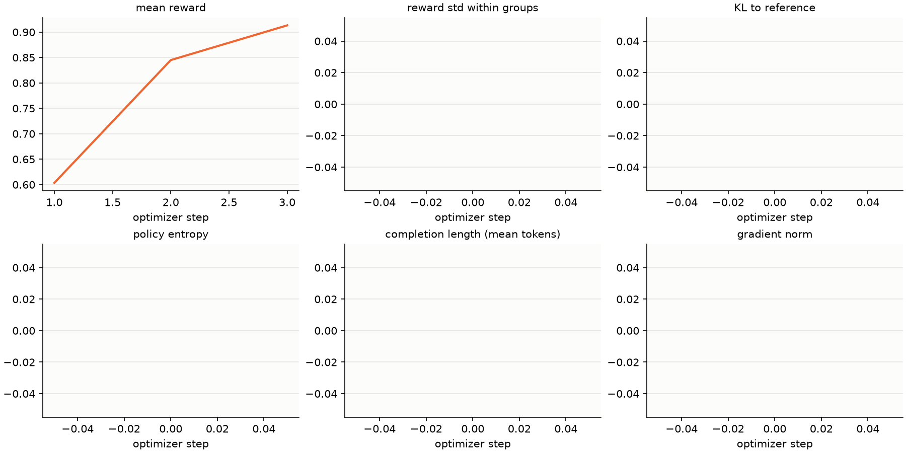
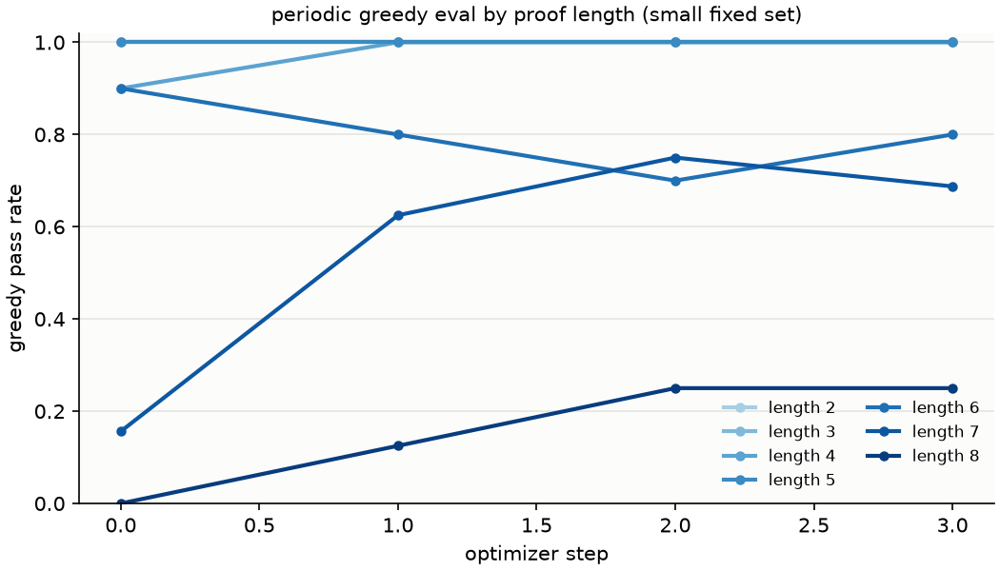
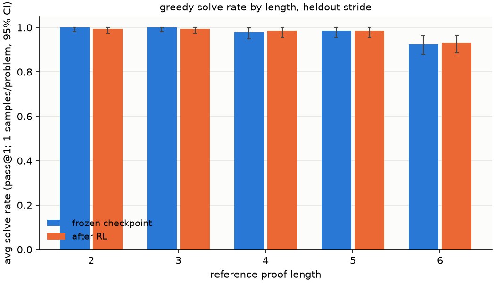
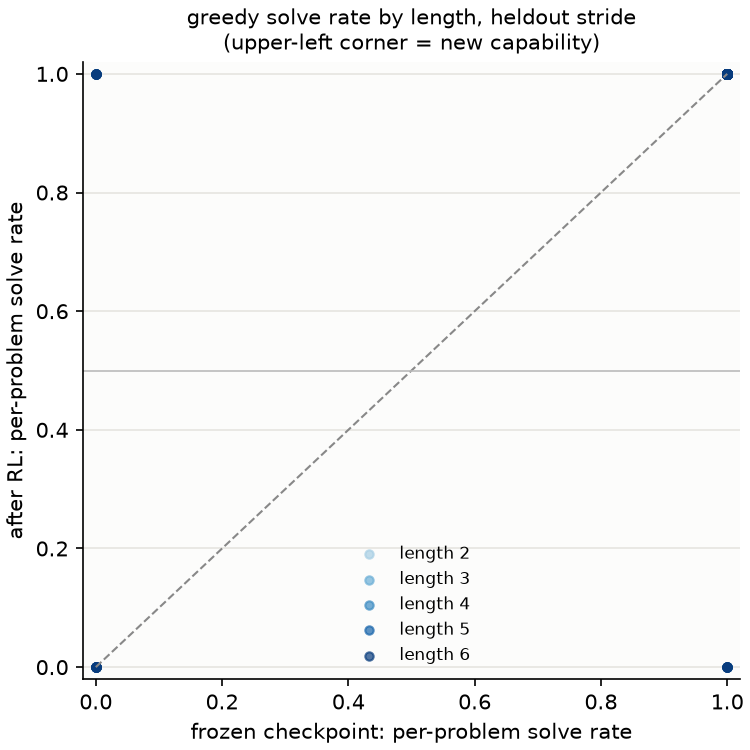
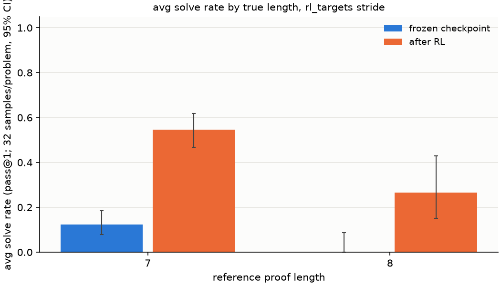
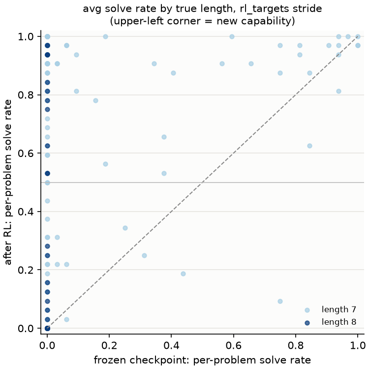
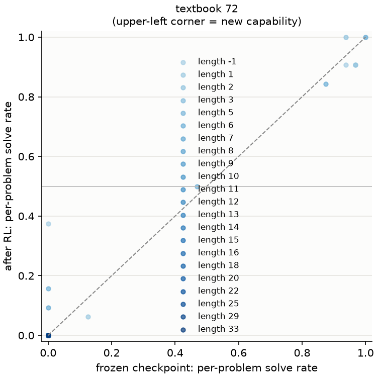

# Report for exp-00c-lr-ei-cpu

Generated 2026-09-28T00:32:07+00:00.

## Gate B: metrics.jsonl coverage (plan section 4)

- ok: mean reward (verified fraction of samples) (`reward`)
- ok: pass rate by proof length (periodic eval) (`eval/pass_rate_len*`)
- ok: unparseable fraction (`reward/unparseable_frac`)
- ok: invalid fraction (`reward/invalid_frac`)
- ok: prompts with a verified proof (`ei/prompts_solved_frac`)
- ok: verified proofs kept (`ei/kept_this_round`)
- ok: SFT training records (`ei/train_records`)
- ok: SFT loss (`sft/loss_last`)
- ok: cumulative completions (matched budget) (`rollout/total_completions`)
- ok: rollout throughput (`rollout/completions_per_sec`)
- ok: utc timestamp (`utc`)
- ok: step (`step`)

3 rollout log lines, 4 periodic eval lines.

## greedy solve rate by length, heldout stride

| length | control avg [95% CI] | RL avg [95% CI] | control / RL reliable (p>=0.5) | control / RL valid prefix of failures | control / RL any of 1 |
| --- | --- | --- | --- | --- | --- |
| 2 | 1.000 [0.981, 1.000] | 0.995 [0.972, 1.000] | 1.000 / 0.995 | - / 1.00 | 200/200 / 199/200 |
| 3 | 1.000 [0.981, 1.000] | 0.995 [0.972, 1.000] | 1.000 / 0.995 | - / 0.67 | 200/200 / 199/200 |
| 4 | 0.980 [0.950, 0.999] | 0.985 [0.957, 1.000] | 0.980 / 0.985 | 0.75 / 0.83 | 196/200 / 197/200 |
| 5 | 0.985 [0.957, 1.000] | 0.985 [0.957, 1.000] | 0.985 / 0.985 | 0.47 / 0.53 | 197/200 / 197/200 |
| 6 | 0.925 [0.880, 0.962] | 0.930 [0.886, 0.965] | 0.925 / 0.930 | 0.56 / 0.64 | 185/200 / 186/200 |
| all | 0.978 [0.967, 0.987] | 0.978 [0.967, 0.987] | 0.978 / 0.978 | - / - | 978/1000 / 978/1000 |

Frontier (longest length with avg >= 0.5 at it and every shorter length): control 6, RL 6.

Per problem, base vs RL (1000 problems, reliable = p >= 0.5):

| length | problems | new capability (base 0, RL reliable) | new, any (base 0, RL > 0) | sharpened (both > 0, RL higher) | lost (base reliable, RL 0) |
| --- | --- | --- | --- | --- | --- |
| 2 | 200 | 0 | 0 | 0 | 1 |
| 3 | 200 | 0 | 0 | 0 | 1 |
| 4 | 200 | 3 | 3 | 0 | 2 |
| 5 | 200 | 1 | 1 | 0 | 1 |
| 6 | 200 | 6 | 6 | 0 | 5 |
| all | 1000 | 10 | 10 | 0 | 10 |

Mean change in per-problem solve rate: +0.000.

## avg solve rate by true length, rl_targets stride

| length | control avg [95% CI] | RL avg [95% CI] | control / RL reliable (p>=0.5) | control / RL valid prefix of failures | control / RL any of 32 |
| --- | --- | --- | --- | --- | --- |
| 7 | 0.122 [0.079, 0.185] | 0.545 [0.466, 0.619] | 0.119 / 0.581 | 0.46 / 0.51 | 39/160 / 118/160 |
| 8 | 0.000 [0.000, 0.088] | 0.266 [0.150, 0.428] | 0.000 / 0.300 | 0.39 / 0.44 | 0/40 / 19/40 |
| all | 0.098 [0.063, 0.149] | 0.489 [0.422, 0.559] | 0.095 / 0.525 | - / - | 39/200 / 137/200 |

Frontier (longest length with avg >= 0.5 at it and every shorter length): control 0, RL 7.

Per problem, base vs RL (200 problems, reliable = p >= 0.5):

| length | problems | new capability (base 0, RL reliable) | new, any (base 0, RL > 0) | sharpened (both > 0, RL higher) | lost (base reliable, RL 0) |
| --- | --- | --- | --- | --- | --- |
| 7 | 160 | 62 | 79 | 29 | 0 |
| 8 | 40 | 12 | 19 | 0 | 0 |
| all | 200 | 74 | 98 | 29 | 0 |

Mean change in per-problem solve rate: +0.391.

Self-knowledge (does the model's own sequence log-probability pick out verified attempts): AUROC control 0.639, RL 0.839; likelihood top-1 control 0.100, RL 0.565.

Log-probability of the best known verified proof (union of both models' finds):

| length | problems | control best log p | RL best log p | control / RL per token |
| --- | --- | --- | --- | --- |
| 7 | 118 | -12.85 | -4.37 | -0.091 / -0.033 |
| 8 | 19 | -35.46 | -4.55 | -0.204 / -0.026 |

## textbook 72 at k=32, temperature 1.0 (control vs RL)

Avg solve rate (headline). Expected = sum of per-problem solve rates; reliable = problems solved in at least half the samples.

| slice | frozen checkpoint: avg [95% CI] | frozen checkpoint: expected / reliable | after RL: avg [95% CI] | after RL: expected / reliable |
| --- | --- | --- | --- | --- |
| dev58 | 0.093 [0.022, 0.186] | 5.4 / 5 of 58 | 0.096 [0.025, 0.208] | 5.6 / 6 of 58 |
| train14 | 0.136 [0.000, 0.399] | 1.9 / 2 of 14 | 0.156 [0.000, 0.399] | 2.2 / 2 of 14 |
| all | 0.101 [0.035, 0.187] | 7.3 / 7 of 72 | 0.108 [0.042, 0.204] | 7.8 / 8 of 72 |
| reference length >= 7 | 0.000 [0.000, 0.082] | 0.0 / 0 of 43 | 0.002 [0.000, 0.082] | 0.1 / 0 of 43 |

Secondary: problems solved at least once in 32 samples.

| slice | frozen checkpoint | after RL |
| --- | --- | --- |
| dev58 | 7 / 58 | 9 / 58 |
| train14 | 2 / 14 | 3 / 14 |
| all | 9 / 72 | 12 / 72 |
| reference length >= 7 | 0 / 43 | 1 / 43 |

Per problem, base vs RL (72 problems, reliable = p >= 0.5):

| length | problems | new capability (base 0, RL reliable) | new, any (base 0, RL > 0) | sharpened (both > 0, RL higher) | lost (base reliable, RL 0) |
| --- | --- | --- | --- | --- | --- |
| unknown | 14 | 0 | 1 | 0 | 0 |
| 1 | 1 | 0 | 0 | 0 | 0 |
| 2 | 2 | 0 | 0 | 1 | 0 |
| 3 | 1 | 0 | 0 | 0 | 0 |
| 5 | 1 | 0 | 0 | 0 | 0 |
| 6 | 10 | 0 | 1 | 1 | 0 |
| 7 | 4 | 0 | 1 | 0 | 0 |
| 8 | 2 | 0 | 0 | 0 | 0 |
| 9 | 3 | 0 | 0 | 0 | 0 |
| 10 | 5 | 0 | 0 | 0 | 0 |
| 11 | 4 | 0 | 0 | 0 | 0 |
| 12 | 2 | 0 | 0 | 0 | 0 |
| 13 | 3 | 0 | 0 | 0 | 0 |
| 14 | 3 | 0 | 0 | 0 | 0 |
| 15 | 4 | 0 | 0 | 0 | 0 |
| 16 | 2 | 0 | 0 | 0 | 0 |
| 18 | 4 | 0 | 0 | 0 | 0 |
| 20 | 3 | 0 | 0 | 0 | 0 |
| 22 | 1 | 0 | 0 | 0 | 0 |
| 25 | 1 | 0 | 0 | 0 | 0 |
| 29 | 1 | 0 | 0 | 0 | 0 |
| 33 | 1 | 0 | 0 | 0 | 0 |
| all | 72 | 0 | 3 | 2 | 0 |

Mean change in per-problem solve rate: +0.007.

Self-knowledge (does the model's own sequence log-probability pick out verified attempts): AUROC control 0.904, RL 0.893; likelihood top-1 control 0.111, RL 0.153.

Log-probability of the best known verified proof (union of both models' finds):

| length | problems | control best log p | RL best log p | control / RL per token |
| --- | --- | --- | --- | --- |
| -1 | 3 | -5.89 | -3.89 | -0.128 / -0.097 |
| 1 | 1 | -7.78 | -7.10 | -0.137 / -0.125 |
| 2 | 2 | -4.22 | -4.44 | -0.079 / -0.163 |
| 3 | 1 | -3.90 | -3.67 | -0.177 / -0.167 |
| 5 | 1 | -3.95 | -3.74 | -0.054 / -0.051 |
| 6 | 3 | -6.69 | -4.56 | -0.097 / -0.070 |
| 7 | 1 | -12.54 | -5.97 | -0.151 / -0.072 |
