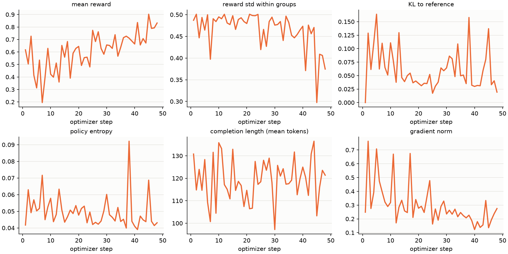
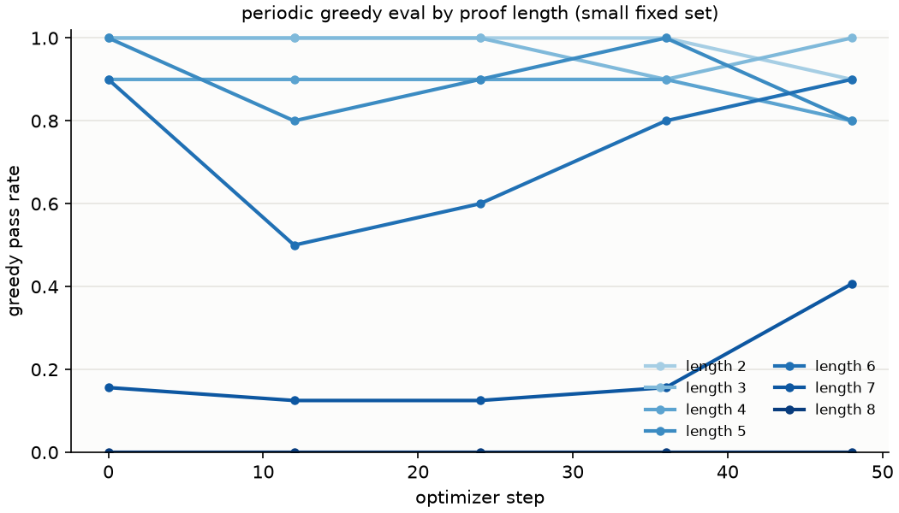
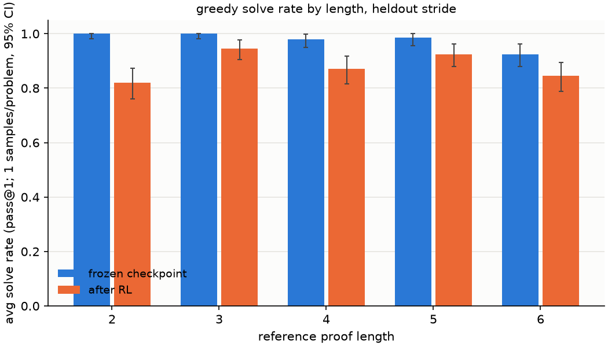
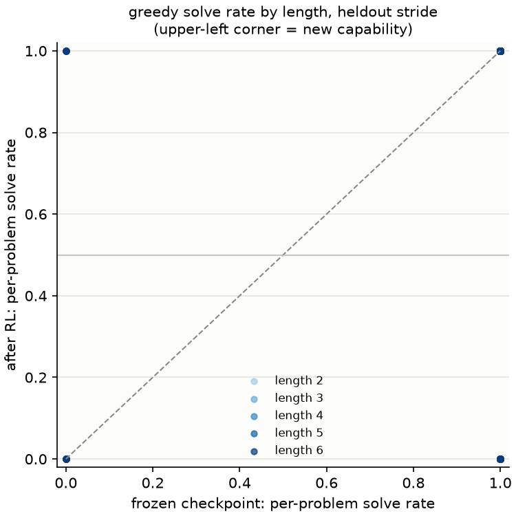
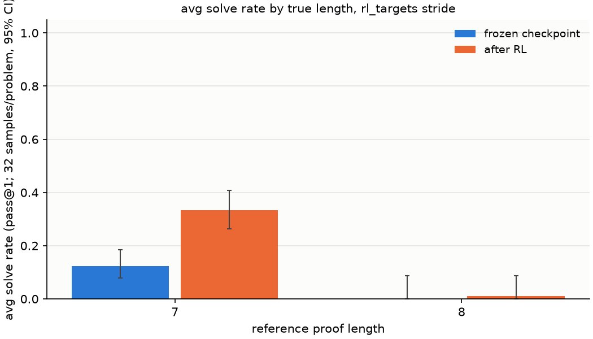
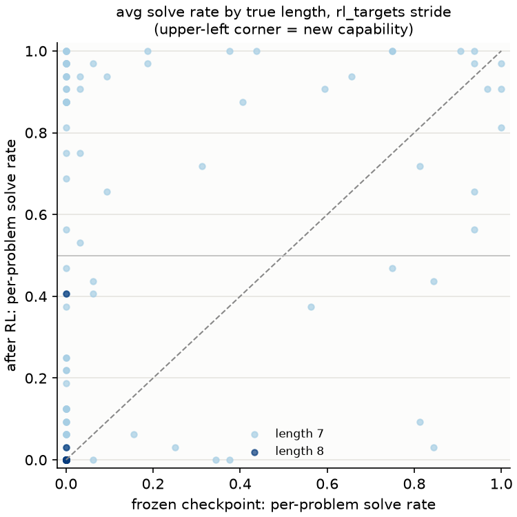
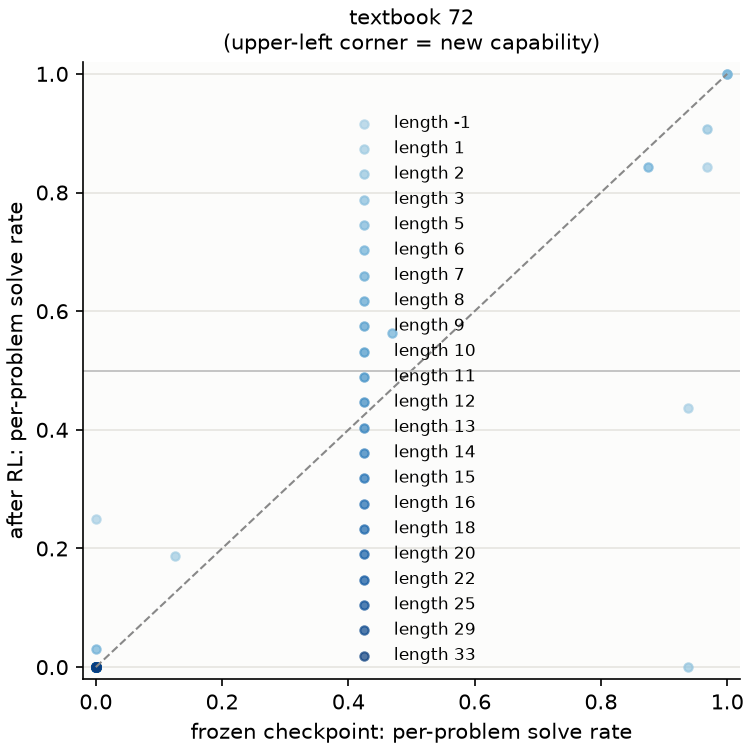

# Report for exp-00c-lr-ei-cpu

Generated 2026-09-28T00:23:36+00:00.

## Gate B: metrics.jsonl coverage (plan section 4)

- ok: mean reward (`reward`)
- ok: reward std within groups (`reward_std`)
- ok: pass rate by proof length (periodic eval) (`eval/pass_rate_len*`)
- ok: KL to reference (`kl`)
- ok: policy entropy (`entropy`)
- ok: unparseable fraction (`reward/unparseable_frac`)
- ok: invalid fraction (`reward/invalid_frac`)
- ok: completion length mean (`completions/mean_length`)
- ok: completion length max (`completions/max_length`)
- ok: fraction at length cap (`completions/clipped_ratio`)
- ok: gradient norm (`grad_norm`)
- ok: learning rate (`learning_rate`)
- ok: rollout throughput (`rollout/completions_per_sec`)
- ok: utc timestamp (`utc`)
- ok: step (`step`)

48 rollout log lines, 5 periodic eval lines.

## greedy solve rate by length, heldout stride

| length | control avg [95% CI] | RL avg [95% CI] | control / RL reliable (p>=0.5) | control / RL valid prefix of failures | control / RL any of 1 |
| --- | --- | --- | --- | --- | --- |
| 2 | 1.000 [0.981, 1.000] | 0.820 [0.761, 0.873] | 1.000 / 0.820 | - / 0.68 | 200/200 / 164/200 |
| 3 | 1.000 [0.981, 1.000] | 0.945 [0.904, 0.977] | 1.000 / 0.945 | - / 0.64 | 200/200 / 189/200 |
| 4 | 0.980 [0.950, 0.999] | 0.870 [0.816, 0.917] | 0.980 / 0.870 | 0.75 / 0.70 | 196/200 / 174/200 |
| 5 | 0.985 [0.957, 1.000] | 0.925 [0.880, 0.962] | 0.985 / 0.925 | 0.47 / 0.57 | 197/200 / 185/200 |
| 6 | 0.925 [0.880, 0.962] | 0.845 [0.788, 0.895] | 0.925 / 0.845 | 0.56 / 0.66 | 185/200 / 169/200 |
| all | 0.978 [0.967, 0.987] | 0.881 [0.859, 0.901] | 0.978 / 0.881 | - / - | 978/1000 / 881/1000 |

Frontier (longest length with avg >= 0.5 at it and every shorter length): control 6, RL 6.

Per problem, base vs RL (1000 problems, reliable = p >= 0.5):

| length | problems | new capability (base 0, RL reliable) | new, any (base 0, RL > 0) | sharpened (both > 0, RL higher) | lost (base reliable, RL 0) |
| --- | --- | --- | --- | --- | --- |
| 2 | 200 | 0 | 0 | 0 | 36 |
| 3 | 200 | 0 | 0 | 0 | 11 |
| 4 | 200 | 4 | 4 | 0 | 26 |
| 5 | 200 | 1 | 1 | 0 | 13 |
| 6 | 200 | 4 | 4 | 0 | 20 |
| all | 1000 | 9 | 9 | 0 | 106 |

Mean change in per-problem solve rate: -0.097.

## avg solve rate by true length, rl_targets stride

| length | control avg [95% CI] | RL avg [95% CI] | control / RL reliable (p>=0.5) | control / RL valid prefix of failures | control / RL any of 32 |
| --- | --- | --- | --- | --- | --- |
| 7 | 0.122 [0.079, 0.185] | 0.333 [0.263, 0.407] | 0.119 / 0.331 | 0.46 / 0.50 | 39/160 / 85/160 |
| 8 | 0.000 [0.000, 0.088] | 0.011 [0.000, 0.088] | 0.000 / 0.000 | 0.39 / 0.45 | 0/40 / 2/40 |
| all | 0.098 [0.063, 0.149] | 0.269 [0.213, 0.335] | 0.095 / 0.265 | - / - | 39/200 / 87/200 |

Frontier (longest length with avg >= 0.5 at it and every shorter length): control 0, RL 0.

Per problem, base vs RL (200 problems, reliable = p >= 0.5):

| length | problems | new capability (base 0, RL reliable) | new, any (base 0, RL > 0) | sharpened (both > 0, RL higher) | lost (base reliable, RL 0) |
| --- | --- | --- | --- | --- | --- |
| 7 | 160 | 26 | 49 | 22 | 0 |
| 8 | 40 | 0 | 2 | 0 | 0 |
| all | 200 | 26 | 51 | 22 | 0 |

Mean change in per-problem solve rate: +0.171.

Self-knowledge (does the model's own sequence log-probability pick out verified attempts): AUROC control 0.639, RL 0.788; likelihood top-1 control 0.100, RL 0.305.

Log-probability of the best known verified proof (union of both models' finds):

| length | problems | control best log p | RL best log p | control / RL per token |
| --- | --- | --- | --- | --- |
| 7 | 88 | -10.74 | -4.27 | -0.077 / -0.032 |
| 8 | 2 | -27.85 | -5.93 | -0.208 / -0.046 |

## textbook 72 at k=32, temperature 1.0 (control vs RL)

Avg solve rate (headline). Expected = sum of per-problem solve rates; reliable = problems solved in at least half the samples.

| slice | frozen checkpoint: avg [95% CI] | frozen checkpoint: expected / reliable | after RL: avg [95% CI] | after RL: expected / reliable |
| --- | --- | --- | --- | --- |
| dev58 | 0.093 [0.022, 0.186] | 5.4 / 5 of 58 | 0.078 [0.014, 0.186] | 4.5 / 5 of 58 |
| train14 | 0.136 [0.000, 0.399] | 1.9 / 2 of 14 | 0.109 [0.000, 0.399] | 1.5 / 1 of 14 |
| all | 0.101 [0.035, 0.187] | 7.3 / 7 of 72 | 0.084 [0.027, 0.170] | 6.1 / 6 of 72 |
| reference length >= 7 | 0.000 [0.000, 0.082] | 0.0 / 0 of 43 | 0.000 [0.000, 0.082] | 0.0 / 0 of 43 |

Secondary: problems solved at least once in 32 samples.

| slice | frozen checkpoint | after RL |
| --- | --- | --- |
| dev58 | 7 / 58 | 7 / 58 |
| train14 | 2 / 14 | 3 / 14 |
| all | 9 / 72 | 10 / 72 |
| reference length >= 7 | 0 / 43 | 0 / 43 |

Per problem, base vs RL (72 problems, reliable = p >= 0.5):

| length | problems | new capability (base 0, RL reliable) | new, any (base 0, RL > 0) | sharpened (both > 0, RL higher) | lost (base reliable, RL 0) |
| --- | --- | --- | --- | --- | --- |
| unknown | 14 | 0 | 1 | 0 | 0 |
| 1 | 1 | 0 | 0 | 1 | 0 |
| 2 | 2 | 0 | 0 | 0 | 1 |
| 3 | 1 | 0 | 0 | 0 | 0 |
| 5 | 1 | 0 | 0 | 0 | 0 |
| 6 | 10 | 0 | 1 | 1 | 0 |
| 7 | 4 | 0 | 0 | 0 | 0 |
| 8 | 2 | 0 | 0 | 0 | 0 |
| 9 | 3 | 0 | 0 | 0 | 0 |
| 10 | 5 | 0 | 0 | 0 | 0 |
| 11 | 4 | 0 | 0 | 0 | 0 |
| 12 | 2 | 0 | 0 | 0 | 0 |
| 13 | 3 | 0 | 0 | 0 | 0 |
| 14 | 3 | 0 | 0 | 0 | 0 |
| 15 | 4 | 0 | 0 | 0 | 0 |
| 16 | 2 | 0 | 0 | 0 | 0 |
| 18 | 4 | 0 | 0 | 0 | 0 |
| 20 | 3 | 0 | 0 | 0 | 0 |
| 22 | 1 | 0 | 0 | 0 | 0 |
| 25 | 1 | 0 | 0 | 0 | 0 |
| 29 | 1 | 0 | 0 | 0 | 0 |
| 33 | 1 | 0 | 0 | 0 | 0 |
| all | 72 | 0 | 2 | 2 | 1 |

Mean change in per-problem solve rate: -0.017.

Self-knowledge (does the model's own sequence log-probability pick out verified attempts): AUROC control 0.904, RL 0.869; likelihood top-1 control 0.111, RL 0.111.

Log-probability of the best known verified proof (union of both models' finds):

| length | problems | control best log p | RL best log p | control / RL per token |
| --- | --- | --- | --- | --- |
| -1 | 3 | -5.89 | -3.77 | -0.128 / -0.091 |
| 1 | 1 | -7.78 | -5.67 | -0.137 / -0.085 |
| 2 | 2 | -4.22 | -9.17 | -0.079 / -0.184 |
| 3 | 1 | -3.90 | -3.12 | -0.177 / -0.142 |
| 5 | 1 | -3.95 | -3.04 | -0.054 / -0.042 |
| 6 | 3 | -6.72 | -4.41 | -0.098 / -0.066 |
